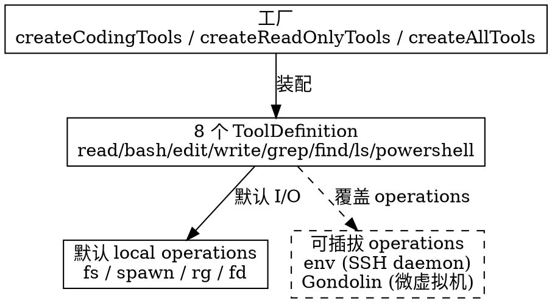

## Introduction

Pi 默认只启用四个工具（`read` / `bash` / `edit` / `write`），其余能力靠扩展叠加——但"工具"本身是一套工程化的分层：工厂造定义、定义包一层本地实现、本地实现背后是**可插拔的 `operations` 接口**。本页把这套机制拆开：八个内置工具的真实实现与限制、`createCodingTools` 等工厂、`truncate` 共享截断工具、`withFileMutationQueue` 并发锁，以及 `operations` 如何成为远程执行的接缝。

> 版本基线：核实于 2026-10-21，基于 npm `@earendil-works/pi-coding-agent` **1.3.0**（2026-10-15）与 `main` 分支 `packages/coding-agent/src/core/tools/`（该目录最近提交 2026-10-14，修 read 行号标签）。所有事实以源码为准，非以文档为准。

## Tool Factories

`src/core/tools/index.ts` 是工具的装配层。它先定义 `ToolName` 联合类型（共 **8** 个），再用一组工厂按用途组装：

```ts
export type ToolName = "read" | "bash" | "powershell" | "edit" | "write" | "grep" | "find" | "ls";

createCodingTools(cwd, opts)     // 默认四件套：read, bash, edit, write
createReadOnlyTools(cwd, opts)   // 只读集：read, grep, find, ls
createAllTools(cwd, opts)        // 全部 8 个（含 powershell）
createCodingToolDefinitions(...) // 同上但只产出声明（不包 AgentTool）
createReadOnlyToolDefinitions(...)
createAllToolDefinitions(...)
createTool(name, cwd, opts)      // 按名字单造
createToolDefinition(name, cwd, opts)
```

`ToolName` 的八件套分两组：**默认四件套**（`read`/`bash`/`edit`/`write`，即 `createCodingTools`）与**只读集**（`read`/`grep`/`find`/`ls`，即 `createReadOnlyTools`）；`powershell` 走 Windows/可选路径，与 `bash` 平行。`ToolsOptions` 允许对每个工具单独传配置（如 `read.autoResizeImages`、`bash.shellPath`、`bash.commandPrefix`）。每个工具都由 `wrapToolDefinition` 包一层，并带 `constrainedSampling: { type: "json_schema", strict: "prefer" }`——尽量让模型按严格 JSON Schema 出参。

所有工具都带 `promptSnippet` / `promptGuidelines`，会注入系统提示，告诉模型"用 read 看文件而不是 cat/sed""edit 的 oldText 必须精确匹配"等。

## Pluggable Operations（远程执行的接缝）

八个工具各自定义一个 `operations` 接口，默认实现是本地文件系统 / `spawn` / `rg` / `fd`；传 `options.operations` 即可整体替换掉 I/O 后端：

| 工具 | `operations` 接口 | 默认实现 |
| :--- | :--- | :--- |
| `read` | `ReadOperations`（`readFile` / `access` / `detectImageMimeType`） | `fs.readFile` / `fs.access(R_OK)` |
| `edit` | `EditOperations`（`readFile` / `writeFile` / `access`） | `fs` 读写 + `R_OK\|W_OK` |
| `write` | `WriteOperations`（`writeFile` / `mkdir`） | `fs.writeFile` / `mkdir -p` |
| `bash` | `BashOperations`（`exec`） | `spawn` 本地 shell |
| `grep` | `GrepOperations`（`isDirectory` / `readFile`） | `fs` + ripgrep |
| `find` | `FindOperations`（`exists` / `glob`） | `fs` + fd |
| `ls` | `LsOperations`（`exists` / `stat` / `readdir`） | `fs.readdir` |

这套接口是 Pi 远程执行与隔离的**接缝**：`env` 包的 SSH daemon（`RemoteExecutionEnv`，见 [Env](/docs/CS/AI/LLM/Agent/Product/Pi/Env.md)）、Gondolin 扩展的 Linux 微虚拟机，正是通过替换 `operations` 把文件读写与命令执行路由到宿主机之外——而工具定义、声明、钩子都不用改。



## The Default Four（read / bash / edit / write）

### read

- 入参：`path`、`offset`（1-indexed 起读行）、`limit`（读取行数）。
- 限制：`DEFAULT_MAX_LINES = 2000` 行、`DEFAULT_MAX_BYTES = 50KB`，**先到为准**，用 `truncateHead`（从头截）保留前部。
- 单行超限（`firstLineExceedsLimit`）：返回空内容 + 提示，教模型用 `sed -n 'Np' … | head -c 50KB` 取该行；其余截断附 `[Showing lines A-B of T. Use offset=C to continue.]` 续读提示。
- 图片：`jpg`/`png`/`gif`/`webp`/`bmp` 走 `processImage`（默认 `autoResizeImages: true`），按模型 `inputLimits.images` 缩放；当前模型不支持图像时附 `[Current model does not support images…]` 提示。
- 程序化输出：`outputSchema` 是 `string` 与 `{ type:"image", data, mimeType, note }` 的联合——codemode 脚本拿到的不是纯文本而是结构化块（文本或可直接喂 `image()` 的图像块）。`structuredContent` 由 `toReadOutput` 生成。
- 路径经 `resolveReadPathAsync` 解析，全程可 `AbortSignal` 取消。

### edit

- 入参：`path`、`edits[]`（每项 `{ oldText, newText }`）。**所有 `oldText` 都针对原始文件匹配**，不是增量应用——所以多个 edit 不能重叠或嵌套，否则报错；`oldText` 需在文件内唯一。
- 匹配前剥 BOM、归一化成 LF 再比，写回时恢复原始行尾（`detectLineEnding` → `restoreLineEndings`），避免把 CRLF 文件悄悄改成 LF。
- `prepareArguments` 做兼容性归一：旧式 `oldText`/`newText`（单字段）并入 `edits[]`；有些模型（Opus 4.6、GLM-5.1）把 `edits` 当 JSON 字符串或单对象发来，这里都归一成数组，保证健壮。
- 全程 `withFileMutationQueue` 串行化；`access` 要求 `R_OK | W_OK`。
- 返回 `details`：`diff`（展示用）、`patch`（标准 unified diff）、`firstChangedLine`（给编辑器导航）。

### write

- 入参：`path`、`content`。
- **创建或覆盖**：文件不存在则建，存在则**直接覆盖**（没有"必须不存在"的护栏——与语义"完整重写用 write"一致）；自动 `mkdir -p` 父目录。
- 全程 `withFileMutationQueue` 串行化；返回 `Successfully wrote to <path>`。

### bash

- 入参：`command`、`timeout?`（秒，**无默认值 → 默认不超时**）。源码常量 `MAX_TIMEOUT_MS = 2_147_483_647`（约 24.8 天）是上限；`STRUCTURED_OUTPUT_MAX_BYTES = 1MB` 限制程序化 `structuredContent.output`。
- 执行：`spawn` 非交互式（`bash -c`，非 Windows 设 `detached` 以便杀整棵进程树），stdout 与 stderr **合并**进同一累积器；`timeout`/`abort` 触发 `killProcessTree`。
- 流式：`onUpdate` 受 `BASH_UPDATE_THROTTLE_MS` 节流推送增量；长输出截断后写入临时文件（前缀 `pi-bash`），文末附 `[… Full output: <path>]` 让模型去读全文。
- `BashToolOptions`：`operations`（可替换执行后端）、`commandPrefix`（每条命令前垫 setup，对应设置 `shellCommandPrefix`）、`shellPath`、`exposeSessionEnvironment`（默认 `true`，暴露 `PI_*` 会话环境变量）、`spawnHook`（执行前改命令/cwd/env）。
- **无内置沙箱**，也**无 `run_in_background` 参数**（当前 main 的 `bashSchema` 仅 `command` + 可选 `timeout`）：命令同步等待结束，安全性靠外部隔离（见 [Security](/docs/CS/AI/LLM/Agent/Product/Pi/Security.md)）。`operations` 可被远程后端整体接管。

## The Read-Only Set（read / grep / find / ls）

`createReadOnlyTools` 的四件套面向"只看不改"场景（如只读模式、`--tools` 收窄）。`read` 同上，其余三个：

| 工具 | 入参（除 `path` 外） | 后端 | 默认上限 | 关键行为 |
| :--- | :--- | :--- | :--- | :--- |
| `grep` | `pattern` / `glob?` / `ignoreCase?` / `literal?` / `context?` / `limit?`(100) | ripgrep（`rg`，缺失则下载） | 100 匹配 / 50KB | 尊重 `.gitignore` + `--hidden`；长行截到 `GREP_MAX_LINE_LENGTH = 500` 字符；`context` 给前后 N 行 |
| `find` | `pattern`(glob) / `limit?`(1000) | fd（缺失则下载） | 1000 结果 / 50KB | 尊重 `.gitignore`；仓库外用 `--no-require-git`；含 `/` 的模式走 `--full-path` 并补 `**/` |
| `ls` | `limit?`(500) | `fs.readdir` | 500 条目 / 50KB | 大小写不敏感字母序；目录加 `/` 后缀；含 dotfile |

三者都经 `ensureTool` 惰性取 `rg` / `fd`（本地没有就下载），输出统一 `truncateHead` 截断并附"已达上限，用 `limit=` 取更多"的可行动提示。`grep`/`find` 同样支持 `operations` 覆盖以委托远程。

## Shared Truncation（`truncate.ts`）

所有工具的输出限制都来自同一工具：`DEFAULT_MAX_LINES = 2000`、`DEFAULT_MAX_BYTES = 50KB`、`GREP_MAX_LINE_LENGTH = 500`。提供四个函数：

- `truncateHead`：从头留（read / grep / find / ls 用），绝不断在行中间；首行超字节上限时返回空 + 标记。
- `truncateTail`：从尾留（bash 错误/末段用）。
- `truncateLine`：单行截到 N 字符（grep 长行）。
- `truncateMiddle`：Codex 式"头 + 尾 + `…N chars truncated…` 中间标记"，只在字符边界切（bash 结构化输出兜底）。

`formatSize` 把字节渲染成 `B`/`KB`/`MB`，用在各类"已达 X 限制"提示里。

## Concurrency Guard（`withFileMutationQueue`）

`file-mutation-queue.ts` 解决"多个工具（或 codemode 脚本）并发改同一文件"的读-改-写竞态：

```ts
const fileMutationQueues = new Map<string, Promise<void>>();  // key = realpath
export async function withFileMutationQueue(filePath, fn) {
  // 按 realpath 串起一条 promise 链：同一文件排队，不同文件并行
}
```

机制：每个绝对路径（经 `realpath`，缺失则解析路径）一条 promise 链，同一文件的变更严格串行，不同文件仍并行；`fn` 跑完在 `finally` 里释放并清理空队列。这是 `read`（不改）/ `edit` / `write` 都包的一层，保证 Pi 与沙箱脚本不会互相踩到对方的半写完状态。

```sequence
Title: withFileMutationQueue 对同一文件的串行化

participant A as edit(file X)
participant B as edit(file X) 并发
participant Q as fileMutationQueues[X]
participant F as fs 写盘

A->>Q: 取当前链尾，挂上自己的 next
B->>Q: 取当前链尾（=A 的 next），再挂自己的 next
A->>F: 读-改-写 file X
A-->>Q: finally 释放
B->>F: A 释放后才跑，读-改-写 file X
B-->>Q: finally 释放，清理空队列
Note over A,B: 不同文件（realpath 不同）则各自并行，不互锁
```

## Exposure and Selection

默认四件套以 `direct` 暴露态注册（声明给模型且可被调）；只读集在只读模式 / `--tools` 收窄时出现。工具集可由 `--tools` / `--exclude-tools` / `defaultTools` 选择，暴露态五态（`direct`/`model-only`/`codemode`/`deferred`/`hidden`）与编排型工具的 `prepareLoadout` 见 [Extensions](/docs/CS/AI/LLM/Agent/Product/Pi/Extensions.md)；codemode 脚本经 `tools.<id>()` 调到的就是这里定义的工具（见 [CodeMode](/docs/CS/AI/LLM/Agent/Product/Pi/CodeMode.md)）。一个批次内多个工具并行执行、事件按固定顺序持久化，见 [Architecture](/docs/CS/AI/LLM/Agent/Product/Pi/Architecture.md)。

## Links

- [Pi 枢纽](/docs/CS/AI/LLM/Agent/Product/Pi/Pi.md)
- [Architecture：内部架构](/docs/CS/AI/LLM/Agent/Product/Pi/Architecture.md) — 工具批次与事件持久化顺序、exposure 五态
- [Extensions：扩展体系](/docs/CS/AI/LLM/Agent/Product/Pi/Extensions.md) — 自定义工具契约、`--tools` 选择、exposure
- [CodeMode：codemode 实现机制](/docs/CS/AI/LLM/Agent/Product/Pi/CodeMode.md) — 沙箱脚本如何 `tools.<id>()` 调本页工具
- [Security：信任与隔离](/docs/CS/AI/LLM/Agent/Product/Pi/Security.md) — `operations` 接缝如何被 Docker/OpenShell/Gondolin 利用
- [Env：远程执行环境](/docs/CS/AI/LLM/Agent/Product/Pi/Env.md) — `operations` 的远端后端：SSH daemon 部署与 `RemoteExecutionEnv` RPC 客户端

## References

- [Pi coding-agent tools 源码](https://github.com/earendil-works/pi/tree/main/packages/coding-agent/src/core/tools)
- [Pi Extensions（工具契约与 exposure）](https://github.com/earendil-works/pi/blob/main/packages/coding-agent/docs/extensions.md)
- [Pi Shell Aliases（bash 默认非交互、commandPrefix）](https://github.com/earendil-works/pi/blob/main/packages/coding-agent/docs/shell-aliases.md)
