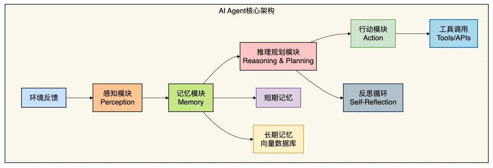

## Definition

在人工智能领域，智能体被定义为任何能够通过**传感器**感知其所处环境，并自主地通过**执行器**采取行动以达成特定目标的实体。

真正赋予智能体"智能"的，是其**自主性**——并非被动响应外部刺激或严格执行预设指令的程序，而是基于感知和内部状态进行独立决策。这种从感知到行动的闭环，构成了所有智能体行为的基础。

传统智能体的能力源于工程师的显式编程与知识构建，行为模式确定且有边界；而 **LLM Agent** 则通过预训练获得隐式的世界模型与涌现能力，能以更灵活、更通用的方式应对复杂任务。

我们正从开发专用自动化工具转向构建能自主解决问题的系统。核心不再是编写代码，而是引导一个通用的"大脑"去规划、行动和学习。

## Agent Loop

**AI Agent 是一个能够调用工具的循环系统**。这个定义抓住两个本质特征：

1. **核心工作机制**：`Loop` 循环（ReAct 模式）
2. **行动能力**：对 `Tools` 工具的调用

Agent 与 LLM 的区别：给 LLM 输入文本、输出文本（Chatbot）；而 Agent 输出的是**一次具体行动**（执行 Tool），行动结果继续输入给 LLM，LLM 据此判断下一步——循环往复直到目标达成。

ReAct 循环四步：

1. **Reason（推理）**：LLM 调研规划，明确做什么、怎么做
2. **Act（行动）**：模型调用 Tools 干活
3. **Observe（观察）**：评估结果是否满足预期
4. 回到下一轮 Reason……前面的行动结果作为输入，直到 Agent 判断得出目标答案

这个 Loop 循环是**对人类实际工作过程的模拟抽象**，类似 PDCA 戴明环。所有 Agent（coding、研究、做 PPT、客服……）表面不同，底层机制都是这个循环。LLM 本身仍在思考推理生成文本，只是 Agent 里生成的文本可以是"运行某个 Tool"这样的执行指令。

> 一个最小可行性 Agent（MVP）必须具备一个完整的"感知-思考-行动-观察"闭环。

循环强依赖两个条件：①执行结果要被保留并作为 Context 输入后续执行（否则每轮都是全新过程）；②需要指挥官统一协调循环与工具调用——由此引出 **Memory** 和 **Harness** 两个模块。**Agent 由四个核心构成：Loop、Tools、Memory、Harness。**

## Four Components

一个成熟的 Agent 系统，都由以下四个核心模块组成：

### Loop

调用模型 → 执行工具 → 观察结果，循环往复直到任务完成。上一节已展开。

### Tool

**Tool 是可供 LLM 调用的一项具体能力**（打开浏览器、搜索网页、查询数据库……），像给大脑提供手脚。

- 需要明确的名称和描述（description）——LLM 和人一样，需要知道"按钮的功能说明"才能判断什么时候按哪个
- **最佳实践**：一个 tool 对应一项简单具体的任务，简单到 description 一两句话能说清——LLM 判断更准，执行效果越好
- 来源三类：系统预置、外部接入（MCP 开放标准协议）、自制
- **Tool 是能力，不是知识**：Tool 负责"能做什么、做了什么"，不承担"怎么做"——后者属于 Memory / 知识库的范畴

### Memory

为什么需要 Memory？Loop 要求上一次循环的执行结果和历史资料作为 Context 输入下一次循环——必须有地方把每次的 Context 存下来供读取。

技术方案演进：

- **早期**：向量数据库——Context 做 embedding 转向量，运行时找相似度最高的数据块
- **现在**：知识库（markdown 文件夹集合）——Agent 通过关键词搜索，读取文件标题/描述/目录树结构判断相关性，比向量相似度更准；像新员工读公司 Wiki / 交接文档

知识库的两个关键优势：

1. **文件与文件夹结构化**，比相似度检索更容易判断相关性
2. **文件可改写**——Context 内容可随时更新迭代（上个任务的日志、报错记录、新增数据文档）

当前 Memory 的工作方式实质是**每次执行过程中对 Context 文件的读取和增删改写**——这也是 Agent"越用越懂你"的原因。

### Harness

Agent 作为系统不是魔法，需要处理一堆执行细节：

- 谁来发起并控制 Loop 循环？谁执行 Tools？谁管理 Context（尤其过长时）？
- 执行出错如何处理？工具调用的权限管控？何时让用户提供更多信息、确认是否往下进行？

**Harness 是 Agent 的底层架构、基础设施、操作系统**（可译作框架 / 编排 / 运行环境）。Codex、Claude Code、DeepSeek Harness 这类 Agent 产品，从工程角度看主要构成就是 Harness——像 Windows / macOS / Linux 之于应用程序。

在这些产品出现之前，搭一个 Agent 要自己用 Python 手搓：条件循环实现 Loop 调度、任务中止 / 重试、Context 间的注意力跳转……如今这些编排调度工作都被 Harness 接管。

四组件合起来的完整图景：

- **Loop 机制**：调用模型、工具，执行、重复，直到任务完成
- **Tools 执行**：行动能力（读文件、Shell、MCP）
- **Memory 知识库**：管理循环中的 Context，决定哪些内容进 context window
- **Harness**：基础设施——错误处理、权限验证（哪些操作自行把控、哪些请求用户允许；授权频率是门艺术：太频繁觉得事儿多，一路干到底又心虚）

最终可总结为：**Agent = LLM + Harness**。

## Pattern Map

六种核心设计模式，决定了「循环里的思考与行动怎么组织」。同样的 Reason-Act-Observe 四步，可以走一步看一步，也可以先画蓝图再施工，还可以干完之后自我批判迭代。每种范式的机制、代价、提示词设计与最小 TypeScript 实现见 [Paradigm](/docs/CS/AI/LLM/Agent/Theory/Paradigm.md)，本节只保留模式地图。

| 模式 | 一句话 | 什么时候用 |
| :--- | :--- | :--- |
| **ReAct** | 推理与行动每步交错，走一步看一步，动态纠错 | 开放式任务、需要根据中间结果灵活调整方向 |
| **Plan-and-Execute** | 先一次性产出完整计划，再按顺序或并行执行 | 可拆解的复杂任务，边界清晰、执行路径可预判 |
| **Reflection** | 执行之后接一层"自我评审 → 修订"的事后迭代 | 对输出质量要求高的场景（代码、写作、方案） |
| **Multi-Agent** | 多个 Agent 通过消息通信动态协作，专业分工 | 任务明确需要并行处理或多领域专家协作 |
| **Human-in-the-Loop** | 在资金、权限、敏感数据等操作上加入人工确认 | 生产环境的安全阀，涉及不可逆操作 |
| **SubAgent** | 主 Agent 派生出来处理子任务的子循环 | 上下文隔离、注意力聚焦、成本控制 |

> **不要过早引入 Multi-Agent**。一个强大的单 Agent 往往比多个简单 Agent 协作更稳定、更省钱。只有任务明确需要并行处理或专业分工时，才引入多 Agent。

> Reflection 不是第四个循环，它是套在循环外面的一层迭代。它的"执行"阶段本身就可以是 ReAct 或 Plan-and-Execute。

在实际项目中，这六种模式往往不是孤立使用的，而是根据业务场景灵活组合：

- **智能客服** = ReAct + Tool Use（查订单、查库存）+ Reflection（提升回答质量）
- **数据分析平台** = Planning + Multi-Agent + Human-in-the-Loop（数据敏感需审批）
- **代码生成助手** = ReAct + Reflection + Tool Use（执行代码、运行测试）

## Links

- [Paradigm](/docs/CS/AI/LLM/Agent/Theory/Paradigm.md)
- [Harness](/docs/CS/AI/LLM/Agent/Theory/Harness.md)
- [Permission](/docs/CS/AI/LLM/Agent/Theory/Permission.md)
- [Compaction](/docs/CS/AI/LLM/Agent/Theory/Compaction.md)
- [Skill](/docs/CS/AI/LLM/Agent/Theory/Skill.md)
- [Agent 目录](/docs/CS/AI/LLM/Agent/README.md)

## References

- [深入拆解 Agent 的工作机制和构成](https://mp.weixin.qq.com/s/H7gAhzx2F432z_ewBanP8A)
