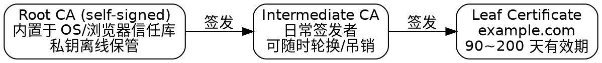

## Introduction

公钥密码解决了"加密"与"签名"，但没有解决一个更基础的问题：**这个公钥到底是谁的？** PKI（Public Key Infrastructure，公钥基础设施）就是回答这个问题的工程体系——由受信任的 CA（Certificate Authority）把身份信息与公钥打包成 X.509 证书并签名，依赖方（浏览器、服务器、操作系统）沿签名链回溯到内置的信任锚，从而在不预先认识对方的前提下建立信任。

分工上：[TLS](/docs/CS/CN/TLS.md) 讲握手协议怎么跑，[Cryptography](/docs/CS/CN/CyberSecurity/Cryptography.md) 讲签名算法本身，本页讲**信任怎么建立、怎么失效、怎么自动化**。所有事实以 2026-10 核实的规范与行业日程为准。

## X.509 Certificates

一张证书的骨架（RFC 5280 定义的结构）：

| 字段 | 内容 |
| :--- | :--- |
| Version | v3（当前唯一） |
| Serial Number | CA 内唯一的序列号，吊销列表据此定位 |
| Signature Algorithm | CA 签本证书用的算法（如 sha256WithRSAEncryption） |
| Issuer | 签发者（父 CA）的可分辨名 |
| Validity | notBefore / notAfter |
| Subject | 证书持有者（对 TLS 证书通常只写 CN 或不写，域名放 SAN） |
| Subject Public Key Info | 算法 + 公钥本体 |
| Extensions | v3 的精髓：**SAN**（多域名）、**KeyUsage / ExtKeyUsage**（能否签名/加密、是否服务器认证）、**BasicConstraints**（是否为 CA）、**AIA**（指向颁发者证书与 OCSP 地址）、**CRL Distribution Points** |
| Signature | CA 对以上全部内容（TBSCertificate）的签名 |

TBS = to-be-signed：签名只覆盖 TBSCertificate 部分，验签就是重算摘要比对。**SAN 取代 CN 成为域名绑定位置**早已是行业强制（CN 中的域名现代客户端一律忽略），迁移老证书时最常见的错误就是把域名只写进 CN。

## Trust Chains and Path Validation

信任链是 PKI 的心脏：一张叶证书的可信度不来自自身，而来自"谁能给它背书"。

**为什么不直接用根证书签叶证书**：根私钥是信任锚，一旦泄露或误签，整个信任库要整体更新（成本以亿计）。因此根的私钥长期离线，用中间 CA 承接日常签发——中间 CA 被吊销或轮换时，只需替换链中一环。根证书轮换（如 ISRG Root X1 交接、各 root program 的迁移）则依赖**交叉签名**：新旧根互为父子各签一张，让只信任旧根的客户端也能接受新根签的链。

路径校验（path validation）是一串必须全部通过的检查：签名有效、链完整且终止于信任锚、每张证书在有效期内、BasicConstraints 允许 CA 行为、EKU 匹配用途（服务器认证 vs 代码签名）、名称约束未被违反、不在吊销列表内。任何一环失败，连接即失败——这正是"证书报错"在 MITM 场景下成为最直接信号的原因（见 [Attack](/docs/CS/CN/Attack.md) 的中间人一节）。

## CA Ecosystem

Web PKI 是"多方共治"而非单一权威：

- **Root Program**：Apple、Google、Mozilla、Microsoft 各自维护操作系统的信任库，制定 CA 准入规则（要点审计、CT 合规、事件响应）；
- **CA/Browser Forum**：CA 与浏览器厂商的行业联盟，发布 TLS Baseline Requirements——证书有效期、验证复用期、算法底线都出自这里；
- **证书等级**：DV（只验域名控制权）、OV（追加组织验证）、EV（扩展验证，历史上 UI 会显示绿色企业名）。**EV 的差异化 UI 已被主流浏览器移除**，现实中 DV 与 OV 的加密强度完全相同，差别收敛到证书里的组织信息；
- **审计**：CA 须通过 WebTrust / ETSI 审计并公开报告，这是进入 root program 的门槛。

## Revocation

吊销是 PKI 最名不副实的环节——**机制齐全，事实失效**。

| 机制 | 原理 | 现实 |
| :--- | :--- | :--- |
| CRL（RFC 5280） | CA 发布已吊销序列号列表 | 体积大、更新慢，现代客户端基本不拉取 |
| OCSP（RFC 6960） | 实时查询单张证书状态 | 有延迟与隐私问题；**浏览器对 OCSP 失败一律 fail-soft**（查不到就当有效），且 Chrome 等已默认不做在线 OCSP 检查 |
| OCSP Stapling | 服务器在握手时可附上"我还没被吊销"的 CA 签名回复 | 解决了客户端的延迟/隐私问题，但依赖服务器自觉配置 |
| Must-Staple | 证书扩展要求对端必须收到 staple，否则拒绝 | 配置错误即自断连接，部署率极低 |

结论直接推动了行业转向**短寿命证书**：既然吊销不可靠，就让证书自己快点过期。Let's Encrypt 的口径最直白——短寿命证书把"密钥泄露后的暴露窗口"从最长 90 天压缩到 6 天，用自动化续期替代对吊销系统的依赖。

## Certificate Lifetimes

公开信任 TLS 证书的有效期正在被系统性压缩。CA/Browser Forum Ballot SC-081v3（2025 年通过）的时间表：

| 生效日期 | 公开 TLS 证书最大有效期 | 域名验证数据复用期 |
| :--- | :--- | :--- |
| 2026-03-15 前 | 398 天 | 397 天 |
| 2026-03-15 | **200 天** | 199 天 |
| 2027-03-15 | 100 天 | 100 天 |
| 2029-03-15 | 47 天 | 10 天 |

Let's Encrypt 的默认值比行业上限更激进（2026-10 核实）：

- 2025-12 宣布 90 → 45 天过渡路线；
- 当前默认 90 天，另提供 **45 天**与 **6 天（160 小时）**两个短寿命 profile（opt-in）；**IP 地址证书必须是短寿命证书**；
- **2027-02-10 起默认改为 64 天**，2028 年起默认 45 天；授权复用期同步从 30 天缩到 10 天，2028 年缩到 7 小时；
- 配套的 ACME Renewal Information（ARI，RFC 9773）让 CA 主动通知客户端"该续了"，替代客户端按固定天数猜。

> [!NOTE]
>
> 这张表对运维的含义只有一句话：**任何还靠"日历提醒 + 人工续期"的流程，在 2027 年前都会失效。** 50 张证书在 47 天周期下意味着一年约 600 次续期。自动化（ACME + ARI + 部署联动）不是优化项，是存亡问题。

## Automation: ACME

ACME（Automatic Certificate Management Environment，RFC 8555）是短寿命时代的地基：客户端向 CA 证明域名控制权（HTTP-01 文件验证 / DNS-01 TXT 记录验证），CA 签发，客户端自动续期。生态位：

- **Let's Encrypt**：非营利 ISRG 运营的免费 CA，为超过 7 亿个网站提供证书；ACME 协议的发明者与最大实践场；
- **客户端**：certbot、acme.sh、Caddy（内置）、cert-manager（K8s）等；
- **CAA 记录**（RFC 8659）：域名 DNS 里声明"只有这些 CA 可以为我签发"，是域名所有者对抗误签的主动防御。

## Certificate Transparency

CT（Certificate Transparency，RFC 6962 / v2.0 为 RFC 9162）把"事后审计"变成协议内建属性：所有公开信任 CA 必须把签发的每张证书提交到公开的只增 Merkle 日志，日志返回 SCT（签名证书时间戳），证书中嵌入 SCT 供依赖方验证。域主人可以监控日志中是否出现未授权的自己域名的证书——这是从 Symantec 误签事件（2015 前后）里长出来的机制，Chrome 的 root program 已把"必须提交 CT 日志"作为强制要求。

下一步是 **Merkle Tree Certificates（MTC）**：CA 批量签发、单签名覆盖整批，客户端凭一个包含证明完成验证，把 CT 从"外挂日志"变成"签发即透明"。这是后量子证书的体积解——Let's Encrypt 已公开承诺以此作为后量子路径（2026-06-03 官方公告），staging 2026 年底、生产 2027；IETF PLANTS 工作组正在标准化，Chrome 已表态优先采纳。ML-DSA 进 X.509 的规范为 RFC 9881。

## Private PKI

企业内部 PKI（自建 CA、SCEP/EST 注册、设备证书、mTLS）不在公开 root program 管辖内，但面临同样的生命周期问题——私有证书同样会过期，且 CyberArk/Ponemon 2026-01 的调研显示大型组织平均管理着六位数级别的内部证书、PKI 团队却只有个位数人力。内部 PKI 的自动化（SCEP 服务器、cert-manager 私有 issuer、内置信任分发到全公司设备）比公开 PKI 更缺现成方案，是 mTLS 落地（见 [Authentication](/docs/CS/CN/CyberSecurity/Authentication.md)）的真实瓶颈。

## Links

- [Computer Network](/docs/CS/CN/CN.md)
- [TLS](/docs/CS/CN/TLS.md)
- [Cryptography](/docs/CS/CN/CyberSecurity/Cryptography.md)
- [Security](/docs/CS/CN/Security.md)
- [Attack](/docs/CS/CN/Attack.md)

## References

1. [RFC 5280 - Internet X.509 Public Key Infrastructure Certificate and CRL Profile](https://datatracker.ietf.org/doc/html/rfc5280)
2. [RFC 6960 - X.509 Internet Public Key Infrastructure Online Certificate Status Protocol](https://datatracker.ietf.org/doc/html/rfc6960)
3. [RFC 8555 - Automatic Certificate Management Environment (ACME)](https://datatracker.ietf.org/doc/html/rfc8555)
4. [RFC 9773 - Automated Certificate Management Environment (ACME) Renewal Information (ARI)](https://datatracker.ietf.org/doc/html/rfc9773)
5. [RFC 9162 - Certificate Transparency Version 2.0](https://datatracker.ietf.org/doc/html/rfc9162)
6. [RFC 9881 - Internet X.509 Public Key Infrastructure: Algorithm Identifiers for ML-DSA](https://datatracker.ietf.org/doc/html/rfc9881)
7. [CA/Browser Forum Baseline Requirements](https://cabforum.org/working-groups/server/baseline-requirements/)
8. [Let's Encrypt: 64-Day Certificate Lifetimes Coming Feb 2027](https://letsencrypt.org/2026/10/07/64-day-certs)
9. [Let's Encrypt: A Post-Quantum Future for Let's Encrypt](https://letsencrypt.org/2026/06/03/pq-certs)
10. [Let's Encrypt: 6-day and IP Address Certificates are Generally Available](https://letsencrypt.org/2026/01/15/6day-and-ip-general-availability.html)
