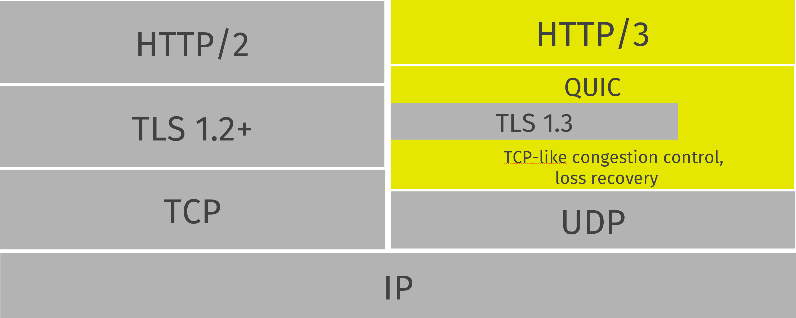

## Introduction

*Quick UDP Internet Connections*（快速 UDP 互联网连接）

> QUIC 在单个资源流内部仍然保持顺序。


<div style="text-align: center;">



</div>

<p style="text-align: center;">
Fig.1. HTTP/3 over QUIC 协议栈概览。
</p>

## Fast handshakes

0-RTT

QUIC 对传输数据和协议本身都做加密与密码学认证，防止中间盒窥探或篡改协议头，同时也让协议具备面向未来的演进能力。
QUIC 还内置了版本协商机制（没错，TCP 没有版本号），这让我们可以按未来需要做深度、大幅度的改动。
版本机制还允许我们在自己的 POP（接入点）内构建、调优并部署替代版本，下文会展开讨论。

我们预见到 QUIC 有两大数据包处理开销来源：

确认处理（Acknowledgement processing）：典型 TCP 连接中很大一部分数据包只携带确认信息。
TCP 的确认在发送端和接收端都由内核处理。
而 QUIC 在用户态处理这些确认，导致更多跨用户/内核边界的数据拷贝和更多的上下文切换。
此外，TCP 确认是明文的，而 QUIC 确认是加密的，收发确认的成本更高。

每包发送开销（Per-packet sender overhead）：内核了解 TCP 连接，能够记住并复用那些在连接生命周期内预期不变的状态。
例如，内核通常只需在连接建立时查一次到目标地址的路由、应用一次防火墙规则。
而内核没有 QUIC 的连接状态，这些内核操作就得对每个 outgoing QUIC 数据包各做一遍。

由于 QUIC 运行在用户态，这些成本都比 TCP 高。
原因是 QUIC 收发的每个数据包都要穿越用户/内核边界，即发生一次上下文切换。

这项实验为提升 quicly 的效率指明了方向：降低确认频率、用 GSO 合并数据包、以及尽可能使用大的数据包尺寸。

## TLS

## Congestion Control

QUIC 为拥塞控制提供的信号是通用的，设计上支持不同的发送端算法。
发送端可以单方面选择使用不同的算法，例如 CUBIC。

### ECN

如果一条路径已被验证支持显式拥塞通知（ECN）[RFC3168]，QUIC 就把 IP 头中的 Congestion Experienced（CE）码点视为拥塞信号。
本文档规定了当对端报告的 ECN-CE 计数增加时，端点应如何响应；参见 [QUIC-TRANSPORT] 第 13.4.2 节。


## Connection Migration

QUIC 连接并不严格绑定在单一条网络路径上。
连接迁移（connection migration）借助连接标识符（connection ID），让连接可以转移到新的网络路径。
在当前版本的 QUIC 中，只有客户端能够发起迁移。
这一设计还使连接能在网络拓扑或地址映射发生变化后继续存活，例如 NAT 重新绑定（NAT rebinding）导致的地址变化。

连接 ID 的使用让连接可以在端点地址（IP 地址和端口）变化后继续存活，比如端点迁移到新网络时。
本节描述端点迁移到新地址的过程。

QUIC 的设计依赖端点在握手期间保持地址稳定。以下情形不允许连接迁移：

- 在手握手确认（confirmed）之前，端点 MUST NOT 发起连接迁移，定义见 [QUIC-TLS](/docs/CS/CN/HTTP/QUIC.md?id=tls)。
- 如果对端发送了 disable_active_migration 传输参数，端点 MUST NOT 发起连接迁移。

如果对端发送了 `disable_active_migration` 传输参数，端点还 MUST NOT 从不同的本地地址向对端在握手期间使用的地址发送数据包（包括探测包），
除非端点已对对端的 `preferred_address` 传输参数作出响应（即切换到该地址）。
如果对端违反此要求，端点 MUST 或者丢弃该路径上的入包且不生成 *Stateless Reset*，或者继续执行路径验证并允许对端迁移。
生成 *Stateless Reset* 或关闭连接会让网络中的第三方能够通过伪造或操纵观测到的流量来导致连接关闭，这是必须避免的。

并非所有对端地址变化都是有意的（主动的）迁移。
对端也可能遭遇 NAT 重新绑定：中间盒（通常是 NAT）为某条流分配了新的出口端口甚至新的出口 IP。
端点只要检测到对端地址发生任何变化，就 MUST 执行路径验证，除非该地址此前已验证过。

当端点没有任何已验证可用于发送的路径时，它可以 MAY 丢弃连接状态。
具备连接迁移能力的端点 MAY 先等待新路径可用，再丢弃连接状态。

本文档把连接迁移限制为迁往新的客户端地址，第 9.6 节描述的情形除外。所有迁移都由客户端负责发起。
服务器在看到来自某地址的非探测包之前，不会向该客户端地址发送非探测包。如果客户端收到来自未知服务器地址的数据包，客户端 MUST 丢弃这些包。

### Classification of Connection Migration

#### ACM and PCM

主动连接迁移与被动连接迁移（Active Connection Migration and Passive Connection Migration）

#### VCM and HCM

垂直连接迁移与水平连接迁移（Vertical Connection Migration and Horizontal Connection Migration）

#### CCM and SCM

客户端连接迁移与服务端连接迁移（Client Connection Migration and Server Connection Migration）

#### SPCM and MPCM

单路径连接迁移与多路径连接迁移（Single-path Connection Migration and Multi-path Connection Migration）

### Connection Migration Strategy

- 故障转移模式（Failover Mode）
- 待机模式（Standby Mode）
- 聚合模式（Aggregation Mode）
- 负载均衡模式（Load Balance Mode）

除 PCM 外，其他连接迁移都可以由 RTT、丢包率、超时、ECN 或应用信号触发。

### Path Verification

连接迁移双方都使用路径验证（path validation）来确认地址变更后的可达性。
在路径验证中，端点测试某一特定本地地址与某一特定对端地址之间的可达性，这里的地址指 IP 地址与端口构成的二元组。

路径验证用于确认：在某条路径上发给对端的数据包确实被对端收到。
路径验证还用于确保从迁移中的对端收到的数据包不携带伪造的源地址。

端点通过发送包含随机数的 PATH_CHALLENGE 帧来启动路径验证。
每个端点都会在连接建立期间验证对端的地址。因此，迁移端点可以向对端发送数据，因为它知道对端愿意在当前地址接收。

大多数连接迁移 MUST 执行路径验证，除非端点已验证过该路径；原因是确认路径的可达性与安全性。
但在某些特殊情况下，应允许连接迁移发起方不等对端确认就直接发送数据包。
其条件是确保连接迁移响应方收到的数据包不携带伪造的源地址。

端点可以使用 PATH_CHALLENGE 帧（type=0x1a）检查到对端的可达性，并在连接迁移期间执行路径验证。

### Probing a New Path

端点可以在把连接迁移到新的本地地址之前，先用路径验证从该新地址探测对端可达性。
路径验证失败只说明新路径对本连接不可用。
**路径验证失败不会导致连接终止，除非没有任何其他可用路径。**

PATH_CHALLENGE、PATH_RESPONSE、NEW_CONNECTION_ID 和 PADDING 帧是「探测帧」（probing frames），其余帧都是「非探测帧」（non-probing frames）。
只包含探测帧的数据包是「探测包」（probing packet），包含任何其他帧的数据包是「非探测包」（non-probing packet）。

### Initiating Connection Migration

端点从新的本地地址发送包含非探测帧的数据包，即可把连接迁移到该新本地地址。

每个端点都会在连接建立期间验证对端的地址。
因此，迁移端点可以向对端发送数据，因为它知道对端愿意在当前地址接收。
也就是说，端点无需先验证对端地址，就可以迁移到新的本地地址。

为了在新路径上建立可达性，端点会在新路径上启动路径验证。
端点 MAY 把路径验证推迟到对端下一个非探测帧发到其新地址之后。

迁移时，新路径可能不支持端点当前的发送速率。
因此，端点会重置其拥塞控制器和 RTT 估计。

新路径的 ECN 能力也可能与旧路径不同。

### Responding to Connection Migration

收到来自新对端地址、且包含非探测帧的数据包，说明对端已迁移到该地址。

如果接收方允许此次迁移，它 MUST 把后续数据包发往新的对端地址，并且如果验证尚未进行，MUST 启动路径验证（第 8.2 节）以确认对端拥有该地址。
如果接收方没有对端提供的未使用连接 ID，在对端提供之前，它无法在新路径上发送任何数据；参见第 9.5 节。

端点只根据编号最大的非探测包来更改发送的目标地址。
这样，即使收到乱序的数据包，端点也不会把数据发到旧的对端地址。

端点 MAY 向未经验证的对端地址发送数据，但 MUST 按第 9.3.1 与 9.3.2 节的描述防范潜在攻击。
如果某地址最近出现过，端点 MAY 跳过对该地址的验证。
特别是，当端点在检测到某种伪迁移（spurious migration）后回到此前已验证的路径时，跳过地址验证并恢复丢包检测与拥塞状态，可以减轻攻击对性能的影响。

在更改非探测包的发送地址后，端点可以放弃针对其他地址的路径验证。

收到来自新对端地址的数据包，也可能是对端发生了 NAT 重新绑定。

服务器验证新的客户端地址后，SHOULD 向客户端发送新的地址验证令牌（第 8 节）。

### Peer Address Spoofing

对端有可能伪造源地址，诱使端点向不愿接收的主机发送大量数据。
如果端点发送的数据量显著大于伪造者，连接迁移就可能被用来放大攻击者流向受害者的数据量。

如第 9.3 节所述，端点必须验证对端的新地址，以确认对端确实拥有该地址。
在对端地址被认定为有效之前，端点会限制发往该地址的数据量；参见第 8 节。
若没有这一限制，端点就有被利用去攻击无辜受害者的风险（拒绝服务攻击）。

如果端点按上文所述跳过了对端地址验证，则无需限制其发送速率。

### On-Path Address Spoofing

路径上的攻击者可以复制并转发一个带有伪造地址的数据包、让它早于原始数据包到达，从而制造一次伪迁移。
带有伪造地址的数据包会被视为来自迁移中的连接，而原始数据包则会被当作重复包丢弃。
伪迁移之后，对新源地址的验证会失败，因为即使该地址上的实体愿意配合，它也没有必要的密码学密钥来读取或响应发给它的 PATH_CHALLENGE 帧。

为防连接因这类伪迁移而失败，端点在对新对端地址验证失败时 MUST 回退到上一个已验证的对端地址。
此外，如果从合法对端地址收到编号更大的数据包，会触发另一次连接迁移。
这会导致针对伪迁移地址的验证被放弃，从而把攻击者注入单个数据包引发的迁移限制在可控范围内。

如果端点没有关于上一个已验证对端地址的任何状态，它 MUST 通过丢弃所有连接状态来静默关闭连接。
此后该连接上的新数据包按通用方式处理。
例如，端点可以 MAY 对任何后续入包发送 Stateless Reset。

### Off-Path Packet Forwarding

```
  (Before connection migration)
   +--------------+   Non-probing Packet   +--------------+
   |    Client    |  ------------------->  |              |
   |(Source IP: 1)|  <-------------------  |              |
   +--------------+   Non-probing Packet   |              |
          |                                |              |
          |                                |              |
          |                                |              |
          v                                |              |
   +--------------+   Non-probing Packet   |              |
   |              |  ------------------->  |              |
   |              |  <-------------------  |              |
   |              |   Non-probing Packet   |              |
   |              |                        |              |
   |              |                        |    Server    |
   |              |     Probing Packet     |              |
   |              |    (PATH_CHALLENGE)    |              |
   |    Client    |  <-------------------  |              |
   |(Source IP: 2)|  ------------------->  |              |
   |              |     Probing Packet     |              |
   |              |     (PATH_RESPONSE)    |              |
   |              |                        |              |
   |              |     Probing Packet     |              |
   |              |    (PATH_CHALLENGE)    |              |
   |              |  ------------------->  |              |
   |              |  <-------------------  |              |
   |              |     Probing Packet     |              |
   |              |     (PATH_RESPONSE)    |              |
   +--------------+                        +--------------+
   (After connection migration)
```

端点从对端收到包含非探测帧的数据包时，会从中看到对端的新地址，说明连接迁移发起方已迁移到该地址。

连接迁移完成后，各端点需要重置拥塞控制参数。

## Loss Detection and Congestion Control

## Bonus

### multplexing

既然如此，我们不禁要问：为什么还需要多路复用（multiplexing）？更进一步说：
HTTP/2 乃至 HTTP/3 都把多路复用作为 HTTP/1.1 所不具备的核心特性之一。

- 其一，可以增量处理或渲染的文件确实受益于多路复用，渐进式图片（progressive images）就是典型例子。
- 其二，如前所述，当其中一个文件远小于其他文件时也很有用：小文件可以先下载完，又不会把其他文件拖慢太多。
- 其三，多路复用允许改变响应顺序，并中断低优先级的响应以优先发送高优先级响应。

### Transport Congestion Control

QUIC 与 HTTP/3 会面临类似挑战：与 HTTP/2 一样，HTTP/3 也使用单一的底层 QUIC 连接。
你可能会说，QUIC 连接在概念上有点像多条 TCP 连接——每个 QUIC 流可以看作一条 TCP 连接，因为丢包检测是按流进行的。
但关键在于：QUIC 的拥塞控制仍然是在连接级别进行的，而不是按流进行。
这意味着，尽管各流在概念上相互独立，它们仍然都影响 QUIC 那唯一的、按连接计算的拥塞控制器；任何一条流上发生丢包，都会拖慢整体。
换句话说：单条 HTTP/3+QUIC 连接的增速仍然比不上 6 条 HTTP/1.1 连接，正如 HTTP/2+TCP 单连接当年也没有更快。

[quicly](https://github.com/h2o/quicly)

## Links

- [Computer Network](/docs/CS/CN/CN.md)
- [HTTP](/docs/CS/CN/HTTP/HTTP.md)

## References

1. [QUIC](https://quicwg.org/)
2. [RFC 9000 - QUIC: A UDP-Based Multiplexed and Secure Transport](https://datatracker.ietf.org/doc/rfc9000/)
2. [RFC 9002 - QUIC Loss Detection and Congestion Control](https://datatracker.ietf.org/doc/rfc9002/)
3. [知乎专栏 QUIC](https://www.zhihu.com/column/c_1303002298995113984)
