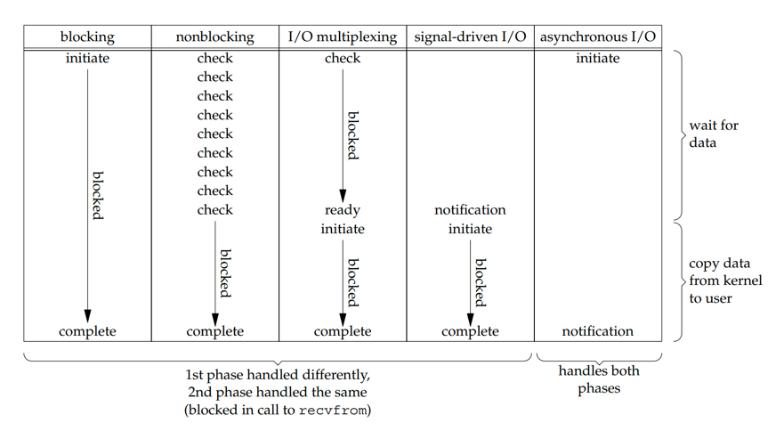

## Introduction

I/O multiplexing is typically used in networking applications in the following scenarios:
- When a client is handling multiple descriptors (normally interactive input and a network socket), I/O multiplexing should be used.
- It is possible, but rare, for a client to handle multiple sockets at the same time.
- If a TCP server handles both a listening socket and its connected sockets, I/O multiplexing is normally used.
- If a server handles both TCP and UDP, I/O multiplexing is normally used.
- If a server handles multiple services and perhaps multiple protocols, I/O multiplexing is normally used.

I/O multiplexing is not limited to network programming. Many nontrivial applications find a need for these techniques.

## I/O Models

Before describing select and poll, we need to step back and look at the bigger picture, examining the basic differences in the five I/O models that are available to us
under Unix:
- blocking I/O
- nonblocking I/O
- I/O multiplexing (select and poll)
- signal driven I/O (SIGIO)
- asynchronous I/O (the POSIX aio_ functions)

Figure from UNP:

Fig.1. Comparison of the five I/O models

There are normally two distinct phases for an input operation:
1. Waiting for the data to be ready
2. Copying the data from the kernel to the process

For an input operation on a socket, the first step normally involves waiting for data to arrive on the network. 
When the packet arrives, it is copied into a buffer within the kernel. The second step is copying this data from the kernel’s buffer into our application buffer.

The main difference between the first four models is the first phase, as the second phase in the first four models is the same: the process is blocked in a call to recvfrom while the data is copied from the kernel to the caller’s buffer. 
Asynchronous I/O, however, handles both phases and is different from the first four.

> [!NOTE]
> 
> POSIX defines these two terms as follows:
> - A synchronous I/O operation causes the requesting process to be blocked until that I/O operation completes.
> - An asynchronous I/O operation does not cause the requesting process to be blocked.

Using these definitions, the first four I/O models—blocking, nonblocking, I/O multiplexing, and signal-driven I/O—are all synchronous because the actual I/O operation(recvfrom) blocks the process. 
Only the asynchronous I/O model matches the asynchronous I/O definition.

## select

> See [Linux select](/docs/CS/OS/Linux/Calls.md?id=select)

select 通过 fd_set 位图向内核传递关注的描述符集合。glibc 的 fd_set 是定长类型，FD_SETSIZE = 1024 ——这是 glibc 的实现上限，不是内核限制；fd 编号大于等于 1023 时再执行 FD_SET/FD_CLR 属于未定义行为。select(2) 的 BUGS 一节给出的建议原话是："To monitor file descriptors greater than 1023, use poll(2) or epoll(7) instead"。

另外两个容易踩的坑：
- nfds 超过进程的 RLIMIT_NOFILE 时，select 返回 EINVAL；
- **每次调用后 fd 集被内核就地修改**（value-result 语义），循环里必须重新初始化整个集合。man page 原话把这种设计称为 "a design error that is avoided in poll(2) and epoll(7)"。

## poll

poll 用 struct pollfd 数组代替 fd_set，每个 pollfd 把 events（输入，调用方填写）与 revents（输出，内核填写）分离——这正是对 select value-result 设计的直接修正：调用前后无需重建关注集合，内核把结果写进独立的 revents 字段。

POLLERR、POLLHUP、POLLNVAL 等错误/异常事件只出现在 revents 中，即使调用方没有请求对应的 events，也可能被置位。

poll(2) 页面本身并不宣称"没有 fd 数量上限"；poll 不受 FD_SETSIZE 限制的依据来自 select(2) 的 BUGS 一节（见上一节引文）。

## epoll

epoll 是 Linux 特有的 I/O 多路复用机制，由四个 API 组成：
- epoll_create：创建一个 epoll 实例。size 参数自 Linux 2.6.8 起被忽略，但必须大于 0；
- epoll_create1：flags 仅支持 EPOLL_CLOEXEC；
- epoll_ctl：向实例注册（EPOLL_CTL_ADD）、修改（EPOLL_CTL_MOD）、删除（EPOLL_CTL_DEL）关注的 fd；
- epoll_wait：等待就绪事件。

epoll_wait 的第三个参数 man page 记作 n（不是一些教程中的别称 maxevents），含义是单次调用最多返回的事件数，即 events 数组容量，必须大于 0。

内核为每个 epoll 实例维护两条链表：interest list（已注册关注的 fd）与 ready list（就绪的 fd）。ready list 由内核在 I/O 活动时动态填充，epoll_wait 只负责检查并取出其中的条目，因此无需像 select/poll 那样每次调用重传整个关注集合。

触发方式：
- **默认水平触发（LT）**：只有显式设置 EPOLLET 才请求边缘触发（ET）。LT 下 man page 的原话是 "epoll is simply a faster poll(2)"；
- ET 的正确用法：必须配合非阻塞 fd，且收到事件后要循环 read/write 直到返回 EAGAIN——man page 的 suggested usage 原文即此。只读一次就返回是典型的 ET 误用。

常用事件标志及引入版本：EPOLLONESHOT 自 2.6.2（事件通知一次后自动把 fd 从 interest list 摘除，需重新 EPOLL_CTL_MOD 才能再次 arm）；EPOLLRDHUP 自 2.6.17（对端关闭或半关闭）；EPOLLEXCLUSIVE 自 4.5（抑制惊群，只唤醒一个 epoll 句柄）。

资源限制：/proc/sys/fs/epoll/max_user_watches 限制单用户可注册的 fd 总数，默认约为可用低端内存的 1/25（约 4%）；每注册一个 fd 约占 90 字节（32 位内核）或 160 字节（64 位内核）。

> [!WARNING]
> 
> 「select/poll 是 O(n) 线性扫描」「epoll 是 O(1)」这两句话**没有 man page 原文支持**（已逐字检索 man7 各页面，均无此表述）。man page 只确认两件事：select/poll 的关注集合需要每次调用重传；epoll "scales well to large numbers of watched file descriptors"。复杂度说法是社区对实现机制的常见归纳，不是内核文档口径，引用时请勿冒充原话。

## io_uring

io_uring 与 epoll 的本质区别不在"要不要系统调用通知"，而在接口形态：应用与内核共享一对环形缓冲区——提交队列（SQ）与完成队列（CQ），I/O 请求经 SQ 递达、完成事件经 CQ 回报，而不是每次等待都通过系统调用传递。

io_uring 于 Linux 5.1 引入，5.5 补齐网络类操作（accept/connect/send/recv）；它自身也能执行 EPOLL_CTL/EPOLL_WAIT 类操作。

需要说明的是：官方文档从未宣称"io_uring 已取代 epoll"。当前定位是——epoll 仍是主流的事件多路复用方案，io_uring 提供了另一条（异步提交加共享队列）路线。

## Links

- [Computer Network](/docs/CS/CN/CN.md)
- [Socket](/docs/CS/CN/Socket.md)
- [C10k](/docs/CS/CN/C10k.md)
- [epoll](/docs/CS/OS/Linux/IO/epoll.md)
- [I/O Multiplexing](/docs/CS/OS/Linux/IO/multiplexing.md)
- [io_uring](/docs/CS/OS/Linux/IO/io_uring.md)

## References

1. [select(2) - Linux man page](https://man7.org/linux/man-pages/man2/select.2.html)
2. [poll(2) - Linux man page](https://man7.org/linux/man-pages/man2/poll.2.html)
3. [epoll(7) - Linux man page](https://man7.org/linux/man-pages/man7/epoll.7.html)
4. [epoll_wait(2) - Linux man page](https://man7.org/linux/man-pages/man2/epoll_wait.2.html)
5. [io_uring(7) - Linux man page](https://man7.org/linux/man-pages/man7/io_uring.7.html)
