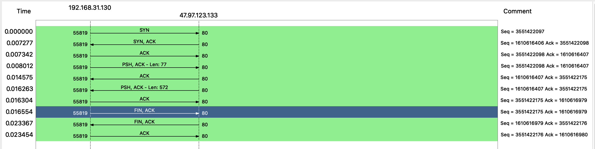
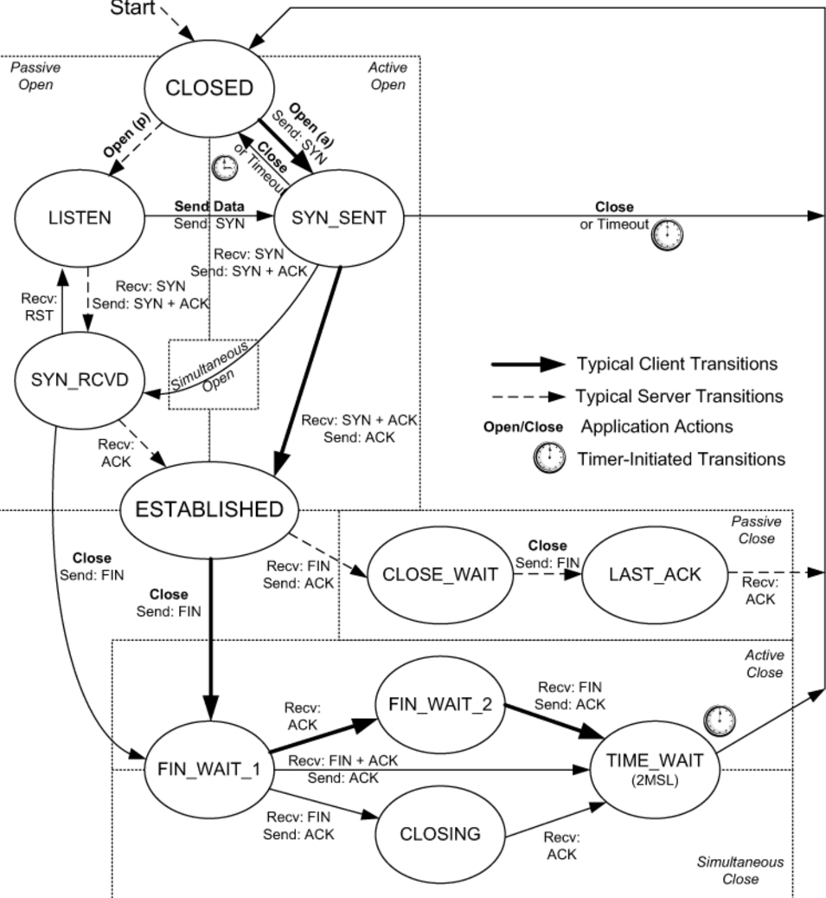
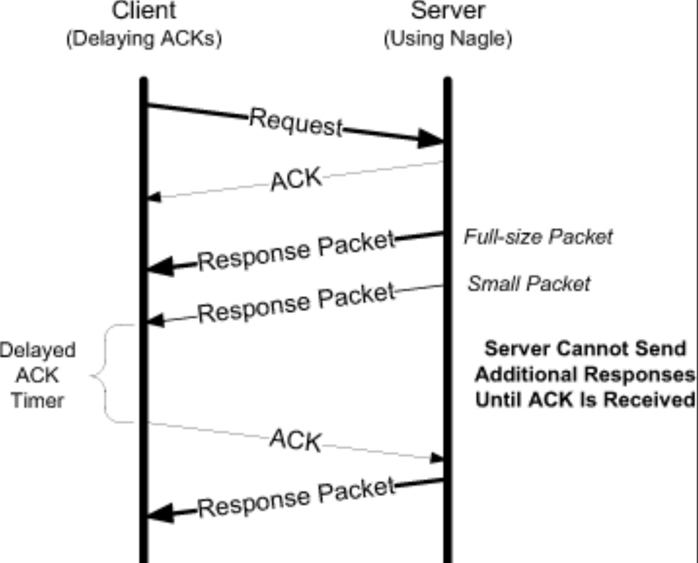
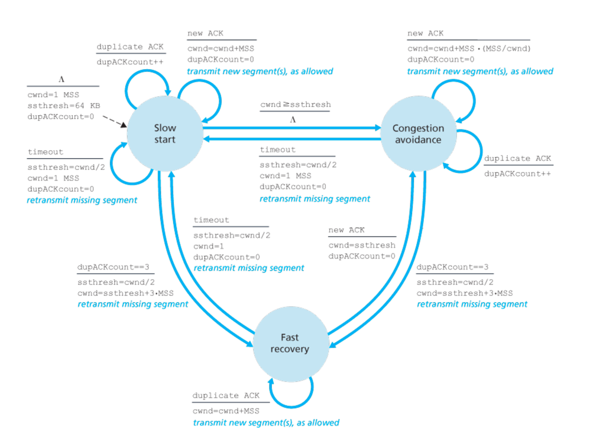

## Introduction

TCP 旨在用作分组交换计算机网络及其互联系统中主机之间的高可靠主机到主机协议。

```
                           Protocol Layering

                        +---------------------+
                        |     higher-level    |
                        +---------------------+
                        |        TCP          |
                        +---------------------+
                        |  internet protocol  |
                        +---------------------+
                        |communication network|
                        +---------------------+
```

TCP 的原始规范是 [RFC793](https://www.rfc-editor.org/rfc/rfc793)，其中的一些错误在 [RFC1122](https://www.rfc-editor.org/rfc/rfc1122) 中被修正。拥塞控制（**RFC5681**、**RFC3782/RFC6582**、**RFC3517/RFC6657**、**RFC3390**、**RFC3168/RFC8311**）、重传超时（**RFC6298**、**RFC5682**、**RFC4015**）、连接管理（**RFC5482**）等特性在后续一系列的 RFC 文档中也进行了补充设计

> 参见 [Linux TCP](/docs/CS/OS/Linux/net/TCP/TCP.md)

### Purpose

TCP 的首要目的，是为成对的进程之间提供可靠、安全的逻辑电路或连接服务。它保证数据的可靠交付，或在失败时给出可靠的通知。要在不太可靠的互联网通信系统之上提供这种服务，需要在以下几个方面具备相应机制：

- 基本数据传输（Basic Data Transfer）
- 可靠性（Reliability）
- 流量控制（Flow Control）
- 复用（Multiplexing）
- 连接（Connections）
- 优先级与安全（Precedence and Security）

### Connections

为了区分一条 TCP 可能要处理的多条数据流，TCP 提供了端口标识符（port identifier）。由于各 TCP 独立选择端口标识符，它们可能并不唯一。为了在每个 TCP 内获得唯一地址，我们将标识该 TCP 的互联网地址与一个端口标识符拼接起来，构成一个套接字（socket），该套接字在所有互联网络中都是唯一的。

一条连接由两端的一对套接字完全确定。一个本地套接字可以参与通往不同远端套接字的多条连接。连接可以双向承载数据，即它是 `"full duplex"`（全双工）的。

建立连接的过程使用 synchronize（SYN）控制标志，并涉及三个消息的交换。这个交换被称为 `three-way hand shake `（三次握手）。

### Relation to Other Protocols

下图展示了 TCP 在协议层次结构中的位置：

```
  
       +------+ +-----+ +-----+       +-----+  
       |Telnet| | FTP | |Voice|  ...  |     |  Application Level 
       +------+ +-----+ +-----+       +-----+  
             |   |         |             |   
            +-----+     +-----+       +-----+  
            | TCP |     | RTP |  ...  |     |  Host Level  
            +-----+     +-----+       +-----+  
               |           |             |   
            +-------------------------------+  
            |    Internet Protocol & ICMP   |  Gateway Level   
            +-------------------------------+  
                           |   
              +---------------------------+  
              |   Local Network Protocol  |    Network Level   
              +---------------------------+  

                         Protocol Relationships
```

## Header Format

```
    0                   1                   2                   3
    0 1 2 3 4 5 6 7 8 9 0 1 2 3 4 5 6 7 8 9 0 1 2 3 4 5 6 7 8 9 0 1
   +-+-+-+-+-+-+-+-+-+-+-+-+-+-+-+-+-+-+-+-+-+-+-+-+-+-+-+-+-+-+-+-+
   |          Source Port          |       Destination Port        |
   +-+-+-+-+-+-+-+-+-+-+-+-+-+-+-+-+-+-+-+-+-+-+-+-+-+-+-+-+-+-+-+-+
   |                        Sequence Number                        |
   +-+-+-+-+-+-+-+-+-+-+-+-+-+-+-+-+-+-+-+-+-+-+-+-+-+-+-+-+-+-+-+-+
   |                    Acknowledgment Number                      |
   +-+-+-+-+-+-+-+-+-+-+-+-+-+-+-+-+-+-+-+-+-+-+-+-+-+-+-+-+-+-+-+-+
   |  Data |           |U|A|P|R|S|F|                               |
   | Offset| Reserved  |R|C|S|S|Y|I|            Window             |
   |       |           |G|K|H|T|N|N|                               |
   +-+-+-+-+-+-+-+-+-+-+-+-+-+-+-+-+-+-+-+-+-+-+-+-+-+-+-+-+-+-+-+-+
   |           Checksum            |         Urgent Pointer        |
   +-+-+-+-+-+-+-+-+-+-+-+-+-+-+-+-+-+-+-+-+-+-+-+-+-+-+-+-+-+-+-+-+
   |                    Options                    |    Padding    |
   +-+-+-+-+-+-+-+-+-+-+-+-+-+-+-+-+-+-+-+-+-+-+-+-+-+-+-+-+-+-+-+-+
   |                             data                              |
   +-+-+-+-+-+-+-+-+-+-+-+-+-+-+-+-+-+-+-+-+-+-+-+-+-+-+-+-+-+-+-+-+

                            TCP Header Format

          Note that one tick mark represents one bit position.
```


| 名称                  | 长度 | 说明                                                                                                                                                                                                        |  |
| ----------------------- | ---------- | -------------------------------------------------------------------------------------------------------------------------------------------------------------------------------------------------------------------- | -- |
| Source Port           | 16 bits  | 源端口号。                                                                                                                                                                                            |  |
| Destination Port      | 16 bits  | 目的端口号。                                                                                                                                                                                      |  |
| Sequence Number       | 32 bits  | 本段中第一个数据字节的序号（除非存在 SYN）。若存在 SYN，该序号为初始序号（ISN），第一个数据字节为 ISN+1。    |  |
| Acknowledgment Number | 32 bits  | 若 ACK 控制位置位，该字段包含本段发送方期望接收的下一个序号。连接建立后该字段总是随段发送。          |  |
| Data Offset           | 4 bits   | TCP 首部中 32 位字的数量，指示数据从哪里开始。TCP 首部（即使含选项）长度总是 32 位的整数倍。                                       |  |
| Reserved              | 6 bits   | 保留字段。                                                                                                                                                                                                                    |  |
| Control Bits          | 6 bits   | URG：Urgent Pointer 字段有效<br>ACK：Acknowledgment 字段有效<br>PSH：Push 功能<br>RST：重置连接<br>SYN：同步序号<br>FIN：发送方数据结束 |  |
| Window                | 16 bits  | 从 Acknowledgment 字段指示的字节开始，本段发送方愿意接收的数据字节数。                                                              |  |
| Checksum              | 16 bits  | 校验和。                                                                                                                                                                                                                    |  |
| Urgent Pointer        | 16 bits  | 紧急指针。                                                                                                                                                                                                                    |  |
| Options               | variable | 选项。                                                                                                                                                                                                                    |  |
| Padding               | variable | TCP 首部填充用于确保首部结束和数据开始都位于 32 位边界上，填充内容为零。                                                                 |  |

### Options

最初的 TCP 规范只定义了三种选项：选项列表结束（End of Option List, EOL）、无操作（No Operation, NOP）和最大段长（Maximum Segment Size, MSS）。此后又定义了若干选项，完整列表由 IANA [TPARAMS] 维护。

每个选项都以 1 字节的 kind 开头，指明选项的类型。根据 [RFC1122]，无法识别的选项会被直接忽略。kind 值为 0 和 1 的选项各只占 1 字节。
其他选项在 kind 字节之后还有一个 len 字节，len 是包含 kind 和 len 字节在内的总长度。
NOP 选项的作用是让发送方在需要时把字段填充到 4 字节的倍数。注意，由于 TCP Header Length 字段以 32 位字为单位，TCP 首部长度必须始终是 32 位的整数倍。
EOL 选项表示选项列表结束，不再对列表执行进一步处理。

#### MSS Option

Maximum Segment Size（最大段长）

#### SACK Options

Selective Acknowledgment（选择性确认）

#### Window Scale Option

Window Scale（WSCALE 或 WSOPT，窗口缩放）

#### PAWS option

Timestamps Option and Protection against Wrapped Sequence Numbers（时间戳选项与防序号回绕保护）

Timestamps 选项（有时写作 Timestamp 选项，记作 TSOPT 或 TSopt）允许发送方在每个段中放置两个 4 字节的时间戳值。
接收方在确认中回显这些值，使发送方能针对收到的每个 ACK 估算连接的 RTT。
之所以希望准确估算连接的 RTT，是为了设置重传超时（RTO）——它告诉 TCP 何时应尝试重发一个可能已丢失的段。

## Connection Establishment and Termination

TCP 是单播的面向连接协议。任何一端在向对端发送数据之前，必须先建立连接。

一条 TCP 连接由一个四元组定义：两个 IP 地址和两个端口号。更准确地说，它是一对端点（endpoints）或套接字（sockets），每个端点由一个（IP 地址，端口号）对标识。

连接通常经历三个阶段：建立（setup）、数据传输（称为 established）和拆除（teardown，即 closing）。


<div style="text-align: center;">



</div>

<p style="text-align: center;">图 4. TCP 三次握手</p>


### Three-Way Handshake

服务器必须先准备好接受接入连接，这通常通过调用 socket、bind 和 listen 完成，称为被动打开（passive open）。TCP 建立连接的过程如下：

1. 客户端调用 connect 发起主动打开（active open）。
   这导致客户端 TCP 发送一个 synchronize（SYN）段，告诉服务器客户端将在这条连接上发送的数据的初始序号。SYN 通常不携带数据，只包含 IP 首部、TCP 首部和可能的 TCP 选项。
2. 服务器必须确认（ACK）客户端的 SYN，同时也必须发送自己的 SYN，其中包含服务器将在这条连接上发送的数据的初始序号。
   服务器把 SYN 和对客户端 SYN 的 ACK 合并在一个段中发出。
3. 客户端必须确认服务器的 SYN。

这个交换最少需要三个包，因此称为三次握手（three-way handshake）。它的主要目的是让连接双方知道连接正在建立、传递以选项形式携带的特殊参数，并交换双方的 ISN。

由于 SYN 占用序号空间中的一个字节，对每个 SYN 的 ACK 中的确认号是初始序号加一。类似地，对每个 FIN 的 ACK 是该 FIN 的序号加一。

ISN 可基于时间戳生成，参见 RFC1948。

- syn queue（半连接队列）
- accept queue（全连接队列）

#### Timeout of Connection Establishment


| 重发对象 | 配置项 | 默认值 |
| --- | --- | --- |
| SYN     | cat /proc/sys/net/ipv4/tcp_syn_retries    | 6             |
| SYN+ACK | cat /proc/sys/net/ipv4/tcp_synack_retries | 5             |

RFC1122 规定最小重试次数对应的时长 MUST 至少为 180 秒。不过按当前的初始 RTO 计算，该值对应的实际重传时长约为 63 秒。

RTO（Retransmission Timeout）按 `1 + 2 <<< (n-1)` 的方式增长；若 RTO 非常大，实际重试次数会小于配置的重试次数。

Linux 中 RTO 的上下限：

```c
#define TCP_RTO_MAX	((unsigned)(120*HZ))
#define TCP_RTO_MIN	((unsigned)(HZ/5))
```

用 iptables 丢弃服务端 80 端口的入包，可以模拟上述场景：

```shell
iptables -I INPUT -p tcp --dport 80 -j DROP
```

TCP 连接请求也可能因 ICMP Port unreachable 消息或 TCP RST 段而被拒绝；目的主机可能直接忽略 ICMP 数据报。

### Connection Termination

建立连接需要三个段，终止连接则需要四个。

1. 一个应用程序先调用 close，我们称这一端执行主动关闭（active close）。
   这一端的 TCP 发送 FIN 段，表示它已发送完数据。
2. 收到 FIN 的另一端执行被动关闭（passive close）。收到的 FIN 由 TCP 确认。
   收到 FIN 也会被传递给应用程序，作为文件结束符（end-of-file，排在任何已排队待应用读取的数据之后），
   因为收到 FIN 意味着应用不会在这条连接上再收到任何数据。
3. 之后，收到 EOF 的应用程序关闭自己的套接字，其 TCP 随之发送 FIN。
4. 收到这个最终 FIN 的系统上的 TCP（即执行主动关闭的一端）确认该 FIN。

由于每个方向都需要一个 FIN 和一个 ACK，通常共需四个段。
之所以说"通常"，是因为在某些场景下第 1 步的 FIN 会携带数据发出；此外，第 2、3 步的段都来自执行被动关闭的一端，可以合并为一个段。

在第 2 步和第 3 步之间，被动关闭方仍可向主动关闭方发送数据。这称为半关闭（half-close）。

每个 FIN 都在套接字关闭时发出。我们说过应用调用 close 才会触发这一过程，但要注意：Unix 进程终止时（无论是主动调用 exit、main 函数返回，还是收到终止信号），所有打开的描述符都会被关闭，任何仍处于打开状态的 TCP 连接也会因此发出 FIN。

> [!NOTE]
>
> 客户端或服务器都可以执行主动关闭。通常是客户端主动关闭，但某些协议（典型的如 HTTP/1.0）由服务器主动关闭。

- fin retry
- fin_wait2 wait time
- time_wait limit

#### Half Close

通过 shutdown 调用实现半关闭，可选参数：

- SHUT_RD
- SHUT_WR
- SHUT_RDWR

### Simultaneous Open and Close

同时打开比正常三次握手多交换一个段，共需四个段。

同时关闭交换的段数与正常关闭相同，唯一的实际区别是段的顺序是交错的，而不是串行的。

### Connection State

连接在其生命周期中会经历一系列状态。这些状态是：LISTEN、SYN-SENT、SYN-RECEIVED、ESTABLISHED、FIN-WAIT-1、FIN-WAIT-2、CLOSE-WAIT、CLOSING、LAST-ACK、TIME-WAIT，
以及一个虚构状态 CLOSED。CLOSED 是虚构的，因为它表示没有 TCB、因而也没有连接的状态。各状态的含义简述如下：

- LISTEN - 等待来自任意远端 TCP 和端口的连接请求。
- SYN-SENT - 发送连接请求后，等待匹配的连接请求。
- SYN-RECEIVED - 在已发送并收到连接请求后，等待对连接请求的确认。
- ESTABLISHED - 连接已打开，收到的数据可以交付给用户。这是连接数据传输阶段的正常状态。
- FIN-WAIT-1 - 等待远端 TCP 的连接终止请求，或对先前发出的连接终止请求的确认。
- FIN-WAIT-2 - 等待远端 TCP 的连接终止请求。
- CLOSE-WAIT - 等待本地用户的连接终止请求。
- CLOSING - 等待远端 TCP 对连接终止请求的确认。
- LAST-ACK - 等待远端 TCP 对先前发往它的连接终止请求的确认（该确认包含对它自己的连接终止请求的确认）。
- TIME-WAIT - 等待足够长的时间过去，以确保远端 TCP 收到了对它的连接终止请求的确认。
- CLOSED - 完全没有连接状态。


<div style="text-align: center;">



</div>

<p style="text-align: center;">图 5. TCP 状态转换图</p>


#### CLOSE_WAIT

CLOSE_WAIT 过多

原因：

1. 忘记调用 close/shutdown 发送 FIN
2. backlog 过大

#### FIN_WAIT_2

只有当应用程序执行关闭（其 FIN 被收到）后，执行主动关闭的 TCP 才会从 FIN_WAIT_2 转入 TIME_WAIT 状态。
这意味着连接的一端可能永远停留在此状态。
另一端仍处于 CLOSE_WAIT 状态，也可能永远停留，直到应用程序决定关闭。

许多实现用如下机制避免在 FIN_WAIT_2 中无限等待：
如果执行主动关闭的应用程序做的是完整关闭（而非表示仍期望接收数据的半关闭），就会设置一个**定时器**。
定时器到期时连接若处于空闲，TCP 就把连接转入 CLOSED 状态。
在 Linux 中，可调整变量 `net.ipv4.tcp_fin_timeout` 来控制该定时器设置的秒数，默认值为 60s。
当连接从 FIN_WAIT_1 状态进入 FIN_WAIT_2 状态且不会再收到任何数据时
（意味着进程调用的是 close，而非利用 TCP 半关闭的 shutdown），该定时器设为 10 分钟。
该定时器到期后重置为 75 秒，第二次到期时连接被丢弃。
设置该定时器的目的是：在对端始终不发 FIN 的情况下，避免连接永远停在 FIN_WAIT_2 状态。

#### TIME_WAIT

数据包在网络中"丢失"通常源于路由异常。这种原始包称为丢失的重复包（lost duplicate）或游荡的重复包（wandering duplicate）。TCP 必须处理这类重复包。

TIME_WAIT 状态有两个原因：

1. 可靠地实现 TCP 的全双工连接终止
2. 让网络中的旧重复段自然过期

第一个原因可以这样理解：假设最终的 ACK 丢失，服务器会重发其最终的 FIN，客户端必须维护状态信息，才能重发该最终 ACK。
如果它没有维护这些信息，就会以 RST（另一种类型的 TCP 段）应答，而服务器会将其解释为错误。

连接关闭后一段时间，可能在相同的 IP 地址和端口之间建立另一条连接。
由于 IP 地址和端口相同，后者称为前一个连接的转世（incarnation）。
TCP 必须防止某条连接的旧重复包在之后重新出现，并被误认为属于同一连接的新转世。
为此，TCP 不会为当前处于 TIME_WAIT 状态的连接发起新的转世。

> 此规则有一个例外：
> Berkeley 系实现会在到达的 SYN 的序号"大于"前一个转世的结束序号时，为处于 TIME_WAIT 状态的连接发起新的转世。

连接进入 TIME_WAIT 状态时定时器设为 1 分钟（Net/3 使用的 MSL 为 30 秒），到期后 TCP 控制块和 Internet PCB 被删除，该套接字对可被重用。

孤儿连接（使用 close）FIN_WAIT2 超时由 tcp_fin_timeout 控制秒数

```shell
cat /proc/sys/net/ipv4/tcp_fin_timeout	#60
```

```c
#define TCP_TIMEWAIT_LEN (60*HZ)
```

tcp_tw_reuse - INTEGER

在从协议视角看安全的前提下，为新连接重用 TIME-WAIT 套接字。
未经技术专家的建议或请求，不应更改此值。

- 0 - 禁用
- 1 - 全局启用
- 2 - 仅对环回流量启用，默认值

### Reset Segments

#### Nonexistent Port

对于 UDP，数据报到达未使用的目的端口时会生成 ICMP Destination Unreachable（Port Unreachable）消息；TCP 则改用重置段（reset segment）。

#### Aborting a Connection

中止连接为应用程序提供两个特性：

1. 丢弃所有排队数据并立即发送重置段
2. 重置段的接收方可以判断对端执行的是中止（abort）而非正常关闭

应用程序使用的 API 必须提供生成中止（而非正常关闭）的方式。

#### Half-Open Connections

如果一端在另一端不知情的情况下关闭或中止了连接，该 TCP 连接称为半开（half-open）。
只要任一对等体崩溃，就可能发生这种情况。只要不尝试在半开连接上传输数据，仍然存活的一端就不会检测到另一端已崩溃。

半开连接的另一个常见原因是一台主机被直接断电，而非正常关机。

#### TWA

如前所述，TIME_WAIT 状态旨在让已关闭连接的残留数据报被丢弃。
在此期间，等待方的 TCP 通常无事可做，只是保持状态直到 2MSL 定时器到期。
但是，如果它在此期间从该连接收到某些段（更确切地说是 RST 段），就可能失去同步。这称为 **TIME-WAIT Assassination（TWA，TIME-WAIT 刺杀）**。

这对服务器没有问题，但会导致客户端过早地从 TIME_WAIT 转入 CLOSED。
大多数系统通过简单地在 TIME_WAIT 状态下不响应重置段来避免此问题。

TCP 在 TIME_WAIT 状态下防护旧重复段的机制如下：

**不可靠：** TIME-WAIT 状态消除了旧重复包对"快"或"长"连接的危害——在这类连接中，时钟驱动的 ISN 选择无法防止新旧序号空间重叠。TIME-WAIT 的延迟为所有旧重复段在连接重开之前从网络中消亡留出足够时间。

TIME-WAIT 状态可能被来自当前或更早转世的旧重复数据段或 ACK 段过早终止（被"刺杀"）。我们称之为 "`TIME-WAIT Assassination`"（**TWA**）。

```
       TCP A                                                TCP B

   1.  ESTABLISHED                                          ESTABLISHED

       (Close)
   2.  FIN-WAIT-1  --> <SEQ=100><ACK=300><CTL=FIN,ACK>  --> CLOSE-WAIT

   3.  FIN-WAIT-2  <-- <SEQ=300><ACK=101><CTL=ACK>      <-- CLOSE-WAIT

                                                            (Close)
   4.  TIME-WAIT   <-- <SEQ=300><ACK=101><CTL=FIN,ACK>  <-- LAST-ACK

   5.  TIME-WAIT   --> <SEQ=101><ACK=301><CTL=ACK>      --> CLOSED

  - - - - - - - - - - - - - - - - - - - - - - - - - - - -

   5.1. TIME-WAIT   <--  <SEQ=255><ACK=33> ... old duplicate

   5.2  TIME-WAIT   --> <SEQ=101><ACK=301><CTL=ACK>    -->  ????

   5.3  CLOSED      <-- <SEQ=301><CTL=RST>             <--  ????
      (prematurely)

                         TWA Example
```

如果在 TWA 事件后立即重开连接，新转世将暴露于旧重复段之下（初始 <SYN> 段除外，它由三次握手处理）。由此产生三种可能的危害：

- 旧重复数据可能被错误接受。
- 新连接可能失去同步，两端在状态上永久分歧。按照 RFC-793 的规范，这种失步会导致无限 ACK 循环。（或许应该修改 RFC-793 的这一行为，直接杀掉连接。）该危害源于确认了未曾发送的内容，可能由旧重复 ACK 引起，也可能是危害 H1 的副作用。
- 新连接可能死亡。在 SYN-SENT 状态到达的重复段（数据或 ACK），可能在新连接看似成功打开后将其杀死。

##### Fixes for TWA Hazards

我们讨论三种可能的修复方案来避免这些危害。

- 在 TIME-WAIT 状态忽略 RST 段。如果强制执行 2 分钟 MSL，该修复可避免全部三种危害。
  这是最简单的方案。也可以认为它在形式上是正确的做法：既然为旧重复段的消亡留出时间是 TIME-WAIT 状态的功能之一，
  该状态就不应被 RST 段截断。[参见 Linux](/docs/CS/OS/Linux/net/TCP/TCP.md)
- 使用 PAWS 避免这些危害。
- 使用 64 位序号

TIME_WAIT 数量超过 `tcp_max_tw_buckets` 后，连接就不经过此状态而直接关闭

```shell
cat /proc/sys/net/ipv4/tcp_max_tw_buckets #5000
```

`tcp_tw_reuse` 适用于发起连接的一方（Client use connect()），需结合 `tcp_timestamps` 使用，1s 后可复用（防止最后的 ack 丢失）
服务端若要复用，用于连接的socket(not listening socket)配置`SO_REUSEADDR`和`tcp_timestamps`使用，参考netty start

```shell
cat /proc/sys/net/ipv4/tcp_tw_reuse #3
cat /proc/sys/net/ipv4/tcp_timestamps #1 enable
```

参见 [RFC 6191 - Reducing the TIME-WAIT State Using TCP Timestamps](https://datatracker.ietf.org/doc/html/rfc6191)

```shell
net.ipv4.tcp_tw_recycle # 1 enable quick recycle TIME_WAIT sockets
```

### Connection Queue

新连接在交付给应用程序之前，可能处于两种不同状态之一。

- 第一种是尚未完成握手、但已收到 SYN 的连接（处于 SYN_RCVD 状态）。
- 第二种是已完成三次握手、处于 ESTABLISHED 状态，但尚未被应用程序 accept 的连接。

通常，操作系统内部有两个不同的连接队列，分别对应这两种情况。

在现代 Linux 内核中，backlog 的含义已改为第二种情况（ESTABLISHED 连接）的数量。
因此，应用程序可以限制等待它处理的、已完全建立的连接数量。在 Linux 中，适用以下规则：

1. 连接请求到达（即 SYN 段）时，会检查系统级参数 `net.ipv4.tcp_max_syn_backlog`（默认 1024）。
   如果 SYN_RCVD 状态的连接数将超过该阈值，接入的连接会被拒绝。
2. 每个监听端点有一个固定长度的队列，存放已被 TCP 完全接受（即三次握手已完成）但应用程序尚未 accept 的连接。
   应用程序为该队列指定上限，通常称为 backlog。该 backlog 必须在 0 到系统特定的最大值 `net.core.somaxconn`（默认 128）之间（含边界）。
   注意，该 backlog 值只规定单个监听端点排队连接的最大数量，这些连接都已被 TCP 接受、正等待应用程序 accept。
   该 backlog 不影响系统允许的最大 ESTABLISHED 连接数，也不影响并发服务器能同时处理的客户端数量。
3. 如果该监听端点的队列有空间容纳新连接，TCP 模块会 ACK 该 SYN 并完成连接。
   服务器应用程序要到三次握手的第三个段到达后，才会看到这个新连接。
   此外，客户端主动打开成功后就可能认为服务器已准备好接收数据，而此时服务器应用程序尚未收到新连接的通知；若如此，服务器的 TCP 只是把接入的数据排队。
4. 如果队列没有足够空间容纳新连接，TCP 会延迟对 SYN 的响应，给应用程序追赶的机会。
   Linux 在这点行为上有些独特——只要有可能，它就会坚持不忽略接入连接。
   如果设置了系统控制变量 `net.ipv4.tcp_abort_on_overflow`，新的接入连接会被重置段拒绝。

#### syn queue

```shell
cat /proc/sys/net/ipv4/tcp_max_syn_backlog	#1024
```

```shell
 # get current syn queue size
 netstat -natp | grep SYN_RECV | wc -l
```

使用 [`hping3`] 模拟 SYN 攻击

**syn queue 溢出时启用 tcp_syncookies**

```shell
cat /proc/sys/net/ipv4/tcp_syncookies	#1
```

检查被丢弃的 SYN 套接字

```shell
netstat -s|grep "SYNs to LISTEN"
```

**防范 SYN 攻击**

1. 扩大 syn queue 与 accept queue 的容量
2. 启用 tcp_syncookies
3. 调小 `tcp_synack_retries`，使连接快速退出 SYN_RECV 状态

#### accept queue

```shell
# -l show the listening socket
# -n no expain server name
# -t only tcp
ss -lnt
```


|        | 监听中（Listening）              | 非监听（non-listening）             |
| -------- | --------------------------- | --------------------------- |
| Recv-Q | 当前 accept queue 大小 | 已接收未读取的字节数 |
| Send-Q | accept queue 最大容量     | 已发送未确认的字节数  |

用 [`wrk`](https://github.com/wg/wrk) 测试 accept queue 溢出

```shell
# -t thread number
# -c connection count
# -d continue time
wrk -t 6 -c 30000 -d 60s http://xxx.xxx.xxx.xxx 
```

如果看到 `connection reset by peer`，可能是 accept queue 溢出；默认行为则是连接超时（丢弃 SYN，由客户端重传）。

> 如果监听服务接受新连接的速度太慢，就重置它们。
> 默认状态为 FALSE。这意味着如果溢出只是由突发流量引起，连接会自行恢复。只有当你确信监听守护进程无法通过调优更快地接受连接时，才启用该选项。
> 启用该选项可能损害服务器的客户端。

```shell
# 0 dicard, 1 dicard and return RST
cat /proc/sys/net/ipv4/tcp_abort_on_overflow
```

```shell
netstat -s|grep overflowed
```

### Fast Open

TCP Fast Open 可以降低延迟、显著改善用户体验。
然而，天真的防火墙和糟糕的入侵检测系统会挡道——糟糕的中间盒（Middlebox）和防火墙对 TCP Fast Open 的响应很差：

- 抑制 TCP 选项
- 丢弃数据包
- 把整个连接标记为 "invalid"
- 把客户端拉黑

TFO 的核心组件是 Fast Open Cookie（cookie），即服务器生成的消息认证码（MAC）标签。
客户端先在一条普通 TCP 连接中申请 cookie，之后在后续 TCP 连接的三次握手（3WHS）期间用它交换数据：

申请 Fast Open Cookie：

1. 客户端发送一个带 Fast Open 选项、cookie 字段为空的 SYN 来申请 cookie。
2. 服务器生成 cookie，通过 SYN-ACK 包的 Fast Open 选项发回。
3. 客户端缓存该 cookie，供后续 TCP Fast Open 连接使用（见下）。

在连接 1 中申请 Fast Open Cookie：

```
   TCP A (Client)                                      TCP B (Server)
   ______________                                      ______________
   CLOSED                                                      LISTEN

   #1 SYN-SENT       ----- <SYN,CookieOpt=NIL>  ---------->  SYN-RCVD

   #2 ESTABLISHED    <---- <SYN,ACK,CookieOpt=C> ----------  SYN-RCVD
```

在连接 2 中执行 TCP Fast Open：

```
   TCP A (Client)                                      TCP B (Server)
   ______________                                      ______________
   CLOSED                                                      LISTEN

   #1 SYN-SENT       ----- <SYN=x,CookieOpt=C,DATA_A> ---->  SYN-RCVD

   #2 ESTABLISHED    <---- <SYN=y,ACK=x+len(DATA_A)+1> ----  SYN-RCVD

   #3 ESTABLISHED    <---- <ACK=x+len(DATA_A)+1,DATA_B>----  SYN-RCVD

   #4 ESTABLISHED    ----- <ACK=y+1>--------------------> ESTABLISHED

   #5 ESTABLISHED    --- <ACK=y+len(DATA_B)+1>----------> ESTABLISHED
```

```
                                   +-+-+-+-+-+-+-+-+-+-+-+-+-+-+-+-+
                                   |      Kind     |    Length     |
   +-+-+-+-+-+-+-+-+-+-+-+-+-+-+-+-+-+-+-+-+-+-+-+-+-+-+-+-+-+-+-+-+
   |                                                               |
   ~                            Cookie                             ~
   |                                                               |
   +-+-+-+-+-+-+-+-+-+-+-+-+-+-+-+-+-+-+-+-+-+-+-+-+-+-+-+-+-+-+-+-+

   Kind            1 byte: value = 34
   Length          1 byte: range 6 to 18 (bytes); limited by
                           remaining space in the options field.
                           The number MUST be even.
   Cookie          0, or 4 to 16 bytes (Length - 2)
```

[TCP Fast Open](http://conferences.sigcomm.org/co-next/2011/papers/1569470463.pdf)

```shell
#linux
cat /proc/sys/net/ipv4/tcp_fastopen	#1
```

Netty 对 TFO 的支持仅在 Linux native epoll transport 下可用（`TCP_FASTOPEN` / `TCP_FASTOPEN_CONNECT`），NIO 不支持，详见 [Netty TCP Fast Open](/docs/CS/Framework/Netty/TPO.md)。

### Attacks Involving TCP Connection Management

SYN flood 是一种 TCP DoS 攻击：一个或多个恶意客户端向服务器发送大量 TCP 连接尝试（SYN 段），通常使用伪造的（如随机的）源 IP 地址。
服务器会为每个半开连接分配一定数量的连接资源。
由于这些连接永远不会建立，服务器在为大量半开连接保存状态而耗尽内存后，可能开始拒绝为后续合法请求服务。

应对该问题的一种机制称为 SYN cookies [RFC4987]。
SYN cookies 的主要洞察是：SYN 到达时本应为连接保存的大部分信息，可以编码进随 SYN+ACK 提供的 Sequence Number 字段中。
使用 SYN cookies 的目标机器无需为接入的连接请求分配任何存储——只有 SYN+ACK 段本身被确认（且初始序号被带回）后，才分配真实内存。
此时可以恢复所有关键连接参数，连接即可置于 ESTABLISHED 状态。

另一类针对 TCP 的降级攻击涉及 PMTUD。攻击者伪造一个包含极小 MTU 值（如 68 字节）的 ICMP PTB 消息，
迫使受害 TCP 试图把数据塞进极小的包，从而大幅降低其性能。

还有一类攻击破坏现有 TCP 连接甚至可能接管它（称为劫持，hijacking）。
这类攻击通常先"失步"（desynchronizing）两个 TCP 端点，使它们彼此通信时使用无效序号。
它们是序号攻击 [RFC1948] 的具体例子。
至少可以用两种方式实施：在连接建立期间引发无效状态转换（类似于 [TWA](/docs/CS/CN/TCP/TCP.md?id=time_wait)），以及在 ESTABLISHED 状态产生额外数据。

一类统称为欺骗攻击（spoofing attacks）的攻击，使用攻击者精心定制的 TCP 段来破坏或改变现有 TCP 连接的行为。
攻击者可以生成伪造的重置段发给现有 TCP 端点。
只要连接四元组和校验和正确、序号在范围内，重置段通常就会导致任一端点中止连接。
其他类型的段（SYN，甚至 ACK）也可以被伪造（并与洪泛攻击组合），引发各种各样的问题。
有些欺骗攻击并非 TCP 协议的一部分，却能影响 TCP 的运行。例如，ICMP 可被用于篡改 PMTUD 行为，
也可被用于表明端口或主机不可用，这常导致 TCP 连接被终止。
此类攻击大多描述于 [RFC5927]，该文档还给出了多种提高对伪造 ICMP 消息鲁棒性的方法。

## Timeout and Retransmission

TCP 在可能丢失、重复或重排数据包的底层网络层（IP）之上，为两个应用程序提供可靠的数据交付服务。
为了无差错地交换数据，TCP 会重发它认为已丢失的数据。
为了决定需要重发哪些数据，TCP 依赖从接收方到发送方持续的确认（ACK）流。
当数据段或确认丢失时，TCP 会重传未被确认的数据。
TCP 有两套独立的重传机制：一套基于时间，一套基于确认的结构。第二种方式通常远比第一种高效。

由于 TCP 只确认到流中第一个缺失字节为止的数据，因此说 TCP 提供累积确认（cumulative acknowledgments）。

### Retransmission Timeout

TCP 发送数据时会设置一个定时器；若定时器到期时数据仍未得到确认，就发生超时（基于定时器的）重传。
该超时发生在一个称为重传超时（RTO）的间隔之后。

连续两次重传之间时间翻倍的做法称为二进制指数退避（binary exponential backoff），我们在失败的 TCP 连接建立尝试中已经见过。

阈值 R1 表示 TCP 在向 IP 层传递"负面建议"（例如促使它重新评估所用的 IP 路由）之前，将重试（或等待）重发一个段的次数。
阈值 R2（大于 R1）决定 TCP 应在何时放弃连接。文档建议这两个阈值分别至少为 3 次重传和 100 秒。
对于连接建立（发送 SYN 段），这些值可能与数据段不同，且 SYN 段的 R2 值要求至少 3 分钟。

在 Linux 中，普通数据段的 R1 和 R2 值可由应用程序更改，或分别通过系统级配置变量 `net.ipv4.tcp_retries1` 和 `net.ipv4.tcp_retries2` 更改。
它们以重传次数而非时间单位计量。tcp_retries2 的默认值为 15，大致对应 13–30 分钟，取决于连接的 RTO。net.ipv4.tcp_retries1 的默认值为 3。
对于 SYN 段，参见 [连接建立超时](/docs/CS/CN/TCP/TCP.md?id=timeout-of-connection-establishment)。

> 摘自 [ip-sysctl.txt](https://www.kernel.org/doc/Documentation/networking/ip-sysctl.txt)
>
> tcp_retries1 - INTEGER
>
> 该值影响 TCP 在 RTO 重传未获确认后，判定出现问题并向网络层报告该怀疑所需的时间。
> 详见 tcp_retries2。
> RFC 1122 建议至少 3 次重传，即默认值。
>
> tcp_retries2 - INTEGER
>
> 该值影响活跃 TCP 连接在 RTO 重传仍未获确认时的超时。
> 给定值 N，一个遵循指数退避、初始 RTO 为 TCP_RTO_MIN 的假设 TCP 连接，会在第 (N+1) 个 RTO 杀死连接前重传 N 次。
>
> 默认值 15 给出的假设超时为 **924.6 秒**，是实际超时的下界。
> TCP 会在第一个超过该假设超时的 RTO 处实际超时。
> RFC 1122 建议超时至少 100 秒，对应至少为 8 的值。

### Fast Retransmit

TCP 还有另一种发起重传的方式，称为快速重传（fast retransmission 或 fast retransmit），通常不带任何延迟地发生。
快速重传基于以下观察推断丢失：TCP 的累积确认在一段时间内没有前进，
或者携带选择性确认信息（SACK）的 ACK 表明接收方存在乱序段。
一般来说，当发送方认为接收方可能缺失某些数据时，需要在发送新（未发送过的）数据和重传之间做出选择。

乱序数据到达时立即发送的重复 ACK 不做延迟。
这样做是为了让发送方知道某个段被乱序收到，并指出期望的序号（即空洞在哪里）。
使用 SACK 时，这些重复 ACK 通常还包含 SACK 块，可以提供多个空洞的信息。

期望的包可能确实丢失，也可能只是延迟。
由于通常无法区分是哪一种，TCP 会先等待少量重复 ACK（称为重复 ACK 阈值 dupthresh）到达，才断定包已丢失并发起快速重传。
传统上 dupthresh 是常量（值为 3），但一些非标准实现（包括 Linux）会根据当前测量到的乱序程度调整该值。

TCP 发送方观察到至少 dupthresh 个重复 ACK 时，不等重传定时器到期就重发一个或多个看似丢失的包。
它也可以发送尚未发送过的数据。这就是快速重传算法的本质。

由重复 ACK 推断出的丢包被认为与网络拥塞有关，因此快速重传会同时调用[拥塞控制](/docs/CS/CN/TCP/TCP.md?id=congestion-control)过程。

没有 SACK 时，在收到可接受的 ACK 之前通常只重传一个段。
有 SACK 时，ACK 包含额外信息，允许发送方在每个 RTT 内填补接收方的多个空洞。

### Spurious Timeouts

在许多情况下，即使没有数据丢失，TCP 也可能发起重传。
这类不必要的重传称为伪重传（spurious retransmissions），由伪超时（spurious timeouts，即定时器触发过早）以及包重排、包重复、ACK 丢失等其他原因引起。

### Packet Reordering and Duplication

我们希望 TCP 能够区分被重排或重复的包与真正丢失的包。

#### Reordering

IP 网络可能发生包重排，因为 IP 不保证交付过程中包之间的相对顺序得以保持。

重排可能发生在 TCP 连接的正向或反向路径上（某些情况下两者都有）。数据段的重排与 ACK 包的重排对 TCP 的影响略有不同。

如果重排在反向（ACK）方向发生，发送方 TCP 会先收到一些使窗口显著前进的 ACK，随后收到一些明显过时的冗余 ACK 并被丢弃。
这可能导致 TCP 发送模式出现有害的突发性（瞬时高速发送），并且由于 TCP 拥塞控制的行为，也难以利用可用网络带宽。

如果重排在正向发生，TCP 可能难以将此情况与丢失区分。
丢失和重排都导致接收方收到乱序包，在下一个期望包与目前已收到的其他包之间形成空洞。
当重排较轻微（例如两个相邻包交换顺序）时，情况可以较快处理。
当重排更严重时，TCP 可能被误导以为数据已丢失（尽管并未丢失），从而导致伪重传，主要来自快速重传算法。

#### Duplication

虽然罕见，IP 协议可能把同一个包交付多次。
例如，链路层网络协议执行重传并产生同一包的两个副本时，就会如此。
产生重复时，TCP 可能以我们见过的某些方式陷入混乱。

包 3 被重复的效果是从接收方产生一系列重复 ACK。
这足以触发一次伪快速重传，因为非 SACK 发送方可能误以为包 5 和包 6 已提前到达。
使用 SACK（特别是 DSACK）时，这在发送方更容易诊断。使用 DSACK 时，每个针对 A3 的重复 ACK 都包含 DSACK 信息，表明段 3 已被收到。
此外，它们中没有一个包含任何乱序数据的指示，意味着到达的包（或其 ACK）必定是重复的。TCP 在这种情况下通常可以抑制伪重传。

### Repacketization

TCP 超时重传时，不必重传完全相同的段。
相反，TCP 允许执行重分包（repacketization），发送更大的段，这可以提升性能。（当然，更大的段不能超过接收方宣告的 MSS，也不应超过路径 MTU。）

协议允许这样做，因为 TCP 按字节号（而非段号/包号）标识发送和确认的数据。

### Attacks Involving TCP Retransmission

有一类 DoS 攻击称为低速率 DoS 攻击 [KK03]。
在此类攻击中，攻击者向网关或主机发送突发流量，使受害系统经历重传超时。
若能预测受害 TCP 何时尝试重传，攻击者在每次重传尝试时生成一阵突发流量。
结果是受害 TCP 感知到网络拥塞，把发送速率压制到接近零，并按照 Karn 算法持续退避 RTO，实际获得的吞吐极少。
应对此类攻击的建议机制是给 RTO 增加随机化，使攻击者难以猜中重传发生的精确时刻。

另一种相关但不同的 DoS 攻击形式是拖慢受害 TCP 的段，使其 RTT 估计过高。
这样做使受害 TCP 在自己的包丢失时重传得不那么积极。
相反的攻击也可能：攻击者在数据已传输但实际尚未到达接收方时伪造 ACK。
这种情况下，攻击者可使受害 TCP 相信连接 RTT 远小于真实值，导致过于激进的 TCP 产生大量不必要的重传。

## Data Flow and Window Management

### Delayed Acknowledgments

许多情况下，TCP 不为每个接入包发送 ACK。这得益于 TCP 的累积 ACK 字段。
使用累积 ACK，TCP 可以有意延迟一段时间再发送 ACK，期望把它需要发送的 ACK 与本地应用想往另一方向发送的数据合并。
这是一种捎带（piggybacking）形式，最常用于批量数据传输。
显然 TCP 不能无限期延迟 ACK，否则对端会认为数据已丢失并发起不必要的重传。

```shell
#linux
cat /proc/sys/net/ipv4/tcp_sack	#1
```

> [!Note]
>
> Host Requirements RFC [RFC1122] 指出 TCP 应实现延迟 ACK，但延迟必须小于 500ms。许多实现使用最长 200ms。

延迟 ACK 比不延迟时在网络上传送的流量更少，因为使用的 ACK 更少。
批量传输中 2:1 的比例相当常见。延迟 ACK 的使用以及 TCP 发送 ACK 前允许等待的最长时间可以配置，取决于主机操作系统。
Linux 使用动态调整算法，可以在对每个段都 ACK（称为 "quickack" 模式）与常规延迟 ACK 模式之间切换。

### Nagle Algorithm

Nagle 算法指出：当 TCP 连接有已发送但尚未确认的数据时，在所有这些未确认数据被确认之前，不能发送小段（小于 SMSS 的段）。
取而代之，TCP 把小份数据收集起来，在确认到达时用一个段发出。
该过程实际上迫使 TCP 进入停止-等待行为——它在收到任何未确认数据的 ACK 之前停止发送。

该算法的精妙之处在于它是自计时（self-clocking）的：ACK 回来得越快，数据发送得越快。
在相对高延迟的 WAN 上，减少微小报文（tinygrams）是必要的，单位时间内发送的段更少。换言之，RTT 控制着发包速率。
这就是 Nagle 算法的取舍：使用更少、更大的包，但代价是更高的延迟。

如果考虑延迟 ACK 与 Nagle 算法同时使用的情形，可以构造一个不理想的场景。
设想一个使用延迟 ACK 的客户端向服务器发送请求，而服务器响应的数据量略多于一个包。

Nagle 算法与延迟 ACK 的相互作用


<div style="text-align: center;">



</div>

<p style="text-align: center;">图 5. Nagle 算法与延迟 ACK 的相互作用</p>


这里我们看到，客户端收到服务器的两个包后忍住不发 ACK，希望有更多发往服务器的数据可以捎带。
通常，只有当收到的两个包都是满长度时，TCP 才必须对两个包都提供 ACK，而这里并非如此。
服务器一侧，由于 Nagle 算法在起作用，在收到 ACK 之前不允许向客户端发送更多包，因为最多只允许一个"小"包在途。
延迟 ACK 与 Nagle 算法的组合导致一种死锁形式（彼此等待）[MMSV99][MM01]。
幸运的是，这种死锁不是永久性的，延迟 ACK 定时器到期会打破它，迫使客户端即使在无数据可发时也提供 ACK。
然而，整个数据传输在此死锁期间陷入空闲，这通常不可取。
Nagle 算法在这种情况下可以禁用，正如我们在 ssh 中看到的。

#### TCP_NODELAY

如果设置，则禁用 Nagle 算法。这意味着段总是尽快发出，即使只有少量数据。
未设置时，数据会被缓冲到足够量才发出，从而避免频繁发送小包——那会导致网络利用率低下。
该选项会被 TCP_CORK 覆盖；不过，设置该选项会强制显式刷新待发输出，即使当前设置了 TCP_CORK。
按当前实现，被 TCP_CORK 堵住的输出有 200 毫秒的上限。

[Nagle's algorithm](https://en.wikipedia.org/wiki/Nagle's_algorithm) 是一种通过减少需要经网络发送的包数来提高 TCP/IP 网络效率的手段。

Nagle 算法所做的事情是：

- 如果存在已发送但未确认的数据，且内核写缓冲区小于 MTU，则稍等片刻，看应用是否写入了更多数据。
- 如果写缓冲区达到 MTU 大小，数据将被发送。如果在途数据被确认，数据也会被发送，即使它小于 MTU。

其中 MSS 是本连接上能发送的最大段长，窗口大小是当前可接受的未确认数据窗口，用伪代码可以写成：

```
if there is new data to send then
    if the window size ≥ MSS and available data is ≥ MSS then
        send complete MSS segment now
    else
        if there is unconfirmed data still in the pipe then
            enqueue data in the buffer until an acknowledge is received
        else
            send data immediately
        end if
    end if
end if
```

> [!NOTE]
>
> 用户层解决方案是避免在套接字上执行 write–write–read 序列。write–read–write–read 没问题，write–write–write 也没问题，但 write–write–read 是杀手。
> 因此，如果可以的话，把零碎写入缓冲起来一次性发给 TCP。使用标准 UNIX I/O 包并在每次 read 前刷新写入，通常有效。

TCP 延迟 ACK 特性同样是为了最小化发送的小包数量。
其工作方式是一个 TCP 包可以一次确认多个数据包。
因此，实现延迟 ACK 的 TCP 栈在确认包之前可能等待一段时间，期望能一次确认更多包。
在 Linux 上，这可能导致确认包时最多 40 ms 的延迟。
同样，这通常是好事，因为它减少了必须发送的包数（包数通常是网络性能的限制因素）。

```shell
cat /boot/config-4.18.0-193.el8.x86_64 |grep 'CONFIG_HZ='
CONFIG_HZ=1000
```

延迟 ACK 定时器的典型取值为 40 ~ 200 ms。

TCP_QUICKACK

对延迟非常敏感、尤其是数据传输量不大的应用，可以放心使用 TCP_NODELAY。

### Flow Control and Window Management

TCP 通过在它发送的每个 ACK 中携带窗口通告来实现流量控制。这种窗口通告向对端 TCP 表明发送该 ACK 的端点还剩多少缓冲区空间。
最大窗口通告为 65,535 字节，除非使用 Window Scale TCP 选项；用了该选项后，最大窗口通告可以大得多（约 1GB）。

#### Sliding Windows

TCP 连接的每个端点都能发送和接收数据。
连接上发送或接收的数据量由一组窗口结构（window structures）维护。
对每个活跃连接，每个 TCP 端点都维护一个发送窗口结构（send window structure）和一个接收窗口结构（receive window structure）。

> 窗口缩放选项只在 TCP 握手中出现一次。

- 发送窗口（Sent Window）
- 接收窗口（Receive Window）
- 拥塞窗口（Congestion Window）

##### sender-side

TCP 以字节（而非包）为单位维护其窗口结构。
Window Size 字段包含相对于 ACK 号的字节偏移。
发送方计算其可用窗口（usable window），即它立即可以发送的数据量。可用窗口 = 通告窗口 − 已发送但尚未确认的数据量。

随着接收方确认数据，滑动窗口随时间向右移动。窗口两端的相对运动使窗口大小增大或减小。
描述窗口左右边缘运动有三个术语：

1. 窗口关闭（closes）：左边缘向右移动。发生在已发送数据被确认且窗口大小变小的时候。
2. 窗口打开（opens）：右边缘向右移动，允许发送更多数据。这发生在另一端接收进程读取已确认数据、腾出其 TCP 接收缓冲区空间时。
3. 窗口收缩（shrinks）：右边缘向左移动。Host Requirements RFC [RFC1122] 强烈不建议这样做，但 TCP 必须能够应对。

由于每个 TCP 段都同时包含 ACK 号和窗口通告，TCP 发送方在每收到一个段时都会根据这两个值调整窗口结构。
窗口左边缘不能向左移动，因为该边缘由对端发来的 ACK 号控制，而累积 ACK 号永不回退。
当 ACK 号前进而窗口大小不变（常见情况）时，称窗口前进或"滑动"。
如果 ACK 号前进但窗口通告在后续到达的 ACK 中变小，窗口左边缘就离右边缘更近。
如果左边缘到达右边缘，称为零窗口（zero window），发送方停止发送任何数据。
若发生这种情况，发送方 TCP 开始探测对端窗口，寻找通告窗口的增大。

##### receiver-side

接收方也维护一个窗口结构，比发送方的略简单。
接收窗口结构跟踪已收到并确认的数据，以及它愿意接收的最大序号。
TCP 接收方依赖该结构确保收到数据的正确性。
具体而言，它希望避免存储已收到并确认的重复字节，也希望避免存储不应收到的字节（超过发送方右窗口边缘的任何字节）。

该结构像发送方窗口一样有左右边缘，但窗口内的字节不需要像发送方窗口结构那样区分。
对接收方而言，任何序号小于左窗口边缘的字节都作为重复丢弃，任何序号超出右窗口边缘的字节都作为越界丢弃。
序号落在接收窗口范围内的字节被接受。

注意，由于 TCP 累积 ACK 的结构，接收方生成的 ACK 号只有在段直接填补左窗口边缘时才可能前进。
使用选择性 ACK 时，其他在窗口内的段可以通过 TCP SACK 选项确认，但 ACK 号本身最终只有在收到与左窗口边缘连续的数据时才前进。

#### Window Scale

参见 [RFC 1323 - TCP Extensions for High Performance](https://datatracker.ietf.org/doc/rfc1323/)。

**窗口大小限制：**

TCP 首部用 16 位字段向发送方报告接收窗口大小。因此，可用的最大窗口为 2**16 = 65K 字节。

```
TCP Window Scale Option (WSopt):

         Kind: 3 Length: 3 bytes

                +---------+---------+---------+
                | Kind=3  |Length=3 |shift.cnt|
                +---------+---------+---------+
```

除 SYN 段外，每个接入段首部中的窗口字段（SEG.WND）在更新 SND.WND 之前，先左移 Snd.Wind.Scale 位：
`SND.WND = SEG.WND << Snd.Wind.Scale`

除 SYN 段外，每个发出段首部中的窗口字段（SEG.WND）右移 Rcv.Wind.Scale 位：
`SEG.WND = RCV.WND >> Rcv.Wind.Scale`

**从丢失中恢复：**

**RTT 测量：**

TCP 通过重传未在某个重传超时（RTO）间隔内得到确认的段，来实现可靠数据交付。

新的 TCP 选项 `"Timestamps"` 定义了一种机制，利用该选项可以以可忽略的计算开销对几乎每个段（包括重传）计时。
我们用助记符 RTTM（Round Trip Time Measurement）指代该机制，以区别于 `Timestamps` 选项的其他用途。

##### PAWS

我们称 PAWS（Protect Against Wrapped Sequence numbers）为一种机制，它把 TCP 的可靠性扩展到远超可预见网络带宽上限的传输速率。

PAWS 算法要求对同步连接的所有接入段执行以下处理：

- 如果接入段中有 Timestamps 选项，且 SEG.TSval < TS.Recent，且 TS.Recent 有效（见后文讨论），则把接入段视为不可接受：
  - 按 RFC-793 第 69 页的规定回复确认，并丢弃该段。
  - 注意：必须发送 ACK 段，以保持 TCP 检测和恢复半开连接的机制。例如，参见 RFC-793 的图 10。
- 如果段在窗口之外，拒绝它（正常 TCP 处理）
- 如果接入段满足 SEG.SEQ <= Last.ACK.sent，则把它的时间戳记录到 TS.Recent。
- 如果接入段是保序的（即在左窗口边缘），则正常接受它。
- 否则，把该段视为正常的窗口内乱序 TCP 段（例如，排队等待稍后交付给用户）。

#### Zero Windows and the TCP Persist Timer

TCP 通过让接收方指定它愿意从发送方接受的数据量来实现流量控制：即接收方的通告窗口（advertised window）。
当接收方的通告窗口降为零时，发送方在窗口重新变为非零之前实际上被停止发送数据。
当接收方再次有空间可用时，它向发送方提供窗口更新（window update），表明数据可以再次流动。
由于这类更新通常不含数据（它们是"纯 ACK"的一种形式），TCP 不会可靠地交付它们。
因此 TCP 必须处理这种会打开窗口的窗口更新丢失的情况。

如果一个（含窗口更新的）确认丢失，我们可能陷入双方互相等待：
接收方等待接收数据（因为它给了发送方非零窗口并期望看到接入数据），发送方等待接收允许它发送的窗口更新。
为防止这种形式的死锁，发送方使用持续定时器（persist timer）周期性查询接收方，了解窗口大小是否已增大。
持续定时器触发窗口探测（window probes）的发送。窗口探测是迫使接收方提供 ACK 的段，其中必然包含 Window Size 字段。
Host Requirements RFC [RFC1122] 建议第一个探测在一个 RTO 后发生，后续探测以指数间隔发生。

窗口探测只包含 1 字节数据，因此丢失时会被 TCP 可靠地（重传）交付，从而消除丢失窗口更新导致的潜在死锁。
探测在 TCP 持续定时器每次到期时发送，其中包含的字节可能被接收方接受，也可能不被接受，取决于它有多少可用缓冲区空间。
与 [TCP 重传定时器](/docs/CS/CN/TCP/TCP.md?id=retransmission-timeout) 一样，计算持续定时器的超时时可以使用常规指数退避。
但有一个重要区别：普通 TCP 永远不会放弃发送窗口探测，而重传最终可能被放弃。

有许多要点可以总结：

1. 发送方不必传输满窗的数据。
2. 来自接收方的单个段既确认数据又把窗口向右滑动。这是因为窗口通告相对于同一段中的 ACK 号。
3. 窗口大小可以减小，但窗口的右边缘不会向左移动，以避免窗口收缩。
4. 接收方不必等窗口填满才发送 ACK。

#### Silly Window Syndrome

基于窗口的流量控制方案（尤其是那些不使用定长段的方案，如 TCP）可能受害于一种称为愚笨窗口综合征（silly window syndrome, SWS）的状况。
发生时，连接上交换的是小数据段而非满长段 [RFC0813]。
这导致有害的低效，因为每个段的开销相对较高——数据字节数相对于首部字节数很少。

SWS 可能由 TCP 连接的任一端引起：
接收方可以通告小窗口（而不是等到能通告更大窗口时），发送方可以发送小数据段（而不是等待更多数据以发送更大的段）。
正确避免 SWS 要求 TCP 无论作为发送方还是接收方，都实现专门为此目的的规则。TCP 永远无法预先知道对端 TCP 的行为。适用以下规则：

1. 作为接收方时，不通告小窗口。
   [RFC1122] 规定的接收算法是：在窗口能增大之前，不通告比当前更大的窗口（当前可能为 0）——增大幅度为一个满长段（即接收 MSS）或接收方缓冲区空间的一半，取较小者。
   注意，该规则起作用的两种情况：应用从网络消费数据使缓冲区空间可用时，以及 TCP 必须响应窗口探测时。
2. 发送时，不发送小段，由 Nagle 算法决定何时发送。发送方通过除非满足以下条件之一否则不传输段来避免 SWS：
   1. (a) 可以发送一个满长（发送 MSS 字节）段。
   2. (b) TCP 可以发送至少对端在本连接上曾通告过的最大窗口的一半。
   3. (c) TCP 可以发送它必须发送的全部数据，且 (i) 当前不期望 ACK（即没有未确认的在途数据），或 (ii) 本连接禁用了 Nagle 算法。

条件 (a) 最直接，直接避免了高开销段问题。
条件 (b) 应对总是通告极小窗口（可能小于段大小）的主机。
条件 (c) 防止 TCP 在有未确认数据等待 ACK 且启用了 Nagle 算法时发送小段。
如果发送应用在做小写入（例如小于段大小），条件 (c) 可避免 SWS。

这三个条件也回答了以下问题：
如果 Nagle 算法阻止我们在有未确认在途数据时发送小段，那么"小"是多小？
由条件 (a) 可见，"小"意味着字节数小于 SMSS（即不超过 PMTU 或接收方 MSS 的最大包长）。
条件 (b) 只在老旧的简单主机，或因接收缓冲区有限而使用小通告窗口时起作用。

### Buffers and Auto-Tuning

接收方窗口的大小受接收方缓冲区大小限制。
历史上，未指定接收缓冲区的应用会被分配相对较小的缓冲区，在高带宽高延迟的网络路径上吞吐性能受损。
在较新的操作系统中，自动调优（auto-tuning）以高效的方式自动设置分配的缓冲区大小，使这类担忧基本成为过去。

```shell
> sysctl -a |grep mem
net.core.wmem_default = 212992
net.core.wmem_max = 212992
net.ipv4.tcp_wmem = 4096        16384   4194304

net.core.rmem_default = 212992
net.core.rmem_max = 212992
net.ipv4.tcp_rmem = 4096        87380   6291456
```

### Attacks Involving Window Management

TCP 的窗口管理过程一直是各种攻击的目标，主要是资源耗尽的形式。
本质上，通告小窗口会拖慢 TCP 传输，长时间占用内存等资源。
这已被用作对不良流量（即蠕虫）的一种攻击形式。

## Congestion Control

> 拥塞控制的算法专题（AIMD、各代算法与经典论文）另见 [Congestion](/docs/CS/CN/TCP/Congestion.md)；本页讲协议行为。

如果路由器每单位时间收到的数据多于它能发送的数据，它必须存储这些数据。
如果这种情况持续，最终存储会耗尽，路由器将被迫丢弃部分数据。
路由器因无法处理到达的流量率而被迫丢弃数据的状态，称为拥塞（congestion）。
处于此状态的路由器称为拥塞；即使单条连接也能把一个或多个路由器推入拥塞。
若不处理，拥塞能使网络性能严重恶化直至不可用。
最糟糕的情况下，称网络处于拥塞崩溃（congestion collapse）状态。
为避免、或至少有效缓解这种情况，每个 TCP 都实现拥塞控制过程。
难点在于准确判定 TCP 何时以及如何减速，何时又能重新加速。

> [!TIP]
>
> TCP 拥塞控制常被称为加性增、乘性减（AIMD，additive-increase, multiplicative-decrease）形式的拥塞控制。


<div style="text-align: center;">



</div>

<p style="text-align: center;">图 5. TCP 拥塞控制状态机</p>


### Detection of Congestion

TCP 中检测拥塞的方法：

- 丢包是拥塞的指示
- 测量延迟
- 网络支持的显式拥塞通知（Explicit Congestion Notification, ECN）

> [!Note]
>
> 在当今有线网络中，丢包主要由路由器或交换机中的拥塞引起。
> 而在无线网络中，传输和接收错误成为丢包的重要原因。
> 判定丢包是拥塞还是传输错误所致，自 1990 年代中期无线网络开始广泛使用以来一直是活跃的研究课题。

我们马上需要弄清的一个细节是如何让 TCP 发送方减速。
我们看到 TCP 首部中的 Window Size 字段用于让发送方根据接收方缓冲区空间的 availability 调整窗口。
我们可以更进一步：安排发送方在接收方太慢或网络太慢时都减速。
这通过在发送方引入一个基于网络容量估计的窗口控制变量来实现，并确保发送方的窗口大小从不超过两者中的较小值。
实际上，发送方 TCP 的发送速率就等于接收方或网络能处理的速率中较小的那个。

用于保存网络可用容量估计的新值称为拥塞窗口（congestion window），简写为 cwnd。
发送方的实际（可用）窗口 W 则取接收方通告窗口 awnd 与拥塞窗口的最小值：

$$
W = min(cwnd, awnd)
$$

有此关系后，TCP 发送方不允许在网络中有超过 W 的未确认包或字节。
发送方已注入网络但尚未收到确认的数据总量，有时称为在途大小（flight size），它总是小于或等于 W。
一般而言，W 可以以包或字节为单位维护。

> [!NOTE]
>
> 当 TCP 不使用选择性确认时，对 W 的限制意味着发送方不允许发送序号大于"最高已确认序号 + W"的段。
> SACK TCP 发送方对 W 的处理略有不同，把它用作在途大小的总上限。

此外，如前所述，我们不希望 W 太大或太小——我们希望它设为约为网络路径的带宽延迟积（bandwidth-delay product, BDP），也称为最优窗口大小。

这是传输途中可存储在网络中、正发往接收方的数据量。
它等于 RTT 与发送方到接收方路径上容量最低（瓶颈）链路的容量之积。
一般而言，发送策略是通过安排网络中始终有至少 BDP 量的数据来保持网络繁忙。
然而，显著超过 BDP 的在途上限通常不可取，因为它可能导致有害的延迟。
在 Internet 上，给定路由、延迟和统计复用（即容量共享）程度随时间变化，确定连接的 BDP 可能颇具挑战。

尽管我们主要关心在 TCP 发送方处理拥塞，但也有工作研究反向路径上因 ACK 造成拥塞的情形。
在 [RFC5690](https://datatracker.ietf.org/doc/rfc5690/) 中引入了一种方法，告知 TCP 接收方应使用的 ACK 比例（即每收到多少包才发送一个 ACK）。

### Congestion Control Algorithms

注意，如果确认到达的速率相对较慢（例如端到端路径延迟高或包含低带宽链路），拥塞窗口的增长也会相对较慢。
另一方面，如果确认高速到达，拥塞窗口增长更快。
由于 TCP 用确认来触发（或计时）拥塞窗口的增长，TCP 被称为自计时（self-clocking）的。

现在转向 TCP 的两个主要算法：慢启动（slow start）和拥塞避免（congestion avoidance）。这两个算法基于包守恒（packet conservation）和 ACK 计时原则。
**它们不同时工作——TCP 在任一时刻只执行其中一个，但可能在两者间来回切换。**

快速恢复（fast recovery）被推荐但非强制要求 TCP 发送方实现。

在 BDP 很大的高速网络（如 1Gb/s 或更高的 WAN）中，常规 TCP 可能表现不佳，因为其窗口增长算法（尤其是拥塞避免算法）需要很长时间才能把窗口增长到足以饱和网络路径。
换言之，即使没有拥塞，TCP 也可能无法利用快速网络。
该问题主要源于拥塞避免固定的加性增长行为。

#### Slow Start

慢启动算法在新建 TCP 连接时，或因重传超时（RTO）检测到丢包后执行。
发送方 TCP 空闲一段时间后也可能调用它。
慢启动的目的是帮助 TCP 找到 cwnd 的值，再用拥塞避免探测更多可用带宽，并建立 ACK 时钟。
典型情况下，TCP 新连接以慢启动开始，最终丢包，然后用[拥塞避免算法](/docs/CS/CN/TCP/TCP.md?id=congestion-avoidance)稳定运行。

> [!NOTE]
> 
> 引自 [RFC5681](https://datatracker.ietf.org/doc/rfc5681/)：
>
> 向状况未知的网络开始传输，要求 TCP 缓慢探测网络以确定可用容量，避免用不恰当大的突发数据拥塞网络。慢启动算法用于传输开始时，或修复由重传定时器检测到的丢包之后。

TCP 在慢启动中（SYN 交换后）先发送一定数量的段，称为初始窗口（IW）。
IW 原值为 1 SMSS，但 [RFC5681](https://datatracker.ietf.org/doc/rfc5681/) 允许更大。公式如下：
- IW = 2*(SMSS) 且不超过 2 个段（如果 SMSS > 2190 字节）
- IW = 3*(SMSS) 且不超过 3 个段（如果 2190 ≥ SMSS > 1095 字节）
- IW = 4*(SMSS) 且不超过 4 个段（其他情况）

大多数情况下 SMSS 等于接收方 MSS 与路径 MTU（减去首部大小）中的较小者。

慢启动对收到的每个良好 ACK 将 cwnd 增加 min(N, SMSS)，其中 N 是该"良好 ACK"确认的此前未确认字节数。
良好 ACK 指 ACK 号高于此前见过的 ACK。

一般而言，假设无丢包且每个包都有 ACK，经过 k 次往返交换后 W 的值为 W = $2^k$。
改写即：达到工作窗口 W 需要 k = $log_2W$ 个 RTT。
该增长看似相当"快"（指数增长），但仍"慢于"TCP 被允许立即发送等于接收方通告窗口的窗口时所能做的。
（注意 W 仍从不超过 awnd。）

#### Congestion Avoidance

慢启动用于在连接上发起数据流，或在超时引发的丢包事件之后。
它较快地增大 cwnd，并帮助确定慢启动阈值（slow start threshold, ssthresh）的值。
一旦达到，始终存在更多网络容量对连接可用的可能。
如果立即用大流量突发使用这种容量，与同一路由器队列共享的其他 TCP 连接的包很可能大量丢弃，
导致许多连接同时经历丢包并以重传反应，造成整体不稳定。

为解决"寻找可能可用的额外容量但不过于激进"的问题，TCP 实现了拥塞避免算法。
ssthresh 确定且 cwnd 至少达到该水平后，TCP 运行拥塞避免算法：对每个成功从发送方移动到接收方的窗口数据量，cwnd 约增加一个段。
这提供了远慢于慢启动的增长速率：随时间近似线性，而非慢启动的指数增长。
更准确地说，对每个收到的非重复 ACK，cwnd 通常按如下方式更新：

$$
cwndt+1 = cwndt + SMSS * SMSS/cwndt
$$

我们通常认为拥塞避免使窗口随时间线性增长，而慢启动使其指数增长。
该函数也称为加性增（additive increase），因为每个成功接收的窗口数据量给 cwnd 增加一个特定值（此处约一个包）。

该算法假设比特错误导致的丢包非常少（远小于 1%），因此丢包意味着源与目的之间某处网络拥塞。
如果该假设不成立（无线网络有时如此），即使没有拥塞，TCP 也会减速。
此外，cwnd 长到很大可能需要许多 RTT，而这是高效利用高容量网络所必需的。

前文提到过 ssthresh。该阈值限制 cwnd 的值，决定运行哪个算法：慢启动还是拥塞避免。
cwnd < ssthresh 时用慢启动，cwnd > ssthresh 时用拥塞避免；相等时任选其一。
慢启动与拥塞避免最重要的区别（如我们所见）在于新 ACK 到达时各自如何修改 cwnd。
使 TCP 有些棘手而有趣的是，ssthresh 的值不是固定的，而是随时间变化。它的主要目的是记住无丢包时上一个工作窗口的"最佳"估计。
换言之，它保存 TCP 对最优窗口大小最佳估计的下界。

Tahoe 实现简单地一遇丢包就把 cwnd 降回其起始值（当时为 1 SMSS），迫使连接慢启动直到 cwnd 长到 ssthresh 的值。

使用拥塞避免算法时，对每个到达的良好 ACK 将 cwnd 加性增加 1/cwnd，并在丢包事件时乘性减半。
这称为加性增/乘性减（AIMD，additive increase/multiplicative decrease）拥塞控制。


#### Fast Recovery

快速恢复中，对导致 TCP 进入快速恢复状态的丢失段的每个重复 ACK，cwnd 增加 1 MSS。
最终，当丢失段的 ACK 到达时，TCP 在缩小（deflating）cwnd 后进入拥塞避免状态。
如果发生超时事件，快速恢复在执行与慢启动和拥塞避免相同的动作后转入慢启动状态：
cwnd 设为 1 MSS，ssthresh 设为丢包事件发生时 cwnd 值的一半。

Reno 快速恢复允许 cwnd 在恢复期间每收到一个 ACK 临时增长 1 SMSS。
因此拥塞窗口在一段时间内被放大（inflated），允许每收到一个 ACK 多发送一个新包，直到看到良好 ACK。

NewReno

快速恢复的一个问题是：当一个数据窗口中多个包丢失时，一旦一个包被恢复（即成功交付并确认），
发送方可能收到一个良好 ACK，在丢失的包全部重传完之前就把快速恢复的临时窗口放大抹掉。
触发此行为的 ACK 称为部分 ACK（partial ACKs）。
Reno TCP 对部分 ACK 缩小其放大的拥塞窗口后，可能陷入空闲直到重传定时器触发。
要理解其原因，回忆（非 SACK）TCP 依赖三个（或 dupthresh 个）重复 ACK 的信号来触发快速重传过程。
如果网络中没有足够的包，就不可能在丢包时触发该过程，最终导致重传定时器到期并调用慢启动过程，严重影响 TCP 吞吐性能。

为解决 Reno 的这个问题，开发了名为 NewReno [RFC3782] 的修改。
该过程通过跟踪上一个已传输数据窗口的最高序号来修改快速恢复。
只有收到 ACK 号至少达到恢复点（recovery point）的 ACK 后，才解除快速恢复的放大。
这允许 TCP 在恢复期间每收到一个 ACK 就发送一个段，并减少重传超时的发生，尤其在单个数据窗口多个包丢失时。
NewReno 是现代 TCP 的流行变体——它没有原版快速恢复的问题，且实现比 SACK 简单得多。
然而，使用 SACK 时，当一个数据窗口中多个包丢失，TCP 能比 NewReno 表现更好，但这需要认真关注拥塞控制过程。

SACK

在快速重传/恢复的情况下，包丢失时发送方 TCP 只传输它认为丢失的段，并能在窗口 W 允许时发送新数据。
由于快速恢复期间窗口对每个到达的 ACK 放大，窗口较大时 TCP 通常能在执行重传后发送一些额外数据。
使用 SACK 的 TCP，发送方能获知多个缺失段，理论上能立即把它们全部发出，因为它们都在有效窗口内。
然而，这可能涉及一次向网络注入太多数据，从而损害拥塞控制。
由此产生 SACK TCP 的问题：仅用 cwnd 作为发送方滑动窗口的上限，来指示恢复期间发送多少（以及哪些）包是不够的。
相反，选择发哪些包需要与何时发出解耦。换言之，SACK TCP 凸显了把拥塞管理与重传的包选择和机制分离开的必要。
常规（非 SACK）TCP 把两者混在一起。

实现这种解耦的一种方式是让 TCP 单独跟踪它已向网络注入的数据量，与窗口的维护分开。
在 [RFC3517] 中这称为 pipe 变量，即在途大小的估计。
重要的是，pipe 变量统计传输和重传的字节（或包，取决于实现），只要它们不被认为已丢失。
假设 awnd 较大，SACK TCP 在以下关系成立时可随时发送段：cwnd - pipe ≥ SMSS。
换言之，cwnd 仍用于限制网络中可以 outstanding 的数据量，但估计在网络中的数据量与窗口本身分开记账。
SACK TCP 用这种方法做拥塞控制与常规 TCP 的对比，首先由 [FF96] 中的系列仿真详细探讨。

前向确认（FACK）与速率减半

为避免丢包后的初始停顿，同时不违背"以进入时一半大小的拥塞窗口退出恢复"的惯例，[MM96] 中描述了前向确认（forward acknowledgment, FACK）。
它由两个算法组成，称为"过阻尼"（overdamping）和"斜坡下降"（rampdown）。
自最初提案以来，作者更新了他们的方法，形成统一改进的算法，称为速率减半（rate halving），基于 Hoe 的早期工作 [H96]。
为确保它尽可能有效，他们进一步通过添加边界参数约束其行为，完整算法称为带边界参数的速率减半（Rate-Halving with Bounding Parameters, RHBP）[PSCRH]。

有限传输（Limited Transmit）

在 [RFC3042] 中，作者提出有限传输（limited transmit），这是对 TCP 的一个小修改，旨在帮助它在可用窗口较小时表现更好。
回忆 Reno TCP 的经验：以小窗口运行时，丢包时网络中的包可能不足以触发快速重传/恢复算法，
因为这些算法通常要求先观察到三个重复 ACK。

使用有限传输，有未发送数据的 TCP 每收到一对连续重复 ACK，就允许发送一个新包。
这样做有助于在网络中保持最小数量的包——足以在丢包时触发快速重传。
这对 TCP 有利，因为等待 RTO（可能是相对大量的时间——数百毫秒）会大大降低吞吐性能。
自 [RFC5681] 起，有限传输现在是推荐的 TCP 行为。
注意，速率减半是有限传输的一种形式。


TCP 拥塞管理的问题之一是：发送方停止发送一段时间，要么因为它没有更多数据可发，要么因为它因某种其他原因被阻止发送。
如果一切顺利，发送方从不停顿，持续发送数据并接收对端 ACK。
这种持续的反馈使它能把 cwnd 和 ssthresh 的估计保持在合理的最新状态（一个 RTT 以内）。

如果 TCP 发送方已发送一段时间，其 cwnd 可能已长到相当大。
如果随后它有一段时间未能发送而之后恢复，大的 cwnd 可能允许发送方向网络无延迟地注入数量有害的大批包（即高速突发）。
此外，如果停顿足够长，其最后的 cwnd 值可能不再适合该路径和拥塞状态。

#### CWV

在 [RFC2861] 中，作者提出实验性的拥塞窗口验证（Congestion Window Validation, CWV）机制。
本质上，发送方当前的 cwnd 值在一段时间的不使用后衰减，而 ssthresh 保留衰减开始前对它的"记忆"。
为理解该方案，需区分空闲发送方（idle sender）和应用受限发送方（application-limited sender）。
空闲发送方已停止把想发送的数据生产到网络中；它已发送的所有数据的 ACK 都已收到。
因此连接真正静止——无数据流动，也没有 ACK，除了偶尔的窗口更新。
应用受限发送方确实有更多数据要发，但因某种原因一直未能发送。
这可能是因为发送计算机忙于其他任务，或因为 TCP 之下的某种机制或协议层阻止数据发送。
该情况导致允许的拥塞窗口利用不足，但连接并非完全静止。特别是，之前发送数据的 ACK 可能仍在返回。

#### CUBIC

CUBIC 用奇次多项式函数控制窗口增长函数。
三次函数可以同时有凸部和凹部，意味着它可以在某些部分增长较慢（凹），在另一些部分增长较快（凸）。
在 BIC 和 CUBIC 之前，几乎所有 TCP 文献都倡导凸的窗口增长函数。
CUBIC 用于设置 cwnd 的具体窗口增长函数如下：

$$
W(t) = C(t-K)^3 + W_{max}
$$

CUBIC 自 Linux 内核 2.6.18 起是默认拥塞控制算法。
但自内核版本 2.6.13 起，Linux 支持可插拔拥塞避免模块 [P07]，允许用户选择使用哪种算法。
变量 `net.ipv4.tcp_congestion_control` 保存当前默认拥塞控制算法（默认：cubic）。
变量 `net.ipv4.tcp_available_congestion_control` 保存系统上加载的拥塞控制算法（通常额外的可作为内核模块加载）。
变量 `net.ipv4.tcp_allowed_congestion_control` 保存允许应用使用的算法（显式选择或默认）。

```shell
cat /proc/sys/net/ipv4/tcp_congestion_control
#cubic

cat /proc/sys/net/ipv4/tcp_available_congestion_control 
#reno cubic

cat /proc/sys/net/ipv4/tcp_allowed_congestion_control 
#reno cubic
```


#### Vegas

Vegas 相对于共享同一路径的其他 Vegas TCP 是公平的，因为每个 Vegas 只把网络推向持有最小量的数据。
然而，Vegas 流和标准 TCP 流不能平等共享路径。标准 TCP 发送方倾向于填满网络中的队列，而 Vegas 倾向于让它们近乎为空。
因此，随着标准发送方注入更多包，Vegas 发送方看到延迟增加并减速。最终，这导致有利于标准 TCP 的不公。
Vegas 被 Linux 支持但默认未启用。对于 2.6.13 之前的内核，布尔 sysctl 变量 net.ipv4.tcp_vegas_cong_avoid 决定是否使用它（默认 0）。
变量 net.ipv4.tcp_vegas_alpha（默认 2）和 net.ipv4.tcp_vegas_beta（默认 6）对应前文描述的 alpha 和 beta，但以半个包为单位表示（即 6 对应 3 个包）。
变量 net.ipv4.tcp_vegas_gamma（默认 2）配置 Vegas 在慢启动期间应尝试保持多少半个包的在途量。
对于 2.6.13 之后的内核，Vegas 必须作为单独的内核模块加载，并通过把 net.ipv4.tcp_congestion_control 设为 vegas 启用。

[TCP Vegas: End to End Congestion Avoidance on a Global Internet](https://cseweb.ucsd.edu/~rbraud/jsac.pdf)

#### BBR

Bottleneck link Bandwidth（瓶颈链路带宽）

基于模型（based on model）：

- 丢包 != 拥塞（packet loss != congestion）
- 大缓冲区允许更长的延迟
- BDP=RTT*BtlBW

### Sharing Congestion State

许多情况下，后续连接可能从到同一主机的早期连接，或当前其他到同一主机的活跃连接中得知这些值。
这个思想涉及在同一台机器上的多个连接间共享拥塞状态。[RFC2140] 中一篇题为 "TCP Control Block Interdependence" 的早期描述说明了如何实现。
该工作指出了时间共享（temporal sharing，新连接与现已 CLOSED 的其他连接共享信息）和整体共享（ensemble sharing，新连接与其他活跃连接共享状态）的区别。

为推广这一思想并扩展到 TCP 以外的协议和应用，[RFC3124] 描述了拥塞管理器（Congestion Manager），
它提供一个本地操作系统服务，供协议实现了解诸如到目的主机的路径丢包率、估计拥塞、RTT 等信息。

### TCP Friendliness

当多个连接共享共同瓶颈时，RTT 较小的会话能在链路容量释放时更快地抢到可用带宽
（即更快打开其拥塞窗口），因而比 RTT 大的连接享有更高吞吐。

尽管在这种情况下它们并不总是平等共享带宽，但它们至少会随时间对来来去去的其他 TCP 连接做出反应。
然而，当 TCP 与非 TCP 协议竞争带宽，或与使用另一套拥塞窗口控制的 TCP 竞争时，情况就不一定如此了。

为给协议设计者提供一条在互联网上合作运行时避免与 TCP 流不公平竞争的准则，
研究人员开发了基于方程的速率控制上限，它给出特定环境中常规 TCP 连接所用带宽的界。
这种方法称为 TCP Friendly Rate Control（TFRC）[RFC 5348](https://datatracker.ietf.org/doc/html/rfc5348)。
它旨在基于连接参数与 RTT、丢包率等环境因素的组合，提供发送速率上限。
与常规 TCP 相比，它还给出更平稳的带宽利用曲线，因此被认为适合使用中等大小包（如视频传输）的流媒体应用。

### Active Queue Management and ECN

采用 FIFO/尾丢弃（drop tail）以外的调度和缓冲区管理策略的路由器通常称为主动的，它们用于管理队列的相应方法称为主动队列管理（AQM）机制。
[RFC2309] 的作者讨论了 AQM 的潜在好处。

对 TCP 而言，这在 [RFC3168] 中描述，并在实验性规范 [RFC3540] 中附加了安全性扩展。
这些 RFC 描述显式拥塞通知（Explicit Congestion Notification, ECN），即路由器通过标记包（把 IP 首部中两个 ECN 位都置位）来指示拥塞开始的一种方式。

ECN 机制部分工作在网络层，因此可能适用于 TCP 以外的传输协议，尽管 ECN 的大部分工作都是围绕 TCP 做的，这也是我们在此讨论的内容。
当一台支持 ECN 的路由器遭遇持续拥塞并收到一个 IP 包时，它在 IP 首部中查找 ECN-Capable Transport（ECT）指示（目前定义为 IP 首部两个 ECN 位中任一个被置位）。
如果置位，说明负责发送该包的传输协议理解 ECN。
此时路由器在 IP 首部中设置 Congestion Experienced 指示（把两个 ECN 位都置 1）并转发数据报。
当拥塞看起来不持续时（例如仅因队列溢出刚丢了一个包），不鼓励路由器设置 CE 指示，因为传输协议本该对哪怕单个 CE 指示都做出反应。

看到接入数据包带 CE 置位的 TCP 接收方，有义务把该指示回传给发送方（还有一个把 ECN 加到 SYN+ACK 段的实验性扩展 [RFC5562]）。
由于接收方通常用（不可靠的）ACK 包向发送方回传信息，拥塞指示有相当大的可能丢失。
因此 TCP 实现了一个小的增强可靠性协议，来把该指示带回发送方。
收到带 CE 置位的接入包后，TCP 接收方在它发送的每个 ACK 包中设置 ECN-Echo 位字段，直到在发送方后续数据包中收到 CWR 位字段置 1。
CWR 位字段置位表示拥塞窗口（即发送速率）已被压低。

在 ACK 中收到 ECN-Echo 指示的发送方 TCP，其反应与检测到单个丢包时相同：调整 cwnd，并安排在后续数据包中设置 CWR 位字段。
它调用快速重传/恢复算法规定的拥塞反应（当然，不重传包），使 TCP 在遭受丢包之前减速。
注意 TCP 不应过度反应；特别地，不应对同一窗口的数据反应超过一次。那样会相对于其他连接过度惩罚 ECN TCP。

在 Linux 中，布尔 sysctl 变量 `net.ipv4.tcp_ecn` 非零即启用 ECN。默认值取决于所用的 Linux 发行版，大多数默认为关闭。

## Keepalive

某些情况下，客户端或服务器有必要感知与对端连接的终止或丢失。
另一些情况下，即使应用没有数据要交换，也希望在连接上保持最小量的数据流动。
TCP keepalive 提供了对两种情况都有用的能力。

Keepalive 是 TCP 探测其对端而不影响数据流内容的一种方法。它由 keepalive 定时器驱动。
定时器触发时发送一个 keepalive 探测（简称 keepalive），收到探测的对端以 ACK 响应。

TCP 连接的任一端都可以为它自己的连接方向请求 keepalive，其**默认关闭**。
keepalive 可以为一端、两端或都不设置。有几个可配置参数控制 keepalive 的运行。
如果连接在一段时间（称为 keepalive time）内无活动，启用了 keepalive 的一端会向其对端发送探测。
如果未收到响应，探测会以 keepalive interval 为周期重复，直到次数达到 keepalive probes 规定的数量。
若此时仍无响应，则判定对端系统不可达，连接被终止。

keepalive 探测是一个空（或 1 字节）段，其序号等于目前从对端看到的最大 ACK 号减一。
由于该序号已被接收方 TCP 确认过，到达的段无害，但能引出用于判断连接是否仍在运行的 ACK。
探测及其 ACK 都不含任何新数据（是"垃圾"数据），且丢失时 TCP 都不重传。
RFC1122 规定：正因如此，单个 keepalive 探测未获响应，不应被视为连接已停止运行的充分证据。
这就是前述 keepalive probes 参数设置的原因。注意，某些（多为较旧的）TCP 实现对缺少"垃圾"字节的 keepalive 不做响应。

运行中的 TCP 使用 keepalive 时，可能发现其对端处于以下四种状态之一：

1. 对端主机仍在运行且可达。对端的 TCP 正常响应，请求方知道另一端仍在。
   请求方的 TCP 重置 keepalive 定时器到之后的 keepalive time 值。
   如果下次定时器到期前连接上有应用流量，定时器重置回 keepalive time 值。
2. 对端主机已崩溃，正在关机或重启。
   无论哪种情况，其 TCP 都不响应。请求方收不到探测响应，并在 keepalive interval 规定的时间后超时。
   请求方以 keepalive interval 为间隔共发送 keepalive probes 个探测，若仍未收到响应，请求方判定对端主机已宕机并终止连接。
3. 客户端主机已崩溃并重启。这种情况下，服务器收到对其 keepalive 探测的响应，但响应是重置段，导致请求方终止连接。
4. 对端主机在运行但因某种原因从请求方不可达（例如网络无法交付流量，可能用 ICMP 告知对端，也可能不告知）。
   这与状态 2 实质相同，因为 TCP 无法区分两者。TCP 能告诉的只是探测未收到任何回复。

请求方不必担心对端主机被优雅关闭后重启（相对于崩溃）。
操作员关闭系统时，所有应用进程（即另一端的进程）都被终止，这导致另一端的 TCP 在连接上发送 FIN。
收到 FIN 会使请求方的 TCP 向请求方进程报告文件结束，使请求方能检测此场景并退出。
在第一种状态下，请求方的应用完全不知道 keepalive 探测正在进行（除了它当初选择启用 keepalive）。一切都由 TCP 层处理。
在状态 2、3、4 被确定之前，这对应用是透明的。这三种情况下，其 TCP 会向请求方应用返回错误。
（通常请求方已发出从网络的读取，等待对端数据。如果 keepalive 功能返回错误，它会作为 read 的返回值返回给请求方。）
场景 2 的错误类似 "Connection timed out"，场景 3 我们预期 "Connection reset by peer"。
场景 4 可能看起来像连接超时，也可能返回其他错误，取决于是否收到并如何处理与连接相关的 ICMP 错误。
下一节我们看全部四种场景。

变量 keepalive time、keepalive interval 和 keepalive probes 的值通常可以更改。
某些系统允许逐连接更改，另一些只允许系统级设置（某些情况下两者皆可）。
在 Linux 中，这些值分别是 sysctl 变量 `net.ipv4.tcp_keepalive_time`、`net.ipv4.tcp_keepalive_intvl` 和 `net.ipv4.tcp_keepalive_probes`。
默认值分别为 7200（秒，即 2 小时）、75（秒）和 9（次探测）。

## Examples

### How to optimize TCP

1. 客户端设置 syn_retries
2. 服务端
   1. 防范 SYN 攻击
   2. 改进 accept queue
3. 传输优化
   1. 扩大 tcp_window_scaling

socket 的 SO_SNDBUF/SO_RCVBUF 会关闭缓存区动态调整功能

### max connections

1. 文件描述符限制
   系统级：当前系统可打开的最大数量，通过fs.file-max参数可修改
   用户级：指定用户可打开的最大数量，修改/etc/security/limits.conf
   进程级：单个进程可打开的最大数量，通过fs.nr_open参数可修改

2 占用资源限制

```shell
sysctl -a | grep rmem
net.ipv4.tcp_rmem = 4096 87380 8388608
net.core.rmem_default = 212992
net.core.rmem_max = 8388608
```

查看连接与内核占用的工具：

- ss
- slabtop

## Timers

TCP 为每个连接维护七个定时器。这里按它们在连接生命周期中大致出现的顺序简述。

1. [连接建立定时器](/docs/CS/CN/TCP/TCP.md?id=timeout-of-connection-establishment) 在发送 SYN 建立新连接时启动。
   如果 75 秒内未收到响应，连接建立被中止。
2. [重传定时器](/docs/CS/CN/TCP/TCP.md?id=retransmission-timeout) 在 TCP 发送数据时设置。如果该定时器到期时数据未被对端确认，TCP 重传数据。
3. [延迟 ACK 定时器](/docs/CS/CN/TCP/TCP.md?id=delayed-acknowledgments) 在 TCP 收到必须确认但不需立即确认的数据时设置。
   TCP 等待最多 200 ms 才发送 ACK。如果在这 200 ms 内 TCP 在该连接上有数据要发，待处理的确认会随数据一起发出（称为捎带，piggybacking）。
4. [持续定时器](/docs/CS/CN/TCP/TCP.md?id=zero-windows-and-the-tcp-persist-timer) 在连接的另一端通告窗口为 0、使 TCP 停止发送数据时设置。
   与重传定时器一样，持续定时器的值基于往返时间动态计算。TCP 把该值限制在 5 到 60 秒之间。
5. [keepalive 定时器](/docs/CS/CN/TCP/TCP.md?id=keepalive) 可由进程通过 SO_KEEPALIVE 套接字选项设置。
6. [FIN_WAIT_2 定时器](/docs/CS/CN/TCP/TCP.md?id=fin_wait_2)。
7. [TIME_WAIT 定时器](/docs/CS/CN/TCP/TCP.md?id=time_wait)，常称为 2MSL 定时器。
   连接进入 TIME_WAIT 状态时定时器设为 1 分钟（Net/3 使用的 MSL 为 30 秒），到期后 TCP 控制块和 Internet PCB 被删除，该套接字对可被重用。

TCP 有两个定时器函数：一个每 200 ms 调用一次（快定时器），另一个每 500 ms 调用一次（慢定时器）。
延迟 ACK 定时器与其他六个不同：为连接设置延迟 ACK 定时器，意味着必须在下次 200 ms 定时器到期时发送延迟 ACK（即经过的时间在 0 到 200 ms 之间）。
其他六个定时器每 500 ms 递减一次，只有计数到 0 时才执行相应动作。


## Performance

导致 TCP 性能问题的三个重要原因：
- TCP 的拥塞控制在发生丢包时会进行退让，减少能够发送的数据段数量，但是丢包并不一定意味着网络拥塞，更多的可能是网络状况较差；
- TCP 的三次握手带来了额外开销，这些开销不只包括需要传输更多的数据，还增加了首次传输数据的网络延迟；
- TCP 的重传机制在数据包丢失时可能会重新传输已经成功接收的数据段，造成带宽的浪费；

为了解决 TCP 的性能问题，目前业界有两种解决方案：
1. 使用 UDP 构建性能更加优异、更灵活的传输协议，例如：QUIC19 等；
2. 通过不同的手段优化 TCP 协议的性能，例如：选择性 ACK（Selective ACK, SACK），TCP 快开启（TCP Fast Open, TFO）；
   由于 TCP 协议在操作系统内核中，不利于协议的更新，所以第一种方案目前发展的更好，HTTP/3 就使用了 QUIC 作为传输协议

## Links

- [计算机网络](/docs/CS/CN/CN.md)

## References

1. [RFC 793 - Transmission Control Protocol](https://datatracker.ietf.org/doc/rfc793/)
2. [RFC 1122 - Requirements for Internet Hosts - Communication Layers](https://datatracker.ietf.org/doc/rfc1122/)
3. [RFC 1323 - TCP Extensions for High Performance](https://datatracker.ietf.org/doc/rfc1323/)
4. [RFC 1337 - TIME-WAIT Assassination Hazards in TCP](https://datatracker.ietf.org/doc/rfc1337/)
5. [RFC 2018 - TCP Selective Acknowledgment Options](https://datatracker.ietf.org/doc/rfc2018/)
6. [RFC 2525 - Known TCP Implementation Problems](https://datatracker.ietf.org/doc/rfc2525/)
7. [RFC 2581 - TCP Congestion Control](https://datatracker.ietf.org/doc/rfc2581/)
8. [RFC 3168 - The Addition of Explicit Congestion Notification (ECN) to IP](https://datatracker.ietf.org/doc/rfc3168/)
9. [RFC 5690 - Adding Acknowledgement Congestion Control to TCP](https://datatracker.ietf.org/doc/rfc5690/)
10. [RFC 6077 - Open Research Issues in Internet Congestion Control](https://datatracker.ietf.org/doc/rfc6077/)
11. [RFC 6191 - Reducing the TIME-WAIT State Using TCP Timestamps](https://datatracker.ietf.org/doc/doc/rfc6191)
12. [RFC 6937 - Proportional Rate Reduction for TCP](https://datatracker.ietf.org/doc/doc/rfc6937)
13. [RFC 7413 - TCP Fast Open](https://datatracker.ietf.org/doc/rfc7413/)
