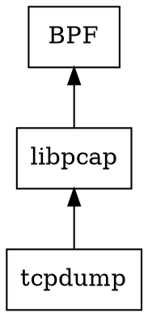

## Introduction

[tcpdump](https://www.tcpdump.org/) 命令用于在 Linux 系统上抓取网络流量，底层依赖 *libpcap*——一个可移植的 C/C++ 网络流量捕获库。



tcpdump 的抓包点位于 `ip_rcv` / `arp_rcv` 之前，即报文进入 IP / ARP 协议栈处理之前。

> [!TIP]
> 
> 抓包前先用 BPF 表达式收敛流量，是成本最低的手段：只关心 80 端口时写 `port 80`，让无关报文在内核侧尽早丢弃（可配合下文 `strace tcpdump port 80` 观察过滤表达式如何抵达内核）。

## lookup

`pcap-npf.c` 需要自己的 `pcap_lookupdev()`：出于兼容性考虑，它实际返回所有接口的名字，彼此以 NUL 分隔，某些调用方可能依赖这一行为。

MS-DOS 也有自己的 `pcap_lookupdev()`，不过那大概只能算一种优化。

其余情况下，统一调用 `pcap_findalldevs()` 获取设备列表，再从中挑选一个。

```c
#if !defined(HAVE_PACKET32) && !defined(MSDOS)
/*
 * Return the name of a network interface attached to the system, or NULL
 * if none can be found.  The interface must be configured up; the
 * lowest unit number is preferred; loopback is ignored.
 */
char *
pcap_lookupdev(char *errbuf)
{
   pcap_if_t *alldevs;
#ifdef _WIN32
  /*
   * Windows - use the same size as the old WinPcap 3.1 code.
   * XXX - this is probably bigger than it needs to be.
   */
  #define IF_NAMESIZE 8192
#else
  /*
   * UN*X - use the system's interface name size.
   * XXX - that might not be large enough for capture devices
   * that aren't regular network interfaces.
   */
  /* for old BSD systems, including bsdi3 */
  #ifndef IF_NAMESIZE
  #define IF_NAMESIZE IFNAMSIZ
  #endif
#endif
   static char device[IF_NAMESIZE + 1];
   char *ret;

   /*
    * We disable this in "new API" mode, because 1) in WinPcap/Npcap,
    * it may return UTF-16 strings, for backwards-compatibility
    * reasons, and we're also disabling the hack to make that work,
    * for not-going-past-the-end-of-a-string reasons, and 2) we
    * want its behavior to be consistent.
    *
    * In addition, it's not thread-safe, so we've marked it as
    * deprecated.
    */
   if (pcap_new_api) {
      snprintf(errbuf, PCAP_ERRBUF_SIZE,
          "pcap_lookupdev() is deprecated and is not supported in programs calling pcap_init()");
      return (NULL);
   }

   if (pcap_findalldevs(&alldevs, errbuf) == -1)
      return (NULL);

   if (alldevs == NULL || (alldevs->flags & PCAP_IF_LOOPBACK)) {
      /*
       * There are no devices on the list, or the first device
       * on the list is a loopback device, which means there
       * are no non-loopback devices on the list.  This means
       * we can't return any device.
       *
       * XXX - why not return a loopback device?  If we can't
       * capture on it, it won't be on the list, and if it's
       * on the list, there aren't any non-loopback devices,
       * so why not just supply it as the default device?
       */
      (void)pcap_strlcpy(errbuf, "no suitable device found",
          PCAP_ERRBUF_SIZE);
      ret = NULL;
   } else {
      /*
       * Return the name of the first device on the list.
       */
      (void)pcap_strlcpy(device, alldevs->name, sizeof(device));
      ret = device;
   }

   pcap_freealldevs(alldevs);
   return (ret);
}
#endif /* !defined(HAVE_PACKET32) && !defined(MSDOS) */
```

## pcap

### pcap_findalldevs

获取所有已启动且可打开的抓包源列表：出错返回 -1，成功返回 0；若没有任何接口处于 up 且可打开，通过 `alldevsp` 返回的列表可能为 NULL。
```c
int
pcap_findalldevs(pcap_if_t **alldevsp, char *errbuf)
{
   size_t i;
   pcap_if_list_t devlist;

   /*
    * Find all the local network interfaces on which we
    * can capture.
    */
   devlist.beginning = NULL;
   if (pcap_platform_finddevs(&devlist, errbuf) == -1) {
      /*
       * Failed - free all of the entries we were given
       * before we failed.
       */
      if (devlist.beginning != NULL)
         pcap_freealldevs(devlist.beginning);
      *alldevsp = NULL;
      return (-1);
   }

   /*
    * Ask each of the non-local-network-interface capture
    * source types what interfaces they have.
    */
   for (i = 0; capture_source_types[i].findalldevs_op != NULL; i++) {
      if (capture_source_types[i].findalldevs_op(&devlist, errbuf) == -1) {
         /*
          * We had an error; free the list we've been
          * constructing.
          */
         if (devlist.beginning != NULL)
            pcap_freealldevs(devlist.beginning);
         *alldevsp = NULL;
         return (-1);
      }
   }

   /*
    * Return the first entry of the list of all devices.
    */
   *alldevsp = devlist.beginning;
   return (0);
}
```

```c
// net/packet/af_packet.c
static const struct net_proto_family packet_family_ops = {
       .family =      PF_PACKET,
       .create =      packet_create,
       .owner =      THIS_MODULE,
};
```

## trace

```shell
strace tcpdump port 80
```

调用[创建 socket](/docs/CS/OS/Linux/net/socket.md?id=create)

```shell
#define ETH_P_ALL	0x0003		/* Every packet (be careful!!!) */

// Documentation/networking/filter.rst
socket(PF_PACKET, SOCK_RAW, htons(ETH_P_ALL))
```

### create

#### packet_create

设置 `po->prot_hook.func = packet_rcv;`

再由 `__register_prot_hook` 注册协议钩子

```c
static int packet_create(struct net *net, struct socket *sock, int protocol,
                      int kern)
{
       struct sock *sk;
       struct packet_sock *po;
       __be16 proto = (__force __be16)protocol; /* weird, but documented */
       int err;

       if (!ns_capable(net->user_ns, CAP_NET_RAW))
              return -EPERM;
       if (sock->type != SOCK_DGRAM && sock->type != SOCK_RAW &&
           sock->type != SOCK_PACKET)
              return -ESOCKTNOSUPPORT;

       sock->state = SS_UNCONNECTED;

       err = -ENOBUFS;
       sk = sk_alloc(net, PF_PACKET, GFP_KERNEL, &packet_proto, kern);
   

       sock->ops = &packet_ops;
       if (sock->type == SOCK_PACKET)
              sock->ops = &packet_ops_spkt;

       sock_init_data(sock, sk);

       po = pkt_sk(sk);
       init_completion(&po->skb_completion);
       sk->sk_family = PF_PACKET;
       po->num = proto;
       po->xmit = dev_queue_xmit;

       err = packet_alloc_pending(po);
       if (err)
              goto out2;

       packet_cached_dev_reset(po);

       sk->sk_destruct = packet_sock_destruct;
       sk_refcnt_debug_inc(sk);

       /*
        *     Attach a protocol block
        */

       spin_lock_init(&po->bind_lock);
       mutex_init(&po->pg_vec_lock);
       po->rollover = NULL;
       po->prot_hook.func = packet_rcv;

       if (sock->type == SOCK_PACKET)
              po->prot_hook.func = packet_rcv_spkt;

       po->prot_hook.af_packet_priv = sk;

       if (proto) {
              po->prot_hook.type = proto;
              __register_prot_hook(sk);
       }

       mutex_lock(&net->packet.sklist_lock);
       sk_add_node_tail_rcu(sk, &net->packet.sklist);
       mutex_unlock(&net->packet.sklist_lock);

       preempt_disable();
       sock_prot_inuse_add(net, &packet_proto, 1);
       preempt_enable();

       return 0;
out2:
       sk_free(sk);
out:
       return err;
}
```

`__register_prot_hook` 必须通过 `register_prot_hook` 调用，或者在不存在对 packet socket 异步访问的上下文中调用（`packet_create()` 即属后者）。

```c
//
static void __register_prot_hook(struct sock *sk)
{
       struct packet_sock *po = pkt_sk(sk);

       if (!po->running) {
              if (po->fanout)
                     __fanout_link(sk, po);
              else
                     dev_add_pack(&po->prot_hook);

              sock_hold(sk);
              po->running = 1;
       }
}
```

### rcv

#### packet_rcv

该函数对 skb 采取惰性克隆：寄望大部分报文在 BPF 过滤阶段就被丢弃，从而省下这次拷贝。
需要注意的微妙之处：这里确实会改写共享的 skb——`skb->data`、`skb->len` 与 `skb->cb` 都会被改动。
之所以安全，是因为（且仅当）落到这里的报文归当前 CPU 所有：出口报文由 `dev_queue_xmit_nit()` 负责克隆，入口报文由 `net_bh` 串行处理；因此只要在退出时把 skb 恢复原状，就不会波及他人。

```c
// 
static int packet_rcv(struct sk_buff *skb, struct net_device *dev,
                    struct packet_type *pt, struct net_device *orig_dev)
{
       struct sock *sk;
       struct sockaddr_ll *sll;
       struct packet_sock *po;
       u8 *skb_head = skb->data;
       int skb_len = skb->len;
       unsigned int snaplen, res;
       bool is_drop_n_account = false;

       if (skb->pkt_type == PACKET_LOOPBACK)
              goto drop;

       sk = pt->af_packet_priv;
       po = pkt_sk(sk);

       if (!net_eq(dev_net(dev), sock_net(sk)))
              goto drop;

       skb->dev = dev;

       if (dev_has_header(dev)) {
              /* The device has an explicit notion of ll header,
               * exported to higher levels.
               *
               * Otherwise, the device hides details of its frame
               * structure, so that corresponding packet head is
               * never delivered to user.
               */
              if (sk->sk_type != SOCK_DGRAM)
                     skb_push(skb, skb->data - skb_mac_header(skb));
              else if (skb->pkt_type == PACKET_OUTGOING) {
                     /* Special case: outgoing packets have ll header at head */
                     skb_pull(skb, skb_network_offset(skb));
              }
       }

       snaplen = skb->len;

       res = run_filter(skb, sk, snaplen); /** BPF filter */
       if (!res)
              goto drop_n_restore;
       if (snaplen > res)
              snaplen = res;

       if (atomic_read(&sk->sk_rmem_alloc) >= sk->sk_rcvbuf)
              goto drop_n_acct;

       if (skb_shared(skb)) {
              struct sk_buff *nskb = skb_clone(skb, GFP_ATOMIC);
              if (nskb == NULL)
                     goto drop_n_acct;

              if (skb_head != skb->data) {
                     skb->data = skb_head;
                     skb->len = skb_len;
              }
              consume_skb(skb);
              skb = nskb;
       }

       sock_skb_cb_check_size(sizeof(*PACKET_SKB_CB(skb)) + MAX_ADDR_LEN - 8);

       sll = &PACKET_SKB_CB(skb)->sa.ll;
       sll->sll_hatype = dev->type;
       sll->sll_pkttype = skb->pkt_type;
       if (unlikely(po->origdev))
              sll->sll_ifindex = orig_dev->ifindex;
       else
              sll->sll_ifindex = dev->ifindex;

       sll->sll_halen = dev_parse_header(skb, sll->sll_addr);

       /* sll->sll_family and sll->sll_protocol are set in packet_recvmsg().
        * Use their space for storing the original skb length.
        */
       PACKET_SKB_CB(skb)->sa.origlen = skb->len;

       if (pskb_trim(skb, snaplen))
              goto drop_n_acct;

       skb_set_owner_r(skb, sk);
       skb->dev = NULL;
       skb_dst_drop(skb);

       /* drop conntrack reference */
       nf_reset_ct(skb);

       spin_lock(&sk->sk_receive_queue.lock);
       po->stats.stats1.tp_packets++;
       sock_skb_set_dropcount(sk, skb);
       __skb_queue_tail(&sk->sk_receive_queue, skb);
       spin_unlock(&sk->sk_receive_queue.lock);
       sk->sk_data_ready(sk);
       return 0;

drop_n_acct:
       is_drop_n_account = true;
       atomic_inc(&po->tp_drops);
       atomic_inc(&sk->sk_drops);

drop_n_restore:
       if (skb_head != skb->data && skb_shared(skb)) {
              skb->data = skb_head;
              skb->len = skb_len;
       }
drop:
       if (!is_drop_n_account)
              consume_skb(skb);
       else
              kfree_skb(skb);
       return 0;
}
```

#### packet_recvmsg

从接收队列中取出一个报文并交给用户态；必要时阻塞等待。

```c
// 
static int packet_recvmsg(struct socket *sock, struct msghdr *msg, size_t len,
                       int flags)
{
       struct sock *sk = sock->sk;
       struct sk_buff *skb;
       int copied, err;
       int vnet_hdr_len = 0;
       unsigned int origlen = 0;

       err = -EINVAL;
       if (flags & ~(MSG_PEEK|MSG_DONTWAIT|MSG_TRUNC|MSG_CMSG_COMPAT|MSG_ERRQUEUE))
              goto out;

#if 0
       /* What error should we return now? EUNATTACH? */
       if (pkt_sk(sk)->ifindex < 0)
              return -ENODEV;
#endif

       if (flags & MSG_ERRQUEUE) {
              err = sock_recv_errqueue(sk, msg, len,
                                    SOL_PACKET, PACKET_TX_TIMESTAMP);
              goto out;
       }

       /*
        *     Call the generic datagram receiver. This handles all sorts
        *     of horrible races and re-entrancy so we can forget about it
        *     in the protocol layers.
        *
        *     Now it will return ENETDOWN, if device have just gone down,
        *     but then it will block.
        */

       skb = skb_recv_datagram(sk, flags, flags & MSG_DONTWAIT, &err);

       /*
        *     An error occurred so return it. Because skb_recv_datagram()
        *     handles the blocking we don't see and worry about blocking
        *     retries.
        */

       if (skb == NULL)
              goto out;

       packet_rcv_try_clear_pressure(pkt_sk(sk));

       if (pkt_sk(sk)->has_vnet_hdr) {
              err = packet_rcv_vnet(msg, skb, &len);
              if (err)
                     goto out_free;
              vnet_hdr_len = sizeof(struct virtio_net_hdr);
       }

       /* You lose any data beyond the buffer you gave. If it worries
        * a user program they can ask the device for its MTU
        * anyway.
        */
       copied = skb->len;
       if (copied > len) {
              copied = len;
              msg->msg_flags |= MSG_TRUNC;
       }

       err = skb_copy_datagram_msg(skb, 0, msg, copied);
       if (err)
              goto out_free;

       if (sock->type != SOCK_PACKET) {
              struct sockaddr_ll *sll = &PACKET_SKB_CB(skb)->sa.ll;

              /* Original length was stored in sockaddr_ll fields */
              origlen = PACKET_SKB_CB(skb)->sa.origlen;
              sll->sll_family = AF_PACKET;
              sll->sll_protocol = skb->protocol;
       }

       sock_recv_ts_and_drops(msg, sk, skb);

       if (msg->msg_name) {
              int copy_len;

              /* If the address length field is there to be filled
               * in, we fill it in now.
               */
              if (sock->type == SOCK_PACKET) {
                     __sockaddr_check_size(sizeof(struct sockaddr_pkt));
                     msg->msg_namelen = sizeof(struct sockaddr_pkt);
                     copy_len = msg->msg_namelen;
              } else {
                     struct sockaddr_ll *sll = &PACKET_SKB_CB(skb)->sa.ll;

                     msg->msg_namelen = sll->sll_halen +
                            offsetof(struct sockaddr_ll, sll_addr);
                     copy_len = msg->msg_namelen;
                     if (msg->msg_namelen < sizeof(struct sockaddr_ll)) {
                            memset(msg->msg_name +
                                   offsetof(struct sockaddr_ll, sll_addr),
                                   0, sizeof(sll->sll_addr));
                            msg->msg_namelen = sizeof(struct sockaddr_ll);
                     }
              }
              memcpy(msg->msg_name, &PACKET_SKB_CB(skb)->sa, copy_len);
       }

       if (pkt_sk(sk)->auxdata) {
              struct tpacket_auxdata aux;

              aux.tp_status = TP_STATUS_USER;
              if (skb->ip_summed == CHECKSUM_PARTIAL)
                     aux.tp_status |= TP_STATUS_CSUMNOTREADY;
              else if (skb->pkt_type != PACKET_OUTGOING &&
                      (skb->ip_summed == CHECKSUM_COMPLETE ||
                       skb_csum_unnecessary(skb)))
                     aux.tp_status |= TP_STATUS_CSUM_VALID;

              aux.tp_len = origlen;
              aux.tp_snaplen = skb->len;
              aux.tp_mac = 0;
              aux.tp_net = skb_network_offset(skb);
              if (skb_vlan_tag_present(skb)) {
                     aux.tp_vlan_tci = skb_vlan_tag_get(skb);
                     aux.tp_vlan_tpid = ntohs(skb->vlan_proto);
                     aux.tp_status |= TP_STATUS_VLAN_VALID | TP_STATUS_VLAN_TPID_VALID;
              } else {
                     aux.tp_vlan_tci = 0;
                     aux.tp_vlan_tpid = 0;
              }
              put_cmsg(msg, SOL_PACKET, PACKET_AUXDATA, sizeof(aux), &aux);
       }

       /*
        *     Free or return the buffer as appropriate. Again this
        *     hides all the races and re-entrancy issues from us.
        */
       err = vnet_hdr_len + ((flags&MSG_TRUNC) ? skb->len : copied);

out_free:
       skb_free_datagram(sk, skb);
out:
       return err;
}
```

## filter

### run_filter

## Summary

一次抓包可以串成完整链路：用户态经 libpcap 创建 AF_PACKET socket，`packet_create` 把 `packet_rcv` 挂成协议钩子；每个流经网卡的报文在 `ip_rcv` / `arp_rcv` 之前命中该钩子，先过一遍 BPF 过滤器（`run_filter`），命中的报文惰性克隆后进入 socket 接收队列；最后 `packet_recvmsg` 把队列中的报文拷贝到用户缓冲区。

这条链路直接解释两类常见现象：过滤器写得太宽，BPF 拦不住流量，拷贝与队列压力随之上升；抓包量超过接收缓冲区时，内核直接丢包并累计丢弃计数（`tp_drops`），表现为抓包结果出现丢包。排查时应先把 `port 80` 这类表达式写窄，再核对两端的报文数差距。

## Links

- [BPF](/docs/CS/OS/Linux/Tools/BPF.md)
- [Xcap](/docs/CS/CN/Tools/Xcap.md)
- [WireShark](/docs/CS/CN/Tools/WireShark.md)
- [netfilter](/docs/CS/CN/Tools/netfilter.md)

## References

1. [TCPDUMP & LiBPCAP](https://www.tcpdump.org/index.html#documentation)
2. [Linux 内核角度分析 tcpdump 原理](https://mp.weixin.qq.com/s?__biz=Mzg5MTU1ODgyMA==&mid=2247483799&idx=1&sn=d31ddd924b8809040c004c5f163cb61d&chksm=cfcacf5cf8bd464abdab4c3a9b571d6e52d0a8d0ee9d71191bbe8ed3c3dfb084e303b636afce&scene=178&cur_album_id=2086465918313775105#rd)
3. [The BSD Packet Filter: A New Architecture for User-level Packet Capture](https://www.tcpdump.org/papers/bpf-usenix93.pdf)
