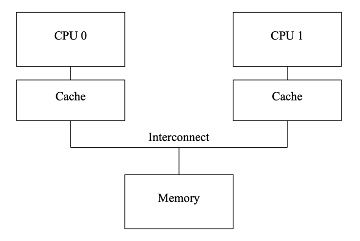

## Introduction

缓存（cache）是存储层次中衔接 CPU 与主存的一层：以**缓存行（cache line）**为单位在两者间搬运数据，命中时把访问延迟从 DRAM 的约百纳秒压到数纳秒。它上承[存储层次](/docs/CS/CO/CO.md)的整体金字塔，下接[多处理器内存](/docs/CS/CO/memory.md)的 UMA/NUMA 组织，其延迟模型直接决定[流水线](/docs/CS/CO/pipeline.md)中 load-use 冒险的停顿拍数。本页讲**单核视角的缓存组织**：结构与三种缺失、映射方式、替换与写策略；多核一致性（MESI 状态机、store buffer、invalidate queue 与内存屏障）拆至[缓存一致性与内存序](/docs/CS/CO/coherence.md)。

## Cache Structure

Fig.1. Modern Computer System Cache Structure.

数据在 CPU 缓存与内存之间以定长块搬运，即**缓存行（cache line）**，大小通常是 2 的幂，从 16 到 256 字节（今日 x86 / ARM 主流为 64 B）。某个数据第一次被某颗 CPU 访问时必然不在它的缓存里，称为**强制性缺失（compulsory / cold / warmup miss）**，CPU 要停顿数百个周期等内存取数；取回后该行进入缓存，后续访问全速命中。

缓存被填满后，新行需要淘汰旧行让位，这种缺失叫**容量缺失（capacity miss）**。但大缓存即使没满也可能被迫淘汰——因为大缓存实现为**固定桶大小、无碰撞链的硬件哈希表**，CPU 设计者把这些桶叫作**组（set）**（见 Fig.1）：一个地址只能落到唯一一组，组内行位有限，组满即需淘汰，由此产生**冲突缺失（conflict miss）**。

典型多核系统的层级：**L1**（分指令 L1i 与数据 L1d，各核私有，约 1 ns）→ **L2**（核私有，数 ns）→ **L3**（socket 内共享，十余 ns）→ DRAM（约百 ns）。越往下越慢越大，这是[存储层次](/docs/CS/CO/CO.md)金字塔在单芯片上的投影。

## 映射方式（Mapping）

主存块到缓存行的放置策略，是缓存组织方式的核心：

| 方式 | 规则 | 特点 |
|------|------|------|
| 直接映射（direct-mapped） | 每块只能落到唯一一组（常为 `addr mod 组数`） | 查找最快（一次比较），冲突缺失最高 |
| 组相联（set-associative） | 每块可落到唯一一组内的任意行（N 路） | 现代 CPU 主流（L1 多为 8 路） |
| 全相联（fully associative） | 每块可落到任意行 | 冲突缺失最低，查找需并行比较所有 tag，仅适合小缓存（如 TLB） |

访存地址因此被切成三段：**tag | index（选组）| offset（行内偏移）**。组相联下每组并行比较各路 tag，命中即按 offset 取数据；全部不命中则走替换策略选牺牲行。

## 替换与写策略

- **替换**：直接映射无须选择；组相联常用 **LRU** 或其近似（伪 LRU / PLRU，硬件只需少量位即可逼近），也有随机替换。替换发生在缺失需要让位时。
- **写命中**：**写直达（write-through）**同时写缓存与内存（简单但慢）；**写回（write-back）**只改缓存并置脏位，行被淘汰时才写内存（主流，脏行让位靠[一致性协议](/docs/CS/CO/coherence.md)的 M 态落地）。
- **写缺失**：**写分配（write-allocate）**先把行取入缓存再写（配合 write-back）；**不写分配（no-write-allocate）**直接写内存（配合 write-through）。

## 缓存性能：AMAT 与多级缺失代价

映射、替换、写策略都是"怎么组织"，而**平均访存时间（AMAT）**是组织好坏唯一的量化裁判：

$$\text{AMAT} = \text{hit time} + \text{miss rate} \times \text{miss penalty}$$

- **hit time**：命中时的访问延迟（L1 ~1 ns，含 tag 比较与数据读取）；
- **miss rate**：访问未命中的比例，与三种缺失直接对应——强制性（cold）、容量（capacity）、冲突（conflict）；
- **miss penalty**：缺失后从下一层取回行的全部代价（L1 miss 到 DRAM 约 80–100 ns）。

多级缓存是 AMAT 的链式展开：**L1 的 miss penalty 就是 L2 的 AMAT**，L2 的 miss penalty 是 L3 的 AMAT，最后一级的 miss penalty 才落到内存。这解释了层级设计的优化方向：

- 压低 hit time（少用大容量全相联、VIPT 并行 TLB 查找，见 [TLB](/docs/CS/CO/tlb.md)）；
- 压低 miss rate（更大容量、更高相联度、更好的替换——但边际收益递减，8 路以上再涨收益很小）；
- 压低 miss penalty（更快的下一层、预取、多级并行 miss——**MLP** 让多个缺失同时进行，等效摊薄 penalty，见[数据通路](/docs/CS/CO/datapath.md)）。

经验法则：一次 L1 miss 约等于几百条指令的执行时间，而 L1 hit 只需几个周期——**缓存系统的全部设计，本质都是在 miss rate 与 hit time 之间做交易**。软件侧减少 miss 的手段（分块、数据布局、预取）的收益上限，同样可以用 AMAT 估出来。

## Links

- [Computer Organization（组成原理枢纽）](/docs/CS/CO/CO.md)
- [缓存一致性与内存序](/docs/CS/CO/coherence.md)
- [多处理器内存（UMA/NUMA 与缓存一致性）](/docs/CS/CO/memory.md)
- [并行与伪共享](/docs/CS/OS/Parallel.md)
- [Linux 内存管理](/docs/CS/OS/Linux/mm/memory.md)

## References

1. [Memory Barriers: a Hardware View for Software Hackers](http://www.rdrop.com/users/paulmck/scalability/paper/whymb.2010.06.07c.pdf)
2. [Computer Architecture: A Quantitative Approach（Hennessy & Patterson）](https://shop.elsevier.com/books/computer-architecture/hennessy/978-0-12-811905-1)
