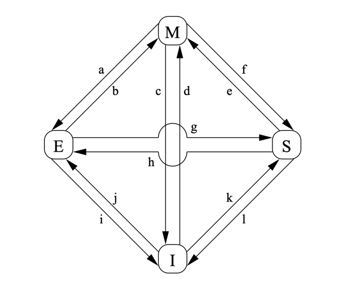

## Introduction

单核 cache 只是延迟问题，多核则是**正确性**问题：同一地址可能同时存在于多颗 CPU 的缓存中，某核改写后其他核的副本即过期。本页讲硬件如何对软件透明地维持各副本一致——MESI 协议的消息与状态机、store buffer 与 invalidate queue 两处"故意重排序"、以及纠正它们的内存屏障。它是[缓存层次](/docs/CS/CO/Cache.md)（缓存组织）的多核续篇，也是[多处理器内存](/docs/CS/CO/memory.md)（UMA/NUMA）之上真正让并行程序出错的环节，向下直达[并行程序可见性](/docs/CS/OS/Parallel.md)与 Linux 的[内存屏障语义](/docs/CS/OS/Linux/mm/memory.md)。

## Cache-Coherence Protocols

硬件用**缓存一致性协议（cache-coherence protocol）**维持各副本一致，商业实现可达几十个状态，本节只讲最经典的 **MESI**。

Fig.1. MESI Cache-Coherency State Diagram.

### MESI

MESI 四态即 modified / exclusive / shared / invalid：除物理地址与数据外，每行还有**两位状态位**。在单共享总线的多处理器上，下面一组消息即可完成全部状态迁移：

- **Read**：携带目标行的物理地址，请求读；
- **Read Response**：回应 Read 的数据，可来自内存或其他缓存（若某缓存持有该行的 M 态副本，必须由它提供数据）；
- **Invalidate**：要求其他缓存作废对应行，收方移除后须应答；
- **Invalidate Acknowledge**：对 Invalidate 的应答，发完才认定作废完成；
- **Read Invalidate**：Read + Invalidate 的合体（为"拿数据并独占"），需 Read Response 与一组 Invalidate Acknowledge 回复；
- **Writeback**：把 M 态行的地址与数据写回内存（沿途可被其他缓存嗅探吸收），使该行可被让位。

Fig.1 中各条迁移弧线归纳如下：

| 迁移 | 场景 | 动作 |
|------|------|------|
| (a) | 本核把干净行写回 | 发 Writeback；保留缓存副本，仍可改 |
| (b) | 本核写自己独占（E）的行 | 无消息，E → M |
| (c) | 本核的 M 态行被 Read Invalidate | 作废本地副本，回 Read Response + Invalidate Acknowledge，数据转交请求方 |
| (d) | 原子 RMW 命中缺失地址 | 发 Read Invalidate，收数据与全部 Ack 后完成 |
| (e) | 原子 RMW 命中只读（S）行 | 发 Invalidate，等全部 Ack 后升级 |
| (f) / (g) | 其他核 Read 本核持有的行 | 由本核缓存（或内存）供数，本核保留只读副本 |
| (h) | 本核预写某行 | 发 Invalidate，等全部 Ack 后独占（或他核经 Writeback 顺带让位） |
| (i) | 其他核对本核私有行做原子 RMW | 收 Read Invalidate，回数据 + Ack 并作废 |
| (j) | 本核 store 缺失行 | 发 Read Invalidate，收齐数据与 Ack 后经 (b) 转 M |
| (k) | 本核 load 缺失行 | 发 Read，收 Read Response 后装入 |
| (l) | 其他核 store 本核只读持有的行 | 收 Invalidate，回 Ack 并作废 |

MESI 保证一致性，但消息往返本身就是多核写的性能瓶颈——写共享变量引发的**缓存行乒乓（cache line bouncing）**是[多核扩展](/docs/CS/CO/memory.md)的隐形杀手，软件侧的**伪共享**（false sharing）即由此而来，详见[并行性能笔记](/docs/CS/OS/Parallel.md)。协议的工程实现（总线嗅探 vs 目录）与 MOESI/MESIF 变体见[多处理器内存](/docs/CS/CO/memory.md)。

## Store Buffers

若每次 store 都等一致性消息往返确认，写操作会慢到不可接受。为此每核设有**存储缓冲区（store buffer）**：store 先进入缓冲区即视作完成，CPU 继续执行，缓冲区再异步把消息发出去、把脏行写入缓存。

代价是**重排序**：后续 load 可能先于仍在缓冲区里的 store 对其他核可见——本核按程序序看一切正常，别的核却看到了"旧值"，单线程正确、多线程出错。缓解办法是**写内存屏障（write memory barrier）**：把该屏障之前的所有 store 在缓冲区里排干（标记并等待确认）后，才放行后续 store。

## Invalidate Queues

Invalidate 消息同样不能当场处理：每核设**失效队列（invalidate queue）**，收到的 Invalidate 消息先入队、延迟处理。这带来镜像问题：某核已发出 Invalidate 并收到 Ack，便认为其他核不再有副本，但对方其实只是把消息**排在队里还没执行**，随后的读仍可能命中本地旧副本。

**读内存屏障（read memory barrier）**标记失效队列，保证该屏障之后的 load 执行前，队中此前积累的失效消息全部处理完毕。

## Memory Barrier

允许内存引用重排序能大幅提升性能，但同步原语的正确性依赖有序的内存引用，因此需要**内存屏障**强制定序。各架构提供的屏障强弱不同，粗分三类：

- **读屏障（read memory barrier）**：只标记失效队列，只对执行它的 CPU 上的 load 定序——屏障前的 load 全部"看起来完成"之后，屏障后的 load 才执行；
- **写屏障（write memory barrier）**：只标记存储缓冲区，只对 store 定序——屏障前的 store 全部完成后，屏障后的 store 才执行；
- **全屏障（full memory barrier）**：两者都做，对 load 与 store 全面定序。

注意三者都**只约束执行屏障的这颗 CPU 自身**的可见顺序；跨核的顺序与可见性仍要靠一致性协议与屏障的组合来保证。

## 从 MESI 到内存模型

一致性协议保证"最终一致"，**内存模型（memory model）**才规定"多远的重排序被允许"，各 ISA 的尺度差异很大：

- **x86-64（TSO）**：store-load 一对允许重排（靠 store buffer），其余保持程序序，是主流架构中最强的模型；
- **ARMv8 / POWER / RISC-V（RVWMO）**：弱序模型，除依赖关系外多数重排都可能发生，**几乎每个共享内存访问都要显式屏障或 acquire/release 语义**；
- 这正是同一份 C++ 无锁代码在 x86 上"碰巧能跑"、移植到 ARM 就偶发崩溃的根因。Linux 内核因此提供统一屏障 API（`smp_wmb` / `smp_rmb` / `smp_mb`），编译器侧的 `volatile` 与 `_Atomic` 也各自只解决一半问题，详见[并行笔记](/docs/CS/OS/Parallel.md)与 [Linux 内存管理](/docs/CS/OS/Linux/mm/memory.md)。

## Links

- [缓存层次](/docs/CS/CO/Cache.md)
- [多处理器内存（UMA/NUMA 与缓存一致性）](/docs/CS/CO/memory.md)
- [并行与伪共享](/docs/CS/OS/Parallel.md)
- [Linux 内存管理](/docs/CS/OS/Linux/mm/memory.md)

## References

1. [Memory Barriers: a Hardware View for Software Hackers](http://www.rdrop.com/users/paulmck/scalability/paper/whymb.2010.06.07c.pdf)
2. [Computer Architecture: A Quantitative Approach（Hennessy & Patterson）](https://shop.elsevier.com/books/computer-architecture/hennessy/978-0-12-811905-1)
3. [MESI protocol（Wikipedia）](https://en.wikipedia.org/wiki/MESI_protocol)
