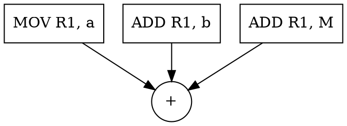
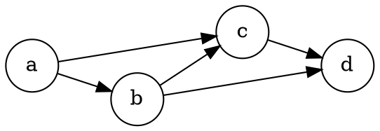

# Code Generation

## Introduction

代码生成是后端的最后一段：把 IR 映射成目标机的指令序列。
它由三个互相纠缠的子问题组成——**指令选择**（哪条指令实现这个 IR 操作）、**寄存器分配**（哪些值住进寄存器）、**指令调度**（指令按什么顺序发射）。
任一子问题的"最优"都可能让另一个变差，真实编译器用迭代逼近而非全局最优。

生成的代码必须遵守 [assembly](/docs/CS/assembly/assembly.md) 描述的 ABI：调用约定决定参数怎么传、哪些寄存器被调用者保存，代码生成器是 ABI 的直接执行者。

## Instruction Selection

给定 IR 操作序列，为每个操作（或组合）选目标机指令。

### Tree Covering

把 IR 表示成树，用指令模板库覆盖它：

- **Maximal munch**：自底向上，每步选能覆盖最多节点的模板，贪心、快、常用；
- **动态规划 / BURS**（bottom-up rewrite system）：全局最优或近优，GCC 与 LLVM 的低层都用树/ DAG 覆盖；
- **dialect** 的概念：CISC 机器的一条 `ADD R1, M`（内存操作数）覆盖"load + add"两个 IR 节点，模板库的丰富度决定选择质量。

### Selection DAG

LLVM 的 `SelectionDAG` 把 IR 转成数据流图再覆盖：节点是操作，边是数据依赖，天然合并公共子表达式、显式化链条（`load → add → store`）。
图覆盖之后进入指令调度。

## Register Allocation

寄存器的稀缺性是后端的核心矛盾：变量数 ≫ 寄存器数，分配质量直接决定执行速度（一次溢出 = 一次内存往返）。

### Interference and Coloring

活性分析（后向数据流）给出每个程序点上"活跃"的变量集合；
两个变量活跃区间**相交**即互相干涉（interference），构造干涉图。
分配归结为图着色：寄存器数 = 颜色数，`K` 个寄存器 → `K`-着色，不可着色即溢出（spill）到栈。

图着色是 NP 难，工业实现用启发式：

- **Chaitin-Briggs**：迭代简化（反复移除度数 < K 的节点）+ 选择（挑低溢出代价的点溢出）+ 合并（复写传播把两个节点并成一个）；
- **线性扫描**（linear scan）：按活性区间端点排序后一趟扫过，O(n log n)，JIT 与 GC 语言运行时的首选；
- **SSA 优势**：SSA 下干涉图是弦图，染色存在线性时间算法，且 φ 的并行拷贝直接对应 coalescing 目标。

### Coalescing and Spilling

两个变量若被 `mov` 连接且不互相干涉，尽量分同一寄存器（coalescing），消掉拷贝指令。
简化失败时的**溢出代价**（`use_count × loop_depth`）决定谁让出寄存器——循环深处的值最贵。
被调用者/调用者保存寄存器的划分（见 [Runtime Environment](/docs/CS/Compiler/Runtime_Environment.md)）在调用序列生成时处理。

## Instruction Scheduling

调度在不改变数据依赖的前提下重排指令，填满流水线（详见 [Instruction-Level Parallelism](/docs/CS/Compiler/Instruction_Level_Parallelism.md)）：

- **列表调度**：维护"就绪"指令表，按启发式（关键路径优先、最少延迟）逐条发射；
- **依赖约束**：真依赖（RAW）必须保序；反依赖（WAR）与输出依赖（WAR/WAW）可被寄存器重命名打破；
- **前向 vs 后向**：前向调度从入口铺到出口填延迟；后向调度从出口倒排，适合有分支的代码。

调度与分配的耦合：调度改变活性区间，分配产生的溢出代码又反过来改变调度，经典解法（如把两者统一到图着色框架、或迭代重跑）至今仍是研究课题。

## Machine-Dependent Optimization

后端还有一批贴近硬件的优化：寻址模式选择（`[base+idx*4+disp]` 能一条指令复合三种计算）、分支偏移压缩、条件执行（ARM `IT` 块、if-conversion）、指令融合（x86 的 `cmp+jcc` 宏融合）。
这些通常放在指令选择模板与窥孔阶段完成，与中端的机器无关优化分层清晰。

## Links

- [Compiler](/docs/CS/Compiler/Compiler.md)
- [Intermediate Representation](/docs/CS/Compiler/Intermediate_Representation.md)
- [Optimization](/docs/CS/Compiler/Optimization.md)
- [Runtime Environment](/docs/CS/Compiler/Runtime_Environment.md)
- [assembly](/docs/CS/assembly/assembly.md)

## References

1. [LLVM Code Generator — SelectionDAG and Instruction Selection](https://llvm.org/docs/CodeGenerator.html)
2. [GCC Internals — Register Allocation and Instruction Scheduling](https://gcc.gnu.org/onlinedocs/gccint/)
