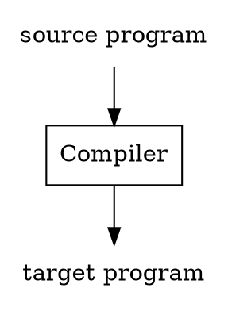
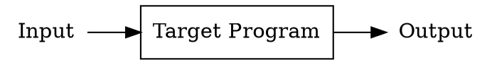
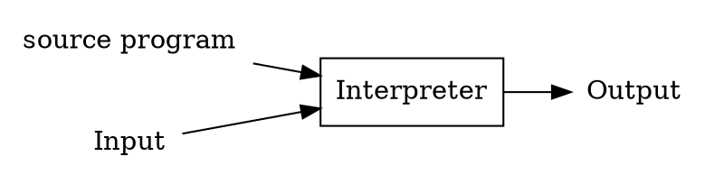
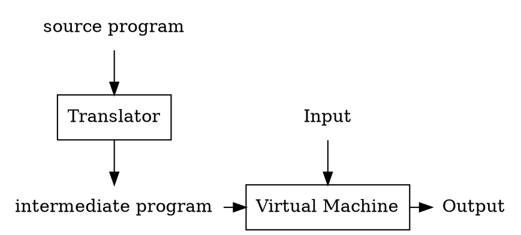
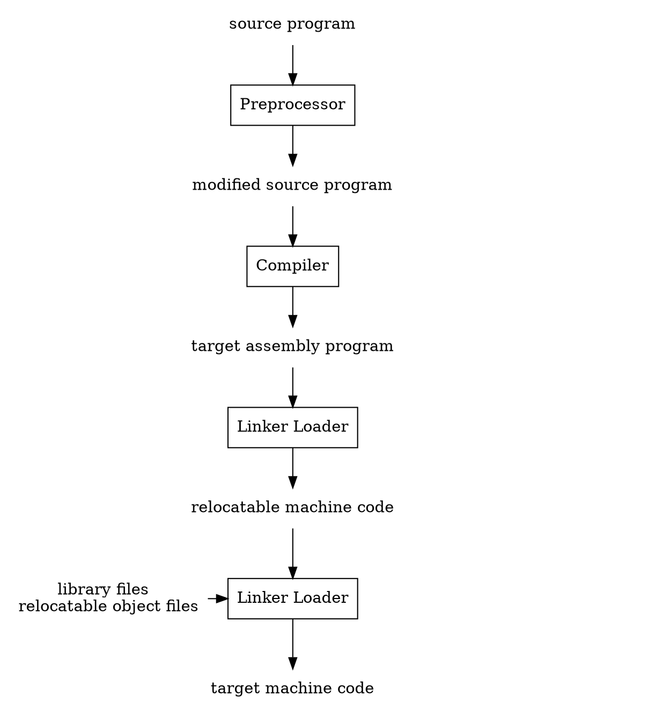
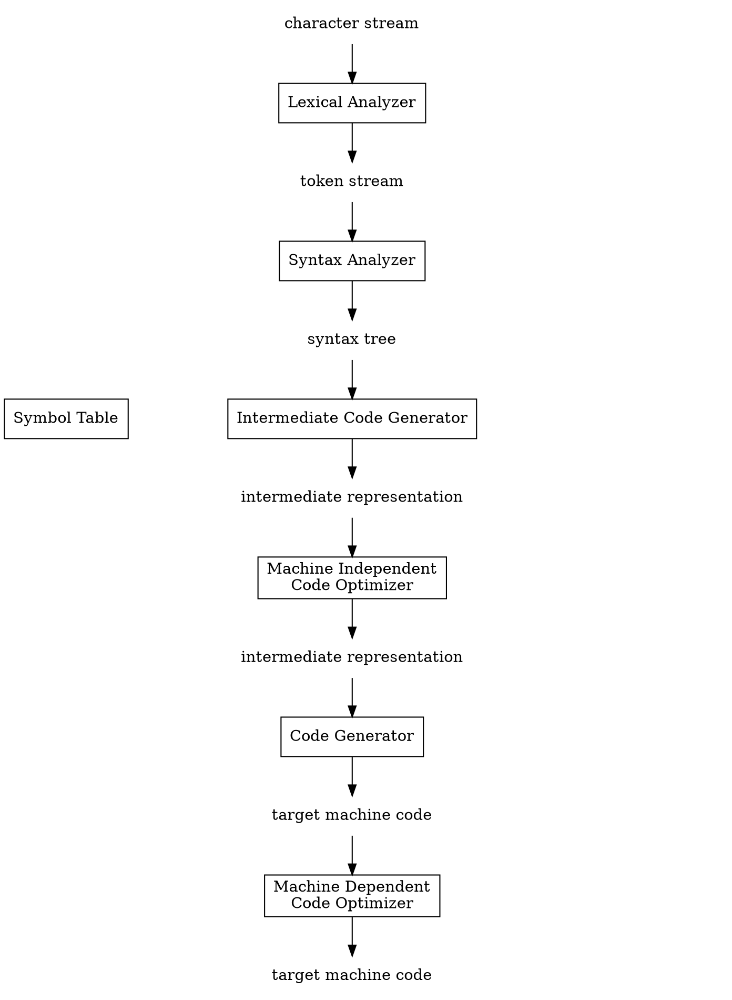

# Compiler

## Introduction

Programming languages are notations for describing computations to people and to machines.
The world as we know it depends on programming languages, because all the software running on all the computers was written in some programming language.
But, before a program can be run, it first must be translated into a form in which it can be executed by a computer.

The software systems that do this translation are called *compilers*.

## Language Processors

Simply stated, a compiler is a program that can read a program in one language (the source language) and translate it into an equivalent program in another language (the target language), see Figure 1.
An important role of the compiler is to report any errors in the source program that it detects during the translation process.

<div style="text-align: center;">



</div>

<p style="text-align: center;">
Fig.1. A compiler.
</p>

If the target program is an executable machine-language program, it can then be called by the user to process inputs and produce outputs, see Figure 2.

<div style="text-align: center;">



</div>

<p style="text-align: center;">
Fig.2. Running the target program.
</p>

An interpreter is another common kind of language processor.
Instead of producing a target program as a translation, an interpreter appears to directly execute the operations specified in the source program on inputs supplied by the user, as shown in Figure 3.

<div style="text-align: center;">



</div>

<p style="text-align: center;">
Fig.3. An interpreter.
</p>

The machine-language target program produced by a compiler is usually much faster than an interpreter at mapping inputs to outputs.
An interpreter, however, can usually give better error diagnostics than a compiler, because it executes the source program statement by statement.

Java language processors combine compilation and interpretation, as shown in Figure 4.
A Java source program may first be compiled into an intermediate form called bytecodes.
The bytecodes are then interpreted by a virtual machine.
A benefit of this arrangement is that bytecodes compiled on one machine can be interpreted on another machine, perhaps across a network.
In order to achieve faster processing of inputs to outputs, some Java compilers, called just-in-time compilers, translate the bytecodes into machine language immediately before they run the intermediate program to process the input.

<div style="text-align: center;">



</div>

<p style="text-align: center;">
Fig.4. A hybrid compiler.
</p>

In addition to a compiler, several other programs may be required to create an executable target program, as shown in Figure 5.
A source program may be divided into modules stored in separate files.
The task of collecting the source program is sometimes entrusted to a separate program, called a *preprocessor*.
The preprocessor may also expand shorthands, called macros, into source language statements.

The modified source program is then fed to a compiler.
The compiler may produce an assembly-language program as its output, because assembly language is easier to produce as output and is easier to debug.
The assembly language is then processed by a program called an *assembler* that produces relocatable machine code as its output.

Large programs are often compiled in pieces, so the relocatable machine code may have to be linked together with other relocatable object files and library files into the code that actually runs on the machine.
The *linker* resolves external memory addresses, where the code in one file may refer to a location in another file.
The *loader* then puts together all of the executable object files into memory for execution.

<div style="text-align: center;">



</div>

<p style="text-align: center;">
Fig.5. A language-processing system.
</p>

## The Structure of a Compiler

Up to this point we have treated a compiler as a single box that maps a source program into a semantically equivalent target program.
If we open up this box a little, we see that there are two parts to this mapping: analysis and synthesis.

The *analysis* part breaks up the source program into constituent pieces and imposes a grammatical structure on them.
It then uses this structure to create an intermediate representation of the source program.
If the analysis part detects that the source program is either syntactically ill formed or semantically unsound, then it must provide informative messages, so the user can take corrective action.
The analysis part also collects information about the source program and stores it in a data structure called a symbol table, which is passed along with the intermediate representation to the synthesis part.

The *synthesis* part constructs the desired target program from the intermediate representation and the information in the symbol table.
The analysis part is often called the front end of the compiler; the synthesis part is the back end.

If we examine the compilation process in more detail, we see that it operates as a sequence of phases, each of which transforms one representation of the source program to another.
A typical decomposition of a compiler into phases is shown in Figure 6.
In practice, several phases may be grouped together, and the intermediate representations between the grouped phases need not be constructed explicitly.
The symbol table, which stores information about the entire source program, is used by all phases of the compiler.

<div style="text-align: center;">



</div>

<p style="text-align: center;">
Fig.6. Phases of a compiler.
</p>

In summary, the phases of a compiler are: lexical analysis, syntax analysis, semantic analysis, intermediate code generation, optimization, and code generation.
The symbol table is a data structure being used and maintained by the compiler, consisting of all the identifier's names along with their types; it helps the compiler find identifiers quickly.

Some compilers have a machine-independent optimization phase between the front end and the back end.
The purpose of this optimization phase is to perform transformations on the intermediate representation, so that the back end can produce a better target program than it would have otherwise produced from an unoptimized intermediate representation.
Since optimization is optional, one or the other of the two optimization phases shown in Figure 6 may be missing.

The analysis of a source program is divided into mainly three phases:

- **Linear Analysis** — a scanning phase where the stream of characters is read from left to right and grouped into tokens having a collective meaning.
- **Hierarchical Analysis** — tokens are categorized hierarchically into nested groups based on their collective meaning.
- **Semantic Analysis** — checks whether the components of the source program are meaningful or not.

### Three-stage Compiler

传统编译器采用三段式设计：前端只认源码、后端只认目标机，中间靠 IR 解耦——换一门语言只需换前端，换一个架构只需换后端：

```
┏━━━━━━━━━━━┓     ┏━━━━━━━━━━━━━━━━━━━━━━━ Compiler ━━━━━━━━━━━━━━━━━━━━━━━━┓    ┏━━━━━━━━━━━┓
┃  source   ┃     ┃    ┏━━━━━━━━━━━┓ IR ┏━━━━━━━━━━━┓ IR ┏━━━━━━━━━━━┓  ┃    ┃  target   ┃
┃           ┣━━━━━╋━━━>┃ front end ┣━━━>┃ optimizer ┣━━━>┃ back end  ┣━━╋━━═>┃           ┃
┃  program  ┃     ┃    ┗━━━━━━━━━━━┛    ┗━━━━━━━━━━━┛    ┗━━━━━━━━━━━┛  ┃    ┃  program  ┃
┗━━━━━━━━━━━┛     ┗━━━━━━━━━━━━━━━━━━━━━━━━━━━━━━━━━━━━━━━━━━━━━━━━━━━━━┛    ┗━━━━━━━━━━━┛
```

编译器的 IR 可能有多个层级，会进行多次优化，如识别冗余代码、识别内存逃逸等。
LLVM 把这一分工推到了极致：一套 IR 支撑数十种语言前端与数十种目标后端，详见 [GCC](/docs/CS/Compiler/GCC.md) 与 [ELF](/docs/CS/Compiler/ELF.md) 对产物格式的记录。

## Map of This Section

本页只讲编译器作为「语言处理器」的整体形态与三段式骨架；每个阶段的细节展开在以下分册，阅读顺序即数据流向：

- [Lexical Analysis](/docs/CS/Compiler/Lexical_Analysis.md) 把字符流切成 token，回答「正则如何变成识别器」；
- [Parsing](/docs/CS/Compiler/Parsing.md) 把 token 流组织成语法树，回答「文法如何变成分析器」，LL 与 LR 两条路线的取舍是本节主线；
- [Semantic Analysis](/docs/CS/Compiler/Semantic_Analysis.md) 在语法树上做属性计算与类型检查，符号表与作用域在这里成型；
- [Intermediate Representation](/docs/CS/Compiler/Intermediate_Representation.md) 选定前端的产物形态，从三地址码到 SSA，IR 的设计直接决定后续优化的上限；
- [Optimization](/docs/CS/Compiler/Optimization.md) 在 IR 上做等价变换，数据流分析是通用框架，循环优化收益最大；
- [Code Generation](/docs/CS/Compiler/Code_Generation.md) 把 IR 落到目标机：指令选择、寄存器分配、指令调度三件事互相纠缠；
- [Runtime Environment](/docs/CS/Compiler/Runtime_Environment.md) 描述编译器为运行期生成的契约——栈帧、调用约定、存储布局；
- [Instruction-Level Parallelism](/docs/CS/Compiler/Instruction_Level_Parallelism.md) 从硬件流水线视角看编译器如何挖掘指令级并行。

分册之外，[GCC](/docs/CS/Compiler/GCC.md) 记录 GNU 工具链的驱动流程与实战选项，[ELF](/docs/CS/Compiler/ELF.md) 记录链接产物的二进制格式；最底层表达是 [assembly](/docs/CS/assembly/assembly.md)（调用约定、内联汇编、汇编器与工具链）。

## Links

- [Lexical Analysis](/docs/CS/Compiler/Lexical_Analysis.md)
- [Parsing](/docs/CS/Compiler/Parsing.md)
- [Optimization](/docs/CS/Compiler/Optimization.md)
- [Code Generation](/docs/CS/Compiler/Code_Generation.md)
- [GCC](/docs/CS/Compiler/GCC.md)
- [assembly](/docs/CS/assembly/assembly.md)

## References

1. [Compilers: Principles, Techniques, and Tools](https://www.pearson.com/en-us/subject-catalog/p/compilers-principles-techniques-and-tools/P200000005771)
2. [GCC Online Documentation](https://gcc.gnu.org/onlinedocs/)
