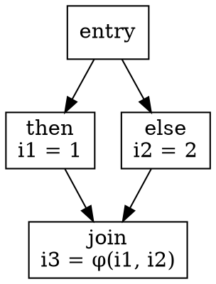

# Intermediate Representation

## Introduction

中间表示（IR）是前端的产物、后端与优化的输入。
它的存在只有一个理由：**把"源语言是什么"与"目标机是什么"解耦**——前端只负责把源码翻成 IR，后端只负责把 IR 翻成机器码，同一份 IR 服务 N 个前端 × M 个后端。

IR 的设计是编译器架构里影响最深的一个决定：它决定了哪些优化可以表达、分析的粒度到哪、跨语言工具（LSP、静态分析）能不能复用前端。
本页从三地址码出发，走到 SSA，再对比 HIR/MIR/LIR 分层与字节码 IR。

## Three-Address Code

三地址码（TAC）的每条指令最多三个地址：`x = y op z`。
它既是 IR 的最小公倍数，又几乎与汇编同构，实现成本极低：

```
t1 = inttofloat(60)
t2 = id3 * t1
t3 = id2 + t2
id1 = t3
```

三种等价文本形式：

| 形式 | 例子 | 特点 |
| :--- | :--- | :--- |
| 四元式 (quad) | `(*, id3, t1, t2)` | 易寻址，隐式临时变量 |
| 三元式 (triple) | `(0)(*)(1)(2)` | 紧凑，难重排 |
| 间接三元式 | 间接表指向三元式 | 兼顾紧凑与可重排 |

临时变量的命名本身就是信息：`t3` 只被用一次，这条事实就是常量传播与复写传播的原料（见 [Optimization](/docs/CS/Compiler/Optimization.md)）。

## SSA Form

静态单赋值（SSA）每个变量只被赋值一次，是过去三十年最重要的 IR 创新——它把"值的使用点"与"定义点"显式连成 use-def 链，绝大多数数据流分析从迭代求解变成常数时间查表。

控制流汇合处引入 **φ 函数**：



```
if (c) i = 1; else i = 2;
// SSA:
  %c = icmp ...
  br i1 %c, label %then, label %else
then:
  %i1 = ...
  br label %join
else:
  %i2 = ...
  br label %join
join:
  %i3 = phi i32 [ %i1, %then ], [ %i2, %else ]
```

SSA 的关键性质：

- **use-def 链显式**：一个值的所有使用点沿 def 可达，常量传播、死代码消除一遍扫描完成；
- **支配边界**（dominance frontier）：精确计算"哪些汇合点需要为某定义插入 φ"，是 SSA 构造的算法核心；
- **退出 SSA**（out of SSA）：后端寄存器分配前把 φ 拆成并行拷贝，处理并行拷贝的冲突是另一个经典问题。

未初始化的读在 SSA 下变成"使用了一个没有 def 的值"，可静态检出。

## IR Levels: HIR, MIR, LIR

真实编译器很少只有一层 IR，而是分层降低：

| 层级 | 抽象度 | 内容 | 典型代表 |
| :--- | :--- | :--- | :--- |
| HIR | 高 | 带类型、保留数组/结构/对象语义 | Rust `hir`、Swift `SIL`、GIMPLE 高层 |
| MIR | 中 | 控制流显式化、操作仍与机器无关 | Rust `mir`、LLVM IR、GCC GIMPLE |
| LIR | 低 | 贴近指令选择、可虚拟寄存器 | LLVM SelectionDAG/`MachineIR`、GCC RTL |

分层的收益：

- 高层 IR 保留数组越界、对象语义，便于诊断与源码级优化；
- 中层 IR 是数据流分析的主战场，SSA 通常在这一层；
- 低层 IR 做指令选择、调度与寄存器分配的输入，虚拟寄存器把"无限寄存器"的假设带进后端。

GCC 是分层的活样本：`GENERIC` → `GIMPLE` → `RTL`，前端语言树先降到 GIMPLE 才进入中端 pass。
Rust 是另一个：`THIR → MIR → LLVM IR`，借用检查跑在 MIR 上。

## Basic Blocks and Control Flow

IR 的组织单位是**基本块**：单入口单出口的最大指令序列。
基本块之间连成控制流图（CFG），CFG 是所有过程内分析的框架：

- 定值-使用链（def-use）与使用-定值链沿 CFG 边传播；
- 循环识别依赖回边（back edge，指向支配者的边）；
- 支配树（dominator tree）决定分析方向与 φ 插入点。

## Bytecode IR

面向虚拟机的 IR 与面向原生代码的 IR 目标不同：跨平台与安全优先，密度与静态可验证性优先。

| | JVM Bytecode | Python Bytecode | WASM |
| :--- | :--- | :--- | :--- |
| 类型 | 栈式、强类型 | 栈式、动态 | 栈式、显式类型 |
| 验证 | 加载时字节码验证 | 无 | 解码时类型检查 |
| 执行 | JIT（C2/Graal） | CPython 解释 + 专化 | AOT/JIT 编译器 |
| 分发 | 类文件 | .pyc code object | .wasm 模块 |

栈式 IR（`push a; push b; add`）比三地址码更紧凑、跨平台验证更容易；寄存器式 IR（LLVM）优化空间更大。
详见 [Bytecode](/docs/CS/Python/Bytecode.md) 与 [Javac](/docs/CS/Java/JDK/JVM/Javac.md)。

## Links

- [Compiler](/docs/CS/Compiler/Compiler.md)
- [Semantic Analysis](/docs/CS/Compiler/Semantic_Analysis.md)
- [Optimization](/docs/CS/Compiler/Optimization.md)
- [Code Generation](/docs/CS/Compiler/Code_Generation.md)
- [Bytecode](/docs/CS/Python/Bytecode.md)

## References

1. [LLVM Language Reference Manual](https://llvm.org/docs/LangRef.html)
2. [SSA Book — Static Single Assignment Book](https://pfalcon.github.io/ssabook/latest/book-full.pdf)
