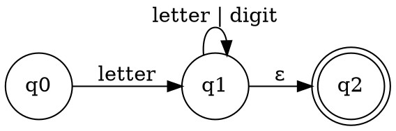
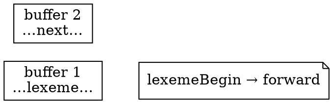

# Lexical Analysis

## Introduction

词法分析是编译的第一阶段：读入字符流，输出 token 流。
它是编译器里最"机械"的部分——不需要理解程序含义，只按语言的词法规则切分，因此也是最早被完全形式化、最早被自动生成器（lex / flex）统治的阶段。

本页回答三个问题：token 与 lexeme 的边界在哪里；正则表达式如何变成可执行的识别器；真实词法分析器如何处理最长匹配、保留字与输入缓冲。

## Tokens and Lexemes

词法分析器把字符序列组合成**词素**（lexeme）——具有集体意义的最小字符序列，并为每个 lexeme 产生一个 token：

```
<token-name, attribute-value>
```

- `token-name` 是供语法分析使用的抽象符号（如 `ID`、`IF`、`NUM`）；
- `attribute-value` 指向符号表条目，语义分析与代码生成需要这里的额外信息。

典型语言的 token 类别：

| 类别 | 例子 | 属性值 |
| :--- | :--- | :--- |
| 关键字 | `if`、`while`、`return` | 无（token-name 已足够） |
| 标识符 | `count`、`total_sum` | 符号表条目指针 |
| 字面量 | `42`、`3.14`、`"hi"` | 常量值 |
| 运算符 | `+`、`<=`、`&&` | 无 |
| 分隔符 | `;`、`(`、`{` | 无 |

关键字（reserved word）与标识符的区分有两种策略：词法阶段就把 `if` 归为关键字 token；或者先统一识别为 `ID`，再由语法分析前的查表决定。
前者要求词法分析器持有保留字表，后者让"关键字不能作变量名"这条规则暴露在更晚的阶段。

## Regular Expressions

词法规则几乎总写成正则表达式，因为正则语言恰好覆盖"多数语言的 token 结构"，且能被高效识别。
三种核心运算：选择（`|`）、连接、 Kleene 星号（`*`），加上扩展记法 `+`、`?`、字符类 `[a-z]`、`\d` 等。

例如一个简单语言的 token 正则：

```
digit      → [0-9]
digits     → digit+
number     → digits (. digits)? (E [+-]? digits)?
letter     → [a-zA-Z_]
id         → letter (letter | digit)*
if         → if
relop      → < | > | <= | >= | == | !=
ws         → [ \t\n]+
```

正则文法与上下文无关文法的区别：词法分析不需要嵌套结构（括号配对是语法问题），所以 DFA 足够。

## From Regular Expression to Recognizer

### NFA and DFA

两条技术路线：

- **NFA**（不确定的有穷自动机）：每个状态对同一输入可有多个转移，允许 ε-转移。易构造、难执行；
- **DFA**（确定的有穷自动机）：每个状态对每个输入类恰好一个转移。执行是 O(n) 单遍扫描，但构造复杂。

经典三步：

1. **Thompson 构造**：把正则表达式递归地翻译成 NFA，每个片段有唯一入口/出口，通过 ε-转移拼接；
2. **子集构造**（subset construction）：把 NFA 状态集合映射为 DFA 状态，ε-closure 是关键操作；
3. **Hopcroft 算法**：DFA 最小化，合并等价状态。



转换的代价必须权衡：子集构造可能指数爆炸（实际语言的 DFA 很少触发），所以生成器通常先构造再最小化，而不是手写 DFA。

### Simulation

DFA 的模拟本身极简，但真实分析器必须处理三个工程问题：

**最长匹配（maximal munch）**：输入 `iff` 在 C 语言里是标识符而不是 `if` + `f`。
分析器不能一匹配到 `if` 就停下，必须继续读到不能再匹配为止，取最长的 lexeme。

**上下文相关**：同一个字符序列在不同上下文是不同 token。
Fortran 的空格规则、PL/1 的关键字非保留化都是著名灾难；现代语言（Go、Swift）通过明确规则避免，Go 甚至用自动插入分号规则把"换行是否有语义"变成词法问题。

**保留字**：词法分析器持有关键字集合，匹配到标识符形状时查表决定 token 名。

## Lexical Analyzer Generators

lex / flex 的工作流：`.l` 文件写「正则 → 动作（C 代码）」规则，生成 C 词法分析器：

```
%{
#include <stdio.h>
%}
%%
[0-9]+          { printf("NUMBER %s\n", yytext); }
[a-zA-Z_][a-zA-Z0-9_]*  { printf("ID %s\n", yytext); }
"+"|"-"|"*"|"/" { printf("OP %s\n", yytext); }
[ \t\n]+        { /* 跳过空白 */ }
.               { printf("UNKNOWN %s\n", yytext); }
%%
int main(void) { yylex(); return 0; }
```

生成器处理冲突的默认规则：正则按书写顺序优先（前面的规则赢），且默认按最长匹配。
这些行为恰好覆盖多数语言的词法设计。

## Input Buffering

词法分析器通常需要向前看多个字符才能确定 lexeme 边界（`>` vs `>=`、`<=` vs `<`）。
直接逐字符 `getchar()` 太慢，实际实现用**双缓冲**：两块缓冲交替填充，到达缓冲末尾时用 **sentinel**（哨兵字符，如 `eof`）标记，避免每字符越界检查。



- `lexemeBegin`：当前 lexeme 起点；
- `forward`：扫描前沿；
- 两个指针间距离就是当前 lexeme 长度，超过缓冲容量时才真正复制。

## Errors

词法错误的形态很少（非法字符、未闭合字符串/注释、数字格式错误），处理策略也简单：跳过、吞到下一个同步点、或报告后继续。
但lexeme 边界错误可能层联引爆——一个漏掉的分号会让后续大片代码被误切分，错误信息必须带行号才能定位。

## Links

- [Compiler](/docs/CS/Compiler/Compiler.md)
- [Parsing](/docs/CS/Compiler/Parsing.md)
- [Semantic Analysis](/docs/CS/Compiler/Semantic_Analysis.md)
- [assembly](/docs/CS/assembly/assembly.md)

## References

1. [flex — The Fast Lexical Analyzer](https://github.com/westes/flex)
2. [GNU Bison](https://www.gnu.org/software/bison/)
