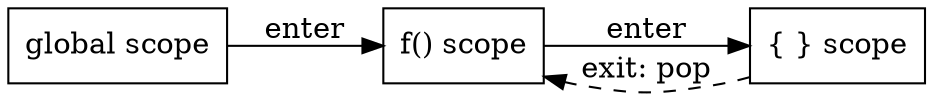

# Semantic Analysis

## Introduction

语法分析只检查形状，语义分析检查**含义**：`a[i] = b + c` 在语法上完全合法，但 `i` 是浮点、`b` 未声明时它毫无意义。
语义分析在语法树上计算属性、核对类型、建立符号表，把"合法程序"细化成"类型一致、绑定完整的程序"。

本页覆盖三块：符号表与作用域如何组织；属性文法如何描述"含义计算"；类型检查与推断的规则形态。

## Symbol Table and Scope

符号表记录每个名字的属性：种类（变量/常量/过程/类型）、类型、存储类别、作用域、对过程还有参数个数与传递方式。
核心操作只有两个：`insert` 与 `lookup`，难点全在**作用域**——同一名字在不同块内可指不同实体。

### Block Structure

C 的 `{}`、Pascal 的 `begin/end` 是词法作用域（lexical scoping）：名字的可见范围由文本结构静态决定。
实现用**栈式符号表**：进入块时压入新一层，退出时弹出；查找从栈顶向栈底扫，第一个命中即最近绑定。



嵌套过程（Pascal 的嵌套函数）需要每层一个符号表并链接成静态链，供内层访问外层名字；C++ 的类作用域则是名字查找的扩展规则（先类内后外层，名字隐藏）。

### Hash Table with Scoping

工业实现几乎都是**散列表 + 作用域栈**：散列表给 O(1) 查找，作用域栈管理进出。
删除时的坑：弹出一层要把该层插入的所有条目从散列表摘除，实现上要么逆序记录插入序列，要么用按层编号的墓碑。

## Attribute Grammars

属性文法给文法符号附加**属性**，用语义规则描述属性间依赖——属性计算就是语义分析的骨架。

- **综合属性**（synthesized）：由子节点/自身决定，向上传递，如 `E.val = E1.val + E2.val`；
- **继承属性**（inherited）：由父节点/兄弟决定，向下传递，如声明语句中类型名向变量列表传递 `type`。

属性依赖可能成环（环 = 语义定义有误），属性求值顺序由依赖图的拓扑排序决定。
**S-属性定义**（只含综合属性）可在自底向上归约时同步求值——yacc 的 `$$`/`$1` 动作正是这个模型；**L-属性定义**允许受"左兄弟与父"影响的继承属性，适配自顶向下/从左到右的扫描。

### Syntax-Directed Translation

不建显式语法树、边分析边翻译（syntax-directed translation）可省一次遍历，但失去树就失去灵活性。
折中方案普遍存在：建**压缩语法树**（省掉链式单继承节点）、分析期顺带生成三地址码，Clang 的 AST 即带语义信息的完整树，供后续各 pass 复用。

## Type Checking

类型系统是语义分析的核心资产：编译器持有每个表达式的类型，通过类型规则验证"运算符与操作数匹配"。

### Type Expressions and Rules

类型表达式（`int`、`array(1..10, int)`、`pointer(int)`）构成类型格，检查规则写成推理形式：

```
E1.type = E2.type = integer        ⇒ E1 + E2 : integer
E1 : array(s, t), E2 : integer     ⇒ E1[E2] : t
```

### Coercion and Overloading

语言规范决定**自动转换**（coercion）的允许范围：C 允许 `int + float` 隐式提升，Rust/Go 完全禁止隐式转换，Java 允许收窄外的特定提升。
重载解析（overload resolution）按参数类型匹配度挑选重载集合——C++ 的重载决议规则（精确匹配 > 提升 > 标准转换 > 用户定义转换）是编译器里最繁琐的算法之一。

### Type Inference

无需标注的推断让类型系统既安全又简洁：

- **Hindley-Milner（算法 W）**：ML/Haskell 一族的核心，多态类型 `∀a. a → a` 自动推出；
- **局部推断**：C++ `auto`、Java 10 `var`、C# `var` 是受限制的 HM——只从初始化表达式推，不跨语句；
- **完全推断的边界**：子类型多态（面向对象）下的推断一般不可判定，所以 Java/C# 的类型推断都带明确规则而非统一算法。

## What Follows

语义分析的产物——带类型标注的语法树与填满的符号表——直接交给中间代码生成（见 [Intermediate Representation](/docs/CS/Compiler/Intermediate_Representation.md)）。
类型信息同时是优化的前提：别名分析、逃逸分析、向量化都依赖"这两个表达式类型是否相同/是否可能指向同一对象"的结论。

## Links

- [Compiler](/docs/CS/Compiler/Compiler.md)
- [Lexical Analysis](/docs/CS/Compiler/Lexical_Analysis.md)
- [Parsing](/docs/CS/Compiler/Parsing.md)
- [Intermediate Representation](/docs/CS/Compiler/Intermediate_Representation.md)
- [TypeScript 编译器](/docs/CS/TypeScript/Compiler.md)

## References

1. [LLVM Kaleidoscope Tutorial — Code Generation to LLVM IR](https://llvm.org/docs/tutorial/MyFirstLanguageFrontend/LangImpl03.html)
2. [Java Language Specification — Chapter 18: Type Inference](https://docs.oracle.com/javase/specs/jls/se21/html/jls-18.html)
