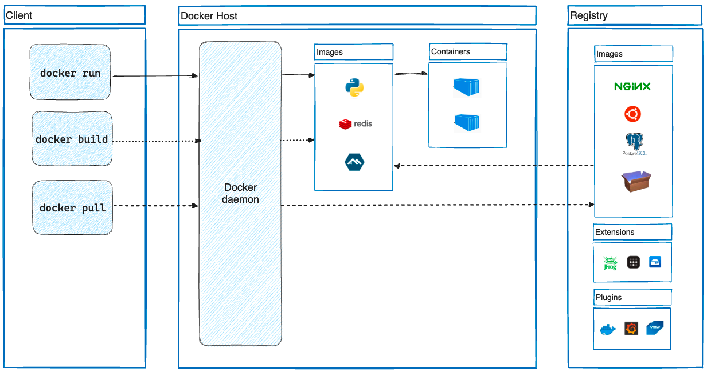

## Introduction

在 [Docker](/docs/CS/Container/Docker/Docker.md) 出现之前，Cloud Foundry 这类 PaaS 项目最核心的组件就是一套应用的打包和分发机制。Docker 项目与 Cloud Foundry 的容器在大部分功能和实现原理上其实是一样的，差别在于**打包的粒度**。

使用 PaaS，用户必须为每种语言、每种框架、甚至每个版本的应用维护一个打好的包，这个打包过程没有任何章法可循。更麻烦的是，明明在本地运行得好好的应用，需要做大量修改和配置才能在 PaaS 里跑起来，而这些修改基本只能靠试错去"摸清脾气"。

Docker 带来的"降维打击"，是提供了一种**直接打包整个操作系统**的机制：应用运行所需的 rootfs 全部封进镜像，从而保证本地环境与云端环境的高度一致，消除了两头试错的成本。

> 2013 年 3 月 15 日 PyCon，Solomon Hykes 的演讲 [The future of Linux Containers](https://www.youtube.com/watch?v=wW9CAH9nSLs) 通常被视为这条路的起点。

**Container images** become containers at runtime：镜像在运行于 Docker Engine 之上时才变成容器。容器把软件与环境隔离，使它无视开发、预发、生产之间的差异，始终保持一致。

Docker 容器的三个卖点：

- **Standard**：Docker 定义了容器的事实标准，镜像可以到处移植
- **Lightweight**：容器共享宿主机内核，不需要每个应用带一个 OS，服务器利用率更高
- **Secure**：容器内的应用被隔离，Docker 提供行业里较强的默认隔离能力（注意：隔离不等于安全沙箱，见 [Docker 安全](/docs/CS/Container/Docker/security.md)）

> 目前使用 Docker 基本上有两个选择：**Docker Desktop** 和 **Docker Engine**
>
> - Docker Desktop 面向个人使用，Mac / Windows 一键安装、带图形界面和周边工具
> - Docker Engine 完全免费、只能跑在 Linux 上、纯命令行操作

### Moby

Moby is an open framework created by Docker to assemble specialized container systems without reinventing the wheel. It provides a "lego set" of dozens of standard components and a framework for assembling them into custom platforms.

> [A new upstream project to break up Docker into independent components](https://github.com/moby/moby/pull/32691)

`moby/moby` 是 Engine 的上游仓库，Docker 公司发行的 Docker Engine 就是它加上品牌、打包与支持服务的产物。日常说的"Docker 源码"基本就是 Moby。

### 版本与生态基线

容器生态是多个独立项目拼起来的，版本号互不绑定。写笔记时按下面的分工理解：

| 组件 | 角色 | 当前线（2026-10 核实） |
| :-- | :-- | :-- |
| Docker Engine | CLI + daemon，用户直接打交道的那层 | 29.x（29.0.0 于 2025-11-10，最新 29.9.1 于 2026-10-14） |
| containerd | 高级运行时：镜像/内容/快照/生命周期 | 2.3 为 LTS（2026-04-30，支持至 2028-04-30），2.4 为最新特性线 |
| runc | 低级运行时：真正创建容器进程 | 1.5 系列（1.5.0 于 2026-06-19），实现 OCI Runtime Spec v1.3.0 |
| BuildKit | 构建引擎 | 上游 v0.34.0（2026-10-07），Engine 29.7.2 打包 v0.32.2 |
| Docker Compose | 多容器编排 CLI | v2 插件（`docker compose`），v5 线（最新 5.6.0 于 2026-10-02）；v1（Python）已 EOL |

Engine 29 是一次"打地基"的发布，几个影响日常运维的变化：

- **containerd image store 成为新装默认**，老的 graph driver（storage driver）转为 deprecated，未来版本会移除；
- 最小 API 版本提升到 1.44（对应 Moby v25），老客户端会被拒绝；
- cgroup v1 支持进入 deprecated（延续支持到 2029-05）；
- Docker Content Trust（`DOCKER_CONTENT_TRUST`）已从 CLI 移除，签名改用 cosign 之类的外部工具；
- nftables 防火墙后端为实验特性；29.7.0 起提供实验性的 embedded containerd（把 containerd 跑进 daemon 进程）。

## Installing Docker

Install Docker Desktop：

> IDEA 和 VS Code 的 Docker 插件非常实用，装完 Docker 后建议一并启用

<!-- tabs:start -->

##### **Ubuntu**

```shell
sudo apt install -y docker.io

```

##### **Fedora**

```shell
# Uninstall old versions
sudo dnf remove docker \
                  docker-client \
                  docker-client-latest \
                  docker-common \
                  docker-latest \
                  docker-latest-logrotate \
                  docker-logrotate \
                  docker-selinux \
                  docker-engine-selinux \
                  docker-engine

sudo dnf -y install dnf-plugins-core
sudo dnf config-manager --add-repo https://download.docker.com/linux/fedora/docker-ce.repo

sudo dnf install docker-ce docker-ce-cli containerd.io docker-buildx-plugin docker-compose-plugin

sudo systemctl start docker
```

##### **Mac**

ARM mac 最好使用 ARM 版本 Homebrew 来安装 Docker

```shell
brew install --cask docker
brew install docker

#rm files if has installed docker
brew uninstall  docker
brew uninstall  --cask docker
rm -rf /usr/local/bin/docker
rm -rf /usr/local/etc/bash_completion.d/docker
rm -rf /usr/local/share/zsh/site-functions/_docker
rm -rf /usr/local/share/fish/vendor_completions.d/docker.fish
```

<!-- tabs:end -->

第一个 `service docker start` 是启动 Docker 的后台服务，第二个 `usermod -aG` 是把当前用户加入 Docker 用户组。操作 Docker 必须要有 root 权限，直接使用 root 不够安全，加入 docker 组是官方推荐做法——但要清楚**它等价于给了该用户 root 权限**（能挂载宿主机任意目录），见 [Docker 安全](/docs/CS/Container/Docker/security.md)。

```plain
sudo service docker start         #启动docker服务
# 重新登录后生效
sudo usermod -aG docker ${USER}   #当前用户加入docker组
```

After installed done, open Docker Desktop and set registry-mirrors:

```json
{
  "registry-mirrors": [
    "https://docker.mirrors.ustc.edu.cn",
    "https://registry.docker-cn.com",
    "http://hub-mirror.c.163.com",
    "https://mirror.ccs.tencentyun.com"
  ]
}
```

Docker 开启监听 2375 端口：

<!-- tabs:start -->

##### **Mac**

```shell
docker run -it -d --name=socat \
  -p 2375:2375 \
  -v /var/run/docker.sock:/var/run/docker.sock \
  alpine/socat \
  TCP4-LISTEN:2375,fork,reuseaddr UNIX-CONNECT:/var/run/docker.sock
```

##### **Windows**

Windows 较为复杂，`netstat -ano | findstr :2375` 发现没有进程时见 [Port 2375 not listening](https://github.com/docker/for-win/issues/3546)：

```shell
netsh interface ipv4 show excludedportrange protocol=tcp
```

停止 winnat 服务：

```shell
net stop winnat
dism.exe /Online /Disable-Feature:Microsoft-Hyper-V
```

```shell
netsh int ipv4 add excludedportrange protocol=tcp startport=2375 numberofports=1
```

reset 后重启：

```shell
netsh int ip reset
```

<!-- tabs:end -->

> [!WARNING]
> 2375 是**无认证无加密**的明文端口，一旦监听在 `0.0.0.0` 上等于把宿主机 root 交给网络里的任何人（Docker 官方有专门的蠕虫案例）。仅在本机或隔离网络内做调试用，生产环境走 2376 + TLS。

## Architecture

Docker uses a client-server architecture. The Docker client talks to the Docker daemon, which does the heavy lifting of building, running, and distributing your Docker containers. The client and daemon can run on the same system, or you can connect a Docker client to a remote Docker daemon. They communicate using a REST API, over UNIX sockets or a network interface.

<div style="text-align: center;">



</div>

<p style="text-align: center;">
Fig.1. Docker architecture
</p>

- **Docker client**：`docker` CLI（以及 `docker compose`、buildx 等插件）
- **Docker daemon**（dockerd）：接收 API 请求，管镜像、容器、网络、卷
- **Registry**：镜像仓库，按 OCI Distribution Spec 提供 HTTP API
- **Graph / image store**：镜像与层的本地存储（Engine 29 起新装默认 containerd image store）
- **Driver**：graphdriver（overlay2）、network driver（libnetwork）、logging driver 等可插拔实现
- **libcontainer**：runc 的前身，今天封装 namespace/cgroup/capabilities 的库
- **Container**：最终那个被隔离的进程

daemon 之下还有一层：dockerd 并不直接创建容器，而是调用 [containerd](/docs/CS/Container/k8s/containerd.md)，由 containerd 拉起 shim、再 fork/exec runc。完整分层见 [Docker 运行时](/docs/CS/Container/Docker/runtime.md)。

## Under Hood

Docker 底层技术主要包括 Namespaces、Cgroups 和 rootfs，三者都是内核机制，Docker 只是把它们组装起来：

| 机制 | 作用 | 内核笔记 |
| :-- | :-- | :-- |
| Namespace | 访问隔离：PID/NET/MNT/IPC/UTS/USER 等视图隔离 | [namespace](/docs/CS/OS/Linux/namespace.md?id=how-containers-use-namespace) |
| Cgroups | 资源限额：CPU/MEM/IO 配额与记账 | [cgroup](/docs/CS/OS/Linux/cgroup.md?id=how-cpu-limit-reaches-the-scheduler) |
| rootfs（overlayfs） | 文件系统隔离与分层镜像 | [LXC](/docs/CS/OS/Linux/LXC.md)（clone + pivot_root 伪代码） |

Docker builds containers using 10 major system features：

- PID namespace — 进程标识符与能力
- UTS namespace — 主机名与域名
- MNT namespace — 文件系统访问与结构
- IPC namespace — 共享内存通信
- NET namespace — 网络访问与结构
- USR namespace — 用户名与标识符
- `chroot` syscall — 文件系统根位置
- cgroups — 资源保护
- CAP drop — 操作系统特性限制
- Security modules — 强制访问控制（AppArmor / SELinux）

一条 `docker run` 在内核层面发生的事：`clone(CLONE_NEW*)` 创建隔离视图 → `pivot_root` 切换 rootfs → 把 PID 写入 `cgroup.procs` 纳入限额 → `exec` 入口程序。完整路径见 [Docker 运行时](/docs/CS/Container/Docker/runtime.md)，网络的 veth/bridge/NAT 细节见 [Docker 网络](/docs/CS/Container/Docker/net.md)。

## 分册导航

Docker 的正文按主题拆成下面这些分册，每篇只负责自己的那一段，不重复叙述：

| 分册 | 覆盖的问题 |
| :-- | :-- |
| [Docker 运行时](/docs/CS/Container/Docker/runtime.md) | `docker run` 之后谁在干活：OCI 规范、containerd/shim/runc、rootless |
| [Docker 镜像](/docs/CS/Container/Docker/image.md) | 镜像是什么、分层与内容寻址、registry、体积优化、供应链安全 |
| [Dockerfile](/docs/CS/Container/Docker/Dockerfile.md) | 每条指令的语义与坑、多阶段构建、BuildKit 缓存与 secret |
| [Docker 存储](/docs/CS/Container/Docker/storage.md) | volume / bind / tmpfs、overlay2 与 containerd snapshotter、日志与磁盘清理 |
| [Docker 网络](/docs/CS/Container/Docker/net.md) | bridge/host/container/none/overlay/macvlan、端口发布、内嵌 DNS |
| [Docker Compose](/docs/CS/Container/Docker/compose.md) | 多容器编排：project / service / container 三层与字段陷阱 |
| [Docker CLI](/docs/CS/Container/Docker/cli.md) | 命令速查、inspect 模板、日常排查一条龙 |
| [Docker 安全](/docs/CS/Container/Docker/security.md) | capabilities、非 root、seccomp/LSM、镜像签名与 secret |
| [Docker 性能](/docs/CS/Container/Docker/performance.md) | CPU/内存/IO 限额到 cgroup v2 的映射、OOM、观测手段 |
| [Docker 工具](/docs/CS/Container/Docker/tools.md) | runlike / whaler / dive：从容器或镜像反推构建方式 |
| [Docker 日志](/docs/CS/Container/Docker/logging.md) | 两层日志模型、driver 全目录、轮转、dual logging、排障 |
| [Docker Buildx](/docs/CS/Container/Docker/buildx.md) | 多平台构建、builder 实例、缓存导出、Bake、Docker Build Cloud |
| [容器生命周期](/docs/CS/Container/Docker/lifecycle.md) | PID 1 与僵尸、信号与优雅终止、重启策略、健康检查 |
| [Docker Registry](/docs/CS/Container/Docker/registry.md) | OCI Distribution Spec、私有 registry、鉴权、GC、镜像加速器 |
| [Docker Swarm](/docs/CS/Container/Docker/swarm.md) | 内建集群编排：服务/栈、overlay+routing mesh、与 K8s 对比 |
| [容器定位](/docs/CS/Container/locate.md) | 容器 ID ↔ 宿主机 PID 双向换算，排障的第一步 |

## Links

- [Container](/docs/CS/Container/Container.md)
- [Kubernetes](/docs/CS/Container/k8s/K8s.md)
- [Linux](/docs/CS/OS/Linux/Linux.md)
- [容器知识地图](/docs/CS/Container/README.md)

## References

1. [Moby](https://github.com/moby/moby)
2. [Docker Engine release notes](https://docs.docker.com/engine/release-notes/)
3. [Docker Engine v29: Foundational Updates for the Future](https://www.docker.com/blog/docker-engine-v29-foundational-updates-for-the-future/)
