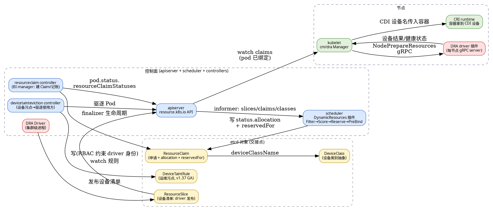

# Dynamic Resource Allocation (DRA)

## Introduction

DRA（Dynamic Resource Allocation，动态资源分配）是 Kubernetes 的**新一代设备资源模型**：把 GPU、FPGA、网卡、自定义加速器这类"非 CPU/内存"资源，从 DevicePlugin 的"节点侧黑盒"改造成**声明式、可调度、可共享**的 API 对象模型。它回答的问题不是"节点上还剩几个 GPU"（那是 DevicePlugin/扩展资源的事），而是"**这个 Pod 需要什么样的设备、哪个节点能给它、谁负责在节点上把它准备好**"。

一个精确的边界定义：DRA 管**设备的申请、分配、节点侧准备（prepare）与回收**；不管设备内部怎么用（那是容器里的库，如 CUDA），也不管设备驱动怎么安装（那是集群管理员装 DRA driver 的事）。`DynamicResourceAllocation` gate **v1.34 GA、v1.35 LockToDefault**（gate 本体计划 1.38 从代码移除，行为恒开）——这不是实验特性了，是当前主线方案。

本文源码基于 **Kubernetes v1.37.2**（commit 91c32c2b）逐字核对。v1.37 是 DRA 的"GA 收尾年"：`DRAExtendedResource`、`DRADeviceTaints`、`DRADeviceTaintRules`、`DRAResourceClaimDeviceStatus`、`DRAPrioritizedList` 全部在本版 GA；同时新增 `ResourcePoolStatusRequest`（alpha，设备池可用性查询）等对象。驱动侧 gRPC 库已从主仓库迁到独立仓库（主仓库只剩 `staging/src/k8s.io/dynamic-resource-allocation` 这个**使用方**库）。

## The Big Picture

DRA 的角色跨度是所有 K8s 资源机制里最大的：**设备信息由驱动发布、调度决策由调度器做、节点准备由 kubelet 驱动插件做**，三方通过 etcd 里的对象交接，没有任何一环直接调用另一环。



读这张图的关键是分清**三类写入者**：ResourceSlice 只有驱动写（数据权威在驱动手里）；ResourceClaim 的 `status.allocation`/`reservedFor` 由调度器写（调度是分配的权威）；`status.devices` 由节点上的驱动写（设备实际状态在节点上）。三组写入走的是**不同的鉴权路径**（`DRAResourceClaimGranularStatusAuthorization` gate 把 claim 的状态更新拆成 `binding`/`driver` 两种子资源分别鉴权，v1.37 生效）。

## Why This Shape

理解 DRA 为什么长这样，要从它替代的 DevicePlugin 的三个根本缺陷出发：

**1. DevicePlugin 的调度盲区。** 旧模型里 kubelet 通过 device plugin 拿到本节设备列表并上报成 `status.capacity["nvidia.com/gpu"]`，调度器只看这个整数字段做装箱——**调度器根本不知道设备长什么样**。GPU 拓扑亲和（NVLink 相邻）、MIG 切片、多网卡 Bond、"两块卡之间延迟 < X"这类诉求完全无法表达。DRA 把设备属性（`DeviceAttribute`：int/bool/string/version 四种）显式放进 ResourceSlice，调度时直接在调度器进程里做设备选择，`DeviceClass` 上的 `selectors`/`constraints` 就是"这一类设备必须满足什么"的声明。

**2. 分配算法为什么要放进调度器（而不是 controller）。** DevicePlugin 时代的分配发生在**节点侧**（kubelet 拿到 Pod 才去问 plugin 要设备），调度器先做了"整数够不够"的判断，节点侧再分配时可能跟其他 Pod 冲突，只能重试。DRA 把分配作为调度决策的一部分：`DynamicResources` 插件在 `Reserve` 阶段用调度器**进程内的 allocator**（`pkg/scheduler/framework/plugins/dynamicresources/allocateddevices.go`）从 ResourceSlice 快照里挑设备，结果记进 CycleState；同一个调度周期内不会两 Pod 拿到同一设备。根本约束是：**跨调度周期的并发控制交给 etcd 里的 claim（乐观锁 + reservedFor），单周期内的独占性靠调度器内存**——调度器不会并行调度的两个 Pod 无需在 etcd 层面互斥。

**3. 为什么 claim 需要 finalizer。** Claim 是设备消费凭证：`status.reservedFor` 列出所有用它的 Pod。如果 Pod 删了就把 claim 直接删掉，多 Pod 共享一个 claim（v1.37 起 PodGroup 也可以共享）时会出"一个 Pod 还活着，claim 没了"的悬空。所以 claim 带 `resource.k8s.io/finalizer`，只有当 `reservedFor` 清空（且是内置 controller 持有的 finalizer）时才允许对象真正消失：

```go
// pkg/controller/resourceclaim/controller.go —— claim 删除保护
builtinControllerFinalizer := slices.Index(claim.Finalizers, resourceapi.Finalizer)
...
} else if builtinControllerFinalizer >= 0 && claim.DeletionTimestamp != nil && len(remaining) == 0 {
    // 最后一个消费者也走了，才摘 finalizer 放行删除
    claim.Finalizers = slices.Delete(claim.Finalizers, builtinControllerFinalizer, builtinControllerFinalizer+1)
```

这与 PV 的 pv-protection finalizer 是同一个设计模式：**凭证对象的生命周期必须覆盖所有引用者**。

## The Four API Objects (Plus Two)

DRA 的 API 面在 v1.37 有 4 个核心对象 + 2 个运维对象：

| 对象 | 谁写 | 语义 | 生命周期 |
|---|---|---|---|
| **ResourceSlice** | DRA driver | 某驱动在某批节点上的**设备清单**（pool：nodeName/namespace/resourcePoolCount） | 驱动进程的全量刷新（最多 128 个 slice/pool），驱动走人对象过期 |
| **DeviceClass** | 管理员 | 设备类别抽象（selectors + 请求策略），Pod 经它间接申请 | 长期对象 |
| **ResourceClaim** | 用户/BI-manager | 一次具体申请：deviceClassName + constraints；**status.allocation 是分配结果** | 随消费者（finalizer 保护） |
| **ResourceClaimTemplate** | 用户 | Claim 的模板，Pod 引用它 → BI-manager 实例化 | 长期对象 |
| **DeviceTaintRule**（v1.37 GA） | 管理员 | 给一批设备打污点（NoSchedule/NoExecute），复用 K8s 污点心智 | 触发驱逐后常驻 |
| **ResourcePoolStatusRequest**（alpha） | 用户 | 一次性触发某资源池的可用性快照计算（配合 partitionable device） | 一次性 |

v1.37 的新东西里最值得注意的是 **DeviceTaint 污点体系**：`DRADeviceTaints`/`DRADeviceTaintRules` 双双 GA（1.38 LockToDefault）。它把节点的"污点驱逐"心智移植到设备粒度——运维想把某块故障 GPU 摘出调度，不再需要重配 driver，写一条 DeviceTaintRule 即可，`NoExecute` 由 `devicetainteviction controller` 落地为驱逐：

```go
// pkg/controller/devicetainteviction/device_taint_eviction.go —— 驱逐理由
Reason: "DeletionByDeviceTaintManager",
```

这个 Reason 与 Eviction.md 里的三来源对照表并列成第四个来源（`EvictionByEvictionAPI`/`DeletionByTaintManager`/`TerminationByKubelet`/`DeletionByDeviceTaintManager`）——**设备污点的驱逐走的是同一套 tainteviction 包**，`pkg/controller/devicetainteviction` 直接引用 `tainteviction.NamespacedObject` 与限流队列，没有重新发明限流器。

## Scheduling: One Cycle, Five Extensions

DRA 对调度器不是一个"框架外的旁路"，而是五个扩展点各做一段。`DynamicResources` 插件（`pkg/scheduler/framework/plugins/dynamicresources/dynamicresources.go`）的实现细节：

**PreEnqueue——不在没资格的队列里排队。** Pod 引用的 claim 若不存在（或 Pod 自身非法），直接拒绝入队，而不是进队列再被 Filter 打回：

```go
func (pl *DynamicResources) PreEnqueue(ctx context.Context, pod *v1.Pod) (status *fwk.Status) {
	if !pl.enabled {
		return nil
	}
	if err := pl.foreachPodResourceClaim(pod, nil); err != nil {
		return statusUnschedulable(klog.FromContext(ctx), err.Error())
	}
	return nil
}
```

注意这里有一个与 v1.30 初代设计的重要差异：**当前版本没有给 Pod 加 scheduling gate**。初代的 `PodSchedulingContext` 对象（v1.29）已删；现在 Pod 在创建时就"可调度"，未分配的 claim 由插件在 Filter 里挡住，事件驱动（`isSchedulableAfterClaimChange` queueing hint）唤醒重试。省掉了一个中间对象，代价是 Pod 会长时间处于 Pending 而不是 SchedulingGated。

**Filter——三种身份分开处理。** 已分配的 claim 用 allocation 里的 nodeSelector 匹配节点；已分配但声明了 binding conditions 的还要检查驱动上报的 `status.devices[].conditions` 是否就绪（不就绪且超过 binding timeout 的标记不可用，由 PostFilter 换设备重试）；未分配的 claim 则是在 Filter 里**现场试分配**（allocator 只读快照 + 周期状态，不写 etcd）。Filter 有超时保护：`DRASchedulerFilterTimeout`（默认 10s，`DynamicResourcesFilterTimeoutDefault`）——设备选择是 NP 问题近似，不能让它拖垮整个调度周期。

**Reserve——周期内独占。** 真正的分配结果在 Reserve 落到 CycleState 并注册"pending allocation"：

```go
// Reserve 中：内存假设已分配，etcd 写推迟到 PreBind
// Allocated, but perhaps not reserved yet. We checked in PreFilter that
// the pod could reserve the claim. Instead of reserving here by
// updating the ResourceClaim status, we assume that reserving
// will work and only do it for real during binding. If it fails at
// that time, some other pod was faster and we have to try again.
```

注释里这句话就是整个设计的并发模型：**调度器内部先乐观假设，etcd 写入（含 RV 乐观锁）在 PreBind 兜底**，输给并发竞争就 Unreserve 回滚重调度。这与 scheduler.md 里 Assume 机制是同一哲学的第三次应用（Pod assume、volume binding assume、claim allocation assume）。

**PreBind——落账 + 等设备就绪。** 把 allocation 写进 claim status 并把 Pod 加进 reservedFor（patch，带 RV 冲突重试）。如果分配结果声明了 BindingConditions（设备需要节点侧物理装配，比如热插拔网卡），调度器在这里**同步等待**驱动把 `status.devices[].conditions` 置为 True，上限 `bindingTimeout` 默认 600s（`DynamicResourcesBindingTimeoutDefault`）：

```go
// PreBind：binding conditions 未就绪时轮询等待
err = wait.PollUntilContextTimeout(ctx, 5*time.Second, pl.bindingTimeout, true,
	func(ctx context.Context) (bool, error) {
		return pl.isPodReadyForBinding(state)
	})
```

同步等待是这里最反直觉的选择——调度器 hold 住一个调度循环最多 10 分钟。Why：设备的"物理就绪"事件只有驱动知道，且**换节点重试的代价（释放+重新分配+重新 prepare）远高于等待**；超时后 PostFilter 会把 claim 解除分配（deallocate）让下一轮换设备，这形成了"等待优先、超时换卡"的策略。

**Unreserve——对称回滚。** 绑定失败/抢占时清理 reservedFor 与 pending allocation，幂等。

## The BI-Manager: resourceclaim controller

`pkg/controller/resourceclaim/controller.go` 名义上是一个 controller，实际承担两段职责（代码里自称 BI-manager，"build and instantiate"）：**为 Pod 建 claim** 和 **替已调度 Pod 记账**。

第一段：Pod 引用了 `ResourceClaimTemplate`（而不是具名 claim）时，每个 Pod 生成独立 claim（模板隔离，互不干扰），把实例名 patch 进 `pod.status.resourceClaimStatuses`。具名引用（`resourceClaimName`）则什么都不建，用户自己管共享。PodGroup 共享模板（`DRAWorkloadResourceClaims`，alpha）时多个 Pod 共用同一 claim 实例。

第二段：Pod 已经绑定节点（`pod.Spec.NodeName != ""`，跳过调度器路径的场景，比如 DaemonSet 直绑）时，controller 检查 claim 已分配但未记 reservedFor，补上 reservation：

```go
// syncPod：两段职责的分界线
if pod.Spec.NodeName == "" {
	// Scheduler will handle reservations.
	logger.V(5).Info("Nothing to do for pod, scheduler will deal with it")
	return nil
}
```

这条 `if` 就是**调度路径与非调度路径的交接点**：走调度的 Pod 由 PreBind 记账，直绑节点的 Pod（DaemonSet、`nodeName` 预填）由这里记账——同一个 `reservedFor` 数据结构，两个写入者。

claim 的删除保护在 `enqueueResourceClaim` 对应的 reconcile 里：reservedFor 里已被删除的 Pod 会被清掉；当 `DeletionTimestamp != nil && len(remaining) == 0` 时摘 finalizer。**驱动也可以持有 claim finalizer**（多 finalizer 模式），驱动侧资源真正回收完才摘自己的——与 CSI 的外部 attacher finalizer 同构。

## The Kubelet Side: Prepare Before Sandbox

kubelet 的 DRA 参与（`pkg/kubelet/cm/dra/`）有两条独立线程：**插件注册**和**按 Pod 准备/回收**。

**插件注册**复用 DevicePlugin 时代的 socket watching 机制。驱动在节点上以 gRPC server 形式运行，在注册目录放 socket：

```go
// staging/src/k8s.io/dynamic-resource-allocation/kubeletplugin/draplugin.go
KubeletPluginsDir     = "/var/lib/kubelet/plugins"
KubeletRegistryDir    = "/var/lib/kubelet/plugins_registry"
```

kubelet 的 `DRAPluginManager` 实现 `cache.PluginHandler`（与 CSI 的 plugin watcher 同一套框架），发现 socket 后 gRPC 握手拿到 driverName，建立到驱动插件的连接池。

**PrepareResources 的调用点在 SyncPod 里、createPodSandbox 之前**——这是全链路里最重要的一处时序：

```go
// pkg/kubelet/kuberuntime/kuberuntime_manager.go —— SyncPod
// Prepare resources allocated by the Dynammic Resource Allocation feature for the pod
if utilfeature.DefaultFeatureGate.Enabled(features.DynamicResourceAllocation) {
	if err := m.runtimeHelper.PrepareDynamicResources(ctx, pod); err != nil {
		ref, referr := ref.GetReference(legacyscheme.Scheme, pod)
		...
		m.recorder.WithLogger(logger).Eventf(ref, v1.EventTypeWarning, events.FailedPrepareDynamicResources, "Failed to prepare dynamic resources: %v", err)
		return
	}
}
podSandboxID, msg, err = m.createPodSandbox(ctx, pod, podContainerChanges.Attempt)
```

排障含义直接可得：**Pod 卡在非 Running 且带 `FailedPrepareDynamicResources` 事件 = 设备准备失败**，而不是 runtime/CNI 问题。prepare 路径内部先做一遍**纯校验 pass**（不写缓存），理由在注释里写得很清楚：如果先把 claim 加进缓存再失败，Unprepare 就会误以为 NodePrepareResources 被调用过而去做多余的清理——"先验证后提交"在分布式清理场景的又一次应用。

kubelet 侧逐 claim 校验的三道闸（verbatim 前后文）：

1. `resourceclaim.Name(pod, podClaim)` 解析 claim 名（模板实例从 status 里取）；
2. `resourceclaim.IsForPod(pod, claim)` 校验所有权（具名 claim 必须真的属于这个 Pod，防止**跨 Pod 盗用 claim**——DRA 最基础的租户隔离闸门）；
3. `IsReservedForPod` 校验 reservedFor 里有没有自己（调度器记账没落上就拒绝 prepare，防止调度器与 controller 竞态窗口内资源被双重使用）。

通过后按 claim 里 allocation 的 driver 分组调 `NodePrepareResources` gRPC，返回的设备以 CDI 名（`vendor.com/device=xxx`）记录进 ClaimInfo，后续经 `GetResources` 喂给 CRI（容器创建时变成 `CDIDevice` 注入）。Pod 退出后 `UnprepareDynamicResources`（在 kubelet 的 `SyncTerminatingPod` 中调用）对称回收，kubelet 还有独立的 reconcile loop 兜底清理孤儿 ClaimInfo，以及健康状态聚合（`healthinfo.go`）。

## The Driver Side: Publish and Serve

DRA driver 是**集群级 + 节点级两个进程**的合体（通常一个二进制两种部署）：

- **集群级**：以自己的身份（ServiceAccount）向 apiserver 发布/更新 ResourceSlice——设备清单的全量事实来源。写入被 RBAC 约束：driver 只能写自己 driverName 对应的 slice（`spec.driver` 不可变，名称 lowercase 有 warning 校验）。每个 pool 最多 128 个 slice 是硬编码的 API 校验限制，驱动要把大集群设备分片发布。
- **节点级**：起 gRPC server 注册进 kubelet，实现 `NodePrepareResources`/`NodeUnprepareResources`（以及可选的健康上报、`status.devices` 写入——这条路径被 `DRAResourceClaimGranularStatusAuthorization` 拆到 `resourceclaims/driver` 子资源上按节点授权）。

主仓库 `staging/src/k8s.io/dynamic-resource-allocation/kubeletplugin/` 提供驱动侧的注册框架（`Start` 一个 `kubeletplugin.DRVPlugin` 即自动完成 socket 放置 + registration），驱动作者不用碰 pluginregistration API。

## DRAExtendedResource: the Bridge

`DRAExtendedResource`（**v1.37 GA LockToDefault**）解决的是一个迁移问题：存量集群里 `resources: {"nvidia.com/gpu": 1}` 的写法铺天盖地，DRA 不可能一夜替换。机制是**双向桥**：

1. 节点上运行的 DRA driver 可以同时向 kubelet 上报传统扩展资源（保留 device plugin 兼容路径）；
2. Pod 用扩展资源名申请时，**调度器的 DRA 插件在 PreBind 时给 Pod 创建一个隐藏 claim** 并 patch 进 `pod.status.ExtendedResourceClaimStatus`（`patchPodExtendedResourceClaimStatus`），kubelet 侧 `prepareResources` 把它当作一个普通 claim 处理；
3. Filter 里 `filterExtendedResources` 优先让 device plugin 满足的请求继续走老路，只有 driver 声明接管时才走 DRA 分配。

这个设计的意义在于：**扩展资源与 DRA claim 在 kubelet 侧最终汇聚到同一条 PrepareResources 链**，迁移是逐步的、按驱动自愿的，没有全局开关。

## 与 DevicePlugin 的逐项对照

| 维度 | DevicePlugin | DRA |
|---|---|---|
| 设备清单上报 | 节点侧 → `status.capacity` 整数 | 驱动 → ResourceSlice 结构化对象 |
| 调度器可见性 | 只有计数，无属性/拓扑 | 完整设备属性 + 约束 + 分区 |
| 分配时机与位置 | kubelet 收到 Pod 后节点侧分配 | 调度器 Reserve 阶段分配 |
| Pod 与设备绑定 | kubelet 内部记账（不可见） | claim.status.allocation（etcd 可审计） |
| 共享/多 Pod | 无 | reservedFor 多消费者 + PodGroup 共享 |
| 运维摘除 | 无（要改 plugin 配置） | DeviceTaintRule → 自动驱逐 |
| 失败恢复 | kubelet 重启重连 plugin | 对象模型驱动（claim/allocation 可重建） |
| 遗留成本 | 部署简单（socket 即插即用） | 需要 driver 集群级 + 节点级部署 |

注意 DevicePlugin 并没有死：扩展资源路径仍在，且 `filterExtendedResources` 让两条路径共存。**DRA 的终局不是删除 DevicePlugin，而是让新需求走 DRA、存量走桥接。**

## Counter-Intuitive Checklist

1. **Pod 没有 scheduling gate**。claim 未分配时 Pod 只是 Pending（PreEnqueue 拒入队），`kubectl get pod` 看不到 Gated；v1.30 的 PodSchedulingContext 已删除，旧资料里的"gate 流程"全部过时。
2. **分配不发生在 etcd 写入时**。Reserve 只是内存 assume，真正落账在 PreBind；两个调度器实例（HA）竞争同一设备靠 claim 的 RV 乐观锁裁决，输家 Unreserve。
3. **Filter 可能花 10 秒**。设备选择在 Filter 里现场做（NP 近似），`DRASchedulerFilterTimeout` 默认 10s 超时保护整个调度周期；大集群要调 FilterTimeout 配置。
4. **PreBind 可能同步等 10 分钟**。BindingConditions 场景调度器 hold 住循环等驱动报就绪（默认 600s），超时 PostFilter 换设备——调度器慢不一定是它坏了，可能是在等热插拔。
5. **claim 的 status 有三个写入者**：allocation/reservedFor 归调度器与 controller，`devices` 归节点驱动，二者鉴权路径不同（v1.37 拆分子资源）。写 claim status 报 403 时先看是不是 driver 用错身份。
6. **跨 Pod 盗用具名 claim 会被 kubelet 拒绝**，不是调度器拒绝——`IsForPod` 校验在节点侧。共享必须走 template 或显式多消费者。
7. **prepare 失败的 Pod 不启动沙箱**。SyncPod 里 prepare 在 createPodSandbox 之前，事件 `FailedPrepareDynamicResources` 是第一诊断信号。
8. **ResourceSlice 是驱动的"全量事实"**，不是增量日志；驱动要周期性全量刷新，pod 计数超 128 个 slice 会被 API 拒绝。
9. **设备污点驱逐复用节点污点驱逐的限流器**（tainteviction 包），排查 DRA 驱逐限流参数要同时看 nodelifecycle 的 rate limiter 配置。
10. **ExtendedResourceClaimStatus 在 pod.status 而非 spec**——调度器 PreBind 创建，用户不用也不该管；kubelet 从 status 里读它。手工清理这个字段会破坏桥接。
11. **DRAOptionalNodeOperations**（alpha）：分配结果可声明节点侧操作可选（SkipNodeOperations），Filter 检查节点 `DeclaredFeatures`——节点能力协商第一次进入了调度决策。
12. **PodGroup 共享 claim 是 alpha**（`DRAWorkloadResourceClaims`），Kueue 等批调度器在等它；没开 gate 时 PodGroup 的 claim 模板每个 Pod 独立实例化。

## Key Default Values

| 参数 | 默认值 | 出处 |
|---|---|---|
| `DynamicResourceAllocation` gate | GA，v1.35 LockToDefault（1.38 移除 gate） | `pkg/features/kube_features.go` |
| `DRAExtendedResource` | GA，1.37 LockToDefault | 同上 |
| `DRADeviceTaints` / `DRADeviceTaintRules` | GA，1.37（1.38 Lock） | 同上 |
| `DRAResourceClaimDeviceStatus` | GA，1.37 LockToDefault | 同上 |
| `DRAPrioritizedList` | GA，1.37 LockToDefault | 同上 |
| `DRAPartitionableDevices` | Beta 默认 true（1.36） | 同上 |
| `DRASchedulerFilterTimeout` | alpha；Filter 超时 **10s** | `DynamicResourcesFilterTimeoutDefault` |
| Binding 超时（PreBind 等就绪） | **600s** | `DynamicResourcesBindingTimeoutDefault` |
| BindingConditions 轮询间隔 | **5s** | `wait.PollUntilContextTimeout` |
| 每 pool 的 ResourceSlice 上限 | **128** | API 校验 |
| 驱动注册目录 | `/var/lib/kubelet/plugins_registry` | `KubeletRegistryDir` |
| claim finalizer | `resource.k8s.io/finalizer` | `resourceapi.Finalizer` |

## Links

- [K8s 架构与四条主链路](/docs/CS/Container/k8s/Architecture.md)
- [scheduler](/docs/CS/Container/k8s/scheduler.md)
- [kubelet](/docs/CS/Container/k8s/kubelet.md)
- [DevicePlugin（旧模型对照）](/docs/CS/Container/k8s/DevicePlugin.md)
- [Resource（requests/limits 与扩展资源）](/docs/CS/Container/k8s/Resource.md)
- [Eviction（驱逐来源对照）](/docs/CS/Container/k8s/Eviction.md)

## References

1. [Kubernetes v1.37.2 pkg/scheduler/framework/plugins/dynamicresources](https://github.com/kubernetes/kubernetes/tree/v1.37.2/pkg/scheduler/framework/plugins/dynamicresources)
2. [Kubernetes v1.37.2 pkg/kubelet/cm/dra](https://github.com/kubernetes/kubernetes/tree/v1.37.2/pkg/kubelet/cm/dra)
3. [KEP-4381: Dynamic Resource Allocation](https://github.com/kubernetes/enhancements/tree/master/keps/sig-node/4381-dra-resourceclaim)
4. [KEP-5055: DRA Device Taints](https://github.com/kubernetes/enhancements/tree/master/keps/sig-node/5055-dra-device-taints)
5. [DRA Documentation - Kubernetes 文档](https://kubernetes.io/docs/concepts/scheduling-eviction/dynamic-resource-allocation/)
