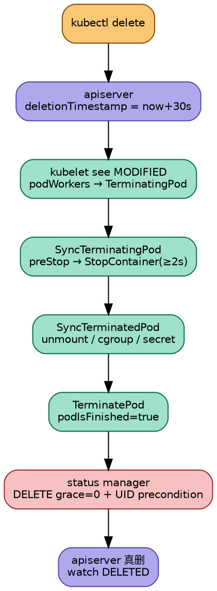

## Introduction

创建 Pod 的那条链路看起来像一个动作：`POST` 一下，Pod 就有了。删除却完全不是——**`DELETE` 一次调用并不会让对象消失**，它只是把对象推入一个"待删除"的中间态，然后由 apiserver、垃圾回收控制器、kubelet 三方接力，才能让对象真正从 etcd 里消失。

这就是为什么 Kubernetes 里"删"总是比"建"慢、也总是更容易出问题。一个 Pod 卡在 `Terminating` 可能卡在三个阶段中的任意一个：

| 卡在哪 | 谁负责解锁 | 典型症状 |
|---|---|---|
| apiserver 已打时间戳，等 finalizer 清空 | 某个外部控制器 / admission | 对象上有 `metadata.finalizers` 非空 |
| 等 GC 删完依赖 | garbage collector | 对象上有 `foregroundDeletion` |
| 等 kubelet 停容器 | kubelet + CRI runtime | Pod 已从 inode 分配但容器还在跑 |

理解这条链路的关键，是先接受一个反直觉的事实：**Kubernetes 的删除是一个"标记 + 通知 + 等待确认"的分布式协议，而不是一个操作**。对象上的 `metadata.deletionTimestamp` 是那个标记，`metadata.finalizers` 是等待名单，而真正执行删除动作的永远是最后一个摘掉 finalizer 的组件。

> [!NOTE]
> 本文全部结论基于 **Kubernetes v1.37.2**（release-1.37，commit `91c32c2b`）源码实读，所有片段均为 verbatim。相对 v1.36 有几处变化，统一收在文末「v1.37 变化清单」。

本文分成三段讲：apiserver 如何把删除变成两阶段（对应 [apiserver](/docs/CS/Container/k8s/apiserver.md) 的写链路镜像）、GC 如何级联（对应 [垃圾回收](/docs/CS/Container/k8s/GC.md) 的运行时行为）、kubelet 如何真正停容器并触发最终删除（对应 [kubelet](/docs/CS/Container/k8s/kubelet.md) 的三态机）。

## Segment 1: apiserver Splits One Deletion into Two Writes

### BeforeDelete: Core of Deletion Semantics

删除的整个判定逻辑压缩在一个函数里 —— `rest.BeforeDelete`（`staging/src/k8s.io/apiserver/pkg/registry/rest/delete.go`）。它在一个 DELETE 请求里**被调用两次**：

1. `store.go` 的 `Delete` 入口 —— 作用在刚从 etcd 读出来的对象上
2. `updateForGracefulDeletionAndFinalizers` 的 `GuaranteedUpdate` 事务内 —— 作用在重新读出的对象上

第二次是必要的：第一次读完之后对象可能已经被别人改过了，必须在事务里重判。下面的片段就是事务内的那一次（`staging/src/k8s.io/apiserver/pkg/registry/generic/registry/store.go`）：

```go
err = e.Storage.GuaranteedUpdate(
    ctx,
    key,
    out,
    false, /* ignoreNotFound */
    &preconditions,
    storage.SimpleUpdate(func(existing runtime.Object) (runtime.Object, error) {
        if err := deleteValidation(ctx, existing); err != nil {
            return nil, err
        }
        graceful, pendingGraceful, err := rest.BeforeDelete(e.DeleteStrategy, ctx, existing, options)
        if err != nil {
            return nil, err
        }
        if pendingGraceful {
            return nil, errAlreadyDeleting
        }

        // Add/remove the orphan finalizer as the options dictates.
        // Note that this occurs after checking pendingGraceufl, so
        // finalizers cannot be updated via DeleteOptions if deletion has
        // started.
        existingAccessor, err := meta.Accessor(existing)
        if err != nil {
            return nil, err
        }
        needsUpdate, newFinalizers := deletionFinalizersForGarbageCollection(ctx, e, existingAccessor, options)
        if needsUpdate {
            existingAccessor.SetFinalizers(newFinalizers)
        }
        // ...
```

注意注释里那句 **finalizers cannot be updated via DeleteOptions if deletion has started**——级联 finalizer 的增删只发生在"第一次删除"的事务里。

判定入口是 `delete.go` 里的一行：

```go
// if the object is already being deleted, no need to update generation.
if objectMeta.GetDeletionTimestamp() != nil {
```

这个 `!= nil` 把一次 DELETE 分成截然不同的两条路径。

### First Deletion: Only Timestamp, Do Not Delete Anything

```go
// staging/src/k8s.io/apiserver/pkg/registry/rest/delete.go
requestedDeletionTimestamp := metav1.NewTime(metav1Now().Add(time.Second * time.Duration(*options.GracePeriodSeconds)))
objectMeta.SetDeletionTimestamp(&requestedDeletionTimestamp)
objectMeta.SetDeletionGracePeriodSeconds(options.GracePeriodSeconds)
// If it's the first graceful deletion we are going to set the DeletionTimestamp to non-nil.
// Controllers of the object that's being deleted shouldn't take any nontrivial actions, hence its behavior changes.
// Thus we need to bump object's Generation (if set). This handles generation bump during graceful deletion.
if objectMeta.GetGeneration() > 0 {
    objectMeta.SetGeneration(objectMeta.GetGeneration() + 1)
}
```

注意这里 **`deletionTimestamp` 是 `now + grace`，一个未来时间**，不是 `now`。这个细节后面会咬人。同时 `generation` 会 +1。

写完这些，函数返回 `(graceful=true, gracefulPending=false)`。`Store.Delete` 据此走 `updateForGracefulDeletionAndFinalizers`，事务后的分支判定如下（`store.go`）：

```go
switch err {
case nil:
    // If there are pending finalizers, we never delete the object immediately.
    if pendingFinalizers {
        return nil, false, false, out, lastExisting
    }
    if lastGraceful > 0 {
        return nil, false, false, out, lastExisting
    }
    // ...
case errDeleteNow:
    // we've updated the object to have a zero grace period, or it's already at 0, so
    // we should fall through and truly delete the object.
    return nil, false, true, out, lastExisting
case errAlreadyDeleting:
    out, err = e.finalizeDelete(ctx, in, true, options)
    return err, false, false, out, lastExisting
```

所以最终行为是：

- 有 finalizer → 落一次 UPDATE，对象继续存在于 etcd
- 无 finalizer 且 grace > 0 → 落一次 UPDATE，**不删**，返回 HTTP **200 + 完整 Pod 对象**
- 无 finalizer 且 grace == 0 → 真的删

所以对有 grace period 的 Pod 做 DELETE，拿到的不是 202 也不是 204，而是 **200 加一个带着 `deletionTimestamp` 的 Pod**。这是因为 Pod 的 store 配了 `ReturnDeletedObject: true`（`pkg/registry/core/pod/storage/storage.go`）。

> [!TIP]
> **202 Accepted 的条件极窄**：只有 `!wasDeleted && OrphanDependents != nil && !*OrphanDependents` 才返回 202（`staging/src/k8s.io/apiserver/pkg/endpoints/handlers/delete.go`）。日常删 Pod 不会遇到。

### Second Deletion: grace period Compressed to 0

当对象已经有 `deletionTimestamp` 时，`BeforeDelete` 走另一套逻辑。最重要的一条规则是：**grace period 只能缩短，不能延长**。

```go
// staging/src/k8s.io/apiserver/pkg/registry/rest/delete.go
// only a shorter grace period may be provided by a user
if options.GracePeriodSeconds != nil {
    period := int64(*options.GracePeriodSeconds)
    if period >= *objectMeta.GetDeletionGracePeriodSeconds() {
        return false, true, nil
    }
    // Move the existing deletionTimestamp back by existing object.DeletionGracePeriod, then forward by options.DeletionGracePeriod.
    // This moves the deletionTimestamp back, since the grace period can only be shortened in this code path.
    newDeletionTimestamp := metav1.NewTime(
        objectMeta.GetDeletionTimestamp().Add(-time.Second * time.Duration(*objectMeta.GetDeletionGracePeriodSeconds())).
            Add(time.Second * time.Duration(*options.GracePeriodSeconds)))
    // Prevent shortening the grace period moving deletionTimestamp into the past
    if now := metav1Now(); newDeletionTimestamp.Before(&now) {
        newDeletionTimestamp = now
        if period != 0 {
            // Since a graceful deletion was requested (options.GracePeriodSeconds != 0), but the entire grace period has already expired,
            // shorten to the minimum period possible while still treating this as a graceful delete.
            period = int64(1)
        }
    }
    objectMeta.SetDeletionTimestamp(&newDeletionTimestamp)
    objectMeta.SetDeletionGracePeriodSeconds(&period)
    return true, false, nil
}
```

想缩短时，代码把 `deletionTimestamp` 先回退旧的 grace、再前进新的 grace；如果算出来的新时间戳已经早于当前时刻，就直接取 `now`（但 grace 仍取 1 而非 0，源码注释解释了为什么——保持走 graceful 路径，由另一个 actor 完成最终删除）。

这条路径就是 kubelet 在容器停完之后发 `DELETE?gracePeriodSeconds=0` 时走的：宽限期被压成 0，事务内 `lastGraceful` 保持 0，走 `errDeleteNow` 分支真正调 etcd 删除。

**v1.37 值得注意的一个小变化**：负数 grace 的归一化现在在 `BeforeDelete` 里就做了（对所有资源生效），不再只依赖各资源的 strategy：

```go
// staging/src/k8s.io/apiserver/pkg/registry/rest/delete.go
// Negative values will be treated as the value `1s` on the delete path.
if gracePeriodSeconds := options.GracePeriodSeconds; gracePeriodSeconds != nil && *gracePeriodSeconds < 0 {
    options.GracePeriodSeconds = ptr.To[int64](1)
}
if deletionGracePeriodSeconds := objectMeta.GetDeletionGracePeriodSeconds(); deletionGracePeriodSeconds != nil && *deletionGracePeriodSeconds < 0 {
    objectMeta.SetDeletionGracePeriodSeconds(ptr.To[int64](1))
}
```

Pod 自己的 `CheckGracefulDelete`（`pkg/registry/core/pod/strategy.go`）里保留着同义的 `period < 0 → 1` 兜底，两个入口现在语义一致。另外它还有两个"立即删"判定：Pod 未调度（`NodeName` 为空）或已终态（Failed/Succeeded）时 grace 直接压成 0。

### Finalizer: The Only Deletion Veto Power

finalizer 的权威定义注释在 `staging/src/k8s.io/apimachinery/pkg/apis/meta/v1/types.go`，三句话讲清了全部语义：

- **对象从 registry 消失前，`finalizers` 必须为空**
- **一旦 `deletionTimestamp` 非空，这个列表只能被删项，不能被加项**
- **处理顺序不保证**（注释明确说强制顺序会引入死锁风险）

第二条由代码强制：`staging/src/k8s.io/apimachinery/pkg/api/validation/objectmeta.go` 在 `deletionTimestamp != nil` 时调 `ValidateNoNewFinalizers`，试图新增就返回 403 Forbidden：

```go
// staging/src/k8s.io/apimachinery/pkg/api/validation/objectmeta.go
// ValidateNoNewFinalizers validates the new finalizers has no new finalizers compare to old finalizers.
func ValidateNoNewFinalizers(newFinalizers []string, oldFinalizers []string, fldPath *field.Path) field.ErrorList {
```

至于 `deletionTimestamp` 本身是不可变字段，有两道防线：`staging/src/k8s.io/apiserver/pkg/registry/rest/update.go` 在 update 前强制回填旧值：

```go
if !oldMeta.GetDeletionTimestamp().IsZero() {
    objectMeta.SetDeletionTimestamp(oldMeta.GetDeletionTimestamp())
```

外加 objectmeta 校验里的 immutability 检查。也就是说**没有任何 API 调用能把一个对象从"正在删除"改回正常态**——删除一旦开始就不可逆。

那么，谁有资格摘 finalizer？答案是**任何对该对象有 update 权限且知道该 finalizer 名字的客户端**。Kubernetes 没有 central finalizer registry，这只是个约定：`protect.foo.io/my-lock` 意味着"我还没处理完，别删"。

### The Trigger for Final Deletion Is in UPDATE

这一点很容易看漏：当最后一个 finalizer 被摘掉时的那次 `PUT`，会顺带把对象删掉。

判定在 `store.go` 的 `ShouldDeleteDuringUpdate`：

```go
// staging/src/k8s.io/apiserver/pkg/registry/generic/registry/store.go
func ShouldDeleteDuringUpdate(ctx context.Context, key string, obj, existing runtime.Object) bool {
    newMeta, err := meta.Accessor(obj)
    if err != nil {
        utilruntime.HandleError(err)
        return false
    }
    oldMeta, err := meta.Accessor(existing)
    if err != nil {
        utilruntime.HandleError(err)
        return false
    }
    if len(newMeta.GetFinalizers()) > 0 {
        // don't delete with finalizers remaining in the new object
        return false
    }
    if oldMeta.GetDeletionTimestamp() == nil {
        // don't delete if the existing object hasn't had a delete request made
        return false
    }
    // delete if the existing object has no grace period or a grace period of 0
    return oldMeta.GetDeletionGracePeriodSeconds() == nil || *oldMeta.GetDeletionGracePeriodSeconds() == 0
}
```

满足条件时 `Store.Update` 返回哨兵错误 `errEmptiedFinalizers`，随后转调 `deleteWithoutFinalizers` 真正调 `e.Storage.Delete`（内部还会容忍并发下其他人已经删完的 NotFound）。

**所以"清空 finalizers 的那个 PUT 请求"就是真正的删除请求**，这在排查时很有用：如果你用 `kubectl patch` 摘掉最后一个 finalizer，那个 patch 请求本身就已经把对象删掉了，返回给你的 200 里带着最终对象。

## Segment 2: How GC Handles Cascading

### Who Wrote `foregroundDeletion` — Not GC

这是本条链路最大的认知纠正。**GC controller 从不添加 finalizer**，整个包里只有 `removeFinalizer`（`pkg/controller/garbagecollector/operations.go`）。

写 finalizer 的是 apiserver，在 `Store.Delete` 的 graceful 事务里：`deletionFinalizersForGarbageCollection` 计算新列表 → `existingAccessor.SetFinalizers(newFinalizers)`（见上一节片段）。具体增删逻辑是：先把 `orphan` 和 `foregroundDeletion` 从列表里剔掉，再按 `DeleteOptions` 决定要不要重新加回来。

所以当你执行 `kubectl delete deployment foo --cascade=foreground` 时，发生了这些事：

1. apiserver 的 `shouldDeleteDependentsInForeground`（`store.go`）看见 `PropagationPolicy == Foreground` → true
2. apiserver 写 `foregroundDeletion` finalizer + `deletionTimestamp`
3. GC informer 看到这个变化，才开始干活
4. 依赖删完后，**GC 摘掉 finalizer**，apiserver 随即真删

GC 在这里扮演的角色是"先把活干完，再去销假"，而不是"锁住对象"。

### Three Cascading Modes

| 模式 | finalizer | 处理入口 |
|---|---|---|
| **Background**（默认） | 无 | `attemptToDeleteItem` 的 default 分支 |
| **Foreground** | `foregroundDeletion` | `processDeletingDependentsItem` |
| **Orphan** | `orphan` | `orphanDependents` |

**Background 才是默认**。`shouldDeleteDependentsInForeground` 只在显式 `PropagationPolicy == Foreground` 时返回 true，而绝大多数资源（含 Pod）压根没实现 `DefaultGarbageCollectionPolicy`，零值就是 background。

值得记的例外（这些资源的策略是写死在 strategy 里的）：

| 资源 | 默认策略 |
|---|---|
| Deployment / ReplicaSet / StatefulSet / DaemonSet | `DeleteDependents`（即 background） |
| **ReplicationController（core/v1）** | **OrphanDependents** |
| **Job（batch/v1）** | **OrphanDependents** |
| Event | `Unsupported`（永不加 GC finalizer） |

> [!WARNING]
> `rest.DeleteDependents` 这个常量名有严重的历史包袱——它**不是** foreground。默认返回值 false 意味着"不加 finalizer，直接删，让 GC 后台收尾"，即 background。别被名字骗了。

### Where Foreground Actually 'Blocks'

常见说法是"foreground deletion 会阻塞直到依赖删除完成"。这个描述会引起误解——**没有任何 goroutine 卡住**。

看 `processDeletingDependentsItem`（`pkg/controller/garbagecollector/garbagecollector.go`）：

```go
func (gc *GarbageCollector) processDeletingDependentsItem(logger klog.Logger, item *node) error {
    blockingDependents := item.blockingDependents()
    if len(blockingDependents) == 0 {
        logger.V(2).Info("remove DeleteDependents finalizer for item", "item", item.identity)
        return gc.removeFinalizer(logger, item, metav1.FinalizerDeleteDependents)
    }
    for _, dep := range blockingDependents {
        if !dep.isDeletingDependents() {
            logger.V(2).Info("adding dependent to attemptToDelete, because its owner is deletingDependents",
                "item", item.identity,
                "dependent", dep.identity,
            )
            gc.attemptToDelete.Add(dep)
        }
    }
    return nil
}
```

它把 blocking dependents 丢回队列就返回了。worker 不被占用。

真正的"阻塞"是**对象在 etcd 里的状态**：`deletionTimestamp + finalizers=[foregroundDeletion]`。因为 apiserver 拒绝在 finalizer 非空时删除对象，这个对象就停在原地。

解除条件是 `blockingDependents()` 返回空，而它（`pkg/controller/garbagecollector/graph.go`）**只统计 `BlockOwnerDeletion=true` 的依赖**：

```go
func (n *node) blockingDependents() []*node {
    dependents := n.getDependents()
    var ret []*node
    for _, dep := range dependents {
        for _, owner := range dep.getOwners() {
            if owner.UID == n.identity.UID && owner.BlockOwnerDeletion != nil && *owner.BlockOwnerDeletion {
                ret = append(ret, dep)
            }
        }
    }
    return ret
}
```

这是关键：

> **只有 `blockOwnerDeletion: true` 的 ownerReference 才会阻塞 foreground 级联删除。** 那些"软引用"（比如很多 controller 只标记 `blockOwnerDeletion: false`）不计入。

解除靠事件重入——依赖被真删 → informer 推 delete event → graph builder 检查这些依赖的 owner 是否处于 `isDeletingDependents()` → 是则把 owner 重新塞进 `attemptToDelete`（`pkg/controller/garbagecollector/graph_builder.go`）：

```go
if !found || !ownerNode.isDeletingDependents() {
    continue
}
// this is to let attempToDeleteItem check if all the owner's
// dependents are deleted, if so, the owner will be deleted.
gb.attemptToDelete.Add(ownerNode)
```

owner 再次执行 `processDeletingDependentsItem`，这次 blocking 为空 → 摘 finalizer。

**这个顺序天然是自底向上的叶子优先**，没有任何拓扑排序代码。

### How the Graph Is Maintained

GC 最特别的一点是它的 informer 是**动态跟随 discovery 变化**的：

- `GarbageCollector.Sync`（`pkg/controller/garbagecollector/garbagecollector.go`）周期性调 `GetDeletableResources` 重新发现资源类型
- 有变化就重建 informer：`graph_builder.go` 的 `syncMonitors` 做增量 diff，新增的建 monitor，消失的 `close(monitor.stopCh)`
- 这是 GC 能自动处理 CRD 创建的新资源类型的原因——不需要重启

`Sync` 的骨架（v1.37 新增了一处细节——**部分 discovery 失败时保留已同步组的 informer**，避免局部故障触发无谓重建）：

```go
// pkg/controller/garbagecollector/garbagecollector.go
func (gc *GarbageCollector) Sync(ctx context.Context, discoveryClient discovery.ServerResourcesInterface, period time.Duration) {
    oldResources := make(map[schema.GroupVersionResource]struct{})
    wait.UntilWithContext(ctx, func(ctx context.Context) {
        // Get the current resource list from discovery.
        newResources, err := GetDeletableResources(ctx, discovery.ToServerResourcesInterfaceWithContext(discoveryClient))

        if len(newResources) == 0 {
            logger.V(2).Info("no resources reported by discovery, skipping garbage collector sync")
            metrics.GarbageCollectorResourcesSyncError.Inc()
            return
        }
        if groupLookupFailures, isLookupFailure := discovery.GroupDiscoveryFailedErrorGroups(err); isLookupFailure {
            // In partial discovery cases, preserve existing synced informers for resources in the failed groups, so resyncMonitors will only add informers for newly seen resources
            for k, v := range oldResources {
                if _, failed := groupLookupFailures[k.GroupVersion()]; failed && gc.dependencyGraphBuilder.IsResourceSynced(k) {
                    newResources[k] = v
                }
            }
        }

        // Decide whether discovery has reported a change.
        if reflect.DeepEqual(oldResources, newResources) {
            logger.V(5).Info("no resource updates from discovery, skipping garbage collector sync")
            return
        }
        // ...
```

另一个反直觉点：**GC 的 informer 完全关闭了 resync**：

```go
// pkg/controller/garbagecollector/garbagecollector.go
// ResourceResyncTime defines the resync period of the garbage collector's informers.
const ResourceResyncTime time.Duration = 0
```

它只依赖 watch 事件，不做周期性全量重放。

图本身是**单线程写**的，`graph.go` 顶部的注释就是权威说明：

```go
// The single-threaded GraphBuilder.processGraphChanges() is the sole writer of the
```

读是并发的，所以 `uidToNode` 被包成了带 `RWMutex` 的 `concurrentUIDToNode`。

worker 并发数默认 20（`garbagecollector/config/v1alpha1/defaults.go` 的 `ConcurrentGCSyncs = 20`），但 `Run` 里每个 worker 起**两个** goroutine（删除队列 + orphan 队列各一），所以实际是 40 个：

```go
// pkg/controller/garbagecollector/garbagecollector.go
func (gc *GarbageCollector) Run(ctx context.Context, workers int, initialSyncTimeout time.Duration) {
    // ...
    // gc workers
    for i := 0; i < workers; i++ {
        wg.Go(func() {
            wait.UntilWithContext(ctx, gc.runAttemptToDeleteWorker, 1*time.Second)
        })
        wg.Go(func() {
            wait.Until(func() { gc.runAttemptToOrphanWorker(logger) }, 1*time.Second, ctx.Done())
        })
    }
    <-ctx.Done()
}
```

## Segment 3: How kubelet Actually Stops the Container

### Three-state Machine, Not Two-state

kubelet 侧的每个 Pod 都有一个专属 goroutine `podWorkerLoop`，它的状态是**从时间戳推导**出来的（`pkg/kubelet/pod_workers.go`）：

```go
func (s *podSyncStatus) WorkType() PodWorkerState {
    if s.IsTerminated() {
        return TerminatedPod
    }
    if s.IsTerminationRequested() {
        return TerminatingPod
    }
    return SyncPod
}
```

其中 `IsTerminationRequested()` 就是 `!s.terminatingAt.IsZero()`。

**一旦进入 Terminating，就再也回不到 SyncPod**。`UpdatePod` 对此有专门的防护：任何外部传入的 update，无论原本是什么 `UpdateType`，都会被降级成"kill 请求 + 状态覆盖"。理由写在注释里——`syncPod` 一旦重跑就可能把容器重新拉起来，所以终止必须不可逆。

还有一处设计很妙：`pendingUpdate` 会被**直接覆盖**而不是排队：

```go
// pkg/kubelet/pod_workers.go
status.pendingUpdate = &options
```

配合 buffered=1 的 channel 和非阻塞 send。中间态允许丢失，但 `terminatingAt`、`gracePeriod` 这类单调量存在 `podSyncStatus` 里而非随 update 走。这是刻意选择的语义：**worker 看到的永远是最新意图，不必重放历史**。

### SyncPod No Longer Handles Deletion

这一点相对旧版本是架构性变化。`pkg/kubelet/kuberuntime/kuberuntime_manager.go` **全文没有 `DeletionTimestamp`**——旧版本里"`SyncPod` 检测到 `DeletionTimestamp` 就走 kill 分支"的设计已经完全移除，职责移交给了 `podWorkerLoop` 的 `WorkType == TerminatingPod` 分支。

现在的执行顺序（`Kubelet.SyncTerminatingPod`，`pkg/kubelet/kubelet.go`）：

1. `SetPodStatus` —— 先上报"正在终止"
2. `probeManager.StopLivenessAndStartup` —— **在 kill 之前**停探针，避免探针触发重启
3. `kl.killPod` —— 真正杀容器
4. 复查 CRI：重新 `GetPod` 看还有没有 running container，有就报 `"CRI violation"`
5. `UnprepareDynamicResources` —— 释放 DRA 资源，必须在容器停后、写终态前
6. 再次 `SetPodStatus` 写带 exit code 的终态

### preStop Occupies the grace period

`pkg/kubelet/kuberuntime/kuberuntime_container.go` 的 `killContainer`：

```go
// Run the pre-stop lifecycle hooks if applicable and if there is enough time to run it
if containerSpec.Lifecycle != nil && containerSpec.Lifecycle.PreStop != nil && gracePeriod > 0 {
    gracePeriod = gracePeriod - m.executePreStopHook(ctx, pod, containerID, containerSpec, gracePeriod)
}

// if we care about termination ordering, then wait for this container's turn to exit if there is
// time remaining
if ordering != nil && gracePeriod > 0 {
    // grace period is only in seconds, so the time we've waited gets truncated downward
    gracePeriod -= int64(ordering.waitForTurn(containerName, gracePeriod))
}

// always give containers a minimal shutdown window to avoid unnecessary SIGKILLs
if gracePeriod < minimumGracePeriodInSeconds {
    gracePeriod = minimumGracePeriodInSeconds
}

err := m.runtimeService.StopContainer(ctx, containerID.ID, gracePeriod)
```

preStop 拿到的就是当前剩余的 grace period 作为上限，跑完之后**从预算里扣除实际耗时**，剩下的才给 `StopContainer`。v1.37 这里多了一段 sidecar 相关逻辑：`ordering != nil` 时（Pod 含 restartable init container），容器要**排队等自己的 turn**，等待时间同样从预算里扣。

hook 超时发生在 `executePreStopHook` 内部的一个 `select` 里。注意 hook 超时后**那个 goroutine 不会被 kill**，`killContainer` 也不等它——它会自己跑完，但已经不影响容器下线。

### Containers Are Killed in Parallel, and force delete Is Not Immediate

`killContainersWithSyncResult`：所有容器各起一个 goroutine，共享同一份完整 grace period。所以 Pod 的整体耗时 ≈ max(单个容器)，不是累加。唯一例外是有 sidecar（restartable init container）时会构造 `terminationOrdering` 启用串行化：

```go
// pkg/kubelet/kuberuntime/kuberuntime_container.go
func (m *kubeGenericRuntimeManager) killContainersWithSyncResult(ctx context.Context, pod *v1.Pod, runningPod kubecontainer.Pod, gracePeriodOverride *int64) (syncResults []*kubecontainer.SyncResult) {
    containerResults := make(chan *kubecontainer.SyncResult, len(runningPod.Containers))
    wg := sync.WaitGroup{}

    wg.Add(len(runningPod.Containers))
    var termOrdering *terminationOrdering
    if types.HasRestartableInitContainer(pod) {
        var runningContainerNames []string
        for _, container := range runningPod.Containers {
            runningContainerNames = append(runningContainerNames, container.Name)
        }
        termOrdering = newTerminationOrdering(pod, runningContainerNames)
    }
    for _, container := range runningPod.Containers {
        go func(container *kubecontainer.Container) {
            // ...
            m.killContainer(ctx, pod, container.ID, container.Name, "", reasonUnknown, gracePeriodOverride, termOrdering)
            // ...
        }(container)
    }
    // ...
}
```

关于 force delete（`--grace-period=0 --force`），有**三道逐级夹取**：

| 层 | 位置 | 效果 |
|---|---|---|
| BeforeDelete 负数归一化（v1.37 泛化） | `registry/rest/delete.go` | 负数 → `1` |
| Pod strategy 兜底 | `pkg/registry/core/pod/strategy.go` 的 `CheckGracefulDelete` | `period < 0 → 1` |
| podWorkers 下界 | `pod_workers.go` 的 `calculateEffectiveGracePeriod` | `<1 → 1` |
| killContainer 地板 | `kuberuntime_container.go` | `<2 → **2**` |

最后一道的常量 `minimumGracePeriodInSeconds = 2`（`kuberuntime_manager.go`）。

> [!WARNING]
> **`--force` 不等于立即 SIGKILL。** 容器至少拿到 2 秒。而且因为 grace 被夹成 1 而非 0，`gracePeriod > 0` 的条件仍成立，**preStop hook 依然会执行**（上限约 1 秒）。这与"force delete 跳过一切钩子"的流行说法直接冲突。

至于 SIGTERM → SIGKILL 这两个信号，kubelet **只传一个 timeout 给 runtime**（`StopContainer(ctx, containerID.ID, gracePeriod)`），信号级别的转换完全由 containerd / CRI-O 内部完成。

### Who Actually Takes Priority in the grace period

`pod_workers.go` 的 `calculateEffectiveGracePeriod`，优先级顺序：

```go
// pkg/kubelet/pod_workers.go
func calculateEffectiveGracePeriod(status *podSyncStatus, pod *v1.Pod, options *KillPodOptions) (int64, bool) {
    // enforce the restriction that a grace period can only decrease and track whatever our value is,
    // then ensure a calculated value is passed down to lower levels
    gracePeriod := status.gracePeriod
    overridden := false
    // this value is bedrock truth - the apiserver owns telling us this value calculated by apiserver
    if override := pod.DeletionGracePeriodSeconds; override != nil {
        if gracePeriod == 0 || *override < gracePeriod {
            gracePeriod = *override
            overridden = true
        }
    }
    // we allow other parts of the kubelet (namely eviction) to request this pod be terminated faster
    if options != nil {
        if override := options.PodTerminationGracePeriodSecondsOverride; override != nil {
            if gracePeriod == 0 || *override < gracePeriod {
                gracePeriod = *override
                overridden = true
            }
        }
    }
    // make a best effort to default this value to the pod's desired intent, in the event
    // the kubelet provided no requested value (graceful termination?)
    if !overridden && gracePeriod == 0 && pod.Spec.TerminationGracePeriodSeconds != nil {
        gracePeriod = *pod.Spec.TerminationGracePeriodSeconds
    }
    // no matter what, we always supply a grace period of 1
    if gracePeriod < 1 {
        gracePeriod = 1
    }
    return gracePeriod, status.gracePeriod != 0 && status.gracePeriod != gracePeriod
}
```

优先级一目了然：

1. **`pod.DeletionGracePeriodSeconds`**（apiserver 写的）——注释原文 `this value is bedrock truth - the apiserver owns telling us this value`
2. kubelet 内部 override（eviction / nodeshutdown）
3. `pod.Spec.TerminationGracePeriodSeconds` —— 兜底
4. 下界永远是 1

而且它取的是**历史最小值**：一旦 `status.gracePeriod` 被设定，只有更小的值能替换。这保证了 "grace period can only decrease"。

同样的优先级也体现在 `setTerminationGracePeriod`（`kuberuntime_container.go`），`pod.DeletionGracePeriodSeconds != nil` 时直接 return。

顺带一提：**v1.37 仍然不支持 per-container termination grace period**。`Container` struct 里只有 `StopSignal`，没有 `TerminationGracePeriodSeconds`。唯一更细粒度的是**探针级**（`Probe.TerminationGracePeriodSeconds`），且只在 liveness/startup 探针失败路径时生效，不影响正常删除路径。

### Second DELETE Is in status manager, Not podWorkers

这是核实中最意外的一条。网上常见说法是 "podWorkers 发第二次删除"，**不成立** —— `pod_workers.go` 和 `kubelet_pods.go` 里都搜不到删除调用。

真实位置是 `pkg/kubelet/status/status_manager.go`：

```go
// pkg/kubelet/status/status_manager.go
// We don't handle graceful deletion of mirror pods.
if m.canBeDeleted(logger, pod, status.status, status.podIsFinished) {
    deleteOptions := metav1.DeleteOptions{
        GracePeriodSeconds: new(int64),
        // Use the pod UID as the precondition for deletion to prevent deleting a
        // newly created pod with the same name and namespace.
        Preconditions: metav1.NewUIDPreconditions(string(pod.UID)),
    }
    err = m.kubeClient.CoreV1().Pods(pod.Namespace).Delete(ctx, pod.Name, deleteOptions)
    if err != nil {
        logger.Info("Failed to delete status for pod", "pod", klog.KObj(pod), "err", err)
        return
    }
    logger.V(3).Info("Pod fully terminated and removed from etcd", "pod", klog.KObj(pod))
    m.deletePodStatus(uid)
}
```

注意写法是 `new(int64)` 而不是用 `ptr.To` 显式构造 `int64` 零值——这也是按字面 pattern 搜不到的原因之一。

触发条件 `canBeDeleted` 要求**四条同时满足**：

```go
func (m *manager) canBeDeleted(logger klog.Logger, pod *v1.Pod, status v1.PodStatus, podIsFinished bool) bool {
    if pod.DeletionTimestamp == nil || kubetypes.IsMirrorPod(pod) {
        return false
    }
    // Delay deletion of pods until the phase is terminal, based on pod.Status
    // which comes from pod manager.
    if !podutil.IsPodPhaseTerminal(pod.Status.Phase) {
        return false
    }
    // If this is an update completing pod termination then we know the pod termination is finished.
    if podIsFinished {
        return true
    }
    return false
}
```

1. `pod.DeletionTimestamp != nil`
2. 非 mirror pod（static pod 走另一条路：`pkg/kubelet/pod/mirror_client.go`）
3. `pod.Status.Phase` 已经是 Succeeded/Failed
4. `podIsFinished == true`

第 4 条来自 `SyncTerminatingPod` 之后的 `SyncTerminatedPod` 最后一步 `kl.statusManager.TerminatePod`，它会把 phase 强推到 Failed 并标记 `podIsFinished=true`。

**完整闭环**：



### No One Counts Down the grace period

这是第二份反直觉结论。kubelet **从不基于 `deletionTimestamp` 做任何时间运算**（在 `pkg/kubelet` 下搜 `DeletionTimestamp` 相关的 `Add`/`Sub`/`Since`/`Until` 零命中）。

它做的是：每次 sync 都取 `pod.DeletionGracePeriodSeconds` 的**完整值**（遵守历史最小值约束），原封不动传给 CRI。真正的秒级计时在 runtime 内部。

由此得到一个可直接观测的推论：

> 由于 apiserver 写的是 `now + grace`，而 kubelet 观测到它时已经过去了一点时间，随后又拿**完整的 grace** 去调 runtime —— **Pod 实际消失的时间必然晚于 `deletionTimestamp`**，差值约为 watch 传播 + sync 循环 + PLEG cache 延迟，通常秒级到十几秒。

这也顺带解释了为什么"Pod 卡 Terminating"的兜底**不可能**在 kubelet 里按时间戳判断。唯一的软超时在 `killPodNow`（`pkg/kubelet/pod_workers.go`）里，而且**只用于驱逐路径**：

```go
// pkg/kubelet/pod_workers.go
func killPodNow(ctx context.Context, podWorkers PodWorkers, recorder record.EventRecorder) eviction.KillPodFunc {
    return func(pod *v1.Pod, isEvicted bool, gracePeriodOverride *int64, statusFn func(*v1.PodStatus)) error {
        // ...
        // we timeout and return an error if we don't get a callback within a reasonable time.
        // the default timeout is relative to the grace period (we settle on 10s to wait for kubelet->runtime traffic to complete in sigkill)
        timeout := gracePeriod + (gracePeriod / 2)
        minTimeout := int64(10)
        if timeout < minTimeout {
            timeout = minTimeout
        }
        timeoutDuration := time.Duration(timeout) * time.Second
        // ...
        select {
        case <-ch:
            return nil
        case <-time.After(timeoutDuration):
            recorder.Eventf(pod, v1.EventTypeWarning, events.ExceededGracePeriod, "Container runtime did not kill the pod within specified grace period.")
            return fmt.Errorf("timeout waiting to kill pod")
        }
    }
}
```

软超时是 `1.5 × grace` 且最小 10 秒。函数签名 `eviction.KillPodFunc` 直接说明了调用方——正是 **kubelet 节点压力驱逐**（`pkg/kubelet/eviction/`），它不走 apiserver，而是本地调 `killPodNow`。这条路径与控制器驱逐是两套完全不同的机制，详见 [驱逐](/docs/CS/Container/k8s/Eviction.md)。

**结论：一个 Pod 卡在 Terminating 且节点 Ready 时，kubelet 是唯一的解除者。** PodGC 帮不上忙。

### PodGC Only Backstops Four Types of Anomalies

`pkg/controller/podgc/gc_controller.go` 的四个 panel：

| Panel | 条件 | 阈值 |
|---|---|---|
| `gcTerminated` | phase 终态 | 超过 `terminatedPodThreshold`，默认 **12500** |
| `gcTerminating` | `DeletionTimestamp != nil` **且** Node NotReady **且** 有 `node.kubernetes.io/out-of-service` taint | 无 |
| `gcOrphaned` | Pod 绑了 node，但 node 已不存在 | `quarantineTime` = **40s** |
| `gcUnscheduledTerminating` | `DeletionTimestamp != nil` 且 `Spec.NodeName` 为空 | 无 |

`gcTerminating` 的判定条件（verbatim）：

```go
// pkg/controller/podgc/gc_controller.go
// Add this pod to terminatingPods list only if the following conditions are met:
// 1. Node is not ready.
// 2. Node has `node.kubernetes.io/out-of-service` taint.
if !nodeutil.IsNodeReady(node) && taints.TaintKeyExists(node.Spec.Taints, v1.TaintNodeOutOfService) {
```

注意 `gcTerminating` **已经不再基于 grace 超时**——历史上的"terminating 超时回收"行为已移除，现在只针对被标记 out-of-service 的节点。检查周期 `gcCheckPeriod = 20s`。

## Why namespace Especially Easily Gets Stuck

namespace 的删除之所以成为经典难题，是因为它把上面所有机制叠在了一起，而且它的 finalizer 形式还不一样。

**`kubernetes` finalizer 写在 `spec.finalizers` 而非 `metadata.finalizers`**，由 apiserver 在创建时强制注入（`pkg/registry/core/namespace/strategy.go`）：

```go
// pkg/registry/core/namespace/strategy.go
func (namespaceStrategy) PrepareForCreate(ctx context.Context, obj runtime.Object) {
    // on create, status is active
    namespace := obj.(*api.Namespace)
    namespace.Status = api.NamespaceStatus{
        Phase: api.NamespaceActive,
    }
    // on create, we require the kubernetes value
    // we cannot use this in defaults conversion because we let it get removed over life of object
    hasKubeFinalizer := false
    for i := range namespace.Spec.Finalizers {
        if namespace.Spec.Finalizers[i] == api.FinalizerKubernetes {
            hasKubeFinalizer = true
            break
        }
    }
    if !hasKubeFinalizer {
        if len(namespace.Spec.Finalizers) == 0 {
            namespace.Spec.Finalizers = []api.FinalizerName{api.FinalizerKubernetes}
        } else {
            namespace.Spec.Finalizers = append(namespace.Spec.Finalizers, api.FinalizerKubernetes)
        }
    }
}
```

并且 update 时被强行继承旧值：

```go
func (namespaceStrategy) PrepareForUpdate(ctx context.Context, obj, old runtime.Object) {
    newNamespace := obj.(*api.Namespace)
    oldNamespace := old.(*api.Namespace)
    newNamespace.Spec.Finalizers = oldNamespace.Spec.Finalizers
    newNamespace.Status = oldNamespace.Status
}
```

**用户无法通过 update 摘掉它**。摘除只能走 `Finalize` 子资源。

namespace controller 的主循环（`pkg/controller/namespace/deletion/namespaced_resources_deleter.go` 的 `Delete`）每轮做这几件事：

1. 把 `status.phase` 置 `NamespaceTerminating`（`updateNamespaceStatusFunc`）
2. **重新做一次 discovery**（`discoverResourcesFn`）——不缓存资源列表，所以新装的 CRD 也能被覆盖到
3. `deleteAllContent` 遍历所有 GVR，**统一用 `DeletePropagationBackground`**（注释说明是不希望 GC 插入 orphan finalizer）
4. 有残留就返回 `ResourcesRemainingError{estimate}`
5. 只有残留为 0 才摘 finalizer（`finalizeNamespace`）

v1.37 有一个值得注意的变化：**pods 先删不再是 feature gate**。`OrderedNamespaceDeletion` gate 已从代码移除，pods-first 变成 `deleteAllContent` 里的无条件逻辑，且 pods 有残留时**直接提前返回**、不碰其他资源：

```go
// pkg/controller/namespace/deletion/namespaced_resources_deleter.go
podsGVR := schema.GroupVersionResource{Group: "", Version: "v1", Resource: "pods"}

if _, hasPods := groupVersionResources[podsGVR]; hasPods {
    // Ensure all pods in the namespace are deleted first
    gvrDeletionMetadata, err := d.deleteAllContentForGroupVersionResource(ctx, podsGVR, namespace, namespaceDeletedAt)
    // ...
    // Check if any pods remain before proceeding to delete other resources
    if numRemainingTotals.gvrToNumRemaining[podsGVR] > 0 {
        logger.V(5).Info("Namespace controller - pods still remain, delaying deletion of other resources", "namespace", namespace)
        // ... update status conditions, return early
        return estimate, utilerrors.NewAggregate(errs)
    }
```

卡住时的诊断手段非常直接——看 namespace 的 conditions（`status_condition_utils.go` 定义了五个）：

```bash
kubectl get namespace foo -o yaml
```

有效的两个是：

- `NamespaceContentRemaining` —— message 形如 `"pods. has 3 resource instances"`
- `NamespaceFinalizersRemaining` —— message 形如 `"kubernetes.io/pvc-protection in 2 resource instances"`

后者会**直接点名是哪个 finalizer 卡住了**，这是排查 namespace 删除问题最快的一条命令。实现就在 `deleteAllContentForGroupVersionResource` 里：残留列表逐项收集 `finalizersToNumRemaining[finalizer]++`，随 condition 上报。

> 这里出现的 `kubernetes.io/pvc-protection` 属于三个「卷保护控制器」之一（另两个守护 `kubernetes.io/pv-protection` 与 `kubernetes.io/vac-protection`）。它们唯一的职责就是「还有人在用就别删」，判定依据与源码位置见 [持久化存储](/docs/CS/Container/k8s/Storage.md)。

重试逻辑（`namespace_controller.go`）：有 `ResourcesRemainingError` 时按 `Estimate/2 + 1` 秒重排队列，而 `finalizerEstimateSeconds` 硬编码为 15（`namespaced_resources_deleter.go`），所以默认是 **8 秒重试一次**，无限循环直到解开。估算来源有两级：资源支持 graceful delete 时用真实 grace 估算；不支持但残留项带 finalizer 时用硬编码的 15 秒——实现见上文 `deleteAllContentForGroupVersionResource` 的两级 `gvrDeletionMetadata` 返回。

## v1.37 Change List

以下每条都回 v1.37.2 源码核实过，且与常见认知或旧版本行为相反：

| 常见认知 | v1.37.2 实际 | 证据 |
|---|---|---|
| `--force` 会立即 SIGKILL、跳过 preStop | 至少给容器 **2 秒**，preStop 仍会执行约 1 秒 | `kuberuntime_container.go`；`kuberuntime_manager.go` 的 `minimumGracePeriodInSeconds = 2` |
| kubelet 在 podWorkers 里发第二次删除 | 在 **status manager**，需要 phase 终态 + `podIsFinished` | `status_manager.go` 的 `canBeDeleted` |
| kubelet 按 `deletionTimestamp` 倒计时 grace | **无人倒计时**，每次都用完整 grace 调 runtime | `calculateEffectiveGracePeriod`；`pkg/kubelet` 下无时间运算 |
| `SyncPod` 检测 `DeletionTimestamp` 走 kill | `kuberuntime_manager.go` 全文无此字段，职责已移交 podWorkerLoop | 全文件搜索无匹配 |
| PodGC 会兜底回收卡住的 Terminating Pod | 只对 **out-of-service + NotReady** 节点生效 | `gc_controller.go` 的 `gcTerminating` |
| GC controller 添加 finalizer | **GC 只摘不写**，写的是 apiserver | 整个 garbagecollector 包无 `addFinalizer` |
| Foreground 删除会阻塞 goroutine | 无 goroutine 阻塞，阻塞的是**对象状态** | `processDeletingDependentsItem` 末尾直接 return |
| `rest.DeleteDependents` 是 foreground | 它是 **background**，常量名有历史包袱 | `shouldDeleteDependentsInForeground` 默认 false |
| 所有依赖都会阻塞 foreground | **只有 `blockOwnerDeletion: true` 的**统计在内 | `blockingDependents()` |
| `kubectl delete` 默认 background | 对，但 **RC/Job(batch/v1) 默认 orphan** | 各自的 `strategy.go` |
| namespace finalizer 在 `metadata.finalizers` | 在 **`spec.finalizers`**，且用户改不掉 | `namespace/strategy.go` 的 `PrepareForCreate/PrepareForUpdate` |
| `OrderedNamespaceDeletion` 可以关闭 | gate **已从代码移除**，pods-first 无条件且 pods 残留时提前返回 | `namespaced_resources_deleter.go` 的 `deleteAllContent` |
| per-container terminationGracePeriod 可用了 | 仍是 Pod 级；只有**探针级**例外 | `Container` 无该字段；`Probe.TerminationGracePeriodSeconds` 存在 |

## Troubleshooting Quick Reference

| 现象 | 先看这里 | 命令 |
|---|---|---|
| 对象卡 Terminating，有 `foregroundDeletion` | 它的 blocking dependents（只看 `blockOwnerDeletion: true`）谁没删完 | `kubectl get <res> -o json \| jq .metadata.finalizers` |
| 对象卡 Terminating，有自定义 finalizer | 谁负责摘它——通常是某个 operator 已挂 | 同上 |
| namespace 卡 Terminating | `NamespaceFinalizersRemaining` 的 message 会点名 finalizer | `kubectl get ns <name> -o yaml` |
| Pod 卡 Terminating，节点正常 | kubelet 日志搜 `KillPod` / `SyncTerminatingPod`，或 CRI runtime 侧 | `crictl ps` 看容器是否还在 |
| CRD 卡 Terminating | CRD 的 `Terminating` condition：`InstanceDeletionFailed` / `NeverEstablished` | `kubectl get crd <name> -o yaml` |

CRD 删除有个独立的坑（`staging/src/k8s.io/apiextensions-apiserver/pkg/controller/finalizer/crd_finalizer.go`）：

- finalizer 是 `customresourcecleanup.apiextensions.k8s.io`
- 只有 CRD **`Established`** 过才会真正删 CR；从未 Established 的直接跳过（condition reason `NeverEstablished`），残留 CR 会变成孤儿
- 删完 CR 后会 **poll 最多 1 分钟**确认归零（`wait.PollUntilContextTimeout(ctx, 5*time.Second, 1*time.Minute, ...)`），超时就卡住

## Links

- [K8s 架构与四条主链路](/docs/CS/Container/k8s/Architecture.md)
- [apiserver](/docs/CS/Container/k8s/apiserver.md)
- [垃圾回收](/docs/CS/Container/k8s/GC.md)
- [kubelet](/docs/CS/Container/k8s/kubelet.md)
- [ReplicaSet Controller](/docs/CS/Container/k8s/ReplicaSetController.md)
- [常见问题排查](/docs/CS/Container/k8s/Issues.md)

## References

1. [Kubernetes v1.37.2 source](https://github.com/kubernetes/kubernetes/tree/v1.37.2)
2. [Owners and Dependents](https://kubernetes.io/docs/concepts/overview/working-with-objects/owners-dependents/)
3. [Using Finalizers](https://kubernetes.io/blog/2021/05/14/using-finalizers-to-control-deletion/)
4. [Pod Lifecycle — Termination of Pods](https://kubernetes.io/docs/concepts/workloads/pods/pod-lifecycle/#pod-termination)
5. [Garbage Collection](https://kubernetes.io/docs/concepts/architecture/garbage-collection/)
