# Events: 组件状态的发布机制

## Introduction

Kubernetes 里"发生了什么"有两套互补的记录，常被混为一谈：**Events**（集群状态变化，给运维排障）与 **Audit logs**（谁调了什么 API，给安全合规）。本文讲前者。

Events 是集群内**对象状态变更**的记录：Pod 调度失败、镜像拉取失败、节点 NotReady、容器 OOMKilled、killing/created 等。由 kubelet、controller-manager、scheduler 产生，写入 apiserver、存 etcd。理解它要抓住三点：

1. **它是一种 API 对象，不是日志**——可以被 watch、被 List、被准入策略拦截，也因此有 etcd 写入成本；
2. **聚合发生在客户端**（client-go 的 broadcaster），apiserver 端几乎零逻辑；
3. **生命周期由 storage 层 TTL 决定**——默认 1 小时，过期即从 etcd 删除，**Events 不是长期存档**。

> [!WARNING]
> Events 是"给运维看的状态变化"，不是审计。它不含"谁发起的 API 请求"，且默认仅保留 1 小时。排障够用，合规不够。

## Big Picture

```dot
digraph events {
  rankdir=LR;
  node [shape=box, style=filled, fillcolor="#eef3fb"];

  subgraph cluster_1 {
    label="生产端（每个组件进程内）";
    style=filled; color="#c5d7ef"; fontsize=11;

    rec  [label="EventRecorder<br/>Eventf(reason, msg)", fillcolor="#e8f5e9"];
    brd  [label="EventBroadcaster<br/>eventKey 内存聚合", fillcolor="#fff8e1"];
    agg  [label="首见 → Create<br/>再现 → Series.Count++<br/>(仅 Patch 一次)", fillcolor="#ffe0b2"];
  }

  subgraph cluster_2 {
    label="apiserver";
    style=filled; color="#f5d9c5"; fontsize=11;

    rest [label="Event REST<br/>TTLFunc → 固定 TTL", fillcolor="#fff8e1"];
    etcd [label="etcd key TTL<br/>默认 1h 自动过期", fillcolor="#ffd6d6"];
  }

  cons [label="消费端<br/>kubectl describe / get events<br/>Event Router → Loki/ES", fillcolor="#e3f2fd"];

  rec -> brd;
  brd -> agg;
  agg -> rest [label="Create / Patch"];
  rest -> etcd;
  rest -> cons [label="List/Watch"];
  etcd -> etcd [label="TTL 到期删除"];
}
```



**Why This Shape：为什么把聚合放在客户端而不是 apiserver？** Events 的量级决定了设计。一个大集群每秒可能产生几十上百个事件，其中绝大多数是同一个 Pod 反复重试同一件事（CrashLoopBackOff、BackOff……）。如果把每条都 POST 到 apiserver，etcd 会立刻被"日志"打爆。所以 K8s 把去重的第一道闸放进了 client-go：同一条事件在**客户端内存里**合并成一个计数器，只有首见时发 Create、系列每 6 分钟收尾时发一次 Patch。apiserver 端反而几乎不做任何特殊处理——一个普通的 genericregistry.Store 加一个固定 TTL。

**为什么 TTL 做在 storage 层而没有任何 controller 参与清理？** Events 是纯增量的"日志对象"：没有人需要回收它们、没有 finalizer、没有级联语义。对这种对象，最便宜的过期方式就是 etcd 的 key TTL——写入时带上 TTL，到期 etcd 自己删。整个"清理系统"只有 storage.go 里一个三行的 `TTLFunc`。

## Two APIs: core/v1 and events.k8s.io/v1

Event 有两套 API，语义相同、字段名不同。旧代码（`client-go/tools/record`）写 `core/v1`，新代码（`client-go/tools/events`）写 `events.k8s.io/v1`：

| 语义 | core/v1 | events.k8s.io/v1 |
|---|---|---|
| 正文 | `message` | `note` |
| 关联对象 | `involvedObject` | `regarding` |
| 事件类型 | `type`（`Normal` / `Warning`，写入时校验只认这两个值） | 同左 |
| 原因 | `reason` | 同左 |
| 来源组件 | `source`（component + host） | `reportingController` + `reportingInstance`（+ 兼容字段 `deprecatedSource`） |
| 动作 | `action` | 同左 |
| 重复计数 | `count` + `lastTimestamp`（客户端 patch 累加） | `series`（`EventSeries{count, lastObservedTime}`，服务端对象上的显式字段） |

```go
// staging/src/k8s.io/api/events/v1/types.go
type Event struct {
    ...
    Series *EventSeries `json:"series,omitempty"`
    ReportingController string `json:"reportingController,omitempty"`
    Action string `json:"action,omitempty"`
    Reason string `json:"reason,omitempty"`
    Regarding corev1.ObjectReference `json:"regarding,omitempty"`
    Note string `json:"note,omitempty"`
    Type string `json:"type,omitempty"`
    DeprecatedSource corev1.EventSource `json:"deprecatedSource,omitempty"`
    ...
}
```

`reason` 是排障时最有用的字段（如 `FailedScheduling`、`BackOff`、`Unhealthy`）；`regarding`（旧 `involvedObject`）把它挂到具体对象上，`kubectl describe pod` 的 Events 段就是按它查的。

## Client-side Aggregation: Two Generations

### events 包（新机制）：EventSeries

每个组件进程内有一个 `EventBroadcaster`，组件通过 `NewRecorder` 拿到自己的 recorder。事件进入 sink 前先在**内存缓存**里按 `eventKey` 聚合：

```go
// staging/src/k8s.io/client-go/tools/events/event_broadcaster.go
type eventKey struct {
    eventType           string
    action              string
    reason              string
    reportingController string
    reportingInstance   string
    regarding           corev1.ObjectReference
    related             corev1.ObjectReference
}
```

注意 **message 不在 key 里**——同一个 (对象, 动作, 原因) 组合、内容略有差异的消息会被合并。聚合逻辑在 `recordToSink`：

```go
// staging/src/k8s.io/client-go/tools/events/event_broadcaster.go
evToRecord := func() *eventsv1.Event {
    e.mu.Lock()
    defer e.mu.Unlock()
    eventKey := getKey(eventCopy)
    isomorphicEvent, isIsomorphic := e.eventCache[eventKey]
    if isIsomorphic {
        if isomorphicEvent.Series != nil {
            isomorphicEvent.Series.Count++
            isomorphicEvent.Series.LastObservedTime = metav1.MicroTime{Time: clock.Now()}
            return nil                      // ★ 计数 ++，不产生任何 API 调用
        }
        isomorphicEvent.Series = &eventsv1.EventSeries{
            Count:            2,
            LastObservedTime: metav1.MicroTime{Time: clock.Now()},
        }
        return isomorphicEvent.DeepCopy()   // 第二次出现：建 series，发一次 Patch
    }
    e.eventCache[eventKey] = eventCopy
    return eventCopy.DeepCopy()             // 首见：发 Create
}()
```

三种命运：**首见 Create**、**第二次出现升级为 series 并 Patch 一次**、**后续出现只做内存 `Count++`（返回 nil，零 API 调用）**。这就是客户端聚合省写入量的核心。

两个后台 goroutine 负责收尾：

```go
// staging/src/k8s.io/client-go/tools/events/event_broadcaster.go
const (
    maxTriesPerEvent = 12
    finishTime       = 6 * time.Minute
    refreshTime      = 30 * time.Minute
    maxQueuedEvents  = 1000
)

func (e *eventBroadcasterImpl) StartRecordingToSinkWithContext(ctx context.Context) error {
    go wait.UntilWithContext(ctx, e.refreshExistingEventSeries, refreshTime)
    go wait.UntilWithContext(ctx, e.finishSeries, finishTime)
    return e.startRecordingEvents(ctx)
}
```

- `finishSeries`（每 6 分钟）：series 最后观测时间超过 6 分钟 → 把最终 count Patch 到 apiserver，然后从内存缓存删除；单例事件超时直接删缓存。
- `refreshExistingEventSeries`（每 30 分钟）：对还活着的 series 做一次 Patch，刷新其 lastObservedTime——防止活跃系列在 TTL 内被 etcd 意外过期。
- 失败重试最多 12 次，间隔 10s 带 25% jitter（避免 apiserver 恢复瞬间所有客户端同时冲进来）。

**Why 这套机制能称为"补偿"而不只是"缓存"？** 内存缓存丢失是可接受的：控制器重启后重新首见、重新计数，只是 count 归零。对比之下，**把事件可靠性做进 apiserver 或 etcd 是不值的**——排障信息允许有损。

### record 包（旧机制）：spam filter + aggregator

`core/v1` 路径（`client-go/tools/record`）是上一代实现，用 `EventCorrelator` 三段流水线：

1. **spam filter**：按 (source, involvedObject) 维度做令牌桶限流——burst **25**、refill QPS **1/300**（每 5 分钟才回 1 个 token）。同一来源对同一对象刷事件，超过 25 条后**直接丢弃**。

```go
// staging/src/k8s.io/client-go/tools/record/events_cache.go
defaultSpamBurst = 25
defaultSpamQPS   = 1. / 300.
```

2. **aggregator**：按 reason 聚合相似事件，message 变成 `(combined from similar events)` 前缀。
3. **eventCache**：同 key 事件 patch 累加 `count` / `lastTimestamp`（对应 core/v1 的字段）。

仍有一些组件走这条旧路径，所以你在生产里会同时看到 `count: 47` 的 core/v1 Event 和带 `series.count` 的 events.k8s.io/v1 Event。kubectl 读两套 API 都能展示。

## Server Side: Almost Nothing

apiserver 端的 Event 存储就是一个通用 Store 加一个固定 TTL：

```go
// pkg/registry/core/event/storage/storage.go
func NewREST(optsGetter generic.RESTOptionsGetter, ttl uint64) (*REST, error) {
    store := &genericregistry.Store{
        NewFunc:       func() runtime.Object { return &api.Event{} },
        NewListFunc:   func() runtime.Object { return &api.EventList{} },
        PredicateFunc: event.Matcher,
        TTLFunc: func(runtime.Object, uint64, bool) (uint64, error) {
            return ttl, nil
        },
        ...
    }
    ...
}
```

`TTL` 来自 `--event-ttl`（默认 1h，见 `pkg/controlplane/apiserver/options`：`EventTTL: 1 * time.Hour`），写入时作为 etcd key 的 TTL 交给存储层，到期自动删除。**没有任何后台清理 controller。**

**Why 这么简陋是合理的？** Events 的查询模式是"按对象看最近发生了什么"（`kubectl describe`）或"全集群扫一遍"（Event Router）。前者走 `fieldSelector=involvedObject.name=...` 的 List，后者由外部系统自己轮询。K8s 刻意不给 Events 做索引、做检索、做聚合——那些是 Prometheus/Loki/ES 的工作。Events 的定位就是"把组件的状态变化发出来"这一个动作，剩下的归生态。

## Using Events in Practice

```shell
kubectl get events -n <ns> --sort-by=.lastTimestamp
kubectl describe pod <pod>     # Events 是第一手排查线索
```

- **保留期**：默认 `--event-ttl=1h`，过期自动清理。量大，生产应接 **Event Router** 把 Events 转发到 ES/Loki，否则默认只留 1 小时。详见 [常见问题排查](/docs/CS/Container/k8s/Issues.md)。
- **`Normal` vs `Warning`**：写入时校验只接受这两个值。组件通常把"预期内的状态推进"（Scheduled、Pulling、Created）记 Normal，把"需要人看"的记 Warning——但没有硬性约束，这只是产出组件的自觉。
- **排障时的第一问**：这条 Event 是谁发的？看 `reportingController`（新 API）或 `source.component`（旧 API）。同一对象上 scheduler 的 `FailedScheduling` 和 kubelet 的 `FailedKillPod` 是两回事，链路见 [调度器](/docs/CS/Container/k8s/scheduler.md)、[kubelet](/docs/CS/Container/k8s/kubelet.md)、[Eviction](/docs/CS/Container/k8s/Eviction.md)。

## Events vs Audit

| | Events | Audit |
| :--- | :--- | :--- |
| 记录内容 | 对象状态变化（Warning/Normal） | 谁调了什么 API（request 级） |
| 用途 | 排障、可观测 | 安全合规、溯源 |
| 产生方 | kubelet/controller/scheduler | kube-apiserver |
| 保留 | 默认 1h（etcd key TTL） | 按输出后端（可长期） |
| 含身份信息 | 否 | 是（user/group） |

Audit 由 apiserver 按 `--audit-policy-file` 对请求分阶段记录（`RequestReceived` / `ResponseStarted` / `ResponseComplete` / `Panic`），级别 `None` / `Metadata` / `Request` / `RequestResponse`，可输出文件或 webhook。与 Events 的"客户端聚合"完全相反，audit 是**服务端逐请求记录**——因为它的价值恰恰在"每个请求都不可抵赖"，不能聚合。

> [!WARNING]
> `RequestResponse` 级别会把请求/响应 body 落盘，可能含 **Secret/token**（如创建 Secret 的请求体）。生产务必对审计后端做脱敏/访问控制，或对其敏感资源降到 `Metadata`。

## Key Default Values

| 参数 | 默认值 | 归属 |
|---|---|---|
| `--event-ttl` | **1h** | apiserver（etcd key TTL） |
| `finishTime`（series 收尾周期） | 6min | client-go events 包 |
| `refreshTime`（series 刷新周期） | 30min | client-go events 包 |
| `defaultSleepDuration`（重试间隔） | 10s（Jitter 25%） | client-go events 包 |
| `maxTriesPerEvent` | 12 | client-go events 包 |
| `maxQueuedEvents` | 1000 | client-go events 包 |
| `defaultSpamBurst` | 25 | client-go record 包 |
| `defaultSpamQPS` | 1/300（每 5 分钟 1 token） | client-go record 包 |
| Event `type` 合法值 | Normal / Warning | apiserver 校验 |

## Links

- [常见问题排查](/docs/CS/Container/k8s/Issues.md)
- [K8s 架构与四条主链路](/docs/CS/Container/k8s/Architecture.md)
- [kube-apiserver](/docs/CS/Container/k8s/apiserver.md)
- [etcd 存储层](/docs/CS/Container/k8s/etcd.md)
- [Eviction: 驱逐的三条路径](/docs/CS/Container/k8s/Eviction.md)
- [集群访问控制 acl](/docs/CS/Container/k8s/acl.md)
- [身份与证书](/docs/CS/Container/k8s/Identity.md)

## References

1. [Kubernetes v1.37.2 source](https://github.com/kubernetes/kubernetes/tree/v1.37.2)
2. [Events (API reference)](https://kubernetes.io/docs/reference/kubernetes-api/cluster-resources/event-v1/)
3. [Auditing](https://kubernetes.io/docs/tasks/audit/)
4. [Event recording in client-go (tools/events)](https://github.com/kubernetes/kubernetes/tree/v1.37.2/staging/src/k8s.io/client-go/tools/events)
