# Eviction: 驱逐的三条路径

## Introduction

Kubernetes 里 **"eviction" 这个词至少覆盖三条完全不同的路径**，它们共享一个名字、都能让 Pod 消失，但触发者、执行者、走的代码毫无交集。混淆这三条路径是排查"节点出问题 Pod 就没了"这类故障时的第一块绊脚石：

| | 污点驱逐（taint-based eviction） | 节点压力驱逐（node-pressure eviction） | Eviction API（pods/eviction） |
|---|---|---|---|
| 触发者 | **kube-controller-manager** 里的 nodelifecycle controller | **kubelet 自己** | 外部客户端（kubectl drain、descheduler） |
| 触发条件 | 节点 `spec.taints` 出现 Pod 不容忍的 `NoExecute` 污点 | 节点 memory / disk / inode / PID 越过阈值 | 客户端主动请求 |
| 执行位置 | 向 apiserver `DELETE` Pod 对象 | 本地 kill 容器，**不经过 apiserver 删除** | apiserver 检查 PDB 后转成 DELETE |
| 目的 | 节点不健康时把 Pod 挪走 | 节点快撑不住时自我减负 | 主动腾空节点，且尊重预算 |
| 代码 | `pkg/controller/tainteviction/` | `pkg/kubelet/eviction/` | `pkg/registry/core/pod/rest/` |

前两条路径是本文的主角。它们看似独立，其实共享一个前提：**节点健康与否的"真相"必须落在 etcd 的 Node 对象上**——kubelet 停止上报 → controller 判定超时 → 写 condition → 打污点 → 另一个控制器读到污点 → 删 Pod。注意这里有**两次跨组件交接**，而且交接介质都是 etcd 里的对象，不是任何 RPC。

第三条路径（Eviction API）本质是"带 PDB 检查的 DELETE"，与本文两大机制的关系见文末；完整机制在 [PodDisruptionBudget](/docs/CS/Container/k8s/PDB.md)。

> [!NOTE]
> 本文全部结论基于 **Kubernetes v1.37.2** 源码实读。v1.37 最重要的变化是新增了 **NodeControllerLeaseCircuitBreaker**（Beta 默认开启），用于防止 informer 缓存滞后导致的误驱逐，见 Segment 1。

---

## Big Picture

```dot
digraph eviction {
  rankdir=LR;
  node [shape=box, style=filled, fillcolor="#eef3fb"];

  subgraph cluster_1 {
    label="路径 A：污点驱逐（控制面）";
    style=filled; color="#c5d7ef"; fontsize=11;

    kubelet_hb    [label="kubelet 心跳<br/>(Node status + Lease)", fillcolor="#e8f5e9"];
    nlc           [label="nodelifecycle controller<br/>超时判定 → 写 Unknown condition", fillcolor="#fff8e1"];
    taints        [label="node.spec.taints<br/>NoExecute 污点", fillcolor="#ffebee"];
    tm            [label="taint-eviction-controller<br/>(独立控制器)", fillcolor="#e3f2fd"];
    poddel        [label="DELETE Pod<br/>(先 patch DisruptionTarget)", fillcolor="#ffd6d6"];

    kubelet_hb -> nlc [label="停发 50s"];
    nlc -> taints [label="doNoExecuteTaintingPass<br/>限速 0.1 QPS"];
    taints -> tm [label="Node informer<br/>(etcd 解耦)"];
    tm -> poddel;
  }

  subgraph cluster_2 {
    label="路径 B：节点压力驱逐（kubelet 本地）";
    style=filled; color="#f5d9c5"; fontsize=11;

    stats [label="cAdvisor / summary<br/>每 10s 观测资源水位", fillcolor="#e8f5e9"];
    thr   [label="阈值判定<br/>memory/disk/inode/PID", fillcolor="#fff8e1"];
    kill  [label="本地 kill 容器<br/>killPodNow → CRI", fillcolor="#ffd6d6"];
    cond  [label="Node condition<br/>MemoryPressure=True", fillcolor="#ffebee"];

    stats -> thr;
    thr -> kill  [label="超阈值"];
    thr -> cond  [label="上报压力"];
    cond -> taints [style=dashed, label="nodelifecycle 映射<br/>成 NoSchedule 污点"];
  }
}
```



**Why This Shape：为什么没有统一的"驱逐入口"？** 这三条路径的形状由三个根本约束决定：

1. **控制面不能替节点做本地动作。** kill 容器是 kubelet 的特权——apiserver 和 controller 看不到容器的 cgroup、进程句柄。所以污点驱逐只能删 etcd 里的 Pod 对象，然后**等 kubelet 的 pod worker 发现自己管理的 Pod 被删了**，才在本地执行真正的容器终止（这条衔接见 [删除与级联链路](/docs/CS/Container/k8s/Deletion.md) 的优雅删除事务）。
2. **kubelet 不能删 etcd 对象。** kubelet 对 Pod 对象只有 status 子资源的写权限，没有 DELETE 权限。所以压力驱逐只能本地杀容器，Pod 对象的终态（`Failed/Evicted`）由 kubelet 的 status manager 事后上报，对象本身的删除走常规的 [GC 链路](/docs/CS/Container/k8s/GC.md)。
3. **跨组件交接只能通过 etcd 对象。** nodelifecycle 和 tainteviction 是两个独立注册的控制器，它们的衔接是纯数据驱动：一个写 `spec.taints`，另一个的 informer 观测到。这保证了任一侧崩溃重启都不会丢事件——状态在 etcd 里，不在内存里。

---

## Segment 1: Is the Node Still Alive — Heartbeat and Liveness

### Two Sets of Heartbeats Are OR Relationship

节点心跳有两路，很多人以为 Lease 取代了 Node status，其实**两者并存，任意一路到达即视为存活**：

```go
// pkg/controller/nodelifecycle/node_lifecycle_controller.go
observedLease, _ := nc.leaseLister.Leases(v1.NamespaceNodeLease).Get(node.Name)
if observedLease != nil && (savedLease == nil || savedLease.Spec.RenewTime.Before(observedLease.Spec.RenewTime)) {
    nodeHealth.lease = observedLease
    nodeHealth.probeTimestamp = nc.now()
}
```

| 心跳源 | 周期 | 说明 |
|---|---|---|
| Node status | 10s | `NodeStatusUpdateFrequency` |
| Lease renew | 10s（= 40s × 0.25） | `NodeLeaseDurationSeconds=40`；`nodeLeaseRenewIntervalFraction=0.25` |

Lease 对象放在 `kube-node-lease` 命名空间，名字与 Node 同名。它的存在意义是让心跳更新**只写一个几十字节的小对象**，而不是每次都 patch 整个 Node status——大规模集群下这个差异非常可观。

**Why 两条并存而不是只用 Lease？** 兼容与信息量的折中：Lease 便宜但没有 status 信息（压力 condition、地址等都在 Node status 里）；Node status 信息全但写入太重。kubelet 两者都发，controller 取任一路新鲜信号刷新 `probeTimestamp`。

判定超时的核心只有一行：

```go
if nc.now().After(nodeHealth.probeTimestamp.Add(gracePeriod)) {
```

`gracePeriod` 分两种情况：

| 情况 | gracePeriod | 默认值 |
|---|---|---|
| kubelet 从未上报过 Ready condition | `nodeStartupGracePeriod` | **60s** |
| 正常运行的节点 | `nodeMonitorGracePeriod` | **50s** |

> [!WARNING]
> **`nodeMonitorGracePeriod` 默认 50s，不是流传甚广的 40s。** 40s 是 kubelet 侧 `NodeLeaseDurationSeconds` 的默认值，两者被混为一谈很久了。源码注释解释了 50s 的来历——它必须大于 HTTP2_PING_TIMEOUT（30s）+ HTTP2_READ_IDLE_TIMEOUT（15s）之和，保证一次"慢但活着"的连接不会被误判：

```go
// pkg/controller/nodelifecycle/config/v1alpha1/defaults.go
// NodeMonitorGracePeriod is set to a default value of 50 seconds.
// This value should be greater than the sum of HTTP2_PING_TIMEOUT_SECONDS (30s)
// and HTTP2_READ_IDLE_TIMEOUT_SECONDS (15s) from the http2 health check
// to ensure that the server has adequate time to handle slow or idle connections
// properly before marking a node as unhealthy.
if obj.NodeMonitorGracePeriod == zero {
    obj.NodeMonitorGracePeriod = metav1.Duration{Duration: 50 * time.Second}
}
```

### After Timeout: Writes Unknown, Not False

这是最容易搞错的一处。controller **永远不会把 Ready 写成 `False`**——`False` 只能由 kubelet 自己上报（比如 kubelet 主动发现 containerd 挂了）。controller 在超时后写的是 **`Unknown`**：

```go
// pkg/controller/nodelifecycle/node_lifecycle_controller.go
nodeConditionTypes := []v1.NodeConditionType{
    v1.NodeReady,
    v1.NodeMemoryPressure,
    v1.NodeDiskPressure,
    v1.NodePIDPressure,
    // We don't change 'NodeNetworkUnavailable' condition, as it's managed on a control plane level.
}
...
if currentCondition.Status != v1.ConditionUnknown {
    currentCondition.Status = v1.ConditionUnknown
    currentCondition.Reason = "NodeStatusUnknown"
    currentCondition.Message = "Kubelet stopped posting node status."
    currentCondition.LastTransitionTime = nowTimestamp
}
```

kubelet 从未上报过的节点则走另一支，写入 `Reason: "NodeStatusNeverUpdated"`。

**Why 只写 Unknown？** 语义诚实性：controller 收不到心跳只能说明"我不知道"，不能断言"节点坏了"——网络分区时节点可能活得好好的。把"猜的"和"实测的"分开，下游才能区别对待：`Unknown` 对应 `node.kubernetes.io/unreachable` 污点，`False` 对应 `node.kubernetes.io/not-ready`。

| 状态 | 谁写的 | 含义 | 对应污点 |
|---|---|---|---|
| `False` | kubelet | 节点在，但自己报告不健康 | `node.kubernetes.io/not-ready` |
| `Unknown` | controller | controller 收不到心跳，猜的 | `node.kubernetes.io/unreachable` |

> [!TIP]
> 排查时看 `Reason` 字段就能分清是谁下的结论：`NodeStatusUnknown` / `NodeStatusNeverUpdated` 是 controller 写的，其它 reason 基本都是 kubelet 写的。

### v1.37 新增：Lease 断路器防误驱逐

判定超时的分支里，v1.37 加了一层双重确认（**NodeControllerLeaseCircuitBreaker**，Beta 默认开启）：

```go
// pkg/controller/nodelifecycle/node_lifecycle_controller.go
if nc.now().After(nodeHealth.probeTimestamp.Add(gracePeriod)) {
    if utilfeature.DefaultFeatureGate.Enabled(features.NodeControllerLeaseCircuitBreaker) {
        ...
        // The lease instance in the informer cache indicates it is expired.
        // Double-check the live lease is actually expired in case our informer cache is stale.
        liveLease, err := nc.kubeClient.CoordinationV1().Leases(v1.NamespaceNodeLease).Get(ctx, node.Name, metav1.GetOptions{})
        if err == nil {
            if liveLease.ResourceVersion != nodeHealthLeaseRV {
                nc.consistencyStore.WroteAt(...)
                return 0, v1.NodeCondition{}, nil, shortCircuitError{...}
            }
        } else if !apierrors.IsNotFound(err) {
            return 0, v1.NodeCondition{}, nil, shortCircuitError{...}
        }
    }
```

**Why 这层确认值得一次跨网络回读？** 驱逐的代价不对称：误驱逐一个健康节点上的 Pod，代价是业务中断 + 重新调度风暴；漏判一次的代价只是多等一个监控周期。informer 缓存在大规模集群下可能滞后数秒——如果 controller 正好拿着一份"滞后的过期 Lease"，就会把一个刚刚续了 lease 的节点判死。所以宁可多一次 `Get` 也要看 live 数据；若发现 live RV 比缓存新，还会通过 consistency store 短路**整轮**监控，等缓存追上再处理。

---

## Segment 2: Setting Taints — Two Paths, Two Rate Limits

### NoSchedule: Synchronous, Fast

`doNoScheduleTaintingPass` 由 8 个 worker 消费 `nodeUpdateQueue`，由 Node informer 事件驱动。它按一张映射表把 condition 翻译成污点：

```go
// pkg/controller/nodelifecycle/node_lifecycle_controller.go
// map {NodeConditionType: {ConditionStatus: TaintKey}}
nodeConditionToTaintKeyStatusMap = map[v1.NodeConditionType]map[v1.ConditionStatus]string{
    v1.NodeReady: {
        v1.ConditionFalse:   v1.TaintNodeNotReady,
        v1.ConditionUnknown: v1.TaintNodeUnreachable,
    },
    v1.NodeMemoryPressure: {
        v1.ConditionTrue: v1.TaintNodeMemoryPressure,
    },
    v1.NodeDiskPressure: {
        v1.ConditionTrue: v1.TaintNodeDiskPressure,
    },
    v1.NodeNetworkUnavailable: {
        v1.ConditionTrue: v1.TaintNodeNetworkUnavailable,
    },
    v1.NodePIDPressure: {
        v1.ConditionTrue: v1.TaintNodePIDPressure,
    },
}
```

生成的污点 effect 一律是 **`NoSchedule`**，只影响新 Pod 调度，不动存量 Pod。`spec.unschedulable=true` 会额外追加 `node.kubernetes.io/unschedulable:NoSchedule`。

**这一步是 kubelet 驱逐与调度器之间的唯一桥梁**：kubelet 上报 `MemoryPressure=True` → 这里转成 `node.kubernetes.io/memory-pressure:NoSchedule` 污点 → 调度器的 `TaintToleration` 插件拦住新 Pod。kubelet 自己从不写压力污点（见 Segment 4）。

### NoExecute: Asynchronous, Rate-limited

`doNoExecuteTaintingPass` 每 **100ms** 轮询（`scheduler.NodeEvictionPeriod`），从 `zoneNoExecuteTainter[zone]` 出队，把 Ready condition 翻译成互斥的 NotReady/Unreachable 污点：

```go
// pkg/controller/nodelifecycle/node_lifecycle_controller.go
// Because we want to mimic NodeStatus.Condition["Ready"] we make "unreachable" and "not ready" taints mutually exclusive.
taintToAdd := v1.Taint{}
oppositeTaint := v1.Taint{}
switch condition.Status {
case v1.ConditionFalse:
    taintToAdd = *NotReadyTaintTemplate
    oppositeTaint = *UnreachableTaintTemplate
case v1.ConditionUnknown:
    taintToAdd = *UnreachableTaintTemplate
    oppositeTaint = *NotReadyTaintTemplate
default:
    // It seems that the Node is ready again, so there's no need to taint it.
    return true, 0
}
result := controllerutil.SwapNodeControllerTaint(ctx, nc.kubeClient,
    []*v1.Taint{&taintToAdd}, []*v1.Taint{&oppositeTaint}, node)
```

真正的节流在令牌桶里，速率随 zone 状态切换：

```go
// pkg/controller/nodelifecycle/node_lifecycle_controller.go
func (nc *Controller) setLimiterInZone(zone string, zoneSize int, state ZoneState) {
    switch state {
    case stateNormal:
        nc.zoneNoExecuteTainter[zone].SwapLimiter(nc.evictionLimiterQPS)
    case statePartialDisruption:
        nc.zoneNoExecuteTainter[zone].SwapLimiter(
            nc.enterPartialDisruptionFunc(zoneSize))
    case stateFullDisruption:
        nc.zoneNoExecuteTainter[zone].SwapLimiter(
            nc.enterFullDisruptionFunc(zoneSize))
    }
}
```

| 参数 | 默认值 | flag |
|---|---|---|
| `NodeEvictionRate` | **0.1** | `--node-eviction-rate` |
| `SecondaryNodeEvictionRate` | **0.01** | `--secondary-node-eviction-rate` |
| `EvictionRateLimiterBurst` | **1** | 内部常量 |
| `LargeClusterSizeThreshold` | **50** | `--large-cluster-size-threshold` |
| `UnhealthyZoneThreshold` | **0.55** | `--unhealthy-zone-threshold` |
| `NodeEvictionPeriod`（出队周期） | **100ms** | 内部常量 |

0.1 QPS + burst 1 意味着 **Normal 状态下大约 10 秒才能污点化一个节点**。**Why 这么保守？** 节点故障时要给运维留出反应时间，不能一瞬间把整个集群的 Pod 全删了——0.1 QPS 的语义是"每秒 0.1 个节点"，而不是"每个节点 0.1 秒"。

### Partition Three-state

`ComputeZoneState` 把每个 zone 归入三态之一：

```go
// pkg/controller/nodelifecycle/node_lifecycle_controller.go
switch {
case readyNodes == 0 && notReadyNodes > 0:
    return notReadyNodes, stateFullDisruption      // 该 zone 全军覆没
case notReadyNodes > 2 && float32(notReadyNodes)/float32(notReadyNodes+readyNodes) >= nc.unhealthyZoneThreshold:
    return notReadyNodes, statePartialDisruption   // 超过 2 个且不健康占比 ≥ 55%
default:
    return notReadyNodes, stateNormal
}
```

注意 `notReadyNodes > 2` 是**严格大于**，即最少 3 个节点才可能进入 PartialDisruption。

进入 PartialDisruption 后限速降到 secondary 值：集群（或 zone）规模 > 50 时 0.01 QPS，否则**直接归零**——小集群部分故障时干脆停止驱逐，因为此时大概率是网络抖动而非节点真挂了。

> [!WARNING]
> 反直觉的一点：进入 **FullDisruption**（全集群无 Ready 节点）时，controller 反而会**移除所有节点的污点**并停掉所有驱逐：

```go
// pkg/controller/nodelifecycle/node_lifecycle_controller.go
if allAreFullyDisrupted {
    logger.Info("Controller detected that all Nodes are not-Ready. Entering master disruption mode")
    for i := range nodes {
        _, err := nc.markNodeAsReachable(ctx, nodes[i])
        ...
    }
    // We stop all evictions.
    for k := range nc.zoneStates {
        nc.zoneNoExecuteTainter[k].SwapLimiter(0)
    }
    ...
}
```

**Why 全挂反而停止驱逐？** 如果所有节点都不健康，故障大概率在控制面一侧（apiserver 不可达导致 kubelet 心跳集体丢失）——此时驱逐只会造成雪上加霜的大规模误删。"master disruption mode" 是控制面自我怀疑的兜底。

---

## Segment 3: Taint Eviction — Who Actually Deleted the Pod

### It Is No Longer Node Lifecycle Controller's Job

网上几乎所有教程都说"node controller 负责驱逐 Pod"，这早就过时了。`SeparateTaintEvictionController` gate：

```go
// pkg/features/kube_features.go
SeparateTaintEvictionController: {
    {Version: version.MustParse("1.29"), Default: true, PreRelease: featuregate.Beta},
    {Version: version.MustParse("1.34"), Default: true, PreRelease: featuregate.GA, LockToDefault: true}, // remove in 1.37
},
```

**GA 且 LockToDefault**，无法关闭。因此 nodelifecycle 里的内嵌分支是死代码，`nc.taintManager` 永远保持 nil，**驱逐由独立控制器 `taint-eviction-controller` 承担**（在 `cmd/kube-controller-manager/app/core.go` 以自己的 ControllerDescriptor 注册）。

两个控制器的耦合只剩一个永不赋值的字段。**nodelifecycle 从不调用 tainteviction 的任何方法**——它们的真实衔接是：

> nodelifecycle 写 `node.spec.taints` → tainteviction 自己的 Node informer 观测到变更 → 驱逐

完全通过 etcd 里的对象解耦。**Why 拆开？** KEP-3902：taint manager 挂了不该拖累节点生命周期管理（打污点、贴标签），两者故障域和扩缩特征完全不同。

### Decision Core: processPodOnNode

`pkg/controller/tainteviction/taint_eviction.go` 的 `processPodOnNode` 是全部的判定逻辑，浓缩成一句话：**能容忍的污点按容忍时长排程，不能容忍的立即驱逐，无限容忍的跳过**：

```go
// pkg/controller/tainteviction/taint_eviction.go
allTolerated, usedTolerations := v1helper.GetMatchingTolerations(logger, taints, tolerations)
if !allTolerated {
    tc.taintEvictionQueue.AddWork(ctx, ..., now, now)   // 立即
    return
}
minTolerationTime := getMinTolerationTime(usedTolerations)
if minTolerationTime < 0 {                              // -1：无限容忍
    return
}
triggerTime := startTime.Add(minTolerationTime)         // 延时
tc.taintEvictionQueue.AddWork(ctx, ..., startTime, triggerTime)
```

`getMinTolerationTime` 的返回值决定了三种命运：

```go
// pkg/controller/tainteviction/taint_eviction.go
func getMinTolerationTime(tolerations []v1.Toleration) time.Duration {
    minTolerationTime := int64(math.MaxInt64)
    if len(tolerations) == 0 {
        return 0
    }
    for i := range tolerations {
        if tolerations[i].TolerationSeconds != nil {
            tolerationSeconds := *(tolerations[i].TolerationSeconds)
            if tolerationSeconds <= 0 {
                return 0
            } else if tolerationSeconds < minTolerationTime {
                minTolerationTime = tolerationSeconds
            }
        }
    }
    if minTolerationTime == int64(math.MaxInt64) {
        return -1
    }
    return time.Duration(minTolerationTime) * time.Second
}
```

| 情况 | 返回值 | 结果 |
|---|---|---|
| 有污点但不被任何 toleration 匹配 | 不参与 | **立即驱逐** |
| 匹配上了，但那些 toleration 都没写 `TolerationSeconds` | **-1** | **永不驱逐** |
| 匹配上了且 `TolerationSeconds = N > 0` | N 秒 | **延时 N 秒** |

> [!WARNING]
> **"没写 tolerationSeconds 就立刻驱逐"是错的，恰恰相反——没写意味着无限容忍。** 默认那 300 秒是 `DefaultTolerationSeconds` admission 插件注入的（not-ready 与 unreachable 各 300），**不是内建行为**：

```go
// plugin/pkg/admission/defaulttolerationseconds/admission.go
defaultNotReadyTolerationSeconds    = int64(300)
defaultUnreachableTolerationSeconds = int64(300)
```

自己手写 toleration 时漏掉 `tolerationSeconds`，Pod 会永远赖在故障节点上。

### Starting Point of Timing: Controller's In-process Clock

`tolerationSeconds` 从哪一刻开始数？三种流传说法全都不准确：

- ❌ Pod 创建时间
- ❌ 污点的 `TimeAdded`（tainteviction 包内 grep `TimeAdded` **零命中**）
- ❌ 污点被加到 Node 上的时刻

真实答案是 **taint manager 第一次处理到该 (Pod, 污点) 组合时的 `time.Now()`**。排程时还做了一个保护：如果该 Pod 已有更早的排程，沿用旧排程而不重置：

```go
// pkg/controller/tainteviction/taint_eviction.go
scheduledEviction := tc.taintEvictionQueue.GetWorkerUnsafe(podNamespacedName.String())
if scheduledEviction != nil {
    startTime = scheduledEviction.CreatedAt          // 沿用首次排程时刻
    if startTime.Add(minTolerationTime).Before(triggerTime) {
        return                                       // 保持更早的排程，不重置
    }
    ...
}
```

两个推论：

1. 实际起点比污点 `TimeAdded` 晚一个 informer 延迟 + 队列延迟，**所以 Pod 实际存活时间略长于 `tolerationSeconds`**。
2. 排程保护保证了后续任何 Pod/Node 更新事件都**不会重置计时器**——否则一次无关紧要的 Pod 更新就能无限续命。控制器重启会丢失内存中的排程，计时归零重来。

有意思的是，**device taint eviction（DRA）用的是另一套**：它真的读污点的 `TimeAdded`。同一份语义，两个控制器两种实现。

### Execution: Patch Condition, Then DELETE

执行动作分两步，先声明后删除：

```go
// pkg/controller/tainteviction/taint_eviction.go
func addConditionAndDeletePod(ctx context.Context, c clientset.Interface, name, ns string) (err error) {
    pod, err := c.CoreV1().Pods(ns).Get(ctx, name, metav1.GetOptions{})
    if err != nil {
        return err
    }
    newStatus := pod.Status.DeepCopy()
    updated := apipod.UpdatePodCondition(newStatus, &v1.PodCondition{
        Type:               v1.DisruptionTarget,
        ObservedGeneration: apipod.CalculatePodConditionObservedGeneration(&pod.Status, pod.Generation, v1.DisruptionTarget),
        Status:             v1.ConditionTrue,
        Reason:             "DeletionByTaintManager",
        Message:            "Taint manager: deleting due to NoExecute taint",
    })
    if updated {
        if _, _, _, err := utilpod.PatchPodStatus(ctx, c, pod.Namespace, pod.Name, pod.UID, pod.Status, *newStatus); err != nil {
            return err
        }
    }
    return c.CoreV1().Pods(ns).Delete(ctx, name, metav1.DeleteOptions{})
}
```

两个值得注意的细节：

1. **删除前先 patch 一个 `DisruptionTarget` condition**（`Reason: "DeletionByTaintManager"`）。这是给 PDB 与工作负载控制器（Job 重试策略等）用的信号：这次中断**不是自愿的**，不要计入 disruption budget 的消耗。同一机制在 kubelet 压力驱逐里也存在（见 Segment 4）。
2. **`DeleteOptions` 是完全空的**：不覆盖 gracePeriod、不带 UID precondition。对比 device taint eviction 严谨得多——它带了 `Preconditions{UID}`，防止同名 Pod 复用的竞态。删除后的收尾（优雅终止、finalizer）走的是标准的 [删除与级联链路](/docs/CS/Container/k8s/Deletion.md)，与 taint manager 无关。

失败重试是 5 次 × 10ms 的紧循环，失败后就不再回队列，只能等下一次 Pod/Node 事件。

### Concurrency Model

`tainteviction.Controller` 用 **8 个 sharded worker**，Node 与 Pod 更新**按同一个 nodeName 做 FNV 哈希分到同一个 worker**——这样同一节点的 node 事件与 pod 事件在同一个 worker 内串行，天然无竞态。worker 内部 Node 更新优先于 Pod 更新。

---

## Segment 4: kubelet Self-protection — Node Pressure Eviction

这套机制与前三段**完全没有代码交集**，纯粹是 kubelet 的本地自保。

### Main Loop

```go
// pkg/kubelet/eviction/eviction_manager.go
go func() {
    for {
        evictedPods, err := m.synchronize(ctx, diskInfoProvider, podFunc)
        if evictedPods != nil && err == nil {
            m.waitForPodsCleanup(logger, podCleanedUpFunc, evictedPods)
        } else {
            select {
            case <-ctx.Done():
                return
            case <-time.After(monitoringInterval):
            }
        }
    }
}()
```

`monitoringInterval` = **10s**（`kubelet.go` 里的 `evictionMonitoringPeriod`）。驱逐成功后不 sleep，而是阻塞在 `waitForPodsCleanup`（最多 30s，1s 轮询）。所以实际节奏是"空闲 10s / 清理完立即重试"。**Why 驱逐后不等固定周期？** 杀一个 Pod 后压力很可能立即缓解，立即重测能避免多杀；而如果 30s 内没清理完（优雅终止还在进行），下一轮自然重入。

另外，当 `KernelMemcgNotification` 开启（且信号是 memory）时，还会注册 cgroup 内存事件 notifier——memcg 越限时**事件驱动**触发一次 `synchronize`，不等 10s 周期，显著降低 OOM 前的响应延迟。

### synchronize 的九步顺序

`synchronize` 的顺序值得记住：

1. `summaryProvider.Get()` 取统计
2. `makeSignalObservations` 算观测值
3. `thresholdsMet` 判定
4. **minReclaim 未满足的阈值继续保留**（merge）
5. grace period（软阈值首次越线的观察时间、软阈值宽限期）
6. `nodeConditions` + `PressureTransitionPeriod` 过滤抖动
7. `localStorageEviction` —— emptyDir / ephemeral 超限，命中就返回
8. **`reclaimNodeLevelResources` —— 先 GC 试试**（回收 imagefs 等，见 [镜像与对象 GC](/docs/CS/Container/k8s/GC.md)）
9. 按优先级排序阈值 + 排序 Pod + 逐个驱逐

**每轮最多只杀一个 Pod**——for 循环在成功驱逐一次后就 return。这是刻意的保守设计：杀完一个立刻重新观测，很可能已经降压了。

### Default Threshold

```go
// pkg/kubelet/eviction/defaults_linux.go
var DefaultEvictionHard = map[string]string{
    "memory.available":   "100Mi",
    "nodefs.available":   "10%",
    "nodefs.inodesFree":  "5%",
    "imagefs.available":  "15%",
    "imagefs.inodesFree": "5%",
}
```

三个坑：

> [!WARNING]
> **1. `pid.available` 默认不在阈值里。** 全仓只有一处定义这个 signal，`DefaultEvictionHard` 没有它。PID 驱逐是纯 opt-in，必须显式配 `evictionHard: {pid.available: "<N>"}`。相关的 rank 函数、condition 映射、观测代码全都就绪了，就差一个默认值。
>
> **2. 部分覆盖会丢掉其余默认值。** kubelet 启动装配只在 `EvictionHard == nil` 时整体注入默认表；一旦你显式给了任何一项，其余信号就**没有默认值**了，除非开 `mergeDefaultEvictionSettings`（默认 `false`）。
>
> **3. 软阈值 grace period 没有 1m30s 这个默认值。** 文档里的 1m30s 只是示例。`EvictionSoftGracePeriod` 默认 `nil`，而且校验逻辑**强制要求**每个软阈值都显式配 grace period，否则 kubelet 启动直接报错。

其余关键默认值：

| 参数 | 默认 | 说明 |
|---|---|---|
| `eviction-pressure-transition-period` | **5m** | condition 解除后保持 5 分钟才撤掉，防抖 |
| `eviction-minimum-reclaim` | `nil`（不生效） | 每次回收至少腾出多少 |
| 硬阈值立即驱逐的 grace | **1s** | `immediateEvictionGracePeriodSeconds` |
| `memory.available` 计算 | `capacity = AvailableBytes + WorkingSetBytes` | 容量含 cache，所以 working set 大会触发 |

### Sorting: QoS Not Considered

这是另一处常见误解。三个 rank 函数的排序关键字里**没有 QoS 等级**：

```go
// pkg/kubelet/eviction/helpers.go
// Less ranks memory before all other resources, and ranks thresholds with no resource to reclaim last
func (a byEvictionPriority) Less(i, j int) bool {
    _, jSignalHasResource := signalToResource[a[j].Signal]
    return a[i].Signal == evictionapi.SignalMemoryAvailable ||
        a[i].Signal == evictionapi.SignalAllocatableMemoryAvailable ||
        !jSignalHasResource
}
```

阈值层面 **memory 永远排第一**。Pod 层面的排序（以内存压力为例）：

```go
// pkg/kubelet/eviction/helpers.go
orderedBy(exceedMemoryRequests(stats), priority, memory(stats)).Sort(pods)
```

实际规则：先按"是否超过自己的 request"（比较 usage vs `GetResourceRequestQuantity`），再按 `priority`（低的先走），最后按"超 request 的绝对增量"降序。

**Why 排序不看 QoS？** QoS（BestEffort/Burstable/Guaranteed）本质是调度与 cgroup 层的承诺，kubelet 驱逐要回答的问题是"杀谁最能快速回收资源"——超 request 的 Pod 本来就在占用不属于它的资源，先杀它是资源账目意义上的公平。QoS 只在 **Admit 阶段**起作用：当节点处于"**仅有 memory pressure**"一个 condition 时，非 BestEffort 的 Pod 仍被允许 admit 进来；DiskPressure / PIDPressure 下一律拒绝新 Pod。

### Execution: Local Kill, Not Through apiserver

驱逐单个 Pod 走 `evictPod`，它先做 **critical pod 保护**：

```go
// pkg/kubelet/eviction/eviction_manager.go
if kubelettypes.IsCriticalPod(pod) {
    logger.Error(nil, "Eviction manager: cannot evict a critical pod", ...)
    return false
}
```

通过后构造 `DisruptionTarget` condition（`Reason: "TerminationByKubelet"`），再调 `killPodFunc`：

```go
// pkg/kubelet/eviction/eviction_manager.go
err := m.killPodFunc(pod, true, &gracePeriodOverride, func(status *v1.PodStatus) {
    status.Phase = v1.PodFailed
    status.Reason = Reason          // "Evicted"
    status.Message = evictMsg
    if condition != nil {
        podutil.UpdatePodCondition(status, condition)
    }
})
```

grace period 的选择分两种：

- **硬阈值**：`gracePeriodOverride = 1s`——压力是事故，1 秒内走人。
- **软阈值**：`min(MaxPodGracePeriodSeconds, pod.Spec.TerminationGracePeriodSeconds)`——尊重 Pod 自己的优雅终止意愿。

`killPodFunc` 是 kubelet 注入的 `killPodNow`，最终走：

> `podWorkers.UpdatePod(SyncPodKill)` → `SyncTerminatingPod` → CRI 停容器

**整条链路没有任何 kubeClient 调用。** Pod 对象的 `Failed/Evicted` 终态由 status manager 事后上报；对象本身的删除由 GC 收尾。三种 local storage 超限驱逐（emptyDir / ephemeral podfs / ephemeral containerfs）甚至不设 `DisruptionTarget` condition——调用方传 nil。

### Who Set the Taint

kubelet **只写 condition，从不写压力污点**。它唯一写 `node.Spec.Taints` 的地方是注册时的 `--register-with-taints`。

压力污点由 **nodelifecycle controller** 依据 kubelet 上报的 condition 生成（Segment 2 那张映射表）。完整的三方分工是：

```
kubelet        上报 MemoryPressure=True 条件 + 本地杀 Pod（治标）
     ↓ etcd
nodelifecycle  映射成 node.kubernetes.io/memory-pressure:NoSchedule 污点（防新增）
     ↓ etcd
scheduler      TaintToleration 插件读 spec.taints 拒绝新 Pod 落入
```

**Why kubelet 不直接写污点？** 职责单一：kubelet 只观察本机，nodelifecycle 才有全集群视角（zone 状态、限速预算）。kubelet 写污点还要处理"condition 恢复后谁负责摘污点"的一致性问题——集中在 controller 一处实现，kubelet 的协议就只有"上报 condition"这一件事。

---

## Segment 5: The Third Path — Eviction API

`kubectl drain`、descheduler 用的 `POST /api/v1/namespaces/{ns}/pods/{name}/eviction` 是第三条路径：apiserver 收到请求后检查 PodDisruptionBudget 余量，通过则转成一次普通 DELETE。它**不是** kubelet 或 controller 使用的机制——kubelet 压力驱逐完全不碰它，taint manager 也直接调 DELETE 而不走这个子资源。

PDB 的检查逻辑、`DisruptionTarget` condition 与它的关系，见 [PodDisruptionBudget](/docs/CS/Container/k8s/PDB.md)。

---

## Counterintuitive List (v1.37.2 复核)

按杀伤力排序，全部已回源码复验：

1. **`nodeMonitorGracePeriod` 是 50s，不是 40s。** 40s 是 kubelet 侧 `NodeLeaseDurationSeconds`。50s = HTTP2_PING(30s) + READ_IDLE(15s) 的余量。
2. **`PodEvictionTimeout` 是死配置。** 它只存在于 versioned v1alpha1 API，internal 类型根本没有这个字段。那个著名的"节点挂了 5 分钟后 Pod 被驱逐"的 5 分钟，其实来自 admission 注入的 `tolerationSeconds: 300`。
3. **没写 `tolerationSeconds` = 无限容忍，不是立即驱逐。** `getMinTolerationTime` 此时返回 `-1`。默认的 300s 是 admission 插件给的。
4. **`tolerationSeconds` 的计时起点是 controller 进程内的 `time.Now()`**，不是 `TimeAdded` 也不是 Pod 创建时间。控制器重启会重置计时。
5. **进入 FullDisruption 时 controller 反而摘掉所有污点并停止驱逐。** 故障大概率在控制面一侧，驱逐只会雪上加霜。
6. **taint eviction 已独立成控制器且无法关回去。** `SeparateTaintEvictionController` 自 1.34 起 GA + LockToDefault。
7. **v1.37 新增 Lease 断路器：判死前回读 live lease。** informer 缓存滞后不再能导致误驱逐，发现滞后还会短路整轮监控。
8. **kubelet 驱逐完全不经过 apiserver。** 走本地 `killPodNow` → `podWorkers.UpdatePod(SyncPodKill)`。
9. **kubelet 驱逐排序不看 QoS。** QoS 只在 Admit 阶段起作用，而且只在"仅有 memory pressure"时放行非 BestEffort。
10. **`pid.available` 默认没阈值。** 代码全就绪，就缺一个默认值，属于纯 opt-in。
11. **部分覆盖 `evictionHard` 会丢掉其余默认值。** 想增量修改必须开 `mergeDefaultEvictionSettings`。
12. **`zonePodEvictor` 只剩一行过时注释。** 字段早已只剩 `zoneNoExecuteTainter`。
13. **kubelet 驱逐成功后不等固定周期。** 改为阻塞等清理（最多 30s），能更快确认是否真的降压。

## Troubleshooting Quick Reference

| 现象 | 该看什么 |
|---|---|
| 节点 NotReady 但 Pod 一直没被删 | 查 `node.spec.taints` 有没有 NoExecute；再看 Pod 的 toleration 是不是漏了 `tolerationSeconds`（→ 无限容忍） |
| Pod 被删得比预期快 | 查是否没装 `DefaultTolerationSeconds` admission 插件，或显式 toleration 没有 `tolerationSeconds` |
| 节点内存满但没驱逐 | 查 `evictionHard` 是否被部分覆盖导致其余信号失默认值（`mergeDefaultEvictionSettings`） |
| 驱逐一直不生效 | 看 `reclaimNodeLevelResources` 是否每轮都在 GC 后"刚好降压"，导致永远轮不到杀 Pod |
| 大规模集群驱逐过慢 | 正常：Normal 状态 0.1 QPS，约 10 秒一个节点。想加快要调 `--node-eviction-rate` |
| 全集群节点都 NotReady 但没驱逐 | 这是**设计如此**：master disruption mode 下 controller 会摘污点并停止驱逐 |
| 大集群偶发误驱逐健康节点上的 Pod | v1.37+ 检查 `NodeControllerLeaseCircuitBreaker` 是否开启；旧版本这是 informer 缓存滞后的已知痛点 |

## Key Default Values

| 参数 | 默认值 | 归属 |
|---|---|---|
| `nodeMonitorGracePeriod` | 50s | nodelifecycle |
| `nodeStartupGracePeriod` | 60s | nodelifecycle |
| `nodeMonitorPeriod` | 5s | nodelifecycle |
| `NodeEvictionRate` | 0.1 | nodelifecycle |
| `SecondaryNodeEvictionRate` | 0.01（小集群归 0） | nodelifecycle |
| `NodeEvictionPeriod` | 100ms | nodelifecycle（常量） |
| `EvictionRateLimiterBurst` | 1 | nodelifecycle（常量） |
| `defaultNotReadyTolerationSeconds` | 300s | admission 插件 |
| `defaultUnreachableTolerationSeconds` | 300s | admission 插件 |
| `evictionMonitoringPeriod` | 10s | kubelet |
| `immediateEvictionGracePeriodSeconds` | 1s | kubelet（常量） |
| `podCleanupTimeout` / 轮询 | 30s / 1s | kubelet（常量） |
| `eviction-pressure-transition-period` | 5m | kubelet |
| `DefaultEvictionHard` | 100Mi / 10% / 5% / 15% / 5% | kubelet |

## Links

- [K8s 架构与四条主链路](/docs/CS/Container/k8s/Architecture.md)
- [删除与级联链路](/docs/CS/Container/k8s/Deletion.md)
- [kubelet](/docs/CS/Container/k8s/kubelet.md)
- [controller-manager](/docs/CS/Container/k8s/controller-manager.md)
- [调度器](/docs/CS/Container/k8s/scheduler.md)
- [镜像与对象 GC](/docs/CS/Container/k8s/GC.md)
- [PodDisruptionBudget](/docs/CS/Container/k8s/PDB.md)
- [常见问题排查](/docs/CS/Container/k8s/Issues.md)

## References

1. [Kubernetes v1.37.2 source](https://github.com/kubernetes/kubernetes/tree/v1.37.2)
2. [Node-pressure Eviction](https://kubernetes.io/docs/concepts/scheduling-eviction/node-pressure-eviction/)
3. [Taints and Tolerations](https://kubernetes.io/docs/concepts/scheduling-eviction/taint-and-toleration/)
4. [KEP-3902: Decouple Taint Manager from Node Lifecycle Controller](https://github.com/kubernetes/enhancements/tree/master/keps/sig-node/3902-decouple-taint-manager)
5. [Reclaiming Node Resources](https://kubernetes.io/docs/concepts/scheduling-eviction/node-pressure-eviction/#reclaim-node-resources)
