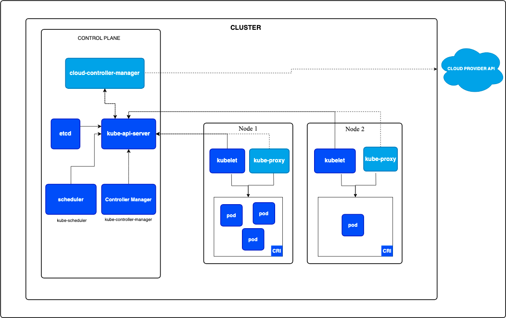

## Introduction

[Kubernetes](https://kubernetes.io/)（简称 K8s）是一个开源系统，用于自动化部署、扩缩容与管理[容器化](/docs/CS/Container/Container.md)应用。

> Kubernetes 源自 Google 内部的 [Borg](/docs/CS/Distributed/Borg.md) 与 Omega 集群管理系统。

Kubernetes 具备以下特征：

- 由一组管理节点（Manager）与一组工作节点（Node）构成
- 内置调度器（Scheduler）把容器放置到集群中
- 提供 API Server 与基于 etcd 的持久化层
- 通过控制器（Controller）持续把实际状态调谐到期望状态
- 可部署在虚拟机或裸金属机器上，既支持公有云，也支持本地机房（on-premise）
- 使用 Go 语言编写

Kubernetes 是管理容器化应用的一套成熟且功能丰富的方案。它并非唯一的容器编排器，另外还有四种：Docker Swarm、Apache Mesos、HashiCorp Nomad、Rancher。

从高层视角看，Kubernetes 与其它集群系统并无本质不同：一个中央管理器对外暴露 API，调度器把工作负载落到一组节点上，集群状态保存在持久化层里。区别在于，Kubernetes 的持久化层用 etcd 实现，而 Mesos 用的是 Zookeeper。

## Installing K8s

先把关闭 swap 等前置条件准备好，再安装组件；生产环境更推荐用 [kubeadm](/docs/CS/Container/k8s/kubeadm.md) 引导集群，日常操作见 [kubectl](/docs/CS/Container/k8s/kubectl.md)。

```shell
swapoff -a

# 追加 vm.swappiness = 0
sudo vim /etc/sysctl.d/k8s.conf
sudo sysctl -p /etc/sysctl.d/k8s.conf
```

官方安装工具清单见 [Install Tools](https://kubernetes.io/docs/tasks/tools/)。

> Windows 上 WSL 与虚拟机不适用：在 `minikube start` 时会因"不支持双重虚拟化"报错。安装 minikube 依赖 Docker，需先确认镜像能否下载（`minikube status` 可查看状态）。

到目前为止，在容器里运行 kubelet 仍没有很好的解决办法，也不推荐用容器去部署 Kubernetes 项目。[kubeadm](/docs/CS/Container/k8s/kubeadm.md) 选择了一种妥协方案：把 kubelet 直接运行在宿主机上，再用容器部署其它 Kubernetes 组件。

### kubeadm, kubelet and kubectl

你需要在所有机器上安装以下三个包：

- **kubeadm**：引导（bootstrap）集群的命令。
- **kubelet**：运行在集群每一台机器上的组件，负责启动 Pod 与容器等具体工作。
- **kubectl**：与集群交互的命令行工具。

<!-- tabs:start -->

##### **CentOS**

```shell
# 将 SELinux 设为 permissive 模式（相当于关闭它）
sudo setenforce 0
sudo sed -i 's/^SELINUX=enforcing$/SELINUX=permissive/' /etc/selinux/config

# 覆盖 /etc/yum.repos.d/kubernetes.repo 中已有的配置
cat <<EOF > /etc/yum.repos.d/kubernetes.repo
[kubernetes]
name=Kubernetes
baseurl=https://mirrors.aliyun.com/kubernetes/yum/repos/kubernetes-el7-x86_64/
enabled=1
gpgcheck=1
repo_gpgcheck=1
gpgkey=https://mirrors.aliyun.com/kubernetes/yum/doc/yum-key.gpg https://mirrors.aliyun.com/kubernetes/yum/doc/rpm-package-key.gpg
exclude=kube*
EOF

# 仅 CentOS7 需要
cat <<EOF >  /etc/sysctl.d/k8s.conf
net.bridge.bridge-nf-call-ip6tables = 1
net.bridge.bridge-nf-call-iptables = 1
EOF
sysctl --system

sudo yum install -y kubelet kubeadm kubectl --disableexcludes=kubernetes
sudo systemctl enable --now kubelet
```

##### **Ubuntu**

```shell
sudo apt-get update
# apt-transport-https 可能是一个空包，若是可直接跳过
sudo apt-get install -y apt-transport-https ca-certificates curl gpg

curl -fsSL https://pkgs.k8s.io/core:/stable:/v1.28/deb/Release.key | sudo gpg --dearmor -o /etc/apt/keyrings/kubernetes-apt-keyring.gpg

# 覆盖 /etc/apt/sources.list.d/kubernetes.list 中已有的配置
echo 'deb [signed-by=/etc/apt/keyrings/kubernetes-apt-keyring.gpg] https://pkgs.k8s.io/core:/stable:/v1.28/deb/ /' | sudo tee /etc/apt/sources.list.d/kubernetes.list

sudo apt-get update
sudo apt-get install -y kubelet kubeadm kubectl
sudo apt-mark hold kubelet kubeadm kubectl
```

##### **Mac**

Mac 下通常使用 Docker Desktop 自带的 K8s。

若遇到 Kubernetes 一直处于 starting 的情况，可参考：

> [`Docker Desktop for Mac` 开启并使用 `Kubernetes`](https://github.com/maguowei/k8s-docker-desktop-for-mac?tab=readme-ov-file#docker-desktop-for-mac-%E5%BC%80%E5%90%AF%E5%B9%B6%E4%BD%BF%E7%94%A8-kubernetes)

<!-- tabs:end -->

### Build

早期 K8s 支持使用 Bazel 构建；由于 Bazel 方式产出的二进制维护复杂度较高，而 Go 语言本身已通过缓存编译中间结果实现了类似增量编译的效果，K8s 在 1.21 版本移除了 Bazel 构建方式。

<!-- tabs:start -->

##### **Local Env**

```shell
make all

# 单独构建某个组件
make WHAT=cmd/kubectl
```

构建函数入口为 `kube::golang::build_binaries`。

##### **Container Env**

```shell
# 构建当前平台
make quick-release
```

报错 `Device not configured template parsing error: template: :1:19: executing "" at <.NetworkSettings.IPAddress>: map has no entry for key "IPAddress"` 时，编辑 `build/common.sh`，找到 `NetworkSettings.IPAddress` 所在行，将其整行替换为：

```shell
container_ip="127.0.0.1"
```

<!-- tabs:end -->

## Architecture

K8s 借鉴了 Borg 的架构设计理念，例如 Scheduler 调度器、Pod 资源对象管理等。

<div style="text-align: center;">



</div>

<p style="text-align: center;">
Fig.1. Kubernetes cluster architecture
</p>

K8s 架构分为 Control Plane（控制平面）与 Worker Node（工作节点）两部分。

> [!TIP]
> 本文按组件展开。若想先看**全局串联**——四条主链路（写请求到账、控制回路、调度决策、kubelet 落地）如何从同一个模型上长出来，以及 ResourceVersion、OwnerReference、水平触发这三个贯穿全局的契约，见 [K8s 架构与四条主链路](/docs/CS/Container/k8s/Architecture.md)。该篇基于 v1.36.4 源码，并附有一条"v1.36 反直觉清单"。

Control Plane 基于 [etcd](/docs/CS/Framework/etcd/etcd.md) 做分布式键值存储：一个具备数据副本的最小可运行集群至少要有 3 个 etcd 节点，生产环境建议 5 个。etcd 集群存储着 K8s 的系统状态与元数据，包括所有资源对象信息、集群节点信息等；K8s 把全部数据存到 etcd 中前缀为 `/registry` 的目录下。

Control Plane 主要包含以下组件：

- [scheduler](/docs/CS/Container/k8s/scheduler.md)
- [apiServer](/docs/CS/Container/k8s/apiserver.md)
- [controller-manager](/docs/CS/Container/k8s/controller-manager.md)

工作节点主要包含以下组件：

- [kubelet](/docs/CS/Container/k8s/kubelet.md)：运行在每个节点上的主要"节点代理"，负责接收、处理、上报 kube-apiserver 下发的任务。
- [kube-proxy](/docs/CS/Container/k8s/kube-proxy.md)：负责把 Service 与 EndpointSlice 翻译成节点上的负载均衡规则（iptables / IPVS / nftables），独立 watch apiserver，不受 kubelet 指挥。
- Container Runtime：负责提供容器的基础管理服务，接收 `kubelet` 的指令。

Kubernetes 支持 containerd、CRI-O 以及其它任意实现了 CRI（Container Runtime Interface）的运行时。生产环境主流是 **containerd**：它本身并非 K8s 组件，而是独立的通用运行时（Docker 底层也是它），通过 CRI Plugin 接入 K8s；kubelet 发出 CRI 请求后，containerd 内部如何翻译、准备 rootfs、经 shim 落到 runc，见 [containerd](/docs/CS/Container/k8s/containerd.md)。另一轻量实现 CRI-O 的定位与机制见 [CRI-O](/docs/CS/Container/k8s/CRI-O.md)。

此外，Kubernetes 官方提供命令行工具（CLI），用户通过 [kubectl](/docs/CS/Container/k8s/kubectl.md) 以命令行方式与 API Server 通信，协议为 HTTP/JSON。K8s 系统使用 client-go 作为 Go 语言的官方编程式客户端库，提供对 API Server 的交互访问，其它组件与 apiserver 的通信也基于 client-go 实现。

## Resource

Kubernetes 是一套"以 API 为核心"的基础设施：所有概念都被抽象成资源（Resource），不同资源承担不同职责；对资源的操作都通过 API 完成，kube-apiserver 提供一系列 REST API 来完成资源的增删改查。换句话说，REST API 是 K8s 的骨架，集群里的一切都被视为 API 对象。

K8s 源码中，所有 API 资源都由 `APIGroup`、`APIVersions`、`APIResource` 三个数据结构承载。执行 `kubectl api-versions -v 10` 可以查看全部 API 版本与 HTTP 请求的详细信息。

### Group Version Resource

在庞大而复杂的系统里，仅有"资源"还不够。Kubernetes 把资源进一步分组并版本化，形成 **Group / Version / Resource** 三级：一个集群支持多个 Group，每个 Group 支持多个 Version，每个 Version 支持多个 Resource，其中部分资源还会拥有自己的 SubResource。例如，写一个 Deployment 的 YAML 时，首行 `apiVersion: apps/v1` 中的 `apps` 就是 Group，`v1` 就是 Version。

为了区分"对外暴露"与"内部使用"，每个资源至少有两个版本：**外部版本（External Version）** 用于面向用户的请求接口；**内部版本（Internal Version）** 不对外暴露，仅在 apiserver 内部使用。

```go
type GroupVersionKind struct {
	Group   string
	Version string
	Kind    string
}

type GroupVersionResource struct {
	Group    string
	Version  string
	Resource string
}
```

### Kind and Scheme

每种资源类型都有一个具体表示，称为 **Kind**（又称 Object Scheme），分为 Object / List / Simple 三类。Scheme 则负责 API 对象的序列化与反序列化、Group/Version/Kind 与 Go 结构体之间的类型注册，以及不同版本 Go 结构体之间的转换映射——它是"带版本的 API 与配置"随时间演化的基础。Scheme、NewScheme 的源码与内外版本转换逻辑，见 [资源模型 Resource](/docs/CS/Container/k8s/Resource.md)。

资源在源码中的落点如下：

- 内部定义：有组在 `pkg/apis/<group>/`，无组在 `pkg/apis/core/types.go`
- 外部版本：有组在 `staging/src/k8s.io/api/<group>/<version>/<resource file>`，无组在 `staging/src/k8s.io/api/core/v1`
- 资源操作方法接口：`staging/src/k8s.io/apiserver/pkg/registry/rest/rest.go`
- 资源操作方法实现：`staging/src/k8s.io/apiserver/pkg/registry/generic/registry/store.go`
- 控制器定义：`kubernetes/pkg/controller/`

### Source Layout

按 Standard Go Project Layout 方案来看 Kubernetes 的工程布局：

| 目录 | 说明 |
| --- | --- |
| cmd | 可执行文件入口 |
| pkg | 核心库代码 |
| staging | 核心库暂存目录，该目录下的核心包多以软链接的方式链接到 `vendor/k8s.io` 目录 |
| vendor / api / build / test / docs / hack / third_party / plugin / translations / CHANGELOG | 其余标准目录（从略） |

K8s 各组件的 `main` 入口结构风格高度一致。

## Pod

Pod 是 K8s 的最小调度单元。它并非内核里的实体，而是一个逻辑概念——一组共享了部分资源的容器。Kubernetes 真正处理的，依旧是宿主机上 Linux 容器的 Namespace 与 Cgroups，并不存在一道名为"Pod"的隔离边界。具体来说：同一个 Pod 里的容器共享同一个 Network Namespace，并可以声明共享同一个 Volume。

pause（infra）容器是 Pod 的"地基"：它永远是 Pod 里第一个被创建的容器，用户定义的容器通过 Join 它的 Network Namespace 与之关联。infra 容器占用极少资源，使用的是一个用汇编编写、永远处于"暂停"状态的特殊镜像 `k8s.gcr.io/pause`（解压后仅 100~200 KB）。Pod 这种"超亲密关系"容器的设计思想，本质上是建议：当你想在一个容器里跑多个功能并不紧密相关的应用时，应优先考虑把它们描述成一个 Pod 里的多个容器。

两类典型模式：

- **Init 容器 + 普通容器**：以 WAR 包 + Tomcat 为例，把 WAR 包做成 Init Container、Tomcat 做成普通容器，二者作为同一 Pod 的两个容器"组合"在一起，绕开了"改 WAR 就要重做镜像"或"维护分布式存储挂载"的两难。
- **sidecar**：以日志收集为例，应用容器把日志写到 `/var/log`，同 Pod 的 sidecar 容器挂载同一个 Volume，持续把日志转发到 MongoDB / Elasticsearch。

凡是调度、网络、存储以及安全相关的属性，基本都是 Pod 级别的；凡是与容器 Linux Namespace 相关的属性，也一定是 Pod 级别的——这些属性描述的都是"机器"这个整体，而非里面运行的"程序"。

Pod 里主要包含三类容器：Init 容器、普通容器、临时容器（Ephemeral Containers），分别对应 `InitContainers`、`Containers`、`EphemeralContainers`。Pod 的声明（PodSpec）、生命周期状态（Pending / Running / Succeeded / Failed / Unknown 及其细分 Conditions）、探针（启动/存活/就绪）、QoS 分级（Guaranteed / Burstable / BestEffort）与优雅终止，以及 kubelet 侧 `syncPod` 的调谐流程与容器启停的源码，全部在 [Pod](/docs/CS/Container/k8s/Pod.md) 中展开。

## Workload Management

K8s 对"怎么跑应用"的回答不是单个对象，而是五个控制器各自对 Pod 的身份、顺序与生命周期做出不同假设：Deployment 以 ReplicaSet 为版本单位做滚动替换，StatefulSet 直接管理 Pod 与 PVC 并保证稳定序号和 DNS，DaemonSet 绕过调度器给每个合格节点放一个 Pod，Job 管"成功 N 次"，CronJob 只是按 cron 表达式生成 Job 的薄壳。

"会用"与"懂"的差距通常落在三处：**默认值**（`replicas=1`、`maxSurge`/`maxUnavailable=25%`、`backoffLimit=6`、`progressDeadlineSeconds=600`）、**滚动更新的算式**（`maxSurge` 向上取整、`maxUnavailable` 向下取整，两者都算成 0 时 `maxUnavailable` 被抬到 1）、以及**超时不会自动回滚**（`progressDeadline` 只把失败写进 condition）。逐条源码核对见 [工作负载控制器](/docs/CS/Container/k8s/Workloads.md)，ReplicaSet 与 Job 的调谐细节另见 [ReplicaSetController](/docs/CS/Container/k8s/ReplicaSetController.md)、[jobController](/docs/CS/Container/k8s/jobController.md)。

## Network Management

[Kubernetes 网络模型](/docs/CS/Container/k8s/net.md) 设计的一个基本原则是：每个 Pod 都拥有一个独立的 IP 地址，并假定所有的 Pod 都在一个可以直接联通、扁平的网络空间。

这条链路在实现上被切成两段：**Pod 网络的建立权交给了容器运行时**——kubelet 只发 CRI 的 `RunPodSandbox`，CNI 插件由 containerd / CRI-O 调用，`pkg/kubelet/network/` 在 v1.36 只剩 DNS 相关代码；**Service 网络的实现权在 kube-proxy**，它把 Service/EndpointSlice 翻译成内核规则，数据面在 iptables / IPVS / nftables 三者中选一（v1.36 默认仍是 iptables）。一个报文从出 netns、命中规则、DNAT 到 conntrack 反向还原的完整旅程见 [K8s 网络](/docs/CS/Container/k8s/net.md)。

南北向的七层入口则是另一条演进线：Ingress 之后的新标准是 [Gateway API](/docs/CS/Container/k8s/Gateway_API.md)——把 Gateway（平台侧）与 Route（应用侧）按角色拆开、路由语义可移植，ingress-nginx 终止维护后的官方迁移方向即此；旧模型的能力边界与灰度写法见 [Ingress](/docs/CS/Container/k8s/Ingress.md)。

## Resource Management

资源管理围绕 `requests` / `limits` 两个声明展开：requests 决定调度放置，limits 由 [Cgroup](/docs/CS/OS/Linux/cgroup.md) 强制执行。由此推导出 Guaranteed / Burstable / BestEffort 三档 QoS，它是**内核 OOM killer** 挑 victim 的依据（经 `oom_score_adj`），详见 [Pod 资源与 QoS](/docs/CS/Container/k8s/Pod.md?id=resources-and-qos)。

注意不要把 OOM killer 与 kubelet 驱逐混为一谈：**kubelet 的节点压力驱逐排序并不看 QoS**，而是按"是否超过 request → priority → 绝对用量"排序。节点侧的保障机制（资源预留、驱逐阈值与两套 eviction 的分野）见 [驱逐](/docs/CS/Container/k8s/Eviction.md)。

## Scheduling

调度由 kube-scheduler 完成：先 predicates（预选）过滤不可用节点，再 priorities（优选）打分选出最优节点，调度框架支持以插件方式扩展每个阶段。详见 [scheduler](/docs/CS/Container/k8s/scheduler.md)。

## Scaling

Pod 数量由扩缩容机制动态决定：手动用 `kubectl scale`；自动由 HPA 根据 `期望副本数 = ceil(当前副本数 × 当前平均利用率 / 目标利用率)` 调整副本数，配合 VPA（纵向调整 requests/limits）与 Cluster Autoscaler（Node 池扩缩）构成完整的弹性体系。原理、冷却期、指标类型与实战案例见 [扩缩容与 HPA](/docs/CS/Container/k8s/Scaling.md)。

## Storage Management

K8s 存储分为两层抽象：

- **Volume**：Pod 级存储，随 Pod 生命周期（emptyDir）或独立于 Pod（hostPath、PV）；
- **PV / PVC / StorageClass**：声明式存储供给——用户只声明 PVC（要多少、什么模式），StorageClass 触发动态供给创建 PV，解耦"存储使用"与"存储实现"。

从 PVC 到容器里一个目录，这条链路要穿过四个执行体（PV controller → AttachDetach controller → kubelet VolumeManager → kuberuntime），中途经由 etcd 做两次异步交接。完整过程见 [持久化存储](/docs/CS/Container/k8s/Storage.md)。

集群状态的持久化（所有 API 对象的存储分层与 watch 机制）见 [etcd](/docs/CS/Container/k8s/etcd.md)。

## Others

K8s 集群是一个具有严格 [acl](/docs/CS/Container/k8s/acl.md) 控制机制的安全系统。

这套控制机制背后是**三套彼此独立的身份体系**：组件/节点用 x509 客户端证书（信任根是集群 CA）、工作负载用 ServiceAccount JWT（签发与校验都在 apiserver 内部，与集群 CA 无关）、v1.36 起还有 Beta 中的 Pod 证书。节点首次加入时的"鸡生蛋"问题由 bootstrap token 解决，日常则由证书 70%~90% 生命周期处的自动轮换维持。完整链路见 [身份与证书](/docs/CS/Container/k8s/Identity.md)。

容器运行时链路（kubelet → CRI → containerd → shim → runc）见 [containerd](/docs/CS/Container/k8s/containerd.md)。部署工具链：[kubeadm](/docs/CS/Container/k8s/kubeadm.md) 负责引导集群，[Helm](/docs/CS/Container/k8s/Helm.md) 负责应用包管理，日常操作见 [kubectl](/docs/CS/Container/k8s/kubectl.md)，故障排查速查见 [Issues](/docs/CS/Container/k8s/Issues.md)。

K8s 的 API 本身是开放可扩展的：CRD 让你在不改 apiserver 的前提下注册新类型，Controller/Operator 把运维知识写成调谐循环，聚合 apiserver 与准入 Webhook 分别扩展"资源从哪来"和"写入前怎么校验"。四类扩展点的分工、失败模式（`failurePolicy: Fail` 会直接卡住写请求）与 v1.36 中 GA 的 ValidatingAdmissionPolicy / MutatingAdmissionPolicy 见 [扩展机制](/docs/CS/Container/k8s/Extension.md)。

集群"跑起来"之后要回答三个问题：出了什么问题、为什么慢、请求经过了哪。指标侧 kubelet 暴露 `/metrics`、`/metrics/cadvisor`、`/metrics/resource` 三组端点，metrics-server 只取资源核算那一组，完整监控栈另走 Prometheus；日志落在 `/var/log/pods` 并按 10Mi × 5 轮转；链路追踪统一走 OTLP。三条链路的采集点、指标 API 的分层（`metrics.k8s.io` / `custom.metrics.k8s.io` / `external.metrics.k8s.io`）与常见反模式见 [可观测性](/docs/CS/Container/k8s/Observability.md)。

最后，YAML 怎么进集群也在演进：从 CI 里 `kubectl apply` 的 push 模型，转向集群内 agent 持续拉取 Git 的 pull 模型。GitOps 的关键不是工具，而是"Git 是唯一期望状态来源、集群内只有一个写入者"这两条约束，Argo CD / Flux 只是它的两种实现；漂移纠正、渐进式发布与 Secret 入库的取舍见 [GitOps 交付](/docs/CS/Container/k8s/GitOps.md)。

## Summary

K8s 改变了传统的应用部署发布方式，为容器化的应用服务提供了灵活方便的容器编排、容器调度与简单的服务发现机制，但也缺少更丰富、更细粒度的服务治理能力。

## Links

- [K8s 架构与四条主链路](/docs/CS/Container/k8s/Architecture.md)
- [工作负载控制器](/docs/CS/Container/k8s/Workloads.md)
- [扩展机制](/docs/CS/Container/k8s/Extension.md)
- [可观测性](/docs/CS/Container/k8s/Observability.md)
- [GitOps 交付](/docs/CS/Container/k8s/GitOps.md)
- [容器知识地图](/docs/CS/Container/README.md)

## References

1. [Kubernetes 中文社区](https://www.kubernetes.org.cn/docs)
1. [Kubernetes源码笔记](https://wqyin.cn/gitbooks/kubeSourceCodeNote/)
1. [Kubernetes源码剖析](https://blog.tianfeiyu.com/source-code-reading-notes/)
