# PodDisruptionBudget: 自愿中断的配额闸门

## Introduction

PodDisruptionBudget（PDB）保护**自愿中断（voluntary disruption）**期间应用的可用性：在节点维护、`kubectl drain`、Cluster Autoscaler 缩容期间，保证"同一时刻最多有多少副本不可用"。

**自愿中断 vs 非自愿中断**：

- **自愿**：drain、descheduler、节点升级——都收敛到同一个动作：向 apiserver 发 `POST /api/v1/namespaces/{ns}/pods/{name}/eviction`。PDB 只挡这一条路。
- **非自愿**：节点崩、内核 panic、kubelet 失联、OOM——PDB **管不了**。这类中断不经过 eviction API，任何"预算"都无从检查。扛它们靠的是多副本 + 反亲和 + 跨 AZ 拓扑（见 [调度器](/docs/CS/Container/k8s/scheduler.md) 的拓扑打散），不是 PDB。

先纠正最常见的误解：**PDB 不是"可用性保证器"，它只是 eviction API 请求处理过程中的一个检查点**。整个机制的全部可信度建立在"所有自愿中断都走 eviction API"这一个约定上。

> [!TIP]
> PDB 不保证"绝不丢流量"。平滑缩容还要配合 readinessProbe + preStop + 滚动更新策略，见 [Pod 优雅终止](/docs/CS/Container/k8s/Pod.md)。

## Big Picture

PDB 的实现横跨两个进程，用 PDB 的 status 字段做账本对账：

```dot
digraph pdb {
  rankdir=LR;
  node [shape=box, style=filled, fillcolor="#eef3fb"];

  subgraph cluster_1 {
    label="apiserver（eviction REST）—— 事后扣款";
    style=filled; color="#c5d7ef"; fontsize=11;

    client [label="kubectl drain / descheduler<br/>POST pods/eviction", fillcolor="#e8f5e9"];
    check  [label="checkAndDecrement<br/>五道闸检查", fillcolor="#fff8e1"];
    cond   [label="Update Pod<br/>加 DisruptionTarget condition", fillcolor="#fff8e1"];
    del    [label="Delete Pod", fillcolor="#ffd6d6"];
    dec    [label="PDB UpdateStatus<br/>DisruptionsAllowed--<br/>DisruptedPods[pod]=now", fillcolor="#ffe0b2"];

    client -> check;
    check -> dec [label="通过"];
    dec -> cond -> del;
  }

  subgraph cluster_2 {
    label="controller-manager（disruption controller）—— 周期对账";
    style=filled; color="#f5d9c5"; fontsize=11;

    sync   [label="trySync<br/>重算 currentHealthy / desiredHealthy<br/>disruptionsAllowed = 差值", fillcolor="#ffe0b2"];
    stale  [label="DisruptedPods 超过 2min<br/>未删除 → 退款", fillcolor="#e8f5e9"];
    failsafe [label="sync 失败<br/>→ DisruptionsAllowed=0", fillcolor="#ffd6d6"];

    dec -> sync [label="status 变更触发"];
    del -> sync;
    sync -> stale;
    sync -> failsafe [style=dashed, label="出错"];
  }
}
```



**Why This Shape：为什么是"apiserver 扣款 + controller 对账"的两方记账？** 这是整个设计里最核心的权衡。检查"删掉这个 Pod 后是否还满足预算"必须是一个原子操作，但 apiserver 与 controller 是两个进程，没有共享内存也没有分布式锁。K8s 的解法是：**把记账单元压到一个 int32 字段（`status.disruptionsAllowed`）上**，apiserver 在批准 eviction 时做乐观扣减（用 conflict retry 保证并发下不超卖），controller 周期性全量重算真实值并覆盖。账目短暂失真（扣了没删、删了没扣）没关系——下一次对账自动纠正。这个设计的成立条件是：eviction 是低频操作（运维动作，不是每秒并发抢购），20 次 conflict retry 足够；且最坏情况宁可少批（fail-closed），不会超删。

## Segment 1: The Eviction REST — What Actually Happens on POST

eviction 子资源不是"带检查的 DELETE"那么简单，它是一个多分支事务（`pkg/registry/core/pod/storage/eviction.go`）。

### Which Pods Skip the PDB Entirely

第一道分岔：很多 Pod 状态下根本不需要查 PDB：

```go
// pkg/registry/core/pod/storage/eviction.go
// canIgnorePDB returns true for pod conditions that allow the pod to be deleted
// without checking PDBs.
func canIgnorePDB(pod *api.Pod) bool {
    if pod.Status.Phase == api.PodSucceeded || pod.Status.Phase == api.PodFailed ||
        pod.Status.Phase == api.PodPending || !pod.ObjectMeta.DeletionTimestamp.IsZero() {
        return true
    }
    return false
}
```

**Why 这些状态可以直接删？** 它们要么已经不计入"可用副本"（Succeeded/Failed/Pending 本来就不 ready，删掉不造成额外中断），要么删除已经在进行中（有 DeletionTimestamp）。对这些 Pod 查 PDB 是重复记账，还会造成"Pending Pod 卡住 drain"这类伪故障。这也解释了一个排障常识：**drain 卡住时先看 Pod 是不是 Running/Ready**——Succeeded/Pod 不需要 PDB 放行。

### Unhealthy Pods May Evict for Free

第二道分岔：Pod 存在但不健康（not ready）时，可能"免费"驱逐——不消耗配额：

```go
// pkg/registry/core/pod/storage/eviction.go
if !podutil.IsPodReady(pod) {
    if pdb.Spec.UnhealthyPodEvictionPolicy != nil && *pdb.Spec.UnhealthyPodEvictionPolicy == policyv1.AlwaysAllow {
        // Delete the unhealthy pod, it doesn't count towards currentHealthy and desiredHealthy and we should not decrement disruptionsAllowed.
        updateDeletionOptions = true
        return nil
    }
    // default nil and IfHealthyBudget policy
    if pdb.Status.CurrentHealthy >= pdb.Status.DesiredHealthy && pdb.Status.DesiredHealthy > 0 {
        updateDeletionOptions = true
        return nil
    }
    // confirm no disruptions allowed in checkAndDecrement
}
```

`spec.unhealthyPodEvictionPolicy` 两个值：`IfHealthyBudget`（默认，nil 时即此值）——预算有余量时不健康 Pod 免费走；`AlwaysAllow`——不健康 Pod 无条件免费走。**Why 给不健康 Pod 通道？** 一个已 crash 的 Pod 挡住 drain 没有任何意义：它既不提供容量，删掉也不降低可用性。这条规则让 drain 不至于被僵尸 Pod 卡死。

### Five Gates in checkAndDecrement

走到这里的 Pod 才真正接受预算检查，五道闸依次：

```go
// pkg/registry/core/pod/storage/eviction.go
func (r *EvictionREST) checkAndDecrement(namespace string, podName string, pdb policyv1.PodDisruptionBudget, dryRun bool) error {
    if pdb.Status.ObservedGeneration < pdb.Generation {
        return createTooManyRequestsError(pdb.Name)          // ① status 落后于 spec → 429
    }
    if pdb.Status.DisruptionsAllowed < 0 {
        return errors.NewForbidden(...)                      // ② 负数 → 403
    }
    if len(pdb.Status.DisruptedPods) > MaxDisruptedPodSize {
        return errors.NewForbidden(...)                      // ③ 未确认驱逐堆积 > 2000 → 403
    }
    if pdb.Status.DisruptionsAllowed == 0 {
        return errors.NewTooManyRequests(...)                // ④ 配额用尽 → 429
    }
    pdb.Status.DisruptionsAllowed--
    if pdb.Status.DisruptionsAllowed == 0 {
        pdbhelper.UpdateDisruptionAllowedCondition(&pdb)
    }
    ...
    pdb.Status.DisruptedPods[podName] = metav1.Time{Time: time.Now()}
    if _, err := r.podDisruptionBudgetClient.PodDisruptionBudgets(namespace).UpdateStatus(context.TODO(), &pdb, metav1.UpdateOptions{}); err != nil {
        return err
    }
    return nil
}
```

各闸的含义：

1. **`ObservedGeneration < Generation`**：spec 刚改过、controller 还没重算过 status——此时 status 数字不可信，宁可拒绝。
2. **负数配额**：正常流程到不了这里，出现即是异常（controller 侧 bug 或手工改 status）。
3. **`DisruptedPods` 超过 2000**（`MaxDisruptedPodSize`）：大量"已扣款但 controller 尚未确认"的驱逐堆积，说明 disruption controller 明显落后——停止放行。
4. **配额为 0**：标准路径，返回 429 + `DisruptionBudgetCause` + 建议重试间隔 10s。
5. 通过则扣款：`DisruptionsAllowed--`，同时把 Pod 名和当前时间记入 `status.disruptedPods`——这就是"记账凭证"，供 controller 对账。

重试策略也有讲究：

```go
// pkg/registry/core/pod/storage/eviction.go
// EvictionsRetry is the retry for a conflict where multiple clients
// are making changes to the same resource.
var EvictionsRetry = wait.Backoff{
    Steps:    20,
    Duration: 500 * time.Millisecond,
    Factor:   1.0,
    Jitter:   0.1,
}
```

冲突重试最多 20 步 × 500ms × 10% jitter。**但客户端在 `deleteOptions.preconditions.resourceVersion` 里带了 RV 时重试被关闭**——请求方显式声明"我看到的这个版本是前提"时，apiserver 不允许它悄悄漂移到新版本重试。

### Patch Condition, Then Delete

配额扣完才执行删除，与 taint manager、kubelet 的驱逐一样，先打 `DisruptionTarget` condition 再删：

```go
// pkg/registry/core/pod/storage/eviction.go
conditionAppender := func(_ context.Context, newObj, _ runtime.Object) (runtime.Object, error) {
    podObj := newObj.(*api.Pod)
    podutil.UpdatePodCondition(&podObj.Status, &api.PodCondition{
        Type:    api.DisruptionTarget,
        Status:  api.ConditionTrue,
        Reason:  "EvictionByEvictionAPI",
        Message: "Eviction API: evicting",
    })
    return podObj, nil
}
```

**三个来源三种 Reason**，排障时可借此判断是谁发起了中断：

| 来源 | DisruptionTarget Reason |
|---|---|
| Eviction API（本页） | `EvictionByEvictionAPI` |
| Taint manager（污点驱逐） | `DeletionByTaintManager` |
| kubelet（压力驱逐） | `TerminationByKubelet` |

## Segment 2: The Disruption Controller — Reconciling the Ledger

controller-manager 里的 disruption controller 是记账的另一方。它不参与单次驱逐决策，只做一件事：周期性重算每个 PDB 的真实预算并写回 status。

### How the Numbers Are Computed

`trySync` 的账目公式（`pkg/controller/disruption/disruption.go`）：

```go
// pkg/controller/disruption/disruption.go
func countHealthyPods(pods []*v1.Pod, disruptedPods map[string]metav1.Time, currentTime time.Time) (currentHealthy int32) {
    for _, pod := range pods {
        // Pod is being deleted.
        if pod.DeletionTimestamp != nil {
            continue
        }
        // Pod is expected to be deleted soon.
        if disruptionTime, found := disruptedPods[pod.Name]; found && disruptionTime.Time.Add(DeletionTimeout).After(currentTime) {
            continue
        }
        if apipod.IsPodReady(pod) {
            currentHealthy++
        }
    }
    return
}
```

healthy 的定义很朴素：**ready 且不在删除流程中（含已被扣款的）**。

```go
// pkg/controller/disruption/disruption.go
disruptionsAllowed := currentHealthy - desiredHealthy
if expectedCount <= 0 || disruptionsAllowed <= 0 {
    disruptionsAllowed = 0
}
```

`desiredHealthy` 的来源分两种 spec：`minAvailable`（整数直接用、百分比乘以 expectedScale）与 `maxUnavailable`（`expectedCount - maxUnavailable`）。百分比模式有一个前提——被选中的 Pod 必须有工作负载控制器（Deployment/ReplicaSet/StatefulSet/ReplicationController 四种 finder 按 owner 链找 scale），否则：

```go
// pkg/controller/disruption/disruption.go（trySync 中的告警分支）
dc.recorder.Eventf(pdb, v1.EventTypeWarning, "UnmanagedPods", "Pods selected by this PodDisruptionBudget (selector: %v) were found "+
    "to be unmanaged. As a result, the status of the PDB cannot be calculated correctly, which may result in undefined behavior. "+
    "To account for these pods please set \".spec.minAvailable\" "+
    "field of the PDB to an integer value.", pdb.Spec.Selector)
```

**Why 百分比必须有 controller？** 百分比的分母是"控制器的期望副本数之和"（`getExpectedScale`），裸 Pod 没有这个数字。这也是旧版"maxUnavailable 只支持有控制器的负载"这一限制的由来：不是 API 禁止，而是算不出分母。

### The 2-minute Refund

记账凭证不能无限期占用额度——如果 Pod 扣款后一直没被真删（客户端放弃、优雅终止卡住、apiserver 与实际删除之间出岔），配额就被永久占用。controller 给凭证一个 2 分钟的有效期：

```go
// pkg/controller/disruption/disruption.go
// DeletionTimeout sets maximum time from the moment a pod is added to DisruptedPods in PDB.Status
// to the time when the pod is expected to be seen by PDB controller as having been marked for deletion.
// If the pod was not marked for deletion during that time it is assumed that it won't be deleted at
// all and the corresponding entry can be removed from pdb.Status.DisruptedPods.
DeletionTimeout = 2 * time.Minute
```

`buildDisruptedPodMap` 逐条检查：超过 `DeletionTimeout` 还没出现 DeletionTimestamp 的条目被丢弃（并发 Warning 事件 `NotDeleted`），相当于**退款**；未到期的保留并计算最早的重查时间，入 recheck queue 按时唤醒。

### Fail Closed

对账失败时，controller 采取最保守的动作——把配额清零：

```go
// pkg/controller/disruption/disruption.go
// failSafe is an attempt to at least update the DisruptionsAllowed field to
// 0 if everything else has failed.  This is one place we
// implement the  "fail open" part of the design since if we manage to update
// this field correctly, we will prevent the /evict handler from approving an
// eviction when it may be unsafe to do so.
func (dc *DisruptionController) failSafe(ctx context.Context, pdb *policy.PodDisruptionBudget, err error) error {
    newPdb := pdb.DeepCopy()
    newPdb.Status.DisruptionsAllowed = 0
    ...
    apimeta.SetStatusCondition(&newPdb.Status.Conditions, metav1.Condition{
        Type:    policy.DisruptionAllowedCondition,
        Status:  metav1.ConditionFalse,
        Reason:  policy.SyncFailedReason,
        ...
    })
    return dc.getUpdater()(ctx, newPdb)
}
```

**Why 失败后置 0 而不是维持旧值？** 维持旧值的风险是"账目已乱但闸门还开着"——可能放行超预算的驱逐。清零的代价只是 drain 暂时卡住（运维动作本来就是可等待的），收益是绝不会超删。这是典型的**可用性换一致性**取舍：控制面自身状态可疑时，先停掉"主动制造中断"的能力。sync 失败的 PDB 在 `conditions` 里会留下 `DisruptionAllowed=False / Reason=SyncFailed`，`kubectl describe pdb` 可见。

### Stale Condition Cleanup

controller 还负责清理"孤儿 condition"：Pod 身上有 `DisruptionTarget=True` 却迟迟没有 DeletionTimestamp（例如 taint manager patch 完 condition 后 DELETE 失败又没重试成功），超过 `stalePodDisruptionTimeout`（2min）就把它翻成 False，避免下游（Job 重试策略等）永远等不到中断确认。

## Segment 3: Spec Semantics and Common Traps

```yaml
apiVersion: policy/v1
kind: PodDisruptionBudget
metadata: { name: app-pdb }
spec:
  minAvailable: 2          # 或 maxUnavailable: 1，二者互斥
  selector:
    matchLabels: { app: app }
```

- `minAvailable` / `maxUnavailable` **二选一**；都可以是整数或百分比。
- 一个 Pod 只能被一个 PDB 选中——多个 PDB selector 重叠时后写者报错。
- PDB 的 status 是 controller 算出来的，手工改没有意义（会立刻被覆盖）。

**过严的 PDB 是运维事故源头**：

| 配置 | 后果 |
|---|---|
| `minAvailable: 100%` / `maxUnavailable: 0` | 任何自愿中断都被永久拒绝，drain 卡死 |
| PDB 覆盖但全集群无处可调度 | drain 卡死，Pod 无法搬走（429 无限期） |
| 配额被扣款后 Pod 一直不删 | 2min 内额度被占（`DisruptedPods` 里可见） |
| spec 频繁变更 | `ObservedGeneration` 落后，期间所有 eviction 拿 429 |

`kubectl drain` 对 429 的默认行为是**重试并等待**——这正是设计意图：等副本在别处起来、controller 退款或重新计账。`--force --grace-period=0` 会绕过 PDB 直接删（危险，等于宣告"我不在乎预算"）。

与 Cluster Autoscaler 的交互见 [弹性扩缩容](/docs/CS/Container/k8s/Scaling.md)；污点驱逐与压力驱逐**不走** eviction API，因此不受 PDB 约束（见 [Eviction: 驱逐的三条路径](/docs/CS/Container/k8s/Eviction.md) 的三路径对照）。

## Counterintuitive List

按杀伤力排序，全部已回 v1.37.2 源码复验：

1. **PDB 只在 eviction API 一处生效。** 节点宕机、kubelet 压力驱逐、taint manager 污点驱逐都不经过它。它不是可用性保证器。
2. **Pending/Succeeded/Failed/terminating Pod 直接绕过 PDB。** drain 卡住时先确认被删 Pod 是否 Running。
3. **不健康 Pod 可能免费驱逐。** `IfHealthyBudget`（默认）下预算有余量、或 `AlwaysAllow` 时，not-ready Pod 不消耗配额。
4. **`ObservedGeneration` 落后 = 全部拒绝。** spec 刚改完的头几秒，eviction 一律 429，这是刻意的不可信状态处理。
5. **配额是"乐观扣款 + 2 分钟退款"。** 扣款记录在 `status.disruptedPods`，Pod 超 2 分钟没被删就退款。`kubectl describe pdb` 里能看到 pending 中的凭证。
6. **sync 失败 → 配额清零。** disruption controller 挂掉或出错时 PDB fail-closed，drain 停摆——这是设计选择，不是 bug。
7. **百分比模式要求 Pod 有控制器。** 裸 Pod（无 owner）会让百分比分母算不出来，controller 发 `UnmanagedPods` 告警，建议改用整数 `minAvailable`。
8. **eviction 可以 dry-run。** `dryRun` 会走完检查与扣减但不落盘、不删 Pod——可用于验证预算。
9. **429 自带 10 秒建议重试间隔和 `DisruptionBudgetCause`。** 客户端应读 `Retry-After` 与 cause，而不是立即暴力重试。
10. **三个中断来源在 `DisruptionTarget` condition 上有三种 Reason。** 排障时可一眼分清是 drain、taint manager 还是 kubelet 动的手。

## Troubleshooting Quick Reference

| 现象 | 该看什么 |
|---|---|
| drain 卡住返回 429 | `kubectl describe pdb`：`disruptionsAllowed` 是否为 0；`currentHealthy` vs `desiredHealthy`；`SyncFailed` condition |
| drain 被 Pending Pod 卡住 | 正常：这类 Pod 绕过 PDB，但删除本身可能被 admission/配额拦住；确认 Pod 状态 |
| PDB 配额永远不恢复 | 查 `status.disruptedPods` 是否堆积（controller 挂了或 2min 内 Pod 未删） |
| spec 改完立刻 drain 全部 429 | 正常：`ObservedGeneration` 未追上，等 controller 重算 |
| percentage PDB 状态数字怪异 | 查是否有裸 Pod 被 selector 选中（`UnmanagedPods` 事件） |
| CA 缩容不动空闲节点 | PDB 卡住缩容是已知死锁场景，见 [弹性扩缩容](/docs/CS/Container/k8s/Scaling.md) |

## Key Default Values

| 参数 | 默认值 | 归属 |
|---|---|---|
| `unhealthyPodEvictionPolicy` | nil → **IfHealthyBudget** | PDB spec |
| `MaxDisruptedPodSize` | **2000** | apiserver eviction REST（常量） |
| `EvictionsRetry` | 20 步 × 500ms × Jitter 0.1 | apiserver eviction REST |
| 429 建议重试间隔 | **10s** | apiserver（Retry-After） |
| `DeletionTimeout`（凭证有效期） | **2min** | disruption controller（常量） |
| `stalePodDisruptionTimeout` | **2min** | disruption controller（常量） |
| `DisruptionAllowed` condition | 每次重算刷新 | disruption controller |

## Links

- [Eviction: 驱逐的三条路径](/docs/CS/Container/k8s/Eviction.md)
- [删除与级联链路](/docs/CS/Container/k8s/Deletion.md)
- [kube-apiserver](/docs/CS/Container/k8s/apiserver.md)
- [弹性扩缩容 HPA/CA](/docs/CS/Container/k8s/Scaling.md)
- [Pod 优雅终止](/docs/CS/Container/k8s/Pod.md)
- [工作负载控制器](/docs/CS/Container/k8s/Workloads.md)

## References

1. [Kubernetes v1.37.2 source](https://github.com/kubernetes/kubernetes/tree/v1.37.2)
2. [Pod Disruption Budgets](https://kubernetes.io/docs/concepts/workloads/pod-disruption-budget/)
3. [Safely Drain a Node](https://kubernetes.io/docs/tasks/administer-cluster/safely-drain-node/)
4. [PodDisruptionBudget v1 API](https://kubernetes.io/docs/reference/kubernetes-api/policy-resources/pod-disruption-budget-v1/)
