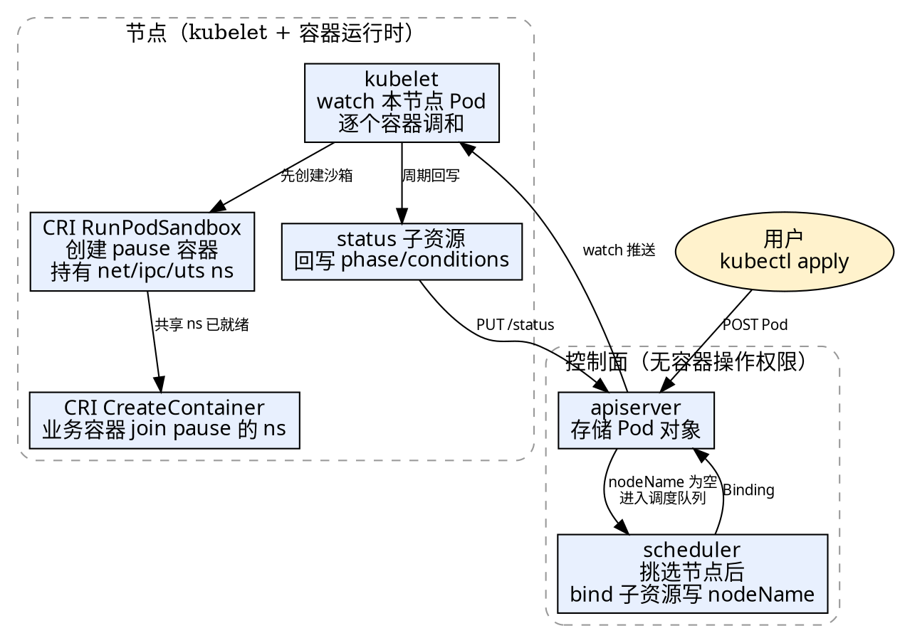

## Introduction

Pod 是 Kubernetes 中**最小的可部署、可调度单元**。它不是直接管理 [容器](/docs/CS/Container/Container.md)，而是把一个或多个容器"打包"成一个逻辑主机：这些容器共享同一组 [Network Namespace](/docs/CS/OS/Linux/namespace.md)、IPC Namespace 和 UTS Namespace，可以互相通过 `localhost` 通信、共享 Volume，但 PID Namespace 自 v1.24+ 默认开启 Pod 级共享（`shareProcessNamespace`）。

理解 Pod 有一个根本视角：**容器是"单进程"的抽象，Pod 是"进程组"的抽象**。容器里 PID=1 承担 init 职责，管理多进程的能力很弱；传统部署时代"一组同生共死的进程"（业务进程 + 日志收集进程）需要新的抽象来承载——这就是 Pod。它刻意**不**对应"一台虚拟机"。

## Big Picture

Pod 的生命周期横跨三个进程（apiserver、scheduler、kubelet）和一个容器运行时，全靠 etcd 里的对象交接：



三个根本约束决定了整个形态（详见 [Why This Shape](#why-this-shape)）：控制面没有容器操作权限、kubelet 没有 etcd 写权限之外的对象语义、跨组件交接只能靠对象状态。

## Why This Shape

**为什么 Pod 不直接是"一个容器 + 附属配置"？** 因为单进程容器无法表达"一组协作进程"。如果日志进程和业务进程是两个独立 Pod，调度器可能把它们放到不同节点——"同生共死"在拓扑上就碎了。Pod 把"必须同节点"编码进调度原子单位，这是它存在的核心理由。

**为什么共享 Namespace 要经过 pause 容器中转，而不是直接让业务容器共享宿主机？** 直接共享宿主机 ns 会引入端口冲突和全局状态污染；直接容器间互 join 则没有稳定的"锚点"——业务容器崩溃重建时需要有东西持有 ns。pause 容器就是那个锚点：它第一个启动、几乎不耗资源、永不退出，IP 和 ns 挂在它身上，业务容器随便重建。

**为什么 Pod IP 属于 Sandbox 而非容器？** 执行层原因在 CNI 调用时机：CNI ADD 发生在 Sandbox 阶段，目标是 pause 容器的 ns；业务容器 `CreateContainer` 时加入同一 ns，**不再调用 CNI**。见 [CNI](/docs/CS/Container/k8s/CNI.md) 的 Sandbox 阶段一节。

### Why Pod-level Resources（v1.34 Beta）

v1.34 起 `PodLevelResources`（[KEP-2837](https://github.com/kubernetes/enhancements/blob/master/keps/sig-node/2837-pod-level-resource-spec/README.md)，Beta 默认开启）允许在 Pod 级声明 `spec.resources`：调度器按 Pod 总量放置，kubelet 再把总量拆给容器。动机是解决"多容器 Pod 各自声明 request 导致调度超配"的问题——三个容器各要 1Gi，实际合计只跑 1.5Gi 时，Pod 级声明 1.5Gi 更省资源。

## Sandbox and the Pause Container

kubelet 调和到一个未运行的 Pod 时，第一步永远是创建沙箱（pause 容器）：

```go
// pkg/kubelet/kuberuntime/kuberuntime_sandbox.go
func (m *kubeGenericRuntimeManager) createPodSandbox(ctx context.Context, pod *v1.Pod, attempt uint32) (string, string, error) {
	podSandboxConfig, err := m.generatePodSandboxConfig(ctx, pod, attempt)
	if err != nil {
		message := fmt.Sprintf("Failed to generate sandbox config for pod %q: %v", format.Pod(pod), err)
		logger.Error(err, "Failed to generate sandbox config for pod", "pod", klog.KObj(pod))
		return "", message, err
	}

	// Create pod logs directory
	err = m.osInterface.MkdirAll(podSandboxConfig.LogDirectory, 0755)
	...
	podSandBoxID, err := m.runtimeService.RunPodSandbox(ctx, podSandboxConfig, runtimeHandler)
	...
}
```

```
Pod
 ├── pause (Infra) 容器   ← 持有 Network / IPC / UTS Namespace
 ├── app 容器             ← join pause 的 Network Namespace
 └── sidecar 容器         ← join pause 的 Network Namespace
```

`Join` 的系统调用是 setns(2)，机制见 [namespace 的 setns](/docs/CS/OS/Linux/namespace.md?id=setns-join-an-existing-namespace)。由此得出两个重要推论：

1. **容器镜像不依赖宿主机环境**：pause 镜像在 Node 上只需存在一次，多个 Pod 复用。
2. **IP 归 Pod 而非容器**：Pod 内所有容器共享同一个 IP 和端口空间，容器间通信走 loopback。

### Who Chooses the Pause Image（v1.37 变化）

历史版本里 pause 镜像由 kubelet 的 `--pod-infra-container-image`（KubeletConfiguration 的 `PodSandboxImage`）指定。**v1.37 的源码里这个字段已经不存在**——kubelet 调和沙箱时只传 config 不传镜像：

```go
// pkg/kubelet/kuberuntime/kuberuntime_sandbox.go（generatePodSandboxConfig 内，节选）
podSandboxConfig := &runtimeapi.PodSandboxConfig{
    Metadata: &runtimeapi.PodSandboxMetadata{
        Name:      pod.Name,
        Namespace: pod.Namespace,
        Uid:       podUID,
        Attempt:   attempt,
    },
    Labels:      newPodLabels(pod),
    Annotations: newPodAnnotations(pod),
}
```

镜像选择权移交到了 CRI runtime 侧。以 containerd v2.4.2 为例，pause 镜像是 CRI 插件配置项：

```toml
# containerd 的 CRI 插件配置（docs/cri/config.md）
sandbox_image = "registry.k8s.io/pause:3.10.2"
```

这个变化把"pause 镜像版本"从 kubelet 升级流程中解耦出来——换 kubelet 不再连带换 pause 镜像，也避免了 kubelet 与运行时各自记录沙箱镜像导致的不一致。

### Sandbox Resources（Pod 级 cgroup）

沙箱不只是 ns 锚点，还是 **Pod 级 cgroup 的挂载点**。v1.34 起 kubelet 会把 Pod 级资源配置写到沙箱的 cgroup 上：

```go
// pkg/kubelet/kuberuntime/kuberuntime_sandbox_linux.go
func (m *kubeGenericRuntimeManager) calculateSandboxResources(ctx context.Context, pod *v1.Pod) *runtimeapi.LinuxContainerResources {
	opts := resourcehelper.PodResourcesOptions{
		ExcludeOverhead:                          true,
		SkipPodLevelResources:                    !utilfeature.DefaultFeatureGate.Enabled(features.PodLevelResources),
		UseDRANodeAllocatableResourceClaimStatus: utilfeature.DefaultFeatureGate.Enabled(features.DRANodeAllocatableResources),
	}
	req := resourcehelper.PodRequests(pod, opts)
	lim := resourcehelper.PodLimits(pod, opts)
	...
	return m.calculateLinuxResources(cpuRequest, lim.Cpu(), lim.Memory(), disableCPUQuota)
}
```

Pod 的 overhead（`spec.overhead`）单独走 `config.Linux.Overhead`，不会混进容器资源。Pod 级 [Cgroup](/docs/CS/OS/Linux/cgroup.md) 是 `PodLevelResources` 的运行时落点。

## Three Types of Containers

Pod 中包含三类容器，分别对应 `InitContainers`、`Containers`、`EphemeralContainers` 字段。v1.29 起 init 容器又分出第四个身份：**sidecar（restartable init container，GA）**——对应的 `SidecarContainers` feature gate 已从代码中移除（GA 后清理），行为恒开。

- **Init 容器**：按定义顺序串行执行，前一个成功退出（exit 0）后才会启动下一个；全部完成后才启动业务容器。适合等待依赖、初始化配置。
- **业务容器**：长期运行，多容器并行。
- **Sidecar 容器**：init 容器声明 `restartPolicy: Always` 即为 sidecar——它按 init 容器的顺序**先于业务容器启动**，但退出不影响 Pod（自动重启），且**在业务容器之后终止**。适合日志收集、代理等"跟随生命周期但不阻塞完成"的组件。
- **临时容器**：无法指定 ports / probes / resources，不能重启，用于故障注入和在线调试（`kubectl debug -it pod --image=busybox`），弥补了 `kubectl exec` 无法进入没有 shell 的容器的情况。

```go
// pkg/api/v1/pod/util.go
// IsRestartableInitContainer returns true if the container has ContainerRestartPolicyAlways.
func IsRestartableInitContainer(initContainer *v1.Container) bool {
	return initContainer != nil && initContainer.RestartPolicy != nil &&
		*initContainer.RestartPolicy == v1.ContainerRestartPolicyAlways
}
```

### Restart Rules（v1.35 Beta 起，重启语义的扩展）

`ContainerRestartRules`（Beta 默认开启）让容器的"退出后重启"不再只有 `restartPolicy` 一刀切：可以按退出码、退出原因声明细粒度规则，action 支持 `Restart`（重启本容器）和 `RestartAllContainers`（重启整个 Pod）。

在此基础上，`RestartAllContainersOnContainerExits`（Beta 默认开启，v1.36 起）实现了一个重要的语义变化：**当某个容器命中 `RestartAllContainers` 规则时，包括 init 容器在内的所有容器一起重启**。这解决了"业务容器崩溃后 init 容器不知情"的隔离问题——以前 init 做的初始化状态可能已经失效，但 init 容器不会重跑。

Pod phase 的计算（`getPhase`）对这三类容器分别计数，sidecar 的终止**不计入** Pod phase 判定：

```go
// pkg/kubelet/kubelet_pods.go（getPhase 内，节选）
// regular init containers
for _, container := range spec.InitContainers {
    if podutil.IsRestartableInitContainer(&container) {
        // Skip the restartable init containers here to handle them separately as
        // they are slightly different from the init containers in terms of the
        // pod phase.
        continue
    }
    ...
}

// sidecar init containers
for _, container := range spec.InitContainers {
    if !podutil.IsRestartableInitContainer(&container) {
        // Skip the regular init containers, as they have been handled above.
        continue
    }
    containerStatus, ok := podutil.GetContainerStatus(info, container.Name)
    ...
    case containerStatus.State.Terminated != nil:
        // Do nothing here, as terminated restartable init containers are not
        // taken into account for the pod phase.
    ...
}
```

## Lifecycle and Status

### Phase 是 kubelet 算出来的，不是 apiserver

Pod 的 `status.phase` 只有五种，且**由 kubelet 在本地根据容器状态推导**（`getPhase`），再经 status 子资源回写 apiserver。控制面从不直接猜 Pod 状态：

| Phase | 判定（getPhase 逻辑） |
|-------|------|
| Pending | 存在未启动的 init 容器 / 有容器 Waiting |
| Running | 至少一个容器 Running 且无 Unknown |
| Succeeded | 全部容器成功退出且不会重启（Job 完成） |
| Failed | 全部容器已终止且至少一个失败退出 |
| Unknown | 容器状态无法获取（通常 kubelet 与 runtime 通信失败） |

```go
// pkg/kubelet/kubelet_pods.go（getPhase 尾部，节选）
case running == 0 && stopped > 0 && unknown == 0:
    // The pod is terminal so its containers won't be restarted regardless
    // of the restart policy.
    if podIsTerminal {
        if !kubetypes.IsStaticPod(pod) {
            // All regular containers are terminated in success and all restartable
            // init containers are stopped.
            if stopped == succeeded {
                return v1.PodSucceeded
            }
            // There is at least one failure
            return v1.PodFailed
        }
    }
    // All containers are terminated
    if utilfeature.DefaultFeatureGate.Enabled(features.ContainerRestartRules) {
        if stopped != stoppedNotRestartable {
            // At least one containers are in the process of restarting
            return v1.PodRunning
        }
        ...
    }
```

注意这个细节：**所有容器都已终止也可能返回 Running**——只要有容器在重启流程中（`stopped != stoppedNotRestartable`）。phase 描述的是"调和目标未达成"，不是"有没有活着的容器"。

### Conditions 才是可用性依据

phase 之外的 `conditions`（`PodScheduled`、`Initialized`、`ContainersReady`、`Ready`）才是判断可用性的关键——Service/Deployment 的 endpoint 管理依据是 `Ready` condition 而不是 phase。一个 Ready=false 的 Running Pod 不接流量。

### RestartPolicy 与退避重启

Pod 重启策略 `restartPolicy`（`Always` / `OnFailure` / `Never`）作用于 Pod 内所有容器。容器反复崩溃时会进入**退避重启**（CrashLoopBackOff），实现在 kubelet 的 `flowcontrol.Backoff` 中：

```go
// pkg/kubelet/kubelet.go
func newCrashLoopBackOff(kubeCfg *kubeletconfiginternal.KubeletConfiguration) (time.Duration, time.Duration) {
	boMax := MaxCrashLoopBackOff
	boInitial := initialCrashLoopBackOff
	if utilfeature.DefaultFeatureGate.Enabled(features.ReduceDefaultCrashLoopBackOffDecay) {
		boMax = reducedMaxCrashLoopBackOff
		boInitial = reducedInitialCrashLoopBackOff
	}

	if utilfeature.DefaultFeatureGate.Enabled(features.KubeletCrashLoopBackOffMax) {
		// operator-invoked configuration always has precedence if valid
		boMax = kubeCfg.CrashLoopBackOff.MaxContainerRestartPeriod.Duration
		if boMax < boInitial {
			boInitial = boMax
		}
	}
	return boMax, boInitial
}
```

- 默认：初始 10s（`initialCrashLoopBackOff`），指数退避，上限 300s（`MaxContainerBackOff`）。
- **重置条件**：容器持续运行超过 10min 才重置退避计数——"运行满 10 分钟"才算"这次真的好了"：

```go
// pkg/kubelet/kubelet.go
klet.crashLoopBackOff = flowcontrol.NewBackOff(base, boMax)
klet.crashLoopBackOff.HasExpiredFunc = func(eventTime time.Time, lastUpdate time.Time, maxDuration time.Duration) bool {
    return eventTime.Sub(lastUpdate) > 600*time.Second
}
```

- v1.35 起 `KubeletCrashLoopBackOffMax`（Beta 默认开启）允许通过 KubeletConfiguration 自定义上限；`ReduceDefaultCrashLoopBackOffDecay`（Alpha）提供更激进的 1s/60s 档位（[KEP-4602](https://github.com/kubernetes/enhancements/tree/master/keps/sig-node/4602-reduce-crashloopbackoff-decay)，针对 CPU 密集型镜像的冷启动场景）。

退避判定发生在每次 sync 循环里，退避中的容器触发 `Back-off` Event：

```go
// pkg/kubelet/kuberuntime/kuberuntime_manager.go（doBackOff 内）
key := GetBackoffKey(pod, container)
if backOff.IsInBackOffSince(key, ts) {
    if containerRef, err := kubecontainer.GenerateContainerRef(pod, container); err == nil {
        m.recorder.WithLogger(logger).Eventf(containerRef, v1.EventTypeWarning, events.BackOffStartContainer,
            "Back-off restarting failed container %s in pod %s", container.Name, format.Pod(pod))
    }
    backoff := backOff.Get(key)
    err := fmt.Errorf("back-off %s restarting failed container=%s pod=%s", backoff, container.Name, format.Pod(pod))
    ...
    return true, err.Error(), kubecontainer.NewBackoffError(kubecontainer.ErrCrashLoopBackOff, ts.Add(backoff))
}
```

`kubectl describe pod` 里看到的 `CrashLoopBackOff` 状态就是这里的 Waiting reason。

## Resources and QoS

每个容器可以声明 `requests`（调度依据）与 `limits`（运行上限）。kubelet 据 requests/limits 关系给 Pod 打 QoS 标签，并落地为内核 `oom_score_adj`：

| QoS 类别 | 条件 | `oom_score_adj` |
|----------|------|-----------------|
| Guaranteed | 所有容器 requests == limits（CPU 与内存都设置） | `-997`（最后被杀） |
| Burstable | 至少一个容器设置了 request | 按公式计算，见下 |
| BestEffort | 什么都没设置 | `1000`（最先被杀） |

```go
// pkg/kubelet/qos/policy.go
const (
    // KubeletOOMScoreAdj is the OOM score adjustment for Kubelet
    KubeletOOMScoreAdj int = -999
    // KubeProxyOOMScoreAdj is the OOM score adjustment for kube-proxy
    KubeProxyOOMScoreAdj  int = -999
    guaranteedOOMScoreAdj int = -997
    besteffortOOMScoreAdj int = 1000
)

func GetContainerOOMScoreAdjust(pod *v1.Pod, container *v1.Container, memoryCapacity int64) int {
    if types.IsNodeCriticalPod(pod) {
        // Only node critical pod should be the last to get killed.
        return guaranteedOOMScoreAdj
    }

    switch v1qos.GetPodQOS(pod) {
    case v1.PodQOSGuaranteed:
        // Guaranteed containers should be the last to get killed.
        return guaranteedOOMScoreAdj
    case v1.PodQOSBestEffort:
        return besteffortOOMScoreAdj
    }

    // Burstable containers are a middle tier, between Guaranteed and Best-Effort. Ideally,
    // we want to protect Burstable containers that consume less memory than requested.
    // The formula below is a heuristic. A container requesting for 10% of a system's
    // memory will have an OOM score adjust of 900. If a process in container Y
    // uses over 10% of memory, its OOM score will be 1000. The idea is that containers
    // which use more than their request will have an OOM score of 1000 and will be prime
    // targets for OOM kills.
    containerMemReq := getEffectiveContainerMemoryRequest(pod, container)

    var oomScoreAdjust, remainingReqPerContainer int64
    if utilfeature.DefaultFeatureGate.Enabled(features.PodLevelResources) &&
        resourcehelper.IsPodLevelRequestsSet(pod) {
        remainingReqPerContainer = remainingPodMemReqPerContainer(pod)
        oomScoreAdjust = 1000 - (1000 * (containerMemReq + remainingReqPerContainer) / memoryCapacity)
    } else {
        oomScoreAdjust = 1000 - (1000*containerMemReq)/memoryCapacity
    }
    ...
    // A guaranteed pod using 100% of memory can have an OOM score of 10. Ensure
    // that burstable pods have a higher OOM score adjustment.
    if int(oomScoreAdjust) < (1000 + guaranteedOOMScoreAdj) {
        return (1000 + guaranteedOOMScoreAdj)
    }
    // Give burstable pods a higher chance of survival over besteffort pods.
    if int(oomScoreAdjust) == besteffortOOMScoreAdj {
        return int(oomScoreAdjust - 1)
    }
    return int(oomScoreAdjust)
}
```

Burstable 的公式是 `1000 - 1000 × 内存request / 节点内存`：request 占节点内存的比例越大，越不容易被内核 OOM killer 选中。两个 Why 值得记住：

1. **下限是 3**（`1000 + (-997)`）：Burstable 就算 request 极小，也不会混到 BestEffort 的档位。
2. **sidecar 特殊处理**：sidecar 的 oom_score_adj 取"自己按公式算的值"与"普通容器中最小 request 算出的值"二者较小者——保证 sidecar 永远不会比它跟随的业务容器先被 OOM 杀掉。

内存超 limit 会被 OOMKill（退出码 137）；CPU 超 limit 只会被 CFS 限流（throttle），不会被杀。内核 OOM killer 如何按 `oom_score_adj` 挑 victim 见 [OOM killer](/docs/CS/OS/Linux/mm/oom.md)。

> [!TIP]
> 注意区分两件容易被混为一谈的事：**内核 OOM killer 确实按 QoS 挑 victim**（经 `oom_score_adj`），但 **kubelet 的节点压力驱逐排序不看 QoS**——它按"是否超过自己的 request → priority → 绝对用量"排序，QoS 只在准入阶段起有限作用。这是两个不同的"内存不足时杀谁"的机制，详见 [驱逐](/docs/CS/Container/k8s/Eviction.md)。

### In-place Resize（v1.35 GA）

`InPlacePodVerticalScaling` 自 v1.35 GA（LockToDefault）：修改运行中 Pod 的 `resources.requests/limits` 不再触发 Pod 重建，kubelet 直接调整 cgroup 参数。这改变了"resources 不可变"的历史约束——现在 spec 中除 requests/limits 外的字段仍不可变，但 CPU/内存可以原地调整。

## Graceful Termination

apiserver 侧的删除流程（deletion timestamp、finalizer、grace period 扣减）见 [Deletion](/docs/CS/Container/k8s/Deletion.md)。kubelet 侧拿到终止指令后的执行逻辑在 `killContainer`：

```go
// pkg/kubelet/kuberuntime/kuberuntime_container.go（killContainer 内，节选）
gracePeriod := setTerminationGracePeriod(ctx, pod, containerSpec, containerName, containerID, reason)
...
// Run the pre-stop lifecycle hooks if applicable and if there is enough time to run it
if containerSpec.Lifecycle != nil && containerSpec.Lifecycle.PreStop != nil && gracePeriod > 0 {
    gracePeriod = gracePeriod - m.executePreStopHook(ctx, pod, containerID, containerSpec, gracePeriod)
}

// if we care about termination ordering, then wait for this container's turn to exit if there is
// time remaining
if ordering != nil && gracePeriod > 0 {
    // grace period is only in seconds, so the time we've waited gets truncated downward
    gracePeriod -= int64(ordering.waitForTurn(containerName, gracePeriod))
}

// always give containers a minimal shutdown window to avoid unnecessary SIGKILLs
if gracePeriod < minimumGracePeriodInSeconds {
    gracePeriod = minimumGracePeriodInSeconds
}

err := m.runtimeService.StopContainer(ctx, containerID.ID, gracePeriod)
```

宽限期的取值优先级（`setTerminationGracePeriod`）：

```go
// pkg/kubelet/kuberuntime/kuberuntime_container.go
func setTerminationGracePeriod(ctx context.Context, pod *v1.Pod, containerSpec *v1.Container, containerName string, containerID kubecontainer.ContainerID, reason containerKillReason) int64 {
	gracePeriod := int64(minimumGracePeriodInSeconds)
	switch {
	case pod.DeletionGracePeriodSeconds != nil:
		return *pod.DeletionGracePeriodSeconds
	case pod.Spec.TerminationGracePeriodSeconds != nil:
		switch reason {
		case reasonStartupProbe:
			if isProbeTerminationGracePeriodSecondsSet(ctx, pod, containerSpec, containerSpec.StartupProbe, containerName, containerID, "StartupProbe") {
				return *containerSpec.StartupProbe.TerminationGracePeriodSeconds
			}
		case reasonLivenessProbe:
			if isProbeTerminationGracePeriodSecondsSet(ctx, pod, containerSpec, containerSpec.LivenessProbe, containerName, containerID, "LivenessProbe") {
				return *containerSpec.LivenessProbe.TerminationGracePeriodSeconds
			}
		}
		return *pod.Spec.TerminationGracePeriodSeconds
	}
	return gracePeriod
}
```

三个关键设计：

1. **`DeletionGracePeriodSeconds` 优先**：这是 apiserver 删除时已经扣减过的余量（见 Deletion 的 updateForGracefulDeletionAndFinalizers），kubelet 直接沿用，避免两端重复计时。
2. **preStop 耗时从宽限期中扣减**：preStop 跑了 3s，容器就只剩 27s 响应 SIGTERM——preStop 里 sleep 越久，真正的优雅退出窗口越小。
3. **最小 2s 关闭窗口**（`minimumGracePeriodInSeconds = 2`）：即使宽限期被扣光，也给容器留最后的机会响应 SIGTERM，避免"preStop 吃掉全部时间 → 立刻 SIGKILL"。

**Sidecar 的终止顺序**：Pod 含 sidecar 时，kubelet 用 `terminationOrdering` 保证**普通容器先退、sidecar 后退**——日志收集器要等业务容器吐完最后的日志：

```go
// pkg/kubelet/kuberuntime/kuberuntime_container.go（killContainersWithSyncResult 内，节选）
var termOrdering *terminationOrdering
if types.HasRestartableInitContainer(pod) {
    var runningContainerNames []string
    for _, container := range runningPod.Containers {
        runningContainerNames = append(runningContainerNames, container.Name)
    }
    termOrdering = newTerminationOrdering(pod, runningContainerNames)
}
```

经典陷阱（endpoint 摘除与 SIGTERM 并行）：endpoint 摘除是异步的，若应用收到 SIGTERM 后立即退出，宽限期内的存量流量会打到已死 Pod。解法是 `preStop` 中 `sleep` 几秒再退出——代价就是要理解上面第 2 条：sleep 时间要计入宽限期预算。

## Troubleshooting

Pod 出现 CrashLoopBackOff 状态，就想到大概率是 Pod 内服务自身的原因。

使用 kubectl describe 命令查看：

从 Event 日志可以看出，是 calico 的健康检查没通过导致的重启，出错原因也比较明显：`net/http: request canceled while waiting for connection (Client.Timeout exceeded while awaiting headers)`，这个错误的含义是建立连接超时，并且手动在控制台执行健康检查命令，发现确实响应慢（正常环境是毫秒级别）。

考虑到错误原因是建立连接超时，并且业务量比较大，先观察一下 TCP 连接的状态情况（大量 `SYN_RECV` 通常意味着握手排队）。

常见排查入口：

```shell
kubectl describe pod <pod>          # Events 是第一手线索
kubectl logs <pod> -c <container> --previous   # 上一次崩溃的日志
kubectl get pod <pod> -o yaml       # 完整 Spec 与 Status
kubectl exec -it <pod> -- /bin/sh   # 进入容器
kubectl debug -it <pod> --image=nicolaka/netshoot  # 临时容器调试
```

更多异常状态见 [常见问题排查](/docs/CS/Container/k8s/Issues.md)。

## Key Default Values

| 配置 | 默认值 | 出处 |
|------|--------|------|
| 退避初始时长 | 10s | `initialCrashLoopBackOff` |
| 退避上限 | 300s | `MaxContainerBackOff` |
| 退避重置条件 | 持续运行 > 10min | `HasExpiredFunc` 600s |
| `KubeletCrashLoopBackOffMax` | Beta 默认 true（v1.35 起） | 可自定义退避上限 |
| `PodLevelResources` | Beta 默认 true（v1.34 起） | KEP-2837 |
| `InPlacePodVerticalScaling` | GA LockToDefault（v1.35 起） | 原地资源调整 |
| `ContainerRestartRules` | Beta 默认 true（v1.35 起） | 细粒度重启规则 |
| `RestartAllContainersOnContainerExits` | Beta 默认 true（v1.36 起） | 重启波及全容器 |
| 最小关闭窗口 | 2s | `minimumGracePeriodInSeconds` |
| `terminationGracePeriodSeconds` | 30s | Pod spec 默认 |
| pause 镜像 | 由 CRI runtime 决定 | containerd 默认 `registry.k8s.io/pause:3.10.2` |
| kubelet 自身 `oom_score_adj` | -999 | `KubeletOOMScoreAdj` |
| Guaranteed Pod `oom_score_adj` | -997 | `guaranteedOOMScoreAdj` |
| BestEffort Pod `oom_score_adj` | 1000 | `besteffortOOMScoreAdj` |

## Links

- [kubelet](/docs/CS/Container/k8s/kubelet.md)
- [containerd](/docs/CS/Container/k8s/containerd.md)
- [Deletion](/docs/CS/Container/k8s/Deletion.md)
- [Eviction](/docs/CS/Container/k8s/Eviction.md)
- [CNI](/docs/CS/Container/k8s/CNI.md)
- [Namespace](/docs/CS/OS/Linux/namespace.md)

## References

- [Pod 文档 - Kubernetes](https://kubernetes.io/docs/concepts/workloads/pods/)
- [KEP-2837: Pod Level Resource Spec](https://github.com/kubernetes/enhancements/blob/master/keps/sig-node/2837-pod-level-resource-spec/README.md)
- [KEP-753: Sidecar Containers](https://github.com/kubernetes/enhancements/tree/master/keps/sig-node/753-sidecar-containers)
- [KEP-3987: In-place Resource Vertical Scaling](https://github.com/kubernetes/enhancements/issues/1281)
- [containerd CRI 配置](https://raw.githubusercontent.com/containerd/containerd/main/docs/cri/config.md)
