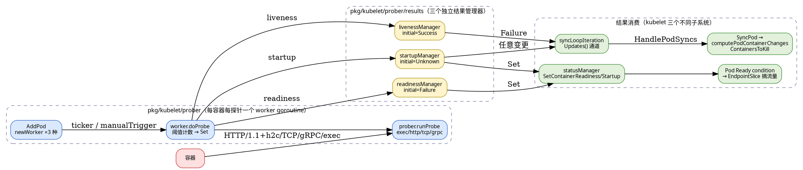

# Probe

## Introduction

Probe（探针）是 kubelet 对容器的**主动健康检查机制**：用户在容器上声明 StartupProbe / ReadinessProbe / LivenessProbe 三种探针，kubelet 周期性地用 HTTP / TCP / gRPC / Exec 四种方式探测容器，把结果写进容器状态与 Pod conditions，并在失败时驱动两条完全不同的通路——**重启容器**（liveness/startup）或**摘除流量**（readiness）。

一个精确的边界定义：探针是**kubelet 本地行为**，控制面（apiserver/scheduler）不参与探测，也不感知探测结果——Probe 的结果只存在于 `pod.status` 里，经由 readiness 影响 EndpointSlice 的 endpoints（通过 Pod Ready 条件间接传递）。这意味着：**探测配置的错误只影响本节点**，但也意味着**没有全局的探测视图**（排查要进节点）。

本文源码基于 **Kubernetes v1.37.2**（commit 91c32c2b）逐字核对，落点在 `pkg/kubelet/prober/`（worker 与 manager）与 `pkg/probe/`（http/tcp/grpc/exec 四个实现包）。v1.37 的新东西：`H2CContainerProbe`（alpha，HTTP/2 cleartext 探测）与 `GRPCContainerProbeTLS`（alpha，gRPC TLS 探测）两个新 gate；gRPC 探针本体已 GA（gate 移除）。

## The Big Picture

探针机制横跨 kubelet 的三个子系统，一次失败探测从产生到生效要走完整条链：



读这张图的关键是**三个结果管理器的通路不对称**：liveness 走 `Updates()` 通道触发一轮 Pod sync（间接杀容器），readiness/startup 走 statusManager 直接改状态（不触发重启）。

## Why This Shape

**1. 为什么 readiness 的初始值是 Failure、liveness 是 Success、startup 是 Unknown？** 这是三个语义的精确编码（`newWorker`）：

```go
// pkg/kubelet/prober/worker.go —— 三种探针的初始值
switch probeType {
case readiness:
    w.spec = container.ReadinessProbe
    w.resultsManager = m.readinessManager
    w.initialValue = results.Failure
case liveness:
    w.spec = container.LivenessProbe
    w.resultsManager = m.livenessManager
    w.initialValue = results.Success
case startup:
    w.spec = container.StartupProbe
    w.resultsManager = m.startupManager
    w.initialValue = results.Unknown
}
```

- **readiness = Failure**：容器刚启动还没探测过时必须视为"不接流量"——如果初值是 Success，一次发布就能把没就绪的容器暴露给客户端。
- **liveness = Success**：初值若为 Failure，则 kubelet 一启动就会把所有容器判死重启——liveness 的语义是"失败到阈值才杀"，而"还没探测过"不等于"失败"。
- **startup = Unknown**："startup 过没过要等 probe 自己说"，Unknown 是中性值，让 `isContainerStarted` 能明确区分"未探测"与"已判定"。

**2. 为什么每容器每探针一个 goroutine，而不是共享轮询循环？** v1.37 的 prober manager 在 `AddPod` 时为每个容器的每种探针各起一个 worker（键 `{podUID, containerName, probeType}`）。共享循环的旧设计在数千 Pod 规模下有一个致命问题：**一次慢探测（HTTP 卡 1s）会推迟队列里所有其他探测**，探测周期漂移与误判连锁。独立 goroutine 把超时隔离在单探测内，代价是 goroutine 数量 ≈ Pod 数 × 容器数 × 3——`scale_test.go` 专门为这个规模做了基准。

**3. 为什么 liveness 失败不直接杀容器，而要绕一圈 SyncPod？** worker 拿到 Failure 达标后只写 resultsManager，杀容器是下一轮 `SyncPod` 里 `computePodContainerChanges` 的决定。Why：**杀容器必须与 Pod 的完整状态对账**（spec 是否变了、是否正在删除、killPod 事务、grace period 计算）——这些逻辑全部在 SyncPod 路径里，probe worker 只生产"事实"，不做"决策"。这与 Eviction.md 里"kubelet 不能删 etcd 对象"是同一分层哲学。

## Three Probes, Three Semantics

三种探针不是"同一个机制加开关"，而是三条语义完全不同的链：

| 维度 | StartupProbe | ReadinessProbe | LivenessProbe |
|---|---|---|---|
| 回答的问题 | 容器完成初始化了吗 | 现在能接流量吗 | 还活着吗 |
| 失败后果 | **重启容器** | Pod Ready=false → 摘流量 | **重启容器** |
| 初始值 | Unknown | Failure | Success |
| 成功后 | **停止探测**（闸门放行） | 持续探测 | 持续探测 |
| 失败达标后 | onHold 停止探测，等新容器 | 状态翻转，继续探测 | onHold 停止探测，等新容器 |
| 优雅删除豁免 | 写 Success 后退出 | 无豁免（继续报真实状态） | 写 Success 后退出 |
| Pod 重启场景 | 容器重启后重新探测 | 容器重启后重新探测 | 容器重启后重新探测 |
| probe 级 grace period | 支持 | **禁止设置**（validation 拒绝） | 支持 |

两个值得展开的语义点：

**startup 是 liveness/readiness 的前置闸门。** `doProbe` 里的顺序检查：startup 未判定成功之前，其它探针直接跳过；startup 成功之后自己退出探测（ticker 还在转但不再执行 probe）。没有 startup probe 时，"已启动"的判定退化为容器 Running——这就是旧时代"慢启动应用被 liveness 误杀"问题的解法：**把"启动慢"表达为 startup 的 FailureThreshold × PeriodSeconds 预算，而不是把 liveness 的阈值调大**。

**优雅删除豁免只豁免重启类探针。** Pod 进入删除流程后，liveness/startup 直接写 Success 并退出，readiness 不豁免。动机不对称：删除中的 Pod 报 NotReady 是**正确信号**（它确实要退出服务了，endpoints 摘除是期望行为）；但如果 liveness 继续探测正在关闭的容器，健康检查失败会触发**新一轮重启**，干扰优雅关闭——所以重启类探针闭嘴，摘流量探针继续工作。

## The Worker Loop

worker 是理解探测行为的钥匙，`doProbe` 里按顺序执行一组守卫（`pkg/kubelet/prober/worker.go`）：

```go
// doProbe 的守卫序列（按源码顺序）
// 1. Pod 已 Failed/Succeeded → worker 退出
// 2. 容器 ID 变了 → 旧结果 Remove、新容器重置 onHold、重播 initialValue
// 3. 容器不在 Running → 写 Failure（终止且不再重启的除外，worker 退出）
// 4. Pod 有 DeletionTimestamp 且 probe 是 liveness/startup
//      → 写 Success，return false 优雅退出
// 5. InitialDelaySeconds 未到 → 跳过本轮（return true）
// 6. startup 已成功（且本 worker 是 startup）→ 跳过；未 started（其它探针）→ 跳过
// 7. 真正执行探测
```

**手动触发与周期抖动**：worker 的 ticker 是标准 `time.NewTicker(PeriodSeconds)`，但有两个附加机制——kubelet 刚启动时 worker 先随机 sleep 一段 tickerPeriod（**防止 kubelet 重启后全部探针同时开打**，抖散负载）；`manualTriggerCh` 允许 manager 在状态同步时（如 `UpdatePodStatus` 发现 readiness 结果缺失）**立即插队一次探测并重置周期起点**：

```go
// worker.run：三种唤醒来源
select {
case <-w.stopCh:
    break probeLoop
case <-probeTicker.C:
    // 周期到点
case <-w.manualTriggerCh:
    // 插队一次，并从现在重新计周期
    probeTicker.Reset(probeTickerPeriod)
}
```

**阈值计数是对"连续结果"计数的**：`lastResult == result` 则 `resultRun++`，否则清零重计。所以 FailureThreshold=3 的含义是**连续** 3 次失败，中间夹一次成功就重新数。达标时才 `resultsManager.Set`——这就是"阈值以下状态不变"的设计，防止一次抖动直接翻转状态。

**失败达标后的 onHold** 是一个容易忽略的细节：liveness/startup 判死达标后 worker 置 `onHold=true` 并停止探测，直到看到新的容器 ID。源码注释给了两个理由：老的 docker exec 在容器停止中执行可能损坏状态（#21751），以及 startup 失败后继续探测纯属浪费（#117153）。

## Four Probe Implementations

`prober.runProbe` 按 `p.Exec / p.HTTPGet / p.TCPSocket / p.GRPC` 四路分发，各有几个不为人知的细节：

**HTTP**（`pkg/probe/http/http.go`）：
- 成功区间 `[200, 400)`；**3xx 不会跟随跨主机重定向**——kubelet 构造 prober 时写死 `followNonLocalRedirects = false`，被终止的重定向返回 **Warning** 结果（Warning 归一化为 Success，但记录 `ContainerProbeWarning` 事件）。本地重定向（同 host）会跟随，上限 10 次。
- 响应体最多读 `maxRespBodyLength` 截断——恶意服务返回超大 body 不会拖垮 kubelet。
- 失败消息**刻意不含响应体**（issue #99425 未解决前的安全决策）——排障时 `kubectl describe` 看到的失败只有 status code，要看 body 得自己 curl。
- Host 默认取 `status.PodIP`；`Host` 头必须用 `httpHeaders` 字段设置（validation 禁止在 headers 列表里塞 Host）。
- **超时来自 `p.TimeoutSeconds`**，作用于 `http.Client.Timeout`（连接+读响应的整个生命周期）。

**TCP**：只做三次握手成功即 Success，不读任何应用层响应——中间件用 TCP 探测"假活"（进程在、accept 线程死）的场景要换 HTTP。

**gRPC**：调标准 `grpc.health.v1.Health/Check`，`service` 参数映射到 health 服务的 service 名。gRPC 探针本体已 GA（gate 移除）；v1.37 新增 alpha gate `GRPCContainerProbeTLS` 支持探测 TLS 端点（`Mode: TLS`）。

**Exec**：经 CRI 在容器内执行命令，**超时同样由 TimeoutSeconds 强制**（`ExecProbeTimeout` gate 已 GA LockToDefault，1.38 移除——想绕过 exec 探测超时已不可能，这是刻意设计：无超时的 exec 探测会挂死 worker）。两个易踩的坑写在源码注释与实现里：**exec 探测没有 Pod 环境变量和 downward API 访问**（命令展开只做静态 env 展开）；每次探测都是新的进程执行，开销在四种探针里最大。

**单次探测内部重试**：`runProbeWithRetries` 对**错误**（err 非空，如超时、连接失败）最多重试 `maxProbeRetries = 3` 次，取最后一次结果。注意这只针对 error，**明确的 Failure（如 HTTP 500）不会重试**——且这个重试在 FailureThreshold 之外，排障时"配置 3 次阈值但日志看到 9 次尝试"是正常现象。

## Failure Pathways: Kill vs Traffic Removal

结果生效的三条通路差异很大：

**liveness/startup 失败 → 重启容器**。结果写入 livenessManager/startupManager 的 `Updates()` 通道，kubelet 的 `syncLoopIteration` 消费：

```go
// pkg/kubelet/kubelet.go —— syncLoop 对 probe 结果的分发
case update := <-kl.livenessManager.Updates():
    if update.Result == proberesults.Failure {
        handleProbeSync(ctx, kl, update, handler, "liveness", "unhealthy")
    }
case update := <-kl.readinessManager.Updates():
    ready := update.Result == proberesults.Success
    kl.statusManager.SetContainerReadiness(logger, update.PodUID, update.ContainerID, ready)
    handleProbeSync(ctx, kl, update, handler, "readiness", status)
```

`handleProbeSync` 最终就是 `HandlePodSyncs`——liveness 失败**不是直接杀**，而是触发一轮 Pod sync，真正的杀容器决策在 `computePodContainerChanges`：

```go
// pkg/kubelet/kuberuntime/kuberuntime_manager.go
} else if liveness, found := m.livenessManager.Get(containerStatus.ID); found && liveness == proberesults.Failure {
    message = fmt.Sprintf("Container %s failed liveness probe", container.Name)
    reason = reasonLivenessProbe
} else if startup, found := m.startupManager.Get(containerStatus.ID); found && startup == proberesults.Failure {
    message = fmt.Sprintf("Container %s failed startup probe", container.Name)
    reason = reasonStartupProbe
}
```

`reason` 决定了 grace period：`setTerminationGracePeriod` 在 `reasonLivenessProbe`/`reasonStartupProbe` 时**优先使用 probe 级 `TerminationGracePeriodSeconds`**（允许大于 pod 级，只记 V(4) 日志不拒绝），否则回落 pod 级。注意 readiness **禁止**设置 probe 级 grace period（validation 直接拒绝）——摘流量不需要杀进程，字段对它无意义。`ProbeTerminationGracePeriod` gate 本体已 GA 并从代码移除（openapi 注释里的"beta field"是残留文本）。

**readiness 变化 → 状态直改 + 摘流量**。`SetContainerReadiness` 直接更新 Pod condition（ContainerReady/Ready），不经 syncPod 全流程；Ready condition 传递到 EndpointSlice controller 完成 endpoints 增删。这就是 readiness 生效路径比 liveness 快得多的原因——不排队等 Pod sync。

**UpdatePodStatus 的兜底查询**。每次生成 Pod status 时，prober manager 会用 `readinessManager.Get` 填 Ready 字段；如果结果缓存里没有（探测还没跑过），会查 worker 是否存在——**有 readiness probe 但没跑过 → NotReady，无 readiness probe → 恒 Ready**，并顺手 `manualTriggerCh` 插队催一次探测。这个兜底保证状态机在任何时刻都有确定的值。

## Kubelet Restart: The Tricky Case

kubelet 重启后探针状态的恢复是整个机制里最微妙的场景，`ChangeContainerStatusOnKubeletRestart` gate（v1.36 引入，alpha）改写了行为：

- **旧行为（gate 关）**：重启后 worker 重播 initialValue 之外，还有 `kubeletRestartGracePeriod`（kubelet 启动前 10 秒内启动的容器视为"非重启"）——**不让一个原本 Ready 的容器因为 kubelet 重启瞬间变 NotReady**（`setReadyStateOnKubeletRestart` 保留旧状态直到真正探测出结果）。sidecar 的 startup 结果也会被 seed 成 Success，防止初始化卡死。
- **新行为（gate 开）**：直接 `resultsManager.Set(initialValue)`，让状态忠实反映"还没探测"的事实——更诚实，但 kubelet 重启的瞬间 readiness 会出现一次抖动。

这个 gate 没转 Beta 说明上游自己也在权衡：**诚实性 vs 抖动**，默认保守（alpha off）。

## Counter-Intuitive Checklist

1. **探针失败不直接杀容器**——liveness Failure 走 Updates 通道触发一轮 SyncPod，杀容器是 `computePodContainerChanges` 的决策。中间隔着 podWorker 队列，所以"探测失败"到"容器重启"有秒级延迟。
2. **FailureThreshold 数的是连续结果**——中间一次 Success 就清零重计；`maxProbeRetries=3` 的内部重试只针对 error（超时/连接失败），HTTP 500 这种明确 Failure 不重试。
3. **3xx 是 Warning 不是 Success/Failure**——跨主机重定向一律终止（`followNonLocalRedirects=false` 写死），Warning 归一化 Success 但有事件；同 host 重定向最多跟 10 次。
4. **失败消息不含响应体**（#99425 安全决策）——`kubectl describe` 里只有 status code，看 body 要自己进容器 curl。
5. **exec 探测没有 Pod 环境变量**——命令展开只做静态 env 引用替换，且每探测一次 fork 一个进程，是四种探针里开销最大的。
6. **exec 超时不可关闭**——`ExecProbeTimeout` GA LockToDefault（1.38 移除 gate），无超时的 exec 探测会挂死 worker，上游不再给这个自由。
7. **startup 成功后停止探测**——ticker 还在转但不执行 probe；容器重启后重新探测（新容器 ID 重置 onHold）。
8. **优雅删除只豁免重启类探针**——liveness/startup 写 Success 退出，readiness 继续报真实状态（摘流量是期望行为）。
9. **readiness 禁止设置 probe 级 grace period**（validation 拒绝），liveness/startup 的 probe 级 grace 可以**大于** pod 级（仅日志提醒不拒绝）——这与直觉相反，K8s 其余字段通常取 min。
10. **liveness/startup 失败达标后 worker onHold**——不再探测直到新容器 ID；重启风暴时 kubelet 的探测负载会自动下降。
11. **TCP 探测只验证握手**——不读应用层响应，accept 线程死掉的进程 TCP 探测照样 Success（假活）。
12. **无 readiness probe 的容器恒 Ready**——`ready = !exists`；这不是"默认健康"而是"没有证据就不拦截"。
13. **kubelet 重启的 readiness 抖动**——`ChangeContainerStatusOnKubeletRestart`（alpha）开启后重启瞬间所有容器重播 initialValue（readiness=Failure），endpoints 会短暂摘除又恢复；关闭时用 grace 窗口保状态。

## Key Default Values

| 参数 | 默认值 | 出处 |
|---|---|---|
| `PeriodSeconds` | **10s** | `SetDefaults_Probe` |
| `TimeoutSeconds` | **1s** | `SetDefaults_Probe` |
| `FailureThreshold` | **3** | `SetDefaults_Probe` |
| `SuccessThreshold` | **1** | `SetDefaults_Probe` |
| `InitialDelaySeconds` | 0 | API 零值 |
| 单次探测内部重试（仅 error） | **3** | `maxProbeRetries` |
| HTTP 重定向上限（同 host） | 10 次 | `RedirectChecker` |
| HTTP 响应体截断 | `maxRespBodyLength` | `pkg/probe/http/http.go` |
| worker 启动抖动 | 随机 [0, PeriodSeconds)（仅 kubelet 刚启动时） | `worker.run` |
| probe 级 grace period 默认 | 未设置 → pod 级（默认 30s） | `setTerminationGracePeriod` |
| `H2CContainerProbe` / `GRPCContainerProbeTLS` | alpha，默认关（v1.37 新增） | `pkg/features/kube_features.go` |
| gRPC 探针本体 / `ExecProbeTimeout` | GA（gate 移除 / LockToDefault 1.35） | 同上 |

## Links

- [kubelet](/docs/CS/Container/k8s/kubelet.md)
- [Pod 生命周期与状态](/docs/CS/Container/k8s/Pod.md)
- [Service](/docs/CS/Container/k8s/Service.md)
- [Eviction（kubelet 驱逐路径）](/docs/CS/Container/k8s/Eviction.md)
- [Events（Unhealthy 事件的聚合）](/docs/CS/Container/k8s/Events.md)

## References

1. [Kubernetes v1.37.2 pkg/kubelet/prober](https://github.com/kubernetes/kubernetes/tree/v1.37.2/pkg/kubelet/prober)
2. [Kubernetes v1.37.2 pkg/probe](https://github.com/kubernetes/kubernetes/tree/v1.37.2/pkg/probe)
3. [Configure Liveness, Readiness and Startup Probes - Kubernetes 文档](https://kubernetes.io/docs/tasks/configure-pod-container/configure-liveness-readiness-startup-probes/)
4. [KEP-3138: Startup/Readiness/Liveness Probe peculiarities](https://github.com/kubernetes/enhancements/tree/master/keps/sig-node/3138-probe-grace-period)
5. [kubernetes#99425: Include response body in HTTP probe failure message](https://github.com/kubernetes/kubernetes/issues/99425)
