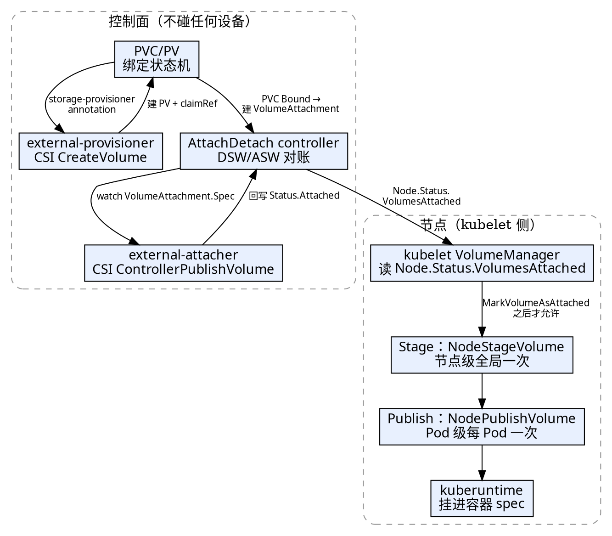

## Introduction

存储是 Kubernetes 里**跨组件最长的一条链路**。一个 PVC 变成容器里一个可写目录，要穿过四个执行体、经历三次交接：

```
用户 kubectl apply PVC
  ①  PV controller（controller-manager）→ 匹配或触发供给 → PVC Bound
  ②  AttachDetach controller（controller-manager）→ 创建 VolumeAttachment
       └─ external-attacher（集群外）→ 调 CSI ControllerPublishVolume
  ③  kubelet VolumeManager → WaitForAttach → MountDevice → SetUp
       └─ CSI NodeStageVolume → NodePublishVolume
  ④  kuberuntime → 把宿主目录塞进容器 spec
```

理解这条链路的关键是抓住**三个不同的「粒度」**，每一层解决一个不同的问题：

| 层级 | 粒度 | 回答的问题 | 记录在哪 |
|---|---|---|---|
| 绑定 | (PVC, PV) | 哪个卷归谁用 | PVC/PV 的 spec 与 annotation |
| Attach | (卷, 节点) | 卷挂到哪个节点上 | `VolumeAttachment` + `Node.Status.VolumesAttached` |
| Mount | (卷, Pod) | 哪个 Pod 里能看到它 | kubelet 的 ASW + `Node.Status.VolumesInUse` |

粒度差异不是设计冗余，而是**必需**：一个 PV 可以 attach 到多个节点（RWX），同一节点上多个 Pod 又共享同一个设备。所以「挂到节点」和「挂进 Pod」必然是两件事——这正是两阶段挂载的根源。

> [!NOTE]
> 本文全部结论基于 **Kubernetes v1.37.2** 源码实读，机制讲解直接贴真实片段。v1.36-v1.37 有几处推翻常见认知的变化（SELinuxMount GA、VolumeAttachment Spec 不可变转 beta），统一收在「反直觉清单」。

## Big Picture

整条链路里，每个执行体只做自己有权限做的事，跨执行体交接全部经由 etcd 里的对象：



## Why This Shape

**为什么交接全靠 etcd 对象（annotation/status）而不是 RPC？** 四个执行体分布在两个不同信任域：external-provisioner / external-attacher 是集群外第三方 Pod，不持有 K8s 组件间互相调用的通道。把中间状态编码成 PVC annotation、VolumeAttachment、Node.Status，任何一方 watch 到变化就能接力——这套设计的代价是异步延迟（Pod 拿到卷总是有往返），收益是完全解耦。

**为什么 attach 和 mount 必须分属两个执行体？** attach 是云 API 级别的副作用（把 EBS 盘挂到宿主机），只有控制面能可靠地做全局仲裁（避免同一卷被两个节点同时挂）；mount 是宿主机本地的 mount(2)，只有节点上的 kubelet 能做。中间那座桥就是 `Node.Status` 的两个字段：kubelet 上报 `VolumesInUse`，controller 回写 `VolumesAttached`。

**为什么 mount 内部还要再分 stage/publish 两阶段？** 三个理由见 [Why Two Phases](#why-two-phases)：多 Pod 共享只 stage 一次、CSI 能力可协商、块设备与文件系统统一模型。

## Segment 1: Binding — How PVC Becomes Bound

### The State Machine Entry Has Only Two Branches

很多人记得 `syncClaim` 有「nil / Lost / 其它」三分支，但在 v1.36+ **`getClaimStatus` 这个函数已经不存在了**，入口只看一个 annotation：

```go
// pkg/controller/volume/persistentvolume/pv_controller.go
if !metav1.HasAnnotation(claim.ObjectMeta, storagehelpers.AnnBindCompleted) {
    return ctrl.syncUnboundClaim(ctx, claim)
} else {
    return ctrl.syncBoundClaim(ctx, claim)
}
```

判定依据只有一个 annotation：`pv.kubernetes.io/bind-completed`。全包只剩 `getClaimStatusForLogging`（`pv_controller_base.go`）这个纯日志函数。

控制器的骨架很朴素：

| 资源 | 事件处理 | 队列名 |
|---|---|---|
| PV | `pv_controller_base.go` 注册 handler | `volumes` |
| PVC | 同上 | `claims` |
| StorageClass | 仅 Lister，无事件 | — |
| Pod / Node | 仅 Lister + Indexer | — |

**每条队列只有一个 worker**——源码注释明确要求 `syncClaim()` 不可重入。resync 周期默认 15s，作用是「给共享 informer 补一个短周期，而不拖累其他消费者」。

### syncUnboundClaim: Two Paths

分叉点很干脆：`claim.Spec.VolumeName` 是否为空。

**路径 A —— 用户没指定 PV**：找匹配，找不到就触发动态供给：

```go
// pkg/controller/volume/persistentvolume/pv_controller.go（syncUnboundClaim 内，节选）
delayBinding, _ := storagehelpers.IsDelayBindingMode(claim, ctrl.classLister)
volume, _ := ctrl.volumes.findBestMatchForClaim(claim, delayBinding)
if volume != nil {
    ctrl.bind(ctx, volume, claim)      // 匹配到了，直接绑
} else {
    assignDefaultStorageClass(claim)   // 没有 StorageClass 就补默认的
    ...
    ctrl.provisionClaim(ctx, claim)    // 匹配不到 → 触发动态供给
}
```

**路径 B —— 用户或供给器已指定 PV**：去缓存找那个 PV，检查 `ClaimRef` 是否为空、`checkVolumeSatisfyClaim` 是否满足（删除时间戳、容量、StorageClassName、VolumeMode、accessModes），满足就 `bind`。

### Matching Is best-fit, But the Index Is No Longer Sorted by Capacity

`index.go` 的类型名还叫 `persistentVolumeOrderedIndex`，但 v1.36+ 里它**只是 `cache.Indexer`，唯一索引是 `accessmodes`**——注释里「ordered by storage capacity」已经名不符实。

真正的匹配逻辑搬到了 `FindMatchingVolume`（`staging/src/k8s.io/component-helpers/storage/volume/pv_helpers.go`），controller 与 scheduler 共用。best-fit 的落点在函数尾部：

```go
// staging/src/k8s.io/component-helpers/storage/volume/pv_helpers.go（FindMatchingVolume 内，节选）
for _, volume := range volumes.List() {
    ...
    if volume.Spec.ClaimRef != nil && !IsVolumeBoundToClaim(volume, claim) {
        continue
    }

    volumeQty := volume.Spec.Capacity[v1.ResourceStorage]
    if volumeQty.Cmp(requestedQty) < 0 {
        continue
    }
    // filter out mismatching volumeModes
    if CheckVolumeModeMismatches(&claim.Spec, &volume.Spec) {
        continue
    }

    claimVAC := ptr.Deref(claim.Spec.VolumeAttributesClassName, "")
    volumeVAC := ptr.Deref(volume.Spec.VolumeAttributesClassName, "")

    // filter out mismatching volumeAttributesClassName
    if vacEnabled && claimVAC != volumeVAC {
        continue
    }
    if !vacEnabled && volumeVAC != "" {
        // when the feature gate is disabled, the PV object has VAC set, then we should not bind at all.
        continue
    }

    // check if PV's DeletionTimeStamp is set, if so, skip this volume.
    if volume.ObjectMeta.DeletionTimestamp != nil {
        continue
    }
    ...
    if IsVolumeBoundToClaim(volume, claim) {
        // If PV node affinity is invalid, return no match.
        // This means the prebound PV (and therefore PVC)
        // is not suitable for this node.
        if !nodeAffinityValid {
            return nil, nil
        }

        return volume, nil
    }

    if node == nil && delayBinding {
        // PV controller does not bind this claim.
        // Scheduler will handle binding unbound volumes
        // Scheduler path will have node != nil
        continue
    }
    ...
    if smallestVolume == nil || smallestVolumeQty.Cmp(volumeQty) > 0 {
        smallestVolume = volume
        smallestVolumeQty = volumeQty
    }
}
```

过滤顺序归纳：`ClaimRef` 不匹配 → 容量不足 → VolumeMode / VAC 不匹配 → 有 `DeletionTimestamp` → NodeAffinity（仅 scheduler 路径）→ **预绑优先**（`IsVolumeBoundToClaim` 为真直接返回）→ **delay binding 时控制面主动跳过未绑 PV**（`node == nil && delayBinding`，留给 scheduler）→ Phase 必须是 `Available` → **best-fit**（保留容量最小的满足者）。

best-fit 是为了避免一个 1Ti 的 PV 被 1Gi 的请求占掉。

### Delayed Binding: A Cross-component Bidirectional Handshake

`volumeBindingMode: WaitForFirstConsumer` 是**为了跟调度器协商拓扑**（比如 EBS 卷必须和 Pod 在同一可用区）。

握手过程：

| 步 | 谁 | 做什么 |
|---|---|---|
| 1 | PV controller | 发现 delay binding 且无 selected-node → 发 `WaitForFirstConsumer` 事件，PVC 停在 Pending |
| 2 | scheduler | `AssumePodVolumes` 给 PVC 打 `volume.kubernetes.io/selected-node` |
| 3 | scheduler | `BindPodVolumes` → 先 Update PV，再 Update PVC（把 annotation 落到 apiserver） |
| 4 | scheduler | 轮询等 PV controller 完成绑定，超时 `BindTimeoutSeconds` 默认 **600s** |
| 5 | PV controller | 看到 annotation → `IsDelayBindingProvisioning` 为真 → 开始供给 |
| 6 | PV controller | **供给失败时删掉 annotation**（`rescheduleProvisioning`） |
| 7 | scheduler | `checkBindings` 发现注解丢了 → 重新调度 |

第 6 步的反向通道源码：

```go
// pkg/controller/volume/persistentvolume/pv_controller.go
// rescheduleProvisioning signal back to the scheduler to retry dynamic provisioning
func (ctrl *PersistentVolumeController) rescheduleProvisioning(ctx context.Context, claim *v1.PersistentVolumeClaim) {
	if _, ok := claim.Annotations[storagehelpers.AnnSelectedNode]; !ok {
		// Provisioning not triggered by the scheduler, skip
		return
	}

	// The claim from method args can be pointing to watcher cache. We must not
	// modify these, therefore create a copy.
	newClaim := claim.DeepCopy()
	delete(newClaim.Annotations, storagehelpers.AnnSelectedNode)
	// Try to update the PVC object
	...
}
```

**它让「供给失败」变成一次可重试的调度事件**，而不是让 Pod 永远卡住——这是很多人不知道的第 6-7 步。

### Binding Action Is Four Steps, Order Cannot Be Messed Up

```go
// pkg/controller/volume/persistentvolume/pv_controller.go
func (ctrl *PersistentVolumeController) bind(ctx context.Context, volume *v1.PersistentVolume, claim *v1.PersistentVolumeClaim) error {
	...
	if updatedVolume, err = ctrl.bindVolumeToClaim(ctx, volume, claim); err != nil {
		...
		return err
	}
	...
	if updatedVolume, err = ctrl.updateVolumePhase(ctx, volume, v1.VolumeBound, ""); err != nil {
		...
		return err
	}
	...
	if updatedClaim, err = ctrl.bindClaimToVolume(ctx, claim, volume); err != nil {
		...
		return err
	}
	...
	if updatedClaim, err = ctrl.updateClaimStatus(ctx, claim, v1.ClaimBound, volume); err != nil {
		...
		return err
	}
	...
}
```

四步：`bindVolumeToClaim`（PV.Spec.ClaimRef）→ `updateVolumePhase`（PV Bound）→ `bindClaimToVolume`（PVC.Spec.VolumeName + 两个 annotation）→ `updateClaimStatus`（PVC Bound）。

先写 PV 再写 PVC：**任何一个中间步骤失败，下一轮 resync 都能从 PV 侧的 `ClaimRef` 恢复**。反过来如果先写 PVC，就会出现「PVC 指向一个不认它的 PV」。

第 3 步写入的两个 annotation 是整个状态机的锚点：

- `pv.kubernetes.io/bind-completed` —— 决定下次进 `syncUnboundClaim` 还是 `syncBoundClaim`
- `pv.kubernetes.io/bound-by-controller` —— 区分「controller 绑的」和「用户手填的」

### Dynamic Provisioning: controller Only Writes annotation, Someone Else Does the Work

`provisionClaim` 先挑插件：命中 CSI 迁移或外部 provisioner 名字 → 返回 `(nil, class)`，走外部路径。

| 分支 | 条件 | 动作 |
|---|---|---|
| 内部（在树插件） | `plugin != nil` | `provisionClaimOperation` 自己建卷建 PV |
| 外部 | `plugin == nil` | `provisionClaimOperationExternal` **只写 annotation + 发事件就返回** |

外部路径的全部工作就是两件事：

```go
// pkg/controller/volume/persistentvolume/pv_controller_base.go
metav1.SetMetaDataAnnotation(..., AnnBetaStorageProvisioner, provisionerName)  // 兼容旧版
metav1.SetMetaDataAnnotation(..., AnnStorageProvisioner, provisionerName)
```

外加发一个 `ExternalProvisioning` 事件。

**external-provisioner 就是靠 watch PVC 上的 `volume.kubernetes.io/storage-provisioner` 才知道要干活的。** 它建完卷、创建 PV 对象（带 `claimRef` 指向 PVC），PV controller 随后在 `FindMatchingVolume` 的「预绑优先」分支命中，完成 bind。

注意这里的职责分工：**PV controller 不调用任何 CSI 接口**。它只写 annotation、发事件、然后等。

### annotation Constant Table

全部定义在 `staging/src/k8s.io/component-helpers/storage/volume/pv_helpers.go`：

| 常量 | 真实字符串 |
|---|---|
| `AnnBindCompleted` | `pv.kubernetes.io/bind-completed` |
| `AnnBoundByController` | `pv.kubernetes.io/bound-by-controller` |
| `AnnSelectedNode` | `volume.kubernetes.io/selected-node` |
| `AnnDynamicallyProvisioned` | `pv.kubernetes.io/provisioned-by` |
| `AnnStorageProvisioner` | `volume.kubernetes.io/storage-provisioner` |
| `AnnBetaStorageProvisioner` | `volume.beta.kubernetes.io/storage-provisioner` |
| `AnnMigratedTo` | `pv.kubernetes.io/migrated-to` |
| `NotSupportedProvisioner` | `kubernetes.io/no-provisioner` |

### Three 'Guardian' Controllers

它们的存在理由高度一致：**防止对象被删时，还在用它的东西被静默丢弃**（与 [Deletion](/docs/CS/Container/k8s/Deletion.md) 的 finalizer 机制同源）。

| 控制器 | 守护的 finalizer | 判定「在用」的依据 |
|---|---|---|
| `pvprotection` | `kubernetes.io/pv-protection` | `pv.Status.Phase == Bound` |
| `pvcprotection` | `kubernetes.io/pvc-protection` | 有 Pod 挂载它 |
| `vacprotection` | `kubernetes.io/vac-protection` | 被任一 PV 或 PVC 引用 |

**三者都由准入插件在创建时就打上**（`plugin/pkg/admission/storage/storageobjectinuseprotection/admission.go`），控制器只在「老对象漏打」时补。

> [!WARNING]
> 还有一个容易混淆的 finalizer：`kubernetes.io/pv-controller`（`PVDeletionInTreeProtectionFinalizer`），它是**动态供给 PV 的删除保护**，只在 `reclaimPolicy: Delete` 时添加。而 `kubernetes.io/pvc-controller` **根本不存在**——这个名字是常见的错误记忆。

## Segment 2: Attach — Volume Mounted to Node

### Two 'Worlds'

AttachDetach controller 的核心是两份状态：

| | DesiredStateOfWorld (DSW) | ActualStateOfWorld (ASW) |
|---|---|---|
| 含义 | **根据 Pod 声明，应该挂什么** | **控制器相信已经挂上了什么** |
| 数据源 | Pod/Node informer | attach/detach 操作回调 + Node 状态回读 |
| 结构 | `nodesManaged[node].volumesToAttach[vol].scheduledPods[pod]` | `attachedVolumes[vol].nodesAttachedTo[node]` |

`reconcile` 的职责就是**求差集**。DSW 是幂等的「意图」，ASW 是带不确定性的「推断」——ASW 里每个 (卷,节点) 还有一个 `attachedConfirmed bool`，false 表示 `AttachStateUncertain`。

**为什么必须有 ASW**：attach 是外部副作用（云 API 调用），可能超时但你不知道是否成功。重启后 controller 只能从 `Node.Status.VolumesAttached` 反推，所以需要一个能表达「不确定」的中间态。

### reconcile: Detach First, Then Attach

```go
// pkg/controller/volume/attachdetach/reconciler/reconciler.go
func (rc *reconciler) reconcile(ctx context.Context) {
	// Detaches are triggered before attaches so that volumes referenced by
	// pods that are rescheduled to a different node are detached first.

	// Ensure volumes that should be detached are detached.
	...
}
```

顺序理由是朴实无华的：Pod 从 A 节点迁到 B 节点时，**先摘 A 上的卷才能挂到 B**（RWO 卷尤其如此）。

detach 分支的判定链：

```
DSW 里不再需要这个 (卷,节点)
  → SetDetachRequestTime 起表 → 得到 elapsedTime
  → maxWaitForUnmountDuration 到期？(默认 6min)
  → 节点健康吗？(nodeutil.IsNodeReady)
  → forceDetach = !isHealthy && 超时
  → 若 MountedByNode=true 且既不 forceDetach 也无 out-of-service taint → 跳过
  → DetachVolume(..., verifySafeToDetach)
```

`verifySafeToDetach` 对应 `verifyVolumeIsSafeToDetach`（`operation_generator.go`）：

```go
// pkg/volume/util/operationexecutor/operation_generator.go
func (og *operationGenerator) verifyVolumeIsSafeToDetach(
	volumeToDetach VolumeToDetach) error {
	// Fetch the node object
	...
	// Node exists, look for the volume in node's VolumesInUse list
	if slices.Contains(node.Status.VolumesInUse, volumeToDetach.VolumeName) {
		...
	}
}
```

如果 `node.Status.VolumesInUse` 里还有这个卷就**拒绝摘除**。这就是「kubelet 说还在用，controller 就不敢动」的硬约束。

### Two Independent Force-eviction Channels

| 通道 | 条件 | 是否看 `MountedByNode` |
|---|---|---|
| 超时强摘 | `elapsedTime > maxWaitForUnmountDuration`（**6 分钟**）**且**节点 NotReady | 不看，强制摘 |
| out-of-service | 节点带 `node.kubernetes.io/out-of-service` 污点 | 不看，**立即**摘 |

第二条是给「确认节点已经死了，但还没超过 6 分钟」准备的快速通道（`hasOutOfServiceTaint`）。运维手动打了这个污点，就是明确宣告「这个节点不用等了」。

### VolumeAttachment: Created By Whom, Consumed By Whom

这是最容易搞错的一段。

```go
// pkg/volume/csi/csi_attacher.go
func (c *csiAttacher) Attach(spec *volume.Spec, nodeName types.NodeName) (string, error) {
	...
	if err := c.k8s.StorageV1().VolumeAttachments().Create(context.TODO(), attachment, metav1.CreateOptions{}); err != nil {
		...
	}
	...
	if err := c.waitForVolumeAttachmentWithLister(spec, pvSrc.VolumeHandle, attachID, c.watchTimeout); err != nil {
		...
	}
```

**in-tree 的 `csiAttacher` 只负责创建/删除 `VolumeAttachment` 对象**，然后轮询它的 `Status`。真正调 CSI 的是集群外的 **external-attacher**：

```
AttachDetach controller → 创建 VolumeAttachment 对象
                              ↓ watch
                       external-attacher（集群外）
                              ↓ gRPC
                       CSI ControllerPublishVolume   ← 不在 K8s 仓库里！
                              ↓
                       回写 VolumeAttachment.Status.Attached
                              ↓
       controller 的 waitForVolumeAttachmentWithLister 观察到完成
```

**证据**：全仓搜索 `ControllerPublishVolume`，只出现在 vendor 的 CSI proto、测试 mock、以及 API 字段名里，**生产代码零调用点**。

`csi_attacher.go` 还有一道硬隔离：如果调用方是 kubelet（类型断言 `volume.KubeletVolumeHost`），直接报错 `"attaching volumes from the kubelet is not supported"`。

角色对应：

| 对象 | 谁创建/写 | 谁读 |
|---|---|---|
| `VolumeAttachment.Spec` | controller（in-tree csiAttacher） | external-attacher |
| `VolumeAttachment.Status` | **external-attacher** | controller |
| `Node.Status.VolumesAttached` | controller（`statusupdater/`） | kubelet + scheduler |
| `Node.Status.VolumesInUse` | **kubelet** | controller |

`statusupdater/` 只维护 `Node.Status.VolumesAttached`，**完全不碰 VolumeAttachment 对象**。

### CSINode Is Written by kubelet

另一个常见误解。out-of-tree 的 `csi-driver-registrar` **只负责把 driver 的 socket 注册给 kubelet**，CSINode 对象由 kubelet 自己维护：

```
csi-driver-registrar 暴露 socket
  → kubelet pluginmanager 发现（pkg/kubelet/pluginmanager/）
  → RegistrationHandler.RegisterPlugin（pkg/volume/csi/csi_plugin.go）
  → 调 CSI NodeGetInfo
  → nim.InstallCSIDriver
  → nodeinfomanager 创建/更新 CSINode
```

kubelet 还会等 CSINode 初始化成功**才允许自己上报 Ready**。

`pkg/volume/csi/csi_node_updater.go` 按 `CSIDriver.Spec.NodeAllocatableUpdatePeriodSeconds` 周期刷新 CSINode 的可分配量，配套的 feature gate `MutableCSINodeAllocatableCount` 已 **GA + LockToDefault**（v1.36 起，注释标注 1.38 移除 gate）。

## Segment 3: Mount — Volume Into the Pod

### kubelet's ASW Granularity Is Different

| | controller | kubelet |
|---|---|---|
| 结构 | `attachedVolumes[vol].nodesAttachedTo[node]` | `attachedVolumes[vol].mountedPods[pod]` |
| 粒度 | (卷, 节点) | **(卷, Pod)** |
| 卷级状态字段 | `MountedByNode` | `DeviceMountState`（`DeviceGloballyMounted` 等） |
| Pod 级状态字段 | — | `volumeMountStateForPod`（`VolumeMounted` / `VolumeMountUncertain`） |

**kubelet 必须同时维护两级状态**，因为「全局 stage 一次、每个 Pod publish 一次」本身就是两件事。ASW 里 `DeviceMountState` 和 `volumeMountStateForPod` 分开存放，正是这个模型的直接体现。

### How kubelet Knows 'the Controller Has Already Attached'

**通道是 `Node.Status.VolumesAttached`，不是直接读 VolumeAttachment**：

```go
// pkg/volume/util/operationexecutor/operation_generator.go
// GenerateVerifyControllerAttachedVolumeFunc 内（节选）
_, err = og.pluginMgr.GetAttachedVolumesFromNodeStatus(...)   // 先查缓存
...
node, nodeErr := og.kubeClient.CoreV1().Nodes().Get(ctx, nodeName, metav1.GetOptions{})
...
for _, av := range node.Status.VolumesAttached {
    if av.Name == volumeToMount.VolumeName {
        actualStateOfWorld.MarkVolumeAsAttached(..., string(av.DevicePath))
        ...
    }
}
```

而且有个**前置门槛**：如果这个卷还没出现在 `Node.Status.VolumesInUse` 里，kubelet 会直接报错等待（`"Volume has not been added to the list of VolumesInUse in the node's volume status"`）。也就是说链路是：

```
kubelet 算出「我要用这个卷」→ 上报 Node.Status.VolumesInUse
        ↓
controller 看到 → 满足安全条件后 attach → 写 Node.Status.VolumesAttached
        ↓
kubelet 读 VolumesAttached → 把卷加入 ASW → 下一轮才允许 mount
```

这是一次**经由 etcd 的异步往返**，也是为什么 Pod 拿到卷总是有延迟。CSI 插件内部的 `WaitForAttach` 已经退化成「查一次拿元数据」——注释明说「there should be no waiting」，真正的设备由 driver 在 stage/publish 阶段自己处理。

<a id="why-two-phases"></a>

### Two-phase: Not Two Loops, But Sequential Calls in the Same Operation

```go
// pkg/volume/util/operationexecutor/operation_generator.go（GenerateMountVolumeFunc 内，节选）
// 需要 device mount 的卷，检查是否已经全局 stage 过
if volumeDeviceMounter != nil && actualStateOfWorld.GetDeviceMountState(volumeToMount.VolumeName) != DeviceGloballyMounted {
    ...
    err = volumeDeviceMounter.MountDevice(...)
    ...
}
...
mountErr := volumeMounter.SetUp(volume.MounterArgs{...})
```

**两阶段是 kubelet 语义层的概念**：

| 阶段 | kubelet 接口 | CSI 方法 | 挂载路径 | 作用域 |
|---|---|---|---|---|
| 第一阶段 | `DeviceMounter.MountDevice` | `NodeStageVolume` | `<pluginDir>/<driver>/<sha256(handle)>/globalmount` | **节点级，一次** |
| 第二阶段 | `Mounter.SetUp` | `NodePublishVolume` | `/var/lib/kubelet/pods/<uid>/volumes/kubernetes.io~csi/<name>/mount` | **Pod 级，每 Pod 一次** |

### Why Two Phases

三个理由，源码里都有据：

**1. 多 Pod 共享同一卷时只 stage 一次。** 关键就是上面的 `GetDeviceMountState(...) != DeviceGloballyMounted` 守卫：第二个 Pod 进来时 device 已经是 `DeviceGloballyMounted`，直接跳过第一阶段。并发也做了保护：`operationExecutor.MountVolume` 对有 deviceMountable 的卷把 `podName` 置为 `EmptyUniquePodName`，**以卷为粒度串行化**，避免多 Pod 并发重复 stage。

**2. CSI 驱动的能力可声明。** 不支持 `STAGE_UNSTAGE_VOLUME` capability 的驱动，kubelet 打日志后直接跳过 `NodeStageVolume`，退化成「只有 `NodePublishVolume`」的单阶段模式。publish 阶段也只有能力存在时才把 `deviceMountPath` 作为 `staging_target_path` 传下去。

**3. 块设备与文件系统走不同分支。** block 卷用 `GenerateMapVolumeFunc` 而不是 `GenerateMountVolumeFunc`，对应 `csi_block.go` 的 `SetUpDevice`（`NodeStageVolume`）/ `MapPodDevice`（`NodePublishVolume`）——但**同样是两阶段**。

### unmount Is Strictly Reverse Order

```go
// pkg/controller/volume/attachdetach/reconciler 之外，kubelet 侧
// pkg/kubelet/volumemanager/reconciler/reconciler.go
readyToUnmount := rc.readyToUnmount()
if readyToUnmount {
    rc.unmountVolumes()          // Pod 级：TearDown → NodeUnpublishVolume
}
rc.mountOrAttachVolumes()        // 先卸旧的，再挂新的
if readyToUnmount {
    rc.unmountDetachDevices()    // 节点级：UnmountDevice → NodeUnstageVolume
}
if readyToUnmount {
    rc.cleanOrphanVolumes()
}
```

**「最后一个 Pod 离开才 unstage」**：`GetUnmountedVolumes` 的定义就是 `len(mountedPods) == 0`，外加 `GenerateUnmountDeviceFunc` 里的 `GetDeviceMountRefs` 兜底——如果宿主上还有进程引用这个挂载点，unstage 会失败而不是强行拆。

`readyToUnmount` 是一道**双重门控**：kubelet 重启后必须等 populator 完成首轮**且** device path 已从 `node.Status` 回填完，才允许任何 unmount。这是为了防止用错误的 devicePath 去卸载。

### Pod Startup Waits for Volume to Be Ready

```go
// pkg/kubelet/volumemanager/volume_manager.go
func (vm *volumeManager) WaitForAttachAndMount(ctx context.Context, pod *v1.Pod) error {
	...
	vm.desiredStateOfWorldPopulator.ReprocessPod(podName)   // 强制重算
	...
	wait.PollUntilContextTimeout(ctx, podAttachAndMountRetryInterval, podAttachAndMountTimeout, ...)
}
```

调用链：`WaitForAttachAndMount` ← kubelet `SyncPod` ← 每个 Pod 自己的 sync goroutine。

**所以「Pod 卡在 ContainerCreating」的最常见原因就是这里在等**——而且它**阻塞该 Pod 的 sync goroutine 最多 2 分 3 秒**（`podAttachAndMountTimeout`）。源码注释解释了为什么定 2 分钟：为了「释放 goroutine」，不能无限等。

### Hand It to the Container Runtime

最后一步反而简单：

```go
// pkg/kubelet/kubelet_pods.go
volumes := kl.volumeManager.GetMountedVolumesForPod(podName)
...
mounts, _, _ := kl.makeMounts(pod, podDir, container, podVolumes, volumeMap, ...)
```

`makeMounts` 把 ASW 里的 `Mounter` 解析成宿主路径（最终就是那个 `/var/lib/kubelet/pods/<uid>/volumes/kubernetes.io~csi/<name>/mount`），处理 subPath，组装成 `kubecontainer.Mount`。运行时层（`kuberuntime_container.go`）再转成 CRI 的 `Mount` 结构，进容器 spec。

## One Table for the Whole Chain

| 阶段 | 执行者 | 关键动作 | 状态落在哪 |
|---|---|---|---|
| 绑定 | PV controller | 匹配 / 触发供给 / `bind` 四步 | PVC & PV 的 spec + annotation |
| 供给 | external-provisioner | 调 CSI `CreateVolume`，建 PV | PV 对象 |
| Attach 意图 | AttachDetach controller | 建 `VolumeAttachment` | `VolumeAttachment.Spec` |
| ControllerPublish | **external-attacher**（集群外） | 调 CSI `ControllerPublishVolume` | `VolumeAttachment.Status` |
| Attach 完成 | AttachDetach controller | 写 `Node.Status.VolumesAttached` | Node status |
| 卷就绪确认 | kubelet | 读 `VolumesAttached` → `MarkVolumeAsAttached` | kubelet ASW |
| Stage | kubelet | `MountDevice` → CSI `NodeStageVolume` | ASW `DeviceMountState` |
| Publish | kubelet | `SetUp` → CSI `NodePublishVolume` | ASW `volumeMountStateForPod` |
| 进容器 | kuberuntime | `makeMounts` → CRI Mount | Pod spec（运行时） |

## v1.36-v1.37 Counterintuitive List

按杀伤力排序，全部已回 v1.37.2 源码复验：

1. **`ControllerPublishVolume` 不是 kubelet 调的。** 生产代码零调用点，实际由集群外的 **external-attacher** 发起。kubelet 连 `csi_attacher.Attach` 都不允许调（类型断言直接报错）。

2. **CSINode 对象是 kubelet 写的，不是 `csi-driver-registrar` 写的。** registrar 只注册 socket，`nodeinfomanager` 负责创建/更新 CSINode。

3. **`SELinuxMount` 在 v1.37 GA 且默认 true**（gate 注释明说 "graduates to GA and gets enabled by default in 1.37. Lock in 1.38"）。配合 `SELinuxMountReadWriteOncePod`（v1.36 GA LockToDefault），意味着**所有 access mode** 的 CSI 卷默认都会带 `-o context=` 走 stage/publish。这是 v1.36 → v1.37 最大的行为变化之一。

4. **`CSIMigration` 系列 feature gate 已全部移除。** `pkg/features/kube_features.go` 里零命中；`csimigration.PluginManager` 对 AWS EBS / GCE PD / Azure File / Azure Disk / Cinder / vSphere / Portworx 七个插件**硬编码返回 true**，迁移视为永久启用。

5. **kubelet 不再主动向 controller 核对卷状态。** `VerifyVolumesAreAttached` 代码还在，但唯一调用方是 **controller 自己**。kubelet 的反向通道是 `Node.Status.VolumesInUse`。

6. **kubelet 的 volume reconciler 没有 `fullSync`。** 只剩 `reconstructVolumes`（启动一次）+ 100ms 的单循环。

7. **`maxWaitForUnmountDuration` = 6 分钟，且是硬编码常量（`DefaultTimerConfig`），没有 flag 可调。** 经常被误认为能用 `--attach-detach-reconcile-sync-period` 改——那是另一个参数（对账周期，默认 60s）。

8. **attachdetach controller 没有 worker 数、没有 `nodeUpdateQueue` / `podUpdateQueue`。** 并发完全靠 `nestedpendingoperations` + 指数退避。把它和 nodelifecycle 的队列机制混为一谈是常见错误。

9. **`syncClaim` 不是三分支，`getClaimStatus` 已经不存在。** 只按 `bind-completed` annotation 分两条路。

10. **`kubernetes.io/pvc-controller` 这个 finalizer 不存在。** 真实的是 `kubernetes.io/pvc-protection`。另外 `kubernetes.io/pv-controller` 是动态供给 PV 的删除保护，只在 `reclaimPolicy: Delete` 时添加。

11. **`Recycle` 回收策略仍然存在。** `pv_controller.go` 的 `ReclaimVolume` 有完整实现（`case v1.PersistentVolumeReclaimRecycle`），KCM 仍探测 `RecyclableVolumePlugin`（NFS/hostPath 可用）。只是 API 层发了废弃警告。

12. **PV 索引不再按容量排序。** `persistentVolumeOrderedIndex` 现在只有 `accessmodes` 一个索引，best-fit 逻辑搬进了 `FindMatchingVolume`（controller 与 scheduler 共用）。类型名和注释都已名不符实。

13. **ASW 的状态位归属极易混淆。** `VolumeMounted` / `MarkVolumeAsMounted` 属于 **kubelet** 的 ASW；controller 的 ASW 用的是 `MountedByNode` + `DetachRequestedTime`。controller 侧那个叫 `SetVolumesMountedByNode`（**复数**）。

14. **out-of-service 污点是一条独立于 6 分钟超时的强摘通道。** 打完 `node.kubernetes.io/out-of-service` 立即允许强摘，不必等。

15. **`VolumeAttachment` 的 Spec 字段族在 v1.37 转为 beta 级不可变**（`+k8s:beta(since: "1.37")=+k8s:immutable`），`Attacher` 字段增加了格式与长度约束。这是 v1.36 alpha 语义的转正。

16. **三个卷相关 gate 在 v1.36 已 GA + LockToDefault**：`VolumeAttributesClass`（VAC，v1.34 GA）、`MutableCSINodeAllocatableCount`、`ImageVolume`。VAC 匹配已进入 `FindMatchingVolume` 的过滤链。

## Key Default Values

| 项 | 值 | 出处 |
|---|---|---|
| controller reconciler 周期 | **100ms** | `DefaultTimerConfig.ReconcilerLoopPeriod` |
| `maxWaitForUnmountDuration` | **6 分钟**（硬编码，**无 flag 可调**） | `DefaultTimerConfig` |
| populator 循环 | 1 分钟 | `DesiredStateOfWorldPopulatorLoopSleepPeriod` |
| list Pods 节流 | 3 分钟 | `DesiredStateOfWorldPopulatorListPodsRetryDuration` |
| `--attach-detach-reconcile-sync-period` | 60s（对账周期，**不是** 6 分钟那个） | KCM options |
| attach 失败退避 | 500ms → 2m2s 指数退避 | `goroutinemap/exponentialbackoff` |
| 等 VolumeAttachment 完成 | 2 分钟 | `csi_plugin.go` watchTimeout |
| scheduler `BindTimeoutSeconds` | **600s** | `pkg/scheduler/apis/config/v1/defaults.go` |
| Pod 等卷超时 `podAttachAndMountTimeout` | **2m3s** | `volume_manager.go` |
| Pod 等卷重试间隔 | 300ms | `podAttachAndMountRetryInterval` |
| `waitForAttachTimeout` | **10m** | 传给 `attacher.WaitForAttach` |
| kubelet volume reconciler 循环 | 100ms | `volumemanager/reconciler` |
| PV controller resync | 15s | `pv_controller_base.go` |

> [!TIP]
> `maxWaitForUnmountDuration` 是**编译期常量**，没有对应的 KCM flag。网上常说可以调 `--attach-detach-reconcile-sync-period` 来改它——那是另一个参数（`reconcilerSyncDuration`），改不了 6 分钟这个值。

## Troubleshooting Quick Reference

| 现象 | 看什么 |
|---|---|
| PVC 一直 Pending | `kubectl describe pvc` 的 Events。`WaitForFirstConsumer` = 在等 Pod 调度；`FailedBinding` = 无匹配 PV 且无 StorageClass；`ExternalProvisioning` = 已交给外部，看 external-provisioner 日志 |
| Pod 卡 ContainerCreating | 按顺序查：`Node.Status.VolumesInUse` 有没有这个卷 → `Node.Status.VolumesAttached` 有没有 → `VolumeAttachment` 是否存在及其 `Status.AttachError` → external-attacher 日志 → 最后才是 kubelet 日志。**最常见是卡在前两步的异步往返** |
| Pod 卡超过 2 分钟 | 超过 `podAttachAndMountTimeout`（2m3s），kubelet 会放弃这次 sync 并重试。查 `volumeMount` 操作的失败原因 |
| 卷删不掉（PVC 卡 Terminating） | `pvcprotection` 没摘 finalizer：还有 Pod 在挂载它。`kubectl get pods -A -o json` 找引用该 PVC 的 Pod |
| PV 删不掉 | `kubernetes.io/pv-protection`（还绑着 PVC）或 `kubernetes.io/pv-controller`（`reclaimPolicy: Delete` 且外部删除未完成） |
| 节点失联后卷一直 detach 不掉 | 默认要等 **6 分钟** + 节点 NotReady。想立刻摘：给节点打 `node.kubernetes.io/out-of-service` 污点 |
| 多 Pod 共享卷时第二个 Pod 慢 | 正常：仍要执行 `NodePublishVolume`。若连 stage 都重跑，说明 `DeviceGloballyMounted` 守卫失效了 |
| 扩容没生效 | 控制面看 external-resizer 是否收到 `volume.kubernetes.io/storage-resizer` 注解；节点侧文件系统扩容由 kubelet 完成（PV 会停在 `FileSystemResizePending`） |
| SELinux 卷重新挂载 | v1.37 起 `SELinuxMount` GA 默认开启，ASW 按 `(卷, SELinux context)` 区分，context 变了视为不同卷（预期行为） |

## Links

- [kubelet](/docs/CS/Container/k8s/kubelet.md)
- [controller-manager](/docs/CS/Container/k8s/controller-manager.md)
- [调度器](/docs/CS/Container/k8s/scheduler.md)
- [删除与级联链路](/docs/CS/Container/k8s/Deletion.md)
- [K8s 架构与四条主链路](/docs/CS/Container/k8s/Architecture.md)
- [常见问题排查](/docs/CS/Container/k8s/Issues.md)

## References

1. [Kubernetes v1.37.2 source](https://github.com/kubernetes/kubernetes/tree/v1.37.2)
2. [Persistent Volumes](https://kubernetes.io/docs/concepts/storage/persistent-volumes/)
3. [Storage Classes](https://kubernetes.io/docs/concepts/storage/storage-classes/)
4. [CSI Volume Attach/Detach — external-attacher](https://github.com/kubernetes-csi/external-attacher)
5. [Volume Binding Mode and Topology](https://kubernetes.io/docs/concepts/storage/storage-classes/#volume-binding-mode)
6. [Kubernetes CSI Developer Documentation](https://kubernetes-csi.github.io/docs/)
7. [KEP-1710: SELinuxMount](https://github.com/kubernetes/enhancements/tree/master/keps/sig-storage/1710-selinux-relabeling)
