## Introduction

kube-apiserver 是 Kubernetes 的 API 门面，也是集群里**唯一的写入口**：scheduler、controller-manager、kubelet、kubectl 全都是它的客户端，没有任何组件直接碰 etcd。它自己几乎不执行任何领域逻辑——不调度 Pod、不拉起容器、不跑控制器循环。它做的事情可以概括成一句话：**把"某个客户端声明的状态"安全、一致地变成"etcd 里存储的状态"，再把变化广播给所有关心它的人**。

> 版本基线：v1.37.2（release-1.37，commit `91c32c2b`，2026-10-29）

早期资料把 apiserver 描述成"一个 REST server 挂一个 etcd client"，或按 1.9~1.13 老源码里的 insecure port 与 `KUBE_API_VERSIONS` 去理解——那套心智模型已经失效。今天读源码应该从**三条链**入手：

- **Filter Chain**：每个请求必经的过滤链，回答三个问题——你是谁（认证）、排不排得上队（APF）、能不能做（鉴权）；
- **Delegation Chain**：三层 server 委托链（Aggregator → KubeAPIServer → APIExtension），决定请求由谁处理；
- **Storage Pipeline**：handler 到 etcd 的加工流水线——解码、准入改写、默认值与校验，最后落成一次乐观 CAS 事务。

本篇按"一个不熟悉 apiserver 的读者第一次读源码"的顺序组织：先建立全景心智模型，再沿一个写请求的生命周期走完三条链，然后是读路径与启动装配，最后是职责边界与默认值。每个部分都附"为什么这么设计"的分析。

三个反直觉点先摆出来，后文会逐一解释：

1. **APF 排队在鉴权之前**——给请求分流只需要认证后的 user 与 RequestInfo，不需要鉴权结果，所以所有请求（包括将来会被 403 的）都要先排队；
2. **写路径完全绕过 watch cache**——Cacher 只服务读和 watch，`Create/Update/Delete` 直接透传 etcd3；
3. **resourceVersion 不是 apiserver 维护的计数器**——它就是 etcd 事务响应的 `Header.Revision`，客户端永远带不进来。

## The Big Picture: Three Chains

一个写请求从进门到落盘，穿过的是三条相互独立的链：

```dot
digraph apiserver {
  rankdir=LR;
  node [shape=box, style=filled, fillcolor="#eef3fa", color="#5b7fb5", fontname="Helvetica"];
  edge [color="#5b7fb5"];

  client [label="client\nkubectl / controller / kubelet", style=filled, fillcolor="#eef7ee", color="#5bb57f"];

  subgraph cluster_filter {
    label="Filter Chain（每个请求必经）";
    fontsize=12;
    authn [label="Authentication\n你是谁"];
    apf [label="APF\n排不排得上队"];
    authz [label="Authorization\n能不能做"];
    authn -> apf -> authz;
  }

  subgraph cluster_delegation {
    label="Delegation Chain（谁来处理）";
    fontsize=12;
    agg [label="AggregatorServer\nAPIService 聚合"];
    kube [label="KubeAPIServer\n内建资源"];
    ext [label="APIExtensionServer\nCRD"];
    agg -> kube -> ext [label="未匹配则下抛"];
  }

  subgraph cluster_storage {
    label="Storage Pipeline（怎么落库）";
    fontsize=12;
    handler [label="create handler\ndecode → SSA 合并 → mutating admit"];
    store [label="genericregistry.Store\ndefaults → validate → validating admit"];
    etcd [label="etcd\n乐观 CAS 事务", style=filled, fillcolor="#f6eaea", color="#b55b5b"];
    handler -> store -> etcd;
  }

  client -> authn;
  authz -> agg;
  kube -> handler [label="匹配到内建资源路由"];
}
```



关键节奏：**一个请求的命运在链路上只有三道关卡**——认证答"你是谁"，APF 答"排不排得上队"，鉴权答"能不能做"。过了这三关，剩下的路径几乎是一条固定流水线：解码 → 准入改写 → 默认值与校验 → etcd CAS。三条链各管一件事，读源码时随时可以问自己"这段代码属于哪条链"，归属清楚了，再复杂的装配也不迷路。

注意：delegation 链上的**每一层 server 都有自己的完整 filter chain**，上图为了简化只画了一条。

## Why This Shape: 三个根本约束

读源码前先记住三个约束，后面每一处"看起来绕"的实现都是它们的直接推论：

**约束一：全集群只有这一个写入口。** 所有组件共享这一道门，门户组件的第一职责不是功能而是活下来——所以排队（APF）、超时、并发上限全部装在业务语义之前，宁可让请求等待或被拒绝，也不能被一个失控的组件打垮。"防护先于语义"是整条 filter chain 的排序原则。

**约束二：锁不在 apiserver 手里。** apiserver 是多副本无状态服务（除个别 leader-elected 后台任务），内存锁只能保护一个副本。并发正确性只能下推给唯一的全局仲裁者——etcd。于是 resourceVersion 就是 etcd revision，一切写入都是乐观 CAS，冲突就重试。本篇里所有"为什么没有锁"的答案都源于此。

**约束三：读的大头是 List/Watch，不是单对象读。** 几十个控制器、几百种资源，意味着数千条常驻 watch 连接。让 etcd 直接服务它们必然过载，于是每个 group-resource 一份内存 watch cache：N 条客户端 watch 被收敛成 1 条到 etcd 的 watch，写路径则完全绕开这份缓存。

## The Filter Chain: Three Questions Before Anything

`DefaultBuildHandlerChain` 位于 `staging/src/k8s.io/apiserver/pkg/server/config.go`。它的写法是**自内向外**层层包裹（`handler = filter(handler)` 然后 return），因此实际执行顺序从 return 处反向推。以下是 v1.37.2 的完整函数体：

```go
func DefaultBuildHandlerChain(apiHandler http.Handler, c *Config) http.Handler {
	handler := apiHandler

	handler = filterlatency.TrackCompleted(handler)
	handler = genericapifilters.WithAuthorization(handler, c.Authorization.Authorizer, c.Serializer)
	handler = filterlatency.TrackStarted(handler, c.TracerProvider, "authorization")

	if c.FlowControl != nil {
		workEstimatorCfg := flowcontrolrequest.DefaultWorkEstimatorConfig()
		requestWorkEstimator := flowcontrolrequest.NewWorkEstimator(
			c.StorageObjectCountTracker.Get, c.FlowControl.GetInterestedWatchCount, workEstimatorCfg, c.FlowControl.GetMaxSeats)
		handler = filterlatency.TrackCompleted(handler)
		handler = genericfilters.WithPriorityAndFairness(handler, c.LongRunningFunc, c.FlowControl, requestWorkEstimator, c.RequestTimeout/4)
		handler = filterlatency.TrackStarted(handler, c.TracerProvider, "priorityandfairness")
	} else {
		handler = genericfilters.WithMaxInFlightLimit(handler, c.MaxRequestsInFlight, c.MaxMutatingRequestsInFlight, c.LongRunningFunc)
	}

	handler = filterlatency.TrackCompleted(handler)
	if c.FeatureGate.Enabled(genericfeatures.ConstrainedImpersonation) {
		handler = impersonation.WithConstrainedImpersonation(handler, c.Authorization.Authorizer, c.Serializer)
		handler = filterlatency.TrackStarted(handler, c.TracerProvider, "constrainedimpersonation")
	} else {
		handler = impersonation.WithImpersonation(handler, c.Authorization.Authorizer, c.Serializer)
		handler = filterlatency.TrackStarted(handler, c.TracerProvider, "impersonation")
	}

	handler = filterlatency.TrackCompleted(handler)
	handler = genericapifilters.WithAudit(handler, c.AuditBackend, c.AuditPolicyRuleEvaluator, c.LongRunningFunc)
	handler = filterlatency.TrackStarted(handler, c.TracerProvider, "audit")

	failedHandler := genericapifilters.Unauthorized(c.Serializer)
	failedHandler = genericapifilters.WithFailedAuthenticationAudit(failedHandler, c.AuditBackend, c.AuditPolicyRuleEvaluator)

	// WithTracing comes after authentication so we can allow authenticated
	// clients to influence sampling.
	handler = genericapifilters.WithTracing(handler, c.TracerProvider)
	failedHandler = filterlatency.TrackCompleted(failedHandler)
	handler = filterlatency.TrackCompleted(handler)
	handler = genericapifilters.WithAuthentication(handler, c.Authentication.Authenticator, failedHandler, c.Authentication.APIAudiences, c.Authentication.RequestHeaderConfig)
	handler = filterlatency.TrackStarted(handler, c.TracerProvider, "authentication")

	handler = genericfilters.WithCORS(handler, c.CorsAllowedOriginList, nil, nil, nil, "true")

	// WithWarningRecorder must be wrapped by the timeout handler
	// to make the addition of warning headers threadsafe
	handler = genericapifilters.WithWarningRecorder(handler)

	// WithTimeoutForNonLongRunningRequests will call the rest of the request handling in a go-routine with the
	// context with deadline. The go-routine can keep running, while the timeout logic will return a timeout to the client.
	handler = genericfilters.WithTimeoutForNonLongRunningRequests(handler, c.LongRunningFunc)

	handler = genericapifilters.WithRequestDeadline(handler, c.AuditBackend, c.AuditPolicyRuleEvaluator,
		c.LongRunningFunc, c.Serializer, c.RequestTimeout)
	handler = genericfilters.WithWaitGroup(handler, c.LongRunningFunc, c.NonLongRunningRequestWaitGroup)
	if c.ShutdownWatchTerminationGracePeriod > 0 {
		handler = genericfilters.WithWatchTerminationDuringShutdown(handler, c.lifecycleSignals, c.WatchRequestWaitGroup)
	}
	if c.SecureServing != nil && !c.SecureServing.DisableHTTP2 && c.GoawayChance > 0 {
		handler = genericfilters.WithProbabilisticGoaway(handler, c.GoawayChance)
	}
	handler = genericapifilters.WithCacheControl(handler)
	handler = genericfilters.WithHSTS(handler, c.HSTSDirectives)
	if c.ShutdownSendRetryAfter {
		handler = genericfilters.WithRetryAfter(handler, c.lifecycleSignals.NotAcceptingNewRequest.Signaled())
	}
	handler = genericfilters.WithHTTPLogging(handler)
	handler = genericapifilters.WithLatencyTrackers(handler)
	// WithRoutine will execute future handlers in a separate goroutine and serving
	// handler in current goroutine to minimize the stack memory usage. It must be
	// after WithPanicRecover() to be protected from panics.
	if c.FeatureGate.Enabled(genericfeatures.APIServingWithRoutine) {
		handler = routine.WithRoutine(handler, c.LongRunningFunc)
	}
	handler = genericapifilters.WithRequestInfo(handler, c.RequestInfoResolver)
	handler = genericapifilters.WithRequestReceivedTimestamp(handler)
	handler = genericapifilters.WithMuxAndDiscoveryComplete(handler, c.lifecycleSignals.MuxAndDiscoveryComplete.Signaled())
	handler = genericfilters.WithPanicRecovery(handler, c.RequestInfoResolver)
	handler = genericapifilters.WithAuditInit(handler)
	return handler
}
```

按**请求进入时先遇到的 filter**（最外层 → 最内层）排序的关键节点：

| 执行序 | Filter | 要点 |
|---|---|---|
| 1 | `WithAuditInit` | 最外层，向 context 注入 audit sink，保证连 panic 的请求也能留下审计记录 |
| 2 | `WithPanicRecovery` | 捕获 handler 内部 panic，写错误响应 |
| 3 | `WithMuxAndDiscoveryComplete` | 等待所有 delegation server 的路由注册信号，否则返回 503 |
| 4 | `WithRequestReceivedTimestamp` | 记录收到时刻，后面的 deadline 以它为起点算 |
| 5 | `WithRequestInfo` | 🔑 从 URL path 解析出 verb / namespace / resource / subresource / GVR → 写入 context，后续一切 filter 和 handler 都依赖它 |
| 6 | `WithLatencyTrackers` / `WithHTTPLogging` | 延迟追踪与访问日志 |
| 7 | `WithRetryAfter` / `WithHSTS` / `WithCacheControl` / `WithProbabilisticGoaway` / `WithWatchTerminationDuringShutdown` | 优雅关闭与响应头治理；GOAWAY 概率性断开 HTTP2 连接驱动客户端重连做负载均衡 |
| 8 | `WithWaitGroup` | 追踪 in-flight 请求，优雅关闭时等待 drain |
| 9 | `WithRequestDeadline` | 非长跑请求的 hard deadline（默认 `--request-timeout`），超时返回 504 |
| 10 | `WithTimeoutForNonLongRunningRequests` | 非长跑请求丢到单独 goroutine，主 goroutine 守超时（watch/exec/log/portforward 豁免） |
| 11 | `WithWarningRecorder` | 让 handler 可以往 response 写 Warning header |
| 12 | `WithCORS` | CORS 预检处理 |
| 13 | `WithAuthentication` | 🔐 认证，失败走 `failedHandler` 返回 401 |
| 14 | `WithTracing` | OpenTelemetry tracing（放在认证之后，authenticated user 可影响采样决策） |
| 15 | `WithAudit` | 请求级三段审计（Request / Response / Panic） |
| 16 | `WithConstrainedImpersonation` | 用户伪装（feature gate 关闭时回落 `WithImpersonation`） |
| 17 | `WithPriorityAndFairness` | ⚖️ APF：按 FlowSchema + PriorityLevel 分类排队；无 APF 时降级为 `WithMaxInFlightLimit` |
| 18 | `WithAuthorization` | 🔑 RBAC / Node / Webhook 联合判定，**链的最内层** |
| → | `Director` | 根据 path 前缀分发到 GoRestfulContainer 或 NonGoRestfulMux（委托链） |

v1.37 新增了 `APIServingWithRoutine` gate 下的 `routine.WithRoutine`：把后续 handler 放到独立 goroutine 执行、当前 goroutine 只负责 serve，压低每请求栈内存占用；它必须排在 `WithPanicRecovery` 之后（注释原文如此）。

这张表里藏着 filter chain 的整体排序原则，值得单独拆出来说。

### Why APF Queues Before Authorization

直觉上"先鉴权再排队"更合理——没资格的请求根本不该占队列位。实际顺序相反，原因有三：

1. **依赖不满足**。APF 分类需要两样东西：user（来自认证）和 RequestInfo（第 5 步解析）。它不需要鉴权结果，所以等不了鉴权。
2. **防护要先于语义**（约束一）。如果 APF 排在鉴权之后，一个狂打 403 请求的恶意客户端可以直接耗尽鉴权/准入的计算资源——这些请求会被 403，但资源已经被消耗了。排到鉴权之前，被限流的请求在队列里就出不来，下游零消耗。
3. **排队是入口级保护，与 RBAC 解耦**。集群负载过载时，被保护的是"所有请求的公平调度"，而不是"特定权限用户的请求"。

### Why Two Layers of Timeout

超时机制有两层，各管一种失败模式：

- **`WithRequestDeadline`**：给 context 设 deadline，让下游所有支持 ctx 的操作（etcd 调用、webhook 回调）主动放弃。它解决的是"下游操作该停了"。
- **`WithTimeoutForNonLongRunningRequests`**：把链的剩余部分扔进**另一个 goroutine** 执行，主 goroutine 守着计时器。它解决的是"下游操作停不下来"——handler 里总有不受 ctx 控制的阻塞点（源码注释原文：goroutine can keep running, while the timeout logic will return a timeout to the client），没有这个分离，超时响应就发不出去。

两层叠加，配合 `WithWaitGroup`（追踪 in-flight 请求）和 `WithRetryAfter`/`WithProbabilisticGoaway`（优雅关闭时的重试引导），构成关闭与过载场景下的完整生命周期管理。长跑请求（watch / exec / log / portforward）被 `c.LongRunningFunc` 从这套机制里豁免——它们本来就该一直挂着。

**认证器本身是一条 union 链**（`pkg/controlplane/kubeauthenticator` 组装），按序尝试 requestheader → x509 client cert → static token file → ServiceAccount JWT → Bootstrap Token → OIDC/webhook token。第一个成功认证的就返回，不再往下尝试。

## Delegation: Which Server Answers

过了 filter chain，请求到达 `APIServerHandler`（`staging/src/k8s.io/apiserver/pkg/server/handler.go`），这里决定由哪一层 server 处理：

```
APIServerHandler.ServeHTTP(w, r)
  └── FullHandlerChain.ServeHTTP(w, r)   // handlerChainBuilder(director) 产出的完整链
        └── Director.ServeHTTP(w, r)     // 路由分发器
              ├── GoRestfulContainer.Dispatch(w, r)   // 已注册的 /api, /apis/apps/v1 等 REST 路由
              └── NonGoRestfulMux.ServeHTTP(w, r)    // 未匹配 → 可能是 delegation 下一跳 or 404
```

`Director` 的核心逻辑：遍历 `GoRestfulContainer` 的已注册 WebService，按路径前缀匹配（`strings.HasPrefix(path, ws.RootPath())`）。匹配到 → gorestful 处理；**没匹配到的 → NonGoRestfulMux**——这是 delegation 能工作的关键：上层 server 注册了 `/apis` 但没注册 `/apis/mycompany.com/v1`，所以请求自然"漏"到 NonGoRestfulMux，那里挂着下层 delegation target 的 handler。

> [!TIP]
> 代码注释里写了 **"Hopefully no API consumers will ever have to deal with this level of detail. I think we should consider completely removing gorestful."** —— gorestful 因为 openapi-swagger 生成的历史原因还在用，社区长期想换成纯 net/http 路由。

### Why Three Servers in One Binary

kube-apiserver 进程里跑着三层 server，从外到内依次是：

- **AggregatorServer**：最外层，类似七层代理，负责 APIService 聚合与全集群 Discovery；
- **KubeAPIServer**：处理认证、鉴权等通用逻辑，并挂载全部内建资源的 REST 服务；
- **APIExtensionServer**：处理 CRD / CR 的 REST 请求，是 Delegation 的最后一环，无法处理的请求由 `notFoundHandler` 返回 404。

为什么不合成一个？因为三类 API 的**生命周期完全不同**：

- 内建资源随二进制版本走，编译期就固定（blank import 注册，见下文启动装配）；
- CRD 是运行期数据，用户随时增删，必须挂在能"以数据驱动路由"的层；
- APIService 聚合的是**另一个进程**（vendor 的扩展 apiserver），这层要处理跨进程代理与可用性探测。

三者共享同一套 generic 机器（认证、鉴权、APF、审计、序列化），但路由与存储各自独立。拆层是必然的，唯一的选择是"拆进程还是拆层"——拆层（一个二进制内委托）让部署、证书、Discovery 保持单一入口，代价是**一个未匹配的请求最多穿过三条 filter chain**（每层各自装配，灵活性换来的开销）。

## The Create Pipeline: From Bytes to an Object

以 `POST /api/v1/namespaces/default/pods` 为例。路由装在 `endpoints/installer.go`，落入 `handlers.createHandler` 之后（`endpoints/handlers/create.go`），v1.37.2 流程：

```
createHandler(r rest.NamedCreater, scope *RequestScope, admit admission.Interface, includeName bool)
  │
  ├── scope.Namer.Name(req)            // 从 path 提取 namespace + name（NamedCreater 支持 generateName 路由）
  ├── NegotiateOutputMediaType / NegotiateInputSerializer
  ├── limitedReadBodyWithRecordMetric  // 读 body（带 MaxRequestBodyBytes 限制）
  ├── Decode(body → scope.HubGroupVersion)   // JSON/YAML/Protobuf/CBOR → runtime.Object；Hub 版本转换
  │     strict decoding 错误在 FieldValidationWarn 下退化为 warning
  ├── WipeObjectMetaSystemFields       // 清空 UID/ResourceVersion/CreationTimestamp 等系统字段
  ├── EnsureObjectNamespaceMatchesRequestNamespace
  │
  ├── admissionAttributes := admission.NewAttributesRecord(obj, nil, ..., admission.Create, ...)
  │
  └── finisher.FinishRequest(ctx, func() {   // 外层包装：统一错误处理 + DryRun 支持
        ├── options.FieldManager != nil 且非 DryRun 时：
        │     liveObj, _ := r.Get(ctx, name)  // 取 live 对象做 SSA 合并
        │     obj = scope.FieldManager.UpdateNoErrors(liveObj, obj, managerOrUserAgent(...))
        │     // 🔑 Server-Side Apply 的核心：把请求字段合并进 liveObj，更新 managedFields
        │     admit = fieldmanager.NewManagedFieldsValidatingAdmissionController(admit)
        │     // 再包一层 admission，专门管 managedFields 的合法性
        │
        ├── mutatingAdmission.Admit(ctx, admissionAttributes, scope)
        │     // 按 AllOrderedPlugins 顺序修改对象（字段默认、自动注入、Webhook 回调）
        │
        ├── dedupOwnerReferencesAndAddWarning  // Webhook 改完对象后再去重 ownerReferences
        │
        └── r.Create(ctx, name, obj, rest.AdmissionToValidateObjectFunc(admit, admissionAttributes, scope), options)
              │
              └── genericregistry.Store.Create(...)
    })
```

这条流水线的顺序不是随意的，两个关键顺序值得拆开分析。

### Why System Fields Are Wiped

`WipeObjectMetaSystemFields` 在解码后立刻清掉 UID / ResourceVersion / CreationTimestamp 等字段——这是**信任边界**的执行点：客户端永远不掌握对象身份。三个字段对应三个伪造风险：

- **ResourceVersion**：如果客户端能带旧 RV 进来创建对象，等于绕过乐观并发语义（约束二：RV 必须是 etcd 说了算）。存储层还有第二道防线——`Create` 入口显式返回 `ErrResourceVersionSetOnCreate`。
- **UID**：对象引用关系（ownerReference、event involvedObject）靠 UID 关联，伪造 UID 可以制造假归属。
- **CreationTimestamp**：由服务端盖戳，否则可以伪造"更老的资源"影响 GC 与展示排序。

顺带一提：UID 也是在这里由 apiserver 本地生成（`FillObjectMetaSystemFields`），而 RV 留给 etcd——两个身份字段的"签发者"不同，各自对应不同的权威。

### Why Mutating Admission Runs Before Any Validation

准入与校验的完整顺序是：**SSA 合并 → mutating admit → strategy 默认值与校验 → validating admit → 落库**。三个环节各有理由：

1. **mutating 的职责是"把对象变成它最终该有的样子"**（注入 sidecar、补默认 label、算 quota）。校验必须发生在对象定型之后——否则校验的是"请求里的对象"而不是"将被存储的对象"，任何 mutation 都会变成绕过校验的后门。
2. **mutating admission 看到的对象先经过 SSA 合并**。否则 webhook 会丢掉 managedFields 的语义上下文，无法正确处理"客户端声明了什么、服务端拥有什么"。webhook 改完后还要做一遍 `dedupOwnerReferencesAndAddWarning`——多个 webhook 叠加修改可能产生重复的 ownerReferences。
3. **mutating / validating 两阶段拆分而不是一个大钩子**，让语义清晰：mutating 阶段对象还会被别人改，validating 阶段看到的是不可再变的最终形态。两个阶段可以是完全不同的 webhook 部署，管理员能精确控制"我的 webhook 改的东西会不会再被别人改"。

### Why the Validation Hook Lives Inside Store.Create

`r.Create` 的第四个参数是 `AdmissionToValidateObjectFunc(admit, admissionAttributes, scope)`——validating admission 被**包成函数**传进了 store，执行点在 store 内部（见下节源码：`BeforeCreate` 之后、`e.Storage.Create` 之前）。为什么不干脆在 handler 层调完再进 store？

- **写路径统一**：create / update / delete 的 store 方法都有对应的 validation 参数，策略执行点统一在"离存储最近的地方"，不会出现某条路径漏调。
- **尽早失败**：校验不通过时连 etcd 都不用碰，DryRun 试算也复用同一条路径（`DryRunnableStorage` 包装）。
- **顺序保证**：validating admission 必然看到 `BeforeCreate` 应用完 `PrepareForCreate` 默认值之后的对象——判断依据是最终形态。

## Store: One Generic Implementation for Every Resource

所有内置资源的 REST 实现最终都指向 `staging/src/k8s.io/apiserver/pkg/registry/generic/registry/store.go` 的 `Store` 类型。核心字段（v1.37.2 摘录）：

```go
type Store struct {
	// NewFunc returns a new instance of the type this registry returns for a
	// GET of a single object, e.g.:
	//
	// curl GET /apis/group/version/namespaces/my-ns/myresource/name-of-object
	NewFunc func() runtime.Object

	// NewListFunc returns a new list of the type this registry; it is the
	// type returned when the resource is listed, e.g.:
	//
	// curl GET /apis/group/version/namespaces/my-ns/myresource
	NewListFunc func() runtime.Object

	DefaultQualifiedResource schema.GroupResource
	KeyRootFunc func(ctx context.Context) string
	KeyFunc func(ctx context.Context, name string) (string, error)
	...
	// CreateStrategy implements resource-specific behavior during creation.
	CreateStrategy rest.RESTCreateStrategy
	// BeginCreate is an optional hook that returns a "transaction-like"
	// commit/revert function which will be called at the end of the operation,
	// but before AfterCreate and Decorator, indicating via the argument
	// whether the operation succeeded.  If this returns an error, the function
	// is not called.  Almost nobody should use this hook.
	BeginCreate BeginCreateFunc
	// AfterCreate implements a further operation to run after a resource is
	// created and before it is decorated, optional.
	AfterCreate AfterCreateFunc
	...
	// Storage is the interface for the underlying storage for the
	// resource. It is wrapped into a "DryRunnableStorage" that will
	Storage storage.Interface
}
```

`Store` 的设计哲学是**每个内置资源只需要提供"策略"而不需要提供"实现"**：core/apps/batch 各组提供的只是 `NewFunc` / `KeyFunc` / `CreateStrategy` 这些声明性字段，通用的创建、更新、删除、List、Watch 逻辑全部由 `Store` 一个类型承担。策略接口 `RESTCreateStrategy` 只有三件事：`PrepareForCreate`（默认值填充）、`Validate`（业务校验）、`NamespaceScoped`（决定 etcd key 前缀）。

`Store.create` 是写路径的业务中枢（v1.37.2 原文）：

```go
func (e *Store) create(ctx context.Context, obj runtime.Object, createValidation rest.ValidateObjectFunc, options *metav1.CreateOptions) (runtime.Object, error) {
	var finishCreate FinishFunc = finishNothing

	// Init metadata as early as possible.
	if objectMeta, err := meta.Accessor(obj); err != nil {
		return nil, err
	} else {
		rest.FillObjectMetaSystemFields(objectMeta)
		if len(objectMeta.GetGenerateName()) > 0 && len(objectMeta.GetName()) == 0 {
			objectMeta.SetName(e.CreateStrategy.GenerateName(objectMeta.GetGenerateName()))
		}
	}

	if e.BeginCreate != nil {
		fn, err := e.BeginCreate(ctx, obj, options)
		if err != nil {
			return nil, err
		}
		finishCreate = fn
		defer func() {
			finishCreate(ctx, false)
		}()
	}

	if err := rest.BeforeCreate(e.CreateStrategy, ctx, obj); err != nil {
		return nil, err
	}
	// at this point we have a fully formed object.  It is time to call the validators that the apiserver
	// handling chain wants to enforce.
	if createValidation != nil {
		if err := createValidation(ctx, obj.DeepCopyObject()); err != nil {
			return nil, err
		}
	}

	name, err := e.ObjectNameFunc(obj)
	if err != nil {
		return nil, err
	}
	key, err := e.KeyFunc(ctx, name)
	if err != nil {
		return nil, err
	}
	qualifiedResource := e.qualifiedResourceFromContext(ctx)
	ttl, err := e.calculateTTL(obj, 0, false)
	if err != nil {
		return nil, err
	}
	out := e.NewFunc()
	if err := e.Storage.Create(ctx, key, obj, out, ttl, dryrun.IsDryRun(options.DryRun)); err != nil {
		err = storeerr.InterpretCreateError(err, qualifiedResource, name)
		err = rest.CheckGeneratedNameError(ctx, e.CreateStrategy, err, obj)
		if !apierrors.IsAlreadyExists(err) {
			return nil, err
		}
		if errGet := e.Storage.Get(ctx, key, storage.GetOptions{}, out); errGet != nil {
			return nil, err
		}
		accessor, errGetAcc := meta.Accessor(out)
		if errGetAcc != nil {
			return nil, err
		}
		if accessor.GetDeletionTimestamp() != nil {
			msg := &err.(*apierrors.StatusError).ErrStatus.Message
			*msg = fmt.Sprintf("object is being deleted: %s", *msg)
		}
		return nil, err
	}
	// The operation has succeeded.  Call the finish function if there is one,
	// and then make sure the defer doesn't call it again.
	fn := finishCreate
	finishCreate = finishNothing
	fn(ctx, true)

	if e.AfterCreate != nil {
		e.AfterCreate(out, options)
	}
	if e.Decorator != nil {
		e.Decorator(out)
	}
	return out, nil
}
```

四个值得注意的细节：

1. `rest.BeforeCreate` 内部依次执行 `PrepareForCreate`（业务层默认值填充）、`Validate`（业务层校验）、`WarningsOnCreate`（校验产生的 warning 直接写入 response header，2021 年就已存在，不是新机制）；
2. `createValidation` 传入的是 handler 层包好的 validating admission 函数——**validating admission 发生在 strategy 校验之后、落库之前**；
3. **Conflict 的错误消息会被改写**：AlreadyExists 且对象带 `deletionTimestamp` 时，消息追加 `object is being deleted`——这是"正在删除的 Pod 抢不到名字"现象的源码出处；
4. `generateName` 冲突时由外层 `createWithGenerateNameRetry` 重试（上限 `maxNameGenerationCreateAttempts`）。

`BeginCreate`/`AfterCreate` 这对 hook 的注释里写着 "Almost nobody should use this hook"——它是为极少数需要在创建前后做原子副作用的资源准备的，通用逻辑永远不要碰它。

## etcd: The Optimistic Commit

约束二的兑现点在存储层。先给结论：**resourceVersion 就是 etcd 事务响应的 `Header.Revision`**，不是独立维护的版本计数器。链路是：

```
OptimisticPut → txnResp.Revision (= txnResp.Header.Revision)
  → decoder.Decode(data, out, revision)
    → versioner.UpdateObject → SetResourceVersion
```

写之前 `PrepareObjectForStorage` 会把 RV 清空，且 `Create` 入口显式拒绝带 RV 的对象（返回 `ErrResourceVersionSetOnCreate`），所以 RV 只由 etcd 决定，客户端永远带不进来。

最终落库是一次 etcd Compare-And-Swap 事务（v1.37.2 已把 etcd client 升到 **v3.7.0**，写操作从手写 `clientv3.Txn` 换成 kubernetes-mode client 的封装）：

```go
// staging/src/k8s.io/apiserver/pkg/storage/etcd3/store.go
func (s *store) Create(ctx context.Context, key string, obj, out runtime.Object, ttl uint64) error {
	...
	if version, err := s.versioner.ObjectResourceVersion(obj); err == nil && version != 0 {
		return storage.ErrResourceVersionSetOnCreate
	}
	if err := s.versioner.PrepareObjectForStorage(obj); err != nil {
		return fmt.Errorf("PrepareObjectForStorage failed: %v", err)
	}
	...
	newData, err := s.transformer.TransformToStorage(ctx, data, authenticatedDataString(preparedKey))
	if err != nil {
		return storage.NewInternalError(err)
	}

	startTime := time.Now()
	txnResp, err := s.client.Kubernetes.OptimisticPut(ctx, preparedKey, newData, 0, kubernetes.PutOptions{LeaseID: lease})
	metrics.RecordEtcdRequest("create", s.groupResource, err, startTime)
	if err != nil {
		return err
	}

	if !txnResp.Succeeded {
		return storage.NewKeyExistsError(preparedKey, 0)
	}

	if out != nil {
		err = s.decoder.Decode(data, out, txnResp.Revision)
		...
	}
	return nil
}
```

创建时 `expectedRevision` 为 0，等价于 `Compare(ModRevision == 0)`，天然实现"key 不存在才写"，这就是 409 Conflict 的来源。`TransformToStorage` 是加密-at-rest（EncryptionConfiguration）的注入点。

### Why No Locks and Why GetOnFailure

为什么全链路无锁（约束二的推论）：

1. **内存锁保护不了多副本**。apiserver 通常跑 2~3 个副本做高可用，任何进程内互斥都只对一个副本生效。
2. **etcd 的 ModRevision 是现成的全局版本号**，零额外元数据开销。`Compare(ModRevision = expected)` 一行就是完整的 CAS。
3. **冲突是低概率事件**。绝大多数对象同一时刻只有一个写者（比如某个 controller 专属的字段），为锁付出的常驻协调代价远大于偶尔冲突重试的代价。冲突重试会重新做 conversion / validation / prepare——贵，但罕见。

更新路径走 `GuaranteedUpdate` + 同样的 Compare-And-Put，冲突后重试——**全程无锁**。v3.7.0 client 的 `OptimisticPut` 支持 `GetOnFailure`，把冲突时的当前值随事务一并返回：

```go
// vendor/go.etcd.io/etcd/client/v3/kubernetes/client.go
func (k Client) OptimisticPut(ctx context.Context, key string, value []byte, expectedRevision int64, opts PutOptions) (resp PutResponse, err error) {
	txn := k.KV.Txn(ctx).If(
		clientv3.Compare(clientv3.ModRevision(key), "=", expectedRevision),
	).Then(
		clientv3.OpPut(key, string(value), clientv3.WithLease(opts.LeaseID)),
	)

	if opts.GetOnFailure {
		txn = txn.Else(clientv3.OpGet(key))
	}

	txnResp, err := txn.Commit()
	...
	if opts.GetOnFailure && !txnResp.Succeeded {
		...
		resp.KV = kvFromTxnResponse(txnResp.Responses[0])
	}
	return resp, nil
}
```

`GetOnFailure` 的价值有两个：一是**省一轮独立 Get**——重试时直接用返回的 KV 重建 `origState`；二是**消除 TOCTOU 窗口**——`Else(OpGet)` 与失败的 Put 在同一个事务里，拿到的当前值与事务失败时刻严格一致，不存在"读完又被别人改"的间隙。调用侧（`GuaranteedUpdate`）始终带 `GetOnFailure: true`。

> [!NOTE]
> 删除走的是同一套事务原语（`OptimisticDelete`，同文件），但语义完全不同：**一次 DELETE 通常不删任何东西**，只写 `metadata.deletionTimestamp`，真正的删除由 GC 与 kubelet 接力完成。这条反向链路见 [删除与级联](/docs/CS/Container/k8s/Deletion.md)。

## The Read Path: Who Actually Reads etcd

写路径的尽头是 etcd，但**读路径大多不碰 etcd**——这正是约束三的兑现。apiserver 为每个 group-resource 维护一个 `Cacher`（`staging/src/k8s.io/apiserver/pkg/storage/cacher/cacher.go`）：它先从 etcd 拉一次全量填进内存 watch cache，之后持续 watch；所有客户端的 List / Watch 都由这份内存结构服务。于是"N 个 informer"被收敛成"1 条到 etcd 的 watch"。

读请求进来时先过 `CacheDelegator` 的分流决策（`cacher/delegator/interface.go`）：`resourceVersionMatch` 与 `continue` 的组合决定这次请求走缓存还是透传 etcd。缓存层内部的滑动窗口、`410` / `504` / `429` 三种错误的分野、以及流式 list 的合成都收在单独的笔记里，见 [watch cache 读路径底座](/docs/CS/Container/k8s/WatchCache.md)。

## How the Server Is Assembled at Startup

前三节讲的是"请求进来之后"，这一节回答"这台机器是怎么装出来的"。装配方向值得先记住：**从最内层往外建，从最贵的东西往外配**。

### Scheme Registration: Blank Imports

kube-apiserver 启动后第一件事，是把所有内建 API group 的类型注册进 Scheme。这个过程不是显式函数调用，而是靠 Go 的 import 副作用触发——`pkg/controlplane/import_known_versions.go` 全文只有一组 blank import：

```go
package controlplane

import (
	// These imports are the API groups the API server will support.
	_ "k8s.io/kubernetes/pkg/apis/admission/install"
	_ "k8s.io/kubernetes/pkg/apis/admissionregistration/install"
	_ "k8s.io/kubernetes/pkg/apis/apps/install"
	_ "k8s.io/kubernetes/pkg/apis/authentication/install"
	_ "k8s.io/kubernetes/pkg/apis/authorization/install"
	_ "k8s.io/kubernetes/pkg/apis/autoscaling/install"
	_ "k8s.io/kubernetes/pkg/apis/batch/install"
	_ "k8s.io/kubernetes/pkg/apis/certificates/install"
	_ "k8s.io/kubernetes/pkg/apis/coordination/install"
	_ "k8s.io/kubernetes/pkg/apis/core/install"
	// ... 共 26 个 group，省略其余
	_ "k8s.io/kubernetes/pkg/apis/storage/install"
	_ "k8s.io/kubernetes/pkg/apis/storagemigration/install"
)
```

每个 `install` 包在自己的 `init()` 里调用 `AddToScheme`，把该 group 的类型、内部版本、转换函数注册进 `legacyscheme.Scheme`。`legacyscheme` 包中的 `Scheme`、`Codecs`、`ParameterCodec` 是全局单例，服务于 KubeAPIServer。历史版本里由 `KUBE_API_VERSIONS` 环境变量驱动的 `ValidateEnvRequestedVersions` 检查已整体移除——现在支持哪些 API group 完全由 `--runtime-config` 决定，在 options 阶段生效。

### Run and the Three-Layer Chain

启动入口在 `cmd/kube-apiserver/app/server.go`，`Command` 完成 flag 解析、`Complete()` / `Validate()` 之后调用 `Run`：

```go
// cmd/kube-apiserver/app/server.go
func Run(ctx context.Context, opts options.CompletedOptions) error {
	// To help debugging, immediately log version
	klog.Infof("Version: %+v", utilversion.Get())

	klog.InfoS("Golang settings", "GOGC", os.Getenv("GOGC"), "GOMAXPROCS", os.Getenv("GOMAXPROCS"), "GOTRACEBACK", os.Getenv("GOTRACEBACK"))

	if opts.InformerName == nil {
		informerName, err := cache.NewInformerName("kube-apiserver")
		if err != nil {
			return err
		}
		opts.InformerName = informerName
	}

	config, err := NewConfig(opts)
	if err != nil {
		return err
	}
	completed, err := config.Complete()
	if err != nil {
		return err
	}
	server, err := CreateServerChain(completed)
	if err != nil {
		return err
	}

	prepared, err := server.PrepareRun()
	if err != nil {
		return err
	}

	return prepared.Run(ctx)
}
```

注意两点：v1.37 里 `Run` 已经拿 `context.Context` 与 `CompletedOptions`（旧资料的 `runOptions *ServerRunOptions, stopCh` 签名早已失效）；`InformerName` 是 watch cache 流式 list 使用的分片命名标识，在入口处兜底创建。

`CreateServerChain` 的构造方向是**从最内层往外**：

```go
// cmd/kube-apiserver/app/server.go
func CreateServerChain(config CompletedConfig) (*aggregatorapiserver.APIAggregator, error) {
	notFoundHandler := notfoundhandler.New(config.KubeAPIs.ControlPlane.Generic.Serializer, genericapifilters.NoMuxAndDiscoveryIncompleteKey)
	apiExtensionsServer, err := config.ApiExtensions.New(genericapiserver.NewEmptyDelegateWithCustomHandler(notFoundHandler))
	if err != nil {
		return nil, err
	}
	crdAPIEnabled := config.ApiExtensions.GenericConfig.MergedResourceConfig.ResourceEnabled(apiextensionsv1.SchemeGroupVersion.WithResource("customresourcedefinitions"))

	kubeAPIServer, err := config.KubeAPIs.New(apiExtensionsServer.GenericAPIServer)
	if err != nil {
		return nil, err
	}

	// aggregator comes last in the chain
	aggregatorServer, err := controlplaneapiserver.CreateAggregatorServer(config.Aggregator, kubeAPIServer.ControlPlane.GenericAPIServer, apiExtensionsServer.Informers.Apiextensions().V1().CustomResourceDefinitions(), crdAPIEnabled, apiVersionPriorities)
	if err != nil {
		// we don't need special handling for innerStopCh because the aggregator server doesn't create any go routines
		return nil, err
	}

	return aggregatorServer, nil
}
```

必须先建最内层，因为每个 server 的 `New` 都需要一个 `delegationTarget` 参数（它的下一跳）。链的尽头是 APIExtensionServer 的 `notFoundHandler`——所有漏到最底层的请求得到 404。请求的穿透方向与装配方向相反：aggregator 在最外层匹配路由，匹配不到就沿 delegation 链往下抛。

### One Config, Three Servers

`CreateServerChain` 只展示了"用" Config 的那一瞬间，Config 本身的构建链更长，从 `app.NewConfig(opts)` 开始（`cmd/kube-apiserver/app/config.go`）：

```
NewConfig(opts CompletedOptions) *Config
│
├── controlplaneapiserver.BuildGenericConfig(opts, schemes, resourceConfig, openAPIDefinitions, informerName)
│   ├── genericConfig = genericapiserver.NewConfig(codecs)
│   ├── opts.GenericServerRunOptions.ApplyTo(genericConfig)      // FeatureGate, EffectiveVersion, RequestTimeout...
│   ├── opts.SecureServing.ApplyToConfig(genericConfig)          // TLS, ListenAddr
│   ├── versionedInformers = clientgoinformers.NewSharedInformerFactoryWithOptions(...)
│   ├── opts.Features.ApplyTo(...)                               // APF, CBOR, CoordinatedLeaderElection...
│   ├── opts.APIEnablement.ApplyTo(...)                         // MergedResourceConfig
│   ├── opts.EgressSelector.ApplyTo(...)                        // 出口流量代理
│   ├── storageFactoryConfig.New()                              // DefaultStorageFactory（etcd3 + 加密转换）
│   ├── opts.Etcd.ApplyWithStorageFactoryTo(...)                 // etcd 连接、Transport
│   ├── opts.Authentication.ApplyTo(...)                         // JWT/OIDC/X509/ServiceAccount/Webhook
│   ├── BuildAuthorizer(...)                                     // RBAC/Node/Webhook 联合鉴权
│   └── opts.Audit.ApplyTo(...)                                  // 审计后端 + 策略
│
├── CreateKubeAPIServerConfig(opts, genericConfig, versionedInformers, storageFactory)
│   ├── capabilities.Setup()                                     // Privileged, MaxConnectionBytesPerSec
│   ├── CreateProxyTransport()                                   // 连接 kubelet 的 Transport
│   ├── CreatePeerEndpointLeaseReconciler() + BuildPeerProxy()   // 跨 apiserver 版本互操作
│   └── controlplaneapiserver.CreateConfig(...)
│       ├── NewStorageFactoryConfigEffectiveVersion().Complete().New()   // 每资源 etcd prefix / 编码策略
│       ├── opts.Admission.ApplyTo(...)                          // Admission Chain 组装（见下）
│       └── ServiceAccountIssuer / ClusterAuthenticationInfo
│
├── CreateAPIExtensionsConfig(...)    // 复用 genericConfig + 注入 apiextensions specific informers
│
└── CreateAggregatorConfig(...)       // 复用 genericConfig + 注入 apiregistration informers
```

这套设计的关键是**三份 Config 共享同一个 `genericapiserver.Config`**。为什么共享？因为 genericConfig 是构建成本最高、也最不该重复的部分：TLS 证书、etcd 连接池、认证器、鉴权器、审计后端——这些资源各建一份没有意义（三套 etcd 连接等于三倍内存与三倍故障面），各建一份还会引入配置漂移（同一集群三层 server 认证策略不一致）。共享之后，三份子 Config 各自 `.Complete().New()` 出独立的 `GenericAPIServer` 实例，只装配自己差异化的部分（resource config、informers）。

`completedConfig.New(name, delegationTarget)`（`staging/src/k8s.io/apiserver/pkg/server/config.go`）是三个 GenericAPIServer 的工厂：

```go
apiServerHandler := NewAPIServerHandler(name, c.Serializer, handlerChainBuilder, delegationTarget.UnprotectedHandler())

s := &GenericAPIServer{
    Handler:            apiServerHandler,
    delegationTarget:   delegationTarget,
    admissionControl:   c.AdmissionControl,
    Authorizer:         c.Authorization.Authorizer,
    LoopbackClientConfig: c.LoopbackClientConfig,
    // ... healthz/openapi/storageVersion/lifecycleSignals/postStartHooks/preShutdownHooks ...
}
```

`handlerChainBuilder` 是一个闭包，把 `DefaultBuildHandlerChain` 绑定到当前 Config 上——所以每个 server 实例都得到**自己的一套完整 filter chain**（这正是 Delegation 一节"最多穿三条链"的来源）。

### Admission Chain Assembly

Admission chain 的组装发生在 `controlplaneapiserver.CreateConfig` → `opts.Admission.ApplyTo()`（`pkg/admission/config.go`）。内部流程：

```
1. plugins.RegisterAll(plugins.NewPluginInitializer(...)) — 注册 30+ 内置插件到 registry
2. 从 kubeadm 风格配置或命令行 --admission-control-list 确定启用集
3. 对每个启用插件：
   ├── 构造 pluginInitializer 参数（Informers, LoopbackClientConfig, ServiceResolver）
   └── plugin.New(initializers...)  // 传入运行时依赖
4. admission.NewChainHandler(plugins...) → chainAdmissionHandler
```

`chainAdmissionHandler`（`staging/src/k8s.io/apiserver/pkg/admission/chain.go`）是最核心的类型：它实现 `admission.Interface`，内部是 `[]Interface`，对 `Admit()` 和 `Validate()` 分别遍历链，遇到首个 error 即返回。Webhook plugin 是其中一环——它内部再调 webhook client 去打外部 HTTP endpoint。

### API Installation

API 安装分两层：Server 层的 `InstallAPIs`（`pkg/controlplane/apiserver/apis.go`）和 GenericAPIServer 层的 `InstallAPIGroups` / `InstallLegacyAPIGroup`：

```
Server.InstallAPIs(restStorageProviders...)
│
├── GenericStorageProviders(...)          // 返回 StorageProvider 列表：core, authentication,
│                                        // authorization, certificates, coordination, rbac,
│                                        // flowcontrol, admissionregistration, events, ...
│
└── 遍历 providers:
    ├── NewRESTStorage(resourceConfig, restOptionsGetter) → APIGroupInfo
    │     每个 Provider.GroupName() + Scheme + VersionedResourcesStorageMap{version: {resource: rest.Storage}}
    │
    ├── 空 group ("") → GenericAPIServer.InstallLegacyAPIGroup("/api", apiGroupInfo)
    │     // core/v1 Pod/Service/Node 走这里
    │
    └── 非空 group → 收集到 nonLegacy 列表，最后 InstallAPIGroups(nonLegacy...)
          │
          └── GenericAPIServer.InstallAPIGroups → InstallAPIGroup (逐个 GroupVersion)
                │
                └── newAPIGroupVersion → APIInstaller.Install()
                      │
                      └── GoRestfulContainer.Add(WebService{
                            /apis/apps/v1/deployments → GET → handlers.GetResource
                            /apis/apps/v1/deployments → POST → handlers.CreateResource
                            /apis/apps/v1/deployments/{name} → PUT → handlers.UpdateResource
                            /apis/apps/v1/deployments/{name} → DELETE → handlers.DeleteResource
                            /apis/apps/v1/deployments/{name} → WATCH → handlers.WatchResource
                            ...
                        })
```

RESTStorageProvider 接口极简——只有 `GroupName()` 和 `NewRESTStorage()`。每个内置组（core、apps、batch...）都有对应的 `rest` 子包提供实现，内部用 `genericregistry.Store` + 特定 Strategy 组装——这正是 Store 一节"每个资源只需提供策略"承诺的兑现处：`Store` 的通用机制 + 各资源的 Strategy，组合出几百种资源的行为差异。

## PostStartHooks: Work That Happens After Serving

GenericAPIServer 的 `Run` 不会阻塞一切启动——`PrepareRun()` 装完 OpenAPI/healthz/readyz/statusz 后，`RunWithContext` 启动 HTTP 服务，PostStartHook 随后在后台 goroutine 里执行。Kube Server（`pkg/controlplane/apiserver/server.go`）注册的主要 hook：

| Hook 名 | 条件 | 作用 |
|---|---|---|
| `bootstrap-controller` | 必选（`pkg/controlplane/instance.go`） | 创建 default/kubernetes Service 与 endpoint |
| `start-system-namespaces-controller` | 必选 | 创建 kube-system 等系统 namespace |
| `start-kube-apiserver-coordinated-leader-election-controller` | feature gate | 协调式 leader election，用 Lease/LeaseCandidate |
| `peer-endpoint-reconciler-controller` | UnknownVersionInteroperabilityProxy | 跨 apiserver 版本互操作的 endpoint lease |
| `mixed-version-proxy-handler` / `local-discovery-cache-sync` / `peer-discovery-workers` | 同上 | 版本互操作代理与 peer 发现 |
| `start-cluster-authentication-info-controller` | 必选 | ClientCA / RequestHeaderCA 变更时刷新 |
| `start-kube-apiserver-identity-lease-controller` | APIServerIdentity feature | 身份 lease（标记此 apiserver 正在运行） |
| `start-kube-apiserver-identity-lease-garbage-collector` | 同上 | 回收已下线实例的身份 lease |
| `storage-readiness` | WatchCacheInit feature | watch cache ready hook |
| `start-legacy-token-tracking-controller` | 必选 | 跟踪 legacy token 使用 |

这些 hook **在 HTTP server 开始接请求之后才执行**。为什么敢这么设计？这些 hook 依赖 informer 同步（比如 bootstrap-controller 要先 List 到 Service/Endpoint 的最新状态），可能要几十秒；如果同步等它们，apiserver 的启动时间会被拖到不可接受。代价是存在一个"路由已注册但数据未就绪"的窗口——`MuxAndDiscoveryComplete` signal 就是这个窗口的封口：filter chain 第 3 层拦住 hook 完成前的请求返回 503，等 informers 和 hooks 初始化完才放行正常流量。客户端收到 503 会按标准语义重试，拿到的是"确定的未就绪"而不是"看似成功实则缺数据"的响应。

## The Responsibility Boundary: What apiserver Does Not Do

最后划一条边界。写链路的另一端有一件事 apiserver 刻意不做：**签发证书**。客户端的 CSR 由 apiserver 收下并落库，但"批准"要走一次 `SubjectAccessReview`，真正签名的是 kube-controller-manager 里持有 CA 私钥的 `CertificateAuthority.Sign`；apiserver 只负责校验请求方有没有资格。同理 **ServiceAccount token 的签发与校验都用 apiserver 自己的密钥对，与集群 CA 完全无关**——`--client-ca-file` 与 `--service-account-key-file` 是两套互不背书的信任根。

这条边界不是偷懒，而是职责分离：apiserver 是"声明与仲裁"层（谁有权做什么），CA 私钥是"信任根"——让唯一的写入口同时持有信任根，等于把最高权限塞进了攻击面最大的组件。这条边界见 [身份与证书](/docs/CS/Container/k8s/Identity.md)。

## Key Default Values (v1.37)

均核实自 `staging/src/k8s.io/apiserver/pkg/server/config.go`（`NewConfig` 的默认值块）与 `server_run_options.go`：

| 参数 | 默认值 | 说明 |
|---|---|---|
| `--request-timeout` | 60s | 非长跑请求的 hard deadline（APF 排队上限取它的 1/4） |
| `--min-request-timeout` | 1800s | watch 超时的随机化下限 |
| `--max-requests-inflight` | 400 | 非 mutating 并发上限（APF 启用时被 `WithPriorityAndFairness` 取代） |
| `--max-mutating-requests-inflight` | 200 | mutating 并发上限（同上） |
| `--max-request-body-bytes` | 3MiB | 请求 body 上限 |
| `--goaway-chance` | 0（关闭，上限 0.02） | 概率性 GOAWAY 断开 HTTP2 连接驱动客户端重连 |

## Links

- [K8s 架构与四条主链路](/docs/CS/Container/k8s/Architecture.md)
- [APF](/docs/CS/Container/k8s/APF.md)
- [watch cache 读路径底座](/docs/CS/Container/k8s/WatchCache.md)
- [访问控制](/docs/CS/Container/k8s/acl.md)
- [etcd 存储](/docs/CS/Container/k8s/etcd.md)
- [client-go](/docs/CS/Container/k8s/client-go.md)

## References

1. [kube-apiserver v1.37.2 source (本地仓库)](https://github.com/kubernetes/kubernetes/tree/v1.37.2/cmd/kube-apiserver)
2. [apiserver ARCHITECTURE.md (staging)](https://github.com/kubernetes/kubernetes/blob/v1.37.2/staging/src/k8s.io/apiserver/ARCHITECTURE.md)
3. [Kubernetes API Concepts](https://kubernetes.io/docs/reference/using-api/api-concepts/)
4. [API Access Control](https://kubernetes.io/docs/concepts/security/controlling-access/)
5. [Dynamic Admission Control](https://kubernetes.io/docs/reference/access-authn-authz/extensible-admission-controllers/)
