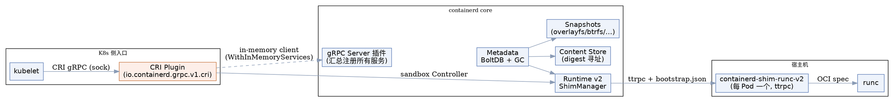

## Introduction

[kubelet](/docs/CS/Container/k8s/kubelet.md) 通过 CRI 的 gRPC 请求把"创建 Pod"的意图发给了容器运行时。但请求发出之后呢？运行时自己干了什么，又交给了谁？

先纠正一个常见误解：**containerd 不是 Kubernetes 的组件**。它是一个独立的通用容器运行时（Container Daemon）——[Docker](/docs/CS/Container/Docker/Docker.md) 底层用的也是它，只是 Docker 在上面套了自己的 CLI 和 API。K8s 通过 CRI 接入 containerd，Docker 通过自己的 API 接入 containerd，入口不同，底层是同一个进程。

本篇对齐 **containerd v2.4.2**（2026-10-14 发布；K8s 1.37 官方兼容矩阵要求 containerd 2.4.0+ 或 2.3.0+），关键结论全部从该版本源码核实。

```shell
sudo systemctl status containerd     # 它是 systemd 服务，不是 K8s 管的
crictl info | jq '.config.containerd.runtimes.runc.runtimeType'
# io.containerd.runc.v2
```

一个重要推论：**kubelet 挂了 containerd 不受影响，containerd 挂了 kubelet 就没法创建容器**。两者的生命周期是解耦的。

各层职责一句话概括：

| 组件 | 职责 |
|------|------|
| kubelet | 决定创建什么 |
| CRI | 把意图标准化成 gRPC 接口（v1） |
| containerd | 执行容器生命周期管理 |
| containerd-shim | 隔离容器进程与 containerd 的进程树，一个 Pod 一个 |
| runc | 真正落地到 Linux 内核 |

## The Big Picture: A Daemon Built on a Plugin Graph

containerd 不是"收到 CRI 请求就调 runc"的黑盒。它把自己拆成一张**插件依赖图**：每个能力（元数据存储、内容寻址、快照、任务、CRI 入口……）都是一个插件，按依赖顺序在启动时初始化，互相通过接口组合：



五个内部模块各管一摊：

| 模块 | 管什么 |
|------|--------|
| **CRI Plugin** | K8s 的入口。把 CRI 请求翻译成 containerd 内部对象与操作 |
| **Metadata** | 全部元数据的单一事实源，BoltDB 单文件 + 命名空间隔离 + GC |
| **Content Store** | 镜像层存储。每层是一个按 digest 寻址的不可变 blob |
| **Snapshotter** | 文件系统快照。把镜像层 + 可写层拼成容器 rootfs |
| **Runtime v2** | 运行中的进程。把 Container 对象（配置）变成 Task（真跑着的进程） |

## Why a Plugin Graph

containerd 的整个架构形状由三个事实决定：

1. **它不只服务 Kubernetes**。Docker、`ctr`、nerdctl、自研 client 都连它。能力必须以"可插拔服务"组织，而不是写死一条 K8s 专用路径——所以 CRI 只是一个普通插件（ID 为 `cri`，类型 `GRPCPlugin`），不用 CRI 的人关掉它即可。
2. **元数据必须全局一致**。镜像、容器、快照、lease 之间互相引用（容器引用快照，快照引用内容），GC 要保证删干净又不误删。把所有元数据收敛到一个 BoltDB、由单一 GC 扫描，比散落各模块各自清理可靠得多。
3. **运行时必须可换**。runc 只是默认值；gVisor、Kata、Windows 都以 shim 形式接入。所以"创建任务"的层抽象成 Runtime v2 协议，具体 shim 以独立二进制存在。

插件图怎么拼起来？所有插件在编译期通过 blank import 注册进全局 registry（`cmd/containerd/builtins/builtins.go`，摘录）：

```go
package builtins

import (
	_ "github.com/containerd/containerd/v2/core/runtime/v2"
	_ "github.com/containerd/containerd/v2/plugins/content/local/plugin"
	_ "github.com/containerd/containerd/v2/plugins/events"
	_ "github.com/containerd/containerd/v2/plugins/gc"
	_ "github.com/containerd/containerd/v2/plugins/leases"
	_ "github.com/containerd/containerd/v2/plugins/metadata"
	_ "github.com/containerd/containerd/v2/plugins/nri"
	// ...
)
```

`import _` 唯一的作用是触发各包的 `init()`——每个插件在 `init()` 里向全局 registry 注册自己的 `Registration`（类型、ID、依赖、配置、`InitFn`）。启动顺序不是手写清单，而是由依赖关系算出来的：`Registry.Graph` 按每个插件的 `Requires` 做 DFS，依赖先于被依赖初始化，成环直接 panic（`vendor/github.com/containerd/plugin/plugin.go`）：

```go
func children(stack []*Registration, registry []*Registration, handled map[*Registration]struct{}, ordered *[]Registration) {
	reg := stack[len(stack)-1]
	for _, t := range reg.Requires {
		for _, r := range registry {
			if (t == "*" || r.Type == t) && r != reg {
				if _, ok := handled[r]; !ok {
					// Ensure not in current stack
					for _, p := range stack[:len(stack)-1] {
						if p == r {
							panic(fmt.Errorf("circular plugin dependency at %s: %w", r.URI(), ErrPluginCircularDependency))
						}
					}
					children(append(stack, r), registry, handled, ordered)
					handled[r] = struct{}{}
					*ordered = append(*ordered, *r)
				}
			}
		}
	}
}
```

为什么用"编译期注册 + 运行期依赖图"而不是静态顺序表？因为插件组合是用户可配的（`disabled_plugins`、proxy plugins），依赖拓扑会变；手写顺序表必然漂移，DFS 让顺序永远从声明式依赖推导。

## Startup Walkthrough

入口 `cmd/containerd/command/main.go` → `server.New`（`cmd/containerd/server/server.go`，摘录）：

```go
func New(ctx context.Context, config *srvconfig.Config) (*Server, error) {
	if err := apply(ctx, config); err != nil {
		return nil, err
	}
	// ...
	loaded, err := LoadPlugins(ctx, config)
	if err != nil {
		return nil, err
	}
	// ...
	for _, p := range loaded {
		id := p.URI()
		log.G(ctx).WithFields(log.Fields{"id": id, "type": p.Type}).Info("loading plugin")
		var mustSucceed atomic.Int32

		initContext := plugin.NewContext(
			ctx,
			initialized,
			map[string]string{
				plugins.PropertyRootDir:      filepath.Join(config.Root, id),
				plugins.PropertyStateDir:     filepath.Join(config.State, id),
				plugins.PropertyGRPCAddress:  grpcAddress,
				plugins.PropertyTTRPCAddress: ttrpcAddress,
			},
		)
		// ...
		result := p.Init(initContext)
		if err := initialized.Add(result); err != nil {
			return nil, fmt.Errorf("could not add plugin result to plugin set: %w", err)
		}

		instance, err := result.Instance()
		if err != nil {
			if plugin.IsSkipPlugin(err) {
				log.G(ctx).WithFields(log.Fields{"error": err, "id": id, "type": p.Type}).Info("skip loading plugin")
			} else {
				log.G(ctx).WithFields(log.Fields{"error": err, "id": id, "type": p.Type}).Warn("failed to load plugin")
			}
			if _, ok := required[id]; ok {
				return nil, fmt.Errorf("load required plugin %s: %w", id, err)
			}
			// If readiness was registered during initialization, the plugin cannot fail
			if mustSucceed.Load() != 0 {
				return nil, fmt.Errorf("plugin failed after registering readiness %s: %w", id, err)
			}
			continue
		}
		// ...
		if p.Type == plugins.ServerPlugin {
			srv, ok := instance.(server)
			if !ok {
				log.G(ctx).WithField("id", id).Warn("plugin does not implement server interface, will not be started")
			} else {
				s.servers = append(s.servers, srv)
			}
		}
	}
	// ...
}
```

值得注意的三个语义：插件初始化失败**默认只告警不致命**（可跳过继续跑，例如 rootless 下 CRI 起不来）；只有配置里声明 `required_plugins` 的才硬失败；`ServerPlugin`（grpc / ttrpc server）收集进 `s.servers`，`Start()` 时才真正监听 socket。

gRPC 服务怎么汇到一起？`plugins/server/grpc/plugin.go` 里 grpc 插件的 `InitFn` 遍历所有已初始化插件，凡实现了 `Register(*grpc.Server)` 的都注册进来（摘录）：

```go
			// grpcService allows GRPC services to be registered with the underlying server
			type grpcService interface {
				Register(*grpc.Server) error
			}

			s := grpc.NewServer(serverOpts...)
			// Iterate plugins directly rather than using GetByType, which
			// short-circuits on the first plugin that failed to initialize.
			// Plugins that failed (e.g. CRI under rootless) have already been
			// logged and should not prevent the GRPC server from starting.
			for _, p := range ic.Plugins().GetAll() {
				if p.Registration.Type != plugins.GRPCPlugin {
					continue
				}
				instance, err := p.Instance()
				if err != nil {
					continue
				}
				if gs, ok := instance.(grpcService); ok {
					if err := gs.Register(s); err != nil {
						return nil, fmt.Errorf("failed to register grpc service: %w", err)
					}
				}
			}
```

CRI 插件正是靠这个机制把自己（`criGRPCServer`）挂上同一个 socket——kubelet 连的 `/run/containerd/containerd.sock` 上同时有 introspection、content、tasks 等服务，只是 kubelet 只用 CRI 那部分。每个 RPC 还有 namespace 拦截器：请求必须带 `containerd-namespace` 元数据（kubelet 恒为 `k8s.io`），不带就被拒。

外部能力也可以进图：配置里声明的 **proxy plugins**（snapshotter/content/sandbox/diff 四类）在 `LoadPlugins` 里被转成注册项，经 gRPC 连到外部进程——这是把重能力（如自定义网络快照器）移出主进程的通道。

## Metadata Store: Everything Is BoltDB

所有元数据收敛在一个 BoltDB 单文件里（`core/metadata/db.go`，结构体摘录）：

```go
// DB represents a metadata database using a bolt
// database. The database is fully namespaced and stores
// image, container, namespace, snapshot, and content data
// while proxying data shared across namespaces to backend
// datastores for content and snapshots.
type DB struct {
	db Transactor
	ss map[string]*snapshotter
	cs *contentStore

	// wlock is used to protect access to the data structures during garbage
	// collection. While the wlock is held no writable transactions can be
	// opened, preventing changes from occurring between the mark and
	// sweep phases without preventing read transactions.
	wlock sync.RWMutex

	// dirty flag indicates that references have been removed which require
	// a garbage collection to ensure the database is clean. This tracks
	// the number of dirty operations. This should be updated and read
	// atomically if outside of wlock.Lock.
	dirty atomic.Uint32
	// ...
}
```

布局在 `core/metadata/buckets.go` 的注释里说得非常直白——按 `<version>/<namespace>/<object>/<key>` 嵌套桶组织：

```go
// Generically, we try to do the following:
//
//	<version>/<namespace>/<object>/<key> -> <field>
//
//	version
//	           Currently, this is "v1". Additions can be made to v1 in a backwards
//	           compatible way. If the layout changes, a new version must be made,
//	           along with a migration.
//
//	namespace
//	           The namespace to which this object belongs.
//
//	object
//	           Defines which object set is stored in the bucket. There are two
//	           special objects, "labels" and "indexes". The "labels" bucket
//	           stores the labels for the parent namespace. The "indexes" object
//	           is reserved for indexing objects, if we require in the future.
//
//	key
//	           Object-specific key identifying the storage bucket for the
//	           object's contents.
```

为什么选 BoltDB 而不是 SQLite 或"元数据放内存"：容器元数据的读写模式是**低频小事务、强一致、和 GC 原子耦合**。BoltDB 的单写多读事务模型天然提供"整库一致性快照"——GC 的 mark 和 sweep 各自包在一个只读事务里，就能看到完全一致的引用图，这是 SQLite/内存表都麻烦得多的保证。`wlock` + `dirty` 的组合说明 GC 是按需的：删除操作只标记 dirty，等下一次 GC 才真正清理，避免每次删除都付全图扫描的代价。

## Content Store and Snapshots

Content Store 是**按 digest 寻址的不可变 blob 池**：镜像每层解压前是压缩 blob、解压后是未压缩 blob，都以 SHA-256 为键，写入前校验 digest，天然去重（`core/content/content.go` 的 `Info`/`Update` 等接口全部以 `dgst digest.Digest` 为参数）。

Snapshotter 负责把内容变成 rootfs。`Prepare`/`Commit` 的产物不是"挂好的文件系统"，而是一组挂载描述（`plugins/snapshots/overlay/overlay.go`，摘录）：

```go
func (o *snapshotter) Prepare(ctx context.Context, key, parent string, opts ...snapshots.Opt) ([]mount.Mount, error) {
	return o.createSnapshot(ctx, snapshots.KindActive, key, parent, opts)
}
```

返回的 `[]mount.Mount` 描述"lowerdir=镜像层们、upperdir=可写层、workdir=…"，真正的挂载交给 Task 创建时执行。容器看到的 rootfs 是多层叠加的结果：

- 只读层所有容器共享：同一镜像拉一次，跑 100 个容器也只存一份；
- 可写层每容器独有：写文件落到可写层，不改只读层——这就是**写时复制（Copy-on-Write）**，内核侧由 [overlayfs](/docs/CS/OS/Linux/fs/overlayfs.md) 承担（首次写入触发 copy-up）。

设计上的关键解耦：**存储（content）与挂载视图（snapshot）分离**。content 只管字节、digest 去重、可校验；snapshotter 只管快照树。同一份 content 可以被不同 snapshotter（overlayfs、btrfs、devmapper）取用——换存储驱动不用重新拉镜像，这是"为什么 rootfs 不直接解压"的答案。

## The CRI Plugin: A K8s Front End

CRI 插件注册（`plugins/cri/cri.go`，摘录）——注意它声明了一大串依赖：

```go
// Register CRI service plugin
func init() {
	defaultConfig := criconfig.DefaultServerConfig()
	registry.Register(&plugin.Registration{
		Type: plugins.GRPCPlugin,
		ID:   "cri",
		Requires: []plugin.Type{
			plugins.CRIServicePlugin,
			plugins.PodSandboxPlugin,
			plugins.SandboxControllerPlugin,
			plugins.NRIApiPlugin,
			plugins.EventPlugin,
			plugins.ServicePlugin,
			plugins.LeasePlugin,
			plugins.SandboxStorePlugin,
			plugins.TransferPlugin,
			plugins.WarningPlugin,
			plugins.ShimPlugin,
		},
		Config:          &defaultConfig,
		ConfigMigration: configMigration,
		InitFn:          initCRIService,
	})
}
```

v2.x 里 CRI 内部又拆成两个基础插件：`CRIServicePlugin/runtime`（`plugins/cri/runtime/plugin.go`，持有配置与基础 OCI spec）和 `CRIServicePlugin/images`，最后的 `GRPCPlugin/cri` 把两者组装成 gRPC 服务。这一层声明全部走依赖图，没有隐性调用。

最有意思的一行在 `initCRIService` 里——CRI 服务创建了一个**连回 containerd 自己的 client**：

```go
	log.G(ctx).Info("Connect containerd service")
	client, err := containerd.New(
		"",
		containerd.WithDefaultNamespace(constants.K8sContainerdNamespace),
		containerd.WithDefaultPlatform(platforms.Default()),
		containerd.WithInMemoryServices(ic),
	)
```

地址传空串 + `WithInMemoryServices`，即客户端不经过 unix socket，直接在进程内调 core services。为什么这么设计？CRI 插件要复用 content/snapshot/container 等全部能力，如果走 socket 就要处理自连接死锁、socket 尚未就绪等时序问题；进程内直调既省序列化开销，又让"插件还没初始化好就调用"变成编译期可见的依赖图问题。CRI 请求的完整路径其实比想象的短：**kubelet → gRPC → CRI 插件 → 内存直调 core services**，没有绕环回 socket。

gRPC 服务的暴露方式是嵌入两个 CRI server 接口（摘录）：

```go
type criGRPCServer struct {
	runtime.RuntimeServiceServer
	runtime.ImageServiceServer
	io.Closer
	initializer
}
```

CRI 版本为 `v1`（`internal/cri/constants/constants.go`）。

### Run: Event Subscription and Recovery

`criService.Run`（`internal/cri/server/service.go`，摘录）启动各后台协程：

```go
// Run starts the CRI service.
func (c *criService) Run(ready func()) error {
	log.L.Info("Start subscribing containerd event")
	// note: filters are any match, if you want any match but not in namespace foo
	// then you have to manually filter namespace foo
	c.eventMonitor.Subscribe(c.client, []string{`topic=="/tasks/oom"`, `topic~="/images/"`})
	// ...
	log.L.Infof("Start recovering state")
	if err := c.recover(ctrdutil.NamespacedContext()); err != nil {
		return fmt.Errorf("failed to recover state: %w", err)
	}

	// Start event handler.
	log.L.Info("Start event monitor")
	eventMonitorErrCh := c.eventMonitor.Start()
	// ...
	// Set the server as initialized. GRPC services could start serving traffic.
	c.initialized.Store(true)
	// ...
}
```

三个要点：事件订阅只挑 OOM 和镜像事件（容器退出事件不走这条路径，由 Task/事件流回传）；`recover()` 在服务对外就绪前把已存在的 shim/容器收编回来——**containerd 重启不停容器**能成立，靠的就是这一步重建内存态（`sandboxStore`/`containerStore` 是内存 store，进程重启即丢，必须从磁盘状态重建）；`initialized` 标志位挡住未就绪流量。

还有一个时序细节直接写在注释里：`RegisterReadiness()` 必须在 `NewCRIService()` 之后调用（引用了 issue #9163）——readiness gate 注册早于服务创建会漏报启动失败。

## RunPodSandbox: Build the Stage Before the Show

Pod 不等于 Container。Pod 是多个容器共享的运行环境（同一套 Network/IPC/UTS Namespace），实现方式是先创建一个最小化的 **Pause 容器**（镜像 `registry.k8s.io/pause`），业务容器创建时加入它的 Namespace 实现共享——细节见 [Pod 的 Pause 容器](/docs/CS/Container/k8s/Pod.md?id=sandbox-and-the-pause-container)。

v2.x 的实现里，sandbox 创建走 **sandbox controller** 抽象（`internal/cri/server/podsandbox/`）：`sandbox_run.go` 负责拉 pause 镜像、创建带 pause 的沙箱记录，`controller.go` 驱动 shim 启动与 CNI 配网。pause 容器退出后的清理复用事件退避机制（`controller.go` 注释）：

```go
			// There is no need to subscribe to the exit event for the pause container,
			// ...
			// actually we only use it's backoff mechanism to make sure pause container is cleaned up.
```

`RunPodSandbox` 的可见步骤：创建 Sandbox 对象 → 拉 Pause 镜像 → 创建 Pause 容器 → 生成 Namespace 配置 → **调 CNI 插件分配网络**（建 veth pair、配路由、分 Pod IP）→ 把 Sandbox 作为后续容器的基础环境。

Sandbox 是网络的锚点：Pod 的 IP 属于 Sandbox，业务容器只是"加入"它——这正是"IP 归 Pod 而非容器"的实现层解释。

## CreateContainer ≠ Container Is Running

这是全文最容易混淆的一点：**`CreateContainer` 执行完后容器还没跑**。它做的是准备工作：

- 通过 Snapshotter 基于镜像构建 rootfs（镜像层 + 可写层拼装）；
- 生成容器的 OCI 配置（进程入口、环境变量、挂载点、资源限制）；
- 关联到 Sandbox，创建 containerd 内部的 Container 对象。

此时没有 `clone()`、没有 `exec()`，进程压根没启动。containerd 中 **Container 与 Task 是两个不同概念**：

| 概念 | 是什么 | 类比 |
|------|--------|------|
| Container | 配置对象：元数据、运行时描述、rootfs 路径、OCI Spec | 设计图纸 |
| Task | 运行实例：有 PID、stdio、退出状态 | 按图纸造出来并跑起来的实物 |

`CreateContainer` 生成图纸，`StartContainer` 才开工制造。用 `ctr` 可以直接看到这个区分：

```shell
sudo ctr -n k8s.io containers ls   # Container 对象，STATUS=created
sudo ctr -n k8s.io tasks ls        # Task，有 PID 列，STATUS=running
```

`-n k8s.io` 是 containerd 的 namespace（对应上面 BoltDB schema 的第二级桶），用来隔离不同上层用户——K8s 的容器都在这个 namespace 下。对照 `crictl`：

- `crictl ps` / `crictl pods` 走 **CRI gRPC 接口**（kubelet 也走这个），把 Container 和 Task 合并展示成一个"容器"概念；
- `ctr` 走 **containerd 自己的 API**，更底层，能看到 Container 与 Task 的分层。

要拿到它在宿主机上的 PID：`ctr tasks ls` 的 PID 列，或 `crictl inspect -o json <container-id> | jq .info.pid`。有了宿主 PID 就能继续顺着 `/proc` 反查容器 PID / namespace / rootfs，完整链路见 [容器定位](/docs/CS/Container/locate.md)。

## Shim v2: One Shim per Pod

Runtime v2 是"containerd 怎么管运行中进程"的协议层。`ShimManager.Start`（`core/runtime/v2/shim_manager.go`，摘录）展示了一个 Pod 只启一个 shim 的关键逻辑：

```go
func (m *ShimManager) Start(ctx context.Context, id string, bundle *Bundle, opts runtime.CreateOpts) (_ ShimInstance, retErr error) {
	shouldInvokeShimBinary := false

	var params = &bootapi.BootstrapResult{}
	if opts.SandboxID != "" {
		_, sbErr := m.sandboxStore.Get(ctx, opts.SandboxID)
		if sbErr != nil {
			// ...
		} else {
			if opts.Address != "" {
				// The address returned from sandbox controller should
				// be in the form like ttrpc+unix://<uds-path> or grpc+vsock://<cid>:<port>,
				// we should get the protocol from the url first.
				protocol, address, ok := strings.Cut(opts.Address, "+")
				// ...
				params = &bootapi.BootstrapResult{
					Version:  int32(opts.Version),
					Protocol: protocol,
					Address:  address,
				}
				// ...
			} else {
				process, err := m.Get(ctx, opts.SandboxID)
				// ...
				p, err := restoreBootstrapParams(process.Bundle())
				// ...
				params = p
			}
		}
	}
	// ...
	const supportSandboxAPIVersion = 3
	if params.Version < supportSandboxAPIVersion {
		shouldInvokeShimBinary = true
	}

	if !shouldInvokeShimBinary {
		// Write sandbox ID this task belongs to.
		if err := os.WriteFile(filepath.Join(bundle.Path, "sandbox"), []byte(opts.SandboxID), 0600); err != nil {
			return nil, err
		}

		if err := writeBootstrapParams(filepath.Join(bundle.Path, "bootstrap.json"), params); err != nil {
			return nil, fmt.Errorf("failed to write bootstrap.json for bundle %s: %w", bundle.Path, err)
		}
		// ...
	}
	// ...
}
```

逻辑是：Pod 的第一个容器（pause）启动时真正拉起 shim 二进制；之后同一 Pod 的业务容器（带 `SandboxID`）不再 fork 新 shim，而是写 `sandbox` 文件和 `bootstrap.json`（记录 ttrpc 地址），**复用现有 shim 的连接**——这就是 v2 相对 v1 的核心改进之一：**一个 Pod 一个 shim**（v1 是一个容器一个 shim），Pod 级事件、cgroup、stdio 由一个 shim 聚合。

shim 为什么必须存在？如果 containerd 直接把容器进程作为自己的子进程管理，会有一个致命问题：**containerd 重启或升级时，它的所有子进程（也就是所有容器）都会受影响**。生产环境 containerd 升级是常事，不能每次升级都干掉节点上所有 Pod。

containerd-shim 的角色是容器进程的"养父"：容器进程的父进程是 shim 而非 containerd，shim 启动后脱离 containerd 进程树独立维护容器生命周期（生产环境 PPID 通常为 1），还负责收集容器退出状态、管理 stdio、充当 containerd 与容器进程之间的通信代理。containerd 重启后，`criService.recover()` 重新从 bundle/`bootstrap.json` 收编既有 shim——**整个升级过程容器不停机**。

```shell
ps -ef | grep containerd-shim     # 每 Pod 一个 containerd-shim-runc-v2 进程
```

shim 收到 Task 创建请求后调用 runc（OCI 运行时的参考实现）：创建 Namespace（PID/Network/Mount/UTS/IPC，原理见 [Namespace](/docs/CS/OS/Linux/namespace.md)）、设置 [Cgroup](/docs/CS/OS/Linux/cgroup.md)、挂载 Snapshotter 准备好的 rootfs。三步做完，容器进程就跑起来了。

## GC: Mark and Sweep on BoltDB

引用图 GC 在 `core/metadata/gc.go`：扫描所有活跃根（images、container、lease 持有的资源）→ 沿引用边遍历标记 → 把未标记的节点从 BoltDB 删掉：

```go
func (c *gcContext) scanRoots(ctx context.Context, tx *bolt.Tx, nc chan<- gc.Node) error {
```

```go
func (c *gcContext) references(ctx context.Context, tx *bolt.Tx, node gc.Node, fn func(gc.Node)) error {
```

三个设计点：**mark/sweep 各在单个 bolt 事务里**执行，与写事务互斥（`DB.wlock`），保证不会边删边引用；**lease 是显式根**——正在进行的拉取/解压把中间产物挂到 lease 上，避免"拉到一半被 GC 清掉"；**按需触发**——删除只置 `dirty`/`dirtySS`/`dirtyCS` 标记（见上文 DB 结构体），下一次 GC 只清理脏的子存储，而不是每次删除都全图扫描。

## Debugging Entrypoints

调试入口按层级从高到低：`kubectl` → `crictl`（CRI 层）→ `ctr`（containerd 内部对象）→ `runc list`（OCI 层）。

```shell
sudo crictl pods                      # Sandbox 视角，每个 Pod 一个
sudo crictl ps                        # 容器视角（CRI 合并了 Container/Task）
sudo ctr -n k8s.io containers ls      # Container 配置对象
sudo ctr -n k8s.io tasks ls           # Task，看 PID
sudo ctr -n k8s.io content ls         # Content Store 的 blob
sudo crictl info | jq '.config.containerd.runtimes'
```

## Links

- [K8s](/docs/CS/Container/k8s/K8s.md)
- [kubelet](/docs/CS/Container/k8s/kubelet.md)
- [Pod](/docs/CS/Container/k8s/Pod.md)
- [Docker](/docs/CS/Container/Docker/Docker.md)
- [CRI-O 运行时](/docs/CS/Container/k8s/CRI-O.md)
- [Namespace](/docs/CS/OS/Linux/namespace.md)

## References

1. [containerd v2.4.2 source (tag v2.4.2)](https://github.com/containerd/containerd/tree/v2.4.2)
2. [containerd releases](https://github.com/containerd/containerd/releases)
3. [containerd runtime v2 protocol (docs/runtime-v2.md)](https://raw.githubusercontent.com/containerd/containerd/v2.4.2/docs/runtime-v2.md)
4. [K8s containerd 拆解：kubelet 发完请求之后发生了什么](https://mp.weixin.qq.com/s/pz7N69Nyi2hvo2aKiPKE_A)
