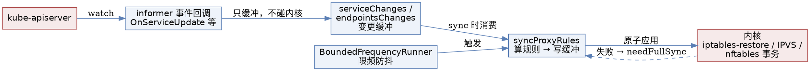

## Introduction

kube-proxy 运行在每个节点上，监听 Service 与 EndpointSlice 资源变化，把"一组 Pod 提供一个虚拟 IP"翻译成节点内核的负载均衡规则。理解它的关键是一句反直觉的话：**kube-proxy 名字里有 proxy，但它自己不转发任何流量**——它只负责把负载均衡规则写入内核（iptables / IPVS / nftables），真正的转发全部发生在内核 netfilter / IPVS 里。`userspace` 时代它确实代理过流量，v1.26 该模式已从代码树移除，"proxy" 只是历史名字。

> 版本基线：v1.37.2（release-1.37，commit `91c32c2b`）

本篇按"一个不熟悉 kube-proxy 的读者第一次读源码"的顺序组织：先建立全景心智模型，再看事件怎么进来、规则怎么出去（syncProxyRules），然后是三种数据面模式的实现与选型，最后是运维入口。每个部分都附"为什么这么设计"的分析。

## The Big Picture: Informer to Kernel

kube-proxy 的全部机制可以画成一条单向流水线，中间有一道缓冲：



关键节奏：**事件永远不直接碰内核**。informer 回调只把变更写进内存缓冲（change trackers），真正的规则应用由一个限频器（BoundedFrequencyRunner）统一触发 `syncProxyRules`，一次性消费缓冲、算出规则、原子写进内核。事件风暴在缓冲里被合并成"一次重算"。

## Why This Shape: 三个根本约束

读源码前先记住三个约束，后面每一处"看起来绕"的实现都是它们的直接推论：

**约束一：决策单元是节点，不是集群。** 每个 kube-proxy 只负责本节点的规则，但它需要全集群的 Service/Endpoint 信息（任何远端 Pod 都可能成为本节点流量的目的地）。于是事件不能来一条处理一条——1000 个 Endpoint 变更触发 1000 次内核写入是不可接受的。变更先缓冲，sync 时一次性消费，把 O(事件数) 的内核写入收敛成 O(sync 次数)。

**约束二：内核是唯一的实际状态，规则应用必须可重试。** kube-proxy 是无状态的规则生产者：它对内核当前长什么样只有一个内存假设，而内核可能被其它组件（手动 iptables、防火墙工具）改掉。所以 sync 失败要能重试、外部篡改要能被发现（canary chain 监测）、假设漂移要能被周期性对账纠正。

**约束三：观测内核状态很贵。** 一次 `iptables-save` 在大集群上是秒级操作。于是 v1.37 引入了全量/部分同步的区分：大多数 sync 不读内核、只重写自己管的链；全量对账只在启动、失败恢复、外部篡改或 1 小时兜底时发生。

## Startup Chain

入口在 `cmd/kube-proxy/proxy.go`，与其它组件同款：Cobra + `cli.Run`：

```go
func main() {
	command := app.NewProxyCommand()
	code := cli.Run(command)
	os.Exit(code)
}
```

`NewProxyCommand` 完成 flag 解析、`Complete()` / `Validate()` 之后调用 `Options.Run`（`cmd/kube-proxy/app/options.go`）：

```go
func (o *Options) Run(ctx context.Context) error {
	defer close(o.errCh)
	if len(o.WriteConfigTo) > 0 {
		return o.writeConfigFile()
	}

	err := platformCleanup(ctx, o.config.Mode, o.CleanupAndExit)
	if o.CleanupAndExit {
		return err
	}
	// We ignore err otherwise; the cleanup is best-effort, and the backends will have
	// logged messages if they failed in interesting ways.

	proxyServer, err := newProxyServer(ctx, o.config, o.master, o.InitAndExit, o.flagz)
	if err != nil {
		return err
	}
	if o.InitAndExit {
		return nil
	}

	o.proxyServer = proxyServer
	return o.runLoop(ctx)
}
```

两个特殊入口先处理：`--write-config-to` 把最终配置落盘（生成配置文件的用法），`--init-and-exit` 只做规则初始化就退出（给 `--cleanup` 配套的预置场景）。`platformCleanup` 是 Linux 平台的旧规则清理（best-effort）。

`ProxyServer.Run` 的主体是装配 informer 事件回调，最后起 SyncLoop：

```go
	// Make informers that filter out objects that want a non-default service proxy.
	informerFactory := informers.NewSharedInformerFactoryWithOptions(s.Client, s.Config.ConfigSyncPeriod.Duration,
		informers.WithTweakListOptions(func(options *metav1.ListOptions) {
			options.LabelSelector = labelSelector.String()
		}))

	// Create configs (i.e. Watches for Services, EndpointSlices and ServiceCIDRs)
	// Note: RegisterHandler() calls need to happen before creation of Sources because sources
	// only notify on changes, and the initial update (on process start) may be lost if no handlers
	// are registered yet.
	serviceConfig := config.NewServiceConfig(ctx, informerFactory.Core().V1().Services(), s.Config.ConfigSyncPeriod.Duration)
	serviceConfig.RegisterEventHandler(s.Proxier)
	go serviceConfig.Run(ctx.Done())

	endpointSliceConfig := config.NewEndpointSliceConfig(ctx, informerFactory.Discovery().V1().EndpointSlices(), s.Config.ConfigSyncPeriod.Duration)
	endpointSliceConfig.RegisterEventHandler(s.Proxier)
	go endpointSliceConfig.Run(ctx.Done())
	...
	// Birth Cry after the birth is successful
	s.birthCry()

	go s.Proxier.SyncLoop()
```

注意三点：informer 用 label selector 过滤掉了 `service.kubernetes.io/service-proxy-name` 非默认代理与 headless service 的 EndpointSlice；`RegisterEventHandler` 必须在 informer 启动之前（注释原文：否则启动初期的变更会丢）；`SyncLoop` 在 goroutine 里跑、永不返回。Service / EndpointSlice / Node / ServiceCIDR 四类对象的回调全部指向同一个 Proxier。

## SyncLoop and syncProxyRules

### BoundedFrequencyRunner: 事件与内核之间的节流阀

`SyncLoop` 本身极简（`pkg/proxy/iptables/proxier.go`）：

```go
func (proxier *Proxier) SyncLoop() {
	// Update healthz timestamp at beginning in case Sync() never succeeds.
	if proxier.healthzServer != nil {
		proxier.healthzServer.Updated(proxier.ipFamily)
	}

	// synthesize "last change queued" time as the informers are syncing.
	metrics.SyncProxyRulesLastQueuedTimestamp.WithLabelValues(string(proxier.ipFamily)).SetToCurrentTime()
	proxier.syncRunner.Loop(wait.NeverStop)
}
```

真正的节流逻辑在 `syncRunner`——`BoundedFrequencyRunner`（client-go `util/flowcontrol`）。它保证 `syncProxyRules` 的执行频率落在 `[minSyncPeriod, syncPeriod]` 区间内：

- 事件到达时调用 `TryRunSoon()`，如果距上次执行超过 `minSyncPeriod` 就尽快跑一次，否则等下一轮；
- 就算永远没有事件，也会按 `syncPeriod` 兜底跑一次（对账内核漂移）；
- 连续触发时最多积压 `burst` 次，防止事件风暴期间的规则写入把 CPU 打满。

iptables proxier 的装配：

```go
	logger.V(2).Info("Iptables sync params", "minSyncPeriod", minSyncPeriod, "syncPeriod", syncPeriod, "maxSyncPeriod", proxyutil.FullSyncPeriod)
	// We pass syncPeriod to ipt.Monitor, which will call us only if it needs to.
	// We need to pass *some* maxInterval to NewBoundedFrequencyRunner anyway though.
	// time.Hour is arbitrary.
	proxier.syncRunner = runner.NewBoundedFrequencyRunner("sync-runner", proxier.syncProxyRules, minSyncPeriod, syncPeriod, proxyutil.FullSyncPeriod)

	go ipt.Monitor(kubeProxyCanaryChain, []utiliptables.Table{utiliptables.TableMangle, utiliptables.TableNAT, utiliptables.TableFilter},
		proxier.forceSyncProxyRules, syncPeriod, wait.NeverStop)
```

`ipt.Monitor` 是约束二的兑现：它维护一条 canary 链（`KUBE-PROXY-CANARY`），周期性检查它还在不在——**任何人 flush 了 iptables 表，canary 就会消失，Monitor 立即调 `forceSyncProxyRules` 强制全量重建**。kube-proxy 对"别人动了我的规则"的感知不是靠猜，是靠一条自杀式哨兵链。

### syncProxyRules: 全量与部分同步

`syncProxyRules` 是整个 kube-proxy 的事务脚本（`pkg/proxy/iptables/proxier.go`）。v1.37 的开头就引入了本节最重要的机制：

```go
func (proxier *Proxier) syncProxyRules() (retryError error) {
	proxier.mu.Lock()
	defer proxier.mu.Unlock()

	// don't sync rules till we've received services and endpoints
	if !proxier.isInitialized() {
		proxier.logger.V(2).Info("Not syncing iptables until Services and Endpoints have been received from master")
		return
	}

	// Keep track of how long syncs take.
	start := time.Now()

	doFullSync := proxier.needFullSync ||
		// Avoid regular full syncs for large clusters.
		((time.Since(proxier.lastFullSync) > proxyutil.FullSyncPeriod) && !proxier.largeClusterMode)
	...
	serviceUpdateResult := proxier.svcPortMap.Update(proxier.serviceChanges)
	endpointUpdateResult := proxier.endpointsMap.Update(proxier.endpointsChanges)
	...
```

主体流程：

```
Step 1  初始化闸门：Service 与 EndpointSlice 至少各收到一次才允许 sync（防止半空状态写规则）
Step 2  判定 doFullSync：needFullSync 标记，或距上次全量超过 1h（大集群模式豁免周期全量）
Step 3  消费变更缓冲：svcPortMap.Update / endpointsMap.Update —— 事件到这里才生效
Step 4  统计 totalEndpoints，> 1000 进入 largeClusterMode（丢弃规则注释以省体积）
Step 5  全量时：EnsureChain/EnsureRule 重建 KUBE-SERVICES 等 jump 链（部分同步跳过，省 20 次 iptables 调用）
Step 6  遍历 svcPortMap 构建规则写入缓冲（natChains/natRules/filterChains/filterRules）
Step 7  RestoreAll(iptablesData, NoFlushTables, RestoreCounters) 原子应用
Step 8  成功 → needFullSync = false；失败 → needFullSync = true 回退全量
```

Step 8 的回退逻辑藏在 defer 里，注释解释了为什么失败必须回退全量：

```go
	success := false
	defer func() {
		if !success {
			proxier.logger.Info("Sync failed", "retryingTime", proxier.syncPeriod)
			retryError = fmt.Errorf("Sync failed")
			if !doFullSync {
				metrics.IPTablesPartialRestoreFailuresTotal.WithLabelValues(string(proxier.ipFamily)).Inc()
			}
			// proxier.serviceChanges and proxier.endpointChanges have already
			// been flushed, so we've lost the state needed to be able to do
			// a partial sync.
			proxier.needFullSync = true
		} else if doFullSync {
			proxier.lastFullSync = time.Now()
		}
	}()
```

变更缓冲在 Step 3 已经被消费掉——部分同步依赖的"哪些链变了"信息不复存在，所以失败后只能全量。这是典型的"缓冲一次性消费"模型的代价：简单、无竞态，但恢复只能走重路。

最终应用是一次 `iptables-restore`：

```go
	// NOTE: NoFlushTables is used so we don't flush non-kubernetes chains in the table
	err := proxier.iptables.RestoreAll(proxier.iptablesData.Bytes(), utiliptables.NoFlushTables, utiliptables.RestoreCounters)
	if err != nil {
		...
		metrics.IPTablesRestoreFailuresTotal.WithLabelValues(string(proxier.ipFamily)).Inc()
		return
	}
	success = true
	proxier.needFullSync = false
```

`NoFlushTables` 保证不动非 K8s 链。整段规则通过 restore 原子生效——不会出现"改到一半"的中间态。

### Why Events Only Buffer

事件回调（`OnServiceUpdate` / `OnEndpointSliceAdd` 等）只往 change tracker 里记一笔，然后 `syncRunner.TryRunSoon()`。为什么不让事件直接改 svcPortMap？

1. **合并窗口**：一次 Deployment 扩容会产生一条 EndpointSlice 更新，滚动更新期间可能连续几十条。缓冲 + 限频让它们合并成一次 sync、一次 restore。
2. **锁的粒度**：事件回调与 syncProxyRules 共享一把 `proxier.mu`。回调只做 O(变更) 的缓冲写入（拿锁微秒级），规则构建的 O(Service×Endpoint) 重活留在 sync 里慢慢算——事件风暴不会阻塞 sync，sync 的长计算也不会让事件回调堆积在锁上等太久。
3. **失败重算简单**（见 Step 8）：缓冲模型让"失败 → 全量重算"成为唯一需要的恢复路径。

## Data Plane: Three Modes

控制面通过 informer watch Service / EndpointSlice / Node，真正干活的数据面在 v1.37 有四种实现（`pkg/proxy/apis/config/types.go`）：

| 模式 | 状态（v1.37 视角） | 数据面结构 |
|------|------|-----------|
| `iptables` | **默认**（`platformApplyDefaults` 里 `config.Mode == ""` 时置为 iptables）；成熟稳定 | nat 表两级自定义链 |
| `ipvs` | **v1.35 deprecated**，启动即打 Event `IPVSDeprecation`；计划 v1.40 默认禁用、v1.43 移除 | 内核 LVS 哈希表 + 辅助 iptables 链 |
| `nftables` | **v1.33 GA**，需显式 `--proxy-mode=nftables` | 自有 `kube-proxy` 表 + verdict map |
| `kernelspace` | Windows 专用（winkernel） | HNS |

这里有个容易搞错的组合：**`NFTablesProxyMode` gate 虽已 GA 并锁定为默认开启，但默认模式仍然是 iptables**——gate 决定"这个实现可用"，`--proxy-mode` 才决定用哪个（`cmd/kube-proxy/app/server_linux.go` 的 `platformApplyDefaults`）。

### iptables Mode

kube-proxy 把每个 Service 翻译成节点 `nat` 表里的两级自定义链：

1. `KUBE-SERVICES` 是总入口，匹配 ClusterIP:Port 后跳到该 Service 的 `KUBE-SVC-XXXXXXXX` 链；
2. `KUBE-SVC-XXXXXXXX` 链用 `statistic` 模块按概率把流量分发到每个后端的 `KUBE-SEP-XXXXXXXX` 链；
3. `KUBE-SEP-XXXXXXXX` 链执行 DNAT，把目的地址改写成具体 Pod IP:targetPort。

```shell
$ iptables-save | grep KUBE-SVC
-A KUBE-SVC-XXXXXXXX -m statistic --mode random --probability 0.33333 -j KUBE-SEP-AAAAAAAA
-A KUBE-SVC-XXXXXXXX -m statistic --mode random --probability 0.50000 -j KUBE-SEP-BBBBBBBB
-A KUBE-SVC-XXXXXXXX                                        -j KUBE-SEP-CCCCCCCC
```

这是**概率抽签，不是精确轮询**：3 个后端时前两条各抽 1/3、1/2，剩余流量兜底给第三条；概率值在每次后端变更时全量重算。它有两个规模问题：iptables 规则更新是整表刷入、报文匹配是线性遍历，规则数随 Service × Endpoint 线性增长，大集群下规则同步延迟和 CPU 开销都会放大——v1.37 的 partial sync 缓解了前者，后者正是 IPVS / nftables 要解决的问题。

DNAT 依赖 conntrack 保证连接粒度的一致性：同一个 TCP 连接的所有报文始终 DNAT 到同一个 Pod，天然实现会话保持。Pod 被摘除时旧 conntrack 条目不清理会造成连接黑洞，kube-proxy 在同步规则时会主动删除失效条目，排障时也可手动 `conntrack -D`。

### IPVS Mode

IPVS 基于内核 LVS，Service 规则存在哈希表中，查找复杂度 O(1)，且支持多种调度算法：

```shell
$ ipvsadm -ln
Prot LocalAddress:Port Scheduler Flags
  -> RemoteAddress:Port    Forward Weight ActiveConn InActConn
TCP  10.96.0.168:80 rr
  -> 10.244.1.3:80         Masq    1      0          0
  -> 10.244.2.7:80         Masq    1      0          0
  -> 10.244.3.9:80         Masq    1      0          0
```

`rr`（轮询）是默认值，此外还有 `wrr`（加权轮询）、`lc`（最少连接）、`sh`（源地址哈希）、`dh`（目标地址哈希）等，通过 kube-proxy 配置 `ipvs.scheduler` 指定；Forward 列的 `Masq` 表示同样走 DNAT（MASQUERADE）改写。

#### Why ClusterIP Can Be Pinged: kube-ipvs0

ClusterIP 没有绑在任何真实网卡上，Pod 发出的包为什么能路由到它？IPVS 模式下，kube-proxy 在每个节点创建了一块 **dummy 网卡 `kube-ipvs0`**，把集群中所有 ClusterIP 以 `/32` 地址绑到这块网卡上（源码里只做 `LinkAdd(&netlink.Dummy{...})`，`NOARP` 是内核 dummy 设备的默认属性，并非 kube-proxy 显式设置）：

```shell
$ ip addr show kube-ipvs0
7: kube-ipvs0: <BROADCAST,NOARP,UP,LOWER_UP> mtu 1500 qdisc noqueue
    inet 10.96.0.1/32 brd 10.96.0.1 scope host kube-ipvs0
    inet 10.96.0.168/32 brd 10.96.0.168 scope host kube-ipvs0
```

这样本机协议栈认为这些 VIP "就在本地"，流量进入协议栈后由 ipvs 规则截获并 DNAT 到后端 Pod；dummy 网卡本身不收发包，只负责让路由判定成立。iptables 模式不需要这块网卡——它靠 `KUBE-SERVICES` 链挂在 PREROUTING/OUTPUT 钩子上、在路由判定之前就完成改写。NodePort 与 `externalTrafficPolicy`（Cluster/Local）同样由各自的链或 ipvs 规则实现，Local 模式只转发给本节点 Pod，可保留客户端源 IP。

### nftables Mode

v1.33 起 GA 的第三种后端（KEP-3866）。它不借用内核保留表，而是自建一张 `ip kube-proxy` 表，把 nat / filter 型 base chain 分别挂在 prerouting / output / postrouting 上。

结构上最大的变化是**用 verdict map 取代逐 Service 建链**：

```shell
map serviceIPsMap { type ipv4_addr . inet_proto . inet_service : verdict }
```

iptables 里的 `KUBE-SVC-XXXX` 那一层被一张哈希表替掉，一条 `vmap @serviceIPsMap` 规则完成分发。但每个 endpoint 仍会建链，DNAT 与 conntrack 的角色不变——所以它解决的是**规则规模增长带来的控制面同步与数据面遍历开销**，而不是"绕开 netfilter"。

v1.37 的规则写入已经走 **`knftables` 库**（`sigs.k8s.io/knftables`，netlink 事务接口）：proxier 持有 `knftables.Interface`，sync 时构建事务对象批量提交，失败时用 `logFailure` 打印事务内容与全表快照（那也是全代码里唯一一处 `exec.Command("nft", ...)`——纯 debug 用途）。相对早期 `exec` 调 `nft` CLI 的方式，省掉了进程间开销，事务还保证了批量规则的原子性。代码中唯一 exec 的 nft 命令只在 debug 日志里出现。

硬性前置条件是内核 ≥ 5.13，不满足直接启动失败；环境变量 `KUBE_PROXY_NFTABLES_SKIP_KERNEL_VERSION_CHECK` 可绕过该检查。把 nftables 设为默认模式是后续 KEP（KEP-5343）的事，v1.37 仍需显式 `--proxy-mode=nftables`。

> [!NOTE]
> 行为上两个与 iptables 的差异值得记：
> - **NodePort 暴露范围**：iptables 模式默认在所有本地地址（含 `127.0.0.1`）上暴露 NodePort；nftables 模式默认只绑节点的 **primary** 地址（`NodePortAddressesPrimary`，`platformApplyDefaults` 里显式设置），v1.37 提供 opt-in 的 loopback 用户态代理以恢复 `127.0.0.1` 上的 NodePort。
> - **conntrack 前 6.1 内核 bug 的 workaround**：iptables 模式会安装一段针对 pre-6.1 内核 conntrack 缺陷的规避规则，nftables 模式**按设计不安装**该 workaround（其 DNAT 路径不触发该缺陷）。

### EndpointSlice: Data Structure for the Backend List

早期一个 Service 的全部后端放在单个 Endpoints 对象里，后端一多每次变更都要全量推送。现在默认拆成 EndpointSlice：每个 slice 默认最多装 100 个端点（控制器可配置，不是 API 协议上限），按协议/地址族分片，kube-proxy watch 时只收自己关心的增量：

```shell
$ kubectl get endpointslices -l kubernetes.io/service-name=nginx-service
NAME                  ADDRESSTYPE   PORTS   ENDPOINTS                 AGE
nginx-service-abc12   IPv4          80      10.244.1.3,10.244.2.7,... 30s
```

上文源码中 `NewEndpointSliceConfig(...).RegisterEventHandler(s.Proxier)` 注册的回调（`OnEndpointSliceAdd/Update/Delete`）就是在等这些事件：收到变更后写入 `endpointsChanges` 缓冲，由 SyncLoop 触发 `syncProxyRules()` 消费。

kube-proxy 只是"规则生产者"这一角色，要理解它在整条链路中的位置，见 [K8s 网络](/docs/CS/Container/k8s/net.md)：Pod 网络如何由 CNI 建立、一个报文如何穿过 netfilter 被 DNAT、conntrack 如何还原回包，以及三种模式的规则挂载差异。

## IPVS Deprecation Timeline

IPVS 后端并非因"有缺陷"被弃用，而是内核 IPVS API 与 K8s Service 语义（会话亲和边界、EndpointSlice、双栈）始终不完全契合，官方把维护重心收敛到 nftables。弃用警告在 v1.37 里已经是启动时的显式 Event（`cmd/kube-proxy/app/server_linux.go`）：

```go
		message := "The ipvs proxier has been deprecated and will be disabled by default in Kubernetes 1.40 and removed in Kubernetes 1.43. Migrate to the 'nftables' proxier instead."
		logger.Error(nil, message)
		s.Recorder.Eventf(s.NodeRef, nil, v1.EventTypeWarning, "IPVSDeprecation", "StartKubeProxy", message)
```

关键时间线：

| 版本 | 事件 |
|------|------|
| v1.11 | IPVS 模式 GA（当初为替代 iptables 规模问题） |
| v1.29 | nftables 模式 alpha（KEP-3866） |
| v1.31 | nftables 模式 beta |
| **v1.33** | **nftables 模式 GA**（`NFTablesProxyMode` gate `LockToDefault`） |
| **v1.35** | **IPVS 模式 deprecated**（PR #134539） |
| v1.37 | 弃用警告升级为启动 Event；nftables 默认化推进（KEP-5343 起步） |
| v1.40（计划） | IPVS 默认禁用 |
| v1.43（计划） | IPVS 移除 |

> [!WARNING]
> 迁移 IPVS → nftables 时，一个常被忽视的旋钮丢失：**nftables 模式负载均衡算法固定为随机分发，没有 IPVS 的 `rr`/`wrr`/`lc`/`sh`/`dh` 等调度器字段**。若现网依赖某调度算法做调优（如 `lc` 打散长连接、`sh` 做会话粘滞），需在 nftables 下改用其他手段补偿：`trafficDistribution`（同区/同节点）、拓扑感知路由 hints，或干脆上 eBPF/Cilium 以拿到更精细的 L3-L7 策略。

## 2026 Mode Selection

一句话：**新集群直接上 nftables；还在跑 iptables 的中小集群不急着动；IPVS 集群尽快规划迁移**。

| 场景 | 推荐模式 | 理由 |
|------|---------|------|
| 新集群（节点内核 ≥ 5.13） | `nftables` | v1.33 GA、官方推荐方向、增量更新毫秒级 |
| 中小集群（< ~1000 Service） | `iptables` | 仍是上游默认、成熟、无切换理由 |
| 老内核（< 5.13）无法用 nftables | `iptables` | 不要降级到已弃用的 IPVS |
| 仍在跑 IPVS 且生产正常 | 暂留，但**规划迁 nftables** | 已 deprecated，v1.40 默认禁用 |
| 要 L7 策略 / 极致性能 / 可观测性 | eBPF（Cilium 替 kube-proxy） | 见 [K8s 网络](/docs/CS/Container/k8s/net.md) |

性能量级（单节点、单 Service 吞吐，数字随内核/NIC/CPU 浮动，仅作数量级参考）：`iptables` ~30k pps、`IPVS` ~200k pps、`nftables` ~100k pps、eBPF/Cilium ~500k pps。三者**每包查找复杂度**都接近 O(1)（严格说 `iptables` 是 O(服务×端点) 的线性遍历，规模大时才显现），真正的差距在**规则同步耗时**：`iptables` 全量重写可达秒级，`nftables`/`IPVS` 增量更新在毫秒级——所以"iptables 慢、IPVS 快"是旧结论，今天选型逻辑是"默认 iptables 够用，新内核新集群上 nftables"。

## Configuration, Migration, and Operations

**启用 nftables**（改 kube-proxy ConfigMap 后滚动重启 DaemonSet）：

```yaml
# kubectl edit configmap kube-proxy -n kube-system
apiVersion: kubeproxy.config.k8s.io/v1alpha1
kind: KubeProxyConfiguration
mode: "nftables"
```

```shell
kubectl rollout restart daemonset kube-proxy -n kube-system
kubectl logs -n kube-system -l k8s-app=kube-proxy | grep "Using nftables"
nft list ruleset | grep kube        # 验证规则已写入 kube-proxy 表
```

前置：节点内核 ≥ 5.13 且 `nft` CLI ≥ 1.0.1；不满足时 kube-proxy 直接启动失败，可用 `KUBE_PROXY_NFTABLES_SKIP_KERNEL_VERSION_CHECK` 绕过内核版本检查（仅当发行版的 nft 二进制已与内核特性匹配时）。

**从 IPVS 迁移**：把 `mode` 从 `ipvs` 改为 `nftables` 并滚动重启，kube-proxy 的 `--cleanup` 会在重启时清理旧 IPVS 状态；先确认无强依赖 IPVS 调度器算法（见上节 WARNING）。

**监控指标**（kube-proxy 在 `:10249/metrics` 暴露）：

| 指标 | 含义 | 经验告警 |
|------|------|---------|
| `kubeproxy_sync_proxy_rules_duration_seconds` | 一次规则同步耗时 | 持续 > 1s 就该换模式 |
| `kubeproxy_sync_proxy_rules_iptables_total` | 当前 iptables 规则条数 | 随 Service 数增长 |
| `kubeproxy_sync_proxy_rules_last_timestamp_seconds` | 上次成功同步时间 | 长时间不更新 = 卡住 |

**排障：conntrack 表满**。三种模式都走 netfilter conntrack，高连接速率下 `nf_conntrack` 表可能写满导致丢包（`/proc/sys/net/netfilter/nf_conntrack_count` 逼近 `nf_conntrack_max`）。调大 `net.netfilter.nf_conntrack_max`；对"发出不求还原"的短连接（节点自身健康检查、监控采集）可考虑 `NOTRACK`，但**被 NAT 改写过的流量绝不能 `NOTRACK`**——否则回包查不到映射被丢弃，表现为连接超时。手动清理：`conntrack -D -p udp --dport <port>`。

## Key Default Values (v1.37)

均核实自 `pkg/proxy/apis/config/v1alpha1/defaults.go` 与 `pkg/proxy/iptables/proxier.go`：

| 参数 | 默认值 | 说明 |
|---|---|---|
| `--proxy-mode` | `iptables`（`platformApplyDefaults`） | nftables gate 已 GA 但不改变默认 |
| `IPTables.SyncPeriod` | 30s | 兜底对账周期（同时也是 `ipt.Monitor` 的检查周期） |
| `IPTables.MinSyncPeriod` | 1s | BoundedFrequencyRunner 的最小间隔 |
| `FullSyncPeriod`（内部常量） | 1h | 周期性全量对账间隔（largeClusterMode 豁免） |
| `largeClusterEndpointsThreshold`（内部常量） | 1000 | 超过后进入大集群模式（丢规则注释、豁免周期全量） |
| `EndpointSlice` 每片上限 | 100 | EndpointSlice 控制器可配，非 API 协议上限 |

## Links

- [K8s](/docs/CS/Container/k8s/K8s.md)
- [Service](/docs/CS/Container/k8s/Service.md)
- [K8s 网络](/docs/CS/Container/k8s/net.md)
- [Ingress](/docs/CS/Container/k8s/Ingress.md)
- [CNI 插件对比](/docs/CS/Container/k8s/CNI.md)
- [常见问题排查](/docs/CS/Container/k8s/Issues.md)

## References

- [kube-proxy v1.37.2 source](https://github.com/kubernetes/kubernetes/tree/v1.37.2/pkg/proxy)
- [Services, Load Balancing, and Networking](https://kubernetes.io/docs/concepts/services-networking/)
- [kube-proxy (component reference)](https://kubernetes.io/docs/reference/command-line-tools-reference/kube-proxy/)
- [KEP-3866: nftables-based kube-proxy backend](https://github.com/kubernetes/enhancements/tree/master/keps/sig-network/3866-nftables-proxy)
- [KEP-5343: make nftables the default kube-proxy backend](https://github.com/kubernetes/enhancements/tree/master/keps/sig-network/5343-nftables-to-default)
- [KEP-5495: deprecate and remove kube-proxy IPVS mode](https://github.com/kubernetes/enhancements/issues/5495)
- [K8s Service 底层原理：ClusterIP 与流量转发](https://mp.weixin.qq.com/s/-B8rs7vFRKciPlhNVECKFQ)
