## Introduction

kubelet 运行在每个节点上，接收 apiserver 下发的 Pod 期望状态，把节点上的实际状态收敛过去，并持续把节点与 Pod 状态回写。它是控制面到数据面的"最后一跳"：**调度器决定 Pod 去哪，kubelet 决定 Pod 怎么真的跑起来**。

> 版本基线：v1.37.2（release-1.37，commit `91c32c2b`）

职责可以拆成四条彼此独立的循环：

| 循环 | 做什么 | 不做什么 |
|---|---|---|
| 配置同步 | 从 apiserver / 静态文件 / HTTP 接收 Pod 期望状态 | 不决定 Pod 调度到哪个节点 |
| 运行时同步 | 调 CRI 创建/删除 sandbox 与容器 | 不直接操作容器进程 |
| 状态回写 | 聚合运行时状态，写 Pod status / Node status | 不做业务级健康判断 |
| 本地自治 | 镜像 GC、驱逐、容器 GC | 不经过 apiserver 删除 Pod 对象 |

kubelet 自己不实现 CRI / CNI / CSI，只定义契约交给外部实现。三者在本仓库中的位置差别很大：

| 接口 | v1.37.2 现状 |
|---|---|
| **CRI** | 唯一运行路径。客户端代码已搬到独立 staging 模块 `k8s.io/cri-client`，流式接口在 `k8s.io/cri-streaming`；dockershim 早已不存在 |
| **CNI** | 已完全移出 kubelet 代码树。kubelet 不再调用任何 CNI 插件，只能通过 CRI 回报的 `NetworkReady` condition 感知网络就绪 |
| **CSI** | kubelet 不实现驱动，但握有衔接链：pluginwatcher 监听插件 socket → 注册 handler → volumeManager reconciler 挂载 |

> [!NOTE]
> CNI 出树的直接影响：**排查网络问题时，kubelet 日志里已经找不到任何 CNI 调用记录**，要看 containerd / CRI-O 侧与 CRI 的 `RuntimeStatus`。

## The Big Picture: Four Loops

kubelet 的全部机制可以画成一个"观测-收敛"闭环加三条旁路：

```dot
digraph kubelet {
  rankdir=LR;
  node [shape=box, style=filled, fillcolor="#eef3fa", color="#5b7fb5", fontname="Helvetica"];
  edge [color="#5b7fb5"];

  apiserver [label="kube-apiserver", style=filled, fillcolor="#f6eaea", color="#b55b5b"];
  sources [label="config sources\napiserver / file / http"];
  podManager [label="podManager\n期望状态"];
  syncLoop [label="syncLoop\n八路 select 事件总线"];
  podWorkers [label="podWorkers\n每 Pod 一个 worker"];
  kuberuntime [label="kubeGenericRuntimeManager\ncomputePodActions"];
  cri [label="CRI runtime\ncontainerd / CRI-O", style=filled, fillcolor="#f6eaea", color="#b55b5b"];
  pleg [label="PLEG\n轮询 diff 运行时"];
  statusManager [label="statusManager\n批量回写 status"];

  apiserver -> sources [label="watch"];
  sources -> podManager;
  podManager -> syncLoop [label="configCh"];
  pleg -> syncLoop [label="plegCh 事件"];
  syncLoop -> podWorkers [label="UpdatePod"];
  podWorkers -> kuberuntime [label="SyncPod"];
  kuberuntime -> cri [label="gRPC"];
  cri -> pleg [label="GetPods 观测"];
  podWorkers -> statusManager [label="SetPodStatus"];
  statusManager -> apiserver [label="PATCH status"];
}
```



关键节奏：**主链路是一个"期望 → 观测 → 差异 → 执行 → 再观测"的循环**——syncLoop 只负责把"该收敛了"的信号分发给对应 Pod 的 worker，真正的收敛由 `computePodActions` 算差异清单后执行。PLEG 是观测的起点，statusManager 是回写的终点，两条旁路（镜像 GC / 驱逐）完全绕开 apiserver。

## Why This Shape: 三个根本约束

读源码前先记住三个约束，后面每一处设计都是它们的直接推论：

**约束一：期望状态与实际状态永远分离，一切以观测重算。** kubelet 从不假设"上一轮做到哪了"——任何一次 sync 都从当前运行时观测（podStatus）重新计算差异清单。这是它能从容应对崩溃重启（重启后自然接管已有容器）、配置高频抖动（每轮都重新对齐）的根本原因。`computePodActions` 的 diff 模式、volume manager 的 DSW/ASW 对账、PLEG 的轮询 diff，全是这一条的实现。

**约束二：每个 Pod 一切串行。** 同一个 Pod 的所有同步请求进同一条 pod worker goroutine，通道容量 1、忙时合并成"最新一次"。并行同步同一个 Pod 会产生竞态（两个 goroutine 同时决定 create/kill 同一个容器），而 Pod 内部的操作顺序（init 先于业务容器、kill 先于 create）又必须保证——串行是唯一既简单又正确的选择。

**约束三：观测有成本。** 感知运行时的唯一方式是 CRI 调用，而一次全局 relist 要 List 所有 Pod 与容器，是 O(N×M) 的。于是观测被拆成三层：1s 周期轮询兜底（保证最终一致）、单 Pod 按需 relist（SyncPod 结束后精准刷新）、CRI 事件流提示（EventedPLEG，把死亡检测压到亚秒级）——每一层都是在"观测成本"与"检测延迟"之间找平衡。

## Startup and Run

`kubelet` 使用 Cobra 作为命令行框架，`main` 只做四件事：解析 flags → 构造 `KubeletServer` → 组装依赖 → `app.Run`。

真正的启动在 `pkg/kubelet/kubelet.go` 的 `Run`。v1.37.2 的启动顺序值得逐个记住，因为它决定了"什么时候能开始调度 Pod"：

```go
// pkg/kubelet/kubelet.go
func (kl *Kubelet) Run(ctx context.Context, updates <-chan kubetypes.PodUpdate) {
	logger := klog.FromContext(ctx)
	...
	if err := kl.initializeModules(ctx); err != nil {
		kl.recorder.WithLogger(logger).Eventf(kl.nodeRefWithUID(), v1.EventTypeWarning, events.KubeletSetupFailed, "%s", err.Error())
		logger.Error(err, "Failed to initialize internal modules")
		os.Exit(1)
	}

	if err := kl.cgroupVersionCheck(); err != nil {
		logger.V(2).Info("Warning: cgroup check", "error", err)
	}

	// Start the allocation manager
	if kl.allocationManager != nil {
		kl.allocationManager.Run(ctx)
	}

	// Start volume manager
	go kl.volumeManager.Run(ctx, kl.sourcesReady)

	if kl.kubeClient != nil {
		// Start two go-routines to update the status.
		//
		// The first will report to the apiserver every nodeStatusUpdateFrequency and is aimed to provide regular status intervals,
		// while the second is used to provide a more timely status update during initialization and runs an one-shot update to the apiserver
		// once the node becomes ready, then exits afterwards.
		//
		// Introduce some small jittering to ensure that over time the requests won't start
		// accumulating at approximately the same time from the set of nodes due to priority and
		// fairness effect.
		go func() {
			// Call updateRuntimeUp once before syncNodeStatus to make sure kubelet had already checked runtime state
			// otherwise when restart kubelet, syncNodeStatus will report node notReady in first report period
			kl.updateRuntimeUp(ctx)
			wait.JitterUntil(func() { kl.syncNodeStatus(ctx) }, kl.nodeStatusUpdateFrequency, 0.04, true, wait.NeverStop)
		}()

		// Keep the previous detached behavior from context.Background while still
		// propagating logging values for contextual logging.
		go kl.fastStatusUpdateOnce(context.WithoutCancel(ctx))

		// Keep renewing the node lease until the kubelet exits.
		// This intentionally does not use the kubelet context so lease renewal can
		// continue during graceful shutdown.
		go kl.nodeLeaseController.Run(context.Background())

		// Mirror pods for static pods may not be created immediately during node startup
		// due to node registration or informer sync delays. They will be created eventually
		//  when static pods are resynced (every 1-1.5 minutes).
		// To ensure kube-scheduler is aware of static pod resource usage faster,
		// mirror pods are created as soon as the node registers.
		go kl.fastStaticPodsRegistration(ctx)
	}
	go wait.UntilWithContext(ctx, kl.updateRuntimeUp, 5*time.Second)

	// Set up iptables util rules
	if kl.makeIPTablesUtilChains {
		kl.initNetworkUtil(logger)
	}

	// Start component sync loops.
	kl.statusManager.Start(ctx)

	// Start syncing RuntimeClasses if enabled.
	if kl.runtimeClassManager != nil {
		kl.runtimeClassManager.Start(wait.NeverStop)
	}

	kl.pleg.Start(ctx)                                  // 先起 PLEG
	if kl.eventedPlegWatcher != nil { kl.eventedPlegWatcher.Start(ctx) }
	kl.syncLoop(ctx, updates, kl)                       // 最后进主循环，永不返回
}
```

### Why Module Init Is Split in Two

这是 v1.37 一个容易被旧资料误导的结构变化：**不依赖运行时的模块与依赖运行时的模块分两次启动**。

`initializeModules`（`pkg/kubelet/kubelet.go`）只做**不需要容器运行时在线**的事：metrics 注册、setupDataDirs、ContainerLogsDir、imageManager.Start（镜像 GC）、serverCertificateManager / clientCAManager、oomWatcher、resourceAnalyzer。

**containerManager、evictionManager、containerLogManager 不在这里**。它们被搬到 `initializeRuntimeDependentModules`：

```go
// pkg/kubelet/kubelet.go
func (kl *Kubelet) initializeRuntimeDependentModules(ctx context.Context) {
	logger := klog.FromContext(ctx)
	if err := kl.cadvisor.Start(); err != nil {
		// Fail kubelet and rely on the babysitter to retry starting kubelet.
		logger.Error(err, "Failed to start cAdvisor")
		os.Exit(1)
	}

	// trigger on-demand stats collection once so that we have capacity information for ephemeral storage.
	// ignore any errors, since if stats collection is not successful, the container manager will fail to start below.
	_, _, _ = kl.StatsProvider.GetCgroupStats(ctx, "/", true)
	// Start container manager.
	node, err := kl.getNodeAnyWay(ctx)
	if err != nil {
		// Fail kubelet and rely on the babysitter to retry starting kubelet.
		logger.Error(err, "Kubelet failed to get node info")
		os.Exit(1)
	}
	// containerManager must start after cAdvisor because it needs filesystem capacity information
	if err := kl.containerManager.Start(ctx, node, kl.GetActivePods, kl.getNodeAnyWay, kl.sourcesReady, kl.statusManager, kl.runtimeService, kl.supportLocalStorageCapacityIsolation()); err != nil {
		// Fail kubelet and rely on the babysitter to retry starting kubelet.
		logger.Error(err, "Failed to start ContainerManager")
		os.Exit(1)
	}
	// eviction manager must start after cadvisor because it needs to know if the container runtime has a dedicated imagefs
	// Eviction decisions are based on the allocated (rather than desired) pod resources.
	kl.evictionManager.Start(ctx, kl.StatsProvider, kl.getAllocatedPods, kl.PodIsFinished, evictionMonitoringPeriod)

	// container log manager must start after container runtime is up to retrieve information from container runtime
	// and inform container to reopen log file after log rotation.
	kl.containerLogManager.Start(ctx)
	// Adding Registration Callback function for CSI Driver
	kl.pluginManager.AddHandler(pluginwatcherapi.CSIPlugin, plugincache.PluginHandler(csi.PluginHandler))
	...
}
```

它由 `updateRuntimeUp` 在运行时首次就绪后触发一次。所以**容器运行时没起来时，kubelet 仍能上报 Node 状态、跑镜像 GC，但不会创建任何 Pod**——这是"运行时故障时节点表现为 NotReady 而不是崩溃"的源码依据。

为什么这样拆？约束一的直接推论：观测与收敛解耦后，"节点状态上报"不再依赖运行时——运行时挂了，节点照样能告诉集群"我的运行时挂了"（Node condition NotReady），调度器据此把新 Pod 排走。如果 containerManager 这类依赖运行时的模块起不来就让整个 kubelet 退出，故障期间连"报状态"的能力都没了。

另外 `Run` 里先调 `updateRuntimeUp` 再起 `syncNodeStatus`，源码注释写得很直白：避免 kubelet 重启后的第一个上报周期就误报 NotReady。

## The Sync Loop

`syncLoop` 是 kubelet 的事件总线。所有来源的变更都被收敛到"对某个 Pod 做一次 sync"，没有变更时也按固定周期兜底同步：

```go
// pkg/kubelet/kubelet.go
func (kl *Kubelet) syncLoop(ctx context.Context, updates <-chan kubetypes.PodUpdate, handler SyncHandler) {
	logger := klog.FromContext(ctx)
	logger.Info("Starting kubelet main sync loop")
	// The syncTicker wakes up kubelet to checks if there are any pod workers
	// that need to be sync'd. A one-second period is sufficient because the
	// sync interval is defaulted to 10s.
	syncTicker := time.NewTicker(time.Second)
	defer syncTicker.Stop()
	housekeepingTicker := time.NewTicker(housekeepingPeriod)
	defer housekeepingTicker.Stop()
	plegCh := kl.pleg.Watch()
	const (
		base   = 100 * time.Millisecond
		max    = 5 * time.Second
		factor = 2
	)
	duration := base
	...
	for {
		if err := kl.runtimeState.runtimeErrors(); err != nil {
			logger.Error(err, "Skipping pod synchronization")
			// exponential backoff
			time.Sleep(duration)
			duration = time.Duration(math.Min(float64(max), factor*float64(duration)))
			continue
		}
		// reset backoff if we have a success
		duration = base

		kl.syncLoopMonitor.Store(kl.clock.Now())
		if !kl.syncLoopIteration(ctx, updates, handler, syncTicker.C, housekeepingTicker.C, plegCh) {
			break
		}
		kl.syncLoopMonitor.Store(kl.clock.Now())
	}
}
```

关键点：**运行时错误不是让 kubelet 退出，而是让主循环整体退避**（100ms 起，factor=2 翻倍到 5s 上限）。退避期间 Node 状态上报、镜像 GC、驱逐等独立 goroutine 照常跑，只有"Pod 同步"被暂停——这正是"运行时故障时节点 NotReady 但不自爆"的另一半依据。

### 八路 select

`syncLoopIteration` 是一个八分支 select，且**分支顺序不代表优先级**——源码注释原文就强调了这一点：*"the case statements in a select are evaluated in a pseudorandom order if there are multiple channels ready to read from"*。各分支：

| 分支 | 触发源 | 动作 |
|---|---|---|
| `configCh` | apiserver / 静态文件 / HTTP | 按 `u.Op` 分发：ADD→`HandlePodAdditions`，UPDATE/DELETE→`HandlePodUpdates`（DELETE 按 UPDATE 处理是为了优雅删除），REMOVE→`HandlePodRemoves`，RECONCILE→`HandlePodReconcile` |
| `plegCh` | PLEG 事件 | `isSyncPodWorthy` 判定"值得同步"就 `HandlePodSyncs`；`ContainerDied` 额外触发 `cleanUpContainersInPod` |
| `syncCh` | 每秒 ticker | `getPodsToSync()` 后批量 `HandlePodSyncs` |
| `livenessManager.Updates()` | 存活探针失败 | `handleProbeSync`，同步该 Pod |
| `readinessManager.Updates()` | 就绪探针结果 | 先 `SetContainerReadiness`，再同步 |
| `startupManager.Updates()` | 启动探针结果 | 先 `SetContainerStartup`，再同步 |
| `containerManager.Updates()` | 设备/资源分配变更（DRA） | 取出受影响 Pod，`HandlePodSyncs` |
| `housekeepingCh` | 定期 | `sourcesReady.AllReady()` 后才 `HandlePodCleanups`，防止误删未就绪来源的 Pod |

`housekeeping` 的闸门值得单独强调（约束一的推论）：**只要还有配置来源没 ready，就跳过清理**——否则可能把"还没从某个来源收到的 Pod"当成残留删掉。观测不完整时宁可不做清理动作，这是"一切以观测重算"原则在删除方向的镜像：不完整的观测同样不可信。

probe 三路的意义在于：**探针结果不需要等 PLEG 或定时同步**，失败即刻触发一次 sync，这是容器重启延迟能压到秒级的原因。

## Probe Manager

v1.37 的 probe manager（`pkg/kubelet/prober/prober_manager.go`）不再是一个共享轮询循环，而是**每个容器的每种 probe 各一条 worker goroutine**：AddPod 时遍历每个 container 的 StartupProbe / ReadinessProbe / LivenessProbe，分别 `newWorker` + `go w.run(ctx)`。键是 `{podUID, containerName, probeType}`，三种 probe 彼此独立互不干扰。

为什么每个 probe 独占一条 goroutine？探针是慢操作（exec 要进容器跑命令、HTTP 要等超时），如果共享一个轮询循环，一个容器的慢探针会拖住全部容器的检测节奏；独占 worker 让每个探针的周期、超时、阈值互不干扰，代价是 goroutine 数量随探针数线性增长——这是典型的"用并发换隔离"。

### Worker 循环与状态闸门

`worker.run` 的骨架（`pkg/kubelet/prober/worker.go`）：

```go
// If kubelet restarted the probes could be started in rapid succession.
// Let the worker wait for a random portion of tickerPeriod before probing.
// Do it only if the kubelet has started recently.
if probeTickerPeriod > time.Since(w.probeManager.start) {
	time.Sleep(time.Duration(rand.Float64() * float64(probeTickerPeriod)))
}

probeTicker := time.NewTicker(probeTickerPeriod)

probeLoop:
for w.doProbe(ctx) {
	select {
	case <-w.stopCh:           break probeLoop
	case <-probeTicker.C:       // 定时触发
	case <-w.manualTriggerCh:   // 手动触发，ticker 重置
		probeTicker.Reset(probeTickerPeriod)
	}
}
```

`doProbe` 里的**五道闸门**决定了 probe 什么时候真的执行：

1. **容器 ID 变了？** → 旧 containerID 的结果从 resultsManager 里删掉，新 containerID 写入 `initialValue`，`onHold = false`。
2. **Pod 终态？** → worker 退出（`PodFailed`/`PodSucceeded` 返回 false）。
3. **容器没 Running？** → 直接写 `Failure`，然后看 `RestartPolicy`（含 restartable init container 的 sidecar 语义）——不需要真正执行 probe。
4. **Graceful shutdown？** → `Pod.DeletionTimestamp != nil` 且 probe 是 liveness/startup 时，直接写 `Success` 然后 `return false` 停止探测。
5. **InitialDelaySeconds 没过？** → 跳过。
6. **Started 闸门？** → `c.Started == true` 时 liveness/readiness 才开始探测；`c.Started == false` 时 startup 才探测。

后两道闸门的真实代码：

```go
// Graceful shutdown of the pod.
if w.pod.ObjectMeta.DeletionTimestamp != nil && (w.probeType == liveness || w.probeType == startup) {
	logger.V(3).Info("Pod deletion requested, setting probe result to success",
		"probeType", w.probeType, "pod", klog.KObj(w.pod), "containerName", w.container.Name)
	if w.probeType == startup {
		logger.Info("Pod deletion requested before container has fully started",
			"pod", klog.KObj(w.pod), "containerName", w.container.Name)
	}
	// Set a last result to ensure quiet shutdown.
	w.resultsManager.Set(w.containerID, results.Success, w.pod)
	// Stop probing at this point.
	return false
}

// Probe disabled for InitialDelaySeconds.
if int32(time.Since(c.State.Running.StartedAt.Time).Seconds()) < w.spec.InitialDelaySeconds {
	return true
}

if c.Started != nil && *c.Started {
	// Stop probing for startup once container has started.
	// we keep it running to make sure it will work for restarted container.
	if w.probeType == startup {
		return true
	}
} else {
	// Disable other probes until container has started.
	if w.probeType != startup {
		return true
	}
}
```

Started 闸门非常关键：**startup probe 是 liveness/readiness 的前置开关**，只有它判 success 之后其它 probe 才开始。反之，startup 判 success 之后自己就退出探测了（代码里 `return true` 但 ticker 分支不再执行 probe，见阈值逻辑）——避免用不必要的探测把容器压垮。闸门 4 的动机也写在行为里：不让"正在被杀"的容器被判 unhealthy 干扰排障——删除中的 Pod 本来就要退出，报 NotReady 只会制造噪音。

### Threshold 状态机：连续 N 次才算数

probe 执行完不会立刻写 resultsManager，而是在 worker 里维护 `lastResult` + `resultRun` 计数器：

```go
if w.lastResult == result {
	w.resultRun++
} else {
	w.lastResult = result
	w.resultRun = 1
}

if (result == results.Failure && w.resultRun < int(w.spec.FailureThreshold)) ||
	(result == results.Success && w.resultRun < int(w.spec.SuccessThreshold)) {
	// Success or failure is below threshold - leave the probe state unchanged.
	return true
}

w.resultsManager.Set(w.containerID, result, w.pod)

if (w.probeType == liveness && result == results.Failure) || w.probeType == startup {
	// The container fails a liveness/startup check, it will need to be restarted.
	// Stop probing until we see a new container ID. This is to reduce the
	// chance of hitting #21751, where running `docker exec` when a
	// container is being stopped may lead to corrupted container state.
	// In addition, if the threshold for each result of a startup probe is exceeded, we should stop probing
	// until the container is restarted.
	// This is to prevent extra Probe executions #117153.
	w.onHold = true
	w.resultRun = 0
}
```

三种 probe 的初始值不同（`newWorker`）：

```go
switch probeType {
case readiness:
	w.spec = container.ReadinessProbe
	w.resultsManager = m.readinessManager
	w.initialValue = results.Failure
case liveness:
	w.spec = container.LivenessProbe
	w.resultsManager = m.livenessManager
	w.initialValue = results.Success
case startup:
	w.spec = container.StartupProbe
	w.resultsManager = m.startupManager
	w.initialValue = results.Unknown
}
```

| probe | initialValue | 设计意图 |
|---|---|---|
| readiness | **Failure** | "没就绪之前一律 NotReady"——防止 kubelet 刚起就把 Pod 标 Ready |
| liveness | **Success** | "还没挂就先算活着"——防止 kubelet 刚起、liveness 还没跑就把容器重启自杀 |
| startup | **Unknown** | "startup 过没过要等 probe 自己说"——Unknown 是中性值，让 `isContainerStarted` 明确区分 |

三个初始值的取向完全不同，因为三种 probe 的错误代价不对称：readiness 误报 Ready 会把流量打到没准备好的实例上（用户立刻感知），所以保守取 Failure；liveness 误报 Failure 会导致无辜容器被杀，所以乐观取 Success；startup 是中性状态值。

### onHold：失败后暂停探测

liveness 判 Failure 或 startup 判 Failure 达到阈值后，worker 置 `w.onHold = true` 且 `w.resultRun = 0`，下一次循环的 `doProbe` 在闸门 1 就返回 `true`——**直到 runtime 返回一个新的 containerID（容器被重启了）才解除 onHold**（`w.onHold = false` 紧跟在容器 ID 变更分支里）。注释里的原因是跑 `docker exec` 时容器可能正处于 stop 过程中会产生不可预测行为（旧 issue #21751），同时防止对已判死的容器继续做无谓探测（#117153）。

### 探针的四种实现与重试

`prober.runProbe`（`pkg/kubelet/prober/prober.go`）按 spec 分派，四种实现共享一个重试包装 `runProbeWithRetries`（最多 3 次）：

| 类型 | 实际执行 | 超时 |
|---|---|---|
| Exec | `kubecontainer.CommandRunner.RunInContainer` → CRI ExecSync | `TimeoutSeconds` 秒 |
| HTTP GET | `httpprobe.Probe(req, timeout)`，可选 H2C（`HTTPProtocolHTTP2` + `H2CContainerProbe` 门） | 同上 |
| TCP Socket | `tcpprobe.Probe(host, port, timeout)` 单纯 Dial | 同上 |
| GRPC | `grpcprobe.Probe(host, service, port, timeout, options)`，可选 TLS 模式 | 同上 |

三条容易被忽略的细节：

- **Exec probe 拿不到 Pod env / downward API**——worker 里注释原文：*"Note, exec probe does NOT have access to pod environment variables or downward API"*。exec 命令是直接在容器里跑的，kubelet 只做静态展开（`ExpandContainerCommandOnlyStatic`），不注入运行时变量。
- **HTTP probe 不跟随非本地重定向**——构造 prober 时写死 `followNonLocalRedirects = false`，防止攻击者让 probe 打内网。
- **results.Manager 只有一个 Updates channel**——接口注释原文：*"NOTE: The current implementation only supports a single updates channel."*，sync loop 三路 select 各自读同一个 channel、互不阻塞。

### restartable init container 的 probe

v1.37 里 probe manager 已支持 restartable init container（sidecar 模式）：`AddPod` 时把 `pod.Spec.Containers` 和 `getRestartableInitContainers` 拼起来，worker 创建与普通容器完全一样。普通 init container 不参与 probe。

### Manual Trigger：UpdatePodStatus 里的即时探测

`UpdatePodStatus` 是**状态回写前的"最终校准"**：如果 readinessManager 还没有这个 containerID 的结果（probe 还没跑过第一次），它会向 worker 的 `manualTriggerCh` 非阻塞写一次，**强制让 probe 在这次 status 写回之前先跑一轮**。这样首次 Ready 状态不会被错误地写成 false。这也是 sync loop 里 readiness 分支先 `SetContainerReadiness` 再 `handleProbeSync` 的原因——handleProbeSync 里的 HandlePodSyncs 会再进一次 UpdatePodStatus，第二次就拿到真实 probe 结果了。

## Pod Admission and Dispatch

`HandlePodAdditions` 是"新 Pod 进入节点"的唯一入口，v1.37 的顺序与旧版本差异明显：

```go
func (kl *Kubelet) HandlePodAdditions(ctx context.Context, pods []*v1.Pod) {
	sort.Sort(sliceutils.PodsByCreationTime(pods))         // 按创建时间排序，保证确定性
	for _, pod := range pods {
		kl.podManager.AddPod(pod)                           // desired state 的唯一真相来源
		kl.podCertificateManager.TrackPod(ctx, pod)         // Pod 证书（PodCertificate 特性）

		pod, mirrorPod, wasMirror := kl.podManager.GetPodAndMirrorPod(pod)
		if wasMirror {
			if pod == nil { continue }                      // 找不到源 Pod 的 mirror pod 直接跳过
			kl.podWorkers.UpdatePod(ctx, UpdatePodOptions{
				Pod: pod, MirrorPod: mirrorPod, UpdateType: kubetypes.SyncPodUpdate, StartTime: start,
			})
			continue
		}

		if !kl.podWorkers.IsPodTerminationRequested(pod.UID) && !podutil.IsPodPhaseTerminal(pod.Status.Phase) {
			if ok, reason, message := kl.allocationManager.AddPod(ctx, kl.GetActivePods(), pod); !ok {
				kl.rejectPod(ctx, pod, reason, message)     // 准入失败：写失败状态 + 事件
				continue
			}
		}
		kl.podWorkers.UpdatePod(ctx, UpdatePodOptions{
			Pod: pod, MirrorPod: mirrorPod, UpdateType: kubetypes.SyncPodCreate, StartTime: start,
		})
	}
}
```

三个必须记住的点：

1. **准入在 `allocationManager.AddPod`，不是 `canAdmitPod`**。设备、CPU 亲和、拓扑、Pod 级资源都在这里一次性分配并判定。旧资料里的 `kubecontainer.DoPodAdmission` 已移除。
2. **`podManager.AddPod` 无条件先执行**。即使后面准入失败、Pod 被 reject，desired state 里也必须有它——否则清理逻辑会把它当"apiserver 已删除"的对象处理。
3. **mirror pod（静态 Pod 的镜像）不再进入准入流程**，直接转成对源 Pod 的 `SyncPodUpdate`。

`dispatchWork` 的实质只有一句：`kl.podWorkers.UpdatePod(...)`。**真正的同步不在调用方 goroutine 里跑**，而是交给该 Pod 专属的 pod worker。

## Pod Worker State Machine

每个 Pod 有一个独立 worker 与一条**容量为 1** 的通知通道。状态机是三态（`pkg/kubelet/pod_workers.go`）：

```go
SyncPod         PodWorkerState = iota   // 创建与稳态同步
TerminatingPod                          // 停止容器、收集退出状态
TerminatedPod                           // 清理资源、写最终状态
```

`podWorkerLoop` 按状态分派：

```go
switch {
case update.WorkType == TerminatedPod:
	err = p.podSyncer.SyncTerminatedPod(ctx, update.Options.Pod, status)
case update.WorkType == TerminatingPod:
	err = p.podSyncer.SyncTerminatingPod(ctx, update.Options.Pod, status, gracePeriod, podStatusFn)
default:
	err = p.podSyncer.SyncPod(ctx, update.Options.Pod, status)
}
```

`UpdatePod` 的并发控制是这套设计的核心：

```go
if !p.isWorking[pod.UID] {
	p.isWorking[pod.UID] = true
	podUpdates <- *options              // 通道容量 1，写入即触发
} else {
	// worker 忙时只保留"最后一次未送达的更新"，旧值被覆盖
	update, found := p.lastUndeliveredWorkUpdate[pod.UID]
	if !found || update.UpdateType != kubetypes.SyncPodKill {
		p.lastUndeliveredWorkUpdate[pod.UID] = *options
	}
}
```

也就是说：**并发更新会被合并成"最新一次配置 + 一次通知"，且 Kill 请求优先级最高、不会被覆盖**。这正是约束二的实现：kubelet 在配置高频抖动下仍能保持稳定的关键——永远只有"当前正在跑的一次 + 一个待送达的最新状态"，中间的历史版本全部丢弃，反正下一轮会按观测重算（约束一）。

> [!IMPORTANT]
> 优雅删除的 grace period **只能缩短、不能延长**。这是明确的设计约束，避免驱逐与滚动更新叠加时无限推迟删除。

终止的语义边界也很清楚：`SyncTerminatingPod` 成功 = 所有容器已停止；`SyncTerminatedPod` 成功 = 资源清理完毕、可以写最终状态。`IsPodKnownTerminated` / `ShouldPodBeFinished` 分别对应这两个里程碑。

## SyncPod: The Transaction Script

`kl.SyncPod` 是"把单个 Pod 收敛到期望状态"的事务脚本，可重入，每次失败后下一轮从当前实际状态继续推进。v1.37.2 的执行顺序：

```
① 记录 PodWorkerStartDuration（updateType == SyncPodCreate）
② InPlacePodVerticalScaling：检查 resize 是否进行中，维护 PodResizeInProgress condition
③ generateAPIPodStatus → statusManager.SetPodStatus
④ 若 Phase 已是 Succeeded / Failed → isTerminal = true，直接返回
⑤ 运行时网络未就绪且非 hostNetwork → 报 NetworkNotReady，返回错误
⑥ secretManager / configMapManager RegisterPod（让引用对象进入缓存）
⑦ Pod 级 cgroup：不存在且非首次同步 → 先 killPod 再重建（QoS 层级迁移）
⑧ tryReconcileMirrorPods（静态 Pod 的 mirror pod 增删）
⑨ makePodDataDirs（创建 Pod 数据目录）
⑩ volumeManager.WaitForAttachAndMount（阻塞等卷挂载）
⑪ containerRuntime.InitializeActuatedPod
⑫ getPullSecretsForPod → probeManager.AddPod
⑬ containerRuntime.SyncPod（用 context.WithoutCancel）
⑭ reasonCache.Update，RestartAllContainers 场景按需再入队
```

几个与旧版本差别最大的地方：

- **"不该运行的 Pod 就地 kill"那段代码没有了**。终止不再由 SyncPod 内部完成，而是 pod worker 切到 `TerminatingPod` 状态调 `SyncTerminatingPod`。SyncPod 只在发现 Pod 已是终态时置 `isTerminal`。
- **Pod 状态在准入之后、启动之前就写回**（第 ③ 步）。因此 `kubectl describe` 看到的 pending 原因来自 status manager 的中间态，而不是等容器建完。
- **`WaitForAttachAndMount` 是 `ContainerCreating` 卡住的主要来源**：它阻塞该 Pod 的 sync goroutine，等的是「kubelet 上报 VolumesInUse → controller attach 并写 VolumesAttached → kubelet 读到」这一整圈经 etcd 的异步往返，而不是本地操作。卷挂载上限超限时走 `rejectPod`。完整链路见 [持久化存储](/docs/CS/Container/k8s/Storage.md)。

## kuberuntime SyncPod: computePodActions

`kubeGenericRuntimeManager.SyncPod`（`pkg/kubelet/kuberuntime/kuberuntime_manager.go`）负责真正的 CRI 调用。它的第一步不是"创建容器"，而是**算出一份差异清单**：

```go
podContainerChanges := m.computePodActions(ctx, pod, podStatus, restartAllContainers)
```

`computePodActions` 的核心判定：

```go
createPodSandbox, attempt, sandboxID, _ := runtimeutil.PodSandboxChanged(pod, podStatus)
changes := podActions{
	KillPod:           createPodSandbox,     // sandbox 变了 → 整个 Pod 重建
	CreateSandbox:     createPodSandbox,
	SandboxID:         sandboxID,
	Attempt:           attempt,
	ContainersToStart: []int{},
	ContainersToKill:  make(map[kubecontainer.ContainerID]containerToKillInfo),
}
```

后续几个关键分支：

| 条件 | 结果 |
|---|---|
| `PodSandboxChanged`（sandbox 缺失/状态异常/ID 变化） | `KillPod = true` + `CreateSandbox = true`，init 容器需要 purge |
| 不需要重启（`!shouldRestartOnFailure` 且 `attempt != 0` 且已有容器状态） | `CreateSandbox = false`，直接返回，避免给已结束的 Pod 再建 sandbox |
| `RestartAllContainersOnContainerExits` 开启且被标记 | 只填 `ContainersToReset`，按**逆序**杀容器（触发源容器最后移除） |
| 计算启动集 | 遍历 `pod.Spec.Containers`，`OnFailure` 策略且已成功的不再启动；`ContainerRestartRules` 支持容器级 restartPolicy |

SyncPod 的主干：

```
Step 1  computePodActions
Step 2  KillPod == true → killPodWithSyncResult（sandbox 变更时额外 purgeInitContainers）
Step 3  否则逐个 kill ContainersToKill；RestartAllContainers 时对 ContainersToReset 先 kill 再 remove
        pruneInitContainersBeforeStart（主动修剪已退出的 init 容器，不等 GC）
Step 4  CreateSandbox → generatePodSandboxConfig → RunPodSandbox（生成 sandbox 配置、建日志目录、拿 podIPs）
后续    按 changes.InitContainersToStart / ContainersToStart 依次创建 init 容器与业务容器
```

> [!TIP]
> "先算差异、再执行动作"是约束一的根本实现。SyncPod 不假设上一轮走到哪一步，全部依据 `podStatus` 的当前观测重新计算。这也解释了为什么 kubelet 重启后能自然接管已有容器：它看到的 podStatus 就是真实状态。

## PLEG

PLEG（Pod Lifecycle Event Generator）是 kubelet 感知运行时状态的唯一来源。它把"运行时里实际有什么"与"上一轮记的有什么"做 diff，产生 `ContainerStarted` / `ContainerDied` / `ContainerRemoved` / `PodSync` 等事件。

`GenericPLEG.Start` 刻意把首个 timer 设为 0，**启动即立刻 relist 一次**，之后才按周期跑：

```go
// pkg/kubelet/pleg/generic.go
func (g *GenericPLEG) Start(ctx context.Context) {
	g.runningMu.Lock()
	defer g.runningMu.Unlock()
	if g.isRunning {
		return
	}

	g.isRunning = true
	g.stopCh = make(chan struct{})
	// Set 0 to trigger the first relist immediately
	// The RelistPeriod is set after the first relist.
	g.globalRelistTimer = g.clock.NewTimer(0)

	go func() {
		for g.workerLoopIteration(ctx) {
		}
	}()
}
```

`workerLoopIteration` 用非阻塞 select 实现**三级优先级**：

```go
// workerLoopIteration is the primary work dispatcher for the PLEG. It uses non-blocking channel
// reads for a prioritized work selection:
// 1. stop: exit the workerLoop if stopCh has been closed.
// 2. global relist: the global relist timer takes priority over single-pod relists.
// 3. single pod relist: execute a request from the single-pod relist queue.
func (g *GenericPLEG) workerLoopIteration(ctx context.Context) bool {
	// Use non-blocking selects for prioritized selection.

	// First priority: stopCh
	select {
	case <-g.stopCh:
		return false
	default:
	}

	// Second priority: global Relist
	select {
	case <-g.globalRelistTimer.C():
		g.Relist(ctx)
		g.globalRelistTimer.Reset(g.relistDuration.RelistPeriod)
		return true
	default:
	}

	// Fallback: blocking select
	select {
	case <-g.stopCh:
		return false
	case <-g.globalRelistTimer.C():
		g.Relist(ctx)
		g.globalRelistTimer.Reset(g.relistDuration.RelistPeriod)
	case req := <-g.relistRequests:
		if req.timestamp.After(g.getRelistTime()) {
			// The request hasn't already been served by the global relist.
			g.relistPod(ctx, req.podUID)
		}
	}

	return true
}
```

Go 的 select 没有优先级，所以"优先级"是用**前置非阻塞 select** 模拟的：先把最高优先级的 channel 各查一遍（有货直接处理），最后一个兜底 select 才真正阻塞。单 Pod relist 还带一个**时间戳去重**：如果请求时间早于最近一次全局 relist，说明这个请求已经被那轮全局 relist 覆盖，直接丢弃。这也是 SyncPod 结束后能"按需立刻刷新状态"而不放大 QPS 的原因。

`Relist` 的主体只有五步：

```go
func (g *GenericPLEG) Relist(ctx context.Context) {
	g.relistLock.Lock()
	defer g.relistLock.Unlock()
	logger := klog.FromContext(ctx)
	...
	// Get all the pods.
	podList, err := g.runtime.GetPods(ctx, true)
	if err != nil {
		logger.Error(err, "GenericPLEG: Unable to retrieve pods")
		return
	}

	g.updateRelistTime(timestamp)

	pods := kubecontainer.Pods(podList)
	// update running pod and container count
	updateRunningPodAndContainerMetrics(pods)
	g.podRecords.setCurrent(pods)

	for pid := range g.podRecords {
		g.reconcilePodRecord(ctx, pid)
	}

	// Update the cache timestamp.  This needs to happen *after*
	// all pods have been properly updated in the cache.
	g.cache.UpdateTime(timestamp)
}
```

`reconcilePodRecord` 对每个容器调 `computeEvents` 做状态迁移比对；**只有产生了事件（或被标记 reinspect）才 `updateCache`**。失败重试策略直接写进注释：

```go
	// updateCache() will inspect the pod and update the cache. If an
	// error occurs during the inspection, we want PLEG to retry again
	// in the next relist. To achieve this, we do not update the
	// associated podRecord of the pod, so that the change will be
	// detect again in the next relist.
	status, err := g.updateCache(ctx, pod, pid)
	if err != nil {
		logger.V(4).Info("PLEG: Ignoring events for pod", "pod", klog.KRef(pod.Namespace, pod.Name), "err", err)

		// make sure we try to reinspect the pod during the next relisting
		g.podsToReinspect.Store(pid, empty)

		return
	}
```

即 **PLEG 用"不推进旧状态"来实现重试**，不需要额外重试队列——这也是约束一"一切以观测重算"在事件层的体现：旧记录没更新，下一轮 diff 自然会再发现差异。`cache.UpdateTime` 必须放在所有 Pod 处理完之后，否则 cache 会短暂报告一个"已更新但内容还是旧的"时间戳。

`Healthy` 判断 `now - lastRelistTime > RelistThreshold`，并把这个值暴露成 `pleg_last_seen_seconds` 指标——**PLEG 卡住时节点会变 NotReady，这是最常见的节点 NotReady 原因之一**。

```go
// Healthy check if PLEG work properly.
// relistThreshold is the maximum interval between two relist.
func (g *GenericPLEG) Healthy() (bool, error) {
	relistTime := g.getRelistTime()
	if relistTime.IsZero() {
		return false, fmt.Errorf("pleg has yet to be successful")
	}
	// Expose as metric so you can alert on `time()-pleg_last_seen_seconds > nn`
	metrics.PLEGLastSeen.Set(float64(relistTime.Unix()))
	elapsed := g.clock.Since(relistTime)
	if elapsed > g.relistDuration.RelistThreshold {
		return false, fmt.Errorf("pleg was last seen active %v ago; threshold is %v", elapsed, g.relistDuration.RelistThreshold)
	}
	return true, nil
}
```

默认（未开 Evented）的 relist 参数：

| 参数 | 值 |
|---|---|
| relist 周期 `genericPlegRelistPeriod` | 1s |
| relist 健康阈值 `genericPlegRelistThreshold` | 3min |
| relist 请求通道容量 | 200（`relistRequests`） |
| 事件流通道容量 | 1000（`eventedPLEGContainerEventsChannelCapacity`） |

## PLEG and EventedPLEG: The Dual Channel

v1.37 的 EventedPLEG 与早期设计**完全不是一种东西**，旧资料里"EventedPLEG 自己产生生命周期事件"的描述已经作废。现在的架构（`pkg/kubelet/pleg/evented.go` 的注释写得很直白）：

```go
// EventedPLEG watches CRI container events and requests low-latency pod relists.
// GenericPLEG remains responsible for observing runtime state, updating the cache,
// and producing pod lifecycle events.
```

也就是说双通道的分工是：

| 通道 | 角色 | 是否触碰缓存/事件 |
|---|---|---|
| GenericPLEG（轮询，1s） | 唯一的状态观测者、diff 者、事件生产者 | 是，唯一写者 |
| EventedPLEG（CRI 事件流） | 低延迟**提示**：只触发单 Pod relist | 否，纯粹是"加速器" |

### Why Events Became Just Hints

旧设计里 EventedPLEG 自己把 CRI 事件翻译成 `ContainerDied` 等生命周期事件直接发出去，但事件流与轮询之间天然存在乱序与丢失（事件可能是旧的、可能重复、流可能断），两条事件来源让下游 syncLoop 处理竞态非常困难。v1.37 的解法是**把事件降级为 relist 提示**：EventedPLEG 收到事件后只调 `RequestRelist(podUID)`，真正的状态比对仍由 GenericPLEG 单点完成。竞态消失了，因为写缓存的永远只有一个组件——这是约束二"每条链路单一写者"思想在观测层的移植。

事件过滤极其苛刻：

```go
	// Ignore the event if PodSandboxStatus is nil.
	// This might happen under some race condition where the podSandbox has
	// been deleted, and therefore container runtime couldn't find the
	// podSandbox for the container when generating the event.
	// It is safe to ignore because
	// a) a event would have been received for the sandbox deletion,
	// b) in worst case, a relist will eventually sync the pod status.
	if event.PodSandboxStatus == nil || event.PodSandboxStatus.Metadata == nil {
		logger.Error(nil, "Evented PLEG: received ContainerEventResponse with nil PodSandboxStatus or PodSandboxStatus.Metadata", "containerEventResponse", event)
		continue
	}

	e.updateLatencyMetric(event)

	if event.ContainerEventType != runtimeapi.ContainerEventType_CONTAINER_STOPPED_EVENT {
		continue
	}

	podID := types.UID(event.PodSandboxStatus.Metadata.Uid)
	e.podRelister.RequestRelist(logger, podID)
```

**只有 CONTAINER_STOPPED 会触发即时 relist**。原因：容器死亡是对延迟最敏感的事件——它决定 kubelet 多快重启容器、多快上报 Failed；而容器启动本来就由 kubelet 自己发起，它不需要被"通知"。sandbox 为 nil 的事件直接丢弃，最坏情况有周期性 relist 兜底。

### The On-Demand Relist Path

快速通道落地的三段都在 GenericPLEG 里：

1. **入队**（`RequestRelist`）：容量 200 的 channel，**非阻塞写入，满了直接丢**并打 error——快速通道宁可丢请求也不阻塞 CRI 事件流：

```go
func (g *GenericPLEG) RequestRelist(logger klog.Logger, podUID types.UID) {
	if !utilfeature.DefaultFeatureGate.Enabled(features.PLEGOnDemandRelist) {
		return
	}

	select {
	case g.relistRequests <- relistRequest{podUID, time.Now()}:
	default:
		logger.Error(nil, "Relist request channel full; dropping relist request", "podUID", podUID)
	}
}
```

2. **去重执行**：`req.timestamp.After(g.getRelistTime())` 才执行——如果上一次全局 relist 已经覆盖了这个时刻，请求作废（见 `workerLoopIteration`）。
3. **单 Pod 刷新**（`relistPod`）：用 `runtime.GetPod`（单 Pod 查询，比全局 `GetPods` 便宜）更新该 Pod 的 record 并走同一条 `reconcilePodRecord` diff；**不推进全局 relist 时间戳**，只 `cache.SetObservedTime`——否则快速通道会"假装"全局 relist 发生过，干扰 Healthy 判定。

效果：**容器死亡的检测延迟从最坏 ~2s（两轮 1s 轮询）压到亚秒级**，而轮询 QPS 不变。

### Stream Resilience and Gates

CRI 事件流的重连逻辑是有限重试：`eventedPlegMaxStreamRetries = 5`，断流/出错重连 5 次后**彻底放弃快速通道**，打 error 日志退回纯轮询——不会无限重试把 runtime 打爆。`GetContainerEvents` 是 CRI 的流式 RPC，连接指标为 `kubelet_evented_pleg_connections` / `_errors_total` / `_latency`。

v1.37.2 的门控状态（`pkg/features/kube_features.go`）：

```go
PLEGOnDemandRelist: {
	{Version: version.MustParse("1.36"), Default: true, PreRelease: featuregate.Beta},
	{Version: version.MustParse("1.37"), Default: true, PreRelease: featuregate.GA, LockToDefault: true}, // remove in v1.40
},
...
EventedPLEG: {
	{Version: version.MustParse("1.26"), Default: false, PreRelease: featuregate.Alpha},
},
```

| 特性门 | 状态 | 说明 |
|---|---|---|
| `PLEGOnDemandRelist` | **v1.37 GA、锁定为 true**（v1.40 移除该门） | 单 Pod 按需 relist 已永久化 |
| `EventedPLEG` | **仍是 Alpha、默认关闭**（自 v1.26 起未推进） | 依赖 `PLEGOnDemandRelist`，开启时必须同时满足 |

> [!WARNING]
> 两个常见误解：其一，EventedPLEG 并没有 GA，v1.37 里默认仍关；其二，开启它**不再放宽轮询周期**——v1.37 里 `genericPlegRelistPeriod` 恒为 1s，旧的"evented 模式轮询放宽到 5 分钟"常量已被删除。EventedPLEG 只是叠加在 1s 轮询之上的快速通道，开不开都不影响兜底延迟上界。

## Status Reporting

状态回写是另一条独立链路，它和 SyncPod 的耦合点只有 `statusManager.SetPodStatus`：

```
SyncPod: generateAPIPodStatus(pod, podStatus)     ← 合并 desired spec 与运行时观测
        → statusManager.SetPodStatus
        → statusManager 内部按 version 比较、限流、批量 PATCH Pod status
```

要点：**status manager 不做业务判断，只负责"把 kubelet 认为的状态可靠地送到 apiserver"**。它维护每个 Pod 的版本号，避免回退覆盖；并在 Pod 终止后等待 `SyncTerminatedPod` 完成才发最终状态。`Run` 里起的两条 goroutine 分工是：一条按 `nodeStatusUpdateFrequency` 常规上报，一条 `fastStatusUpdateOnce` 在初始化期节点变 Ready 时做一次性快速上报——注释原文还解释了为什么要加 jitter（避免多节点因 APF 效应同时打 apiserver）。

## Local Autonomy

kubelet 有两条完全绕开 apiserver 的自主链路，理解它们才能解释很多"对象还在但容器没了"的现象：

- **镜像 GC**：`imageManager.Start` 起两个 goroutine——5 分钟一次 `detectImages`（找出未使用镜像并删除），30 秒一次刷新 imageCache。全部通过 CRI 的 `ListImages` / `GetPods` 实现。image GC 的两条回收路径（space / age）与完整源码见 [垃圾回收](/docs/CS/Container/k8s/GC.md)。
- **节点压力驱逐**：每 10s 轮询水位，越线就本地杀 Pod，并把压力写成 Node condition 上报，**不经过 apiserver 删除 Pod 对象**。默认阈值（Linux）：`memory.available=100Mi`、`nodefs.available=10%`、`imagefs.available=15%`。完整链路见 [驱逐](/docs/CS/Container/k8s/Eviction.md)。

kubelet 自己的身份也是一条自主链路：生成密钥 → 构造 CSR → 等审批 → 落 `kubelet-client-current.pem` → 生命周期 70%~90% 处自动轮换；服务端证书还需 `--rotate-server-certificates` 与 gate `RotateKubeletServerCertificate` 双条件。详见 [身份与证书](/docs/CS/Container/k8s/Identity.md)。

## Volume Manager: DSW → ASW Reconciler

SyncPod 的 ⑩ `WaitForAttachAndMount` 卡在**等待 volume manager 的异步状态收敛**——这里又是约束一的一次完整重演：期望状态（DSW）与实际状态（ASW）分离，reconciler 只做对账。`volumeManager.Run`（`pkg/kubelet/volumemanager/volume_manager.go`）起三个独立 goroutine：

| goroutine | 周期 | 职责 |
|---|---|---|
| `desiredStateOfWorldPopulator.Run` | 100ms loop | 遍历 podManager 里的 Pod，把 spec 里的 volume 转成 DSW（Desired State of World）条目 |
| `reconciler.Run` | **100ms loopSleepDuration** | **纯调度器**：比较 DSW 与 ASW，发起 Attach / Mount / Unmount / Detach |
| `volumeHealthManager.Run` | 可选 | 只有 `CSIVolumeHealth` 特性门开时启动，上报 volume 健康状态 |

核心循环是 reconciler 的 `reconcile`（`pkg/kubelet/volumemanager/reconciler/reconciler.go`）：

```go
func (rc *reconciler) reconcile(ctx context.Context) {
	logger := klog.FromContext(ctx)
	readyToUnmount := rc.readyToUnmount()
	if readyToUnmount {
		// Unmounts are triggered before mounts so that a volume that was
		// referenced by a pod that was deleted and is now referenced by another
		// pod is unmounted from the first pod before being mounted to the new
		// pod.
		rc.unmountVolumes(logger)
	}

	// Next we mount required volumes. This function could also trigger
	// attach if kubelet is responsible for attaching volumes.
	rc.mountOrAttachVolumes(logger)
	...
}
```

### mountOrAttachVolumes: 四分支分派

`mountOrAttachVolumes`（`reconciler/reconciler_common.go`）对 DSW 里每个 `volumeToMount` 走四分支：

```go
func (rc *reconciler) mountOrAttachVolumes(logger klog.Logger) {
	// Ensure volumes that should be attached/mounted are attached/mounted.
	for _, volumeToMount := range rc.desiredStateOfWorld.GetVolumesToMount() {
		if rc.operationExecutor.IsOperationPending(volumeToMount.VolumeName, nestedpendingoperations.EmptyUniquePodName, nestedpendingoperations.EmptyNodeName) {
			continue
		}
		volMounted, devicePath, err := rc.actualStateOfWorld.PodExistsInVolume(logger, volumeToMount.PodName, volumeToMount.VolumeName, volumeToMount.DesiredPersistentVolumeSize, volumeToMount.SELinuxLabel)
		volumeToMount.DevicePath = devicePath
		if cache.IsSELinuxMountMismatchError(err) {
			// The volume is mounted, but with an unexpected SELinux context.
			// It will get unmounted in unmountVolumes / unmountDetachDevices and
			// then removed from actualStateOfWorld.
			rc.desiredStateOfWorld.AddErrorToPod(volumeToMount.PodName, err.Error())
			continue
		} else if cache.IsVolumeNotAttachedError(err) {
			rc.waitForVolumeAttach(logger, volumeToMount)
		} else if !volMounted || cache.IsRemountRequiredError(err) {
			rc.mountAttachedVolumes(logger, volumeToMount, err)
		} else if cache.IsFSResizeRequiredError(err) {
			fsResizeRequiredErr, _ := err.(cache.FsResizeRequiredError)
			rc.expandVolume(logger, volumeToMount, fsResizeRequiredErr.CurrentSize)
		}
	}
}
```

`IsOperationPending` 是这个模型的关键：**同一个 volumeName + podName + nodeName 的同一类型操作，pendingOperations 里只允许一个**。reconciler 不阻塞、不等待，只做"差距扫描 + 未初始化差距起操作"，100ms 一轮 O(N)。

### Why unmount before mount

注释写得很直白：volume 是有限资源，**如果一个 Pod 被删了、另一个 Pod 引用同一块 volume，必须先让旧 Pod unmount，再给新 Pod mount**，不然新 Pod 会因为 volume 还被旧 Pod 挂着而失败。unmount 先于 mount 就是这个原因。

### readyToUnmount 闸门

`readyToUnmount`（`reconciler/reconstruct.go`）在 reconciler 里出现两次（unmountVolumes 和 unmountDetachDevices 都 gated 它）：

```go
// readyToUnmount returns true when reconciler can start unmounting volumes.
func (rc *reconciler) readyToUnmount() bool {
	// During kubelet startup, all volumes present on disk are added as uncertain to ASW.
	// Allow unmount only when DSW is fully populated to prevent unmounting volumes that
	// did not reach DSW yet.
	if !rc.populatorHasAddedPods() {
		return false
	}

	// Allow unmount only when ASW device paths were corrected from node.status to prevent
	// calling unmount with a wrong devicePath.
	if len(rc.volumesNeedUpdateFromNodeStatus) != 0 {
		return false
	}
	...
}
```

核心目的：**DSW 和 ASW 都"收齐"了才开始 unmount**——避免 populator 还在跑、新 Pod 的 volume 还没进 DSW，reconciler 就把一个 volume unmount 掉，结果新 Pod 也要用它，等于白费一次 IO。这与 syncLoop 里 housekeeping 的 `sourcesReady.AllReady()` 闸门是同一条原则：观测不完整时不做破坏性动作。

### Attach 有两条路径

`waitForVolumeAttach` 分叉在 `controllerAttachDetachEnabled`（由 Kubelet flag `--enable-controller-attach-detach` 决定）：

| 模式 | 谁负责 Attach | reconciler 动作 | 典型场景 |
|---|---|---|---|
| `controllerAttachDetachEnabled = true`（默认） | **CSI Attacher controller**（cloud-controller-manager / external-attacher） | `VerifyControllerAttachedVolume`——轮询检查 `node.status.volumesAttached`，没标记就继续等 | 大多数云盘 |
| `controllerAttachDetachEnabled = false` | **kubelet 自己** | `operationExecutor.AttachVolume`——起 goroutine 调 volume plugin 的 Attacher.Attach 实现 | 旧式 in-tree 插件 / 本地盘 |

前者是**跨进程异步**（apiserver 写 Node status，controller watch 到后调 CSI ControllerPublishVolume，再写回 volumesAttached），后者是**进程内 goroutine**。这正是 `WaitForAttachAndMount` 超时设成 2min3s 的原因——controller attach 涉及经 etcd 的全链往返，不能太快判失败。

### operationExecutor: Goroutine Spawner

`operationExecutor.AttachVolume`（`pkg/volume/util/operationexecutor/operation_executor.go`）的实现：

```go
func (oe *operationExecutor) AttachVolume(
	logger klog.Logger,
	volumeToAttach VolumeToAttach,
	actualStateOfWorld ActualStateOfWorldAttacherUpdater) error {
	generatedOperations :=
		oe.operationGenerator.GenerateAttachVolumeFunc(logger, volumeToAttach, actualStateOfWorld)

	if util.IsMultiAttachAllowed(volumeToAttach.VolumeSpec) {
		return oe.pendingOperations.Run(
			volumeToAttach.VolumeName, "" /* podName */, volumeToAttach.NodeName, generatedOperations)
	}

	return oe.pendingOperations.Run(
		volumeToAttach.VolumeName, "" /* podName */, "" /* nodeName */, generatedOperations)
}
```

`pendingOperations.Run` 起 goroutine 执行 operation assembler，**reconciler 拿到 nil 立即返回**，下一轮就 `IsOperationPending` 跳过。goroutine 完成后**直接修改 ASW**（MarkVolumeAsAttached / MarkVolumeMounted / MarkVolumeAsUnmounted），reconciler 下一轮才"看见"。

### WaitForAttachAndMount: SyncPod 的阻塞点

回到 SyncPod ⑩（`volume_manager.go`）：

```go
	// Some pods expect to have Setup called over and over again to update.
	// Remount plugins for which this is true. (Atomically updating volumes,
	// like Downward API, depend on this to update the contents of the volume).
	vm.desiredStateOfWorldPopulator.ReprocessPod(uniquePodName)

	err := wait.PollUntilContextTimeout(
		ctx,
		podAttachAndMountRetryInterval,
		podAttachAndMountTimeout,
		true,
		vm.verifyVolumesMountedFunc(uniquePodName, expectedVolumes))
```

这不是调 reconciler，reconciler 一直在 100ms 跑着。WaitForAttachAndMount 是**观察者**：每 300ms 看一眼 ASW 里"这个 Pod 所有期望的 volume 是否都 mounted 了"，2 分 3 秒还没齐就报错。错误信息里会告诉你 unmounted 哪些、unattached 哪些、哪些还没进 DSW。

四个关键超时/周期（`volume_manager.go` 包级常量）：

| 常量 | 值 | 说明 |
|---|---|---|
| `reconcilerLoopSleepPeriod` | **100ms** | reconcile 循环周期 |
| `waitForAttachTimeout` | **10min** | 单次 Attach / Mount goroutine 的 ctx 超时 |
| `podAttachAndMountRetryInterval` | **300ms** | WaitForAttachAndMount 的轮询间隔 |
| `podAttachAndMountTimeout` | **2min3s** | WaitForAttachAndMount 总超时（注释原文：稍微偏离 2 分钟，方便在日志里辨认这是哪个超时） |

## v1.37 Structural Notes

| 变更 | 说明 |
|---|---|
| `pkg/kubelet/cri/` → `k8s.io/cri-client` | 拆成独立 staging 模块，流式接口另立 `k8s.io/cri-streaming` |
| `kuberuntime_pod.go` → `kuberuntime_sandbox.go` | 文件改名 |
| `pkg/kubelet/network/cni` 出树 | 该目录下只剩 `dns/` |
| 模块初始化两段化 | `initializeModules` 不再启动 containerManager / evictionManager / containerLogManager，改由 `initializeRuntimeDependentModules` 在运行时就绪后启动 |
| 准入迁移 | `kubecontainer.DoPodAdmission` 移除，改到 `HandlePodAdditions → allocationManager.AddPod` |
| 主循环上下文化 | `syncLoop` / `syncLoopIteration` 全面改用 ctx，新增 readiness / startup / containerManager 三路事件 |

## Links

- [K8s](/docs/CS/Container/k8s/K8s.md)
- [K8s 架构与四条主链路](/docs/CS/Container/k8s/Architecture.md)
- [Pod](/docs/CS/Container/k8s/Pod.md)
- [containerd 运行时](/docs/CS/Container/k8s/containerd.md)
- [驱逐](/docs/CS/Container/k8s/Eviction.md)
- [client-go](/docs/CS/Container/k8s/client-go.md)

## References

1. [kubelet source (v1.37.2)](https://github.com/kubernetes/kubernetes/tree/v1.37.2/pkg/kubelet)
2. [Kubelet: The Kubernetes Node Agent](https://kubernetes.io/docs/reference/command-line-tools-reference/kubelet/)
3. [CRI: Container Runtime Interface](https://github.com/kubernetes/cri-api)
4. [Pod Lifecycle](https://kubernetes.io/docs/concepts/workloads/pods/pod-lifecycle/)
