## Introduction

kube-scheduler 是 Kubernetes 的默认调度器，职责窄到只有一件事：**给未绑定的 Pod 挑一个 nodeName**。它不看上层业务，也不管这个 Pod 起来之后能不能正常提供服务，那些是 controller-manager 和 kubelet 的事。

> 版本基线：v1.37.2（release-1.37，commit `91c32c2b`）

早期文档里说的"先 predicates 预选、再 priorities 优选"，指的是 1.15 之前的固定两阶段调度算法。从 1.15 起这套算法被改造成了 **Scheduling Framework**：预选/优选被拆成一个个可插拔的扩展点，两个阶段演变为 PreFilter / Filter / PostFilter / PreScore / Score 等多个有序插件阶段，任何阶段都可以替换或增删。今天再看调度器源码，应该从框架角度而不是 predicates/priorities 角度理解。

本篇按"一个不熟悉 scheduler 的读者第一次读源码"的顺序组织：先建立全景心智模型，再看 Pod 从哪里来（队列）、一个调度周期怎么走完（过滤与打分）、绑定怎么落地，最后才是抢占、提名这类进阶主题。每个部分都附"为什么这么设计"的分析。

## The Big Picture: Two Cycles

整个调度器可以抽象成三个子系统、两条周期：

```dot
digraph scheduler {
  rankdir=LR;
  node [shape=box, style=filled, fillcolor="#eef3fa", color="#5b7fb5", fontname="Helvetica"];
  edge [color="#5b7fb5"];

  subgraph cluster_queue {
    label="Scheduling Queue（等待区）";
    fontsize=12;
    activeQ [label="activeQ\n（按优先级堆排序）"];
    backoffQ [label="backoffQ\n（退避重试）"];
    unschedQ [label="unschedulablePods\n（等集群事件唤醒）"];
  }

  subgraph cluster_sched {
    label="Scheduling Cycle（同步，选节点）";
    fontsize=12;
    filter [label="PreFilter → Filter\n（并行过滤）"];
    score [label="PreScore → Score\n（加权打分）"];
    select [label="选出最高分节点"];
    filter -> score -> select;
  }

  subgraph cluster_bind {
    label="Binding Cycle（异步 goroutine，落库）";
    fontsize=12;
    permit [label="Reserve → Permit"];
    bind [label="PreBind → Bind\n（POST binding）"];
    postbind [label="PostBind"];
    permit -> bind -> postbind;
  }

  activeQ -> filter [label="Pop 取最优 Pod"];
  backoffQ -> activeQ [label="退避到期"];
  unschedQ -> activeQ [label="相关集群事件"];
  select -> permit [label="assume + Reserve"];
  bind -> kubeapiserver [label="POST binding"];
  kubeapiserver [label="kube-apiserver", style=filled, fillcolor="#f6eaea", color="#b55b5b"];
}
```



关键节奏：**调度周期是同步、串行、单 goroutine 的**——同一时刻只有一个 Pod 在被调度；**绑定周期是异步的**——调度周期选出节点后就返回去取下一个 Pod，真正的 apiserver 写入在后台 goroutine 完成。这两条设计合起来决定了后面所有机制的形状。

## Why This Shape: 三个根本约束

读源码前先记住三个约束，后面每一处"看起来绕"的实现都是它们的直接推论：

**约束一：绑定必须走 apiserver，而 apiserver 往返是慢的。** 一次 POST binding 可能花几毫秒到几百毫秒，如果调度器同步等它，吞吐上限就是 `1000ms / 往返耗时`。于是有了两条周期的拆分，也有了"assume"这个内存侧的乐观提交。

**约束二：调度决策必须基于一致的视图。** 过滤和打分要跨几十个插件、几千个节点，如果中途集群状态变了，就会出现"前半段按旧状态、后半段按新状态"的混合决策。于是有了 Snapshot：每个周期开头把节点状态固定成一份只读快照，周期内所有插件都看它。

**约束三：调度器是单点。** 多副本 scheduler 只有一个 Leader 在工作（与 controller-manager 同一套 Lease 选举），单线程主循环是这个单点的关键瓶颈。于是所有优化都围绕"让这个单线程尽快做完一件事"展开：快照增量化、Filter 并行化、局部最优采样、事件驱动重入队。

## Scheduling Queue: Where Pods Wait

新创建的 Pod（`nodeName == ""`）由 informer 事件驱动进入调度队列。队列是理解主循环的前提——主循环的第一步就是从这里取东西。

`PriorityQueue` 由三个部分组成（`backend/queue/scheduling_queue.go`）：

| 队列 | 作用 | 出队/转移条件 |
|---|---|---|
| `activeQ` | 主队列，堆结构 | 每次 Pop 直接取（由 QueueSort 插件决定次序） |
| `backoffQ` | 退避队列 | 退避到期后由后台 goroutine 移回 activeQ |
| `unschedulablePods` | 不可调度集合 | 集群状态变化时按事件过滤后移回 |

出队次序由默认的 `PrioritySort` 插件决定，规则极简：**priority 降序，同优先级 timestamp 升序**，没有任何额外权重：

```go
func (pl *PrioritySort) Less(pInfo1, pInfo2 fwk.QueuedPodInfo) bool {
	p1 := corev1helpers.PodPriority(pInfo1.GetPodInfo().GetPod())
	p2 := corev1helpers.PodPriority(pInfo2.GetPodInfo().GetPod())
	return (p1 > p2) || (p1 == p2 && pInfo1.GetTimestamp().Before(pInfo2.GetTimestamp()))
}
```

### Why Three Sub-Queues

三个队列各自解决一类问题，缺一个都会退化：

1. **activeQ 解决"谁先走"**：priority 高的 Pod 插队，保证关键负载不被海量低优先级 Pod 淹没。
2. **backoffQ 解决"失败后别空转"**：调度失败的 Pod 立刻重试只会白烧 CPU（问题没变，结果也不会变）。指数退避 `initial << (n-1)`，默认 1s 起、10s 封顶（即 1s → 2s → 4s → 8s → 10s）。v1.36 起内部拆成**两个堆**：`podBackoffQ`（插件判定为 Unschedulable 的 Pod）与 `podErrorBackoffQ`（因内部错误失败的 Pod）——前者要等集群变化，后者往往重试就行，语义不同分开管。
3. **unschedulablePods + Queueing Hints 解决"风暴"**：没有这一层，每个集群事件都会唤醒所有不可调度的 Pod 重新调度一次——大集群里任何一个小事件都是 O(N×M) 的重算风暴。Queueing Hints 的做法是**gated pod 只对自己 gating 插件注册过的事件或 wildcard 事件响应**：Pod 因为缺 GPU 进了 unschedulablePods，就只有 Device 相关事件能唤醒它，deployment 扩容这种无关事件不惊动它。这是 KEP-4216 逐步落地的关键优化。

兜底参数（`backend/queue/scheduling_queue.go` 包级常量）：

| 参数 | 默认值 |
|---|---|
| `DefaultPodInitialBackoffDuration` | 1s |
| `DefaultPodMaxBackoffDuration` | 10s |
| `DefaultPodMaxInUnschedulablePodsDuration` | 5min |
| flushUnschedulable 周期 | 30s |

`DefaultPodMaxInUnschedulablePodsDuration = 5min` 是防 hint 注册有 bug 导致 Pod 永久沉底的兜底——躺满 5 分钟也会被强制 flush 回 activeQ。

## One Scheduling Cycle, End to End

现在可以看主循环了。`ScheduleOne`（`pkg/scheduler/schedule_one.go`）是整个调度器的入口，v1.37 统一了 Pod 与 PodGroup 的出队：

```go
func (sched *Scheduler) ScheduleOne(ctx context.Context) {
	logger := klog.FromContext(ctx)
	entity, err := sched.NextEntity(logger)
	if err != nil {
		utilruntime.HandleErrorWithLogger(logger, err, "Error while retrieving next scheduling entity from scheduling queue")
		return
	}
	// entity could be nil when schedulerQueue is closed
	if entity == nil {
		return
	}

	switch specificEntity := entity.(type) {
	case *framework.QueuedPodGroupInfo:
		sched.scheduleOnePodGroup(ctx, specificEntity)
	case *framework.QueuedPodInfo:
		if specificEntity.Pod == nil {
			return
		}
		sched.scheduleOnePod(ctx, specificEntity)
	default:
		utilruntime.HandleErrorWithLogger(logger, nil, "Unexpected entity", "type", fmt.Sprintf("%T", specificEntity))
	}
}
```

`scheduleOnePod` 内部两步走，**调度周期同步，绑定周期异步**：

```
NextEntity(activeQ.pop)         阻塞取当前最优 entity（Pod 或 PodGroup）
 frameworkForPod               按 pod.Spec.SchedulerName 选 profile
 skipPodSchedule               已在删除 / 已被 assume 则跳过
 UpdateSnapshot                固定本轮调度视图，此后到 Permit 结束前不变
 findNodesThatFitPod           PreFilter → Filter（并行）→ Extender filter
 RunPostFilterPlugins          仅当无可行节点时才走抢占
 assumeAndReserve              Cache.AssumePod → RunReservePlugins
 RunPermitPlugins              返回 Wait 则挂起，超时或 Reject 则判定失败
 go runBindingCycle            ★ 绑定放进独立 goroutine
```

两个入口细节：

- **profile 按 schedulerName 选择**：informer 事件回调里用 `responsibleForPod`（`eventhandlers.go`）判断 `pod.Spec.SchedulerName` 是否属于本进程的 profiles 表（`profiles.HandlesSchedulerName`），不相干的 Pod 直接忽略——这就是"一个进程托管多个调度器实例"（自定义调度配置文件里配多个 profile）的实现基础。
- **主循环本体**（`pkg/scheduler/scheduler.go`）只有一行：

```go
go wait.UntilWithContext(ctx, sched.ScheduleOne, 0)
```

### Why Single-Threaded Main Loop

两个值得展开的设计点：

1. **周期是 0**，意味着 `ScheduleOne` 返回后立刻再调用——串行性由 `NextEntity` 阻塞在队列上保证，而不是靠定时器。为什么要串行？除了"实现简单、好推理"之外，还有语义层面的原因：assume 之后 cache 里的资源占用是"本进程的真相"，如果两个调度周期并发跑，两个周期都会基于自己的快照做决策，谁也看不见对方刚 assume 的 Pod，节点就会被超卖。串行 + 每周期开头固定快照，让"决策-提交"天然原子。
2. **必须放进独立 goroutine**。源码注释解释了原因：`ScheduleOne` 会挂在取 Pod 上，若放在 `Run` 自身所在的 goroutine，关闭时 `SchedulingQueue.Close()` 就永远等不到它返回，直接死锁。

那单线程是不是吞吐瓶颈？是的，但缓解手段全在周期内部（并行 Filter、采样、增量快照），而不是把主循环并行化——并行主循环需要重新解决上面说的超卖问题，收益不抵复杂度。

另外调度器给 Pod 装的是 **in-place informer**（`NewInformerFactory` → `newPodInformer`）：informer 直接复用 apiserver 返回的对象指针而不额外拷贝，因为调度器只读不写。

## Snapshot: Consistent View, Incremental Copy

每个调度周期开头都要 `UpdateSnapshot`，但如果每轮都把几千个 NodeInfo 深拷贝一遍，开销不可接受。实现是**按 generation 增量更新**（`backend/cache/cache.go`）：

```go
for node := cache.headNode; node != nil; node = node.next {
	if node.info.Generation <= snapshotGeneration {
		// all the nodes are updated before the existing snapshot. We are done.
		break
	}
	...
	clone := node.info.SnapshotConcrete()
	*existing = *clone
}
if cache.headNode != nil {
	nodeSnapshot.generation = cache.headNode.info.Generation
}
```

### Why Snapshot

回到约束二：Filter/Score 是两段大规模并发计算，如果直接读活 cache，不同 worker 在不同时刻读到的可能是不同版本，打分结果互相矛盾且不可复现。快照把"读什么"从时间敏感变成周期内恒定——这是调度器能正确并发的根基。

三个实现要点：

1. cache 里的 NodeInfo 是一条**按修改时间排序的双向链表**，headNode 最新。一旦遇到 generation 不大于快照世代的节点，后面都不必再看——这就是为什么遍历能提前 break；
2. 只有变化过的节点才 `SnapshotConcrete()` 深拷贝，其余保持原指针；
3. 派生列表（全部节点列表、有亲和性 Pod 的节点列表、有 required anti-affinity 的列表、usedPVCSet）各自有独立的 dirty flag，按需重建而不是每轮重建。

每次进入还会先 `forgetAllAssumedPods`——把上一周期 assume 后绑定失败的残留 Pod 从快照里清掉，这是 assumed pod 的兜底回收点（另一处是绑定失败时的显式 `ForgetPod`；v1.36 已移除旧的 30s TTL 定时清理机制，全文检索 TTL 零命中）。

结尾有一次一致性自检：`nodeInfoList` 长度与 `nodeTree.numNodes` 不相等时，记录 `snapshot state is not consistent ... trying to recover` 并返回 error，本轮调度失败。**看到这条日志说明 cache 与快照已经跑偏**，属于需要上报的实现问题，不是可忽略的告警。

## Filter and Score: Finding the Node

`schedulePod` 是调度周期的算法核心，它把 `findNodesThatFitPod`（过滤）和 `prioritizeNodes`（打分）串起来。对不熟悉调度器的读者，可以把它读成回答两个问题：**哪些节点放得下（Filter）？哪个节点放得最好（Score）？**

```
schedulePod
├─ findNodesThatFitPod(ctx, fwk, state, podInfo)
│   ├─ ListNodesInPlacement()                      — 从快照取所有节点
│   ├─ RunPreFilterPlugins                          — 可能返回 NodeNames 限定候选集
│   ├─ evaluateNominatedNode                       — NominatedNodeName 快路
│   ├─ findNodesThatPassFilters (并行 Filter)
│   └─ findNodesThatPassExtenders                   — Extender 远程过滤
├─ len(feasible) == 1 → 直接返回（跳过打分）
├─ prioritizeNodes(ctx, extenders, fwk, state, pod, feasibleNodes)
│   ├─ RunPreScorePlugins
│   ├─ RunScorePlugins  → 加权求和
│   └─ extenders.Prioritize  → 与框架分数相加
└─ SortedScoredNodes.Pop() → SuggestedHost
```

### findNodesThatFitPod 五步

源码的完整流程：

```go
allNodes, _ := sched.nodeInfoSnapshot.ListNodesInPlacement()

// ① PreFilter：可能返回 NodeNames 限定后续 Filter 范围
preRes, s, unscheduledPlugins := schedFramework.RunPreFilterPlugins(ctx, state, pod)
if !s.IsSuccess() {
    diagnosis.NodeToStatus.SetAbsentNodesStatus(s)   // 所有节点都被标记为该状态
    return nil, diagnosis, "", nil
}

// ② NominatedNodeName 快路：上一轮抢占指定的节点，先试它一个
if len(pod.Status.NominatedNodeName) > 0 || len(nodeHint) > 0 {
    feasibleNodes, _ := sched.evaluateNominatedNode(ctx, pod, fwk, state, nodeHint, diagnosis)
    if len(feasibleNodes) != 0 {
        return feasibleNodes, diagnosis, nodeHint, nil   // 命中就直接返回，不遍历全集群
    }
}

// ③ 如果 PreFilter 给了 NodeNames，过滤候选集
nodes := allNodes
if !preRes.AllNodes() {
    nodes = [...]   // 只保留 preRes.NodeNames 里的节点
}

// ④ 并行 Filter：每个节点串行跑所有 Filter 插件
feasibleNodes, err := sched.findNodesThatPassFilters(ctx, fwk, state, pod, &diagnosis, nodes)

// ⑤ Extender 远程过滤（如果配置了 Extender）
feasibleNodesAfterExtender, _ := findNodesThatPassExtenders(ctx, sched.Extenders, pod, feasibleNodes, diagnosis.NodeToStatus)
```

两个容易忽略的设计点：

1. **NominatedNodeName 快路是"先试一个"**——如果上一轮抢占给 Pod 标了 `nominatedNodeName`，这一轮先只对那个节点跑 Filter。命中就直接返回，不遍历全集群；不命中才降级到全量遍历。这避免了"抢占后还得重新扫一遍所有节点"的浪费。
2. **Extender 过滤失败会把 `fwk.ExtenderName` 塞进 UnschedulablePlugins**——因为 Extender 不支持 EnqueueExtensions，所以任何集群事件都会触发这个 Pod 从 unschedulableQ 重入队，无论事件是否相关。这是 Extender 机制的固有缺陷，也是为什么新写插件不要用 Extender。

### prioritizeNodes 与打分

当 feasibleNodes > 1 时进入打分：

```go
priorityList, _ := prioritizeNodes(ctx, sched.Extenders, fwk, state, pod, feasibleNodes)
sortedPrioritizedNodes := framework.NewSortedScoredNodes(priorityList)
node := sortedPrioritizedNodes.Pop().Name   // 取分数最高的
```

`prioritizeNodes` 内部先跑框架打分（`RunPreScorePlugins` + `RunScorePlugins`），再跑 Extender 打分，然后把两者**相加**（不是加权平均）。这意味着 Extender 的分数量纲如果和框架不一致，会直接压过框架分——写 Extender 时必须注意归一化到 `[0, MaxNodeScore]`。

### Local Optimum: Why Not Scan Every Node

调度器在集群规模大时只遍历部分节点，这就是 sched 文档里"局部最优解"的来源。`numFeasibleNodesToFind` 的公式（`schedule_one.go`）：

| 常量 | 值 |
|---|---|
| `minFeasibleNodesToFind` | 100 |
| `minFeasibleNodesPercentageToFind` | 5 |
| `DefaultPercentageOfNodesToScore` | 0（自适应 `50 - N/125`，下限 5%） |
| `DefaultParallelism`（并发度） | 16 |

```go
// pkg/scheduler/schedule_one.go
func (sched *Scheduler) numFeasibleNodesToFind(percentageOfNodesToScore *int32, numAllNodes int32) (numNodes int32) {
	if numAllNodes < minFeasibleNodesToFind {
		return numAllNodes
	}
	// Use profile percentageOfNodesToScore if it's set. Otherwise, use global percentageOfNodesToScore.
	var percentage int32
	if percentageOfNodesToScore != nil {
		percentage = *percentageOfNodesToScore
	} else {
		percentage = sched.percentageOfNodesToScore
	}
	if percentage == 0 {
		percentage = int32(50) - numAllNodes/125
		if percentage < minFeasibleNodesPercentageToFind {
			percentage = minFeasibleNodesPercentageToFind
		}
	}
	numNodes = numAllNodes * percentage / 100
	if numNodes < minFeasibleNodesToFind {
		return minFeasibleNodesToFind
	}
	return numNodes
}
```

**为什么敢不扫全量？** 这是典型的"找得越久收益越小"问题：调度器要的只是"一个足够好的节点"，不是全局最优。找到 100 个可行节点后，打分环节大概率还是从中挑出与全局最优相同的那个；继续扫剩下几千个节点只是把单 Pod 调度延迟抬高，却几乎不改变结果。`50 - N/125` 让扫描比例随集群变大而下降（5000 节点时按 `50 - 40 = 10%` 取 500 个），用少量"可能错过更优节点"换取调度延迟的线性可控——这正是约束三（单点吞吐）的直接产物。少于 100 个节点时全量遍历，找到足够数量即 `cancel` 掉剩余的并行检查任务。

### 单节点短路

`schedulePod` 里有个很重要的优化：如果 Filter 后只剩 **1 个可行节点**，**直接返回，不跑打分**。原因直白：只有一个候选时，"哪个最好"这个问题不存在，打分纯属浪费——节点资源紧张、大量 Pod 只能落到个别节点时这条短路命中率很高。

## Binding Cycle: From Assume to PostBind

绑定周期是异步的（`go runBindingCycle`），它和调度周期解耦——调度周期选出节点后就返回去调度下一个 Pod，绑定在后台 goroutine 里完成。完整链路：

```
schedulingCycle (同步)
├─ UpdateSnapshot
├─ schedulingAlgorithm → schedulePod → SuggestedHost
└─ prepareForBindingCycle
   ├─ assumeAndReserve                     — ① assume 进 cache + RunReservePlugins
   └─ RunPermitPlugins
      ├─ Success  → 继续（去 bindingCycle）
      ├─ Wait     → AddWaitingPod，挂起
      └─ Reject   → unreserveAndForget，返回 Unschedulable

runBindingCycle (异步 goroutine)
└─ bindingCycle
   ├─ RunPreBindPreFlights (可选)          — ② 预检 + 写 NominatedNodeName
   ├─ WaitOnPermit                         — ③ 等待挂起的 Pod 被唤醒
   ├─ SchedulingQueue.Done(uid)            — ④ 释放队列里的事件缓冲
   ├─ RunPreBindPlugins                    — ⑤ PreBind（如 VolumeBinding）
   ├─ bind (RunBindPlugins)                — ⑥ 实际调 apiserver POST binding
   └─ RunPostBindPlugins                   — ⑦ PostBind（如清理 assumed 状态）
```

### Why Assume: The Optimistic Commit

`assume` 的源码注释写得很直白：

```go
// pkg/scheduler/schedule_one.go
func (sched *Scheduler) assume(logger klog.Logger, state fwk.CycleState, assumedPodInfo *framework.QueuedPodInfo, host string) error {
	// Optimistically assume that the binding will succeed and send it to apiserver
	// in the background.
	// If the binding fails, scheduler will release resources allocated to assumed pod
	// immediately.
	assumedPodInfo.Pod.Spec.NodeName = host
	...
```

`assumeAndReserve` 做两件事：

1. **`sched.assume(...)`**——把 Pod 的 `NodeName` 设为 SuggestedHost，然后调 `Cache.AssumePod`。这一步**只改 scheduler 进程内的 cache**，不碰 apiserver。后续调度的 Filter/Score 看到的 NodeInfo 就已经包含了这个 Pod 的资源占用。
2. **`RunReservePlugins`**——通知 Reserve 插件（如 VolumeBinding 声明"这个卷我占了"）。如果 Reserve 失败，调 `unreserveAndForget` 回滚。

为什么这么设计？回到约束一：绑定是一个 apiserver 往返。如果不先 assume，下一个调度周期要等这次绑定真正写进 apiserver、再被本进程的 informer watch 回来（又是一次延迟），主循环才会看到这个节点资源被占用——中间这段窗口里，调度器会把这个节点当成"空"继续往上放 Pod，直到超卖。assume 把"占用"提前到内存里提交，用乐观锁语义换吞吐：

> [!IMPORTANT]
> 如果实际绑定失败（apiserver 拒绝），会调 `ForgetPod` 回滚 cache。这期间如果有别的 Pod 调度到了同一节点，它看到的 NodeInfo 包含这个"还没真正绑定"的 Pod——这是 scheduler 吞吐的关键（不用等 apiserver 来回）。代价是"assume 了但绑定失败"时短暂窗口内资源视图偏乐观，靠回滚 + 重新入队修正。

### Permit: 同步+异步两段

Permit 分两步走：

1. **调度周期内的 `RunPermitPlugins`**（`prepareForBindingCycle`）——同步跑所有 Permit 插件。如果所有插件都 Success，直接进入绑定周期；如果有 Wait，调 `AddWaitingPod` 挂起，然后**仍然返回 Success**（因为绑定周期会等）；如果 Reject，调 `unreserveAndForget` 回滚，Pod 回到 unschedulableQ。
2. **绑定周期内的 `WaitOnPermit`**（`bindingCycle`）——阻塞等待 Pod 被唤醒。其它插件（如 Coscheduling）可以通过 `frameworkHandle.IterateOverWaitingPods` 找到等待中的 Pod 并调 `waitingPod.Allow()` 唤醒它。超时（15min）则失败。

### PreBind → Bind → PostBind

`bindingCycle` 的后半段：

```go
// Permit 通过后，释放队列里的事件缓冲
sched.SchedulingQueue.Done(assumedPod.UID)

// PreBind：如 VolumeBinding 把 PV 绑定到 PVC
if status := schedFramework.RunPreBindPlugins(ctx, state, assumedPod, host); !status.IsSuccess() {
    return status   // 失败 → handleBindingCycleError → ForgetPod 回滚
}

// Bind：实际调 apiserver POST /api/v1/namespaces/<ns>/pods/<name>/binding
if status := sched.bind(ctx, schedFramework, assumedPod, host, state); !status.IsSuccess() {
    return status
}

// PostBind：成功后的清理（如清 assumed 状态、记录指标）
schedFramework.RunPostBindPlugins(ctx, state, assumedPod, host)
```

> [!TIP]
> **Permit 是最后一个能把 Pod 标记为 Unschedulable 的扩展点**。PreBind 或 Bind 失败不会让 Pod 进 unschedulableQ，而是进 backoffQ 重试（因为这通常是临时错误，不是真正的"不可调度"）。源码注释明确写了："We define the Pod as 'unschedulable' only when Pods are rejected at specific extension points, and Permit is the last one."

为什么这条边界画在 Permit？因为"放不下"是**与集群当前状态有关的判断**，应该反映在 unschedulablePods 的等待-唤醒模型里；而"绑定失败"是**动作执行出错**，重试大概率成功，走退避重试队列更合理。两种失败语义分开建模，各自的恢复路径才不互相污染。

### 失败回滚

`handleBindingCycleError` 在绑定周期任何阶段失败时触发：

```go
// 1. 调 Unreserve 插件回滚资源占用
schedFramework.RunReservePluginsUnreserve(ctx, state, assumedPod, host)

// 2. 从 cache 移除 assumed Pod
sched.Cache.ForgetPod(assumedPod)

// 3. 写失败指标
metrics.PodScheduleErrors.Inc()

// 4. 把 Pod 重新入队（backoffQ 或 unschedulableQ）
sched.SchedulingQueue.AddUnschedulableIfNotPresent(...)
```

回滚顺序和 Reserve 相反（LIFO），保证资源占用被正确释放——和数据库的 undo log 语义一致。

## Framework: Extension Points and Invocation Semantics

### Why a Framework at All

在 Framework 出现之前，Filter/Score 逻辑硬编码在调度器里，想加一条"我的 GPU 节点优先给 ML 任务"就要 fork 调度器。Scheduling Framework 把决策流程切成**有序扩展点**，每个扩展点允许注册多个插件，内置逻辑本身也重写成插件——于是"自定义调度策略"从改源码降级为写一个插件 + 一份配置文件。理解框架的关键是两张表：**扩展点的调用顺序**和**每个扩展点的执行语义（串行/并行、失败语义）**。

扩展点的权威定义在 `staging/src/k8s.io/kube-scheduler/framework/interface.go`。按实际调用顺序：

**调度周期（同步）**

```
PreEnqueue  (入队时)  →  PreFilter  →  Filter  →  PostFilter(抢占)
                                   →  Reserve  →  Permit
```

**绑定周期（异步 goroutine）**

```
PreBindPreFlight  →  WaitOnPermit  →  PreBind  →  Bind  →  PostBind
```

v1.36 新增了两个扩展点：`PreBindPreFlight`（并行 PreBind 预检）与 `SignPlugin`；另有服务于 pod group 的 `PlacementGeneratePlugin` / `PlacementScorePlugin`。注意 `PreFilterExtensions` **没有被统一化**，仍然作为 `PreFilterPlugin` 的可选返回值独立存在。

真正的执行语义在 `pkg/scheduler/framework/runtime/framework.go`。

### Filter: Serial within Node, Parallel across Nodes

`RunFilterPlugins` 对**单个节点**是串行遍历 `f.filterPlugins`：

```go
for _, pl := range f.filterPlugins {
    if state.GetSkipFilterPlugins().Has(pl.Name()) { continue }  // PreFilter 标记跳过
    if status := f.runFilterPlugin(ctx, pl, state, pod, nodeInfo); !status.IsSuccess() {
        status.SetPlugin(pl.Name())
        return status   // 第一个失败的 Filter 直接终止该节点的过滤
    }
}
return nil
```

但调用 `RunFilterPlugins` 的外层（在 `schedule_one.go` 的 `findNodesThatFitPod` 里）是**按节点并行**的——`Parallelizer().Until(ctx, len(allNodes), func(index int) { ... RunFilterPlugins(...) })`。所以整体结构是：

```
外层: 按节点并行（默认 16 goroutine）
  内层: 单节点内按插件串行（第一个 Unschedulable 即终止该节点）
```

**为什么是这个形状？** 节点之间彼此独立（NodeInfo 互不影响），并行安全且收益线性；插件之间的代价不对称（有的插件便宜、有的贵），串行 + 首个失败即停让"便宜且大概率拒绝"的插件先跑，贵的插件只在便宜的全过之后才被调用。`SkipFilterPlugins` 是同一思路的延伸：PreFilter 阶段如果某个插件确认"本 Pod 不需要跑某个 Filter"，就把那个插件名加进 skip 集合，避免无效调用。

### Score: Three-Stage Parallel

`RunScorePlugins` 是三段并行，比 Filter 复杂：

```
阶段 1: RunScorePlugins → 按节点并行（Parallelizer）
         每个节点内串行跑所有 Score 插件，收集 RawScores
         ↓ errCh，任一分支失败 cancel 全部

阶段 2: normalizeScores → 按插件并行（Parallelizer）
         对实现了 ScoreExtensions() 的插件调 NormalizeScore
         ↓ 把 RawScores 转成归一化后的 Scores

阶段 3: 加权求和 → 按节点并行
         TotalScore = Σ (Score × weight)
```

关键代码片段：

```go
// 阶段 1: 按节点并行收集每个插件的原始分
f.Parallelizer().Until(ctx, len(nodes), func(index int) {
    rawScores, status := f.runRawScorePlugins(nodeCtx, state, pod, nodeInfo, plugins)
    for _, rawScore := range rawScores {
        pluginToNodeScores[rawScore.Name][index] = fwk.NodeScore{Name: nodeName, Score: rawScore.Score}
    }
})

// 阶段 2: 按插件并行归一化
f.Parallelizer().Until(ctx, len(plugins), func(index int) {
    pl := plugins[index]
    ext := pl.ScoreExtensions()
    if ext == nil { return }   // 没实现归一化的插件跳过
    ext.NormalizeScore(ctx, state, pod, pluginToNodeScores[pl.Name()])
})
```

> [!TIP]
> **归一化是插件自己的责任，框架不代劳。** 为什么？因为框架无法知道插件打的是什么量纲（0~1 还是 0~100 还是成本倒数），只有插件自己知道"满分"是多少。框架只保证 `Score` 返回值落在 `[0, MaxNodeScore]`。忘了实现 `ScoreExtensions` 的插件，原始分会被直接乘权重，很容易压过所有内置插件。

### PreFilter: Serial with Stateful Side Effects

`RunPreFilterPlugins` 是**串行**的，因为 PreFilter 的职责是"为后续 Filter/Score 准备数据"——通常是往 `CycleState` 里写计算结果（比如 Pod 反亲和的目标 Pod 集合）。串行保证插件间没有 race，但也意味着 PreFilter 是调度周期里不能并行化的瓶颈段。

PreFilter 还有一个特殊返回值 `PreFilterResult`，里面的 `NodeNames` 字段可以**直接限定后续 Filter 只跑哪些节点**——这是大规模集群下"先粗筛再细筛"的常见优化（比如 NodeAffinity 在 PreFilter 里直接算出候选节点集合，避免对全集群跑 Filter）。

### Permit: Wait Aggregation

`RunPermitPlugins` 的语义和其它阶段都不同——它**收集所有插件的 Wait 状态，而不是遇到第一个失败就停**。v1.37.2 实文：

```go
func (f *frameworkImpl) RunPermitPlugins(ctx context.Context, state fwk.CycleState, pod *v1.Pod, nodeName string) (pluginsWaitTime map[string]time.Duration, status *fwk.Status) {
	startTime := time.Now()
	defer func() {
		metrics.FrameworkExtensionPointDuration.WithLabelValues(metrics.Permit, status.Code().String(), f.profileName).Observe(metrics.SinceInSeconds(startTime))
	}()
	var waitStatus *fwk.Status
	pluginsWaitTime = make(map[string]time.Duration)
	...
	for _, pl := range f.permitPlugins {
		...
		status, timeout := f.runPermitPlugin(ctx, pl, state, pod, nodeName)
		if !status.IsSuccess() {
			if status.IsRejected() {
				logger.V(4).Info("Pod rejected by plugin", "pod", klog.KObj(pod), "plugin", pl.Name(), "status", status.Message())
				return nil, status.WithPlugin(pl.Name())
			}
			if status.IsWait() {
				// Not allowed to be greater than maxTimeout.
				if timeout > maxTimeout {
					timeout = maxTimeout
				}
				pluginsWaitTime[pl.Name()] = timeout
				waitStatus = status
			} else {
				err := status.AsError()
				logger.Error(err, "Plugin failed", "plugin", pl.Name(), "pod", klog.KObj(pod))
				return nil, fwk.AsStatus(fmt.Errorf("running Permit plugin %q: %w", pl.Name(), err)).WithPlugin(pl.Name())
			}
		}
	}
	...
```

逻辑是：**只要有一个插件 Reject，整个 Permit 失败；只要有一个插件 Wait 且没人 Reject，Pod 进入等待**。等待时间取 `pluginsWaitTime` 里的最大值，但不超过 `maxTimeout`（15min，`framework/runtime/framework.go` 顶部的包级常量）。等待中的 Pod 由 `waitingPodsMap` 管理，其它插件可以通过 `frameworkHandle.IterateOverWaitingPods` 唤醒它。

> [!TIP]
> Permit 是 PodGroup（gang scheduling）的核心扩展点——Coscheduling 插件就是在 Permit 阶段检查"同组 Pod 是否都能调度"，不够就 Wait，凑齐了一起通过。

### Reserve: Two-Phase Rollback

`RunReservePluginsReserve` 在 assume 后调用，`RunReservePluginsUnreserve` 在绑定失败或 Permit 拒绝时调用。这是一个**两阶段提交**的雏形：Reserve 占资源，Unreserve 释放。框架保证只要调用过 Reserve 的插件，后续一定会调用对应的 Unreserve——顺序逆序（LIFO），和数据库的 undo log 一样。

## Default Plugins and Weights

默认启用的打分插件（`apis/config/v1/default_plugins.go`，v1.37.2 与 v1.36 相同）：

| 插件 | 权重 |
|---|---|
| TaintToleration | 3 |
| NodeAffinity | 2 |
| InterPodAffinity | 2 |
| PodTopologySpread | 2 |
| NodeResourcesFit | 1 |
| NodeResourcesBalancedAllocation | 1 |
| ImageLocality | 1 |

权重怎么读？TaintToleration 权重 3 意味着"容忍污点"的信号比资源均衡信号重要三倍——内置权重的取向是：**硬性偏好（污点/亲和）> 分布类偏好（亲和/拓扑打散）> 均衡类偏好**。改权重时注意它们是相加关系，一个权重从 1 调到 5 不是微调，是把该插件的偏好拉到和 TaintToleration 同级。

NodeResourcesFit 的默认策略是 `LeastAllocated`，资源权重为 `cpu:1, memory:1`。

权重在装配期就做合法性校验（`framework/runtime/framework.go`）：weight 为 0 会被当作 1，且所有插件的 `weight * MaxScore` 之和不得超过 `MaxTotalScore`，否则构造失败——这条保证 TotalScore 始终在 int64 范围内且不溢出。

## Tie-Break: Randomizer, Not Name

最终选节点用了一个堆，v1.37 里已移到 `pkg/scheduler/framework/sorted_nodes.go`：

```go
func (h nodeScoreHeap) Less(i, j int) bool {
	return (h[i].TotalScore > h[j].TotalScore ||
		(h[i].TotalScore == h[j].TotalScore && h[i].Randomizer > h[j].Randomizer))
}
```

`Randomizer` 在打分收尾时注入（`schedule_one.go`）：

```go
nodesScores[i].Randomizer = rand.Int()
```

**为什么用随机数而不是节点名字典序打破平分？** 同分在大集群里很常见（空白集群或均匀资源下，几千个节点可能全部满分）。如果用字典序，所有同分 Pod 会永远落在字母表最前面的同一批节点上，热点集中；随机打破则让负载自然摊开。副作用是**同分时的结果不可复现**——排查"为什么没调度到某个节点"时，总分相同的情况下答案是"随机"，这不是 bug。

两条短路值得记：

1. 过滤后只剩一个可行节点时**完全不打分**，直接返回（注释 *When only one node after predicate, just use it*）；
2. 一个 Score 插件都没配、也没有 extender 时，所有节点统一 `TotalScore: 1`，退化成"随便挑一个"。

HTTP extender 的分数要换算到同一量纲（`schedule_one.go`）：

```go
finalscore := score * weight * (fwk.MaxNodeScore / extenderv1.MaxExtenderPriority)
```

之所以要乘这个比例，是因为 extender 的量纲（MaxExtenderPriority）与调度框架的 `MaxNodeScore`（100）可以完全不同。extender 打分失败不致命——只记日志跳过，让内置插件继续决定。

## Preemption

只有 PostFilter 阶段才会触发抢占。流程是六步：`PodEligibleToPreemptOthers` 过滤 → `findCandidates` → `callExtenders` → `SelectCandidate` → 执行驱逐 → 返回被提名节点。

候选节点数量由两个参数决定，默认 `MinCandidateNodesPercentage=10`、`MinCandidateNodesAbsolute=100`。

> [!WARNING]
> 网上常说的 `VictimsElectorPolicy`（LeastVictims / NewerVictims）在 v1.37.2 中**不存在**。全仓检索零命中，`DefaultPreemptionArgs` 只有上述两个 MinCandidate 字段。victim 选择仍走 `SelectVictimsOnNode`，按"优先级降序、同优先级运行时长降序"排序，并配合 PDB 做分组豁免。

抢占并不会真的驱逐 Pod，它只是给被抢占者标记 `nominatedNodeName` 并通过 apiserver 删除 victim；真正的驱逐由 apiserver + kubelet 完成。

### SelectVictimsOnNode: The Remove-All-Then-Reprieve Algorithm

`SelectVictimsOnNode`（`defaultpreemption/default_preemption.go`）是抢占的核心算法。它在一个候选节点上决定"该驱逐哪些 Pod 才能让 preemptor 落下来"。直觉上是"找出要驱逐的最小集合"，但源码用了一个巧妙的反向策略：

```
① 先把该节点上所有可被抢占的 Pod 全部从 NodeInfo 里移除
   removeVictim() —— 同时调 RunPreFilterExtensionRemovePod 更新 CycleState

② 对该节点重跑一遍 Filter（RunFilterPluginsWithNominatedPods）
   如果 preemptor 还是放不进去 → 这个节点不适合抢占，直接返回

③ 把 potentialVictims 按"重要性"降序排序（优先级高 + 运行时长长的更重要）

④ 逐个尝试"加回"（reprieve）每个 victim：
   addVictim(victim) → 重跑 Filter
   ├── preemptor 还能放 → 这个 victim 可以不驱逐，保留
   └── preemptor 放不下 → 这个 victim 必须驱逐，从 potentialVictims 移除
   优先尝试加回 PDB-violating 的 victim（保护 PodDisruptionBudget）
```

源码结构（简化）：

```go
// 第一步: 全部移除
for _, victim := range potentialVictims {
    removeVictim(victim)   // RemovePod + RunPreFilterExtensionRemovePod
}

// 第二步: 验证 preemptor 是否能放
if status := RunFilterPluginsWithNominatedPods(...); !status.IsSuccess() {
    return nil, 0, status   // 这个节点不适合抢占
}

// 第三步: 按重要性排序，优先 reprieve 重要的
sort.Slice(potentialVictims, func(i, j int) bool {
    return MoreImportantVictim(potentialVictims[i], potentialVictims[j])
})

// 第四步: 逐个加回，放不下的就作为最终 victim
for _, victim := range potentialVictims {
    addVictim(victim)
    if status := RunFilterPluginsWithNominatedPods(...); !status.IsSuccess() {
        removeVictim(victim)   // 放不回去，这个必须驱逐
    }
}
```

**为什么"全驱逐再逐个赦免"而不是"从空集开始逐个添加"？** 从空集出发要找的是"最小的能放下 preemptor 的子集"——子集选择是组合爆炸问题（C(n,1) + C(n,2) + ...）。而"全驱逐"是一个**肯定放得下的已知可行解**，从它出发每次只需判断"这个 victim 还回去是否仍然可行"，n 次线性判断后剩下的必然是"每个都必不可少"的最小驱逐集（贪心意义下）。驱逐是有真实代价的动作（业务中断），最小化驱逐集比算法优雅重要得多。

### PostFilter Delegation and Async Preemption

v1.37 的 `DefaultPreemption.PostFilter`（`default_preemption.go`）本身很薄：

```go
func (pl *DefaultPreemption) PostFilter(ctx context.Context, state fwk.CycleState, pod *v1.Pod, m fwk.NodeToStatusReader) (*fwk.PostFilterResult, *fwk.Status) {
	...
	result, status := pl.Evaluator.Preempt(ctx, state, pod, m)
	return result, status
}
```

它把真正的抢占逻辑委托给 `Evaluator`。当 `EnableAsyncPreemption` feature gate 开启时，PreEnqueue 会检查当前 Pod（或其 PodGroup）是否已经有正在运行的抢占——如果有，返回 `UnschedulableAndUnresolvable` 让 Pod 留在 unschedulablePods，等抢占完成后由事件驱动重入队。这避免了同一个 Pod 在等待抢占结果时被反复调度。

## Nominated Node and Nominator

抢占留下的 `status.nominatedNodeName` 不只是给人看的字段，它在下一轮调度里被**当作优先路径**（`schedule_one.go`）：

```go
// "NominatedNodeName" can potentially be set in a previous scheduling cycle as a result of preemption.
// This node is likely the only candidate that will fit the pod, and hence we try it first before iterating over all nodes.
if len(pod.Status.NominatedNodeName) > 0 || len(nodeHint) > 0 {
	feasibleNodes, err := sched.evaluateNominatedNode(ctx, pod, schedFramework, state, nodeHint, diagnosis)
	...
	if len(feasibleNodes) != 0 {
		return feasibleNodes, diagnosis, nodeHint, nil   // 提名节点过关，跳过全量遍历
	}
}
```

`evaluateNominatedNode` 只对这个单一节点跑 filter 与 extender。命中就直接返回，**省掉整轮全集群过滤**——抢占后大量 Pod 重试时，这条捷径的价值非常明显。

**为什么要把提名节点写进 Pod 的 status？** 因为抢占是"删了 victim 但 preemptor 还没绑上"的中间态，victim 释放的资源要等 Pod 真正消失（API 对象删除 + kubelet 回收）才生效。把提名节点持久化在 Pod status 上，即使 scheduler 崩溃重启、即使中间隔了多个调度周期，preemptor 的"优先落点"信息也不会丢——nominator 状态只挂在 SchedulingQueue 内存里（`PriorityQueue.AddNominatedPod`，不在 scheduler cache），Pod status 里的 NNN 才是跨进程持久的部分。

| 项 | v1.37.2 实际 |
|---|---|
| nominator 归属 | 挂在 **SchedulingQueue** 上（`PriorityQueue.AddNominatedPod`），不在 scheduler cache |
| NNN 的写入时机 | 分两处：抢占后，与绑定周期里可选的"预期写入" |
| 预期写入的用途 | 注释写明是给 **cluster autoscaler 之类的外部组件**看的：告诉它们这个 Pod 即将落到哪个节点 |
| 写入条件 | `NominatingInfo.Mode() == fwk.ModeOverride` 且值与当前不同时才写 |

`clearNominatedNode` 是一个 `ModeOverride + 空名` 的组合，调度失败时用它把 NNN 显式清空——注意 Mode 必须是 Override，`ModeNoop` 表示"不要动这个字段"。

## Where Bind Lands

绑定最终落在 `DefaultBinder` 插件（`framework/plugins/defaultbinder/default_binder.go`）：

```go
logger.V(3).Info("Attempting to bind pod to node", "pod", klog.KObj(p), "node", klog.KRef("", nodeName))
err := util.BindPod(ctx, b.handle.ClientSet(), binding)
if err != nil {
	return fwk.AsStatus(err)
}
```

`util.BindPod`（`pkg/scheduler/util/utils.go`）内部提交的是 legacy **`binding` 子资源**，不是 Update pods。只有开启 `SchedulerAsyncAPICalls`（默认 false）时才会改走异步的 `APICacher().BindPod` + `WaitOnFinish`。

**为什么用 binding 子资源而不是 Update？** 三个原因：① Update 要求先 GET 再 PUT、带 resourceVersion 做乐观并发控制——调度器与 kubelet/其它控制器并发更新同一个 Pod 对象时会频繁 409；binding 是纯 create 语义，绕开 resourceVersion 竞争。② Update 能改 Pod 的任意字段，权限过大；binding 请求体只含 target 节点名，apiserver 会校验"该 Pod 当前确实未调度"，从 API 语义上禁止调度器越权改东西。③ binding 失败（比如节点已不存在）返回明确的 409/404，调度器能精确区分"节点问题"还是"Pod 状态问题"。

## Key Default Values (v1.37)

| 参数 | 默认值 | 位置 |
|---|---|---|
| parallelism | 16 | `framework/parallelize/parallelism.go` |
| Permit 超时上限 | **15min** | `framework/runtime/framework.go`（包级常量 `maxTimeout`） |
| podInitialBackoff / podMaxBackoff | 1s / 10s | `backend/queue/scheduling_queue.go` |
| HardPodAffinityWeight | 1 | `apis/config/v1/defaults.go` |
| VolumeBinding BindTimeoutSeconds | 600 | `apis/config/v1/defaults.go` |
| MaxScore / MaxNodeScore | 100 | `staging/src/k8s.io/kube-scheduler/framework/interface.go` |
| 主循环周期 | 0（`wait.UntilWithContext` 立即循环） | `pkg/scheduler/scheduler.go` |

Permit 上限 15min 常被误记成 30s 或 5min，这是校验卡住时的常见排查点。

`VolumeBinding` 那 600s 是**调度器与 PV controller 之间的握手超时**：`WaitForFirstConsumer` 场景下，调度器写完 `volume.kubernetes.io/selected-node` 后会一直等 PV controller 完成绑定，超时才放弃本次调度。这条握手有两端——调度器侧的预绑与 `checkBindings` 重试、controller 侧的供给与失败回退（删掉 selected-node 让调度器重试），完整时序见 [持久化存储](/docs/CS/Container/k8s/Storage.md)。

## Links

- [K8s 架构与四条主链路](/docs/CS/Container/k8s/Architecture.md)
- [client-go](/docs/CS/Container/k8s/client-go.md)
- [Pod](/docs/CS/Container/k8s/Pod.md)
- [controller-manager](/docs/CS/Container/k8s/controller-manager.md)
- [扩缩容与 HPA](/docs/CS/Container/k8s/Scaling.md)

## References

1. [Kubernetes Scheduling Framework](https://kubernetes.io/docs/concepts/scheduling-eviction/scheduling-framework/)
2. [Scheduler Configuration](https://kubernetes.io/docs/reference/scheduling/config/)
3. [Pod Preemption](https://kubernetes.io/docs/concepts/scheduling-eviction/pod-priority-preemption/)
4. [kube-scheduler v1.37.2 source (本地仓库)](https://github.com/kubernetes/kubernetes/tree/v1.37.2/pkg/scheduler)
5. [scheduler framework runtime](https://github.com/kubernetes/kubernetes/tree/v1.37.2/pkg/scheduler/framework/runtime)
6. [KEP-4216: QueueingHints](https://github.com/kubernetes/enhancements/blob/master/keps/sig-scheduling/4216-queueing-hints/README.md)
