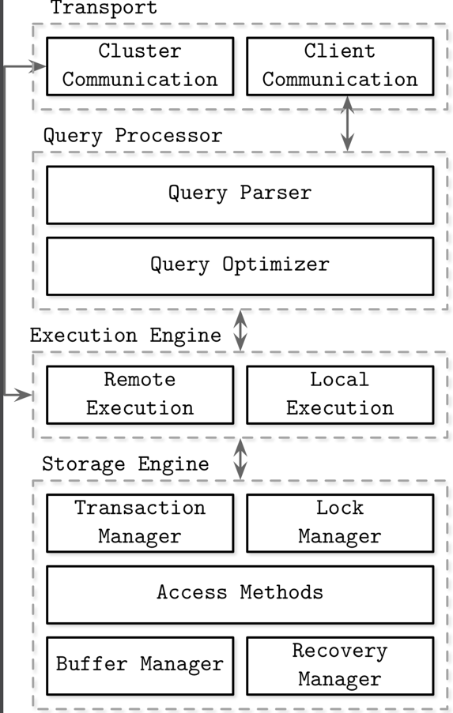
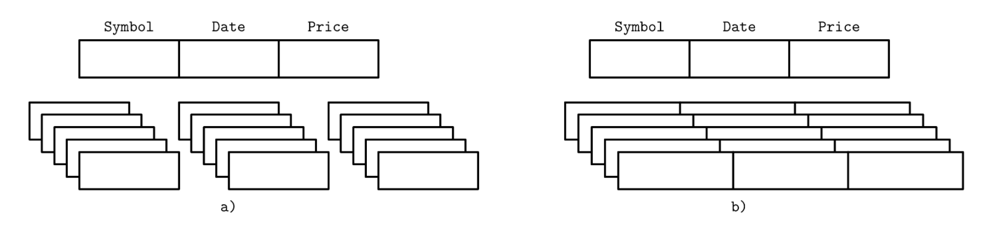
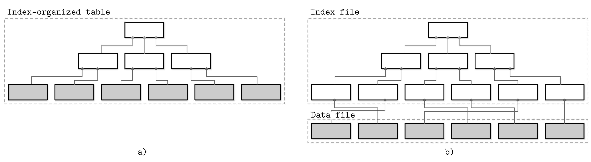
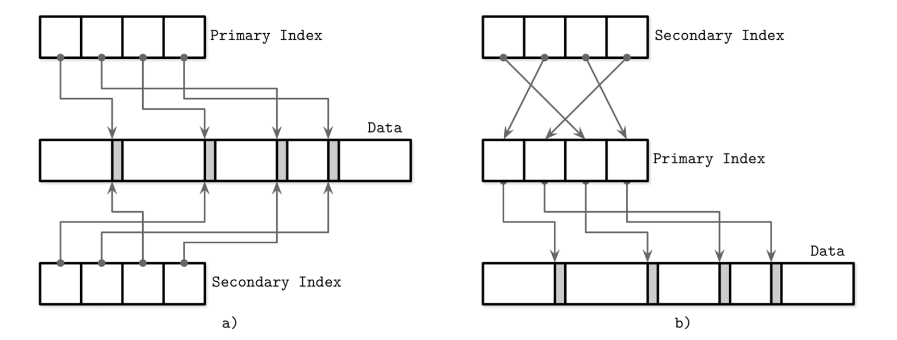
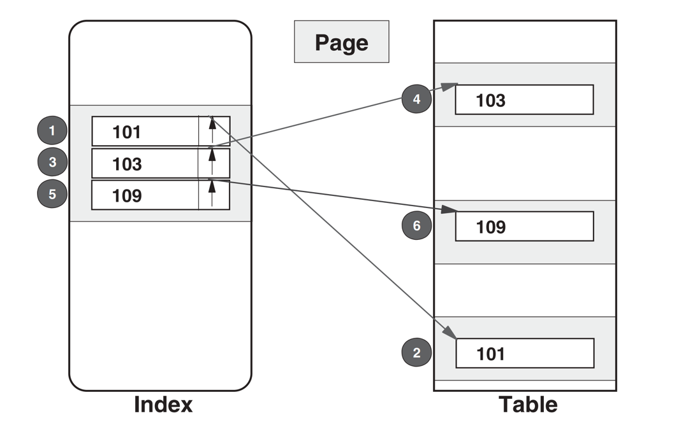

## Introduction

数据库管理系统可以服务于完全不同的目的：有的主要承载临时热数据，有的作为长期冷存储，有的允许复杂的分析查询，有的只能按 key 访问值，有的为时序数据优化，有的则擅长高效存储大对象。


> 关系型与 NoSQL 数据库管理系统（Relational and NoSQL Database Management Systems）的知识库见 [DB-Engines](https://db-engines.com/en/ranking)。


每个数据库系统都有自己的强项与短板。为了降低昂贵迁移的风险，在选定某个具体数据库之前投入一些时间、确认它确实能满足应用的需求，是值得的。

对比数据库时，先充分理解用例，并明确当前与可预期的变量会更有帮助，例如：
- 模式与记录大小
- 客户端数量
- 查询类型与访问模式
- 读写查询的速率
- 以上任何变量的预期变化


分类维度：
- 基于磁盘：B-Tree 或 LSM Tree
- 基于内存：hashtable 或 skiplist
- 存储布局：行式或列式
- 编码：protobuf 或 Thrift

本文按五个问题自上而下展开：**存得下**（Storing Data：存储结构、数据文件与索引文件、缓冲池）→ **找得快**（Finding Data：索引结构、多列与多维、全文与模糊、优化器与访问路径）→ **改不乱**（Changing Safely：事务、并发控制、WAL 与崩溃恢复）→ **扩得开**（Scaling Out：复制、分片、跨节点原子提交与共识）→ **算得动**（Analytics：OLAP 与数据仓库）。再用 **Choosing** 按数据模型收拢各产品家族，**Tuning** 记录容器化与线上排障的实测注意。每章末尾直接挂到本目录下的子页，不必回头翻目录。


## Architecture

数据库管理系统采用 client/server 模型：数据库系统实例（节点）扮演服务器，应用实例扮演客户端。

数据库是模块化系统，由多个部分组成：接受请求的 transport 层、决定以最高效方式运行查询的查询处理器、实际执行操作的执行引擎，以及存储引擎。

再往细一层，一套数据库还可以按层拆开：存储数据层（storage data layer）、缓存层（cache layer）、transport 层、执行层（execute layer）、日志层（log layer）与权限层（authority layer）；容错（tolerance）与并发（concurrency）则是贯穿这些层的关注点。


<div style="text-align: center;">



</div>

<p style="text-align: center;">
图 2：数据库管理系统的架构
</p>


客户端请求经由 transport 子系统到达。请求以查询的形式出现，大多用某种查询语言表达。transport 子系统还负责与数据库集群中其他节点的通信。

收到请求后，transport 子系统把查询交给查询处理器，由它做解析、解释与校验。随后才进行访问控制检查，因为这些检查只有在查询被解释之后才能完整执行。

解析后的查询交给查询优化器：它先剔除查询中不可能成立与冗余的部分，再基于内部统计信息（索引基数、近似交集大小等）和数据分布（集群中哪些节点持有数据、搬运数据的代价）寻找执行它的最高效方式。优化器既处理查询求解所需的关系运算（通常表示为依赖树），也负责索引顺序、基数估计、访问方法选择等优化。

查询通常会以执行计划（execution plan / query plan）的形式给出：一系列为了得到完整结果必须执行的操作。同一个查询可以由不同的执行计划满足，效率也各不相同，于是优化器挑出其中最好的一个。

执行计划交给执行引擎处理，由它收集本地与远程操作的执行结果。远程执行可能涉及向集群中其他节点读写数据，以及复制。

本地查询（无论来自客户端还是其他节点）都由存储引擎执行。

## Taxonomy

数据库的分类不止一种口径，本章按四个维度依次展开：数据主要放在内存还是磁盘、按行还是按列摆放、宽列存储与列式存储的区别、以及向量带来的新类别；末尾再给一张「模型 × 机制」地图，作为整棵 DB 目录的索引。

### Memory Versus Disk-Based

数据库系统把数据存在内存与磁盘上。内存型数据库管理系统（in-memory / main memory DBMS）主要把数据放在内存，磁盘用于恢复与日志；磁盘型 DBMS 则把大部分数据放在磁盘，内存用来缓存磁盘内容或作临时存储。两类系统都会在一定程度上使用磁盘，只是内存数据库的内容几乎完全驻留在 RAM 中。

内存数据库与磁盘型系统的差异，不只在于主存储介质，还在于所用的数据结构、组织方式与优化技术。

把内存作为主存储的数据库，看中的主要是性能、相对较低的访问成本与更细的访问粒度。为内存编程也远比磁盘简单：操作系统抽象了内存管理，让我们可以按任意大小内存块的分配与释放来思考；而在磁盘上，数据引用、序列化格式、已释放空间与碎片都必须手动管理。

限制内存数据库增长的主要因素是 RAM 的易失性（即缺乏持久性）与成本。RAM 内容不持久，软件错误、崩溃、硬件故障、断电都可能造成数据丢失。确保持久性并非没有手段，如不间断电源与电池后备 RAM，但这需要额外的硬件资源与运维经验。现实里，一切最终都归结为磁盘更易维护、价格低得多。

随着非易失内存（Non-Volatile Memory, NVM）技术的可用性与普及度提升，这一局面很可能改变。NVM 存储能缩小甚至完全消除（取决于具体技术）读写延迟的不对称性，进一步提升读写性能，并支持按字节寻址。


内存数据库会在磁盘上保留备份，以提供持久性、防止易失数据丢失。有些数据库把数据完全存在内存里、不提供任何持久性保证，但它们不在本书讨论范围内。

在操作被视为完成之前，其结果必须先写入一个顺序的日志文件。为避免启动或崩溃后重放整个日志，内存存储会维护一份备份副本。备份以磁盘上的有序结构保存，对它的修改通常是异步的（与客户端请求解耦）并成批应用，以减少 I/O 次数。恢复时，数据库内容可以从备份与日志中还原。

日志记录通常会成批地应用到备份上。一批日志处理完后，备份就持有一个特定时间点的数据库快照，此前的日志即可丢弃。这个过程称为 checkpoint（检查点）。它让磁盘上的数据库始终尽可能跟上日志，又不要求客户端阻塞等待备份更新，从而缩短恢复时间。

磁盘型数据库使用为磁盘访问优化的专用存储结构。在内存中，指针可以很快地被跟随，随机内存访问也远快于随机磁盘访问。磁盘上的存储结构常常是宽而矮的树；内存实现则可以从更大的数据结构池中挑选，并做那些在磁盘上不可能或难以实现的优化。同样，在磁盘上处理变长数据需要格外小心，而在内存里往往只是一个「用指针引用值」的问题。

有些场景可以合理地假设整个数据集都能放进内存。有些数据集天然受现实规模约束，例如学校的学生记录、企业的客户记录、网店的库存：每条记录不过几 Kb，条数也有限。

### Row Versus Column-Oriented


给数据库分类的一种方式，是看数据在磁盘上按行还是按列存放。表可以水平切分（把属于同一行的值存在一起），也可以垂直切分（把属于同一列的值存在一起）。图 1 展示了这种区别：(a) 按列切分值，(b) 按行切分值。


<div style="text-align: center;">



</div>

<p style="text-align: center;">
图 1：列式与行式存储的数据布局
</p>

行式数据库管理系统按记录或行存放数据。其布局与表格表示非常接近：每一行都有同一组字段。既然行式存储在需要按行访问数据的场景中最有用，把整行存在一起就改善了空间局部性。

列式数据库管理系统不按行存放，而是垂直（按列）切分数据：同一列的值在磁盘上连续存放。列式存储很适合计算聚合的分析型负载，例如找趋势、算均值等。当逻辑记录有多个字段、其中一些字段更重要且常被一起消费时，复杂聚合就能发挥作用。把相同数据类型存在一起（数字挨着数字、字符串挨着字符串）还能获得更好的压缩比。

#### Wide Column Stores

不要把列式数据库与宽列存储（wide column store，如 BigTable、HBase）混为一谈：后者把数据表示为多维 map，列被组织进列族（column family，通常存同类型数据），而每个列族内部则按行存放。这种布局最适合按 key 或一串连续 key 取数。


### Vector

随着数据脱离了传统数据库整齐的行和列，开始以文本、图片、音频、代码以及关系图的形式存在，一种新的数据处理方式变得必要。向量数据库应运而生来应对这一变化。它们通过将数据表示为由嵌入生成的高维向量来存储意义，而不是标签。在这个空间里，相似性变成了一个距离问题，而不是关键词匹配。这使得向量数据库在现代 AI 系统中不可或缺，比如语义搜索、推荐引擎、RAG 流水线、欺诈检测和多模态助手，因为相关性依赖于上下文和意图，而不是精确匹配。它们的兴起也反映了从基于规则的软件向基于表示的学习的转变，在这种学习中，理解来自于潜在空间中的接近性。整个门类的原理与选型坐标见 [vector](/docs/CS/DB/vector.md)。

向量数据库旨在存储和管理高维数据，而传统数据库管理系统（DBMS）难以有效处理这些数据。
这种创新的数据库利用称为向量的数学表示，向量可包含多个维度，通常从数十到数千不等，具体取决于数据的复杂度。
这些向量由多种数据生成，包括文本、图片、音频和视频，使得复杂的分析和检索能力超越了简单的关键词匹配。
向量数据库促进了快速且精确的相似性搜索，使其在机器学习、自然语言处理和计算机视觉等领域应用中不可或缺。
它们还支持大型语言模型（LLM）的集成，增强了语义搜索、实时知识检索等任务的能力，并减少了 LLM 输出中常见的「幻觉」错误。

### Model and Mechanism Map

把「数据模型 × 存储索引路线」摊成一张表，就是本目录的地图：行是模型，右列是该行在本库的入口页。

| 数据模型 | 存储与索引路线 | 本库入口 |
| :-- | :-- | :-- |
| 关系（行式） | B+Tree 聚簇 + WAL + MVCC | [MySQL](/docs/CS/DB/MySQL/MySQL.md)、[PostgreSQL](/docs/CS/DB/PostgreSQL/PostgreSQL.md)、[Oracle](/docs/CS/DB/Oracle/Oracle.md)、[h2](/docs/CS/DB/h2/H2.md) |
| 关系 · 分布式 | 分片 + 共识日志，兼容 MySQL 生态 | [TiDB](/docs/CS/DB/TiDB.md)、[OceanBase](/docs/CS/DB/OceanBase.md)、[PolarDB](/docs/CS/DB/PolarDB/PolarDB.md) |
| 键值 / 缓存 | 内存 hashtable + skiplist | [Redis](/docs/CS/DB/Redis/Redis.md)、[Memcached](/docs/CS/DB/Memcached.md)、[Valkey](/docs/CS/DB/Valkey.md)、[Dragonfly](/docs/CS/DB/Dragonfly.md) |
| 键值 · 磁盘引擎 | LSM Tree，可嵌入进程 | [LevelDB](/docs/CS/DB/LevelDB/LevelDB.md)、[RocksDB](/docs/CS/DB/RocksDB/RocksDB.md)、[SSDB](/docs/CS/DB/SSDB.md)、[Pika](/docs/CS/DB/Pika.md) |
| 文档 | BSON 嵌套树 + 二级索引 | [MongoDB](/docs/CS/DB/MongoDB.md) |
| 宽列 | 多维 map、列族内行存、LSM 后端 | [HBase](/docs/CS/DB/HBase.md)、[Cassandra](/docs/CS/DB/Cassandra.md) |
| 列式 / 时序 | 按列连续存 + 压缩 + 向量化执行 | [ClickHouse](/docs/CS/DB/ClickHouse.md)、[Doris](/docs/CS/DB/Doris.md)、[Druid](/docs/CS/DB/Druid.md)、[InfluxDB](/docs/CS/DB/InfluxDB.md)、[Presto](/docs/CS/DB/Presto.md) |
| 图 | 免索引邻接 / 外部 KV 上的邻接表 | [graph](/docs/CS/DB/graph/graph.md)、[Neo4j](/docs/CS/DB/graph/Neo4j.md)、[JanusGraph](/docs/CS/DB/graph/JanusGraph.md)、[NebulaGraph](/docs/CS/DB/graph/NebulaGraph.md) |
| 向量 | ANN 图索引与聚类索引 | [vector](/docs/CS/DB/vector.md)、[Milvus](/docs/CS/DB/Milvus/Milvus.md) |
| 中间件（不改存储） | 分库分表、binlog 增量订阅 | [ShardingSphere](/docs/CS/DB/ShardingSphere.md)、[TDDL](/docs/CS/DB/TDDL.md)、[canal](/docs/CS/DB/canal.md) |

跨模型复用的机制页单列一份：[Index](/docs/CS/DB/Index.md)（索引结构）、[WAL](/docs/CS/DB/WAL.md)（预写日志）、[BLink-Tree](/docs/CS/DB/BLink-Tree.md)（并发下的 B+Tree）、[Shard](/docs/CS/DB/Shard.md)（分片与再均衡）；算法与分布式侧的 [LSM Tree](/docs/CS/Algorithms/tree/LSM.md)、[Bigtable](/docs/CS/Distributed/Bigtable.md) 也已在本库。

## Storing Data

第一个问题是**存得下**：数据最终要落成文件与页，而选哪种结构——原地更新的 B-Tree 还是追加写的 LSM Tree——决定了读放大、写放大与空间放大三者怎么分配。

### Storage Engine


存储引擎（storage engine / database engine）是数据库管理系统中的一个软件组件，负责在内存与磁盘中存储、检索和管理数据，目标是给每个节点装上一份可持久、可长期依赖的记忆。数据库可以响应复杂的查询，而存储引擎看数据的粒度更细，只提供一个简单的数据操作 API：创建、更新、删除、检索记录。可以这样理解：数据库管理系统是构建在存储引擎之上的应用，由它额外提供模式、查询语言、索引、事务等大量有用能力。

为了灵活，key 和 value 都可以是没有固定形态的任意字节序列，其排序与表示语义由更上层的子系统定义。例如一张表可以用 int32（32 位整数）做 key，另一张用 ascii（ASCII 字符串）；在存储引擎眼里，两者都只是序列化后的条目。

BerkeleyDB、[LevelDB](/docs/CS/DB/LevelDB/LevelDB.md) 及其后代 [RocksDB](/docs/CS/DB/RocksDB/RocksDB.md)、LMDB 及其后代 libmdbx、Sophia、HaloDB 等存储引擎，都是在独立于如今嵌入的数据库管理系统的情况下发展起来的。可插拔的存储引擎让数据库开发者可以直接基于现成引擎 bootstrap 一个数据库系统，把精力集中在其他子系统上。

同时，数据库系统组件之间清晰的边界，也带来了在不同引擎之间切换的机会——换成更契合特定用例的那一个。


存储引擎由若干各司其职的组件构成：

- Transaction manager<br>
  调度事务，确保事务不会把数据库留在逻辑上不一致的状态。
- Lock manager<br>
  为运行中的事务锁定数据库对象，确保并发操作不会破坏物理数据完整性。
- Access methods（storage structures）<br>
  管理数据在磁盘上的组织与访问方式，包括 heap file 以及 B-Tree、LSM Tree 等存储结构。
- Buffer manager<br>
  在内存中缓存数据页（见 Buffer Management）。
- Recovery manager<br>
  维护操作日志，并在故障后恢复系统状态（见 Recovery）。

transaction manager 与 lock manager 共同负责并发控制（见 Concurrency Control）：在保证逻辑与物理数据完整性的同时，尽可能高效地执行并发操作。


存储引擎建立在某种数据结构之上，但这些数据结构本身并不描述缓存、恢复、事务性等由存储引擎额外加上去的语义。

存储结构通常有三个共同变量：是否使用 *buffering*（缓冲），使用 *immutable*（不可变）还是可变文件，以及是否按 *order*（有序）存放值。

- **Buffering**<br>
  指存储结构是否选择在落盘前先在内存中收集一定量的数据。<br>
  当然，任何磁盘结构在某种程度上都必然用到缓冲，因为磁盘读写的最小单位是块，而且最好写满整块。<br>
  这里说的是可避免的缓冲，即存储引擎实现者主动做出的选择。<br>
  本书最先讨论的优化之一，就是给 B-Tree 节点加上内存缓冲区来摊薄 I/O 成本。
  但这不是应用缓冲的唯一方式。<br>
  例如双组件 LSM Tree 尽管与 B-Tree 有相似之处，使用缓冲的方式却完全不同，并把缓冲与不可变结合在了一起。
- **Mutability**（可变性，或不可变性）<br>
  指存储结构是否会读取文件的一部分、就地更新后再把结果写回原位置。<br>
  不可变结构是 append-only 的：一旦写入，文件内容就不再修改，更新一律追加到文件末尾。
  不可变还有其他实现方式。<br>
  其一是 copy-on-write：承载更新后记录的页被写到文件中的新位置，而不是原来的位置。<br>
  人们常把 LSM 与 B-Tree 的对立描述成不可变与原地更新，但也有受 B-Tree 启发却不可变的结构（例如 Bw-Tree）。
- **Ordering**<br>
  指数据记录是否在磁盘页内按 key 有序存放。
   换句话说，排序上接近的 key 是否存在磁盘上的连续段里。<br>
  有序与否往往决定了我们能否高效扫描一段记录，而不只是定位单条数据记录。<br>
  乱序存放（通常按插入顺序）为写路径带来一些优化机会。
  例如 Bitcask 与 WiscKey 就直接把记录存进 append-only 文件。


我们把存储结构分为可变与不可变两组，并把不可变性认定为影响其设计与实现的核心概念。多数可变存储结构使用原地更新机制：插入、删除、更新时，记录直接改在目标文件中的原位置。

存储引擎往往允许同一条数据记录在库中存在多个版本；例如使用多版本并发控制（见 Multiversion Concurrency Control）或带槽页组织（见 Slotted Pages）时。为了简化，我们暂且假设每个 key 只关联一条有唯一位置的数据记录。

B-Tree 是最流行的存储结构之一。许多开源数据库都基于 B-Tree，多年下来它们已被证明能覆盖大多数用例。

要让一种树结构适合磁盘实现，它必须满足以下性质：

- 高扇出（fanout），以提高相邻 key 的局部性。
- 低高度（height），以减少遍历过程中的寻道次数。

> [!TIP]
>
> 扇出与高度互为倒数关系：扇出越高，高度越低。
> 扇出高意味着每个节点能挂更多子节点，节点总数随之减少，高度也就降了下来。

落地成对：InnoDB 的 [B-Tree](/docs/CS/DB/MySQL/B-Tree.md) 与 [BLink-Tree](/docs/CS/DB/BLink-Tree.md)（并发下的 B+Tree）、LevelDB/RocksDB 的 [LSM Tree](/docs/CS/Algorithms/tree/LSM.md)。


不可变数据结构常用于函数式编程语言，并因其安全特性越来越受欢迎：一旦创建就不会改变，所有引用都可并发访问，其完整性由「不可被修改」这一事实保证。

从高层看，数据在存储结构内部与外部的处理方式有一条严格的分界：内部，不可变文件可以存多份拷贝，较新的覆盖较旧的；而可变文件通常只保留最新值。访问时，不可变文件会被处理、多余的拷贝被归并，最新的版本返回给客户端。

我们以 B-Tree 作为可变结构的典型例子，以 Log-Structured Merge Tree（LSM Tree）作为不可变结构的例子。不可变的 LSM Tree 使用 append-only 存储加归并（merge）来调和；B-Tree 则在磁盘上定位记录，并在文件中的原始偏移处更新页。


原地更新的存储结构为读性能优化：在磁盘上定位到数据后，记录即可返回给客户端。代价是写性能：要就地更新记录，得先在磁盘上找到它。反过来，append-only 存储为写性能优化：写不需要在磁盘上定位记录再覆盖；代价则落在读上——读要取回同一记录的多个版本并做归并。


数据库社区的一大争论是 B-Tree 与 LSM Tree 谁的写放大更低。理解两边写放大的来源至关重要：B-Tree 的写放大来自 writeback 以及同一节点的反复更新；LSM Tree 的写放大则来自 compaction 过程中文件之间的数据迁移。把两者直接对比，很容易得出错误的结论。

概括起来，当以不可变方式把数据存到磁盘上时，我们会面对三个问题：

- Read amplification<br>
   源于取数时不得不读多个表。
- Write amplification<br>
   由 compaction 过程的反复重写造成。
- Space amplification<br>
   源于同一个 key 关联的多条记录同时存在。


数据库系统确实使用文件存放数据，但不依赖文件系统「目录+文件」的层级来定位记录，而是按各家实现的专有格式组织文件。相比 flat file，采用专门的的文件组织主要有三个理由：

- Storage efficiency（存储效率）<br>
   文件的组织方式要让每条记录带来的存储开销尽可能小。
- Access efficiency（访问效率）<br>
   能用尽可能少的步骤定位到记录。
- Update efficiency（更新效率）<br>
   更新记录的方式要让磁盘上的改动次数尽可能少。

数据库系统把由多个字段组成的数据记录存进表里，每张表通常对应一个独立文件。表中的每条记录都可以用搜索 key 查找。为了定位记录，数据库系统使用索引：一种辅助数据结构，让我们不必每次访问都扫全表就能高效找到数据记录。索引由标识记录的字段子集构建。

数据库系统通常把数据文件与索引文件分开：数据文件存数据记录，索引文件存记录的元数据，并用它到数据文件里定位记录。
索引文件一般比数据文件小。
文件被划分为页（page），一页通常等于一个或多个磁盘块。
页可以组织成记录的序列，也可以组织成 slotted page（带槽页）。

新记录（插入）与对已有记录的更新，都以 key/value 对表示。
多数现代存储系统不会显式地从页里删除数据，而是使用删除标记（也叫 tombstone，墓碑），其中携带删除元数据，如 key 与时间戳。
被更新或删除标记遮蔽（shadow）的记录所占的空间，要到垃圾回收时才真正回收：读取页，把存活（未被遮蔽）的记录写到新位置，丢弃被遮蔽的那些。

### Data Files

数据文件（有时称 *primary file*）可以实现为 *index-organized table*（IOT）、*heap-organized table*（heap file）或 *hash-organized table*（hashed file）。

- heap file 中的记录不必遵循任何特定顺序，多数时候按写入顺序摆放。这样追加新页时不需要额外工作或重排文件。heap file 要额外配索引结构，指向数据记录所在的位置，才能被搜索。
- hashed file 把记录存在桶（bucket）里，key 的哈希值决定记录属于哪个桶。桶内可以按追加顺序存，也可以按 key 排序存放以提高查找速度。
- index-organized table（IOT）把数据记录直接存在索引里。由于记录按 key 有序存放，IOT 上的范围扫描只需顺序扫描索引内容即可实现。<br>
  把数据记录存在索引里，至少能少一次磁盘寻道：遍历索引定位到目标 key 之后，不必再去访问另一个文件找关联的数据记录。

当记录存在独立文件里时，索引文件保存 data entry——它们唯一标识数据记录，并携带足以在数据文件中定位记录的信息。例如可以存文件偏移（有时叫 row locator）、数据记录在数据文件中的位置，或哈希文件中的桶 ID。在 index-organized table 中，data entry 就是数据记录本身。

### Index Files

索引是一种在磁盘上组织数据记录、以便高效检索的数据结构。索引文件被组织成专门的结构，把 key 映射到数据文件中的位置——这些位置存放着 key 对应的记录（heap file 情形）或主键（IOT 情形）。本库关于索引结构与类型的完整笔记见 [Indexes](/docs/CS/DB/Index.md)。

构建在数据（主）文件上的索引称为主索引（primary index）；多数情况下还可以进一步认为，主索引建立在主键或被认定为主键的一组 key 之上。其余索引都称为二级索引（secondary index）。

二级索引可以直接指向数据记录，也可以只存记录的主键。指向数据记录的指针，可以是一个到 heap file 或 IOT 的偏移。多条二级索引可以指向同一条记录，使同一条数据记录能被不同字段标识、经由不同索引定位。主索引文件对每个搜索 key 只保留一条唯一条目，而二级索引对一个搜索 key 可能保留多条条目。

若数据记录的顺序与搜索 key 的顺序一致，该索引称为聚簇索引（clustered，也叫 clustering）。聚簇情形下，数据记录通常存在同一个文件里、或存在一个保持 key 顺序的聚簇文件中。若数据存在独立文件、其顺序又不跟随 key 顺序，该索引称为非聚簇（nonclustered，有时叫 unclustered）。

图 4 展示了两种做法的差异：
- a) 两个二级索引直接引用 data entry。
- b) 二级索引经由主索引这一间接层来定位 data entry。


<div style="text-align: center;">



</div>

<p style="text-align: center;">
图 4：数据记录直接存进索引文件 vs. 只存到数据文件的偏移（白色为索引段，灰色为存放数据记录的段）。
</p>

> [!TIP]
> index-organized table 按索引顺序存放信息，因此天生就是聚簇的。<br>
> 主索引几乎都是聚簇索引。二级索引则天生非聚簇，因为它们服务的是主键之外的 key 访问。<br>
> 聚簇索引既可以是 index-organized 的，也可以是索引与数据分文件的。

许多数据库系统都有一条内置且显式的主键——一组能唯一标识记录的列。若建表时没有指定主键，存储引擎可以造一个隐式主键（例如 MySQL InnoDB 会新增一个自增列并自动填值）。


#### Primary Index as an Indirection

直接引用数据，可以减少磁盘寻道次数，但代价是：每当记录被更新、或在维护过程中被搬动，都得同步更新这些指针。用主索引做间接层，可以降低指针更新的代价，代价是读路径更长。

如果负载以读为主，只维护少数几个索引行得通；但对多索引的写密集负载，这种做法并不好。为了降低指针更新成本，一些实现不用 payload 偏移，而是用主键做间接层。例如 MySQL InnoDB 使用主索引，执行查询时会做两次查找：一次在二级索引里，一次在主索引里。
相比直接从二级索引跟随偏移，这多付了一次主索引查找的开销。

图 5 展示了两种做法的不同：

- a) 两个二级索引直接引用 data entry。
- b) 二级索引经由主索引这一间接层来定位 data entry。


<div style="text-align: center;">



</div>

<p style="text-align: center;">
图 5：直接引用数据元组 (a) vs. 以主索引作间接层 (b)。
</p>

也可以采用混合方案，同时存数据文件偏移与主键：先检查数据偏移是否仍然有效，若已变化才多付一次「走主键索引」的代价，并在找到新偏移后更新索引文件。


### Buffer Management

大多数数据库都构建在两级存储层次之上：慢的持久存储（磁盘）与快的主存（RAM）。为了减少访问持久存储的次数，页会被缓存在内存里；当存储层再次请求同一页时，直接返回它的缓存副本。

内存中可用的缓存页可以被复用，前提是认定没有其他进程修改过磁盘上的数据。这种做法有时被称为 virtual disk [BAYER72]：virtual disk 读只有在内存中没有该页副本时才真正访问物理存储。同一概念更常见的叫法是 page cache 或 buffer pool。page cache 负责把从磁盘读入的页缓存在内存中；一旦数据库系统崩溃或非正常关机，缓存内容就会丢失。

页缓存的问题并不只属于数据库。操作系统同样有 page cache 的概念：利用空闲内存段透明地缓存磁盘内容，提升 I/O 系统调用的性能。

未被缓存的页从磁盘调入时，称为被 paged in（调入）。一旦缓存页被修改，它就处于 dirty（脏）状态，直到这些修改被刷回磁盘。

由于存放缓存页的内存区域通常远小于整个数据集，page cache 迟早会被填满，此时要调入新页，就必须先逐出一个已缓存的页。

page cache 的主要职能可以总结为：

- 把缓存页的内容保持在内存中。
- 允许对磁盘页的修改被缓冲在一起，并作用在它们的缓存版本上。
- 当请求的页不在内存中、且有足够空间时，由 page cache 把它调入，并返回缓存版本。
- 若请求的是已缓存的页，直接返回缓存版本。
- 若没有足够空间容纳新页，则逐出其他某个页，并把其内容刷回磁盘。

> [!NOTE]
> 许多数据库用 O_DIRECT 标志打开文件：该标志让 I/O 系统调用绕过内核 page cache、直接访问磁盘，改用数据库自己的缓存管理。操作系统阵营对此时常颇有微词。
> Linus Torvalds 也批评过 O_DIRECT 的用法，因为它不是异步的，也没有 readahead 之类的手段向内核提示访问模式。不过在操作系统提供更完善的机制之前，O_DIRECT 仍然有用。
> 我们还能通过 fadvise 对内核如何从其缓存中逐出页施加一些影响，但这只是请内核参考我们的意见，并不保证生效。要避免 I/O 时的系统调用，可以用内存映射，代价是失去对缓存的控制。

#### Caching Semantics

对缓冲区的所有修改都留在内存中，直到最终写回磁盘。由于不允许其他进程修改背后的文件，这一同步是单向的：从内存到磁盘，而不是反过来。page cache 让数据库对内存管理与磁盘访问有更强的控制。可以把它理解为「应用专属的内核 page cache」：它直接访问块设备，实现类似的功能，服务类似的目的。它抽象了磁盘访问，把逻辑写与物理写解耦。

缓存页让我们无需改动算法、无需把对象实体化进内存，就能把树的一部分常驻内存。要做的只是把磁盘访问替换成对 page cache 的调用。

当存储引擎访问（即请求）某个页时，我们先检查其内容是否已被缓存，已缓存则直接返回缓存副本。若尚未缓存，缓存会把逻辑页地址或页号翻译成物理地址，把内容加载进内存，并把缓存版本返回给存储引擎。返回之后，持有该页的缓冲区即处于被引用（referenced）状态，存储引擎用完必须把它交还给 page cache 或解除引用。通过 pin（钉住），可以告诉 page cache 不要逐出某些页。

如果页被修改过（例如追加了一条记录），它会被标记为 dirty。dirty 位置起，说明页内容与磁盘不同步，必须刷盘才能持久化。


#### Cache Eviction

让缓存保持「满」是好事：更多的读可以不用碰持久存储，更多的同页写可以被缓冲在一起。但 page cache 容量有限，迟早要容纳新内容，就得逐出旧页。若页内容与磁盘同步（已经刷过或从未被修改），且没有被 pin、没有被引用，就可以直接逐出。脏页必须先刷盘才能被逐出。正被其他线程使用的页不应被逐出。

由于每次逐出都触发一次刷盘会伤害性能，一些数据库会用独立的后台进程不断轮询那些即将被逐出的脏页，提前把它们的磁盘版本更新好——例如 PostgreSQL 的 background writer（bgwriter）做的就是这件事。

另一个必须牢记的性质是持久性：如果数据库崩溃，所有没有落盘的数据都会丢失。为了确保所有修改都被持久化，刷盘由 checkpoint 进程统一协调。checkpoint 进程同时掌控 WAL（write-ahead log）与 page cache，让两者步调一致：只有当某条日志对应的操作已应用到「已落盘的缓存页」上时，这条日志才可以从 WAL 中丢弃。checkpoint 完成之前，脏页不能被逐出。


这意味着下面几个目标之间永远存在取舍：
- 推迟刷盘，减少磁盘访问次数
- 提前刷页，以便快速逐出
- 以最优顺序挑选要逐出与刷盘的页
- 把缓存大小控制在内存预算内
- 避免数据因未写入主存储而丢失


#### Locking Pages in Cache

每次读写都做磁盘 I/O 是不现实的：后续的读可能请求同一页，后续的写也可能改同一页。由于 B-Tree 越往上越「窄」，大部分读都会命中靠近根的高层节点，分裂与合并最终也会传播到这些高层节点。也就是说，树里总有一部分能显著受益于常驻缓存。

我们可以把近期很可能被用到的页「锁」在缓存里——这在缓存中称为 pin（钉住）。被 pin 的页在内存中停留更久，从而减少磁盘访问次数、提升性能。


由于 B-Tree 每往下一层的节点数都比上一层多出指数级，高层节点只占整棵树很小的一部分，因此这部分可以永久常驻内存，其余部分按需调入。
这意味着执行一次查询不必做 h 次磁盘访问（见 “B-Tree Lookup Complexity”，h 为树高），只有那些未被缓存的底层才需要真正落盘。

在同一棵子树上执行的操作，可能产生互相冲突的结构变更——例如多次删除触发 merge，随后写入又触发 split，或反之亦然。
不同子树向上传播的结构变更也一样（时间上彼此接近、发生在树的不同部位、同时向上冒泡）。
这些操作可以只在内存中生效而被缓冲在一起，从而减少磁盘写次数、摊薄操作成本——多次写被合并成一次写。


> page cache 还让存储引擎对预取与逐出有细粒度控制：可以要求它提前把页加载进来。例如范围扫描遍历叶子节点时，可以预载接下来的叶子。类似地，如果某个维护进程加载了某页，进程结束后可以立刻把该页逐出，因为它对正在跑的查询几乎没用。一些数据库（例如 PostgreSQL）对大型顺序扫描使用环形缓冲（也就是 FIFO 页替换策略）。


往下读：InnoDB 的落盘结构见 [InnoDB](/docs/CS/DB/MySQL/InnoDB.md)、[tablespace](/docs/CS/DB/MySQL/tablespace.md) 与 [memory](/docs/CS/DB/MySQL/memory.md)（缓冲池）；LSM 一侧的完整拆解是 [LevelDB](/docs/CS/DB/LevelDB/LevelDB.md) 与 [RocksDB](/docs/CS/DB/RocksDB/RocksDB.md) 两棵子树，H2 的 [MVStore](/docs/CS/DB/h2/MVStore.md) 是第三条路线（copy-on-write 日志结构）。

## Finding Data

第二个问题是**找得快**：把全表扫描换成索引查找，代价从 O(n) 降到一次树高；代价是要回答索引怎么组织、值要不要存进索引、多列与多维如何同时收窄，以及优化器凭什么选到这条路径。

*主键*（primary key）唯一标识关系表中的一行、文档数据库中的一个文档，或图数据库中的一个顶点。
库里其他记录可以通过主键（或 ID）引用该 行/文档/顶点，索引则用来解析这类引用。

*二级索引*（secondary index）也非常常见。
在关系数据库中，可以用 CREATE INDEX 在同一张表上建多个二级索引，它们对高效执行 join 往往至关重要。
二级索引可以很容易地建立在键值索引之上，
主要区别是 key 不唯一：即可能有很多行（文档、顶点）共享同一个 key。
解决办法有两种：要么让索引里每个 value 成为匹配行标识符的列表（类似全文索引里的 postings list），要么在每个 key 后附加行标识符使其唯一。
无论哪种，B-tree 与 log-structured 索引都可以充当二级索引。

### Storing Values Within the Index

索引里的 key 是查询要找的东西，而 value 可以是两种东西之一：要么就是那行（文档、顶点）本身，要么是到存放在别处的行的引用。
后一种情况下，存放行的地方叫 heap file，它不以任何特定顺序存数据（可以是 append-only，也可以记录被删除的行，以便之后用新数据覆盖）。
heap file 之所以常见，是因为在存在多个二级索引时它能避免复制数据：每个索引只需引用 heap file 中的一个位置，真正的数据集中存放一处。

只改 value 不改 key 时，heap file 方式可以相当高效：只要新值不比旧值大，记录就能就地覆盖。
若新值更大就麻烦些——它多半得搬到 heap 中有足够空间的新位置。
这时要么更新所有索引让它指向记录的新 heap 位置，要么在旧 heap 位置留一个转发指针。

有些场景下，「从索引多跳一次到 heap file」对读的性能损失太大，于是希望把被索引的行直接存在索引里。
这就是聚簇索引（clustered index）。
例如 MySQL 的 InnoDB 存储引擎里，表的主键永远是聚簇索引，二级索引引用的是主键（而不是 heap file 位置）。
SQL Server 则允许每张表指定一个聚簇索引。
介于聚簇索引（把行数据全存在索引里）与非聚簇索引（索引里只存数据的引用）之间的折中，称为 covering index（覆盖索引）或带 included columns 的索引——把表的一部分列存在索引里。
这让某些查询仅靠索引就能回答（此时称该索引「覆盖」了这条查询）。

与一切数据复制一样，聚簇与覆盖索引能加速读，但要额外存储空间，也会给写增加开销。
数据库还得额外下功夫维持事务保证，因为应用不应看到由复制导致的不一致。

### Multi-Column Indexes

到目前为止讨论的索引都只把一个 key 映射到一个值。
当需要同时查询一张表的多个列（或一个文档的多个字段）时，这就不够了。
最常见的多列索引是 concatenated index（拼接索引），把一个列接在另一个列后面，将若干字段拼成一个 key（索引定义里规定字段的拼接顺序）。
这就像老式纸质电话簿：提供从 (lastname, firstname) 到电话号码的索引。
由于排序规则，这个索引可以找出所有某个姓的人，或所有某个「姓+名」组合的人；
但要找所有某个名的人，它就无能为力了。
多维索引是「一次查询多个列」的更一般手段，对地理空间数据尤其重要。
例如一个餐厅搜索网站的库里存着每家餐厅的经纬度。
用户在地图上看餐厅时，网站需要找出当前矩形视野范围内的所有餐厅。
这需要一个类似下面的二维范围查询：

```
SELECT * FROM restaurants WHERE latitude > 51.4946 AND latitude < 51.5079 AND longitude > -0.1162 AND longitude < -0.1004;
```

标准的 B-tree 或 LSM-tree 索引无法高效回答这种查询：它要么给出某段纬度内的所有餐厅（但经度不限），要么给出某段经度内的所有餐厅（但纬度可以从北极排到南极），却不能同时限定两者。

一个办法是用空间填充曲线把二维位置翻译成一维数字，然后继续用普通 B-tree 索引。
更常见的做法是使用专门的空间索引，如 R-tree。
例如 PostGIS 用 PostgreSQL 的 Generalized Search Tree 索引机制，把地理空间索引实现为 R-tree。
这里不展开讲 R-tree，相关文献很多。

一个有趣的观点是：多维索引不只用于地理位置。
例如电商网站可以在（红、绿、蓝）三个维度上建三维索引，检索某个颜色区间内的商品；天气观测库可以在（日期、温度）上建二维索引，高效查出 2013 年气温介于 25 与 30 之间的所有观测。
用一维索引则只能二选一：先扫完 2013 年所有记录（不管温度）再按温度过滤，或反过来。
二维索引可以同时按时间戳与温度收窄范围。
HyperDex 就用了这种技术。

### Full-Text Search and Fuzzy Indexes

前面讨论的所有索引都假设数据是精确的，只能查 key 的确切值、或按排序查 key 的一段取值范围。
它们不允许你查「相似的 key」，例如拼错的单词。
这类模糊查询需要别的技术。

例如，全文检索引擎通常允许把一个词的搜索扩展为包含它的同义词、忽略词形变化、检索同一文档中彼此邻近的词，并依赖语言的分析支持各种其他特性。
为了应对文档或查询里的错字，Lucene 能在给定编辑距离（edit distance 为 1 表示增删改了一个字母）内检索词语。

正如「Making an LSM-tree out of SSTables」一节（原书第 78 页）所述，Lucene 的词项字典用的就是类 SSTable 结构。
这种结构需要一小份内存索引，告诉查询要在有序文件的哪个偏移处找某个 key。
在 LevelDB 里，这份内存索引是部分 key 的稀疏集合；在 Lucene 里，它是建在 key 字符上的有限状态自动机，类似 trie。
这个自动机可以变换成 Levenshtein 自动机，从而高效支持「给定编辑距离内的词」的搜索。

另一些模糊搜索技术走向文档分类与机器学习。更详细的可参阅信息检索教材。


### Optimizer


关系数据库长期以来的一个优势是：请求数据时，几乎不用（或完全不用）操心数据将如何被访问。
这个决定由 DBMS 中称为优化器（optimizer）的组件做出。
不同关系系统的优化器千差万别，以后大概也会一直如此，但目标都一样：利用系统收集并保存下来的数据统计信息，以最有效的方式访问数据。


在一条 SQL 语句被执行之前，优化器必须先决定如何访问数据：要不要用索引、用哪个索引、索引怎么用、要不要借助辅助随机读，等等。
这些信息全部体现在访问路径（access path）里。


<div style="text-align: center;">



</div>

<p style="text-align: center;">
图 3：传统索引扫描
</p>

#### Index Slices and Matching Columns

于是，索引中一条很薄的切片（如上图所示）会被顺序扫描：
对每一个值落在 100 与 110 之间的索引行，除非对应的页已经在 buffer pool 中，否则都要用一次同步读去表里把行取出来。访问路径的代价显然取决于这片切片有多「厚」，而这又取决于范围谓词：切片越厚，需要顺序读取的索引页越多，要处理的索引行也越多。但真正让代价上涨的，是对表的同步读次数增加——每页可能要花上 10 ms。同理，切片越薄固然能降低索引开销，而更大的节省同样来自更少的表同步读。正因为如此，索引切片的大小可能非常关键。

index slice 这个词并不是哪个关系数据库系统自己用的术语——各家都有各家的叫法，但我们觉得 index slice 更贴近本质，而且可以跨 DBMS 通用。
另一种常见的说法，是用索引在处理过程中用到的 matching column 数目来定义一条 index slice。在我们的例子里（值介于 100 与 110 之间）只有一个 matching column。
这个单独的 matching column 实际上就定义了切片的厚度。假如 WHERE 子句和索引里还有第二个列，两列一起能定义出一条更薄的索引切片，那么我们就有两个 matching column：需要做的索引处理会更少，但更重要的是对表的同步读会更少。


#### Index Screening and Screening Columns

有时候一个列确实同时出现在 WHERE 子句和索引里——这里先只需知道：索引里并非所有列都能定义 index slice。
但这些列仍可能减少同步读表的次数，从而扮演更重要的角色。
我们把这些列叫作 screening column（一些关系数据库系统也确实这么叫），因为这正是它们在做的事：
它们只凭自己出现在索引里这一事实，就能判断无需真的去访问表行，从而省掉那次访问。

索引列从前往后依次检查：
1. 在 WHERE 子句中，该列是否至少有一个足够简单、指向它的谓词？
   有，则该列是 M column。
   没有，则该列及其后面的所有列都不是 M column。
2. 如果谓词是范围谓词，那么后面的列不再是 M column。
3. 最后一个 M column 之后的列，只要有一个足够简单、指向它的谓词，就是 S column。

#### Access Path Terminology

遗憾的是，描述访问路径的术语远未标准化——连 access path 这个词本身也不例外，另一个常用叫法是 execution plan。
我们约定：描述数据实际被访问的方式时用 access path；描述 DBMS 通过 `EXPLAIN` 设施（后文详述）给出的输出时用 execution plan。
这是个细微区别，两个词混用也无伤大雅。

matching predicate 有时也叫 range delimiting predicate。
如果某个谓词对优化器来说足够简单——在有合适索引时能构成 matching predicate——就被称为 indexable 或 sargable。
相反的叫法是 nonindexable 或 nonsargable。

SQL Server 用 table lookup 指代一种「既用索引、又读表行」的访问路径，与 index only 相对。
消除表访问最直接的办法，就是把缺失的列加进索引。
许多 SQL Server 书籍把「能让某条 SELECT 走 index-only 访问路径」的索引称为 covering index；用到 covering index 的 SELECT 有时也被称为 covering SELECT。


往下读：MySQL 的索引与执行计划见 [Index](/docs/CS/DB/MySQL/Index.md) 与 [Optimizer](/docs/CS/DB/MySQL/Optimizer.md)；Redis 的有序集合靠跳表，见 [zset](/docs/CS/DB/Redis/struct/zset.md) 与 [skiplist](/docs/CS/DB/Redis/struct/skiplist.MD)；索引的通用结构（B-Tree 与 LSM 的取舍）在 [Index](/docs/CS/DB/Index.md)。

## Changing Safely

第三个问题是**改不乱**：多个事务并发读写同一份数据时，既要让每个事务看到自洽的快照，又要在崩溃后回到一个说得过去的状态——这由并发控制与日志恢复两件事共同保证。

### Transaction Manager

事务管理器调度事务，确保事务不会把数据库留在逻辑上不一致的状态；锁管理器为运行中的事务锁定数据库对象，确保并发操作不破坏物理数据完整性。两者共同负责并发控制（见下文 Concurrency Control）：在保证逻辑与物理数据完整性的同时，尽可能高效地执行并发操作。

隔离级别决定「允许看到哪种中间状态」，实现路径却分两条：靠锁挡住冲突写，或靠多版本让读不挡写；Redis 则用单线程加 `MULTI`/Lua 直接绕过整个锁矩阵。本章末尾按这两条路径给出各数据库的落地页。

### Recovery

*write-ahead log*（简称 WAL，也叫 commit log）是一种 append-only 的辅助磁盘驻留结构，用于崩溃恢复与事务恢复。page cache 允许把对页内容的修改缓冲在内存里；在缓存内容刷回磁盘之前，唯一能保留操作历史的磁盘副本就存在 WAL 中。许多数据库系统都使用 append-only 的预写日志，例如 PostgreSQL 与 MySQL（MySQL 侧的落地见 [redolog](/docs/CS/DB/MySQL/redolog.md) 与 [undolog](/docs/CS/DB/MySQL/undolog.md)，通用机制见 [WAL](/docs/CS/DB/WAL.md)）。

WAL 的主要作用可以总结为：

- 让 page cache 得以缓冲对磁盘页的更新，同时在数据库系统更大的上下文里守住持久性语义。
- 在受某次操作影响的页的缓存副本同步到磁盘之前，先把该操作持久化到磁盘。每个会改变数据库状态的操作，都必须先落盘日志，才能去改对应页的内容。
- 允许在崩溃时从操作日志中重建丢失的内存修改。


除上述功能外，WAL 在事务处理中也扮演重要角色：它保证数据真的到达了持久存储、并在崩溃时可用——未提交的数据从日志中重放，崩溃前的数据库状态得以完整恢复。


WAL 是 append-only 的，写入的内容不可变，因此对日志的所有写都是顺序写。由于 WAL 是不可变的 append-only 结构，读者可以安全地读取到最新写入位置的内容，而写者继续在日志尾部追加。

WAL 由日志记录组成。每条记录都有一个唯一、单调递增的 log sequence number（LSN），通常由内部计数器或时间戳表示。日志记录未必占满一整个磁盘块，因此其内容先缓存在 log buffer 中，再通过 force 操作刷盘。触发刷盘的时机是 log buffer 写满，事务管理器与 page cache 也可以主动请求；所有日志记录都必须按 LSN 顺序落盘。

除了单条操作记录，WAL 中还保存表示事务完成的记录。在日志至少 force 到该事务 commit 记录的 LSN 之前，事务不能算提交。

为了确保系统在「回滚或恢复过程中再次崩溃」后仍能正确运转，一些系统在 undo 阶段使用 compensation log record（CLR），并把它们写入日志。

WAL 通常通过「可以在达到 checkpoint 时裁剪」这一接口与主存储结构耦合。日志是数据库正确性中最关键的环节之一，而且不太好做对：日志裁剪与「数据确实进入了主存储结构」之间哪怕最细微的不一致，都可能导致数据丢失。

checkpoint 让日志知道：到某个标记为止的日志记录都已完全持久化、不再需要，从而显著减少数据库启动时要做的恢复工作。把所有脏页强制刷盘的过程一般叫 sync checkpoint，因为它让主存储结构完全追平。

把全部内容刷盘并不现实，而且要暂停所有正在运行的操作直到 checkpoint 完成，因此多数数据库实现 fuzzy checkpoint：日志头中保存的 last_checkpoint 指针记录了上一次成功 checkpoint 的信息。一次 fuzzy checkpoint 以特殊的 begin_checkpoint 日志记录标记开始，以 end_checkpoint 记录结束——后者携带脏页信息与事务表内容。在该记录列出的所有页都刷完之前，checkpoint 不算完成。页是异步刷出的，刷完后 last_checkpoint 会被更新为 begin_checkpoint 记录的 LSN；一旦发生崩溃，恢复流程就从那里开始。

#### Operation Versus Data Log

一些数据库系统，例如 System R [CHAMBERLIN81]，使用 shadow paging：一种 copy-on-write 技术，用以确保数据持久性与事务原子性。新内容被写进尚未发布的新 shadow 页，再通过一次指针翻转——从旧页指向装有更新内容的页——使其可见。

任何状态变更都可以表示为一组 before-image 与 after-image，或对应的 redo 与 undo 操作。对 before-image 施加 redo 操作得到 after-image；反过来，对 after-image 施加 undo 操作得到 before-image。

我们可以用物理日志（记录整页状态或按字节的改动）或逻辑日志（记录需要对当前状态执行的操作）让记录或页在时间上向前、向后迁移。重要的是要追踪物理、逻辑日志记录所能作用其上的页的精确状态。

物理日志记录 before/after image，要求把操作涉及的整页都写入日志。逻辑日志则说明需要对页执行哪些操作，例如「为 key Y 插入数据记录 X」，并附带对应的 undo 操作，如「删除与 Y 关联的值」。

实践中，许多数据库系统同时使用这两种方式：用逻辑日志做 undo（为了并发与性能），用物理日志做 redo（为了缩短恢复时间）。

#### Steal and Force Policies

为了决定内存中的修改何时必须刷盘，数据库管理系统定义了 steal/no-steal 与 force/no-force 策略。
这些策略主要作用于 page cache，但放在恢复的语境里讨论更合适，因为它们会显著影响能与哪些恢复方法搭配。

允许在事务提交之前就把该事务改过的页刷盘的恢复方法，称为 steal 策略。
no-steal 策略则不允许把任何未提交事务的内容刷盘。
这里的「steal 一个脏页」指的是：把它在内存中的内容刷到磁盘，并让出位置装载另一个磁盘页。

force 策略要求事务改过的所有页在提交前刷盘。
反之，no-force 策略允许事务在部分被改页尚未刷盘时就提交。
这里的「force 一个脏页」指提交前把它刷到磁盘。

理解 steal 与 force 很重要，因为它们直接影响事务的 undo 与 redo：
undo 回滚已提交事务对 forced 页的更新，redo 则把已提交事务造成的改动重新应用到磁盘上。

采用 no-steal 策略时，恢复可以只用 redo 条目实现：旧版本本就在磁盘页上，修改则存在日志里。
采用 no-force 时，我们可以通过推迟来缓冲同一页的多次修改；代价是那段时间页内容必须留在内存里，可能需要更大的 page cache。

使用 force 策略时，崩溃恢复不需要额外工作就能重建已提交事务的结果，因为这些事务改过的页早已刷盘。
这一做法的主要缺点是：必需的 I/O 会让事务提交变慢。

更一般地，在事务提交之前，我们都要保留足够信息以便撤销其结果。
如果事务碰过的页有被刷盘的，就必须把 undo 信息保留在日志里直到提交，以便回滚。
否则就要把 redo 记录保留到提交为止。两种情况下，undo 或 redo 记录没有写进日志文件之前，事务都不能提交。


### Concurrency Control

#### Why is concurrency control needed?

如果事务是 *串行*（serially）执行的——即顺序执行、时间上互不重叠——就不存在事务并发问题。但如果放任多个事务的操作以不受控的方式交错执行，就可能出现一些意外且不可接受的结果，例如：

1. 丢失更新（lost update）问题：第二个事务把某个数据项（datum）的第二个值覆盖在第一个并发事务写入的值之上，而其他并发运行的事务本应按优先级读到第一个值，于是第一个值对它们丢失。读到了错误值的事务最终得到错误结果。
2. 脏读（dirty read）问题：事务读到了后来被中止（abort）的事务写入的值。该值会随中止一起从数据库中消失，本不该被任何事务读到（「脏读」）。读到它的事务最终得到错误结果。
3. 错误汇总（incorrect summary）问题：一个事务正在对某个重复数据项的所有实例做汇总，第二个事务却在更新其中一些实例。得到的汇总对两个事务之间任何一种（正确性通常要求的）先后顺序都不成立，只是一个随更新时机、以及某些更新是否恰好被计入汇总而定的随机结果。

大多数高性能事务系统为了满足性能要求，必须并发执行事务。因此，没有并发控制，这类系统既无法给出正确结果，也无法维持数据库一致性。

#### Categories

并发控制机制的主要类别：

- **[Optimistic](https://en.wikipedia.org/wiki/Optimistic_concurrency_control)**（乐观）—— 不在事务执行期间阻塞任何（读、写）操作，把「事务是否满足隔离性与其它完整性规则（如 [serializability](https://en.wikipedia.org/wiki/Serializability) 与 [recoverability](https://en.wikipedia.org/wiki/Serializability#Correctness_-_recoverability)）」的检查推迟到事务末尾（「乐观地相信规则会被满足」）；若提交时将违反规则，则中止该事务以阻止违规。被中止的事务会立即重启并重新执行，相比一次跑完显然有额外开销。若中止的事务不多，乐观通常是好策略。
- **Pessimistic**（悲观）—— 当某操作可能违反规则时就阻塞它，直到违规的可能性消失。阻塞操作通常伴随性能下降。
- **Semi-optimistic**（半乐观）—— 某些情形下阻塞可能违反规则的操作，另一些情形下不阻塞、把规则检查（如需要）推迟到事务末尾，即乐观的做法。

不同类别提供不同的性能，即不同的平均事务完成率（*throughput*），取决于事务类型组合、并行度与其他因素。如果对权衡有了解、也有选择余地，就应当选择能带来最高性能的类别与方法。

两个（或多个）事务互相阻塞——你等我、我等你——就会形成 [deadlock](https://en.wikipedia.org/wiki/Deadlock)（死锁）：涉及的事务全部停滞，无法完成。多数非乐观机制（带阻塞）都可能死锁，其解法是刻意中止其中一个停滞事务（释放死锁中的其他事务），并立即重启重跑。死锁的发生概率通常很低。

阻塞、死锁与中止都会降低性能——这正是各类别之间的取舍所在。

#### Methods

并发控制存在许多方法，多数可以在上面两大类别中任一类别下实现。主要方法有[[1\]](https://en.wikipedia.org/wiki/Concurrency_control#cite_note-Bern2009-1)，每种又有许多变体，某些情形下彼此重叠或可以组合：

1. Locking（锁，如 **[Two-phase locking](https://en.wikipedia.org/wiki/Two-phase_locking)**，2PL）—— 通过给数据分配 [lock](https://en.wikipedia.org/wiki/Lock_(computer_science)) 来控制对数据的访问。事务访问被其他事务锁住的数据项（数据库对象）时，可能被阻塞（取决于锁类型与访问操作类型），直到锁释放。
2. **Serialization [graph checking](https://en.wikipedia.org/wiki/Serializability#Testing_conflict_serializability)**（也称 Serializability、Conflict 或 Precedence graph checking）—— 检查调度构成的 [有向图](https://en.wikipedia.org/wiki/Directed_graph) 中是否存在 [环](https://en.wikipedia.org/wiki/Cycle_(graph_theory))，有环则通过中止打破。
3. **[Timestamp ordering](https://en.wikipedia.org/wiki/Timestamp-based_concurrency_control)**（TO）—— 给事务分配时间戳，按时间戳顺序控制或检查对数据的访问。
4. **[Commitment ordering](https://en.wikipedia.org/wiki/Commitment_ordering)**（Commit ordering，CO）—— 控制或检查事务提交事件的时间顺序，使其与各自的 [precedence order](https://en.wikipedia.org/wiki/Serializability#Testing_conflict_serializability) 兼容。

与上述方法配合使用的其他主要并发控制类型还包括：

- **[Multiversion concurrency control](https://en.wikipedia.org/wiki/Multiversion_concurrency_control)**（MVCC）—— 每次写入数据库对象就生成新版本，并按调度方式允许事务读取每个对象最近若干个相关版本，从而提升并发度与性能。本库 MySQL 侧的实现见 [Mvcc](/docs/CS/DB/MySQL/Mvcc.md)。
- **[Index concurrency control](https://en.wikipedia.org/wiki/Index_locking)** —— 同步的是对 [索引](https://en.wikipedia.org/wiki/Index_(database)) 的访问操作而非用户数据；专门的方法能带来显著性能收益。
- **Private workspace model**（**Deferred update**，延迟更新）—— 每个事务为它访问的数据维护私有工作区，改过的数据只在提交后才对事务外可见（如 [Weikum and Vossen 2001](https://en.wikipedia.org/wiki/Concurrency_control#Weikum01)）。该模型带来不同的并发控制行为，在很多场景有收益。

自 1970 年代数据库系统的早期起，最常见的机制类型就是 *[Strong strict Two-phase locking](https://en.wikipedia.org/wiki/Two-phase_locking)*（SS2PL，也称 *Rigorous scheduling* 或 *Rigorous 2PL*）——它是 [Two-phase locking](https://en.wikipedia.org/wiki/Two-phase_locking)（2PL）与 [Commitment ordering](https://en.wikipedia.org/wiki/Commitment_ordering)（CO）两者的特例（变体），属于悲观策略。名字虽然很长（历史原因），**SS2PL** 的思想却很简单：「事务持有的所有锁，只在事务结束后才释放」。SS2PL（或 Rigorousness）也指该机制能生成的全部调度集合——即满足 SS2PL（Rigorous）性质的调度。

#### Optimistic Concurrency Control

**Optimistic concurrency control**（**OCC**）是一种用于事务型系统（如 [关系数据库管理系统](https://en.wikipedia.org/wiki/Relational_database_management_systems) 与 [软件事务内存](https://en.wikipedia.org/wiki/Software_transactional_memory)）的 [并发控制](https://en.wikipedia.org/wiki/Concurrency_control) 方法。OCC 假设多个事务常常可以在互不干扰的情况下完成：运行期间，事务不申请锁就使用数据资源；提交前，每个事务再验证「没有别的事务修改过它读过的数据」。若检查发现冲突修改，正在提交的事务就回滚并可重启[[1\]](https://en.wikipedia.org/wiki/Optimistic_concurrency_control#cite_note-1)。乐观并发控制最早由 [H. T. Kung](https://en.wikipedia.org/wiki/H._T._Kung) 与 John T. Robinson 提出[[2\]](https://en.wikipedia.org/wiki/Optimistic_concurrency_control#cite_note-KungRobinson1981-2)。

OCC 通常用在 [数据争用](https://en.wikipedia.org/wiki/Block_contention) 很低的环境。冲突稀少时，事务不必支付管理锁的开销、也不必等待其他事务释放锁即可完成，吞吐量高于其他并发控制方法。但如果对数据资源的争用很频繁，反复重启事务的代价会严重拖累性能，此时其他 [并发控制](https://en.wikipedia.org/wiki/Concurrency_control) 方法可能更合适。不过基于锁的（「悲观」）方法同样可能表现很差：即便避开了死锁，锁也会大幅限制有效并发。

##### Phases of Optimistic Concurrency Control

乐观并发控制的事务包含以下阶段：

- **Begin**：记录一个标记事务开始的时间戳。
- **Modify**：读取数据库值，并先试探性地写。
- **Validate**：检查是否有其他事务修改了本事务用过（读或写）的数据，包括本事务开始之后完成的事务，以及（可选）验证时刻仍然活跃的事务。
- **Commit/Rollback**：无冲突则让所有修改生效；有冲突则解决冲突——通常是中止该事务，尽管也可采用其他解决策略。要避免 [time-of-check to time-of-use](https://en.wikipedia.org/wiki/Time-of-check_to_time-of-use) 缺陷，尤其当本阶段与上一阶段不是作为一个 [atomic](https://en.wikipedia.org/wiki/Linearizability) 操作执行时。

### Two-Phase Locking

在 [数据库](https://en.wikipedia.org/wiki/Database) 与 [事务处理](https://en.wikipedia.org/wiki/Transaction_processing) 领域，**two-phase locking**（**2PL**）是一种保证 [serializability](https://en.wikipedia.org/wiki/Serializability) 的 [并发控制](https://en.wikipedia.org/wiki/Concurrency_control) 方法[[1\]](https://en.wikipedia.org/wiki/Two-phase_locking#cite_note-Bern1987-1)[[2\]](https://en.wikipedia.org/wiki/Two-phase_locking#cite_note-Weikum2001-2)；它同时也是该机制产生的 [数据库事务](https://en.wikipedia.org/wiki/Database_transaction) [调度](https://en.wikipedia.org/wiki/Schedule_(computer_science))（history）集合的名字。协议通过事务对数据施加的 [lock](https://en.wikipedia.org/wiki/Lock_(computer_science)) 生效，在事务存活期间阻止（以阻塞为「停下」的信号）其他事务访问同一数据。MySQL InnoDB 的锁实现见 [lock](/docs/CS/DB/MySQL/lock.md)。

按 2PL 协议，锁的施加与释放分两个阶段：

1. 扩展阶段（expanding / growing phase）：只获取锁，不释放锁。
2. 收缩阶段（shrinking phase）：只释放锁，不再获取锁。

基本协议使用两种锁：*Shared*（共享锁）与 *Exclusive*（排他锁）。基本协议的改进版可能引入更多锁类型。由于使用会阻塞进程的锁，2PL 可能遭遇 [deadlock](https://en.wikipedia.org/wiki/Deadlock)（两个及以上事务互相阻塞）。

往下读：MySQL 侧的完整链路是 [Transaction](/docs/CS/DB/MySQL/Transaction.md) → [Mvcc](/docs/CS/DB/MySQL/Mvcc.md) → [lock](/docs/CS/DB/MySQL/lock.md) → [redolog](/docs/CS/DB/MySQL/redolog.md) / [undolog](/docs/CS/DB/MySQL/undolog.md) / [binlog](/docs/CS/DB/MySQL/binlog.md)；Redis 用单线程与 [Transaction](/docs/CS/DB/Redis/Transaction.md)、[Lock](/docs/CS/DB/Redis/Lock.md) 绕过整个锁矩阵；日志与恢复的通用机制见 [WAL](/docs/CS/DB/WAL.md)。

## Scaling Out

单机撑住之后，第二道天花板是容量与可用性：一份数据要放多份（复制），一张表要拆多份（分片）。这两件事各自有两条互不兼容的路线，合起来决定了一个数据库能不能长大规模。

### Replication

复制先要分清两个正交维度：**复制算法**决定谁是写入点，**复制过程**决定副本多久追平。

| 维度 | 选项 | 代价 |
| :-- | :-- | :-- |
| 算法 | 单主（leader-follower） | 简单、语义清晰；瓶颈是 leader 的写吞吐 |
| 算法 | 多主（multi-leader） | 多机房各自可写；必须处理写冲突与拓扑收敛 |
| 算法 | 无主（leaderless） | 客户端直连副本；靠 quorum 与反熵收敛 |
| 过程 | 同步 | 零数据丢失；一次跨区写入被 RTT 卡住 |
| 过程 | 异步 | 快；failover 时会丢未送达的变更 |

单主 + 异步是最常见的组合（MySQL 主从、Redis 主从/哨兵）：写入只到 leader，follower 拉取复制日志（MySQL 走 [binlog](/docs/CS/DB/MySQL/binlog.md) 与 [replica](/docs/CS/DB/MySQL/replica.md)，Redis 走命令传播与 [Replication](/docs/CS/DB/Redis/Replication.md)）异步回放。要读到的数据必须最新，就得读 leader 或强制同步复制；否则要显式接受陈旧度。

无主路线（Dynamo/Cassandra）不做共识选举，而是读写各自取 quorum：只要 `W + R > N`，读集合与写集合必相交，再用 read-repair 与 anti-entropy 后台补齐，并把不可达节点的写暂存为 hint 后递送。代价是冲突要额外机制裁决（时间戳、last write wins）。

跨地域要同步就要付 RTT，跨地域要异步就要接受丢数据——「两地三中心」通常按 Zone 拆：同区间同步、跨区间异步。落点：MySQL 的 [replica](/docs/CS/DB/MySQL/replica.md)、Redis 的 [Replication](/docs/CS/DB/Redis/Replication.md) 与 [sentinel](/docs/CS/DB/Redis/sentinel.md)、宽列的 [Cassandra](/docs/CS/DB/Cassandra.md)。

### Sharding

分片要同时回答四个问题：切在哪、搬多少、热点怎么散、跨片怎么读。

- **切法**：按 key 范围切（range）保留局部性，于是前缀/范围扫描便宜，但递增 key（时间戳、自增）会把写全压到一个分片；按哈希切（hash）把负载打散，代价是范围查询要广播到所有分片。
- **再均衡**：以「分区/region」为搬迁单位，先复制再移交所有权，才能不停写地挪数据；一致性哈希 + 虚拟分片把搬迁比例压到 `1/N`；把相关表放进同一分片组（table group / 文件组）能省掉大量跨片 join 与分布式事务。
- **热点**：bucket split——一个哈希桶承载多个分区，桶内再按负载动态拆分；或对热 key 做拆分/读写分离。
- **二级索引**：terminating 方式在索引里存匹配记录的主键（索引分片要回查数据分片），global 方式由索引自己按主键分片（写时要跨片更新，但读不再扇出）。

对应用透明地做这件事，就是中间件的定位：[ShardingSphere](/docs/CS/DB/ShardingSphere.md) 与 [TDDL](/docs/CS/DB/TDDL.md) 在 JDBC/Proxy 层分库分表，[canal](/docs/CS/DB/canal.md) 伪装从库把 binlog 增量订阅出去喂缓存与数仓；而 [TiDB](/docs/CS/DB/TiDB.md)、[OceanBase](/docs/CS/DB/OceanBase.md) 把分片与再均衡做进内核。术语与算法细节见 [Shard](/docs/CS/DB/Shard.md)。

### Atomic Commit and Consensus

分片把事务切成跨节点的问题：一个事务改了 3 个分片，就必须让这 3 个分片「要么都提交、要么都回滚」。

- **2PC**（two-phase commit）：协调者先让所有参与者 prepare（写满 redo 并持锁），全部同意后再广播 commit。它是阻塞的——协调者在 prepare 之后、commit 之前崩溃，参与者只能一直等，锁也不能放。
- **3PC** 用超时与 can-commit 状态缓解，但建立在「网络故障可被超时区分」的假设上，真实异步系统里并不成立，工业界主流仍是 2PC + 更强的容灾。
- **共识（Paxos/Raft）**解决的不是「一次事务要不要提交」，而是「这条日志该不该被写下」，从而构造复制状态机并顺带选出 leader。分片 × 共识 = 每个分区/region 一组副本各自跑共识：[TiDB](/docs/CS/DB/TiDB.md) 的 Region + Raft、[OceanBase](/docs/CS/DB/OceanBase.md) 的日志流 + 自研 Paxos（多数派持久化成功才算写成功，因此 RPO = 0）。
- 单分片内的原子性仍由 WAL + 崩溃恢复保证（见上文 Recovery），共识只负责把同一份日志复制到多副本——两者不要混为一谈。

跨节点事务的实现路径（Percolator 式的 2PC 加状态表、Google Spanner 的 TrueTime 外部一致性）与共识协议本身，见 [Distributed](/docs/CS/Distributed/Distributed.md) 与 [Consensus](/docs/CS/Distributed/Consensus/Consensus.md)。

往下读：分片算法与再均衡见 [Shard](/docs/CS/DB/Shard.md)；MySQL 复制见 [replica](/docs/CS/DB/MySQL/replica.md)，Redis 侧见 [Replication](/docs/CS/DB/Redis/Replication.md)、[cluster](/docs/CS/DB/Redis/cluster.md) 与 [sentinel](/docs/CS/DB/Redis/sentinel.md)；共识协议本身见 [Consensus](/docs/CS/Distributed/Consensus/Consensus.md)；「分片交给中间件」与「分片做进内核」两条路，分别是 [ShardingSphere](/docs/CS/DB/ShardingSphere.md) / [TDDL](/docs/CS/DB/TDDL.md) 与 [TiDB](/docs/CS/DB/TiDB.md) / [OceanBase](/docs/CS/DB/OceanBase.md) / [PolarDB](/docs/CS/DB/PolarDB/PolarDB.md)。

## Analytics

OLAP（online analytical processing，联机分析处理）是对数据仓库、数据湖或其他数据存储中的海量数据执行高速复杂查询与多维分析的技术。
OLAP 用于商业智能（BI）、决策支持，以及各种业务预测与报表应用。

下表对比事务处理系统与分析系统的特征：


| 特征           | 事务处理系统（OLTP）            | 分析系统（OLAP）              |
| -------------- | ------------------------------- | ----------------------------- |
| 主要读取模式   | 每次按键取少量记录              | 对大量记录做聚合              |
| 主要写入模式   | 用户输入带来的随机访问低延迟写  | 批量导入（ETL）或事件流       |
| 主要使用者     | 终端用户/客户（经由 Web 应用）  | 内部分析师（决策支持）        |
| 数据代表什么   | 数据的最新状态（当前时间点）    | 随时间发生的事件历史          |
| 数据集规模       | GB 到 TB                          | TB 到 PB                      |


### MOLAP vs. ROLAP vs. HOLAP

直接在多维 OLAP cube 上工作的 OLAP 称为多维 OLAP（MOLAP）。对多数用途而言，MOLAP 仍是速度最快、最实用的多维分析类型。

ROLAP（relational OLAP）不先把数据重组成 cube，而是直接在关系表上做多维分析。
当「直接处理海量数据」比性能与灵活性更重要时，ROLAP 是最优解。

HOLAP（hybrid OLAP）试图在单一 OLAP 架构内，在关系数据库与多维数据库之间做出最优分工：
关系表承载更大量的数据，OLAP cube 用于聚合与试探性计算。
HOLAP 需要一个同时支持 MOLAP 与 ROLAP 的 OLAP 服务器。


起初，事务处理与分析查询用的是同一批数据库。
SQL 在这方面表现出相当的灵活性：OLTP 型与 OLAP 型查询它都能胜任。
尽管如此，1980 年代末到 1990 年代初，企业开始不再拿 OLTP 系统做分析，而是把分析跑在一个独立的数据库上。
这个独立的数据库被称为 *data warehouse*（数据仓库）。


### Data Warehousing

一个企业可能有几十套不同的事务处理系统：支撑面向客户的网站、管理实体门店的 POS（收银）系统、跟踪仓库库存、为车辆规划路线、管理供应商、管理员工，等等。
每个系统都很复杂、都需要一支团队维护，于是它们彼此基本独立运转。
这些 OLTP 系统通常被要求高可用、低延迟地处理事务，因为它们往往对业务运营至关重要。
因此 DBA 会严防死守自己的 OLTP 数据库，
通常不愿让业务分析师在 OLTP 库上跑 ad hoc 分析查询——那些查询往往代价高昂，要扫描数据集的很大一块，会伤害同时在线的事务性能。

相比之下，数据仓库是一个独立的数据库，分析师可以在里面尽情查询，而不影响 OLTP 业务。
数据仓库里装着公司所有 OLTP 系统数据的只读副本。
数据从 OLTP 数据库中抽取出来（用周期性 dump 或持续更新的流），转换成便于分析的模式、清洗整理后，再加载进数据仓库。
这个「把数据搬进仓库」的过程就是 Extract–Transform–Load（ETL）。

与其直接查 OLTP 系统做分析，不如用独立数据仓库的一大优势是：数据仓库可以针对分析型访问模式做优化。
事实表明，索引算法对 OLTP 很有效，却不太擅长回答分析型查询。

数据仓库的数据模型通常是关系型的，因为 SQL 总体上很适合表达分析查询。
许多图形化数据分析工具会生成 SQL 查询、把结果可视化，并让分析师通过 drill-down、slicing and dicing 等操作探索数据。
表面上，数据仓库与关系型 OLTP 数据库很像，因为都有 SQL 查询接口。
但系统内部往往差别很大，因为它们针对的查询模式完全不同。
如今许多数据库厂商只专注事务处理或分析负载中的一端，而不是两者通吃。
也有 Microsoft SQL Server、SAP HANA 这样的产品同时支持事务处理与数据仓库，但它们内部正越来越清晰地分裂成两套存储与查询引擎，只是共享同一个 SQL 接口。

往下读：列式引擎的两条实现路线（MergeTree 与向量化执行）见 [ClickHouse](/docs/CS/DB/ClickHouse.md) 与 [Doris](/docs/CS/DB/Doris.md)，实时分析取数见 [Druid](/docs/CS/DB/Druid.md)，时序专用于 [InfluxDB](/docs/CS/DB/InfluxDB.md)，不存数据只做联邦查询的是 [Presto](/docs/CS/DB/Presto.md)；离线一侧的批量计算见 [BigData](/docs/CS/BigData/BigData.md)。

## Choosing

文档数据库在一个方面回到了层次模型：把嵌套记录（一对多关系）存进父记录里，而不是另立一张表。

在处理多对一与多对多关系时，关系模型与文档模型没有本质差异：
两种模型都用唯一标识符引用相关条目——关系模型里叫外键（foreign key），文档模型里叫文档引用（document reference）。
该标识符在读取时通过 join 或后续查询解析。

支持文档数据模型的主要理由是模式灵活、局部性带来的更好性能，以及对一些应用来说它更接近应用代码里的数据结构。
关系模型的回击则是：对 join 与多对一、多对多关系有更好的支持。

如果应用中的数据本身就是文档式的结构（即一棵一对多关系的树，而且通常整棵树一次加载），那么用文档模型大概率是个好选择。
关系模型里把文档结构拆碎（shredding）成多张表的做法，往往带来笨拙的模式与不必要的复杂应用代码。
文档模型也有局限：例如无法直接引用文档内的某个嵌套条目，只能表达成「user 251 的 positions 列表里的第 2 项」这类访问路径（很像层次模型里的访问路径）。
不过只要文档嵌套得不深，这通常不是问题。

文档数据库被称为 schema-on-read（数据的结构是隐含的，只在读取时才被解释），与 schema-on-write（关系数据库的传统做法：模式显式存在，数据库保证写入的数据都符合它）相对。
schema-on-read 类似编程语言里的动态（运行时）类型检查，schema-on-write 则类似静态（编译期）类型检查。

两种 approaches 的差异，在「应用想改变数据格式」的场景里尤其明显。
比如原先把用户的全名存在一个字段里，现在想拆成名与姓分开存。
在文档数据库里，只需要开始用新字段写新文档，再在应用里处理读到的旧文档即可。
例如：

```
if (user && user.name && !user.first_name) {
// Documents written before Dec 8, 2013 don't have first_name
user.first_name = user.name.split(" ")[0];
}
```

另一方面，在「静态类型」的数据库模式里，你通常要做的是一次迁移：

```sql
ALTER TABLE users ADD COLUMN first_name text;
UPDATE users SET first_name = split_part(name, ' ', 1); -- PostgreSQL
UPDATE users SET first_name = substring_index(name, ' ', 1); -- MySQL
```

模式变更（schema change）背着「慢、要停机」的坏名声。
这份名声并不完全冤枉：多数关系数据库系统执行 ALTER TABLE 只需几毫秒。
MySQL 是个显著的例外——它会在 ALTER TABLE 时复制整张表，大表一改就是几分钟甚至几小时的停机——尽管也有各种工具可以绕过这一限制。

在大表上跑 UPDATE 语句，在任何数据库里都可能很慢，因为每一行都要重写。
如果这不可接受，应用也可以让 first_name 保持默认的 NULL，在读取时再补上——就像在文档数据库里那样。

如果集合里的条目结构不完全一致（即数据是异构的）——例如因为：

- 对象种类太多，给每种对象建一张表不现实。
- 数据结构由外部系统决定，你无法控制，且随时可能变化。

——那么 schema-on-read 就很有优势。这类场景下，模式带来的束缚可能多于收益，无模式的文档是更自然的数据模型。但当所有记录都预期拥有相同结构时，模式是记录并强制这一结构的有用机制。

一个文档通常作为一整段连续字节串存储，编码为 JSON、XML 或其二进制变体（如 MongoDB 的 BSON）。
如果应用经常需要访问整个文档（例如渲染到网页上），这种存储局部性带来性能优势。
若数据被拆在多张表里，就要多次索引查找才能把它取齐，可能产生更多磁盘寻道、耗时更久。

局部性的优势只在你确实需要同时访问文档的大部分内容时成立。
数据库通常要加载整个文档，哪怕你只访问其中一小部分——对大文档而言这可能很浪费。
更新文档时，通常要重写整个文档——只有不改变文档编码长度的修改才能方便地就地完成。
因此，一般建议把文档保持得比较小，并避免增大文档体积的写操作。
这些性能局限大幅缩小了文档数据库适用的场景范围。

新一代非关系型「NoSQL」数据存储朝两个主要方向分化：

1. 文档数据库面向「数据本来就是自包含文档、文档之间很少有关系」的用例。
2. 图数据库走向另一个极端，面向「任何东西都可能与任何东西相关」的用例。

### In-Memory Databases

本章到目前为止讨论的数据结构，都是对磁盘局限的回答。与主存相比，磁盘很难伺候：
无论机械盘还是 SSD，想让读写都有好性能，就必须仔细安排磁盘上的数据布局。
我们之所以容忍这种别扭，是因为磁盘有两个显著优势：持久（断电内容不丢），以及每 GB 成本远低于 RAM。
随着 RAM 越来越便宜，每 GB 成本这条论据正在瓦解。
很多数据集根本不大，完全可以整体放进内存（必要时分布在多台机器上）。
这催生了 *in-memory database*（内存数据库）。
一些内存键值存储（例如 [Memcached](/docs/CS/DB/Memcached.md)）只用于缓存，机器重启丢数据是可以接受的。
但另一些内存数据库追求持久性——可以靠特殊硬件（如电池后备 RAM）、把变更日志写盘、周期性快照写盘，或把内存状态复制到其它机器来实现。
内存数据库重启时需要重新装载状态：要么从磁盘，要么通过网络从副本拉取（除非用了特殊硬件）。
尽管会写盘，它仍然是内存数据库：磁盘只被当作提供持久性的 append-only 日志，读完全由内存服务。
写盘还有运维上的好处：磁盘文件很容易备份、查看，也能被外部工具分析。

VoltDB、MemSQL、Oracle TimesTen 都是采用关系模型的内存数据库，厂商宣称通过移除管理磁盘数据结构的全部开销，能带来巨大的性能提升。
RAMCloud 是一个开源的内存键值存储，带持久性（内存中与磁盘上的数据都采用 log-structured 方式）。
Redis 与 Couchbase 则通过异步写盘提供弱持久性。

反直觉的是，内存数据库的性能优势并不来自「不用读磁盘」。
只要内存足够大，即便磁盘型存储引擎也可能永远不需要读磁盘，因为操作系统本来就会把最近用到的磁盘块缓存在内存里。
真正的优势在于：它们可以省去「把内存数据结构编码成可落盘形式」的开销。

除性能之外，内存数据库另一个有趣的价值是提供「用磁盘索引很难实现」的数据模型。
例如 Redis 给优先队列、集合等数据结构提供了类数据库接口。
因为它把全部数据放在内存里，实现相对简单。
近期研究表明，内存数据库架构可以被扩展去支持比可用内存更大的数据集，而不必重新引入以磁盘为中心的架构的那些开销。

所谓 anti-caching 的做法是：内存不够时把最久未使用的数据从内存逐出到磁盘，将来再次被访问时再装回内存。
这与操作系统用虚拟内存与 swap 文件做的事情类似，但数据库可以比 OS 更高效地管理内存，因为它能以单条记录为粒度工作，而不是以整个内存页。
不过这种方式仍然要求索引能完全放进内存（就像本章开头 Bitcask 的例子）。

如果非易失内存（NVM）技术得到更广泛的采用，存储引擎的设计大概还会再有变化。
目前这是一个新的研究领域，但值得持续关注。

### MySQL

[MySQL Server](/docs/CS/DB/MySQL/MySQL.md) 是全球最受欢迎的开源数据库，MySQL Cluster 则是实时的开源事务数据库。
围绕 MySQL 协议与生态，还长出了一批分布式与云原生实现：[TiDB](/docs/CS/DB/TiDB.md)、[OceanBase](/docs/CS/DB/OceanBase.md) 与 [PolarDB](/docs/CS/DB/PolarDB/PolarDB.md)。

### Redis

[Redis](/docs/CS/DB/Redis/Redis.md) 是开源（BSD 许可）的内存数据结构存储，同时用作数据库、缓存与消息代理；其派生项目 [Valkey](/docs/CS/DB/Valkey.md) 延续同一条路线。

### LevelDB

[LevelDB](/docs/CS/DB/LevelDB/LevelDB.md) 是 Google 写的高速键值存储库，提供字符串 key 到字符串 value 的有序映射。
它是被 BigTable 启发、基于 [LSM Tree](/docs/CS/Algorithms/tree/LSM.md) 的实现（另见 [BigTable](/docs/CS/Distributed/Bigtable.md)），也是使用最广泛的键值存储之一。
LevelDB 支持范围查询、快照等现代应用需要的能力。
它的几何结构是冻结的而非可调的——七个 level、编译期定死的字节预算、硬编码的写限速阈值——所以理解它就得跟着代码路径走：[Versions_and_Compaction](/docs/CS/DB/LevelDB/Versions_and_Compaction.md) 讲决定哪些文件、何时合并的元数据机器，[BloomFilter](/docs/CS/DB/LevelDB/BloomFilter.md) 则推导它以 2 KiB 为粒度的本地过滤器的假阳性曲线。

### RocksDB

[RocksDB](/docs/CS/DB/RocksDB/RocksDB.md) 是 Facebook 对 LevelDB 的改造：保留 log-structured merge tree，但几乎把每一条策略都变成旋钮。column family 让一个进程拥有多个独立调优、共享同一份 write-ahead log 的键空间；compaction 可选 leveled、universal 或 FIFO；读路径由 Bloom 或 Ribbon filter、partitioned index 与 block cache 守护。引擎之上还有 merge operator、基于快照的 MVCC、事务数据库、做键值分离的 BlobDB，以及嵌入式存储通常欠缺的运维面——checkpoint、备份引擎与外部 SST 导入。[Write_Path](/docs/CS/DB/RocksDB/Write_Path.md)、[Read_Path](/docs/CS/DB/RocksDB/Read_Path.md)、[Compaction](/docs/CS/DB/RocksDB/Compaction.md)、[Table_Format](/docs/CS/DB/RocksDB/Table_Format.md)、[Transactions](/docs/CS/DB/RocksDB/Transactions.md) 与 [Operations](/docs/CS/DB/RocksDB/Operations.md) 逐个展开这些轴，[Column_Families](/docs/CS/DB/RocksDB/Column_Families.md) 则讲清键空间之间的隔离边界。

需要在高速本地存储上做多机本地状态存储的系统通常直接选这个引擎：[Pika](/docs/CS/DB/Pika.md) 与 [SSDB](/docs/CS/DB/SSDB.md) 在它之上做 Redis 兼容，[TiDB](/docs/CS/DB/TiDB.md) 拿它当 KV 层，[NebulaGraph](/docs/CS/DB/graph/NebulaGraph.md) 拿它做图存储。CockroachDB 与 MyRocks 也是使用者，只是本库暂未单列笔记。


### Column Store

[ClickHouse](/docs/CS/DB/ClickHouse.md) 是开源的列式 OLAP 数据库；[Doris](/docs/CS/DB/Doris.md) 是兼容 MySQL 协议的 MPP 分析型数仓。时序负载另见 [InfluxDB](/docs/CS/DB/InfluxDB.md)；不搬数据、直接对已有存储做联邦 SQL 查询的引擎见 [Presto](/docs/CS/DB/Presto.md)。

### Wide Column Store

[HBase](/docs/CS/DB/HBase.md) 与 [Cassandra](/docs/CS/DB/Cassandra.md) 把数据建模为按列族组织的多维 map：列族在建表时声明，qualifier 却可以随手加，行则按 key 全局有序。
正是这个顺序让前缀扫描与范围扫描很便宜——也正是它把二级索引（进而热点）推给了设计 schema 的人。
不要把这种布局与上面的列式存储混为一谈：在一个列族内部，同一行的值是放在一起的，负载因此是点查与有界扫描，而不是整列聚合。

### Document Store

[MongoDB](/docs/CS/DB/MongoDB.md) 以 BSON 文档存数据，模式灵活，一对多关系可以嵌在父文档里；它支持聚合管道、WiredTiger 的 MVCC 存储、副本集与分片。

### Key-Value / In-Memory Alternatives

[SSDB](/docs/CS/DB/SSDB.md) 是兼容 Redis 协议、以 LevelDB 落盘的键值存储；[Pika](/docs/CS/DB/Pika.md) 是类似的 RocksDB 实现；[Dragonfly](/docs/CS/DB/Dragonfly.md) 是高性能的内存替代；纯缓存场景的鼻祖则是 [Memcached](/docs/CS/DB/Memcached.md)。

### Embedded SQL Databases

嵌入式数据库跑在应用进程内，「服务器」作为部署单位消失了：不需要准备连接池，没有端口要开防火墙，备份就是一次文件拷贝。
代价是单写者的进程模型——一个 JVM 或一个地址空间独占文件——因此这类引擎买来的是测试与边缘部署的便利，而不是横向扩展。
[H2](/docs/CS/DB/h2/H2.md) 是 Java 侧的代表（纯 Java、嵌入式 *与* server 双模式、可选项 in-memory、以及叫 MVStore 的 copy-on-write 日志结构存储）；SQLite 是它的 C 语言对应物，拥有最宽的生态；Derby 与 HSQLDB 是更老的纯 Java 引擎。
Spring Boot 的 `@DataJpaTest` 会悄悄换成内存 H2，这正是「厂商专有 SQL 测试全绿、上线即炸」的原因。

### Sharding and CDC Middleware

不改应用就扛住单库容量上限的中间件层：[ShardingSphere](/docs/CS/DB/ShardingSphere.md) 与 [TDDL](/docs/CS/DB/TDDL.md) 站在 JDBC/Proxy 层做分库分表、读写分离与分布式事务，[canal](/docs/CS/DB/canal.md) 伪装成从库消费 binlog，把增量变更订阅出去喂给缓存、搜索引擎与数仓。分片本身的机制见 [Shard](/docs/CS/DB/Shard.md)。

### Vector Databases

向量数据库把「相似」变成一等公民：数据以高维向量表示，检索靠距离而非精确匹配，因此传统数据库的 B-Tree 索引在这里几乎无用武之地，取而代之的是 ANN 图索引与聚类索引。整个门类的原理与选型坐标见 [vector](/docs/CS/DB/vector.md)。落到工程上，这个品类分化成两条路：一条是**扩展**——[pgvector](/docs/CS/DB/PostgreSQL/PostgreSQL.md) 这类嵌入既有关系库的插件，胜在事务与运维复用，受限于单机上限；另一条是**独立系统**，把向量的分区、副本、增量写入与索引重建当成数据库问题重做一遍，[Milvus](/docs/CS/DB/Milvus/Milvus.md) 是其中架构最「云原生」的一个：存算分离、以 WAL 为唯一事实来源、检索由 C++ 的 segcore 承担，因而代价是组件与外部依赖（日志后端、元数据 KV、对象存储）远比一个扩展多。选型时的真实分界线不是召回率，而是数据规模能否摊平这套分布式架构的运维成本。

### Graph

图数据库是一种专门用于存储和查询图形数据的数据库。它们在处理复杂关系和连接方面表现出色，适用于社交网络、推荐系统、知识图谱等应用场景。原生与非原生存储、属性图与 RDF 模型的差异见 [graph](/docs/CS/DB/graph/graph.md)。


| 对比     | 图数据库  | 关系型数据库 |
|--------|-------|--------|
| 理论基础   | 图论    | 关系模型   |
| 数据存储方式 | 顶点    | 二维表    |
| 关系存储方式 | 边     | 主键、外键  |
| 关系查询方式 | 图查询语言 | 表连接    |
| 关系查询速度 | 快     | 慢      |


#### Neo4j

[Neo4j](/docs/CS/DB/graph/Neo4j.md) 是目前最流行的属性图数据库，具有“无索引邻接”的特性，即每个顶点维护着指向其邻接顶点的直接引用。
这使得图导航操作的代价与图的大小无关，仅与图的遍历范围成正比。Neo4j 支持 Cypher 查询语言，适用于需要高效图遍历和查询的场景。

#### JanusGraph

[JanusGraph](/docs/CS/DB/graph/JanusGraph.md) 是一个开源的分布式图数据库，支持多种存储后端，如 Cassandra、HBase 和 BerkeleyDB。
它借助第三方分布式索引库 ElasticSearch、Solr 和 Lucene 实现快速检索功能。JanusGraph 适用于需要分布式存储和高可用性的场景。

#### Dgraph

Dgraph 是一个分布式图数据库，使用 Go 语言开发，支持 GraphQL 查询语言。
它对图的多跳遍历进行了深度优化，适用于需要高性能图查询的场景。

#### NebulaGraph

[NebulaGraph](/docs/CS/DB/graph/NebulaGraph.md) 是一款开源的分布式图数据库，擅长处理超大规模数据集，同时保持毫秒级查询延时。
它采用原生分布式结构，使用 Raft 协议保证数据一致性，支持 openCypher 查询语言。NebulaGraph 适用于需要处理大规模数据和高并发查询的场景


选型时把这条链倒过来读就够了：先看**访问模式**能不能被一个模型天然表达（嵌套一对多 → 文档；多跳关系 → 图；相似性检索 → 向量；整列聚合 → 列式），再看**一致性需求**允许多弱的复制与事务（能接受最终一致才有无主/多主路线，要 RPO = 0 就得付共识延迟），最后用**规模与运维成本**裁掉不可选项——数据量摊不平一套分布式架构的运维开销时，选单机加索引与读写分离；反之，靠中间件硬撑单库会把自己锁死在再均衡与跨片事务上。这个取舍坐标的完整版在 [vector](/docs/CS/DB/vector.md)（向量门类）与 [Shard](/docs/CS/DB/Shard.md)（分片），索引收益在 [Index](/docs/CS/DB/Index.md)。

## Tuning

机制与产品选完，剩下的约束来自运行环境：容器里的 cgroup 与磁盘、从单库一路拆到分库分表的演进顺序，以及线上出问题时的处置次序。

### Containerized Deployment

引自 [InfoQ 不敢把数据库运行在 K8s 上？容器化对数据库性能有影响吗?](https://www.infoq.cn/article/sh2tjyw1dki4zqpakujj):


- MySQL 需要特别关注临时文件，由于临时文件使用的是 BufferedIO，如果没有 Cgroup 限制，会很快触发 OS 大量的脏页刷脏，这个刷脏过程会占用存储设备的几乎所有通道，造成正常请求卡住，这种现象是比较经典的 Disk IO hang。
- PostgreSQL 是多进程模式，所以需要十分关注链接数和页表大小，虽然使用 Hugepage 方案可以降低页表的负担，
  但是 Hugepage 本身还是有比较多的副作用，利用 pgBouncer 之类的 proxy 做链接复用是一种更好的解法；当开启 full page 时，PostgreSQL 对 I/O 带宽的需求非常强烈，此时的瓶颈为 I/O 带宽；当 I/O 和链接数都不是瓶颈时，PostgreSQL 在更高的并发下瓶颈来自内部的锁实现机制。具体可以参考《Postgresql@k8s 性能优化记》[7]。
- MongoDB 整体表现比较稳定，主要的问题一般来自 Disk I/O 和链接数，WiredTiger 在 cache 到 I/O 的流控上做得比较出色，虽然有 I/O 争抢，但是 IO hang 的概率比较小，当然 OLTP 数据库的 workload 会比 MongoDB 更复杂一些，也更难达到一种均衡。
- Redis 的瓶颈主要在网络，所以需要特别关注应用和 Redis 服务之间的网络延迟，这部分延迟由网络链路决定，Redis 满载时 70%+ 的 CPU 消耗在网络栈上，所以为了解决网络性能的扩展性问题，Redis 6.0 版本引入了网络多线程功能，真正的 worker thread 还是单线程，这个功能在大幅提升 Redis 性能的同时也保持了 Redis 简单优雅的特性


### Evolution

从最开始的单库出发，容量与并发压力按固定顺序推动架构演进。

读写分离

- 数据的复制：从主库同步到从库，使用 binlog 做 replication
- 数据源选择：在执行 SQL 语句时需要解析 SQL 从而选择数据库，比如 Druid 的 SQL parser 模块

垂直分库分表

- join 查询需要去多个库查询后在代码层处理
- 分库就需要分布式事务支持，使用 Seata 或者 RocketMQ 实现最终一致性

水平分库分表

- 唯一 id 的生成

### Troubleshooting

线上问题先确认是否是代码变动导致的、是否可以回滚降低影响：先止损，再考虑定位与修复问题。慢查询先看 explain。


往下读：MySQL 的优化清单与踩坑记录见 [Optimization](/docs/CS/DB/MySQL/Optimization.md) 与 [Experiences](/docs/CS/DB/MySQL/Experiences.md)，连接与内存参数在 [memory](/docs/CS/DB/MySQL/memory.md)；Redis 侧的压测方法与结果解读见 [benchmark](/docs/CS/DB/Redis/benchmark.md)；容器化限制的成因在内核侧，见 [cgroup](/docs/CS/OS/Linux/cgroup.md) 与 [Swap](/docs/CS/OS/Linux/Swap.md)。

## Links

- [MySQL](/docs/CS/DB/MySQL/MySQL.md)
- [MongoDB](/docs/CS/DB/MongoDB.md)
- [Oracle](/docs/CS/DB/Oracle/Oracle.md)
- [PostgreSQL](/docs/CS/DB/PostgreSQL/PostgreSQL.md)
- [Redis](/docs/CS/DB/Redis/Redis.md)
- [SSDB](/docs/CS/DB/SSDB.md) / [Pika](/docs/CS/DB/Pika.md) / [Dragonfly](/docs/CS/DB/Dragonfly.md)
- [BLink-Tree](/docs/CS/DB/BLink-Tree.md)
- [WAL](/docs/CS/DB/WAL.md) / [Indexes](/docs/CS/DB/Index.md)
- [ClickHouse](/docs/CS/DB/ClickHouse.md)
- [RocksDB](/docs/CS/DB/RocksDB/RocksDB.md)
- [Cassandra](/docs/CS/DB/Cassandra.md)
- [H2](/docs/CS/DB/h2/H2.md)
- [Milvus](/docs/CS/DB/Milvus/Milvus.md) / [vector](/docs/CS/DB/vector.md)
- [NebulaGraph](/docs/CS/DB/graph/NebulaGraph.md)
- [Druid](/docs/CS/DB/Druid.md)
- [Valkey](/docs/CS/DB/Valkey.md)


## References

1. [NoSQL Database Systems - A Survey and Decision Guidance](https://www.baqend.com/files/nosql-survey.pdf)
2. [Designing Data-Intensive Applications](https://dataintensive.net/)
3. [Database Internals (Alex Petrov)](https://www.oreilly.com/library/view/database-internals/9781492040363/)
4. [Granularity of Locks and Degrees of Consistency in a Shared DataBase](http://jimgray.azurewebsites.net/papers/granularity%20of%20locks%20and%20degrees%20of%20consistency%20rj%201654.pdf)
5. [不敢把数据库运行在 K8s 上？容器化对数据库性能有影响吗（InfoQ）](https://www.infoq.cn/article/sh2tjyw1dki4zqpakujj)
