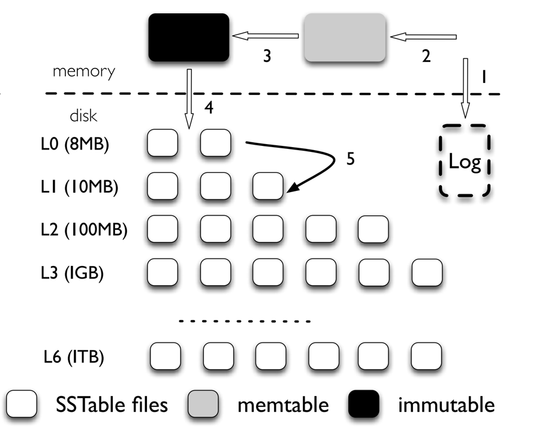

## Introduction

[LevelDB](https://github.com/google/leveldb) is a fast key-value storage library written at Google that provides an ordered mapping from string keys to string values.
LevelDB is a widely used key-value store based on [LSMtrees](/docs/CS/Algorithms/tree/LSM.md) that is inspired by [BigTable](/docs/CS/Distributed/Bigtable.md).
LevelDB supports range queries, snapshots, and other features that are useful in modern applications.

It is worth being explicit about what LevelDB is *not*, because most disappointment with it comes from expecting the other things: there is no SQL, no server process or wire protocol, no secondary index, no schema, no column families, and no replication. It is a library that owns a directory of files and one in-process writer. Anything beyond that — a network API, a Redis-compatible front end like [SSDB](/docs/CS/DB/SSDB.md) or [Pika](/docs/CS/DB/Pika.md), a replicated KV layer — is somebody else's project built on top of it.

**All symbol names, line numbers and defaults in this note are pinned to LevelDB 1.23** (tagged 2021-02, still the latest release). That pin matters for two reasons. First, 1.23 requires C++11 and moved large parts of the tree: the table reader and writer now live in `table/table.cc` and `table/table_builder.cc` rather than `db/table.cc`, and `db/internal_stats.{h,cc}` was deleted outright, so the SSTable properties block many blog posts describe no longer exists. Second, a great deal of LevelDB documentation on the web is really describing RocksDB, which forked this code and renamed or replaced most of its internals — `ColumnFamily`, `VersionStorageInfo`, `WriteController`, `SwitchMemtable`, recyclable WAL records, `DeleteObsoleteFiles` and `RibbonFilterPolicy` are all absent here. The comparison is drawn out explicitly in [Versions_and_Compaction](/docs/CS/DB/LevelDB/Versions_and_Compaction.md).

The shape of the code also explains where the depth of this note goes. LevelDB's geometry is deliberately frozen: seven levels, per-level byte budgets, the write-throttling thresholds, and the 2 KiB filter granularity are compile-time constants, not options. So the interesting questions are never "how do I tune it" but "what exactly happens on a write, a read, a flush, a compaction and a crash" — which is why the walkthrough below is organised by data structure and code path rather than by configuration.

## Architecture

The overall architecture of LevelDB is shown in Figure 1.

<div style="text-align: center;">



</div>

<p style="text-align: center;">
Fig.1. LevelDB architecture. 
<br>
For LevelDB, inserting a key-value pair goes through many steps: (1) the log file; (2) the memtable; (3) the immutable memtable; (4) a SSTable in L0; (5) compacted to further levels.
</p>

The main data structures in LevelDB are an ondisk log file, two in-memory sorted skiplists (memtable and immutable memtable), and seven levels (L0 to L6) of on-disk Sorted String Table (SSTable) files.
LevelDB initially stores inserted key-value pairs in a log file and the in-memory memtable. 
Once the memtable is full, LevelDB switches to a new memtable and log file to handle further inserts from the user.
In the background, the previous memtable is converted into an immutable memtable, and a compaction thread then flushes it to the disk, generating a new SSTable file (about 2 MB usually) at level 0 (L0); the previous log file is discarded.
The size of all files in each level is limited, and increases by a factor of ten with the level number.
For example, the size limit of all files at L1 is 10 MB, while the limit of L2 is 100 MB.
To maintain the size limit, once the total size of a level Li exceeds its limit, the compaction thread will choose one file from Li, merge
sort with all the overlapped files of Li+1, and generate new Li+1 SSTable files.
The compaction thread continues until all levels are within their size limits.
Also, during compaction, LevelDB ensures that all files in a particular level, except L0, do not overlap in their keyranges; keys in files of L0 can overlap with each other since they are directly flushed from memtable.

To serve a lookup operation, LevelDB searches the memtable first, immutable memtable next, and then files L0 to L6 in order.
The number of file searches required to locate a random key is bounded by the maximum number of levels, since keys do not overlap between files within a single level, except in L0.
Since files in L0 can contain overlapping keys, a lookup may search multiple files at L0.
To avoid a large lookup latency, LevelDB slows down the foreground write traffic if the number of files at L0 is bigger than eight, in order to wait for the compaction thread to compact some files from L0 to L1.

## Data Types

Keys and values are arbitrary byte arrays. The keys are ordered within the key value store according to a user-specified comparator function.

### Slice

```c
class LEVELDB_EXPORT Slice {
 public:
  // Create an empty slice.
  Slice() : data_(""), size_(0) {}

  // Create a slice that refers to d[0,n-1].
  Slice(const char* d, size_t n) : data_(d), size_(n) {}

  // Create a slice that refers to the contents of "s"
  Slice(const std::string& s) : data_(s.data()), size_(s.size()) {}

  // Create a slice that refers to s[0,strlen(s)-1]
  Slice(const char* s) : data_(s), size_(strlen(s)) {}

  // Intentionally copyable.
  Slice(const Slice&) = default;
  Slice& operator=(const Slice&) = default;

  // Return a pointer to the beginning of the referenced data
  const char* data() const { return data_; }

  // Return the length (in bytes) of the referenced data
  size_t size() const { return size_; }

  // Return true iff the length of the referenced data is zero
  bool empty() const { return size_ == 0; }

  // Return the ith byte in the referenced data.
  // REQUIRES: n < size()
  char operator[](size_t n) const {
    assert(n < size());
    return data_[n];
  }

  // Change this slice to refer to an empty array
  void clear() {
    data_ = "";
    size_ = 0;
  }

  // Drop the first "n" bytes from this slice.
  void remove_prefix(size_t n) {
    assert(n <= size());
    data_ += n;
    size_ -= n;
  }

  // Return a string that contains the copy of the referenced data.
  std::string ToString() const { return std::string(data_, size_); }

  // Three-way comparison.  Returns value:
  //   <  0 iff "*this" <  "b",
  //   == 0 iff "*this" == "b",
  //   >  0 iff "*this" >  "b"
  int compare(const Slice& b) const;

  // Return true iff "x" is a prefix of "*this"
  bool starts_with(const Slice& x) const {
    return ((size_ >= x.size_) && (memcmp(data_, x.data_, x.size_) == 0));
  }

 private:
  const char* data_;
  size_t size_;
};
```

Code

```c
  enum Code {
    kOk = 0,
    kNotFound = 1,
    kCorruption = 2,
    kNotSupported = 3,
    kInvalidArgument = 4,
    kIOError = 5
  };
```

### Comparator

A Comparator object provides a total order across slices that are used as keys in an sstable or a database.
A Comparator implementation must be thread-safe since leveldb may invoke its methods concurrently from multiple threads.

```c
class LEVELDB_EXPORT Comparator {
 public:
  virtual ~Comparator();

  // Three-way comparison.  Returns value:
  //   < 0 iff "a" < "b",
  //   == 0 iff "a" == "b",
  //   > 0 iff "a" > "b"
  virtual int Compare(const Slice& a, const Slice& b) const = 0;

  // The name of the comparator.  Used to check for comparator
  // mismatches (i.e., a DB created with one comparator is
  // accessed using a different comparator.
  //
  // The client of this package should switch to a new name whenever
  // the comparator implementation changes in a way that will cause
  // the relative ordering of any two keys to change.
  //
  // Names starting with "leveldb." are reserved and should not be used
  // by any clients of this package.
  virtual const char* Name() const = 0;

  // Advanced functions: these are used to reduce the space requirements
  // for internal data structures like index blocks.

  // If *start < limit, changes *start to a short string in [start,limit).
  // Simple comparator implementations may return with *start unchanged,
  // i.e., an implementation of this method that does nothing is correct.
  virtual void FindShortestSeparator(std::string* start,
                                     const Slice& limit) const = 0;

  // Changes *key to a short string >= *key.
  // Simple comparator implementations may return with *key unchanged,
  // i.e., an implementation of this method that does nothing is correct.
  virtual void FindShortSuccessor(std::string* key) const = 0;
};
```

### Iterator

```c

class LEVELDB_EXPORT Iterator {
 public:
  Iterator();

  Iterator(const Iterator&) = delete;
  Iterator& operator=(const Iterator&) = delete;

  virtual ~Iterator();

  // An iterator is either positioned at a key/value pair, or
  // not valid.  This method returns true iff the iterator is valid.
  virtual bool Valid() const = 0;

  // Position at the first key in the source.  The iterator is Valid()
  // after this call iff the source is not empty.
  virtual void SeekToFirst() = 0;

  // Position at the last key in the source.  The iterator is
  // Valid() after this call iff the source is not empty.
  virtual void SeekToLast() = 0;

  // Position at the first key in the source that is at or past target.
  // The iterator is Valid() after this call iff the source contains
  // an entry that comes at or past target.
  virtual void Seek(const Slice& target) = 0;

  // Moves to the next entry in the source.  After this call, Valid() is
  // true iff the iterator was not positioned at the last entry in the source.
  // REQUIRES: Valid()
  virtual void Next() = 0;

  // Moves to the previous entry in the source.  After this call, Valid() is
  // true iff the iterator was not positioned at the first entry in source.
  // REQUIRES: Valid()
  virtual void Prev() = 0;

  // Return the key for the current entry.  The underlying storage for
  // the returned slice is valid only until the next modification of
  // the iterator.
  // REQUIRES: Valid()
  virtual Slice key() const = 0;

  // Return the value for the current entry.  The underlying storage for
  // the returned slice is valid only until the next modification of
  // the iterator.
  // REQUIRES: Valid()
  virtual Slice value() const = 0;

  // If an error has occurred, return it.  Else return an ok status.
  virtual Status status() const = 0;

  // Clients are allowed to register function/arg1/arg2 triples that
  // will be invoked when this iterator is destroyed.
  //
  // Note that unlike all of the preceding methods, this method is
  // not abstract and therefore clients should not override it.
  using CleanupFunction = void (*)(void* arg1, void* arg2);
  void RegisterCleanup(CleanupFunction function, void* arg1, void* arg2);

 private:
  // Cleanup functions are stored in a single-linked list.
  // The list's head node is inlined in the iterator.
  struct CleanupNode {
    // True if the node is not used. Only head nodes might be unused.
    bool IsEmpty() const { return function == nullptr; }
    // Invokes the cleanup function.
    void Run() {
      assert(function != nullptr);
      (*function)(arg1, arg2);
    }

    // The head node is used if the function pointer is not null.
    CleanupFunction function;
    void* arg1;
    void* arg2;
    CleanupNode* next;
  };
  CleanupNode cleanup_head_;
};
```

### Status

You may have noticed the `leveldb::Status` type above. 
Values of this type are returned by most functions in leveldb that may encounter an error.
You can check if such a result is ok, and also print an associated error message:

```c++
leveldb::Status s = ...;
if (!s.ok()) cerr << s.ToString() << endl;
```


## Operations

### Open

A leveldb database has a name which corresponds to a file system directory. 
All of the contents of database are stored in this directory. 
The following example shows how to open a database, creating it if necessary:

```c++
#include <cassert>
#include "leveldb/db.h"

leveldb::DB* db;
leveldb::Options options;
options.create_if_missing = true;
leveldb::Status status = leveldb::DB::Open(options, "/tmp/testdb", &db);
assert(status.ok());
...
```

```cpp
// db_impl.cc
Status DB::Open(const Options& options, const std::string& dbname, DB** dbptr) {
  *dbptr = nullptr;

  DBImpl* impl = new DBImpl(options, dbname);
  impl->mutex_.Lock();
  VersionEdit edit;
  // Recover handles create_if_missing, error_if_exists
  bool save_manifest = false;
  Status s = impl->Recover(&edit, &save_manifest);
  if (s.ok() && impl->mem_ == nullptr) {
    // Create new log and a corresponding memtable.
    uint64_t new_log_number = impl->versions_->NewFileNumber();
    WritableFile* lfile;
    s = options.env->NewWritableFile(LogFileName(dbname, new_log_number),
                                     &lfile);
    if (s.ok()) {
      edit.SetLogNumber(new_log_number);
      impl->logfile_ = lfile;
      impl->logfile_number_ = new_log_number;
      impl->log_ = new log::Writer(lfile);
      impl->mem_ = new MemTable(impl->internal_comparator_);
      impl->mem_->Ref();
    }
  }
  if (s.ok() && save_manifest) {
    edit.SetPrevLogNumber(0);  // No older logs needed after recovery.
    edit.SetLogNumber(impl->logfile_number_);
    s = impl->versions_->LogAndApply(&edit, &impl->mutex_);
  }
  if (s.ok()) {
    impl->RemoveObsoleteFiles();
    impl->MaybeScheduleCompaction();
  }
  impl->mutex_.Unlock();
  if (s.ok()) {
    assert(impl->mem_ != nullptr);
    *dbptr = impl;
  } else {
    delete impl;
  }
  return s;
}
```

### Get

```cpp

Status DBImpl::Get(const ReadOptions& options, const Slice& key,
                   std::string* value) {
  Status s;
  MutexLock l(&mutex_);
  SequenceNumber snapshot;
  if (options.snapshot != nullptr) {
    snapshot =
        static_cast<const SnapshotImpl*>(options.snapshot)->sequence_number();
  } else {
    snapshot = versions_->LastSequence();
  }

  MemTable* mem = mem_;
  MemTable* imm = imm_;
  Version* current = versions_->current();
  mem->Ref();
  if (imm != nullptr) imm->Ref();
  current->Ref();

  bool have_stat_update = false;
  Version::GetStats stats;

  // Unlock while reading from files and memtables
  {
    mutex_.Unlock();
    // First look in the memtable, then in the immutable memtable (if any).
    LookupKey lkey(key, snapshot);
    if (mem->Get(lkey, value, &s)) {
      // Done
    } else if (imm != nullptr && imm->Get(lkey, value, &s)) {
      // Done
    } else {
      s = current->Get(options, lkey, value, &stats);
      have_stat_update = true;
    }
    mutex_.Lock();
  }

  if (have_stat_update && current->UpdateStats(stats)) {
    MaybeScheduleCompaction();
  }
  mem->Unref();
  if (imm != nullptr) imm->Unref();
  current->Unref();
  return s;
}
```

> [!Note]
>
> Ref() Unref()

### Put

```cpp
Status DB::Put(const WriteOptions& opt, const Slice& key, const Slice& value) {
  WriteBatch batch;
  batch.Put(key, value);
  return Write(opt, &batch);
}

void WriteBatch::Put(const Slice& key, const Slice& value) {
  WriteBatchInternal::SetCount(this, WriteBatchInternal::Count(this) + 1);
  rep_.push_back(static_cast<char>(kTypeValue));
  PutLengthPrefixedSlice(&rep_, key);
  PutLengthPrefixedSlice(&rep_, value);
}

void PutLengthPrefixedSlice(std::string* dst, const Slice& value) {
  PutVarint32(dst, value.size());
  dst->append(value.data(), value.size());
}


```

#### write

```cpp
Status DBImpl::Write(const WriteOptions& options, WriteBatch* updates) {
  Writer w(&mutex_);
  w.batch = updates;
  w.sync = options.sync;
  w.done = false;

  MutexLock l(&mutex_);
  writers_.push_back(&w);
  while (!w.done && &w != writers_.front()) {
    w.cv.Wait();
  }
  if (w.done) {
    return w.status;
  }

  // May temporarily unlock and wait.
  Status status = MakeRoomForWrite(updates == nullptr);
  uint64_t last_sequence = versions_->LastSequence();
  Writer* last_writer = &w;
  if (status.ok() && updates != nullptr) {  // nullptr batch is for compactions
    WriteBatch* write_batch = BuildBatchGroup(&last_writer);
    WriteBatchInternal::SetSequence(write_batch, last_sequence + 1);
    last_sequence += WriteBatchInternal::Count(write_batch);

    // Add to log and apply to memtable.  We can release the lock
    // during this phase since &w is currently responsible for logging
    // and protects against concurrent loggers and concurrent writes
    // into mem_.
    {
      mutex_.Unlock();
      status = log_->AddRecord(WriteBatchInternal::Contents(write_batch));
      bool sync_error = false;
      if (status.ok() && options.sync) {
        status = logfile_->Sync();
        if (!status.ok()) {
          sync_error = true;
        }
      }
      if (status.ok()) {
        status = WriteBatchInternal::InsertInto(write_batch, mem_);
      }
      mutex_.Lock();
      if (sync_error) {
        // The state of the log file is indeterminate: the log record we
        // just added may or may not show up when the DB is re-opened.
        // So we force the DB into a mode where all future writes fail.
        RecordBackgroundError(status);
      }
    }
    if (write_batch == tmp_batch_) tmp_batch_->Clear();

    versions_->SetLastSequence(last_sequence);
  }

  while (true) {
    Writer* ready = writers_.front();
    writers_.pop_front();
    if (ready != &w) {
      ready->status = status;
      ready->done = true;
      ready->cv.Signal();
    }
    if (ready == last_writer) break;
  }

  // Notify new head of write queue
  if (!writers_.empty()) {
    writers_.front()->cv.Signal();
  }

  return status;
}
```

### Delete

```c
Status DB::Delete(const WriteOptions& opt, const Slice& key) {
  WriteBatch batch;
  batch.Delete(key);
  return Write(opt, &batch);
}

void WriteBatch::Delete(const Slice& key) {
  WriteBatchInternal::SetCount(this, WriteBatchInternal::Count(this) + 1);
  rep_.push_back(static_cast<char>(kTypeDeletion));
  PutLengthPrefixedSlice(&rep_, key);
}

void PutLengthPrefixedSlice(std::string* dst, const Slice& value) {
  PutVarint32(dst, value.size());
  dst->append(value.data(), value.size());
}

basic_string&
append(const _CharT* __s, size_type __n) {
  __glibcxx_requires_string_len(__s, __n);
  _M_check_length(size_type(0), __n, "basic_string::append");
  return _M_append(__s, __n);
}
```

### File

RandomAccessFile

SequentialFile

WritableFile

## Cache

The contents of the database are stored in a set of files in the filesystem and each file stores a sequence of compressed blocks.
If options.block_cache is non-NULL, it is used to cache frequently used uncompressed block contents.

```c++
#include "leveldb/cache.h"

leveldb::Options options;
options.block_cache = leveldb::NewLRUCache(100 * 1048576);  // 100MB cache
leveldb::DB* db;
leveldb::DB::Open(options, name, &db);
... use the db ...
delete db
delete options.block_cache;
```

Note that the cache holds uncompressed data, and therefore it should be sized according to application level data sizes, without any reduction from compression.
(Caching of compressed blocks is left to the operating system buffer cache, or any custom Env implementation provided by the client.)

When performing a bulk read, the application may wish to disable caching so that the data processed by the bulk read does not end up displacing most of the cached contents.
A per-iterator option can be used to achieve this:

```c++
leveldb::ReadOptions options;
options.fill_cache = false;
leveldb::Iterator* it = db->NewIterator(options);
for (it->SeekToFirst(); it->Valid(); it->Next()) {
  ...
}
delete it;
```

### Table Cache

LevelDB keeps **two distinct caches**, and conflating them is a common source of confusion. The one above is the *block* cache (uncompressed 4 KiB data blocks, `options.block_cache`, defaulting to a shared 8 MB LRU created in `DBImpl` when the field is left null — `db_impl.cc:115-117`, `options.h:94`). The second is the *table* cache in `db/table_cache.{h,cc}`, which holds opened `Table` objects — i.e. the parsed index, the filter block and the file handle.

Its key is an 8-byte fixed64 **file number** (`table_cache.cc:44-46`) and each entry has charge 1 (`:72`), so capacity is measured in open tables rather than bytes:

```
TableCacheSize = max_open_files - kNumNonTableCacheFiles      // kNumNonTableCacheFiles = 10
                                                              // db_impl.cc:40, :123
```

`max_open_files` defaults to 1000 (`options.h:87`) and is first clamped into `[74, 50000]` (`db_impl.cc:101`) — 74 exists precisely so that after subtracting the 10 non-table files there is still a usable cache.

A few behaviours are worth knowing when tuning or reading logs:

- `FindTable` misses try the current name `TableFileName` (`*.ldb`) and fall back to the legacy `SSTTableFileName` (`*.sst`) for databases created by old versions (`table_cache.cc:53-67`).
- If `Table::Open` fails, the file is deleted and **the failure is not cached** — every subsequent access will retry and re-fail.
- Eviction is LRU-driven (`DeleteEntry` runs when the entry is erased), plus an explicit `Evict(file_number)` used by `RemoveObsoleteFiles` before deleting a live table (`db_impl.cc:276`).
- Lifetime during iteration is handled by `Iterator::RegisterCleanup(&UnrefEntry, cache_, handle)` (`table_cache.cc:93`): `NewIterator` deliberately does *not* release the handle, whereas `Get` releases synchronously (`:109`). This is what keeps a `Table` alive while a merging iterator still points into it.
- `fill_cache` is not consulted in `table_cache`; it is honoured deeper down, in `Table::BlockReader`, which only inserts when `contents.cachable && options.fill_cache` (`table.cc:180`). Compaction reads set `fill_cache = false`, which is why a large compaction does not flush the block cache.

## Write-Ahead Log

The WAL is written by `db/log_writer.cc` and replayed by `db/log_reader.cc`; both share the record framing defined in `db/log_format.h`.

Physical layout: the file is a sequence of 32 KiB blocks (`kBlockSize = 32768`, `log_format.h:27`), each block a run of records. A record header is **7 bytes** — 4-byte masked CRC + 2-byte length + 1-byte type (`kHeaderSize = 4 + 2 + 1`, `:29-30`) — followed by the payload. Record types are `kZeroType = 0` (reserved for preallocated files), `kFullType = 1`, `kFirstType = 2`, `kMiddleType = 3`, `kLastType = 4` (`:16-25`). There is **no recyclable record type in LevelDB** — `kRecyclable*` and `kHighBitType` are RocksDB inventions.

`Writer::AddRecord` (`log_writer.cc:34-80`) fragments in a do/while loop. When fewer than `kHeaderSize` bytes remain in the current block it pads the tail with zeros and starts the next block (`:46-53`); the fragment length is `min(left, kBlockSize - block_offset_ - kHeaderSize)` (`:59-60`), and the type is chosen from whether the fragment is the whole record, the first, a middle, or the last (`:62-72`). An empty value still emits one `kFullType` record.

Two details of `EmitPhysicalRecord` (`:82-108`) matter when writing a parser or a recovery tool:

- the length field is a **plain little-endian 16-bit integer**, not a varint (`buf[4] = length & 0xff; buf[5] = length >> 8`, with `assert(length <= 0xffff)`), which caps a fragment at 64 KiB;
- the CRC covers **the type byte plus the payload, but not the length field**: `crc32c::Extend(type_crc_[t], ptr, length)` where `type_crc_` holds pre-computed single-byte CRCs (`:94`, `:16-21`).

The stored CRC is masked — `kMaskDelta = 0xa282ead8ul`, and `Mask()` **rotates right 15 bits then adds** the constant (`util/crc32c.h:22-32`, not an XOR). The header comment explains why: computing a CRC over a string that already embeds its own CRC is awkward, so the value is obfuscated before it hits disk.

Note also that `log::Writer` has **no `Sync()` method**: `AddRecord` ends with `Flush()` on every record, pushing bytes into the page cache (`:99-105`). The real `fsync` happens one level up, in `DBImpl::Write`, only when `WriteOptions::sync` is set (`db_impl.cc:1233`). A second constructor `Writer(dest, dest_length)` initialises `block_offset_ = dest_length % kBlockSize` (`:27-30`) so that a reused log file can be appended to correctly.

`Reader::ReadRecord` keeps its fragmentation state in **local variables**, not members: the reader holds only `file_ / reporter_ / checksum_ / backing_store_ / buffer_ / eof_ / last_record_offset_ / end_of_buffer_offset_ / initial_offset_ / resyncing_`. There is no `Kill()` and no `ReportBadRecord()`; the `checksum` constructor argument has **no default value**, and the recovery path hard-codes `true` (`db_impl.cc:422`). Handling of the awkward edges:

- fewer than `kHeaderSize` bytes left in a block: if the file is not exhausted, the buffer is simply dropped and the next whole block is read; if it *is* exhausted, the truncated header is treated as `kEof` rather than corruption (`log_reader.cc:191-214`, `:206-212`);
- a declared length that runs past the block end mid-file → `ReportCorruption("bad record length")`; at EOF → `kEof` (`:222-233`);
- `kZeroType` with zero length → returns `kBadRecord` **without reporting a drop**, since it marks preallocated space (`:235-241`);
- CRC mismatch (only when `checksum_`) → the buffer is discarded and `ReportCorruption("checksum mismatch")` is raised (`:244-257`).

### Recovery: `RecoverLogFile`

`DBImpl::RecoverLogFile` (`db_impl.cc:385-503`) replays one log file: `reader.ReadRecord(&record, &scratch)` in a loop, `record.size() < 12` is rejected as "log record too small" (12 = the 8-byte sequence + 4-byte count header of a `WriteBatch`), each surviving record becomes a `WriteBatch` lazily inserted into a memtable, and `max_sequence` is tracked as `Sequence(batch) + Count(batch) - 1`. When the memtable exceeds `write_buffer_size` it is flushed to L0 and `*save_manifest` is set.

Crucially, **LevelDB does not deduplicate replays by comparing batch pointers** — there is no `prev` pointer, no `record_to_sequence` map, no `found_final_batch` flag (all of those are RocksDB). Idempotence comes from the collection step in `DBImpl::Recover`: only log files with `number >= versions_->LogNumber()` (or `== PrevLogNumber()`) are gathered, they are replayed **in ascending file-number order**, and the read path resolves duplicates by sequence number. A log whose contents already reached an SSTable has a file number below `LogNumber()`, so it is never replayed at all.

`paranoid_checks` does not reach the reader: the checksum is always verified, so a torn tail of an uncommitted batch is skipped regardless; `paranoid_checks` only decides whether the resulting error is surfaced (`status` set → `DB::Open` fails) or swallowed by `MaybeIgnoreError` and logged as "(ignoring error)" (`:393-398`, `:216-224`).

### Rotation and reuse

`MakeRoomForWrite` rotates the log together with the memtable (`:1360-1382`): take a new file number, `NewWritableFile` (on failure, `ReuseFileNumber` so the number is not burned), `delete log_; delete logfile_;`, then install the new `log::Writer`, set `imm_ = mem_` and create a fresh memtable. The old WAL becomes deletable once every memtable it covers has reached L0 — `RemoveObsoleteFiles` keeps a log iff `number >= LogNumber() || number == PrevLogNumber()` (`:246-250`).

`options.reuse_logs` (present in 1.23, default `false`, marked EXPERIMENTAL, `include/leveldb/options.h:132-137`) lets recovery append to the last WAL instead of starting a new one, but only when the file was fully replayed and nothing was flushed during recovery (`compactions == 0`, `db_impl.cc:472`).

## MemTable

### add MemTable

```cpp

void MemTable::Add(SequenceNumber s, ValueType type, const Slice& key,
                   const Slice& value) {
  // Format of an entry is concatenation of:
  //  key_size     : varint32 of internal_key.size()
  //  key bytes    : char[internal_key.size()]
  //  tag          : uint64((sequence << 8) | type)
  //  value_size   : varint32 of value.size()
  //  value bytes  : char[value.size()]
  size_t key_size = key.size();
  size_t val_size = value.size();
  size_t internal_key_size = key_size + 8;
  const size_t encoded_len = VarintLength(internal_key_size) +
                             internal_key_size + VarintLength(val_size) +
                             val_size;
  char* buf = arena_.Allocate(encoded_len);
  char* p = EncodeVarint32(buf, internal_key_size);
  std::memcpy(p, key.data(), key_size);
  p += key_size;
  EncodeFixed64(p, (s << 8) | type);
  p += 8;
  p = EncodeVarint32(p, val_size);
  std::memcpy(p, value.data(), val_size);
  assert(p + val_size == buf + encoded_len);
  table_.Insert(buf);
}
```

### get MemTable

```c
bool MemTable::Get(const LookupKey& key, std::string* value, Status* s) {
  Slice memkey = key.memtable_key();
  Table::Iterator iter(&table_);
  iter.Seek(memkey.data());
  if (iter.Valid()) {
    // entry format is:
    //    klength  varint32
    //    userkey  char[klength]
    //    tag      uint64
    //    vlength  varint32
    //    value    char[vlength]
    // Check that it belongs to same user key.  We do not check the
    // sequence number since the Seek() call above should have skipped
    // all entries with overly large sequence numbers.
    const char* entry = iter.key();
    uint32_t key_length;
    const char* key_ptr = GetVarint32Ptr(entry, entry + 5, &key_length);
    if (comparator_.comparator.user_comparator()->Compare(
            Slice(key_ptr, key_length - 8), key.user_key()) == 0) {
      // Correct user key
      const uint64_t tag = DecodeFixed64(key_ptr + key_length - 8);
      switch (static_cast<ValueType>(tag & 0xff)) {
        case kTypeValue: {
          Slice v = GetLengthPrefixedSlice(key_ptr + key_length);
          value->assign(v.data(), v.size());
          return true;
        }
        case kTypeDeletion:
          *s = Status::NotFound(Slice());
          return true;
      }
    }
  }
  return false;
}
```

### SkipList

MaxHeight = 12

Random() % 4 = 0


| Height | Probability         |
| -------- | --------------------- |
| 1      | $3/4$               |
| 2      | $3/4 * 1/4$         |
| 3      | $3/4 * (1/4)^(4-2)$ |
| n      | $3/4 * (1/4)^(n-2)$ |

```cpp
enum { kMaxHeight = 12 };


template <typename Key, class Comparator>
int SkipList<Key, Comparator>::RandomHeight() {
  // Increase height with probability 1 in kBranching
  static const unsigned int kBranching = 4;
  int height = 1;
  while (height < kMaxHeight && rnd_.OneIn(kBranching)) {
    height++;
  }
  return height;
}
```

### Seek

## SSTable

### File Layout

The read/write implementation moved in 1.23: `table/table.cc` and `include/leveldb/table.h` hold the reader, `table/table_builder.cc` and `include/leveldb/table_builder.h` hold the writer, and `table/format.{h,cc}`, `table/block.{h,cc}`, `table/block_builder.{h,cc}`, `table/filter_block.{h,cc}` carry the layout. Anything citing `db/table.cc` describes an older tree.

A finished table is laid out as (`TableBuilder::Finish`, `table/table_builder.cc:198-252`):

```
data block 0
data block 1
...
filter block                       (if a filter_policy was configured)
metaindex block                  (key "filter.<policy name>" -> BlockHandle of filter block)
index block                    (one entry per data block: smallest key of that block -> BlockHandle)
padding to 40 bytes
footer                        (2 * BlockHandle::kMaxEncodedLength + 8 = 48 bytes)
```

`BlockHandle::kMaxEncodedLength = 10 + 10`（`table/format.h:26`，两个 varint64 的最坏情况各 10 字节），于是 `Footer::kEncodedLength = 2 * kMaxEncodedLength + 8 = 48`（`:53`）。注释强调 footer 的序列化**恒定占满这 48 字节**：两个 handle 的真实编码先补零到 40 字节，再接 8 字节 magic。`Footer::DecodeFrom` 校验的第一件事就是这个 magic——`kTableMagicNumber = 0xdb4775248b80fb57ull`（`:76`），不符即报 "not an sstable"（`format.cc:42-62`）；`Table::Open` 还要求文件不小于 48 字节（`table.cc:41`）。1.23 里**没有 properties block，metaindex 也不携带统计信息**，源码仍留着 `// TODO(postrelease): Add stats and other meta blocks`（`table_builder.cc:224`）。

一个 `BlockHandle` 只是两个 varint64（`offset`、`size`），所以索引条目本身很便宜；filter block 靠名字定位——`"filter." + filter_policy->Name()`（`table.cc:101-105`），内置策略的名字是 `leveldb.BuiltinBloomFilter2`（`util/bloom.cc:26`）。

### Block Format

Inside a block, entries are delta-encoded: `shared_length`, `non_shared_length`, `value_length` (three varint32) followed by the key suffix and the value (`table/block_builder.cc:16-22`). `Block::Iter::DecodeEntry` has a three-byte fast path for the common small case (`block.cc:55-75`), and `ParseNextKey` (`:250-277`) rebuilds the current key by prefixing `shared` bytes of the previous key.

The block ends with a restart section — `restarts: uint32[num_restarts]`, then `num_restarts: uint32` (`block_builder.cc:24-27`) — which lists the buffer offsets where the prefix encoding restarts from scratch. `Block::Iter::Seek` binary-searches that array and then scans linearly within the chosen interval; 1.23 also narrows the upper bound using the already-known `restart_index_` (`:164-227`). The `restart_offset_` is derived in the constructor as `size_ - (1 + NumRestarts()) * 4` (`block.cc:25-40`).

Restart intervals are chosen per block kind: data blocks use `Options::block_restart_interval` (default **16**, `options.h:105`) while the **index block is built with `block_restart_interval = 1`** (`table_builder.cc:35`), because index entries are seeked individually and must each be decodable without a neighbour. `BlockBuilder` itself has just a `counter_`: in `Add`, if `counter_ < block_restart_interval` it computes the shared prefix, otherwise it pushes `buffer_.size()` as a new restart point and resets the counter (`block_builder.cc:77-88`). There is **no `ShouldRestart`/`RestartBlock`/`EmitRestartPoint` and no `block_size_` member** in LevelDB — those are RocksDB names. Block splitting is decided by `TableBuilder` comparing `CurrentSizeEstimate() >= options.block_size` (default **4 KiB**, `options.h:100`) at `table_builder.cc:119-122`.

### WriteLevel0Table

`DBImpl::WriteLevel0Table(MemTable* mem, VersionEdit* edit, Version* base)` (`db_impl.cc:505-547`) is where an in-memory table becomes an on-disk one. Its shape: `base->Ref()` (so the newly built file's metadata cannot be GC'd mid-flight), take a fresh file number, register it in `pending_outputs_`, build the table, erase from `pending_outputs_`, then record `{file_size, smallest, largest}` into the passed-in `VersionEdit` as a `kNewFile` and add it to `edit`'s in-memory file collection.

It is called from three places, which is the whole story of "when does data reach disk": the foreground `MakeRoomForWrite` path (via `CompactMemTable`, `:557`), the recovery path (`RecoverLogFile`, whenever replayed data exceeds `write_buffer_size`), and the manual `TEST_CompactMemTable`. The actual byte-writing is `BuildTable` (`table/builder.cc`):

```cpp

Status BuildTable(const std::string& dbname, Env* env, const Options& options,
                  TableCache* table_cache, Iterator* iter, FileMetaData* meta) {
  Status s;
  meta->file_size = 0;
  iter->SeekToFirst();

  std::string fname = TableFileName(dbname, meta->number);
  if (iter->Valid()) {
    WritableFile* file;
    s = env->NewWritableFile(fname, &file);
    if (!s.ok()) {
      return s;
    }

    TableBuilder* builder = new TableBuilder(options, file);
    meta->smallest.DecodeFrom(iter->key());
    Slice key;
    for (; iter->Valid(); iter->Next()) {
      key = iter->key();
      builder->Add(key, iter->value());
    }
    if (!key.empty()) {
      meta->largest.DecodeFrom(key);
    }

    // Finish and check for builder errors
    s = builder->Finish();
    if (s.ok()) {
      meta->file_size = builder->FileSize();
      assert(meta->file_size > 0);
    }
    delete builder;

    // Finish and check for file errors
    if (s.ok()) {
      s = file->Sync();
    }
    if (s.ok()) {
      s = file->Close();
    }
    delete file;
    file = nullptr;

    if (s.ok()) {
      // Verify that the table is usable
      Iterator* it = table_cache->NewIterator(ReadOptions(), meta->number,
                                              meta->file_size);
      s = it->status();
      delete it;
    }
  }

  // Check for input iterator errors
  if (!iter->status().ok()) {
    s = iter->status();
  }

  if (s.ok() && meta->file_size > 0) {
    // Keep it
  } else {
    env->RemoveFile(fname);
  }
  return s;
}
```

### FilterPolicy

The `filter." + policy->Name()` block in an SSTable is produced by `table/filter_block.{h,cc}`, which is a *local* (per-region) filter layout — and its granularity is not what most descriptions claim.

**A filter covers a 2 KiB span of file offsets, not one data block.** `kFilterBaseLg = 11` (`table/filter_block.cc:15-16`), so `FilterBlockBuilder::StartBlock(block_offset)` pads in empty filters until it reaches `block_offset >> 11` (`:21-27`). Because `Options::block_size` defaults to 4 KiB, a single filter typically covers two data blocks — but the mapping is by byte offset, so a large block simply spans several buckets. `Finish` appends the accumulated bitmaps, then a `uint32` offset array, the array's own offset, and one final byte holding `base_lg` (`:35-49`).

On the read side, `FilterBlockReader` keeps only `data_ / offset_ / num_ / base_lg_` (there are **no `alloced_`/`cache_allocated_` members**; `Table::Rep` frees `filter_data` manually, `table.cc:32, 128-130`). If the block is shorter than 5 bytes the reader gives up (`n < 5`). `KeyMayMatch(block_offset, key)` computes `index = block_offset >> base_lg_`, and **returns `true` — i.e. "maybe present" — for any malformed or out-of-range case** (`:90-104`), so a broken filter degrades into a full read rather than a false negative.

Two things worth pinning down, since they are frequently misquoted:

- **`bits_per_key` has no default in LevelDB.** `NewBloomFilterPolicy(int bits_per_key)` takes a required argument (`include/leveldb/filter_policy.h:68`); the "10" seen in tutorials comes from comments and tests, not from a default. Inside `util/bloom.cc` the number of hashes is `k_ = bits_per_key * 0.69` clamped to `[1, 30]` (`:21-23`), and the bitmap size is rounded up to a whole byte (`(bits + 7) / 8`, `:36-37`).
- There is **no `kFilterBlockPrefix` constant** (the key is just the literal `"filter."`), and **no `FullFilterBitsBuilder`, `FastLocalFilterBitsBuilder` or `RibbonFilterPolicy`** — a whole-file filter and a ribbon filter are RocksDB features with no LevelDB equivalent. The math behind the false-positive curve lives in [BloomFilter](/docs/CS/DB/LevelDB/BloomFilter.md); this section is only about how the bits get stored and consulted.

## Compression

`Options::CompressionType` has exactly two values — `kNoCompression = 0x0` and `kSnappyCompression = 0x1` (`include/leveldb/options.h:28-29`) — and the default is `kSnappyCompression` (`:131`).

Snappy is optional at build time, gated by `#if HAVE_SNAPPY` (`port/port_stdcxx.h:86-126`; note it is a defined-0-or-1 macro, not `#ifdef SNAPPY`). The degradation path is on the **write** side: `TableBuilder::WriteBlock` calls `Snappy_Compress`, and when that reports unavailable it stores the block raw and rewrites the type byte to `kNoCompression` (`table/table_builder.cc:160-168`). There is no `have_snappy_` member on `Table`. Reading is the opposite — a reader built without snappy that meets a compressed block reports Corruption rather than quietly falling back, so a binary that reads an existing database must be built with the same compression support that wrote it.

A block is only stored compressed if it actually pays: the threshold is `compressed < raw - raw / 8`, i.e. it must save at least 12.5 % (`:161`).

Which blocks get compressed is worth memorising precisely, because it is asymmetric:

- **data blocks** — compressed, via `WriteBlock`;
- **index block and metaindex block** — also compressed, they go through the same `WriteBlock` path (`:225`, `:237`);
- **filter block** — written with `WriteRawBlock(..., kNoCompression, ...)`, deliberately never compressed (`:208`), because it is consulted on nearly every point lookup and decompressing it would defeat its purpose.

Each block on disk ends with a 5-byte trailer (`kBlockTrailerSize = 5`, `table/format.h:79`): 1 byte compression type + 4 bytes masked CRC. The type byte is read in `ReadBlock` (`table/format.cc:97-136`), which switches on it and reports "bad block type" for anything else. Note that in 1.23 the older `Block::InitData` helper no longer exists — CRC verification was folded into the `Block` constructor (`table/block.cc:25-40`).

Compaction of the LSM (which blocks get rewritten, and therefore re-compressed) is covered in [Versions_and_Compaction](/docs/CS/DB/LevelDB/Versions_and_Compaction.md); the entry points formerly listed here, `BackgroundCompaction` and `DoCompactionWork`, live in `db/db_impl.cc`.

## Links

- [DataBases](/docs/CS/DB/DB.md?id=leveldb)
- [Versions and Compaction](/docs/CS/DB/LevelDB/Versions_and_Compaction.md)
- [Bloom Filter](/docs/CS/DB/LevelDB/BloomFilter.md)
- [RocksDB](/docs/CS/DB/RocksDB/RocksDB.md)
- [RocksDB Compaction](/docs/CS/DB/RocksDB/Compaction.md)
- [LSM-Tree](/docs/CS/Algorithms/tree/LSM.md)

## References

1. []
