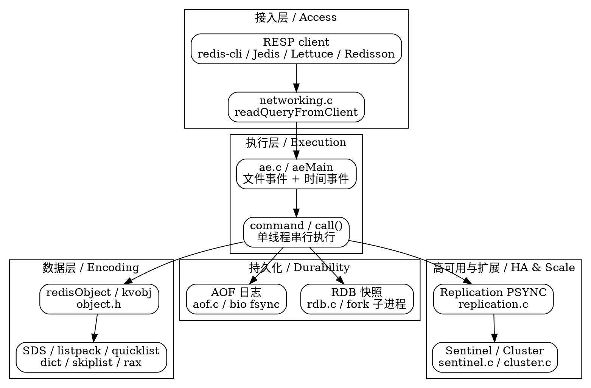

# Redis Index

## Introduction

[Redis](https://redis.io)（Remote Dictionary Server）是**内存数据结构服务器**：通过 TCP 上的 RESP 协议对外暴露命令，让多个进程共享地读写同一批可变数据结构；内置复制、Lua 脚本、LRU 淘汰、事务与不同级别的落盘持久化，并用 Sentinel 提供高可用、Cluster 提供自动分片。

> 版本基线：Redis 8.10.2（commit 498ecd0d，2026-09-17）。本目录所有默认值、命令可用性与源码片段均以此为准；遇到冲突的旧口径，一律以枢纽 [Redis](/docs/CS/DB/Redis/Redis.md) 的 `## Version Baseline` 章为准。

建议按「问题层次」顺序阅读：**执行模型**（为什么快、事件循环与线程边界）→ **编码与持久化**（数据怎么放、怎么落盘）→ **检索与扩展**（怎么查内容、怎么改行为）→ **原子性与一致性**（成组命令与缓存对齐）→ **复制与分片**（扩得开、挂不掉）→ **客户端与替代**（怎么接、什么时候不用它）。想按源码推进顺序读，可直接走 [start](/docs/CS/DB/Redis/start.md) → [server](/docs/CS/DB/Redis/server.md) → [ae](/docs/CS/DB/Redis/ae.md) → [struct 总纲](/docs/CS/DB/Redis/struct/struct.md) → [persist](/docs/CS/DB/Redis/persist.md) → [cluster](/docs/CS/DB/Redis/cluster.md)。

## Hub

- [Redis](/docs/CS/DB/Redis/Redis.md)：枢纽总览——8.10.2 版本基线（支持矩阵、许可时间线、8.x 能力节点、易错默认值）、架构分层源码图、`## Knowledge Map` 六组导航，以及调优、慢日志、客户端缓存等运维面。

## Core Mechanisms

- [start](/docs/CS/DB/Redis/start.md)：启动链路 `initServerConfig` → `initServer` → `aeMain` → 命令执行 → 关闭，含随机数播种与 OOM handler 安装。
- [server](/docs/CS/DB/Redis/server.md)：`redisServer` 全局结构拆解——客户端、进程、缓存与监控子系统。
- [ae](/docs/CS/DB/Redis/ae.md)：事件循环本体——文件事件、时间事件、`epoll` 边缘触发与 beforeSleep / afterSleep 钩子。
- [io](/docs/CS/DB/Redis/io.md)：`bio.c` 后台线程与 `lazyfree.c` 异步释放（UNLINK / FLUSH ASYNC），脏活外移的落点。
- [memory](/docs/CS/DB/Redis/memory.md)：内存上限与 10 种淘汰策略；LRU 读写都更新时间戳、LFU 拆频次与时间、LRM 只在写时更新。
- [persist](/docs/CS/DB/Redis/persist.md)：RDB 快照、AOF 日志与混合持久化（multi-part AOF）的取舍及触发条件。
- [redisDb](/docs/CS/DB/Redis/redisDb.md)：key/value 容器抽象与 get/set/delete 三条路径，含 `redisObject` / `kvobj` 与 `slotToKey*`。
- [command](/docs/CS/DB/Redis/command.md)：命令定义方式、`addReply` 回复约定，以及作为 cluster 路由前提的 key 声明。
- [Concurrency](/docs/CS/DB/Redis/Concurrency.md)：子进程 + 主线程 + bio 线程 + IO 线程的全景辨析，纠正 `BIO_WORKER_NUM` 与 `BIO_NUM_OPS` 的混淆。
- [Transaction](/docs/CS/DB/Redis/Transaction.md)：`MULTI` / `EXEC` / `DISCARD` / `WATCH`，以及「伪事务、没有回滚」的坑。
- [Lua](/docs/CS/DB/Redis/Lua.md)：服务端内编程、`EVAL` 的 CPU 与内存代价，以及自带 debugger。

## Replication and Clustering

- [Replication](/docs/CS/DB/Redis/Replication.md)：PSYNC、部分重同步（backlog / runid / offset）与过期键在主从间的传递。
- [sentinel](/docs/CS/DB/Redis/sentinel.md)：监控、主观与客观下线、选主与 failover 流程。
- [cluster](/docs/CS/DB/Redis/cluster.md)：Gossip、16384 slot 表语义、全有全无覆盖约束、failover 与 cron 任务。
- [MQ](/docs/CS/DB/Redis/MQ.md)：把 Redis 当队列用的语义边界（消费组、ack、重投）；本库口径是 Redis 归 DB，MQ 侧只做对照。
- [PubSub](/docs/CS/DB/Redis/PubSub.md)：按 channel 的订阅匹配、模式订阅，以及「可能丢消息」的适用边界。
- [Lock](/docs/CS/DB/Redis/Lock.md)：跨进程分布式锁的实现方案、看门狗续期与失效、误删场景。

## Data Structures

- [struct 总纲](/docs/CS/DB/Redis/struct/struct.md)：key/object 编码体系与各类型编码选择和转换规则的总入口。
- [SDS](/docs/CS/DB/Redis/struct/SDS.md)：动态字符串，二进制安全的字符串与整数对象底层表示。
- [list](/docs/CS/DB/Redis/struct/list.md)：列表类型的对外语义与底层 quicklist 编码。
- [quicklist](/docs/CS/DB/Redis/struct/quicklist.md)：双向链表加 listpack 分段的混合结构，list 的实际编码。
- [hash](/docs/CS/DB/Redis/struct/hash.md)：哈希类型，8.10 compact hash（共享 schema）后的编码选择。
- [intset](/docs/CS/DB/Redis/struct/intset.md)：整数集合，set 在小整数场景的紧凑编码。
- [set](/docs/CS/DB/Redis/struct/set.md)：集合类型与 intset / dict 两种编码的切换条件。
- [zset](/docs/CS/DB/Redis/struct/zset.md)：有序集合，dict 加 skiplist 双索引实现。
- [skiplist](/docs/CS/DB/Redis/struct/skiplist.MD)：跳表——zset 按 score 排序与范围查询的底层结构。
- [ziplist](/docs/CS/DB/Redis/struct/ziplist.md)：已退役的紧凑连续内存结构，枚举项标注 *No longer used*。
- [listpack](/docs/CS/DB/Redis/struct/listpack.md)：ziplist 的替代者，hash / list / zset 小对象的新紧凑编码。
- [Stream](/docs/CS/DB/Redis/struct/Stream.md)：消息型结构，消费组、消息 ID 与 XREAD 家族命令。
- [bitmap](/docs/CS/DB/Redis/struct/bitmap.md)：位级结构，基于 String 的位操作与基数统计场景。
- [HyperLogLog](/docs/CS/DB/Redis/struct/HyperLogLog.md)：概率基数估计，固定内存换近似去重计数。
- [BloomFilter](/docs/CS/DB/Redis/struct/BloomFilter.md)：概率集合，8.0 起随 Query Engine 内建，用于存在性判断与缓存穿透防护。
- [geo](/docs/CS/DB/Redis/struct/geo.md)：地理位置，直接用 zset（score 编码经纬度）实现。

## Ecosystem and Operations

- [Cache](/docs/CS/DB/Redis/Cache.md)：雪崩、穿透、击穿的成因与对策，以及 Cache Aside / Read-Through / Write-Through / Write-Behind 四种更新模式。
- [Jedis](/docs/CS/DB/Redis/Jedis.md)：基于 commons-pool2 的阻塞直连客户端，连接池配置、预热与「池耗尽」排查。
- [Lettuce](/docs/CS/DB/Redis/Lettuce.md)：基于 Netty 的线程安全客户端，sync / async / reactive 三套 API 与集群拓扑刷新。
- [Redisson](/docs/CS/DB/Redis/Redisson.md)：高层分布式对象封装，尤其是多种锁类型与看门狗续期。
- [RediSearch](/docs/CS/DB/Redis/RediSearch.md)：查询与索引引擎——8.0 起作为 Query Engine 内建，提供全文搜索、二级索引与向量检索；独立 module 的编译加载步骤仅适用于 7.x 等场景。
- [benchmark](/docs/CS/DB/Redis/benchmark.md)：`redis-benchmark` 默认值与易踩选项辨析，pipeline 深度对吞吐的定性影响（数字不可当性能指标）。
- [module](/docs/CS/DB/Redis/module.md)：动态加载机制——`moduleInitModulesSystem` 初始化、fail-fast 的加载队列，以及 `RedisModule_OnLoad` 符号契约与注册流程。

## Links

- [DataBases](/docs/CS/DB/DB.md?id=redis)
- [Valkey](/docs/CS/DB/Valkey.md)
- [Pika](/docs/CS/DB/Pika.md)
- [Dragonfly](/docs/CS/DB/Dragonfly.md)

## References

- <https://redis.io/>
- <https://github.com/redis/redis/tree/8.10.2>
