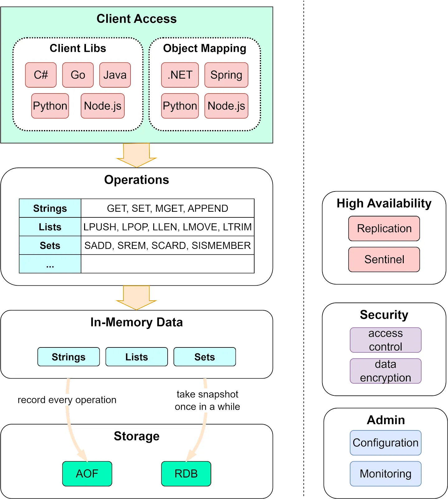

## Version Baseline

> [!IMPORTANT]
> 本页及`Redis/` 子树的所有默认值、命令可用性均以 **Redis 8.10.2（2026-09-17）** 为基线。
> 读到与下表冲突的旧口径表述时，一律以本基线为准。

**当前版本**：8.10.2，发布于 2026-09-17（`src/version.h:1` → `REDIS_VERSION "8.10.2"`）。

**支持状态**（来源：官方仓库 `unstable` 分支 `SECURITY.md`，注意 tag 内的副本是旧矩阵，不要用）：

| 版本线 | 状态 |
| :-- | :-- |
| 8.10.x / 8.8.x / 8.6.x / 8.4.x / 8.2.x | 支持 |
| **8.0.x** | **已 EOL**（唯一被跳过的 8.x 线） |
| 7.4.x / 7.2.x | 支持；7.2.x 延长至 7.4 停止支持为止 |

Redis 官方**未公布**「3 年 / 5 年」这类年限承诺，唯一口径是上述支持矩阵加一句模糊的「通常回移到上一个 major 版本」。

**许可证时间线**（这是最容易记错的一项，来源：各 tag 内 `LICENSE.txt` / `COPYING` 原文）：

| 版本 | 许可 | 依据 |
| :-- | :-- | :-- |
| ≤ 7.2.x | **BSD-3-Clause** | 7.2.4 根目录文件是 `COPYING`，内容为 BSD 三条款；8.0 的 `LICENSE.txt` 反向印证「7.2 and prior releases remain subject to the BSDv3 clause license」 |
| **7.4.0**（2024-07-29） | **RSALv2 + SSPLv1 双许可** —— 首个非 BSD 版本 | `7.4.0/LICENSE.txt`：`Starting on March 20th, 2024, Redis follows a dual-licensing model with all Redis project code contributions under version 7.4 and subsequent releases` |
| **8.0.0**（2025-05-02） | **RSALv2 + SSPLv1 + AGPLv3 三选一** | `8.0.0/LICENSE.txt` 首段：`moving to a tri-licensing model ... your choice of: (a) RSALv2; or (b) SSPLv1; or (c) AGPLv3` |

三个易错点纠正：

- **7.2.x 才是最后一个 BSD 系列**，7.4 就已经不是 BSD 了 —— 「7.4 是最后 BSD 版」是错的。
- **SSPLv2 从未被 Redis 采用过**，只有 SSPLv1；AGPLv3 是 8.0 起新增的第三个**可选**许可，不是「8.0 改成 AGPLv3」。
- 因此 [Valkey](/docs/CS/DB/Valkey.md) 的分叉点是 7.2.4（BSD），此后 Redis 转私有许可才促成 2024-03 的社区分叉。

**8.x 关键能力节点**（用于判断某特性是否可用）：

| 版本 | 日期 | 关键变化 |
| :-- | :-- | :-- |
| 7.2.0 | 2023-08-15 | `WAITAOF`、`CLIENT NO-TOUCH`、`CLIENT SETINFO`、`CLUSTER MYSHARDID`（新增 4 个，**无删除无改名**） |
| **7.4.0** | 2024-07-29 | **Hash 字段级过期 9 个命令**（`HEXPIRE`/`HPEXPIRE`/`HEXPIREAT`/`HPEXPIREAT`/`HPERSIST`/`HEXPIRETIME`/`HPEXPIRETIME`/`HTTL`/`HPTTL`）；`XREAD` 支持 `+`；`HSCAN NOVALUES` |
| **8.0.0** | 2025-05-02 | 更名 Redis Open Source；**许可三选一**；Query Engine 与 JSON / Time Series / Bloom / Cuckoo / Count-min sketch / Top-k / t-digest / Vector set[beta] 内建；新 I/O 线程实现；`HGETDEL`/`HGETEX`/`HSETEX` |
| 8.2.0 | 2025-08-04 | `XDELEX`/`XACKDEL`；`BITOP` 新增 `DIFF`/`DIFF1`/`ANDOR`/`ONE`；SVS-VAMANA 向量索引 |
| 8.4.0 | 2025-11-18 | `DIGEST`/`DELEX`/`MSETEX`；`CLUSTER MIGRATION`（原子 slot 迁移）；`CLUSTER SLOT-STATS` |
| 8.6.0 | 2026-02-10 | **新增 LRM 淘汰策略**（见下）；hash/zset 内存下降；`XADD` 幂等；`HOTKEYS` |
| 8.8.0 | 2026-05-25 | **新数据结构 Array**（18 个 `AR*` 命令）；hash 字段级子键通知；`INCREX`；`XNACK` |
| 8.10.0 | 2026-07-29 | **Compact hash**（共享 schema 的field name 只存一份）+ `HIMPORT`；`LMOVEM`/`BLMOVEM`；`SUNIONCARD`/`SDIFFCARD`；`BACKUP`（基于 MP-AOF） |
| **8.10.2** | 2026-09-17 | 当前最新 GA；安全修复（ACL 事务绕过、cluster bus 未认证） |

**易记错默认值汇总表**（全部取自 8.10.2 `src/config.c`，与 7.2.4 逐项对照过，**唯一差异是 `maxmemory-samples` 上限从 `1, INT_MAX` 收紧为 `1, 64`**）：

| 配置项 | 默认值 | 出处 |
| :-- | :-- | :-- |
| `maxmemory-policy` | `noeviction` | `config.c:3491` |
| `maxmemory-samples` | `5`（范围 1–**64**） | `config.c:3522` |
| `appendonly` | `0` / no（**AOF 默认关闭**） | `config.c:3435` |
| `appendfsync` | `everysec` | `config.c:3492` |
| `save` | `3600 1` / `300 100` / `60 10000` | 编译进二进制，见 `server.c:2489-2491`，非配置默认值 |
| `timeout` | `0`（永不超时） | `config.c:3524` |
| `maxclients` | `10000` | `config.c:3553` |
| `io-threads` | `1`（**单线程**，范围 1–128，`IMMUTABLE_CONFIG` 运行时不可改） | `config.c:3507` |
| `cluster-node-timeout` | `15000` ms | `config.c:3574` |
| `lazyfree-lazy-expire` / `-eviction` / `-server-del` / `-user-del` / `-user-flush` | 全部 `0` / no | `config.c:3410-3414` |
| `slowlog-log-slower-than` | `10000`（**单位微秒**） | `config.c:3579` |
| `slowlog-max-len` | `128` | `config.c:3568` |

**淘汰策略共 10 种，不是 8 种**（`config.c:39-51` 枚举表 + `redis.conf` + 官方 docs 三处一致）：
`noeviction`、`allkeys-lru`、`allkeys-lrm`、`allkeys-lfu`、`allkeys-random`、`volatile-lru`、`volatile-lrm`、`volatile-lfu`、`volatile-random`、`volatile-ttl`。

- `lru` 与 `lrm` 的区别在于**时间戳更新时机**：LRU 在**读和写**时都更新，LRM **只在写**时更新（`src/db.c` 注释原文：`LRM policy should NOT update timestamp on reads`）。8.6.0 起才引入 LRM；≤ 8.4 与 Valkey 都只有 8 种。
- `volatile-xxx` 在没有 key 带过期时间时**行为等同 `noeviction`**（官方 docs 明述）。

**Cluster 全覆盖是全有全无，不是「覆盖一半即挂」**：`src/cluster.h:22-23` 定义 `CLUSTER_SLOT_MASK_BITS 14` / `CLUSTER_SLOTS (1<<14)` = 16384；`src/cluster_legacy.c:5308-5318` 遍历全部 16384 个 slot，**任意一个**未被健康 master 覆盖即置 `CLUSTER_FAIL`——不存在中间态。该行为可由 `cluster-require-full-coverage no`（默认 `1`，`config.c:3420`）关闭。

**后台线程数与 `BIO_NUM_OPS` 不是一回事**（本页与 `Concurrency.md` 曾长期混淆）：8.10.2 `src/bio.h:16-33` 有两组枚举——
`bio_worker_t` 的 `BIO_WORKER_NUM = 3`（**线程数**），`bio_job_type_t` 的 `BIO_NUM_OPS = 7`（**任务类型数**，含 `BIO_CLOSE_AOF` 与三个 `BIO_COMP_RQ_*`）。
「后台线程 3 个」是对的，但括号里写`BIO_NUM_OPS` 是错的。

## Introduction

[Redis](https://redis.io)(Remote Dictionary Server) is often referred to as a *data structures* server.
What this means is that Redis provides access to mutable data structures via a set of commands, which are sent using a *server-client* model with [TCP sockets](/docs/CS/CN/TCP/TCP.md) and a simple protocol.
So different processes can query and modify the same data structures in a shared way.

Redis has **built-in replication, Lua scripting, LRU eviction, [transactions](/docs/CS/DB/Redis/Transaction.md), and different levels of on-disk persistence,** and provides **high availability via Redis Sentinel** and **automatic partitioning with Redis Cluster**.

> [!TIP]
>
> 2024年 Redis 转为双许可后，社区与 Linux 基金会fork 出 [Valkey](/docs/CS/DB/Valkey.md)（基于 7.2.4，全程 BSD-3-Clause）。截至 2026-09 Valkey 已到 9.1.2，与 Redis 8.10.2 已明显分叉——**不要假设「Valkey 就是 Redis」**，两者命令集与配置键都有实质差异，详见 [Valkey 的分叉差异](/docs/CS/DB/Valkey.md?id=divergence-from-redis)。

## Features

Redis 可以用来做什么

- 缓存
- 排行榜
- 无须可靠要求的消息队列（[MQ 用法见专篇](/docs/CS/DB/Redis/MQ.md)）
- 分布式锁
- 计数器

## Configure


### build

修改配置文件中的 daemon 为 yes

禁用 gcc 编译优化，将 makefile 文件中 OPTIMIZATION?=-O2修为-O0

##### **Mac**

```shell
make MALLOC=jemalloc CFLAGS="-g -O0" 
```

Some build issues:


| Issue                                               | Fix                                                    | References                                                        |
| --------------------------------------------------- | ------------------------------------------------------ | ----------------------------------------------------------------- |
| error: variable has incomplete type 'struct stat64' | add`#define MAC_OS_X_VERSION_10_6` into `src/config.h` | [Build Issue in arm](https://github.com/redis/redis/issues/12585) |

### Source Code

Redis源码目录:

<table class="tg"><thead>
  <tr>
    <th class="tg-0lax">目录</th>
    <th class="tg-0lax">子目录</th>
    <th class="tg-0lax">描述</th>
  </tr></thead>
<tbody>
  <tr>
    <td class="tg-0lax" rowspan="5">deps</td>
    <td class="tg-0lax">jemalloc</td>
    <td class="tg-0lax"></td>
  </tr>
  <tr>
    <td class="tg-0lax">linenoise</td>
    <td class="tg-0lax">readline 功能的替代代码</td>
  </tr>
  <tr>
    <td class="tg-0lax">hiredis</td>
    <td class="tg-0lax">客户端</td>
  </tr>
  <tr>
    <td class="tg-0lax">Lua</td>
    <td class="tg-0lax"></td>
  </tr>
  <tr>
    <td class="tg-0lax" >hdr_histogram</td>
    <td class="tg-0lax">生成每个命令的延迟跟踪直方图</td>
  </tr>
  <tr>
    <td class="tg-0lax" rowspan="2">src</td>
    <td class="tg-0lax">commands</td>
    <td class="tg-0lax"></td>
  </tr>
   <tr>
    <td class="tg-0lax">modules</td>
    <td class="tg-0lax"></td>
  </tr>
  <tr>
    <td class="tg-0lax">test</td>
    <td class="tg-0lax"></td>
    <td class="tg-0lax"></td>
  </tr>
   <tr>
    <td class="tg-0lax">utils</td>
    <td class="tg-0lax"></td>
    <td class="tg-0lax"></td>
  </tr>
</tbody>
</table>
Redis 实现的测试代码可以分成四部分，分别是单元测试（对应 unit 子目录），Redis Cluster 功能测试（对应 cluster 子目录）、哨兵功能测试（对应 sentinel 子目录）、主从复制功能测试（对应 integration 子目录）
这些子目录中的测试代码使用了 Tcl 语言（通用的脚本语言）进行编写，主要目的就是方便进行测试
除了有针对特定功能模块的测试代码外，还有一些代码是用来支撑测试功能的，这些代码在 assets、helpers、modules、support 四个目录中

除了 deps、src、tests、utils 四个子目录以外，Redis 源码总目录下其实还包含了两个重要的配置文件，一个是 Redis 实例的配置文件 redis.conf，另一个是哨兵的配置文件 sentinel.conf

客户端在 Redis 的运行过程中也会被广泛使用，比如实例返回读取的数据、主从复制时在主从库间传输数据、Redis Cluster 的切片实例通信等，都会用到客户端
Redis 将客户端的创建、消息回复等功能，实现在了 networking.c 文件中


### benchmark

Redis-benchmark 是官方自带的 Redis 性能测试工具，可以有效的测试 Redis 服务的性能。


## Architecture

Redis 整体架构如下图:

<div style="text-align: center;">



</div>

<p style="text-align: center;">
Fig.1. Architecture
</p>

主要模块:

- 应用层: client
- 网络层: 基于I/O多路复用封装了一个简单的基于事件驱动的网络通信库 [ae](/docs/CS/DB/Redis/ae.md)
  它封装了底层的 select、epoll、avport 以及 kqueue 这些I/O多路复用函数，为上层提供了相同的接口
- 命令执行层 负责执行客户端的各种命令
- 内存层: 提供各种数据结构保存数据
- 持久化层: 提供 RDB 和 AOF 持久化策略
- 高可用层: 提供 Replication 、Sentinel 和 Cluster 实现高可用
- 统计和监控: 提供一些监控工具和性能分析工具, 例如内存监控、基准测试、内存碎片、Bigkey统计、慢指令查询


Redis将启动的这些服务抽象成一个全局的结构体 [redisServer](/docs/CS/DB/Redis/server.md?id=server)
它包含了存储结构 [redisDb](/docs/CS/DB/Redis/redisDb.md)、命令列表、网络监听、客户端缓存等信息


[Redis启动流程](/docs/CS/DB/Redis/start.md)

[Redis命令执行流程](/docs/CS/DB/Redis/start.md)

图源 [redis 异步网络通信流程 - 单线程](https://www.processon.com/view/5eab75227d9c0869dab46472)


### Why Redis so fast

完全基于内存实现 持久化机制都是使用子进程处理 不影响

高效的数据结构

整个 Redis 就是一个全局哈希表，他的时间复杂度是 $O(1)$ ，而且为了防止哈希冲突导致链表过长，Redis 会执行 rehash 操作，扩充哈希桶数量，减少哈希冲突
并且防止一次性 重新映射数据过大导致线程阻塞，采用渐进式 rehash。巧妙的将一次性拷贝分摊到多次请求过程后总，避免阻塞。

同时根据实际存储的数据类型选择不同编码

[Redis 并发模型](/docs/CS/DB/Redis/Concurrency.md)

主从复制 哨兵集群 Cluster分片集群

负载均衡

- [db](/docs/CS/DB/Redis/redisDb.md)

## Persistence

[Persistence](/docs/CS/DB/Redis/persist.md) refers to the writing of data to durable storage, such as a solid-state disk (SSD).
The most important thing to understand is the different trade-offs between the RDB and AOF persistence.

## Event

Time_Event

ServerCron:

- evict key
- RDB and AOF
- master-slave sync
- cluster keepalive
- close dead connection
- statistic memory and other server info

## Log

### Slowlog

The Redis Slow Log is a system to log queries that exceeded a specified execution time.
The execution time does not include the I/O operations like talking with the client, sending the reply and so forth, but just the time needed to actually execute the command
(this is the only stage of command execution where the thread is blocked and can not serve other requests in the meantime).

You can configure the slow log with two parameters: one tells Redis what is the execution time, in microseconds, to exceed in order for the command to get logged, and the other parameter is the length of the slow log.
When a new command is logged the oldest one is removed from the queue of logged commands.

slowlog len can set to 1000

```
The following time is expressed in microseconds, so 1000000 is equivalent
to one second. Note that a negative number disables the slow log, while
a value of zero forces the logging of every command.

slowlog-log-slower-than 10000

# There is no limit to this length. Just be aware that it will consume memory.
# You can reclaim memory used by the slow log with SLOWLOG RESET.
slowlog-max-len 128
```

slowlog get

slowlog len

extension:

latency monitor

```shell
# use it at slave
./redis-cli --bigkeys -i 0.1
```

## Cluster

虽然 Redis 一般是作为内存数据库来使用的，但是它也提供了可靠性保证，这主要体现在 Redis 可以对数据做持久化保存，并且它还实现了主从复制机制，从而可以提供故障恢复的功能。
这部分的代码实现比较集中，主要包括以下两个部分。

- 数据持久化实现
  Redis 的数据持久化实现有两种方式：内存快照 RDB 和 AOF 日志，分别实现在了 rdb.h/rdb.c 和 aof.c 中。
  注意，在使用 RDB 或 AOF 对数据库进行恢复时，RDB 和 AOF 文件可能会因为 Redis 实例所在服务器宕机，而未能完整保存，进而会影响到数据库恢复。因此针对这一问题，Redis 还实现了对这两类文件的检查功能，对应的代码文件分别是 redis-check-rdb.c 和 redis-check-aof.c。
- 主从复制功能实现
  Redis 把主从复制功能实现在了 replication.c 文件中。另外你还需要知道的是，Redis 的主从集群在进行恢复时，主要是依赖于哨兵机制，而这部分功能则直接实现在了 sentinel.c 文件中。
  其次，与 Redis 实现高可靠性保证的功能类似，Redis 高可扩展性保证的功能，是通过 Redis Cluster 来实现的，这部分代码也非常集中，就是在 cluster.h/cluster.c 代码文件中。
  所以这样，我们在学习 Redis Cluster 的设计与实现时，就会非常方便，不用在不同的文件之间来回跳转了

单机 Redis 瓶颈

- QPS
- 容量
- 单点故障

### Master-Slave

主从复制

- Redis读大于写 类似MySQL 副本提供读

主从一致性

```
(error) READONLY You can't write against a read only replica.
```

disadvantage:

load balance and recovery

```log
# replica log
Connecting to MASTER 127.0.0.1:7000
MASTER <-> REPLICA sync started
Non blocking connect for SYNC fired the event.
Master replied to PING, replication can continue...
Partial resynchronization not possible (no cached master)
Full resync from master: 21a84515a95124a3326bd63d9ecf94e52e44c129:0
MASTER <-> REPLICA sync: receiving streamed RDB from master with EOF to disk
MASTER <-> REPLICA sync: Flushing old data
MASTER <-> REPLICA sync: Loading DB in memory
Loading RDB produced by version 7.2.5
RDB age 0 seconds
RDB memory usage when created 0.52 Mb
Done loading RDB, keys loaded: 0, keys expired: 0.
MASTER <-> REPLICA sync: Finished with success
```

```log
# master log
Replica 127.0.0.1:7001 asks for synchronization
Full resync requested by replica 127.0.0.1:7001
Replication backlog created, my new replication IDs are '21a84515a95124a3326bd63d9ecf94e52e44c129' and '0000000000000000000000000000000000000000'
Delay next BGSAVE for diskless SYNC
Starting BGSAVE for SYNC with target: replicas sockets
Background RDB transfer started by pid 16752
Fork CoW for RDB: current 4 MB, peak 4 MB, average 4 MB
Diskless rdb transfer, done reading from pipe, 1 replicas still up.
Background RDB transfer terminated with success
Streamed RDB transfer with replica 127.0.0.1:7001 succeeded (socket). Waiting for REPLCONF ACK from replica to enable streaming
Synchronization with replica 127.0.0.1:7001 succeeded
```

### Redis Sentinel

monitor

- choose new master from slaves when master down
- notify slaves to replicaof and notify clients to create connections with new master

### Redis Cluster

分片算法

range 连续数据 业务相关

hash

[Distributed Lock](/docs/CS/DB/Redis/Lock.md)

## Performance

monitor

### Block

using wrong API or struct Slow get n : get n slow Sqls > 10ms

CPU overflow

Persistence:

- fork
- AOF flush to disk
- enable THP

CPU race

swap

- make sure have enough memory
- Prefer not use swap

Network

connection refused

timeout

network soft interrupt

## memory

Redis 是内存数据库，所以，高效使用内存对 Redis 的实现来说非常重要
而实际上，Redis 主要是通过两大方面的技术来提升内存使用效率的，
分别是[数据结构的优化设计与使用](/docs/CS/DB/Redis/struct/struct.md)，以及[内存友好的数据使用方式](/docs/CS/DB/Redis/memory.md)

Used_memor_rss

- Used_memory
- memory chip

## command

### info

- Server
- Clients
  - rejected_connections
- Memory
  - human  memory jemalloc apply
  - rss_human  memory in top command
  - peak_human
  - lua_human
- Persistence
- Stats
  - ops_per_sec
  - sync_partial_err
- Replication
  - backlog
- CPU
- Modules
- Errorstats
- Cluster
- Keyspace

monitor get request cmds of current time

maxmemory-policy

- noeviction default refuse write(exclude del) request
- volatile-lru
- volatile-ttl
- volatile-random
- alleys-lru
- alleys-random
- volatile-lfu
- allkeys-lfu

LRU

keys contain a 24bits of timestamp

random get keys and del the oldest one util the memory is enough

unlink use a async thread to del big value

flushdb and flushall can add params to be async

LFU

## TLS

## THP

Transparent Huge Pages（THP）
copy-on-write期间复制内存页从4KB变成2MB
fork子进程的速度变慢
高并发下开启容易造成内存溢出，建议关闭

## Tools

- redis-server
- redis-sentinel
- redis-cli
- redis-check-rdb
- redis-check-aof
- redis-benchmark

## Cache Consistency

本地缓存和 Redis 缓存一致性

常见是 Redis 和本地缓存都监听 canal 事件 同步数据库变更

### Client side caching

Redis6 客户端缓存机制 监听key

通常，客户端缓存的两个主要优点是：

1. 数据以非常小的延迟提供。
2. 数据库系统接收的查询较少，因此可以使用较少数量的节点为同一数据集提供服务。

The tracking table is constituted by a radix tree of keys, each pointing to a radix tree of client IDs, used to track the clients that may have certain keys in their local, client side, cache.

When a client enables tracking with "CLIENT TRACKING on", each key served to the client is remembered in the table mapping the keys to the client IDs.

Later, when a key is modified, all the clients that may have local copy of such key will receive an invalidation message.

Clients will normally take frequently requested objects in memory, removing them when invalidation messages are received.

```redis
CLIENT TRACKING ON|OFF [REDIRECT client-id] [PREFIX prefix] [BCAST] [OPTIN] [OPTOUT] [NOLOOP]
```

Redis 客户端缓存支持称为*跟踪*，有两种模式：

- 在默认模式下，服务器会记住给定客户端访问的密钥，并在修改相同的密钥时发送失效消息。这会消耗服务器端的内存，但仅针对客户端内存中可能具有的密钥集发送失效消息。 服务端在给客户端发送过一次 invalidate 消息后，如果 key 再被修改，此时，服务端就不会再次给客户端发送 invalidate 消息。

  **只有下次客户端再次执行只读命令被 track，才会进行下一次消息通知** 。
- 在*广播*模式下，服务器不会尝试记住给定客户端访问了哪些密钥，因此此模式在服务器端根本不消耗内存。服务端会给客户端广播所有 key 的失效情况，如果 key 被频繁修改，服务端会发送大量的失效广播消息，这就会消耗大量的网络带宽资源。

  所以，在实际应用中，我们设置让客户端注册只跟踪指定前缀的 key，当注册跟踪的 key 前缀匹配被修改，服务端就会把失效消息广播给所有关注这个 key前缀的客户端

默认模式

Redis 服务端使用 TrackingTable 存储普通模式的客户端数据，它的数据类型是基数树(radix tree)

Redis 用它存储**键的指针**和**客户端 ID** 的映射关系。因为键对象的指针就是内存地址，也就是长整型数据。客户端缓存的相关操作就是对该数据的增删改查：

- 当开启 track 功能的客户端获取某一个键值时，Redis 会调用 `enableTracking` 方法使用基数树记录下该 key 和 clientId 的映射关系。
- 当某一个 key 被修改或删除时，Redis 会调用 `trackingInvalidateKey` 方法根据 key 从 TrackingTable 中查找所有对应的客户端ID，然后调用 `sendTrackingMessage` 方法发送失效消息给这些客户端(会检查 CLIENT_TRACKING 相关标志位是否开启和是否开启了 NOLOOP)。
- 发送完失效消息后，根据**键的指针值**将映射关系从 TrackingTable中删除。
- 客户端关闭 track 功能后，因为删除需要进行大量操作，所以 Redis 使用懒删除方式，只是将该客户端的 CLIENT_TRACKING 相关标志位删除掉

*广播*模式

广播模式与普通模式类似，Redis 同样使用 `PrefixTable` 存储广播模式下的客户端数据，它存储**前缀字符串指针和(需要通知的 key 和客户端 ID)**的映射关系。它和广播模式最大的区别就是真正发送失效消息的时机不同：

- 当客户端开启广播模式时，会在 `PrefixTable`的前缀对应的客户端列表中加入该客户端ID。
- 当某一个 key 被修改或删除时，Redis 会调用 `trackingInvalidateKey` 方法，`trackingInvalidateKey` 方法中如果发现 `PrefixTable` 不为空，则调用 `trackingRememberKeyToBroadcast` 依次遍历所有前缀，如果key 符合前缀规则，则记录到 `PrefixTable` 对应的位置。
- 在 Redis 的事件处理周期函数 beforeSleep 函数里会调用 `trackingBroadcastInvalidationMessages` 函数来真正发送消息。

```c

void trackingInvalidateKey(client *c, robj *keyobj, int bcast) {
    if (TrackingTable == NULL) return;

    unsigned char *key = (unsigned char*)keyobj->ptr;
    size_t keylen = sdslen(keyobj->ptr);

    if (bcast && raxSize(PrefixTable) > 0)
        trackingRememberKeyToBroadcast(c,(char *)key,keylen);

    void *result;
    if (!raxFind(TrackingTable,key,keylen,&result)) return;
    rax *ids = result;

    raxIterator ri;
    raxStart(&ri,ids);
    raxSeek(&ri,"^",NULL,0);
    while(raxNext(&ri)) {
        uint64_t id;
        memcpy(&id,ri.key,sizeof(id));
        client *target = lookupClientByID(id);
        /* Note that if the client is in BCAST mode, we don't want to
         * send invalidation messages that were pending in the case
         * previously the client was not in BCAST mode. This can happen if
         * TRACKING is enabled normally, and then the client switches to
         * BCAST mode. */
        if (target == NULL ||
            !(target->flags & CLIENT_TRACKING)||
            target->flags & CLIENT_TRACKING_BCAST)
        {
            continue;
        }

        /* If the client enabled the NOLOOP mode, don't send notifications
         * about keys changed by the client itself. */
        if (target->flags & CLIENT_TRACKING_NOLOOP &&
            target == server.current_client)
        {
            continue;
        }

        /* If target is current client and it's executing a command, we need schedule key invalidation.
         * As the invalidation messages may be interleaved with command
         * response and should after command response. */
        if (target == server.current_client && (server.current_client->flags & CLIENT_EXECUTING_COMMAND)) {
            incrRefCount(keyobj);
            listAddNodeTail(server.tracking_pending_keys, keyobj);
        } else {
            sendTrackingMessage(target,(char *)keyobj->ptr,sdslen(keyobj->ptr),0);
        }
    }
    raxStop(&ri);

    /* Free the tracking table: we'll create the radix tree and populate it
     * again if more keys will be modified in this caching slot. */
    TrackingTableTotalItems -= raxSize(ids);
    raxFree(ids);
    raxRemove(TrackingTable,(unsigned char*)key,keylen,NULL);
}
```

转发模式

对于使用 RESP 2 协议的客户端来说，实现客户端缓存则需要另一种模式：重定向模式（redirect）

RESP 2 无法直接 PUSH 失效消息，所以 需要另一个支持 RESP 3 协议的客户端 告诉 Server 将失效消息通过 Pus/Sub 通知给 RESP 2 客户端。

在重定向模式下，想要获得失效消息通知的客户端，就需要执行订阅命令 SUBSCRIBE，专门订阅用于发送失效消息的频道 `_redis_:invalidate`。

同时，再使用另外一个客户端，执行 CLIENT TRACKING 命令，设置服务端将失效消息转发给使用 RESP 2 协议的客户端。

客户端可能希望运行有关次数的内部统计信息 给定的缓存密钥实际上是在请求中提供的，以便在 未来什么好缓存。通常：

- 我们不希望缓存许多不断更改的键。
- 我们不想缓存许多很少请求的密钥。
- 我们希望缓存经常请求的密钥，并以合理的速率进行更改

## Tuning


同样是使用 Redis，但是不同公司的“玩法”却不太一样，比如说，有做缓存的，有做数据库的，也有用做分布式锁的。不过，他们遇见的“坑”，总体来说集中在四个方面：

- CPU 使用上的“坑”，例如数据结构的复杂度、跨 CPU 核的访问；
- 内存使用上的“坑”，例如主从同步和 AOF 的内存竞争；
- 存储持久化上的“坑”，例如在 SSD 上做快照的性能抖动；
- 网络通信上的“坑”，例如多实例时的异常网络丢包。


Redis 对 CPU 的要求并不高，反而是对内存和磁盘的要求很高，因为 Redis 大部分时候都在做读写操作，使用更多的内存和更快的磁盘，对 Redis 性能的提高非常有帮助


为了保证数据的可靠性，Redis 需要在磁盘上读写 AOF 和 RDB，但在高并发场景里，这就会直接带来两个新问题：一个是写 AOF 和 RDB 会造成 Redis 性能抖动，另一个是 Redis 集群数据同步和实例恢复时，读 RDB 比较慢，限制了同步和恢复速度。


我们将使用以下手段，来提升 Redis 的运行速度：

1. 缩短键值对的存储长度；
2. 使用 lazy free（延迟删除）特性；
3. 设置键值的过期时间；
4. 禁用耗时长的查询命令；
5. 使用 slowlog 优化耗时命令；
6. 使用 Pipeline 批量操作数据；
7. 避免大量数据同时失效；
8. 客户端使用优化；
9. 限制 Redis 内存大小；
10. 使用物理机而非虚拟机安装 Redis 服务；
11. 检查数据持久化策略；
12. 使用分布式架构来增加读写速度。


key 的命名规范，只有命名规范，才能提供可读性强、可维护性好的 key，方便日常管理

把业务名作为前缀，然后用冒号或者下划线分隔，再加上具体的业务数据名 为避免 key 过长(key 也是 SDS 长度增加时元数据也会占用更多空间) 可以对前缀进行缩写

BigKey

bigkey 通常有两种情况。

- 情况一：键值对的值大小本身就很大，例如 value 为 1MB 的 String 类型数据。为了避免 String 类型的 bigkey，在业务层，我们要尽量把 String 类型的数据大小控制在 10KB 以下。如果业务层的 String 类型数据确实很大，我们还可以通过数据压缩来减小数据大小
- 情况二：键值对的值是集合类型，集合元素个数非常多，例如包含 100 万个元素的 Hash 集合类型数据。为了避免集合类型的 bigkey，我给你的设计规范建议是，**尽量把集合类型的元素个数控制在 1 万以下**如果集合类型的元素的确很多，我们可以将一个大集合拆分成多个小集合来保存

对带宽压力大 进而影响之后的处理

对于 JIT 技术在存储引擎中而言，“EVAL is evil”，尽量避免使用 lua 耗费内存和计算资源

**不同的序列化方法，在序列化速度和数据序列化后的占用内存空间这两个方面，效果是不一样的**。比如说，protostuff 和 kryo 这两种序列化方法，就要比 Java 内置的序列化方法（java-build-in-serializer）效率更高

XML 和 JSON 格式的数据占用的内存空间比较大。为了避免数据占用过大的内存空间，建议使用压缩工具（例如 snappy 或 gzip），把数据压缩后再写入 Redis

什么时候不能用整数对象共享池呢？主要有两种情况。

第一种情况是，**如果 Redis 中设置了 maxmemory，而且启用了 LRU 策略（allkeys-lru 或 volatile-lru 策略），那么，整数对象共享池就无法使用了**。这是因为，LRU 策略需要统计每个键值对的使用时间，如果不同的键值对都共享使用一个整数对象，LRU 策略就无法进行统计了。

第二种情况是，如果集合类型数据采用 ziplist 编码，而集合元素是整数，这个时候，也不能使用共享池。因为 ziplist 使用了紧凑型内存结构，判断整数对象的共享情况效率低。

**同的业务数据放到不同的 Redis 实例中**。这样一来，既可以避免单实例的内存使用量过大，也可以避免不同业务的操作相互干扰

Redis 单实例的内存大小都不要太大，根据我自己的经验值，建议你设置在 2~6GB 。这样一来，无论是 RDB 快照，还是主从集群进行数据同步，都能很快完成，不会阻塞正常请求的处理。

Pubsub的典型场景
Pubsub 适合悲观锁和简单信号，不适合稳定的更新，因为可能会丢消息。在1对 N 的消息转发通道中，服务瓶颈。还有模
糊通知方面，算力瓶颈。在 channel 和 client 比较多的情况下，造成 CPU 打满、服务夯住。

Transaction
Transaction 是一种伪事物，没有回滚条件；集群版需要所有 key 使用 hashtag 保证，代码比较复杂，hashtag 也可能导
致算力和存储倾斜；Lua中封装了multi-exec，但更耗费CPU，比如编译、加载时，经常出现问题。

Pipeline
Pipeline用的比较多，如下面的示意图，实际上是把多个请求封装在一个请求中，合并在一个请求里发送，服务端一次
性返回，能够有效减少 IO，提高执行效率。需要注意的是，用户需要聚合小的命令，避免在 pipeline 里做大 range。注意
Pipeline 中的批量任务不是原子执行的（从来不是），所以要处理 Pipeline 其中部分命令失败的场景。

危险命令禁用

管道技术本质上是客户端提供的功能，而非 Redis 服务器端的功能
使用管道技术可以解决多个命令执行时的网络等待，它是把多个命令整合到一起发送给服务器端处理之后统一返回给客户端，这样就免去了每条命令执行后都要等待的情况，从而有效地提高了程序的执行效率
管道技术虽然有它的优势，但在使用时还需注意以下几个细节：
- 发送的命令数量不会被限制，但输入缓存区也就是命令的最大存储体积为 1GB，当发送的命令超过此限制时，命令不会被执行，并且会被 Redis 服务器端断开此链接；
- 如果管道的数据过多可能会导致客户端的等待时间过长，导致网络阻塞；
- 部分客户端自己本身也有缓存区大小的设置，如果管道命令没有没执行或者是执行不完整，可以排查此情况或较少管道内的命令重新尝试执行


### slowlog

```properties
# 10ms
slowlog-log-slower-than=10000
# 128
slowlog-max-len=128
```

慢查询日志删除使用FIFO

```c
void slowlogPushEntryIfNeeded(client *c, robj **argv, int argc, long long duration) {
    if (server.slowlog_log_slower_than < 0 || server.slowlog_max_len == 0) return; /* Slowlog disabled */
    if (duration >= server.slowlog_log_slower_than)
        listAddNodeHead(server.slowlog,
                        slowlogCreateEntry(c,argv,argc,duration));

    /* Remove old entries if needed. */
    while (listLength(server.slowlog) > server.slowlog_max_len)
        listDelNode(server.slowlog,listLast(server.slowlog));
}
```

slowlog get

### commands

常用运维命令 用于线上事故保留现场

```shell
INFO MEMORY

MEMORY USAGE

CLIENT LIST
```

## Knowledge Map

本目录按「一个问题一组」组织，与 [DB.md](/docs/CS/DB/DB.md) 的主线同构：存得下 → 找得快 → 改不乱 → 扩得开 → 怎么选。三种读法：顺着下面的组顺序读建立体系；按源码推进顺序读（[start](/docs/CS/DB/Redis/start.md) → [server](/docs/CS/DB/Redis/server.md) → [ae](/docs/CS/DB/Redis/ae.md) → [struct 总纲](/docs/CS/DB/Redis/struct/struct.md) → [persist](/docs/CS/DB/Redis/persist.md) → [cluster](/docs/CS/DB/Redis/cluster.md)）；排障与面试按主题跳读（本页 Tuning 段、slowlog、[memory](/docs/CS/DB/Redis/memory.md)、[Cache](/docs/CS/DB/Redis/Cache.md)、[Lock](/docs/CS/DB/Redis/Lock.md)）。

### Execution Model

事件循环与线程模型是「快」的成因，也是所有延迟问题的解释框架：[start.md](/docs/CS/DB/Redis/start.md) 走 `initServerConfig` → `initServer` → `aeMain` → 命令执行 → 关闭的主流程；[server.md](/docs/CS/DB/Redis/server.md) 拆 `redisServer` 的客户端、进程、缓存与监控子系统；[ae.md](/docs/CS/DB/Redis/ae.md) 是循环本体（文件事件、时间事件、`epoll` 边缘触发）；[Concurrency.md](/docs/CS/DB/Redis/Concurrency.md) 给子进程 + 主线程 + 后台线程 + IO 线程的并发模型，[io.md](/docs/CS/DB/Redis/io.md) 展开 `bio.c` 与 `lazyfree.c`；压测口径与工具在 [benchmark.md](/docs/CS/DB/Redis/benchmark.md)。

### Encoding and Persistence

值在内存里长什么样由编码体系决定：总纲 [struct/struct.md](/docs/CS/DB/Redis/struct/struct.md)（key/object 编码与各类型概览），容器与 get/set/delete 三条路径在 [redisDb.md](/docs/CS/DB/Redis/redisDb.md)。单值 [SDS](/docs/CS/DB/Redis/struct/SDS.md)；聚合结构 [hash](/docs/CS/DB/Redis/struct/hash.md)、[list](/docs/CS/DB/Redis/struct/list.md) 与合并后的 [quicklist](/docs/CS/DB/Redis/struct/quicklist.md)、[set](/docs/CS/DB/Redis/struct/set.md) 与 [intset](/docs/CS/DB/Redis/struct/intset.md)、[zset](/docs/CS/DB/Redis/struct/zset.md) 与其底层 [skiplist](/docs/CS/DB/Redis/struct/skiplist.MD)，以及被接替的 [ziplist](/docs/CS/DB/Redis/struct/ziplist.md) 与替代者 [listpack](/docs/CS/DB/Redis/struct/listpack.md)；消息型 [Stream](/docs/CS/DB/Redis/struct/Stream.md)；概率与位级结构 [bitmap](/docs/CS/DB/Redis/struct/bitmap.md)、[HyperLogLog](/docs/CS/DB/Redis/struct/HyperLogLog.md)、[BloomFilter](/docs/CS/DB/Redis/struct/BloomFilter.md)（模块）；[geo](/docs/CS/DB/Redis/struct/geo.md) 直接用 zset 实现。落盘侧 [persist.md](/docs/CS/DB/Redis/persist.md) 覆盖 RDB、AOF 与混合持久化（multi-part AOF）及取舍，AOF 重写的触发条件在 `server.c` 的 `aofRewriteLimited`；内存上限、淘汰与 LRU/LFU 在 [memory.md](/docs/CS/DB/Redis/memory.md)。

### Retrieval and Extension

按 key 取值本身就是查找路径，「查内容」才需要额外结构：存在性与去重交给上面的概率结构，全文与二级索引见 [RediSearch.md](/docs/CS/DB/Redis/RediSearch.md)，按 channel 的订阅匹配见 [PubSub.md](/docs/CS/DB/Redis/PubSub.md)。要改行为，先看命令层：[command.md](/docs/CS/DB/Redis/command.md)（命令定义、`addReply` 约定，以及 key 声明——它是 cluster 路由的前提）；服务端内编程用 [Lua.md](/docs/CS/DB/Redis/Lua.md)（含自带 debugger），更底层的扩展机制在 [module.md](/docs/CS/DB/Redis/module.md)。

### Atomicity and Consistency

单线程排队执行提供了天然隔离，成组命令的原子性由 [Transaction.md](/docs/CS/DB/Redis/Transaction.md) 提供（`MULTI`/`EXEC`/`DISCARD`/`WATCH` 与它并不等于回滚的坑）；跨进程互斥要自己实现，方案与失效场景在 [Lock.md](/docs/CS/DB/Redis/Lock.md)；改完数据与缓存怎么对齐、雪崩/穿透/击穿的应对在 [Cache.md](/docs/CS/DB/Redis/Cache.md)，客户端侧缓存（tracking 协议）见本页 Client side caching 段。

### Replication and Sharding

复制在 [Replication.md](/docs/CS/DB/Redis/Replication.md)（PSYNC、部分重同步、过期键如何传递），自动故障转移在 [sentinel.md](/docs/CS/DB/Redis/sentinel.md)（定时器、选主、failover 流程），水平分片在 [cluster.md](/docs/CS/DB/Redis/cluster.md)（Gossip、slot 表语义、failover 与 cron 任务）；slot 到 key 的映射细节在 [redisDb.md](/docs/CS/DB/Redis/redisDb.md) 的 `slotToKey*` 一节。把 Redis 当队列用的语义边界（消费组、ack、重投）在 [MQ.md](/docs/CS/DB/Redis/MQ.md) 与 [PubSub.md](/docs/CS/DB/Redis/PubSub.md)——本库口径是 **Redis 归 DB，不归 MQ 专题**，MQ 侧只做对照。

### Clients and Alternatives

Java 侧三种连接模型各一篇：[Jedis.md](/docs/CS/DB/Redis/Jedis.md)（阻塞直连与连接池、JMX）、[Lettuce.md](/docs/CS/DB/Redis/Lettuce.md)（Netty、同步/异步/响应式与拓扑刷新）、[Redisson.md](/docs/CS/DB/Redis/Redisson.md)（锁与分布式数据结构的封装）。服务端形态的同路替代：[Valkey](/docs/CS/DB/Valkey.md)（ fork 延续）、[Pika](/docs/CS/DB/Pika.md) 与 [SSDB](/docs/CS/DB/SSDB.md)（磁盘化）、[Dragonfly](/docs/CS/DB/Dragonfly.md)（share-nothing 内存版）。部署环境的两个隐形前提见本页 THP 与 TLS 段。

横切到数据库层面的机制——事件循环对应的 IO 多路复用、复制与分片的通用取舍、索引结构的 B-Tree/LSM 对比——在 [DB.md](/docs/CS/DB/DB.md) 的 Finding Data、Scaling Out 与 Storing Data 三章，本目录只讲 Redis 的实现。

## Links

- [DataBases](/docs/CS/DB/DB.md?id=redis)
- [Valkey](/docs/CS/DB/Valkey.md)
- [Pika](/docs/CS/DB/Pika.md)
- [MySQL Storage Engines](/docs/CS/DB/MySQL/plugin.md)

## References

1. [Redis中文网](https://redis.com.cn/)
2. [Redis 面试全攻略、面试题大集合](https://mp.weixin.qq.com/s/6NobACeeKCcUy98Ikanryg)
3. [Redis源码分析(一) - 硬核课堂](https://hardcore.feishu.cn/docs/doccnp9v7IljXiJ5FpNT1ipLhlR#)
4. [Distributed locks with Redis](https://redis.io/topics/distlock)
5. [Garnet](https://github.com/microsoft/garnet)
6. [java - Redis 6.0 新特性篇：深度剖析客户端缓存（Client side caching）原理与性能 - Redis - SegmentFault 思否](https://segmentfault.com/a/1190000040926742)
