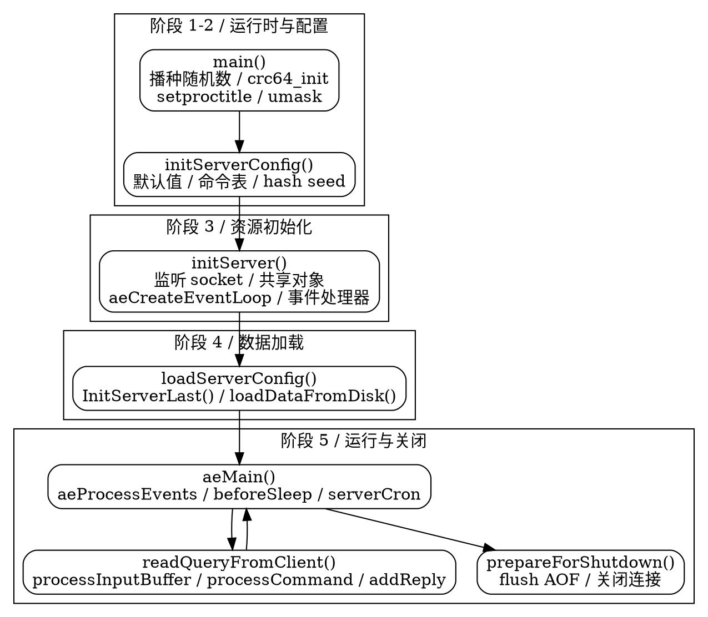

## Introduction

> [!NOTE]
> 版本基线 **Redis 8.10.2**；本页机制若与其他版本口径冲突，以 [Redis 版本基线](/docs/CS/DB/Redis/Redis.md?id=version-baseline) 为准。

三个容易理解错的点：

- **`main()` 先播种随机数，再碰配置**：8.10.2 用 `time() ^ getpid() ^ tv.tv_usec` 三路异或播种，并同时初始化 `srandom` / `init_genrand64`，专门应对容器里 `time()` 与 `getpid()` 相同、多个实例生成相同 runid 与复制 ID 的问题。
- **命令"读取"路径在 8.0 被重写过**：`readQueryFromClient` 现在用 `CLIENT_IO_READ_ENABLED` 标志与 `pending_read` 原子量配合 I/O 线程，还引入了可复用 query buffer；老笔记里的 `postponeClientRead` / `handleClientsWithPendingReadsUsingThreads` 在 8.10.2 已不存在，细节见 [io](/docs/CS/DB/Redis/io.md)。
- **`initServer()` 不是"最后一步"**：它创建监听 socket、事件循环与共享对象后挂上 `beforeSleep` / `serverCron`，真正的命令执行要等 `aeMain()` 进入事件循环才发生；关闭走 `prepareForShutdown()`。

### Bootstrap Chain

启动链路按阶段可读成下面五段，源码集中在 `server.c` 的 `main()`：



以下是启动 Redis 服务器最关键的几个步骤。

* `initServerConfig()` 设置 `server` 结构的默认值。
* `initServer()` 分配运行所需的数据结构、建立监听 socket 等。
* `aeMain()` 启动事件循环，开始接收新连接。

```c
// server.c
int main(int argc, char **argv) {
    struct timeval tv;
    int j;
    char config_from_stdin = 0;

    /* We need to initialize our libraries, and the server configuration. */
#ifdef INIT_SETPROCTITLE_REPLACEMENT
    spt_init(argc, argv);
#endif
    tzset(); /* Populates 'timezone' global. */
    zmalloc_set_oom_handler(redisOutOfMemoryHandler);

    /* To achieve entropy, in case of containers, their time() and getpid() can
     * be the same. But value of tv_usec is fast enough to make the difference */
    gettimeofday(&tv,NULL);
    srand(time(NULL)^getpid()^tv.tv_usec);
    srandom(time(NULL)^getpid()^tv.tv_usec);
    init_genrand64(((long long) tv.tv_sec * 1000000 + tv.tv_usec) ^ getpid());
    crc64_init();

    /* Store umask value. Because umask(2) only offers a set-and-get API we have
     * to reset it and restore it back. We do this early to avoid a potential
     * race condition with threads that could be creating files or directories.
     */
    umask(server.umask = umask(0777));

    uint8_t hashseed[16];
    getRandomBytes(hashseed,sizeof(hashseed));
    dictSetHashFunctionSeed(hashseed);

    char *exec_name = strrchr(argv[0], '/');
    if (exec_name == NULL) exec_name = argv[0];
    server.sentinel_mode = checkForSentinelMode(argc,argv, exec_name);
    initServerConfig();
    ACLInit(); /* The ACL subsystem must be initialized ASAP because the
                  basic networking code and client creation depends on it. */
    moduleInitModulesSystem();
    connTypeInitialize();
    keyMetaInit();

    /* Store the executable path and arguments in a safe place in order
     * to be able to restart the server later. */
    server.executable = getAbsolutePath(argv[0]);
    server.exec_argv = zmalloc(sizeof(char*)*(argc+1));
    server.exec_argv[argc] = NULL;
    for (j = 0; j < argc; j++) server.exec_argv[j] = zstrdup(argv[j]);

```

sentinel 必须现在就初始化：以 sentinel 模式解析配置文件时，会把 sentinel 的配置项写进 sentinel db，否则后面调用 `SentinelReloadConfig()` 会报错。

```c
    if (server.sentinel_mode) {
        initSentinelConfig();
        initSentinel();
    }

    /* Check if we need to start in redis-check-rdb/aof mode. We just execute
     * the program main. However the program is part of the Redis executable
     * so that we can easily execute an RDB check on loading errors. */
    if (strstr(exec_name,"redis-check-rdb") != NULL)
        redis_check_rdb_main(argc,argv,NULL);
    else if (strstr(exec_name,"redis-check-aof") != NULL)
        redis_check_aof_main(argc,argv);

    if (argc >= 2) {
        j = 1; /* First option to parse in argv[] */
        sds options = sdsempty();
        char *configfile = NULL;

        /* Handle special options --help and --version */
        if (strcmp(argv[1], "-v") == 0 ||
            strcmp(argv[1], "--version") == 0) version();
        if (strcmp(argv[1], "--help") == 0 ||
            strcmp(argv[1], "-h") == 0) usage();
        if (strcmp(argv[1], "--test-memory") == 0) {
            if (argc == 3) {
                memtest(atoi(argv[2]),50);
                exit(0);
            } else {
                fprintf(stderr,"Please specify the amount of memory to test in megabytes.\n");
                fprintf(stderr,"Example: ./redis-server --test-memory 4096\n\n");
                exit(1);
            }
        }

        /* First argument is the config file name? */
        if (argv[j][0] != '-' || argv[j][1] != '-') {
            configfile = argv[j];
            server.configfile = getAbsolutePath(configfile);
            /* Replace the config file in server.exec_argv with
             * its absolute path. */
            zfree(server.exec_argv[j]);
            server.exec_argv[j] = zstrdup(server.configfile);
            j++;
        }

        /* All the other options are parsed and conceptually appended to the
         * configuration file. For instance --port 6380 will generate the
         * string "port 6380\n" to be parsed after the actual file name
         * is parsed, if any. */
        while(j != argc) {
            if (argv[j][0] == '-' && argv[j][1] == '-') {
                /* Option name */
                if (!strcmp(argv[j], "--check-rdb")) {
                    /* Argument has no options, need to skip for parsing. */
                    j++;
                    continue;
                }
                if (sdslen(options)) options = sdscat(options,"\n");
                options = sdscat(options,argv[j]+2);
                options = sdscat(options," ");
            } else {
                /* Option argument */
                options = sdscatrepr(options,argv[j],strlen(argv[j]));
                options = sdscat(options," ");
            }
            j++;
        }
     
        resetServerSaveParams();
        loadServerConfig(configfile,options);
        sdsfree(options);
    }

    server.supervised = redisIsSupervised(server.supervised_mode);
    int background = server.daemonize && !server.supervised;
    if (background) daemonize();

    readOOMScoreAdj();
    initServer();
    if (background || server.pidfile) createPidFile();
    redisSetProcTitle(argv[0]);
    redisAsciiArt();
    checkTcpBacklogSettings();

    if (!server.sentinel_mode) {
        /* Things not needed when running in Sentinel mode. */
        serverLog(LL_WARNING,"Server initialized");
    #ifdef __linux__
        linuxMemoryWarnings();
    #endif
        moduleLoadFromQueue();
        ACLLoadUsersAtStartup();
        InitServerLast();
        loadDataFromDisk();
        if (server.cluster_enabled) {
            if (verifyClusterConfigWithData() == C_ERR) {
                serverLog(LL_WARNING,
                    "You can't have keys in a DB different than DB 0 when in "
                    "Cluster mode. Exiting.");
                exit(1);
            }
        }
        if (server.ipfd_count > 0 || server.tlsfd_count > 0)
            serverLog(LL_NOTICE,"Ready to accept connections");
        if (server.sofd > 0)
            serverLog(LL_NOTICE,"The server is now ready to accept connections at %s", server.unixsocket);
        if (server.supervised_mode == SUPERVISED_SYSTEMD) {
            if (!server.masterhost) {
                redisCommunicateSystemd("STATUS=Ready to accept connections\n");
                redisCommunicateSystemd("READY=1\n");
            } else {
                redisCommunicateSystemd("STATUS=Waiting for MASTER <-> REPLICA sync\n");
            }
        }
    } else {
        InitServerLast();
        sentinelIsRunning();
        if (server.supervised_mode == SUPERVISED_SYSTEMD) {
            redisCommunicateSystemd("STATUS=Ready to accept connections\n");
            redisCommunicateSystemd("READY=1\n");
        }
    }

    /* Warning the user about suspicious maxmemory setting. */
    if (server.maxmemory > 0 && server.maxmemory < 1024*1024) {
        serverLog(LL_WARNING,"WARNING: You specified a maxmemory value that is less than 1MB (current value is %llu bytes). Are you sure this is what you really want?", server.maxmemory);
    }

    redisSetCpuAffinity(server.server_cpulist);
    setOOMScoreAdj(-1);

    aeMain(server.el);
    aeDeleteEventLoop(server.el);
    return 0;
}
```

### daemon

```c
void daemonize(void) {
    int fd;

    if (fork() != 0) exit(0); /* parent exits */
    setsid(); /* create a new session */

    /* Every output goes to /dev/null. If Redis is daemonized but
     * the 'logfile' is set to 'stdout' in the configuration file
     * it will not log at all. */
    if ((fd = open("/dev/null", O_RDWR, 0)) != -1) {
        dup2(fd, STDIN_FILENO);
        dup2(fd, STDOUT_FILENO);
        dup2(fd, STDERR_FILENO);
        if (fd > STDERR_FILENO) close(fd);
    }
}
```

## initServerConfig

1. Set properties of [redisServer](/docs/CS/DB/Redis/server.md?id=server)
2. initCommandTable array -> dict
3. initConfigValues

8.10.2 的完整实现如下。注意 `initConfigValues()` 已在函数开头调用，命令表通过 `populateCommandTable()` 在这里建立，而被高频命令缓存指针（如 `delCommand`）已改为直接字段、不再逐个 `lookupCommandByCString`：

```c
void initServerConfig(void) {
    int j;
    char *default_bindaddr[CONFIG_DEFAULT_BINDADDR_COUNT] = CONFIG_DEFAULT_BINDADDR;

    initConfigValues();
    updateCachedTime(1);
    server.cmd_time_snapshot = server.mstime;
    getRandomHexChars(server.runid,CONFIG_RUN_ID_SIZE);
    server.runid[CONFIG_RUN_ID_SIZE] = '\0';
    changeReplicationId();
    clearReplicationId2();
    server.hz = CONFIG_DEFAULT_HZ; /* Initialize it ASAP, even if it may get
                                      updated later after loading the config.
                                      This value may be used before the server
                                      is initialized. */
    server.defrag_frag_cache.cronloops = -1; /* Mark the defrag fragmentation cache as stale */
    server.timezone = getTimeZone(); /* Initialized by tzset(). */
    server.configfile = NULL;
    server.executable = NULL;
    server.arch_bits = (sizeof(long) == 8) ? 64 : 32;
#if DEBUG_ASSERT_KEYSPACE
    server.dbg_assert_flags = DBG_ASSERT_KEYSIZES | DBG_ASSERT_ALLOC_SLOT;
#else
    server.dbg_assert_flags = 0;
#endif
    server.bindaddr_count = CONFIG_DEFAULT_BINDADDR_COUNT;
    for (j = 0; j < CONFIG_DEFAULT_BINDADDR_COUNT; j++)
        server.bindaddr[j] = zstrdup(default_bindaddr[j]);
    memset(server.listeners, 0x00, sizeof(server.listeners));
    server.active_expire_enabled = 1;
    server.allow_access_expired = 0;
    server.allow_access_trimmed = 0;
    server.skip_checksum_validation = 0;
    server.allow_keymeta_registration = 0;
    server.loading = 0;
    server.async_loading = 0;
    server.loading_rdb_used_mem = 0;
    server.aof_state = AOF_OFF;
    server.backup_state = BACKUP_STATE_IDLE;
    server.backup_can_remove_aof_dir = 0;
    server.backup_base_filename = NULL;
    server.backup_incr_filename = NULL;
    server.backup_manifest_filename = NULL;
    server.backup_error = NULL;
    server.backup_start_time = 0;
    server.backup_end_time = 0;
    server.aof_rewrite_base_size = 0;
    server.aof_rewrite_scheduled = 0;
    server.aof_flush_sleep = 0;
    server.aof_last_fsync = time(NULL) * 1000;
    server.aof_cur_timestamp = 0;
    atomicSet(server.aof_bio_fsync_status,C_OK);
    server.aof_rewrite_time_last = -1;
    server.aof_rewrite_time_start = -1;
    server.aof_lastbgrewrite_status = C_OK;
    server.aof_delayed_fsync = 0;
    server.aof_fd = -1;
    server.aof_selected_db = -1; /* Make sure the first time will not match */
    server.aof_flush_postponed_start = 0;
    server.aof_last_incr_size = 0;
    server.aof_last_incr_fsync_offset = 0;
    server.active_defrag_running = 0;
    server.active_defrag_configuration_changed = 0;
    server.notify_keyspace_events = 0;
    server.blocked_clients = 0;
    memset(server.blocked_clients_by_type,0,
           sizeof(server.blocked_clients_by_type));
    server.shutdown_asap = 0;
    server.crashing = 0;
    server.shutdown_flags = 0;
    server.shutdown_mstime = 0;
    server.cluster_module_flags = CLUSTER_MODULE_FLAG_NONE;
    server.cluster_module_trim_disablers = 0;
    server.migrate_cached_sockets = dictCreate(&migrateCacheDictType);
    server.next_client_id = 1; /* Client IDs, start from 1 .*/
    server.page_size = sysconf(_SC_PAGESIZE);
    server.pause_cron = 0;
    server.dict_resizing = 1;

    server.latency_tracking_info_percentiles_len = 3;
    server.latency_tracking_info_percentiles = zmalloc(sizeof(double)*(server.latency_tracking_info_percentiles_len));
    server.latency_tracking_info_percentiles[0] = 50.0;  /* p50 */
    server.latency_tracking_info_percentiles[1] = 99.0;  /* p99 */
    server.latency_tracking_info_percentiles[2] = 99.9;  /* p999 */

    server.lruclock = getLRUClock();
    resetServerSaveParams();

    appendServerSaveParams(60*60,1);  /* save after 1 hour and 1 change */
    appendServerSaveParams(300,100);  /* save after 5 minutes and 100 changes */
    appendServerSaveParams(60,10000); /* save after 1 minute and 10000 changes */

    /* Replication related */
    server.masterhost = NULL;
    server.masterport = 6379;
    server.master = NULL;
    server.cached_master = NULL;
    server.master_initial_offset = -1;
    server.repl_state = REPL_STATE_NONE;
    server.repl_rdb_ch_state = REPL_RDB_CH_STATE_NONE;
    server.repl_num_master_disconnection = 0;
    server.repl_full_sync_buffer = (struct replDataBuf) {0};
    server.repl_transfer_tmpfile = NULL;
    server.repl_transfer_fd = -1;
    server.repl_transfer_s = NULL;
    server.repl_syncio_timeout = CONFIG_REPL_SYNCIO_TIMEOUT;
    server.repl_down_since = 0; /* Never connected, repl is down since EVER. */
    server.repl_up_since = 0;
    server.master_repl_offset = 0;
    server.repl_last_flush_offset = 0;
    server.fsynced_reploff_pending = 0;
    server.repl_stream_lastio = server.unixtime;
    server.repl_total_sync_attempts = 0;

    /* Replication partial resync backlog */
    server.repl_backlog = NULL;
    server.repl_no_slaves_since = time(NULL);

    /* Failover related */
    server.failover_end_time = 0;
    server.force_failover = 0;
    server.target_replica_host = NULL;
    server.target_replica_port = 0;
    server.failover_state = NO_FAILOVER;

    /* Client output buffer limits */
    for (j = 0; j < CLIENT_TYPE_OBUF_COUNT; j++)
        server.client_obuf_limits[j] = clientBufferLimitsDefaults[j];

    /* Linux OOM Score config */
    for (j = 0; j < CONFIG_OOM_COUNT; j++)
        server.oom_score_adj_values[j] = configOOMScoreAdjValuesDefaults[j];

    /* Double constants initialization */
    R_Zero = 0.0;
    R_PosInf = 1.0/R_Zero;
    R_NegInf = -1.0/R_Zero;
    R_Nan = R_Zero/R_Zero;

    /* Command table -- we initialize it here as it is part of the
     * initial configuration, since command names may be changed via
     * redis.conf using the rename-command directive. */
    server.commands = dictCreate(&commandTableDictType);
    server.orig_commands = dictCreate(&commandTableDictType);
    populateCommandTable();

    /* Debugging */
    server.watchdog_period = 0;
}
```

### updateCachedTime

unix 时间用的是全局状态里的一份缓存值：有虚拟内存与页面老化在，若每次访问对象都去读存在对象里的当前时间，代价不可控，而且这里也不需要精确值。
读一个全局变量比调用 `time(NULL)` 快得多。

这个函数必须很快，因为 `call()` 每执行一条命令都会调它；因此是否顺带更新夏令时信息，由 `update_daylight_info` 参数决定。
通常只有在 `serverCron()` 里调用它时才更新那部分信息，从 `call()` 进来时不更新。

```c
void updateCachedTime(int update_daylight_info) {
    server.ustime = ustime();
    server.mstime = server.ustime / 1000;
    time_t unixtime = server.mstime / 1000;
    atomicSet(server.unixtime, unixtime);

    /* To get information about daylight saving time, we need to call
     * localtime_r and cache the result. However calling localtime_r in this
     * context is safe since we will never fork() while here, in the main
     * thread. The logging function will call a thread safe version of
     * localtime that has no locks. */
    if (update_daylight_info) {
        struct tm tm;
        time_t ut = server.unixtime;
        localtime_r(&ut,&tm);
        server.daylight_active = tm.tm_isdst;
    }
}
```

#### initCommandTable

命令表在这里初始化，因为它属于初始配置的一部分——命令名可以通过 redis.conf 的 `rename-command` 指令改掉。

### loadServerConfig

```c
// config.c
/* Load the server configuration from the specified filename.
 * The function appends the additional configuration directives stored
 * in the 'options' string to the config file before loading.
 *
 * Both filename and options can be NULL, in such a case are considered
 * empty. This way loadServerConfig can be used to just load a file or
 * just load a string. */
void loadServerConfig(char *filename, char *options) {
    sds config = sdsempty();
    char buf[CONFIG_MAX_LINE+1];

    /* Load the file content */
    if (filename) {
        FILE *fp;

        if (filename[0] == '-' && filename[1] == '\0') {
            fp = stdin;
        } else {
            if ((fp = fopen(filename,"r")) == NULL) {
                serverLog(LL_WARNING,
                    "Fatal error, can't open config file '%s': %s",
                    filename, strerror(errno));
                exit(1);
            }
        }
        while(fgets(buf,CONFIG_MAX_LINE+1,fp) != NULL)
            config = sdscat(config,buf);
        if (fp != stdin) fclose(fp);
    }
    /* Append the additional options */
    if (options) {
        config = sdscat(config,"\n");
        config = sdscat(config,options);
    }
    loadServerConfigFromString(config);
    sdsfree(config);
}
```

## initServer

1. setupSignalHandlers
2. createSharedObjects
3. [aeCreateEventLoop](/docs/CS/DB/Redis/ae.md?id=aecreateeventloop)
4. 打开 TCP 监听 socket 与 Unix domain socket
5. 创建 Redis 数据库并初始化其余内部状态
6. aeCreateTimeEvent
7. aeCreateFileEvent
8. Open the AOF file if needed
9. 32 位实例若未配置 maxmemory，则默认设为 3GB

```c
void initServer(void) {
    int j;

    signal(SIGHUP, SIG_IGN);
    signal(SIGPIPE, SIG_IGN);
    setupSignalHandlers();
    ThreadsManager_init();
    makeThreadKillable();

    if (server.syslog_enabled) {
        openlog(server.syslog_ident, LOG_PID | LOG_NDELAY | LOG_NOWAIT,
            server.syslog_facility);
    }

    /* Initialization after setting defaults from the config system. */
    server.aof_state = server.aof_enabled ? AOF_ON : AOF_OFF;
    server.fsynced_reploff = server.aof_enabled ? 0 : -1;
    server.hz = server.config_hz;
    server.pid = getpid();
    server.in_fork_child = CHILD_TYPE_NONE;
    server.rdb_pipe_read = -1;
    server.rdb_child_exit_pipe = -1;
    server.main_thread_id = pthread_self();
    server.current_client = NULL;
    server.errors = raxNew();
    server.errors_enabled = 1;
    server.execution_nesting = 0;
    server.firing_keyed_post_notif_jobs = 0;
    server.fire_keyed_jobs_between_subcommands = 0;
    server.in_keyspace_notification = 0;
    server.clients = listCreate();
    server.clients_index = raxNewEx(0, NULL, sizeof(uint64_t));
    server.clients_to_close = listCreate();
    server.slaves = listCreate();
    server.monitors = listCreate();
    server.clients_pending_write = listCreate();
    server.clients_pending_read = listCreate();
    server.clients_with_pending_ref_reply = listCreate();
    /* clients_timeout_table key = 8 bytes BE mstime + 8 bytes client ID
     * (see CLIENT_ST_KEYLEN / encodeTimeoutKey in timeout.c). */
    server.clients_timeout_table = raxNewEx(0, NULL, sizeof(uint64_t) * 2);
    server.replication_allowed = 1;
    server.slaveseldb = -1; /* Force to emit the first SELECT command. */
    server.unblocked_clients = listCreate();
    server.ready_keys = listCreate();
    server.tracking_pending_keys = listCreate();
    server.pending_push_messages = listCreate();
    server.clients_waiting_acks = listCreate();
    server.get_ack_from_slaves = 0;
    server.paused_actions = 0;
    memset(server.client_pause_per_purpose, 0,
           sizeof(server.client_pause_per_purpose));
    server.postponed_clients = listCreate();
    server.events_processed_while_blocked = 0;
    server.system_memory_size = zmalloc_get_memory_size();
    server.blocked_last_cron = 0;
    server.blocking_op_nesting = 0;
    server.thp_enabled = 0;
    server.cluster_drop_packet_filter = -1;
    server.reply_buffer_peak_reset_time = REPLY_BUFFER_DEFAULT_PEAK_RESET_TIME;
    server.reply_buffer_resizing_enabled = 1;
    server.reply_copy_avoidance_enabled = 1;
    server.client_mem_usage_buckets = NULL;
    /* Enable memory accounting only if key-memory-histograms or cluster-slot-stats-enabled
     * includes 'mem' at startup. Memory tracking can be disabled at runtime
     * but cannot be re-enabled, to avoid situation where we would need to
     * catch up or iterate over all slots and kvobjs. */
    server.memory_tracking_enabled = server.key_memory_histograms || clusterSlotStatsEnabled(CLUSTER_SLOT_STATS_MEM);
    resetReplicationBuffer();

    /* Force replication compression off if this build has no compression
     * support. repl-compression is immutable, so this only needs to run once. */
    setReplCompression(server.repl_compression);

    /* Make sure the locale is set on startup based on the config file. */
    if (setlocale(LC_COLLATE,server.locale_collate) == NULL) {
        serverLog(LL_WARNING, "Failed to configure LOCALE for invalid locale name.");
        exit(1);
    }

    hashTemplatesInit();
    createSharedObjects();
    adjustOpenFilesLimit();
    const char *clk_msg = monotonicInit();
    serverLog(LL_NOTICE, "monotonic clock: %s", clk_msg);
    server.el = aeCreateEventLoop(server.maxclients+CONFIG_FDSET_INCR);
    if (server.el == NULL) {
        serverLog(LL_WARNING,
            "Failed creating the event loop. Error message: '%s'",
            strerror(errno));
        exit(1);
    }
    server.db = zmalloc(sizeof(redisDb)*server.dbnum);

    /* Create the Redis databases, and initialize other internal state. */
    int slot_count_bits = 0;
    int flags = KVSTORE_ALLOCATE_DICTS_ON_DEMAND;
    if (server.cluster_enabled) {
        slot_count_bits = CLUSTER_SLOT_MASK_BITS;
        flags |= KVSTORE_FREE_EMPTY_DICTS;
    }
    for (j = 0; j < server.dbnum; j++) {
        server.db[j].keys = kvstoreCreate(&kvstoreExType, &dbDictType, slot_count_bits, flags);
        server.db[j].expires = kvstoreCreate(&kvstoreBaseType, &dbExpiresDictType, slot_count_bits, flags);
        server.db[j].subexpires = estoreCreate(&subexpiresBucketsType, slot_count_bits);
        server.db[j].expires_cursor = 0;
        server.db[j].blocking_keys = dictCreate(&keylistDictType);
        server.db[j].blocking_keys_unblock_on_nokey = dictCreate(&objectKeyPointerValueDictType);
        server.db[j].stream_claim_pending_keys = dictCreate(&objectKeyPointerValueDictType);
        server.db[j].stream_idmp_keys = dictCreate(&objectKeyNoValueDictType);
        server.db[j].ready_keys = dictCreate(&objectKeyPointerValueDictType);
        server.db[j].watched_keys = dictCreate(&keylistDictType);
        server.db[j].id = j;
        server.db[j].avg_ttl = 0;
    }
    evictionPoolAlloc(); /* Initialize the LRU keys pool. */
    /* Note that server.pubsub_channels was chosen to be a kvstore (with only one dict, which
     * seems odd) just to make the code cleaner by making it be the same type as server.pubsubshard_channels
     * (which has to be kvstore), see pubsubtype.serverPubSubChannels */
    server.pubsub_channels = kvstoreCreate(
        &kvstoreBaseType, &objToDictDictType,
        0, KVSTORE_ALLOCATE_DICTS_ON_DEMAND);
    server.pubsub_patterns = dictCreate(&objToDictDictType);
    server.pubsubshard_channels = kvstoreCreate(
        &kvstoreBaseType, &objToDictDictType,
        slot_count_bits, KVSTORE_ALLOCATE_DICTS_ON_DEMAND | KVSTORE_FREE_EMPTY_DICTS);
    server.pubsub_clients = 0;
    server.watching_clients = 0;
    server.cronloops = 0;
    server.in_exec = 0;
    server.busy_module_yield_flags = BUSY_MODULE_YIELD_NONE;
    server.busy_module_yield_reply = NULL;
    server.client_pause_in_transaction = 0;
    server.child_pid = -1;
    server.child_type = CHILD_TYPE_NONE;
    server.rdb_child_type = RDB_CHILD_TYPE_NONE;
    server.rdb_pipe_conns = NULL;
    server.rdb_pipe_numconns = 0;
    server.rdb_pipe_numconns_writing = 0;
    server.rdb_pipe_buff = NULL;
    server.rdb_pipe_bufflen = 0;
    server.rdb_bgsave_scheduled = 0;
    server.child_info_pipe[0] = -1;
    server.child_info_pipe[1] = -1;
    server.child_info_nread = 0;
    server.aof_buf = sdsempty();
    server.lastsave = time(NULL); /* At startup we consider the DB saved. */
    server.lastbgsave_try = 0;    /* At startup we never tried to BGSAVE. */
    server.rdb_save_time_last = -1;
    server.rdb_save_time_start = -1;
    server.rdb_last_load_keys_expired = 0;
    server.rdb_last_load_keys_loaded = 0;
    server.dirty = 0;
    resetServerStats();
    /* A few stats we don't want to reset: server startup time, and peak mem. */
    server.stat_starttime = time(NULL);
    server.stat_peak_memory = 0;
    server.stat_peak_memory_time = server.unixtime;
    server.stat_current_cow_peak = 0;
    server.stat_current_cow_bytes = 0;
    server.stat_current_cow_updated = 0;
    server.stat_current_save_keys_processed = 0;
    server.stat_current_save_keys_total = 0;
    server.stat_rdb_cow_bytes = 0;
    server.stat_aof_cow_bytes = 0;
    server.stat_module_cow_bytes = 0;
    server.stat_module_progress = 0;
    for (int j = 0; j < CLIENT_TYPE_COUNT; j++)
        server.stat_clients_type_memory[j] = 0;
    server.stat_cluster_links_memory = 0;
    server.cron_malloc_stats.zmalloc_used = 0;
    server.cron_malloc_stats.process_rss = 0;
    server.cron_malloc_stats.allocator_allocated = 0;
    server.cron_malloc_stats.allocator_active = 0;
    server.cron_malloc_stats.allocator_resident = 0;
    server.repl_current_sync_attempts = 0;
    server.lastbgsave_status = C_OK;
    server.aof_last_write_status = C_OK;
    server.aof_last_write_errno = 0;
    server.repl_good_slaves_count = 0;
    server.last_sig_received = 0;
    memset(server.io_threads_clients_num, 0, sizeof(server.io_threads_clients_num));
    atomicSetWithSync(server.running, 0);
    server.accum_call_count_since_ustime = 0;
    server.monotonic_us_when_ustime = 0;

    /* Initiate acl info struct */
    server.acl_info.invalid_cmd_accesses = 0;
    server.acl_info.invalid_key_accesses  = 0;
    server.acl_info.user_auth_failures = 0;
    server.acl_info.invalid_channel_accesses = 0;
    server.acl_info.acl_access_denied_tls_cert = 0;

    /* Initialize the shared pending command pool. */
    server.cmd_pool.size = 0;
    server.cmd_pool.capacity = PENDING_COMMAND_POOL_SIZE;
    server.cmd_pool.pool = zmalloc(sizeof(pendingCommand*) * PENDING_COMMAND_POOL_SIZE);
    server.cmd_pool.min_size = 0;

    /* Create the timer callback, this is our way to process many background
     * operations incrementally, like clients timeout, eviction of unaccessed
     * expired keys and so forth. */
    if (aeCreateTimeEvent(server.el, 1, serverCron, NULL, NULL) == AE_ERR) {
        serverPanic("Can't create event loop timers.");
        exit(1);
    }

    /* Register a readable event for the pipe used to awake the event loop
     * from module threads. */
    if (aeCreateFileEvent(server.el, server.module_pipe[0], AE_READABLE,
        modulePipeReadable,NULL) == AE_ERR) {
            serverPanic(
                "Error registering the readable event for the module pipe.");
    }

    /* Register before and after sleep handlers (note this needs to be done
     * before loading persistence since it is used by processEventsWhileBlocked. */
    aeSetBeforeSleepProc(server.el,beforeSleep);
    aeSetAfterSleepProc(server.el,afterSleep);

    /* 32 bit instances are limited to 4GB of address space, so if there is
     * no explicit limit in the user provided configuration we set a limit
     * at 3 GB using maxmemory with 'noeviction' policy'. This avoids
     * useless crashes of the Redis instance for out of memory. */
    if (server.arch_bits == 32 && server.maxmemory == 0) {
        serverLog(LL_WARNING,"Warning: 32 bit instance detected but no memory limit set. Setting 3 GB maxmemory limit with 'noeviction' policy now.");
        server.maxmemory = 3072LL*(1024*1024); /* 3 GB */
        server.maxmemory_policy = MAXMEMORY_NO_EVICTION;
    }

    luaEnvInit();
    scriptingInit(1);
    if (functionsInit() == C_ERR) {
        serverPanic("Functions initialization failed, check the server logs.");
        exit(1);
    }
    slowlogInit();
    latencyMonitorInit();

    /* Initialize ACL default password if it exists */
    ACLUpdateDefaultUserPassword(server.requirepass);

    applyWatchdogPeriod();

    if (server.maxmemory_clients != 0)
        initServerClientMemUsageBuckets();

    prefetchCommandsBatchInit();
}
```


### setupSignalHandlers

```c
void setupSignalHandlers(void) {
    struct sigaction act;

    /* When the SA_SIGINFO flag is set in sa_flags then sa_sigaction is used.
     * Otherwise, sa_handler is used. */
    sigemptyset(&act.sa_mask);
    act.sa_flags = 0;
    act.sa_handler = sigShutdownHandler;
    sigaction(SIGTERM, &act, NULL);
    sigaction(SIGINT, &act, NULL);

#ifdef HAVE_BACKTRACE
    sigemptyset(&act.sa_mask);
    act.sa_flags = SA_NODEFER | SA_RESETHAND | SA_SIGINFO;
    act.sa_sigaction = sigsegvHandler;
    sigaction(SIGSEGV, &act, NULL);
    sigaction(SIGBUS, &act, NULL);
    sigaction(SIGFPE, &act, NULL);
    sigaction(SIGILL, &act, NULL);
#endif
    return;
}
```

### createSharedObjects

shared objects 0 ~ 9999

```c
// server.c
#define OBJ_SHARED_INTEGERS 10000

void createSharedObjects(void) {
    int j;

    shared.crlf = createObject(OBJ_STRING,sdsnew("\r\n"));
    shared.ok = createObject(OBJ_STRING,sdsnew("+OK\r\n"));
    shared.err = createObject(OBJ_STRING,sdsnew("-ERR\r\n"));
    shared.emptybulk = createObject(OBJ_STRING,sdsnew("$0\r\n\r\n"));
    shared.czero = createObject(OBJ_STRING,sdsnew(":0\r\n"));
    shared.cone = createObject(OBJ_STRING,sdsnew(":1\r\n"));
    shared.emptyarray = createObject(OBJ_STRING,sdsnew("*0\r\n"));
    shared.pong = createObject(OBJ_STRING,sdsnew("+PONG\r\n"));
    shared.queued = createObject(OBJ_STRING,sdsnew("+QUEUED\r\n"));
    shared.emptyscan = createObject(OBJ_STRING,sdsnew("*2\r\n$1\r\n0\r\n*0\r\n"));
    shared.wrongtypeerr = createObject(OBJ_STRING,sdsnew(
        "-WRONGTYPE Operation against a key holding the wrong kind of value\r\n"));
    shared.nokeyerr = createObject(OBJ_STRING,sdsnew(
        "-ERR no such key\r\n"));
    shared.syntaxerr = createObject(OBJ_STRING,sdsnew(
        "-ERR syntax error\r\n"));
    shared.sameobjecterr = createObject(OBJ_STRING,sdsnew(
        "-ERR source and destination objects are the same\r\n"));
    shared.outofrangeerr = createObject(OBJ_STRING,sdsnew(
        "-ERR index out of range\r\n"));
    shared.noscripterr = createObject(OBJ_STRING,sdsnew(
        "-NOSCRIPT No matching script. Please use EVAL.\r\n"));
    shared.loadingerr = createObject(OBJ_STRING,sdsnew(
        "-LOADING Redis is loading the dataset in memory\r\n"));
    shared.slowscripterr = createObject(OBJ_STRING,sdsnew(
        "-BUSY Redis is busy running a script. You can only call SCRIPT KILL or SHUTDOWN NOSAVE.\r\n"));
    shared.masterdownerr = createObject(OBJ_STRING,sdsnew(
        "-MASTERDOWN Link with MASTER is down and replica-serve-stale-data is set to 'no'.\r\n"));
    shared.bgsaveerr = createObject(OBJ_STRING,sdsnew(
        "-MISCONF Redis is configured to save RDB snapshots, but it is currently not able to persist on disk. Commands that may modify the data set are disabled, because this instance is configured to report errors during writes if RDB snapshotting fails (stop-writes-on-bgsave-error option). Please check the Redis logs for details about the RDB error.\r\n"));
    shared.roslaveerr = createObject(OBJ_STRING,sdsnew(
        "-READONLY You can't write against a read only replica.\r\n"));
    shared.noautherr = createObject(OBJ_STRING,sdsnew(
        "-NOAUTH Authentication required.\r\n"));
    shared.oomerr = createObject(OBJ_STRING,sdsnew(
        "-OOM command not allowed when used memory > 'maxmemory'.\r\n"));
    shared.execaborterr = createObject(OBJ_STRING,sdsnew(
        "-EXECABORT Transaction discarded because of previous errors.\r\n"));
    shared.noreplicaserr = createObject(OBJ_STRING,sdsnew(
        "-NOREPLICAS Not enough good replicas to write.\r\n"));
    shared.busykeyerr = createObject(OBJ_STRING,sdsnew(
        "-BUSYKEY Target key name already exists.\r\n"));
    shared.space = createObject(OBJ_STRING,sdsnew(" "));
    shared.colon = createObject(OBJ_STRING,sdsnew(":"));
    shared.plus = createObject(OBJ_STRING,sdsnew("+"));

    /* The shared NULL depends on the protocol version. */
    shared.null[0] = NULL;
    shared.null[1] = NULL;
    shared.null[2] = createObject(OBJ_STRING,sdsnew("$-1\r\n"));
    shared.null[3] = createObject(OBJ_STRING,sdsnew("_\r\n"));

    shared.nullarray[0] = NULL;
    shared.nullarray[1] = NULL;
    shared.nullarray[2] = createObject(OBJ_STRING,sdsnew("*-1\r\n"));
    shared.nullarray[3] = createObject(OBJ_STRING,sdsnew("_\r\n"));

    shared.emptymap[0] = NULL;
    shared.emptymap[1] = NULL;
    shared.emptymap[2] = createObject(OBJ_STRING,sdsnew("*0\r\n"));
    shared.emptymap[3] = createObject(OBJ_STRING,sdsnew("%0\r\n"));

    shared.emptyset[0] = NULL;
    shared.emptyset[1] = NULL;
    shared.emptyset[2] = createObject(OBJ_STRING,sdsnew("*0\r\n"));
    shared.emptyset[3] = createObject(OBJ_STRING,sdsnew("~0\r\n"));

    for (j = 0; j < PROTO_SHARED_SELECT_CMDS; j++) {
        char dictid_str[64];
        int dictid_len;

        dictid_len = ll2string(dictid_str,sizeof(dictid_str),j);
        shared.select[j] = createObject(OBJ_STRING,
            sdscatprintf(sdsempty(),
                "*2\r\n$6\r\nSELECT\r\n$%d\r\n%s\r\n",
                dictid_len, dictid_str));
    }
    shared.messagebulk = createStringObject("$7\r\nmessage\r\n",13);
    shared.pmessagebulk = createStringObject("$8\r\npmessage\r\n",14);
    shared.subscribebulk = createStringObject("$9\r\nsubscribe\r\n",15);
    shared.unsubscribebulk = createStringObject("$11\r\nunsubscribe\r\n",18);
    shared.psubscribebulk = createStringObject("$10\r\npsubscribe\r\n",17);
    shared.punsubscribebulk = createStringObject("$12\r\npunsubscribe\r\n",19);
    shared.del = createStringObject("DEL",3);
    shared.unlink = createStringObject("UNLINK",6);
    shared.rpop = createStringObject("RPOP",4);
    shared.lpop = createStringObject("LPOP",4);
    shared.lpush = createStringObject("LPUSH",5);
    shared.rpoplpush = createStringObject("RPOPLPUSH",9);
    shared.zpopmin = createStringObject("ZPOPMIN",7);
    shared.zpopmax = createStringObject("ZPOPMAX",7);
    shared.multi = createStringObject("MULTI",5);
    shared.exec = createStringObject("EXEC",4);
    for (j = 0; j < OBJ_SHARED_INTEGERS; j++) {
        shared.integers[j] =
            makeObjectShared(createObject(OBJ_STRING,(void*)(long)j));
        shared.integers[j]->encoding = OBJ_ENCODING_INT;
    }
    for (j = 0; j < OBJ_SHARED_BULKHDR_LEN; j++) {
        shared.mbulkhdr[j] = createObject(OBJ_STRING,
            sdscatprintf(sdsempty(),"*%d\r\n",j));
        shared.bulkhdr[j] = createObject(OBJ_STRING,
            sdscatprintf(sdsempty(),"$%d\r\n",j));
    }
    /* The following two shared objects, minstring and maxstrings, are not
     * actually used for their value but as a special object meaning
     * respectively the minimum possible string and the maximum possible
     * string in string comparisons for the ZRANGEBYLEX command. */
    shared.minstring = sdsnew("minstring");
    shared.maxstring = sdsnew("maxstring");
}
```

### aeCreateTimeEvent

`aeCreateTimeEvent` 接受以下参数：

- `eventLoop`：即 `server.c` 里的 `server.el`
- `milliseconds`：从当前时间算起，定时器多少毫秒后到期。
- `proc`：函数指针，保存定时器到期后要调用的函数地址。
- `clientData`：通常是 `NULL`。
- `finalizerProc`：指向「该时间事件从时间事件链表移除之前」要调用的函数。

`initServer` 调用 `aeCreateTimeEvent`，把一个时间事件挂到 `server.el` 的 `timeEventHead` 字段上——该指针指向这条时间事件链表。`server.c:initServer` 里的那次调用如下：

```
aeCreateTimeEvent(server.el /*eventLoop*/, 1 /*milliseconds*/, serverCron /*proc*/, NULL /*clientData*/, NULL /*finalizerProc*/);
```

`server.c:serverCron` 做了很多维持 Redis 正常运转的后台工作。

创建这个定时器回调，是我们增量处理大量后台操作的方式，比如客户端超时、淘汰已过期的 key 等。

```c
long long aeCreateTimeEvent(aeEventLoop *eventLoop, long long milliseconds,
        aeTimeProc *proc, void *clientData,
        aeEventFinalizerProc *finalizerProc)
{
    long long id = eventLoop->timeEventNextId++;
    aeTimeEvent *te;

    te = zmalloc(sizeof(*te));
    if (te == NULL) return AE_ERR;
    te->id = id;
    aeAddMillisecondsToNow(milliseconds,&te->when_sec,&te->when_ms);
    te->timeProc = proc;
    te->finalizerProc = finalizerProc;
    te->clientData = clientData;
    te->prev = NULL;
    te->next = eventLoop->timeEventHead;
    te->refcount = 0;
    if (te->next)
        te->next->prev = te;
    eventLoop->timeEventHead = te;
    return id;
}
```

### createEventHandler


<!-- tabs:start -->

##### **TCP**

```c
// networking.c
#define MAX_ACCEPTS_PER_CALL 1000
void acceptTcpHandler(aeEventLoop *el, int fd, void *privdata, int mask) {
    int cport, cfd, max = MAX_ACCEPTS_PER_CALL;
    char cip[NET_IP_STR_LEN];
    UNUSED(el);
    UNUSED(mask);
    UNUSED(privdata);

    while(max--) {
        cfd = anetTcpAccept(server.neterr, fd, cip, sizeof(cip), &cport);
        if (cfd == ANET_ERR) {
            if (errno != EWOULDBLOCK)
                serverLog(LL_WARNING,
                    "Accepting client connection: %s", server.neterr);
            return;
        }
        serverLog(LL_VERBOSE,"Accepted %s:%d", cip, cport);
        acceptCommonHandler(connCreateAcceptedSocket(cfd),0,cip);
    }
}
```
##### **TLS**

```c
void acceptTLSHandler(aeEventLoop *el, int fd, void *privdata, int mask) {
    int cport, cfd, max = MAX_ACCEPTS_PER_CALL;
    char cip[NET_IP_STR_LEN];
    UNUSED(el);
    UNUSED(mask);
    UNUSED(privdata);

    while(max--) {
        cfd = anetTcpAccept(server.neterr, fd, cip, sizeof(cip), &cport);
        if (cfd == ANET_ERR) {
            if (errno != EWOULDBLOCK)
                serverLog(LL_WARNING,
                    "Accepting client connection: %s", server.neterr);
            return;
        }
        serverLog(LL_VERBOSE,"Accepted %s:%d", cip, cport);
        acceptCommonHandler(connCreateAcceptedTLS(cfd, server.tls_auth_clients),0,cip);
    }
}
```

##### **Unix**

```c
void acceptUnixHandler(aeEventLoop *el, int fd, void *privdata, int mask) {
    int cfd, max = MAX_ACCEPTS_PER_CALL;
    UNUSED(el);
    UNUSED(mask);
    UNUSED(privdata);

    while(max--) {
        cfd = anetUnixAccept(server.neterr, fd);
        if (cfd == ANET_ERR) {
            if (errno != EWOULDBLOCK)
                serverLog(LL_WARNING,
                    "Accepting client connection: %s", server.neterr);
            return;
        }
        serverLog(LL_VERBOSE,"Accepted connection to %s", server.unixsocket);
        acceptCommonHandler(connCreateAcceptedSocket(cfd),CLIENT_UNIX_SOCKET,NULL);
    }
}
```

<!-- tabs:end -->

#### createAcceptedSocket

```c
connection *connCreateAcceptedSocket(int fd) {
    connection *conn = connCreateSocket();
    conn->fd = fd;
    conn->state = CONN_STATE_ACCEPTING;
    return conn;
}

connection *connCreateSocket() {
    connection *conn = zcalloc(sizeof(connection));
    conn->type = &CT_Socket;
    conn->fd = -1;

    return conn;
}
```

set socketEventHandler for conn
```c
ConnectionType CT_Socket = {
    .ae_handler = connSocketEventHandler,
    .close = connSocketClose,
    .write = connSocketWrite,
    .writev = connSocketWritev,
    .read = connSocketRead,
    .accept = connSocketAccept,
    .connect = connSocketConnect,
    .set_write_handler = connSocketSetWriteHandler,
    .set_read_handler = connSocketSetReadHandler,
    .get_last_error = connSocketGetLastError,
    .blocking_connect = connSocketBlockingConnect,
    .sync_write = connSocketSyncWrite,
    .sync_read = connSocketSyncRead,
    .sync_readline = connSocketSyncReadLine,
    .get_type = connSocketGetType
};
```

处理 socket read/write 的事件 通常先 read 再 write 这样有时候能在处理查询请求的时候马上获取响应

```c
static void connSocketEventHandler(struct aeEventLoop *el, int fd, void *clientData, int mask)
{
    UNUSED(el);
    UNUSED(fd);
    connection *conn = clientData;

    if (conn->state == CONN_STATE_CONNECTING &&
            (mask & AE_WRITABLE) && conn->conn_handler) {

        int conn_error = connGetSocketError(conn);
        if (conn_error) {
            conn->last_errno = conn_error;
            conn->state = CONN_STATE_ERROR;
        } else {
            conn->state = CONN_STATE_CONNECTED;
        }

        if (!conn->write_handler) aeDeleteFileEvent(server.el,conn->fd,AE_WRITABLE);

        if (!callHandler(conn, conn->conn_handler)) return;
        conn->conn_handler = NULL;
    }

    /* 
    
     * However if WRITE_BARRIER is set in the mask, our application is
     * asking us to do the reverse: never fire the writable event
     * after the readable. In such a case, we invert the calls.
     * This is useful when, for instance, we want to do things
     * in the beforeSleep() hook, like fsync'ing a file to disk,
     * before replying to a client. */
    int invert = conn->flags & CONN_FLAG_WRITE_BARRIER;

    int call_write = (mask & AE_WRITABLE) && conn->write_handler;
    int call_read = (mask & AE_READABLE) && conn->read_handler;

    /* Handle normal I/O flows */
    if (!invert && call_read) {
        if (!callHandler(conn, conn->read_handler)) return;
    }
    /* Fire the writable event. */
    if (call_write) {
        if (!callHandler(conn, conn->write_handler)) return;
    }
    /* If we have to invert the call, fire the readable event now
     * after the writable one. */
    if (invert && call_read) {
        if (!callHandler(conn, conn->read_handler)) return;
    }
}
```


#### acceptCommonHandler

```c
// networking.c
#define MAX_ACCEPTS_PER_CALL 1000
static void acceptCommonHandler(connection *conn, int flags, char *ip) {
    client *c;
    char conninfo[100];
    UNUSED(ip);

    if (connGetState(conn) != CONN_STATE_ACCEPTING) {
        connClose(conn);
        return;
    }

    /* Limit the number of connections we take at the same time.
     *
     * Admission control will happen before a client is created and connAccept()
     * called, because we don't want to even start transport-level negotiation
     * if rejected. */
    if (listLength(server.clients) + getClusterConnectionsCount()
        >= server.maxclients)
    {
        char *err;
        if (server.cluster_enabled)
            err = "-ERR max number of clients + cluster "
                  "connections reached\r\n";
        else
            err = "-ERR max number of clients reached\r\n";

        /* That's a best effort error message, don't check write errors.
         * Note that for TLS connections, no handshake was done yet so nothing
         * is written and the connection will just drop. */
        if (connWrite(conn,err,strlen(err)) == -1) {
            /* Nothing to do, Just to avoid the warning... */
        }
        server.stat_rejected_conn++;
        connClose(conn);
        return;
    }

    if ((c = createClient(conn)) == NULL) {
        connClose(conn); /* May be already closed, just ignore errors */
        return;
    }

    /* Last chance to keep flags */
    c->flags |= flags;

    /* Initiate accept.
     *
     * Note that connAccept() is free to do two things here:
     * 1. Call clientAcceptHandler() immediately;
     * 2. Schedule a future call to clientAcceptHandler().
     *
     * Because of that, we must do nothing else afterwards.
     */
    if (connAccept(conn, clientAcceptHandler) == C_ERR) {
        char conninfo[100];
        if (connGetState(conn) == CONN_STATE_ERROR)
            serverLog(LL_WARNING,
                    "Error accepting a client connection: %s (conn: %s)",
                    connGetLastError(conn), connGetInfo(conn, conninfo, sizeof(conninfo)));
        freeClient(connGetPrivateData(conn));
        return;
    }
}
```

##### createClient

1. Set conn NonBlock & TcpNoDelay
2. set [readQueryFromClient](/docs/CS/DB/Redis/start.md?id=readqueryfromclient) to ReadHandler

```c
client *createClient(connection *conn) {
    client *c = zmalloc(sizeof(client));

    if (conn) {
        connNonBlock(conn);
        connEnableTcpNoDelay(conn);
        if (server.tcpkeepalive)
            connKeepAlive(conn,server.tcpkeepalive);
        connSetReadHandler(conn, readQueryFromClient);
        connSetPrivateData(conn, c);
    }

    selectDb(c,0);
    uint64_t client_id = ++server.next_client_id;
    c->id = client_id;
    c->resp = 2;
    c->conn = conn;
    c->name = NULL;
    c->bufpos = 0;
    c->qb_pos = 0;
    c->querybuf = sdsempty();
    c->pending_querybuf = sdsempty();
    c->querybuf_peak = 0;
    c->reqtype = 0;
    c->argc = 0;
    c->argv = NULL;
    c->cmd = c->lastcmd = NULL;
    c->user = DefaultUser;
    c->multibulklen = 0;
    c->bulklen = -1;
    c->sentlen = 0;
    c->flags = 0;
    c->ctime = c->lastinteraction = server.unixtime;
    /* If the default user does not require authentication, the user is
     * directly authenticated. */
    c->authenticated = (c->user->flags & USER_FLAG_NOPASS) &&
                       !(c->user->flags & USER_FLAG_DISABLED);
    c->replstate = REPL_STATE_NONE;
    c->repl_put_online_on_ack = 0;
    c->reploff = 0;
    c->read_reploff = 0;
    c->repl_ack_off = 0;
    c->repl_ack_time = 0;
    c->slave_listening_port = 0;
    c->slave_ip[0] = '\0';
    c->slave_capa = SLAVE_CAPA_NONE;
    c->reply = listCreate();
    c->reply_bytes = 0;
    c->obuf_soft_limit_reached_time = 0;
    listSetFreeMethod(c->reply,freeClientReplyValue);
    listSetDupMethod(c->reply,dupClientReplyValue);
    c->btype = BLOCKED_NONE;
    c->bpop.timeout = 0;
    c->bpop.keys = dictCreate(&objectKeyHeapPointerValueDictType,NULL);
    c->bpop.target = NULL;
    c->bpop.xread_group = NULL;
    c->bpop.xread_consumer = NULL;
    c->bpop.xread_group_noack = 0;
    c->bpop.numreplicas = 0;
    c->bpop.reploffset = 0;
    c->woff = 0;
    c->watched_keys = listCreate();
    c->pubsub_channels = dictCreate(&objectKeyPointerValueDictType,NULL);
    c->pubsub_patterns = listCreate();
    c->peerid = NULL;
    c->client_list_node = NULL;
    c->client_tracking_redirection = 0;
    c->client_tracking_prefixes = NULL;
    c->client_cron_last_memory_usage = 0;
    c->client_cron_last_memory_type = CLIENT_TYPE_NORMAL;
    c->auth_callback = NULL;
    c->auth_callback_privdata = NULL;
    c->auth_module = NULL;
    listSetFreeMethod(c->pubsub_patterns,decrRefCountVoid);
    listSetMatchMethod(c->pubsub_patterns,listMatchObjects);
    if (conn) linkClient(c);
    initClientMultiState(c);
    return c;
}

/* This function links the client to the global linked list of clients.
 * unlinkClient() does the opposite, among other things. */
void linkClient(client *c) {
    listAddNodeTail(server.clients,c);
    /* Note that we remember the linked list node where the client is stored,
     * this way removing the client in unlinkClient() will not require
     * a linear scan, but just a constant time operation. */
    c->client_list_node = listLast(server.clients);
    uint64_t id = htonu64(c->id);
    raxInsert(server.clients_index,(unsigned char*)&id,sizeof(id),c,NULL);
}
```

### aeCreateFileEvent

`aeCreateFileEvent` 的本质就是一次 `epoll_ctl` 系统调用：在 `anetTcpServer` 建出的*监听描述符*上注册对 `EPOLLIN` 的监听，并把它与 `aeCreateEventLoop` 创建的 `epoll` 描述符关联起来。

下面说明 `aeCreateFileEvent` 被 `server.c:initServer` 调用时具体做了什么。

`initServer` 传给 `aeCreateFileEvent` 的参数如下：

- `server.el`：由 `aeCreateEventLoop` 创建的事件循环，`epoll` 描述符就取自它。
- `server.fd`：*监听描述符*，同时充当下标，用来在 `eventLoop->events` 表里取到对应的文件事件结构，并存放回调函数等附加信息。
- `AE_READABLE`：表示要监听 `server.fd` 上的 `EPOLLIN` 事件。
- `acceptHandler`：被监听的事件就绪时要执行的函数，这个函数指针会存进 `eventLoop->events[server.fd]->rfileProc`。

到这里，Redis 事件循环的初始化就完成了。

初始化了 aeFileEvent，存放在 eventLoop 中的events[] 内。并且调用 [aeApiAddEvent()](/docs/CS/DB/Redis/ae.md?id=events)，将监听端口的描述符注册到创建的内核队列中

```c
// ae.c
int aeCreateFileEvent(aeEventLoop *eventLoop, int fd, int mask,
        aeFileProc *proc, void *clientData)
{
    if (fd >= eventLoop->setsize) {
        errno = ERANGE;
        return AE_ERR;
    }
    aeFileEvent *fe = &eventLoop->events[fd];

    if (aeApiAddEvent(eventLoop, fd, mask) == -1)
        return AE_ERR;
    fe->mask |= mask;
    if (mask & AE_READABLE) fe->rfileProc = proc;
    if (mask & AE_WRITABLE) fe->wfileProc = proc;
    fe->clientData = clientData;
    if (fd > eventLoop->maxfd)
        eventLoop->maxfd = fd;
    return AE_OK;
}
```

### InitServerLast

服务器初始化中有几步必须放到最后做（在加载模块之后）。

具体就是线程的创建：ld.so 有个竞态 bug，TLS（线程本地存储）初始化会与 `dlopen` 调用冲突。
```c
void InitServerLast() {
    bioInit();
    initThreadedIO();
    set_jemalloc_bg_thread(server.jemalloc_bg_thread);
    server.initial_memory_usage = zmalloc_used_memory();
}
```

#### bioInit

Background job opcodes

Three Ops:

- Deferred close(2) syscall.
- Deferred AOF fsync.
- Deferred objects freeing.

初始化后台系统，并拉起后台线程。

```c
void bioInit(void) {
    pthread_attr_t attr;
    pthread_t thread;
    size_t stacksize;
    int j;

    for (j = 0; j < BIO_NUM_OPS; j++) { // always 3
        pthread_mutex_init(&bio_mutex[j],NULL);
        pthread_cond_init(&bio_newjob_cond[j],NULL);
        pthread_cond_init(&bio_step_cond[j],NULL);
        bio_jobs[j] = listCreate();
        bio_pending[j] = 0;
    }

    /* Set the stack size as by default it may be small in some system */
    pthread_attr_init(&attr);
    pthread_attr_getstacksize(&attr,&stacksize);
    if (!stacksize) stacksize = 1; /* The world is full of Solaris Fixes */
    while (stacksize < REDIS_THREAD_STACK_SIZE) stacksize *= 2;
    pthread_attr_setstacksize(&attr, stacksize);
```

可以创建我们的线程了。用线程函数唯一的那个参数，把该线程负责的任务 ID 传进去。

```c
    for (j = 0; j < BIO_NUM_OPS; j++) {
        void *arg = (void*)(unsigned long) j;
        if (pthread_create(&thread,&attr,bioProcessBackgroundJobs,arg) != 0) {
            exit(1);
        }
        bio_threads[j] = thread;
    }
}
```

##### bioProcess

```c
void *bioProcessBackgroundJobs(void *arg) {
    struct bio_job *job;
    unsigned long type = (unsigned long) arg;
    sigset_t sigset;

    /* Check that the type is within the right interval. */
    if (type >= BIO_NUM_OPS) {
        return NULL;
    }

    switch (type) {
    case BIO_CLOSE_FILE:
        redis_set_thread_title("bio_close_file");
        break;
    case BIO_AOF_FSYNC:
        redis_set_thread_title("bio_aof_fsync");
        break;
    case BIO_LAZY_FREE:
        redis_set_thread_title("bio_lazy_free");
        break;
    }

    redisSetCpuAffinity(server.bio_cpulist);

    makeThreadKillable();

    pthread_mutex_lock(&bio_mutex[type]);
    /* Block SIGALRM so we are sure that only the main thread will
     * receive the watchdog signal. */
    sigemptyset(&sigset);
    sigaddset(&sigset, SIGALRM);
    if (pthread_sigmask(SIG_BLOCK, &sigset, NULL))
        serverLog(LL_WARNING,
            "Warning: can't mask SIGALRM in bio.c thread: %s", strerror(errno));

    while(1) {
        listNode *ln;

        /* The loop always starts with the lock hold. */
        if (listLength(bio_jobs[type]) == 0) {
            pthread_cond_wait(&bio_newjob_cond[type],&bio_mutex[type]);
            continue;
        }
        /* Pop the job from the queue. */
        ln = listFirst(bio_jobs[type]);
        job = ln->value;
        /* It is now possible to unlock the background system as we know have
         * a stand alone job structure to process.*/
        pthread_mutex_unlock(&bio_mutex[type]);

        /* Process the job accordingly to its type. */
        if (type == BIO_CLOSE_FILE) {
            close(job->fd);
        } else if (type == BIO_AOF_FSYNC) {
            /* The fd may be closed by main thread and reused for another
             * socket, pipe, or file. We just ignore these errno because
             * aof fsync did not really fail. */
            if (redis_fsync(job->fd) == -1 &&
                errno != EBADF && errno != EINVAL)
            {
                int last_status;
                atomicGet(server.aof_bio_fsync_status,last_status);
                atomicSet(server.aof_bio_fsync_status,C_ERR);
                atomicSet(server.aof_bio_fsync_errno,errno);
                if (last_status == C_OK) {
                    serverLog(LL_WARNING,
                        "Fail to fsync the AOF file: %s",strerror(errno));
                }
            } else {
                atomicSet(server.aof_bio_fsync_status,C_OK);
            }
        } else if (type == BIO_LAZY_FREE) {
            job->free_fn(job->free_args);
        } else {
            serverPanic("Wrong job type in bioProcessBackgroundJobs().");
        }
        zfree(job);

        /* Lock again before reiterating the loop, if there are no longer
         * jobs to process we'll block again in pthread_cond_wait(). */
        pthread_mutex_lock(&bio_mutex[type]);
        listDelNode(bio_jobs[type],ln);
        bio_pending[type]--;

        /* Unblock threads blocked on bioWaitStepOfType() if any. */
        pthread_cond_broadcast(&bio_step_cond[type]);
    }
}
```

Create jobs

```c
bioCreateLazyFreeJob
  bioCreateCloseJob
  bioCreateFsyncJob
  

  void bioSubmitJob(int type, struct bio_job *job) {
    job->time = time(NULL);
    pthread_mutex_lock(&bio_mutex[type]);
    listAddNodeTail(bio_jobs[type],job);
    bio_pending[type]++;
    pthread_cond_signal(&bio_newjob_cond[type]);
    pthread_mutex_unlock(&bio_mutex[type]);
}
```

#### initThreadedIO

初始化线程化 I/O 需要的数据结构。
```c
void initThreadedIO(void) {
    for (int i = 0; i < server.io_threads_num; i++) {
        /* Things we do for all the threads including the main thread. */
        io_threads_list[i] = listCreate();
        if (i == 0) continue; /* Thread 0 is the main thread. */

        /* Things we do only for the additional threads. */
        pthread_t tid;
        pthread_mutex_init(&io_threads_mutex[i],NULL);
        io_threads_pending[i] = 0;
        pthread_mutex_lock(&io_threads_mutex[i]); /* Thread will be stopped. */
        if (pthread_create(&tid,NULL,IOThreadMain,(void*)(long)i) != 0) {
            serverLog(LL_WARNING,"Fatal: Can't initialize IO thread.");
            exit(1);
        }
        io_threads[i] = tid;
    }
}
```

##### IOThreadMain

IO循环处理
- IO_THREADS_OP_WRITE [writeToClient](/docs/CS/DB/Redis/start.md?id=writetoclient)
- IO_THREADS_OP_READ [readQueryFromClient](/docs/CS/DB/Redis/start.md?id=readqueryfromclient)

```c
void *IOThreadMain(void *myid) {
    long id = (unsigned long)myid;
    char thdname[16];

    while(1) {
        /* Wait for start */
        for (int j = 0; j < 1000000; j++) {
            if (io_threads_pending[id] != 0) break;
        }

        /* Give the main thread a chance to stop this thread. */
        if (io_threads_pending[id] == 0) {
            pthread_mutex_lock(&io_threads_mutex[id]);
            pthread_mutex_unlock(&io_threads_mutex[id]);
            continue;
        }

        /* Process: note that the main thread will never touch our list
         * before we drop the pending count to 0. */
        listIter li;
        listNode *ln;
        listRewind(io_threads_list[id],&li);
        while((ln = listNext(&li))) {
            client *c = listNodeValue(ln);
            if (io_threads_op == IO_THREADS_OP_WRITE) {
                writeToClient(c,0);
            } else if (io_threads_op == IO_THREADS_OP_READ) {
                readQueryFromClient(c->conn);
            } else {
                serverPanic("io_threads_op value is unknown");
            }
        }
        listEmpty(io_threads_list[id]);
        io_threads_pending[id] = 0;

        if (tio_debug) printf("[%ld] Done\n", id);
    }
}
```

## aeMain

事件循环会周期性调用两个特殊函数：

1. `serverCron()` 按 `server.hz` 的频率周期性调用，负责那些必须时不时做一次的活，比如检查超时的客户端。
2. `beforeSleep()` 在每次事件循环触发、Redis 处理完若干请求、正准备回到事件循环睡眠之前被调用。

`server.c:main` 调用 `ae.c:aeMain`，由它驱动前面阶段初始化好的事件循环。

`ae.c:aeMain` 在一个 while 循环里调用 `ae.c:aeProcessEvents`，处理待办的时间事件与文件事件。

```c
// server.c
void aeMain(aeEventLoop *eventLoop) {
    eventLoop->stop = 0;
    while (!eventLoop->stop) {
        aeProcessEvents(eventLoop, AE_ALL_EVENTS|
                                   AE_CALL_BEFORE_SLEEP|
                                   AE_CALL_AFTER_SLEEP);
    }
}
```

## Command Execution

这里看一下命令的执行流程

对于一个命令处理的过程来说，主要可以分成四个阶段，它们分别对应了 Redis 源码中的不同函数。这里，我把它们对应的入口函数，也就是它们是从哪个函数开始进行执行的，罗列如下：

- 命令读取，对应 readQueryFromClient 函数；
- 命令解析，对应 processInputBuffer 函数；
- 命令执行，对应 processCommand 函数；
- 结果返回，对应 addReply 函数
- 发送响应, 对应 writeToClient 函数

server中两个重要的buffer

```c
struct redisServer {
 		...
    list *clients_pending_write; /* There is to write or install handler. */
    list *clients_pending_read;  /* Client has pending read socket buffers. */
}
```


### read

客户端发送的请求触发可读事件, 调用 `readQueryFromClient` 执行流程

#### readQueryFromClient

`readQueryFromClient()` 是***可读事件处理器***，把从客户端读到的数据累积进 query buffer。


```c
void readQueryFromClient(connection *conn) {
    client *c = connGetPrivateData(conn);
    int nread, big_arg = 0;
    size_t qblen, readlen;

    /* We have to read compressed data but compression for this client is
     * currently disabled. This could happened f.e when client was just fetched
     * to main thread. */
    int pending_compression_read = c->compression_state &&
                                   !(c->io_flags & CLIENT_IO_COMPRESSION_ENABLED);

    if (!(c->io_flags & CLIENT_IO_READ_ENABLED) || pending_compression_read) {
        atomicSetWithSync(c->pending_read, 1);
        return;
    } else if (server.io_threads_num > 1) {
        atomicSetWithSync(c->pending_read, 0);
    }

    c->read_error = 0;

    c->stat_total_read_events++;

    /* Update the number of reads of io threads on server */
    atomicIncr(IOThreads[c->running_tid].io_reads_processed, 1);

    readlen = PROTO_IOBUF_LEN;
    /* If this is a multi bulk request, and we are processing a bulk reply
     * that is large enough, try to maximize the probability that the query
     * buffer contains exactly the SDS string representing the object, even
     * at the risk of requiring more read(2) calls. This way the function
     * processMultiBulkBuffer() can avoid copying buffers to create the
     * Redis Object representing the argument. */
    if (c->reqtype == PROTO_REQ_MULTIBULK && c->multibulklen && c->bulklen != -1
        && c->bulklen >= PROTO_MBULK_BIG_ARG)
    {
        /* For big argv, the client always uses its private query buffer.
         * Using the reusable query buffer would eventually expand it beyond 32k,
         * causing the client to take ownership of the reusable query buffer. */
        if (!c->querybuf) c->querybuf = sdsempty();

        ssize_t remaining = (size_t)(c->bulklen+2)-(sdslen(c->querybuf)-c->qb_pos);
        big_arg = 1;

        /* Note that the 'remaining' variable may be zero in some edge case,
         * for example once we resume a blocked client after CLIENT PAUSE. */
        if (remaining > 0) readlen = remaining;

        /* Master client needs expand the readlen when meet BIG_ARG(see #9100),
         * but doesn't need align to the next arg, we can read more data. */
        if (c->flags & CLIENT_MASTER && readlen < PROTO_IOBUF_LEN)
            readlen = PROTO_IOBUF_LEN;
    } else if (c->querybuf == NULL) {
        if (unlikely(thread_reusable_qb_used)) {
            /* The reusable query buffer is already used by another client,
             * switch to using the client's private query buffer. This only
             * occurs when commands are executed nested via processEventsWhileBlocked(). */
            c->querybuf = sdsnewlen(NULL, PROTO_IOBUF_LEN);
            sdsclear(c->querybuf);
        } else {
            /* Create the reusable query buffer if it doesn't exist. */
            if (!thread_reusable_qb) {
                thread_reusable_qb = sdsnewlen(NULL, PROTO_IOBUF_LEN);
                sdsclear(thread_reusable_qb);
            }

            /* Assign the reusable query buffer to the client and mark it as in use. */
            serverAssert(sdslen(thread_reusable_qb) == 0);
            c->querybuf = thread_reusable_qb;
            c->io_flags |= CLIENT_IO_REUSABLE_QUERYBUFFER;
            thread_reusable_qb_used = 1;
        }
    }

    qblen = sdslen(c->querybuf);
    if (!(c->flags & CLIENT_MASTER) && // master client's querybuf can grow greedy.
        (big_arg || sdsalloc(c->querybuf) < PROTO_IOBUF_LEN)) {
        /* When reading a BIG_ARG we won't be reading more than that one arg
         * into the query buffer, so we don't need to pre-allocate more than we
         * need, so using the non-greedy growing. For an initial allocation of
         * the query buffer, we also don't wanna use the greedy growth, in order
         * to avoid collision with the RESIZE_THRESHOLD mechanism. */
        c->querybuf = sdsMakeRoomForNonGreedy(c->querybuf, readlen);
        /* We later set the peak to the used portion of the buffer, but here we over
         * allocated because we know what we need, make sure it'll not be shrunk before used. */
        if (c->querybuf_peak < qblen + readlen) c->querybuf_peak = qblen + readlen;
    } else {
        c->querybuf = sdsMakeRoomFor(c->querybuf, readlen);

        /* Read as much as possible from the socket to save read(2) system calls. */
        readlen = sdsavail(c->querybuf);
    }
    /* Compression is applied at the client level (see client_comp.c): when
     * decompression is active `nread` is the number of decompressed bytes placed
     * in the query buffer while `network_read` is the number of bytes actually
     * read from the socket. Without compression they are equal. */
    int network_read = 0;
    nread = clientConnRead(c, c->querybuf+qblen, readlen, &network_read);
    if (nread == -1) {
        if (connGetState(conn) == CONN_STATE_CONNECTED) {
            goto done;
        } else {
            c->read_error = CLIENT_READ_CONN_DISCONNECTED;
            freeClientAsync(c);
            goto done;
        }
    } else if (nread == 0) {
        c->read_error = CLIENT_READ_CONN_CLOSED;
        freeClientAsync(c);
        goto done;
    }

    sdsIncrLen(c->querybuf,nread);
    qblen = sdslen(c->querybuf);
    if (c->querybuf_peak < qblen) c->querybuf_peak = qblen;

    if (!(c->flags & CLIENT_MASTER) || c->running_tid == IOTHREAD_MAIN_THREAD_ID)
        c->lastinteraction = server.unixtime;
    else
        /* Avoid contention with genRedisInfoString as it can access master
         * client's data. If this is a master running in IO thread the value of
         * c->lastinteraction will be updated during processClientsFromIOThread */
        c->io_lastinteraction = server.unixtime;

    if (c->flags & CLIENT_MASTER) {
        if (c->running_tid == IOTHREAD_MAIN_THREAD_ID) {
            c->read_reploff += nread;
        } else {
            /* Same comment as for c->io_lastinteraction */
            c->io_read_reploff += nread;
        }
        atomicIncr(server.stat_net_repl_input_bytes, network_read);
    } else {
        atomicIncr(server.stat_net_input_bytes, network_read);
    }
    c->net_input_bytes += network_read;

    if (!(c->flags & CLIENT_MASTER) &&
        /* The commands cached in the MULTI/EXEC queue have not been executed yet,
         * so they are also considered a part of the query buffer in a broader sense.
         *
         * For unauthenticated clients, the query buffer cannot exceed 1MB at most. */
        (c->mstate.argv_len_sums + sdslen(c->querybuf) > server.client_max_querybuf_len ||
         (c->mstate.argv_len_sums + sdslen(c->querybuf) > 1024*1024 && authRequired(c))))
    {
        c->read_error = CLIENT_READ_REACHED_MAX_QUERYBUF;
        freeClientAsync(c);
        atomicIncr(server.stat_client_qbuf_limit_disconnections, 1);
        goto done;
    }

    /* There is more data in the client input buffer, continue parsing it
     * and check if there is a full command to execute. */
    if (processInputBuffer(c) == C_ERR)
         c = NULL;

done:
    if (c && isClientReadErrorFatal(c)) {
        if (c->running_tid == IOTHREAD_MAIN_THREAD_ID) {
            handleClientReadError(c);
        }
    }

    if (c && (c->io_flags & CLIENT_IO_REUSABLE_QUERYBUFFER)) {
        serverAssert(c->qb_pos == 0); /* Ensure the client's query buffer is trimmed in processInputBuffer */
        resetReusableQueryBuf(c);
    }
    beforeNextClient(c);
}
```

> [!WARNING]
> 旧笔记在这一段贴了 `postponeClientRead()` 与 `handleClientsWithPendingReadsUsingThreads()` 的源码，但这两个函数在 8.10.2 的 `src/networking.c` 中**都已不存在**——8.0 重写 I/O 线程实现后，读取就绪性改由 `CLIENT_IO_READ_ENABLED` / `c->pending_read` 原子量控制，query buffer 也可在线程间复用。上面贴出的 `readQueryFromClient` 才是 8.10.2 的真实现。I/O 线程与 bio 的完整辨析见 [io](/docs/CS/DB/Redis/io.md)。

#### processPendingCommandAndInputBuffer

processCommandAndResetClient 执行实际的命令

```c
int processPendingCommandAndInputBuffer(client *c) {
    if (c->flags & CLIENT_PENDING_COMMAND) {
        c->flags &= ~CLIENT_PENDING_COMMAND;
        if (processCommandAndResetClient(c) == C_ERR) {
            return C_ERR;
        }
    }

    if (c->querybuf && sdslen(c->querybuf) > 0) {
        return processInputBuffer(c);
    }
    return C_OK;
}
```


#### processCommandAndResetClient


这个函数会调用 `processCommand()`，但同时顺手为该客户端做几件在这个上下文里必要的事：

1. 把当前客户端设为 `c`。
2. 若命令已被处理，则调用 `commandProcessed()`。

```c
int processCommandAndResetClient(client *c) {
    int deadclient = 0;
    server.current_client = c;
    if (processCommand(c) == C_OK) {
        commandProcessed(c);
    }
    if (server.current_client == NULL) deadclient = 1;
    server.current_client = NULL;
    /* freeMemoryIfNeeded may flush slave output buffers. This may
     * result into a slave, that may be the active client, to be
     * freed. */
    return deadclient ? C_ERR : C_OK;
}
```

这里处理命令后返回值只有C_ERR 或者 C_OK, 命令的响应是在I/O线程里完成的

### process

#### processCommand

processCommand 函数从 `server.commands` 这个[hash](/docs/CS/DB/Redis/struct/hash.md) 中查找命令对应的 redisCommand 实例

如果通过就会进行如下处理

- 如果处于事务中，就将命令先放入队列中，不执行。
- 如果不在事务中，就直接调用call() 执行命令。

call() 中会调用命令对应的处理函数

```c
    c->cmd->proc(c);
```


这里以 GET 的函数 getCommand 为例

```c
void getCommand(client *c) {
    getGenericCommand(c);
}

int getGenericCommand(client *c) {
    robj *o;

    if ((o = lookupKeyReadOrReply(c,c->argv[1],shared.null[c->resp])) == NULL)
        return C_OK;

    if (checkType(c,o,OBJ_STRING)) {
        return C_ERR;
    }

    addReplyBulk(c,o);
    return C_OK;
}
```
返回值是通过 addReply 写入到对应 client 的 buffer

```c
void addReplyBulk(client *c, robj *obj) {
    addReplyBulkLen(c,obj);
    addReply(c,obj);
    addReply(c,shared.crlf);
}
```

#### addReply

addReply 函数是在 networking.c 文件中定义的。它的执行逻辑比较简单，主要是调用 prepareClientToWrite 函数，并在 prepareClientToWrite 函数中调用 clientInstallWriteHandler 函数，将待写回客户端加入到全局变量 server 的 `clients_pending_write` 列表中。

然后，addReply函数会调用_addReplyToBuffer等函数，将要返回的结果添加到客户端的输出缓冲区中

```c
void addReply(client *c, robj *obj) {
    if (prepareClientToWrite(c) != C_OK) return;

    if (sdsEncodedObject(obj)) {
        if (_addReplyToBuffer(c,obj->ptr,sdslen(obj->ptr)) != C_OK)
            _addReplyProtoToList(c,obj->ptr,sdslen(obj->ptr));
    } else if (obj->encoding == OBJ_ENCODING_INT) {
        /* For integer encoded strings we just convert it into a string
         * using our optimized function, and attach the resulting string
         * to the output buffer. */
        char buf[32];
        size_t len = ll2string(buf,sizeof(buf),(long)obj->ptr);
        if (_addReplyToBuffer(c,buf,len) != C_OK)
            _addReplyProtoToList(c,buf,len);
    } else {
        serverPanic("Wrong obj->encoding in addReply()");
    }
}
```

##### prepareClientToWrite

每次准备向客户端发送新数据之前，都会调用这个函数。

The behavior is the following:

如果客户端应当收到新数据（普通客户端都是如此），函数返回 `C_OK`，并确保在事件循环里装上 write handler，以便 socket 一可写就把新数据写出去。

如果客户端不该收到新数据——例如它是个 fake client（用于把 AOF 载入内存）、是 master，或者装 write handler 失败了——函数返回 `C_ERR`。

以下两种情况下，函数会返回 `C_OK` 但并不真的装上写事件处理器：

1. 输出缓冲里已经有内容，说明处理器本该已经装好了。
2. 该客户端是尚未上线的 replica：我们只想先把写累积在缓冲里，暂时不真正发送。

通常在构造应答、准备往客户端输出缓冲追加更多数据之前调用它。
若返回 `C_ERR`，就不该再往输出缓冲追加任何数据。

```c
int prepareClientToWrite(client *c) {
    /* If it's the Lua client we always return ok without installing any
     * handler since there is no socket at all. */
    if (c->flags & (CLIENT_LUA|CLIENT_MODULE)) return C_OK;

    /* CLIENT REPLY OFF / SKIP handling: don't send replies. */
    if (c->flags & (CLIENT_REPLY_OFF|CLIENT_REPLY_SKIP)) return C_ERR;

    /* Masters don't receive replies, unless CLIENT_MASTER_FORCE_REPLY flag
     * is set. */
    if ((c->flags & CLIENT_MASTER) &&
        !(c->flags & CLIENT_MASTER_FORCE_REPLY)) return C_ERR;

    if (!c->conn) return C_ERR; /* Fake client for AOF loading. */

    /* Schedule the client to write the output buffers to the socket, unless
     * it should already be setup to do so (it has already pending data). */
    if (!clientHasPendingReplies(c)) clientInstallWriteHandler(c);

    /* Authorize the caller to queue in the output buffer of this client. */
    return C_OK;
}
```

### write

#### handleClientsWithPendingWritesUsingThreads

下一次时间循环时 [beforeSleep](/docs/CS/DB/Redis/ae.md?id=beforesleep) 函数会调用 handleClientsWithPendingWrites 把 clients_pending_write 队列的数据分配给 I/O 线程和 main 线程

分配完成后由负责的 I/O 线程或者主线程调用 `writeToClient` 函数把命令执行结果发送回客户端

```c
int handleClientsWithPendingWritesUsingThreads(void) {
    int processed = listLength(server.clients_pending_write);
    if (processed == 0) return 0; /* Return ASAP if there are no clients. */

    /* If I/O threads are disabled or we have few clients to serve, don't
     * use I/O threads, but the boring synchronous code. */
    if (server.io_threads_num == 1 || stopThreadedIOIfNeeded()) {
        return handleClientsWithPendingWrites();
    }

    /* Start threads if needed. */
    if (!server.io_threads_active) startThreadedIO();

    /* Distribute the clients across N different lists. */
    listIter li;
    listNode *ln;
    listRewind(server.clients_pending_write,&li);
    int item_id = 0;
    while((ln = listNext(&li))) {
        client *c = listNodeValue(ln);
        c->flags &= ~CLIENT_PENDING_WRITE;

        /* Remove clients from the list of pending writes since
         * they are going to be closed ASAP. */
        if (c->flags & CLIENT_CLOSE_ASAP) {
            listDelNode(server.clients_pending_write, ln);
            continue;
        }

        /* Since all replicas and replication backlog use global replication
         * buffer, to guarantee data accessing thread safe, we must put all
         * replicas client into io_threads_list[0] i.e. main thread handles
         * sending the output buffer of all replicas. */
        if (getClientType(c) == CLIENT_TYPE_SLAVE) {
            listAddNodeTail(io_threads_list[0],c);
            continue;
        }

        int target_id = item_id % server.io_threads_num;
        listAddNodeTail(io_threads_list[target_id],c);
        item_id++;
    }

    /* Give the start condition to the waiting threads, by setting the
     * start condition atomic var. */
    io_threads_op = IO_THREADS_OP_WRITE;
    for (int j = 1; j < server.io_threads_num; j++) {
        int count = listLength(io_threads_list[j]);
        setIOPendingCount(j, count);
    }

    /* Also use the main thread to process a slice of clients. */
    listRewind(io_threads_list[0],&li);
    while((ln = listNext(&li))) {
        client *c = listNodeValue(ln);
        writeToClient(c,0);
    }
    listEmpty(io_threads_list[0]);

    /* Wait for all the other threads to end their work. */
    while(1) {
        unsigned long pending = 0;
        for (int j = 1; j < server.io_threads_num; j++)
            pending += getIOPendingCount(j);
        if (pending == 0) break;
    }

    io_threads_op = IO_THREADS_OP_IDLE;

    /* Run the list of clients again to install the write handler where
     * needed. */
    listRewind(server.clients_pending_write,&li);
    while((ln = listNext(&li))) {
        client *c = listNodeValue(ln);

        /* Update the client in the mem usage after we're done processing it in the io-threads */
        updateClientMemUsage(c);

        /* Install the write handler if there are pending writes in some
         * of the clients. */
        if (clientHasPendingReplies(c)) {
            installClientWriteHandler(c);
        }
    }
    listEmpty(server.clients_pending_write);

    /* Update processed count on server */
    server.stat_io_writes_processed += processed;

    return processed;
}
```


handleClientsWithPendingWrites

这个函数在进入事件循环（睡眠）之前被调用，期望能顺手把应答直接写进客户端输出缓冲，从而避免「装可写事件处理器 → 等它被触发」这一整套系统调用开销。

```c
int handleClientsWithPendingWrites(void) {
    listIter li;
    listNode *ln;
    int processed = listLength(server.clients_pending_write);

    listRewind(server.clients_pending_write,&li);
    while((ln = listNext(&li))) {
        client *c = listNodeValue(ln);
        c->flags &= ~CLIENT_PENDING_WRITE;
        listDelNode(server.clients_pending_write,ln);

        /* If a client is protected, don't do anything,
         * that may trigger write error or recreate handler. */
        if (c->flags & CLIENT_PROTECTED) continue;

        /* Try to write buffers to the client socket. */
        if (writeToClient(c,0) == C_ERR) continue;

        /* If after the synchronous writes above we still have data to
         * output to the client, we need to install the writable handler. */
        if (clientHasPendingReplies(c)) {
            int ae_barrier = 0;
            /* For the fsync=always policy, we want that a given FD is never
             * served for reading and writing in the same event loop iteration,
             * so that in the middle of receiving the query, and serving it
             * to the client, we'll call beforeSleep() that will do the
             * actual fsync of AOF to disk. the write barrier ensures that. */
            if (server.aof_state == AOF_ON &&
                server.aof_fsync == AOF_FSYNC_ALWAYS)
            {
                ae_barrier = 1;
            }
            if (connSetWriteHandlerWithBarrier(c->conn, sendReplyToClient, ae_barrier) == C_ERR) {
                freeClientAsync(c);
            }
        }
    }
    return processed;
}
```

#### sendReplyToClient

```c
/* Write event handler. Just send data to the client. */
void sendReplyToClient(connection *conn) {
    client *c = connGetPrivateData(conn);
    writeToClient(c,1);
}
```

#### writeToClient

把输出缓冲里的数据写给客户端。
若 `handler_installed` 为真，还会尝试清除写事件。
这个函数由线程调用，但传入的 `handler_installed` 恒为 0。
因此当 `handler_installed` 为 0 时，它必须是线程安全的。

writeToClient 函数核心是一个while 循环, 循环调用 _writeToClient 函数向底层的 socket 连接里写数据

```c
int writeToClient(client *c, int handler_installed) {
    /* Update total number of writes on server */
    server.stat_total_writes_processed++;

    ssize_t nwritten = 0, totwritten = 0;
    size_t objlen;
    clientReplyBlock *o;

    while(clientHasPendingReplies(c)) {
        if (c->bufpos > 0) {
            nwritten = connWrite(c->conn,c->buf+c->sentlen,c->bufpos-c->sentlen);
            if (nwritten <= 0) break;
            c->sentlen += nwritten;
            totwritten += nwritten;

            /* If the buffer was sent, set bufpos to zero to continue with
             * the remainder of the reply. */
            if ((int)c->sentlen == c->bufpos) {
                c->bufpos = 0;
                c->sentlen = 0;
            }
        } else {
            o = listNodeValue(listFirst(c->reply));
            objlen = o->used;

            if (objlen == 0) {
                c->reply_bytes -= o->size;
                listDelNode(c->reply,listFirst(c->reply));
                continue;
            }

            nwritten = connWrite(c->conn, o->buf + c->sentlen, objlen - c->sentlen);
            if (nwritten <= 0) break;
            c->sentlen += nwritten;
            totwritten += nwritten;

            /* If we fully sent the object on head go to the next one */
            if (c->sentlen == objlen) {
                c->reply_bytes -= o->size;
                listDelNode(c->reply,listFirst(c->reply));
                c->sentlen = 0;
                /* If there are no longer objects in the list, we expect
                 * the count of reply bytes to be exactly zero. */
                if (listLength(c->reply) == 0)
                    serverAssert(c->reply_bytes == 0);
            }
        }
        /* Note that we avoid to send more than NET_MAX_WRITES_PER_EVENT
         * bytes, in a single threaded server it's a good idea to serve
         * other clients as well, even if a very large request comes from
         * super fast link that is always able to accept data (in real world
         * scenario think about 'KEYS *' against the loopback interface).
         *
         * However if we are over the maxmemory limit we ignore that and
         * just deliver as much data as it is possible to deliver.
         *
         * Moreover, we also send as much as possible if the client is
         * a slave or a monitor (otherwise, on high-speed traffic, the
         * replication/output buffer will grow indefinitely) */
        if (totwritten > NET_MAX_WRITES_PER_EVENT &&
            (server.maxmemory == 0 ||
             zmalloc_used_memory() < server.maxmemory) &&
            !(c->flags & CLIENT_SLAVE)) break;
    }
    server.stat_net_output_bytes += totwritten;
    if (nwritten == -1) {
        if (connGetState(c->conn) == CONN_STATE_CONNECTED) {
            nwritten = 0;
        } else {
            serverLog(LL_VERBOSE,
                "Error writing to client: %s", connGetLastError(c->conn));
            freeClientAsync(c);
            return C_ERR;
        }
    }
    if (totwritten > 0) {
        /* For clients representing masters we don't count sending data
         * as an interaction, since we always send REPLCONF ACK commands
         * that take some time to just fill the socket output buffer.
         * We just rely on data / pings received for timeout detection. */
        if (!(c->flags & CLIENT_MASTER)) c->lastinteraction = server.unixtime;
    }
    if (!clientHasPendingReplies(c)) {
        c->sentlen = 0;
        /* Note that writeToClient() is called in a threaded way, but
         * adDeleteFileEvent() is not thread safe: however writeToClient()
         * is always called with handler_installed set to 0 from threads
         * so we are fine. */
        if (handler_installed) connSetWriteHandler(c->conn, NULL);

        /* Close connection after entire reply has been sent. */
        if (c->flags & CLIENT_CLOSE_AFTER_REPLY) {
            freeClientAsync(c);
            return C_ERR;
        }
    }
    return C_OK;
}
```

## Shutdown

```c

void setupSignalHandlers(void) {
    struct sigaction act;

    /* When the SA_SIGINFO flag is set in sa_flags then sa_sigaction is used.
     * Otherwise, sa_handler is used. */
    sigemptyset(&act.sa_mask);
    act.sa_flags = 0;
    act.sa_handler = sigShutdownHandler;
    sigaction(SIGTERM, &act, NULL);
    sigaction(SIGINT, &act, NULL);

    sigemptyset(&act.sa_mask);
    act.sa_flags = SA_NODEFER | SA_RESETHAND | SA_SIGINFO;
    act.sa_sigaction = sigsegvHandler;
    if(server.crashlog_enabled) {
        sigaction(SIGSEGV, &act, NULL);
        sigaction(SIGBUS, &act, NULL);
        sigaction(SIGFPE, &act, NULL);
        sigaction(SIGILL, &act, NULL);
        sigaction(SIGABRT, &act, NULL);
    }
    return;
}
```

```c

static void sigShutdownHandler(int sig) {
    char *msg;

    switch (sig) {
    case SIGINT:
        msg = "Received SIGINT scheduling shutdown...";
        break;
    case SIGTERM:
        msg = "Received SIGTERM scheduling shutdown...";
        break;
    default:
        msg = "Received shutdown signal, scheduling shutdown...";
    };

    /* SIGINT is often delivered via Ctrl+C in an interactive session.
     * If we receive the signal the second time, we interpret this as
     * the user really wanting to quit ASAP without waiting to persist
     * on disk. */
    if (server.shutdown_asap && sig == SIGINT) {
        serverLogFromHandler(LL_WARNING, "You insist... exiting now.");
        rdbRemoveTempFile(getpid(), 1);
        exit(1); /* Exit with an error since this was not a clean shutdown. */
    } else if (server.loading) {
        serverLogFromHandler(LL_WARNING, "Received shutdown signal during loading, exiting now.");
        exit(0);
    }

    serverLogFromHandler(LL_WARNING, msg);
    server.shutdown_asap = 1;
}
```

收到 SIGTERM 后在这里安全地关闭进程——在信号处理器里直接做关停是不合适的。

```c
int serverCron(struct aeEventLoop *eventLoop, long long id, void *clientData) {
    // ...
    if (server.shutdown_asap) {
        if (prepareForShutdown(SHUTDOWN_NOFLAGS) == C_OK) exit(0);
        serverLog(LL_WARNING,"SIGTERM received but errors trying to shut down the server, check the logs for more information");
        server.shutdown_asap = 0;
    }
    // ...  
}
```

### prepareForShutdown

```c

int prepareForShutdown(int flags) {
    /* When SHUTDOWN is called while the server is loading a dataset in
     * memory we need to make sure no attempt is performed to save
     * the dataset on shutdown (otherwise it could overwrite the current DB
     * with half-read data).
     *
     * Also when in Sentinel mode clear the SAVE flag and force NOSAVE. */
    if (server.loading || server.sentinel_mode)
        flags = (flags & ~SHUTDOWN_SAVE) | SHUTDOWN_NOSAVE;

    int save = flags & SHUTDOWN_SAVE;
    int nosave = flags & SHUTDOWN_NOSAVE;

    serverLog(LL_WARNING,"User requested shutdown...");
    if (server.supervised_mode == SUPERVISED_SYSTEMD)
        redisCommunicateSystemd("STOPPING=1\n");

    /* Kill all the Lua debugger forked sessions. */
    ldbKillForkedSessions();

    /* Kill the saving child if there is a background saving in progress.
       We want to avoid race conditions, for instance our saving child may
       overwrite the synchronous saving did by SHUTDOWN. */
    if (server.child_type == CHILD_TYPE_RDB) {
        serverLog(LL_WARNING,"There is a child saving an .rdb. Killing it!");
        killRDBChild();
        /* Note that, in killRDBChild normally has backgroundSaveDoneHandler
         * doing it's cleanup, but in this case this code will not be reached,
         * so we need to call rdbRemoveTempFile which will close fd(in order
         * to unlink file actully) in background thread.
         * The temp rdb file fd may won't be closed when redis exits quickly,
         * but OS will close this fd when process exits. */
        rdbRemoveTempFile(server.child_pid, 0);
    }

    /* Kill module child if there is one. */
    if (server.child_type == CHILD_TYPE_MODULE) {
        serverLog(LL_WARNING,"There is a module fork child. Killing it!");
        TerminateModuleForkChild(server.child_pid,0);
    }

    if (server.aof_state != AOF_OFF) {
        /* Kill the AOF saving child as the AOF we already have may be longer
         * but contains the full dataset anyway. */
        if (server.child_type == CHILD_TYPE_AOF) {
            /* If we have AOF enabled but haven't written the AOF yet, don't
             * shutdown or else the dataset will be lost. */
            if (server.aof_state == AOF_WAIT_REWRITE) {
                serverLog(LL_WARNING, "Writing initial AOF, can't exit.");
                return C_ERR;
            }
            serverLog(LL_WARNING,
                "There is a child rewriting the AOF. Killing it!");
            killAppendOnlyChild();
        }
        /* Append only file: flush buffers and fsync() the AOF at exit */
        serverLog(LL_NOTICE,"Calling fsync() on the AOF file.");
        flushAppendOnlyFile(1);
        if (redis_fsync(server.aof_fd) == -1) {
            serverLog(LL_WARNING,"Fail to fsync the AOF file: %s.",
                                 strerror(errno));
        }
    }

    /* Create a new RDB file before exiting. */
    if ((server.saveparamslen > 0 && !nosave) || save) {
        serverLog(LL_NOTICE,"Saving the final RDB snapshot before exiting.");
        if (server.supervised_mode == SUPERVISED_SYSTEMD)
            redisCommunicateSystemd("STATUS=Saving the final RDB snapshot\n");
        /* Snapshotting. Perform a SYNC SAVE and exit */
        rdbSaveInfo rsi, *rsiptr;
        rsiptr = rdbPopulateSaveInfo(&rsi);
        if (rdbSave(server.rdb_filename,rsiptr) != C_OK) {
            /* Ooops.. error saving! The best we can do is to continue
             * operating. Note that if there was a background saving process,
             * in the next cron() Redis will be notified that the background
             * saving aborted, handling special stuff like slaves pending for
             * synchronization... */
            serverLog(LL_WARNING,"Error trying to save the DB, can't exit.");
            if (server.supervised_mode == SUPERVISED_SYSTEMD)
                redisCommunicateSystemd("STATUS=Error trying to save the DB, can't exit.\n");
            return C_ERR;
        }
    }

    /* Fire the shutdown modules event. */
    moduleFireServerEvent(REDISMODULE_EVENT_SHUTDOWN,0,NULL);

    /* Remove the pid file if possible and needed. */
    if (server.daemonize || server.pidfile) {
        serverLog(LL_NOTICE,"Removing the pid file.");
        unlink(server.pidfile);
    }

    /* Best effort flush of slave output buffers, so that we hopefully
     * send them pending writes. */
    flushSlavesOutputBuffers();

    /* Close the listening sockets. Apparently this allows faster restarts. */
    closeListeningSockets(1);
    serverLog(LL_WARNING,"%s is now ready to exit, bye bye...",
        server.sentinel_mode ? "Sentinel" : "Redis");
    return C_OK;
}
```

## Links

- [Redis](/docs/CS/DB/Redis/Redis.md)

## References

1. [Redis: under the hood](https://www.pauladamsmith.com/articles/redis-under-the-hood.html)
