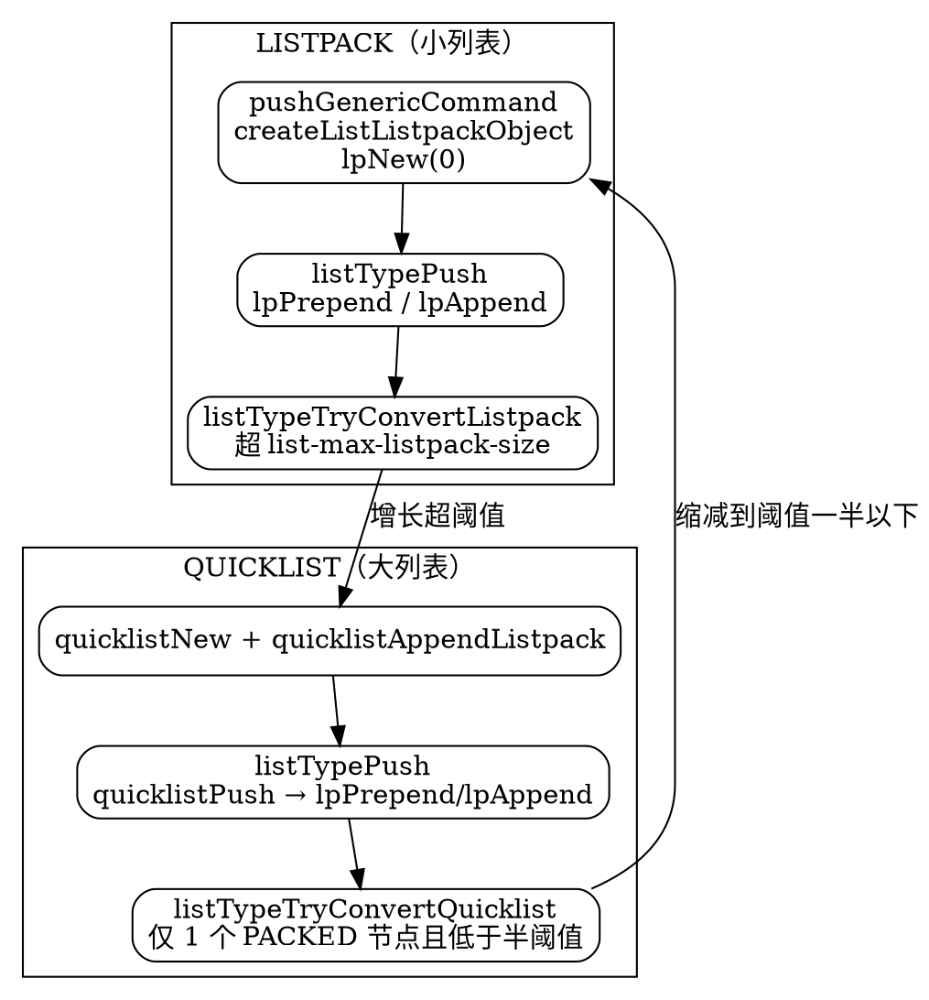

# Redis List Type: Source Deep Dive

## Introduction

List 是线性的有序结构，可用作队列、栈。它的底层实现经历过三个阶段：3.2 之前的 `linkedlist` / `ziplist` 二选一，3.2 引入 `quicklist`（linkedlist 套 ziplist），7.0 把 quicklist 的节点换成 listpack。**8.10.2 又往前走了一步**：小列表直接用单个 `listpack`，超过阈值才转成 `quicklist`，并且缩容后还能转回。

> 版本基线：Redis 8.10.2（commit 498ecd0d）。以下片段均取自该 tag，路径为 `src/` 相对路径。

三个容易理解错的点：

- **8.10.2 的 List 不是「一律 quicklist」**：`object.h` 中 List 合法编码有 `OBJ_ENCODING_LISTPACK`（小列表，单块 listpack）与 `OBJ_ENCODING_QUICKLIST`（大列表，listpack 的双向链表）两种；`pushGenericCommand` 新建对象走 `createListListpackObject()`，再按需升级。
- **`linkedlist` / `ziplist` 编码早已移除**：`OBJ_ENCODING_LINKEDLIST`、`OBJ_ENCODING_ZIPLIST` 在 8.x 仅作历史符号（`object.h` 标注 ZIPLIST `No longer used`）。旧笔记「3.2 前满足条件用 ziplist 否则 linkedlist」只能作为历史叙述。
- **编码可双向转换，且缩容用更严格的半阈值**：`listTypeTryConvertListpack` / `listTypeTryConvertQuicklist` 负责来回切；`shrinking=1` 时把字节/元素阈值减半，避免插入删除抖动导致反复转换。Quicklist 只有在「只剩一个 PACKED 节点」时才允许转回 listpack。

## Encodings and Conversion Decision



## Creation: createListListpackObject / createQuicklistObject

新建 List 默认走 `createListListpackObject()`（LISTPACK）；`createQuicklistObject()` 仍保留，供已知会很大的场景（如 RDB 加载）直接构造 QUICKLIST。

```c
robj *createQuicklistObject(int fill, int compress) {
    quicklist *l = quicklistNew(fill, compress);
    robj *o = createObject(OBJ_LIST,l);
    o->encoding = OBJ_ENCODING_QUICKLIST;
    return o;
}

robj *createListListpackObject(void) {
    unsigned char *lp = lpNew(0);
    robj *o = createObject(OBJ_LIST,lp);
    o->encoding = OBJ_ENCODING_LISTPACK;
    return o;
}
```

## Growing: listTypeTryConvertListpack

追加前调用 `listTypeTryConversionAppend`（内部是 `LIST_CONV_GROWING`），评估「现有 listpack 字节 + 待追加字节」与「现有元素数 + 待追加数」是否超过 `list_max_listpack_size`，超了就建 quicklist 并把原 listpack 作为一个节点挂进去。

```c
static void listTypeTryConvertListpack(robj *o, robj **argv, int start, int end,
                                       beforeConvertCB fn, void *data)
{
    serverAssert(o->encoding == OBJ_ENCODING_LISTPACK);

    size_t add_bytes = 0;
    size_t add_length = 0;

    if (argv) {
        for (int i = start; i <= end; i++) {
            if (!sdsEncodedObject(argv[i]))
                continue;
            add_bytes += sdslen(argv[i]->ptr);
        }
        add_length = end - start + 1;
    }

    if (quicklistNodeExceedsLimit(server.list_max_listpack_size,
            lpBytes(o->ptr) + add_bytes, lpLength(o->ptr) + add_length))
    {
        /* Invoke callback before conversion. */
        if (fn) fn(data);

        quicklist *ql = quicklistNew(server.list_max_listpack_size, server.list_compress_depth);

        /* Append listpack to quicklist if it's not empty, otherwise release it. */
        if (lpLength(o->ptr))
            quicklistAppendListpack(ql, o->ptr);
        else
            lpFree(o->ptr);
        o->ptr = ql;
        o->encoding = OBJ_ENCODING_QUICKLIST;
    }
}
```

## Shrinking: listTypeTryConvertQuicklist

反向转换条件更严格：quicklist 必须**只有一个 PACKED 节点**，且字节数 / 元素数低于阈值（缩减场景再减半）；满足则把该节点的 `entry`（listpack）直接摘出来作为对象的 `ptr`，释放空壳 quicklist。

```c
static void listTypeTryConvertQuicklist(robj *o, int shrinking, beforeConvertCB fn, void *data) {
    serverAssert(o->encoding == OBJ_ENCODING_QUICKLIST);

    size_t sz_limit;
    unsigned int count_limit;
    quicklist *ql = o->ptr;

    /* A quicklist can be converted to listpack only if it has only one packed node. */
    if (ql->len != 1 || ql->head->container != QUICKLIST_NODE_CONTAINER_PACKED)
        return;

    /* Check the length or size of the quicklist is below the limit. */
    quicklistNodeLimit(server.list_max_listpack_size, &sz_limit, &count_limit);
    if (shrinking) {
        sz_limit /= 2;
        count_limit /= 2;
    }
    if (ql->head->sz > sz_limit || ql->count > count_limit) return;

    /* Invoke callback before conversion. */
    if (fn) fn(data);

    /* Extract the listpack from the unique quicklist node,
     * then reset it and release the quicklist. */
    o->ptr = ql->head->entry;
    ql->head->entry = NULL;
    ql->alloc_size -= ql->head->sz;
    quicklistRelease(ql);
    o->encoding = OBJ_ENCODING_LISTPACK;
}
```

统一入口 `listTypeTryConversionRaw` 按当前编码与增长/缩减类型分派：

```c
static void listTypeTryConversionRaw(robj *o, list_conv_type lct,
                                     robj **argv, int start, int end,
                                     beforeConvertCB fn, void *data)
{
    if (o->encoding == OBJ_ENCODING_QUICKLIST) {
        if (lct == LIST_CONV_GROWING) return; /* Growing has nothing to do with quicklist */
        listTypeTryConvertQuicklist(o, lct == LIST_CONV_SHRINKING, fn, data);
    } else if (o->encoding == OBJ_ENCODING_LISTPACK) {
        if (lct == LIST_CONV_SHRINKING) return; /* Shrinking has nothing to do with listpack */
        listTypeTryConvertListpack(o, argv, start, end, fn, data);
    } else {
        serverPanic("Unknown list encoding");
    }
}
```

## LPUSH / RPUSH: pushGenericCommand

`LPUSH` / `RPUSH` 共用 `pushGenericCommand`：新建走 `createListListpackObject()`，追加前调 `listTypeTryConversionAppend()` 决定是否升级 quicklist，再逐个 `listTypePush()`。`listTypePush()` 同时处理两种编码（LISTPACK 走 `lpPrependInteger` / `lpAppend`，QUICKLIST 走 `quicklistPush`）。

```c
void pushGenericCommand(client *c, int where, int xx) {
    unsigned long llen;
    dictEntryLink link;
    int j;
    size_t oldsize = 0;

    kvobj *lobj = lookupKeyWriteWithLink(c->db, c->argv[1], &link);
    if (checkType(c,lobj,OBJ_LIST)) return;
    int existed = (lobj != NULL);
    if (!lobj) {
        if (xx) {
            addReply(c, shared.czero);
            return;
        }

        lobj = createListListpackObject();
        dbAddByLink(c->db, c->argv[1], &lobj, &link);
    }

    if (server.memory_tracking_enabled)
        oldsize = kvobjAllocSize(lobj);
    listTypeTryConversionAppend(lobj,c->argv,2,c->argc-1,NULL,NULL);
    for (j = 2; j < c->argc; j++) {
        listTypePush(lobj,c->argv[j],where);
        server.dirty++;
    }
```

```c
void listTypePush(robj *subject, robj *value, int where) {
    if (subject->encoding == OBJ_ENCODING_QUICKLIST) {
        int pos = (where == LIST_HEAD) ? QUICKLIST_HEAD : QUICKLIST_TAIL;
        if (value->encoding == OBJ_ENCODING_INT) {
            char buf[32];
            ll2string(buf, 32, (long)value->ptr);
            quicklistPush(subject->ptr, buf, strlen(buf), pos);
        } else {
            quicklistPush(subject->ptr, value->ptr, sdslen(value->ptr), pos);
        }
    } else if (subject->encoding == OBJ_ENCODING_LISTPACK) {
        if (value->encoding == OBJ_ENCODING_INT) {
            subject->ptr = (where == LIST_HEAD) ?
                lpPrependInteger(subject->ptr, (long)value->ptr) :
                lpAppendInteger(subject->ptr, (long)value->ptr);
        } else {
            subject->ptr = (where == LIST_HEAD) ?
                lpPrepend(subject->ptr, value->ptr, sdslen(value->ptr)) :
                lpAppend(subject->ptr, value->ptr, sdslen(value->ptr));
        }
    } else {
        serverPanic("Unknown list encoding");
    }
}
```

## History: linkedlist / ziplist（历史口径）

3.2 之前，List 在「单元素 < 64 字节且元素数 < 512」时用 ziplist，否则用 `adlist.h` 的双向链表：

```c
typedef struct list {
    listNode *head;
    listNode *tail;
    void *(*dup)(void *ptr);
    void (*free)(void *ptr);
    int (*match)(void *ptr, void *key);
    unsigned long len; // get size O(1)
} list;
```

这段仅为历史背景：8.10.2 里 `linkedlist` 编码已不存在，ziplist 也已 `No longer used`，不要据此描述当前实现。压缩深度 `list-compress-depth`（默认 0）至今仍有效，只压缩 quicklist 两端之外的中间节点。

## Summary

- List 在 8.10.2 有两种编码：小列表 `LISTPACK`、大列表 `QUICKLIST`（节点也是 listpack）。
- 新建默认 `createListListpackObject()`，追加前 `listTypeTryConversionAppend()` 决定是否升级；缩容到半阈值以下且仅一个 PACKED 节点时可转回。
- `linkedlist` / ziplist 是历史实现；`LPUSH` = `pushGenericCommand(c, LIST_HEAD, 0)`。

## Links

- [Redis Struct 总纲](/docs/CS/DB/Redis/struct/struct.md?id=lists)
- [Quicklist（大列表实现）](/docs/CS/DB/Redis/struct/quicklist.md)
- [Listpack（小列表实现）](/docs/CS/DB/Redis/struct/listpack.md)
- [List 用法与 MQ 语义](/docs/CS/DB/Redis/MQ.md)

## References

- <https://github.com/redis/redis/blob/8.10.2/src/t_list.c>
- <https://github.com/redis/redis/blob/8.10.2/src/object.c>
- <https://github.com/redis/redis/blob/8.10.2/src/object.h>
- <https://redis.io/docs/latest/develop/data-types/lists/>
