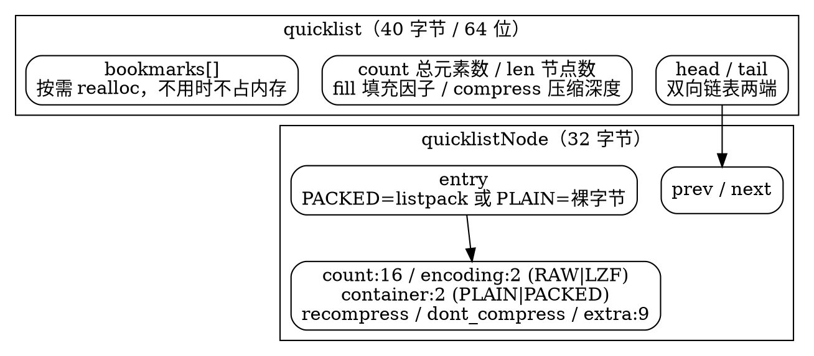

# Redis Quicklist: Source Deep Dive

## Introduction

Quicklist 是 List 类型的底层实现，本质是一个**双向链表，每个节点是一个 listpack**（PACKED 容器），以此在「连续内存的高 locality」与「大块 realloc 的成本」之间折中。旧资料通篇说「节点是 ziplist、container ZIPLIST=2、调用 `ziplistPush`」，那是 7.x 口径：8.10.2 的容器枚举里已经没有 ZIPLIST，节点字段也从 `zl` 改名为 `entry`，插入走 `lpPrepend` / `lpAppend`。

> 版本基线：Redis 8.10.2（commit 498ecd0d）。以下片段均取自该 tag，路径为 `src/` 相对路径。

三个关键纠偏点：

- **节点容器是 `PACKED`（listpack）与 `PLAIN`（单元素裸字节数组），没有 ZIPLIST**。头文件注释原文：`container: 2 bits, PLAIN=1 (a single item as char array), PACKED=2 (listpack with multiple items)`。
- **超大元素单独成 `PLAIN` 节点**。`isLargeElement()` 为真时不进 listpack，而是调 `__quicklistInsertPlainNode()` 存成独立 `char array`，避免撑爆某个 listpack。
- **配置项已改名**。`list-max-listpack-size` 是主名，`list-max-ziplist-size` 退化为旧名别名，默认值仍是 `-2`（每个节点约 8 KB）。

## Structure: quicklist / quicklistNode

`quicklist` 描述整条链表；`quicklistNode` 描述单个节点。8.10.2 在 `quicklist` 里多了 `alloc_size`（内存追踪用），在 `quicklistNode` 里把 `zl` 改名为 `entry`、`sz` 升为 `size_t`，并新增 `dont_compress` 位（阻止后续会复用节点的压缩）。



`quicklist` 结构（`alloc_size` 是 8.x 新增的内存追踪字段）：

```c
typedef struct quicklist {
    quicklistNode *head;
    quicklistNode *tail;
    unsigned long count;        /* total count of all entries in all listpacks */
    unsigned long len;          /* number of quicklistNodes */
    size_t alloc_size;          /* total allocated memory (in bytes) */
    signed int fill : QL_FILL_BITS;       /* fill factor for individual nodes */
    unsigned int compress : QL_COMP_BITS; /* depth of end nodes not to compress;0=off */
    unsigned int bookmark_count: QL_BM_BITS;
    quicklistBookmark bookmarks[];
} quicklist;
```

`quicklistNode` 结构与容器枚举：注意 `entry` 字段与 `container : 2 /* PLAIN==1 or PACKED==2 */`。

```c
typedef struct quicklistNode {
    struct quicklistNode *prev;
    struct quicklistNode *next;
    unsigned char *entry;
    size_t sz;             /* entry size in bytes */
    unsigned int count : 16;     /* count of items in listpack */
    unsigned int encoding : 2;   /* RAW==1 or LZF==2 */
    unsigned int container : 2;  /* PLAIN==1 or PACKED==2 */
    unsigned int recompress : 1; /* was this node previous compressed? */
    unsigned int attempted_compress : 1; /* node can't compress; too small */
    unsigned int dont_compress : 1; /* prevent compression of entry that will be used later */
    unsigned int extra : 9; /* more bits to steal for future usage */
} quicklistNode;
```

```c
/* quicklist node container formats */
#define QUICKLIST_NODE_CONTAINER_PLAIN 1
#define QUICKLIST_NODE_CONTAINER_PACKED 2
```

## Creation: quicklistCreate

新建空 quicklist，`fill` 默认 `-2`。相比旧版多了 `zmalloc_usable()` 取实际可用字节数写入 `alloc_size`。

```c
/* Create a new quicklist.
 * Free with quicklistRelease(). */
quicklist *quicklistCreate(void) {
    struct quicklist *quicklist;
    size_t quicklist_sz;

    quicklist = zmalloc_usable(sizeof(*quicklist), &quicklist_sz);
    quicklist->head = quicklist->tail = NULL;
    quicklist->len = 0;
    quicklist->count = 0;
    quicklist->alloc_size = quicklist_sz;
    quicklist->compress = 0;
    quicklist->fill = -2;
    quicklist->bookmark_count = 0;
    return quicklist;
}
```

## Insertion: quicklistPushHead / quicklistPushTail

入队先判 `isLargeElement()`：超大元素直接建 `PLAIN` 节点；否则用 `_quicklistNodeAllowInsert()` 判断 head/tail 节点能否再塞一个元素，能则 `lpPrepend` / `lpAppend`，不能则 `lpNew(0)` 新建一个 listpack 节点再插入链表。

```c
int quicklistPushHead(quicklist *quicklist, void *value, size_t sz) {
    quicklistNode *orig_head = quicklist->head;

    if (unlikely(isLargeElement(sz, quicklist->fill))) {
        __quicklistInsertPlainNode(quicklist, quicklist->head, value, sz, 0);
        return 1;
    }

    if (likely(
            _quicklistNodeAllowInsert(quicklist->head, quicklist->fill, sz))) {
        size_t oldsize = quicklist->head->sz;
        quicklist->head->entry = lpPrepend(quicklist->head->entry, value, sz);
        quicklistNodeUpdateSz(quicklist->head);
        quicklistUpdateAllocSize(quicklist, quicklist->head->sz, oldsize);
    } else {
        quicklistNode *node = quicklistCreateNode(quicklist);
        node->entry = lpPrepend(lpNew(0), value, sz);
        quicklistNodeUpdateSz(node);
        quicklistUpdateAllocSize(quicklist, node->sz, 0);
        _quicklistInsertNodeBefore(quicklist, quicklist->head, node);
    }
    quicklist->count++;
    quicklist->head->count++;
    return (orig_head != quicklist->head);
}
```

```c
int quicklistPushTail(quicklist *quicklist, void *value, size_t sz) {
    quicklistNode *orig_tail = quicklist->tail;
    if (unlikely(isLargeElement(sz, quicklist->fill))) {
        __quicklistInsertPlainNode(quicklist, quicklist->tail, value, sz, 1);
        return 1;
    }

    if (likely(
            _quicklistNodeAllowInsert(quicklist->tail, quicklist->fill, sz))) {
        size_t oldsize = quicklist->tail->sz;
        quicklist->tail->entry = lpAppend(quicklist->tail->entry, value, sz);
        quicklistNodeUpdateSz(quicklist->tail);
        quicklistUpdateAllocSize(quicklist, quicklist->tail->sz, oldsize);
    } else {
        quicklistNode *node = quicklistCreateNode(quicklist);
        node->entry = lpAppend(lpNew(0), value, sz);
        quicklistNodeUpdateSz(node);
        quicklistUpdateAllocSize(quicklist, node->sz, 0);
        _quicklistInsertNodeAfter(quicklist, quicklist->tail, node);
    }
    quicklist->count++;
    quicklist->tail->count++;
    return (orig_tail != quicklist->tail);
}
```

`_quicklistNodeAllowInsert()` 用 `SIZE_ESTIMATE_OVERHEAD` 高估单条目开销（宁可低估填充度，也不让节点低于 4 KB 下限），再交给 `quicklistNodeExceedsLimit(fill, new_sz, node->count + 1)` 按 fill 规则裁决：

```c
REDIS_STATIC int _quicklistNodeAllowInsert(const quicklistNode *node,
                                           const int fill, const size_t sz) {
    if (unlikely(!node))
        return 0;

    if (unlikely(QL_NODE_IS_PLAIN(node) || isLargeElement(sz, fill)))
        return 0;

    /* Estimate how many bytes will be added to the listpack by this one entry.
     * We prefer an overestimation, which would at worse lead to a few bytes
     * below the lowest limit of 4k (see optimization_level).
     * Note: No need to check for overflow below since both `node->sz` and
     * `sz` are to be less than 1GB after the plain/large element check above. */
    size_t new_sz = node->sz + sz + SIZE_ESTIMATE_OVERHEAD;
    if (unlikely(quicklistNodeExceedsLimit(fill, new_sz, node->count + 1)))
        return 0;
    return 1;
}
```

## Tuning

`fill` 取值语义（配置名已改为 `list-max-listpack-size`，旧名 `list-max-ziplist-size` 仍作为别名接受）：

- `-5` ~ `-1`：按节点字节数上限（`-5`=64 KB、`-4`=32 KB、`-3`=16 KB、`-2`=8 KB、`-1`=4 KB），`-2` / `-1` 是常用推荐。
- 正数：每个节点**恰好**存该数量的元素。

```c
createIntConfig("list-max-listpack-size", "list-max-ziplist-size", MODIFIABLE_CONFIG, INT_MIN, INT_MAX, server.list_max_listpack_size, -2, INTEGER_CONFIG, NULL, NULL),
```

控制节点大小的意义：既避免节点过小退化成「链表套单元素 listpack」而浪费指针，也避免节点过大回到接近单块连续内存、让修改又触发大范围内存拷贝。由于 listpack 本身**没有 ziplist 的级联更新问题**，这里控制粒度纯粹是为了 realloc 成本与迭代局部性，而非旧资料强调的「缩小级联更新范围」。

## Summary

- Quicklist 是 listpack 的双向链表；节点容器只有 `PACKED`（listpack）与 `PLAIN`（单元素），ZIPLIST 枚举已不存在。
- 插入走 `lpPrepend` / `lpAppend`；超大元素单独成 `PLAIN` 节点。
- `fill` 默认 `-2`，主配置名 `list-max-listpack-size`，旧名作为别名兼容。

## Links

- [List（命令层与 listTypePush）](/docs/CS/DB/Redis/struct/list.md)
- [Listpack](/docs/CS/DB/Redis/struct/listpack.md)
- [Ziplist（历史）](/docs/CS/DB/Redis/struct/ziplist.md)

## References

- <https://github.com/redis/redis/blob/8.10.2/src/quicklist.c>
- <https://github.com/redis/redis/blob/8.10.2/src/quicklist.h>
- <https://github.com/redis/redis/blob/8.10.2/src/config.c>
