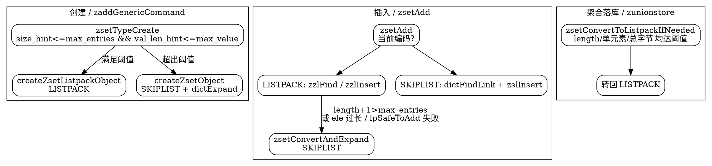

# Redis Sorted Set (ZSET) Structure: Source Deep Dive

## Introduction

Sorted Set 是有序集合：元素唯一，每个元素挂一个 `double score`，排序规则是「先比 score，score 相同再按成员字典序」。它既像 Set（成员唯一）又像 Hash（成员→score），但顺序是**结构自带的**，查询时不再排序。经典场景是排行榜、延迟队列、带权重的去重集合。

> 版本基线：Redis 8.10.2（commit 498ecd0d）。以下片段均取自该 tag，路径为 `src/` 相对路径。

三个最容易被旧资料误导的点：

- **小对象编码是 `listpack`，不是 ziplist**。`object.h` 里 `OBJ_ENCODING_ZIPLIST` 已标注 `No longer used: old list/hash/zset encoding`；8.10.2 新建小 zset 走 `createZsetListpackObject()`。旧笔记通篇 `createZsetZiplistObject` / `zset-max-ziplist-*` 是 7.x 口径。
- **配置项已改名但保留旧别名**。`config.c` 用 `createSizeTConfig("zset-max-listpack-entries", "zset-max-ziplist-entries", ...)` 的形式注册，新名 `zset-max-listpack-*` 是主名，`zset-max-ziplist-*` 退化为兼容别名（默认值 128 / 64 不变）。
- **可以「从 skiplist 转回紧凑编码」**。旧口径说「一旦升级 skiplist 永不回退」；8.10.2 在 `ZUNIONSTORE` 等聚合落库前会调 `zsetConvertToListpackIfNeeded()`，满足条件就转回 `listpack`——前提是元素数、单元素长度与总字节数（`lpSafeToAdd`）都在阈值内。

## Two Encodings and the Decision

`zset` 编码只有两种在用：`OBJ_ENCODING_LISTPACK`（紧凑小对象）与 `OBJ_ENCODING_SKIPLIST`（跳表 + 哈希表）。转换决策由「元素个数 / 单元素长度 / 总字节数」三个量共同决定，且**建库时**与**插入时**走不同函数：



编码枚举在 `object.h`，注意 `LISTPACK_EX` 是 hash 字段级过期用的扩展编码，zset 不用：

```c
#define OBJ_ENCODING_ZIPLIST 5 /* No longer used: old list/hash/zset encoding. */
#define OBJ_ENCODING_SKIPLIST 7  /* Encoded as skiplist */
#define OBJ_ENCODING_QUICKLIST 9 /* Encoded as linked list of listpacks */
#define OBJ_ENCODING_LISTPACK 11 /* Encoded as a listpack */
#define OBJ_ENCODING_LISTPACK_EX 12 /* Encoded as listpack, extended with metadata */
```

## Skiplist Encoding: dict + zskiplist

SKIPLIST 编码的 `zset` 结构定义在 `server.h`，两个成员：哈希表 `dict` 与跳表 `zsl`。注意 8.x 的 `dict` 现在把**成员映射到跳表节点指针**（见后文 `dictSetKeyAtLink(zs->dict, znode, ...)`），而非直接存 score 值。

```c
typedef struct zset {
    dict *dict;
    zskiplist *zsl;
} zset;
```

## Creation: zsetTypeCreate / zsetTypeMaybeConvert

`zaddGenericCommand` 建 key 时不再硬编码 `createZsetZiplistObject()`，而是把元素数与第一个成员长度作为 hint 传给 `zsetTypeCreate()`；已存在则调 `zsetTypeMaybeConvert()` 判断是否要提前升级。

```c
robj *zsetTypeCreate(size_t size_hint, size_t val_len_hint) {
    if (size_hint <= server.zset_max_listpack_entries &&
        val_len_hint <= server.zset_max_listpack_value)
    {
        return createZsetListpackObject();
    }

    robj *zobj = createZsetObject();
    zset *zs = zobj->ptr;
    dictExpand(zs->dict, size_hint);
    return zobj;
}

/* Check if the existing zset should be converted to another encoding based off the
 * the size hint. */
void zsetTypeMaybeConvert(robj *zobj, size_t size_hint) {
    if (zobj->encoding == OBJ_ENCODING_LISTPACK &&
        size_hint > server.zset_max_listpack_entries)
    {
        zsetConvertAndExpand(zobj, OBJ_ENCODING_SKIPLIST, size_hint);
    }
}
```

调用点（`zaddGenericCommand`）：

```c
    if (zobj == NULL) {
        if (xx) goto reply_to_client; /* No key + XX option: nothing to do. */
        robj *o = zsetTypeCreate(elements, sdslen(c->argv[scoreidx + 1]->ptr));
        zobj = dbAdd(c->db,key,&o);
    } else {
        if (server.memory_tracking_enabled)
            oldsize = kvobjAllocSize(zobj);
        zsetTypeMaybeConvert(zobj, elements);
```

## Insertion: zsetAdd

`zsetAdd` 按编码分两条路径。LISTPACK 分支：`zzlFind` 查重 → 存在则按需 `zzlDelete` + `zzlInsert`；不存在则先做阈值预检（元素数 +1、成员长度、`lpSafeToAdd`），超阈值就 `zsetConvertAndExpand` 到 SKIPLIST。

```c
    if (zobj->encoding == OBJ_ENCODING_LISTPACK) {
        unsigned char *eptr;

        if ((eptr = zzlFind(zobj->ptr,ele,&curscore)) != NULL) {
            /* NX? Return, same element already exists. */
            if (nx) {
                *out_flags |= ZADD_OUT_NOP;
                return 1;
            }

            /* Prepare the score for the increment if needed. */
            if (incr) {
                score += curscore;
                if (isnan(score)) {
                    *out_flags |= ZADD_OUT_NAN;
                    return 0;
                }
            }

            if (newscore) *newscore = score;

            /* Remove and re-insert when score changed. */
            if (score != curscore) {
                zobj->ptr = zzlDelete(zobj->ptr,eptr);
                zobj->ptr = zzlInsert(zobj->ptr,ele,score);
                *out_flags |= ZADD_OUT_UPDATED;
            }
            return 1;
        } else if (!xx) {
            /* check if the element is too large or the list
             * becomes too long *before* executing zzlInsert. */
            if (zzlLength(zobj->ptr)+1 > server.zset_max_listpack_entries ||
                sdslen(ele) > server.zset_max_listpack_value ||
                !lpSafeToAdd(zobj->ptr, sdslen(ele)))
            {
                zsetConvertAndExpand(zobj, OBJ_ENCODING_SKIPLIST, zsetLength(zobj) + 1);
            } else {
                zobj->ptr = zzlInsert(zobj->ptr,ele,score);
                if (newscore) *newscore = score;
                *out_flags |= ZADD_OUT_ADDED;
                return 1;
            }
        } else {
            *out_flags |= ZADD_OUT_NOP;
            return 1;
        }
    }
```

SKIPLIST 分支用 `dictFindLink` 一次查找同时拿到 bucket，省掉旧实现里 `dictFind` + `dictAdd` 的二次查找；score 变化时用 `zslUpdateScore(zs->zsl, znode, score)`（8.x 直接传节点指针，不再传 curscore+ele）。

```c
    /* Note that the above block handling listpack would have either returned or
     * converted the key to skiplist. */
    if (zobj->encoding == OBJ_ENCODING_SKIPLIST) {
        zset *zs = zobj->ptr;
        zskiplistNode *znode;
        dictEntry *de;
        dictEntryLink bucket, link;

        /* Use dictFindLink to find the element and get the bucket for potential insertion.
         * This avoids a second lookup in dictAdd() if the element doesn't exist. */
        link = dictFindLink(zs->dict, ele, &bucket);

        if (link != NULL) {
            de = *link;
            /* ... NX / incr / GT-LT 检查略 ... */
            znode = dictGetKey(de);
            curscore = znode->score;
            if (score != curscore) {
                zslUpdateScore(zs->zsl, znode, score);
                /* node pointer stays the same, no dict update needed */
                *out_flags |= ZADD_OUT_UPDATED;
            }
            return 1;
        } else if (!xx) {
            znode = zslInsert(zs->zsl, score, ele);
            dictSetKeyAtLink(zs->dict, znode, &bucket, 1);
            *out_flags |= ZADD_OUT_ADDED;
            if (newscore) *newscore = score;
            return 1;
        }
    }
```

## Conversion: zsetConvertToListpackIfNeeded

`ZUNIONSTORE` / `ZINTERSTORE` / `ZDIFFSTORE` 与 GEO 落库后会调这个函数尝试回退到 LISTPACK。相比旧版 `zsetConvertToZiplistIfNeeded`，8.10.2 多了一个 `lpSafeToAdd(NULL, totelelen)` 的**总字节数**安全阀。

```c
void zsetConvertToListpackIfNeeded(robj *zobj, size_t maxelelen, size_t totelelen) {
    if (zobj->encoding == OBJ_ENCODING_LISTPACK) return;
    zset *zset = zobj->ptr;

    if (zset->zsl->length <= server.zset_max_listpack_entries &&
        maxelelen <= server.zset_max_listpack_value &&
        lpSafeToAdd(NULL, totelelen))
    {
        zsetConvert(zobj,OBJ_ENCODING_LISTPACK);
    }
}
```

对应配置项在 `config.c` 的注册（`zset-max-ziplist-*` 作为旧名别名保留）：

```c
createSizeTConfig("zset-max-listpack-entries", "zset-max-ziplist-entries", MODIFIABLE_CONFIG, 0, LONG_MAX, server.zset_max_listpack_entries, 128, INTEGER_CONFIG, NULL, NULL),
createSizeTConfig("zset-max-listpack-value", "zset-max-ziplist-value", MODIFIABLE_CONFIG, 0, LONG_MAX, server.zset_max_listpack_value, 64, MEMORY_CONFIG, NULL, NULL),
```

## Summary

- ZSET 两种在用编码：LISTPACK（小对象）与 SKIPLIST（跳表 + dict）；`OBJ_ENCODING_ZIPLIST` 已废弃。
- 创建 / 插入 / 聚合三条路径分别用 `zsetTypeCreate`、`zsetAdd`、`zsetConvertToListpackIfNeeded` 决定或切换编码。
- SKIPLIST 编码下 dict 存的是跳表节点指针，比较规则是先 score 后成员字典序。

## Links

- [Redis Struct 总纲](/docs/CS/DB/Redis/struct/struct.md?id=sorted-sets)
- [Listpack](/docs/CS/DB/Redis/struct/listpack.md)
- [Skiplist](/docs/CS/DB/Redis/struct/skiplist.MD)
- [Hash](/docs/CS/DB/Redis/struct/hash.md)
- [Geo（基于 zset 实现）](/docs/CS/DB/Redis/struct/geo.md)

## References

- <https://github.com/redis/redis/blob/8.10.2/src/t_zset.c>
- <https://github.com/redis/redis/blob/8.10.2/src/server.h>
- <https://github.com/redis/redis/blob/8.10.2/src/object.h>
- <https://github.com/redis/redis/blob/8.10.2/src/config.c>
- <https://redis.io/docs/latest/develop/data-types/sorted-sets/>
