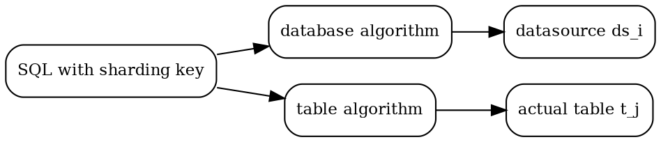

## Introduction

分片（sharding）是将大数据表分解为较小的表（分片）、并把这些分片分布在多个数据库集群节点上的过程。每个分片只含原数据集的一个子集，总负载因此被分散到多个节点——它是关系数据库**水平扩展（scale-out）**的标准手段。分片本质上可以看作传统数据库中的分区表，只是分区边界从「单机内的存储组织」变成了「跨节点的数据分布」。

单机关系库的瓶颈是结构性的：B+Tree 索引随数据量变深、磁盘 IO 次数上升，高并发请求又把压力集中到仅有的写入口；数据量越大，备份与恢复的时间成本越不可控（经验上单库数据量宜控制在 1TB 以内，这是运维阈值不是物理极限）。分片就是对这三个问题的正面回答，代价是引入一整套新的分布式问题——本页逐项展开。

## Horizontal and Vertical Sharding

| | 水平分片 | 垂直分片 |
| :--- | :--- | :--- |
| 拆分维度 | 同一张表的不同**行** | 同一张表的不同**列**（按业务分库） |
| 分片间数据 | 互不重叠 | 通常互补，可 join 回完整行 |
| 解决的问题 | 单表数据量、TPS、备份恢复 | 单库压力按业务隔离 |
| 遗留问题 | 分布式事务、跨片查询、全局主键 | 单表过大依旧存在 |

垂直分片是按业务把表分到不同数据库（用户库、订单库），让专业库干专业事；它**不解决单表过大**——表量继续增长仍要水平分片。实践中两者常叠加：先按业务垂直切，再对热点表水平切。

## Alternatives to Sharding

不是所有「单库扛不住」都该上分片，先看替代方案：

- **库内分区**：MySQL 支持 RANGE / LIST / COLUMNS / HASH / KEY 分区与子分区（仅 InnoDB 与 NDB 引擎），PostgreSQL 有声明式分区（declarative partitioning）。分区是**单机内**的存储组织优化：管理、备份、写入口仍在同一台机器，不突破单机容量上限。库内实现口径见 [PostgreSQL Partition](/docs/CS/DB/PostgreSQL/Partition.md)。
- **冷热数据分离与归档**：历史数据批次迁走、查询上加时间限制，用访问模式而不是架构扩容解决问题。
- **读写分离**：读多写少时先把读流量分摊到副本，不动数据分布；与分片正交、可叠加（ShardingSphere 的实现口径见 [Readwrite Splitting](/docs/CS/DB/ShardingSphere/Readwrite_Splitting.md)）。
- **升级硬件（scale-up）**：最简单也最先撞墙的一条。
- **分布式数据库内核**：把分片做进存储内核（[TiDB](/docs/CS/DB/TiDB.md) 等），绿地项目的另一种答案。

| 症状 | 首选 |
| :--- | :--- |
| 单表过大但总量可控、查询集中 | 库内分区 |
| 读流量占比高 | 读写分离 |
| 写入口与总量都到顶、必须分散存储 | 水平分片 |
| 新系统、要原生分布式语义 | 分布式数据库内核 |

## Sharding Strategies

分片策略的选择几乎不可逆——数据重分布的代价远高于改配置，选型要在业务访问模式上验证：

| 策略 | 均匀性 | 范围查询 | 扩容成本 | 热点风险 |
| :--- | :--- | :--- | :--- | :--- |
| 哈希取模 | 好 | 差（退化全路由） | 高（模数变化 = 全量重哈希） | 低 |
| 范围（RANGE） | 差 | 好 | 低（加新段即可） | 高（热点集中在尾段） |
| 目录 / 查表 | 取决于映射 | 好 | 低（改映射表） | 目录表是单点 |
| 一致性哈希 + 虚拟节点 | 较好 | 差 | **低（仅搬迁约 1/N）** | 低 |
| 时间 / 日期 | 差 | 好 | 低（加新分区） | 高（热点在最新分区） |
| 地理 / 租户 / tag-aware | 取决于数据 | 好 | 低 | 大租户自身成热点 |

- **哈希取模**：`hash(key) % N`。实现最简、分布最匀，但扩容时 N 变化导致**几乎所有 key 的归属都变**——全量重哈希 + 重迁移，只能作为分片数永不变的预分片底座。
- **范围分片**：按键值区间切（如用户 ID 段、订单日期）。范围查询天然落在少数分片，但热点永远在「正在写入」的那一段（最新日期段、最大 ID 段）。
- **目录分片**：用一张映射表查 key 属于哪个片。灵活性最高（可逐 key 调配），映射表本身成为热点与单点，规模大后查询开销显著。
- **一致性哈希**：Karger 等人 1997 年提出，Dynamo（SOSP 2007）把它推广为工业标准。哈希空间组织成环，节点与 key 都映射到环上，key 归属沿环找到的第一个节点；增减节点只影响环上相邻区间，**平均只需搬迁约 1/N 的数据**。再叠加**虚拟节点**（每个物理节点在环上占多个位置），解决节点少时分布不均与异构机器的权重问题。
- **地理/租户分片**：按地域、租户 ID 打标，把相关数据圈在一起——查询局部性好、跨片 join 少，但大租户会自己变成热点，需要二次拆分。

## Routing and Table Types

一次读写要过两级路由：**分库算法**按分库字段算出数据源，**分表算法**按分表字段算出真实表。两个字段可以是同一个，也可以不同（如按 `user_id` 分库、按 `order_id` 分表）。

分片语境下「表」有五种，混淆它们是配置错误的第一来源：

- **逻辑表**：SQL 里写的表名，水平分片同构表的逻辑标识。
- **真实表**：物理存在的分片表（`t_order_0` ~ `t_order_9`）。
- **绑定表（binding table）**：分片规则一致的一组表，join 时按主表的分片条件**一次算完**，其余表复用结果。没绑定时，`t_order` 与 `t_order_item` 按同一 `order_id` 分片，一条 `IN (10,11)` 也会路由出 2×2 的笛卡尔积。绑定关系靠**剥离真实表名尾部的数字后缀**推导——尾部的数字只能留给分片后缀（`_0`、`_1`），`t_order_2024` 式命名会直接破坏绑定。
- **广播表（broadcast table）**：每个数据源都有一份相同结构与数据的表（字典表），与小数据量的维表 join 时避免跨片。
- **单表**：只存在于一个数据源、不参与分片的表；中间件不会自动加载全部单表，需要显式登记，否则路由不到。

**没有分片键的 SQL 会执行全路由**——扇出到所有数据节点再归并。功能正确，性能最差；这是分片中间件性能问题里最常见的单点。

## Rebalancing and Scaling

扩容的核心命题是「加一个节点，只动该动的数据」：

- **预分片**：一开始就建远多于物理库数的逻辑片（如 1024 个桶），扩容只改「片 → 库」映射，数据在桶内不动。取模策略因此重新可用——模的是逻辑片数，不是物理库数。
- **虚拟节点**：一致性哈希的工程化配套，映射表随扩容局部调整，搬迁比例约 1/N。
- **在线迁移的标准路径**：双写（新旧库同时写）→ 存量迁移 → 增量同步追平 → 一致性校验 → 只读窗口内切换流量。ShardingSphere 的迁移四阶段（preparation / stock / incremental / traffic switching，增量靠 binlog 或逻辑复制）就是这套流程的完整实现，见 [Governance](/docs/CS/DB/ShardingSphere/Governance.md)。
- **同片组（table group / 文件组）**：把相关表放进同一分片，能省掉大量跨片 join 与分布式事务——**把数据摆对位置，比选事务模式更根本**。
- 再均衡以分区/region 为搬迁单位：先复制再移交所有权，才能不停写地挪数据。

## Hotspots

分片把单库热点变成了新形态的热点：

- **哈希倾斜**：算法本身均匀，但 key 分布不均（大量同租户、同地区数据）时仍会打偏某几个片。
- **范围分片热尾**：时间/ID 范围分片下，写入永远集中在最新段；按天分片的库，热点是「今天」。
- **热点 key 拆分**：单个超大 key（如一个爆款商品的库存行）单独成热点时，拆成多个子键（`item_123_0` ~ `item_123_N`）分散写，读时聚合。
- **bucket split**：宽列存储的解法——一个哈希桶承载多个分区，桶内再按负载动态拆分，扩容不需要全环重哈希（HBase/Cassandra 式）。

## Global Primary Key

单表自增主键在分片后失效：各真实表的自增序列互不感知，必然重复。全局主键的候选方案：

| 方案 | 原理 | 代价 |
| :--- | :--- | :--- |
| UUID | 本地生成，无需协调 | 无序、字符串长，索引友好性差 |
| 自增错开步长 | 各库设不同初始值与步长 | 扩容要改步长，ID 不连续，运维规则负担重 |
| 号段（segment） | 发号器批量取一段（如 1000）在本地点分配 | 批量取段提效；服务重启会丢未用完的号段 |
| 雪花（snowflake） | 64 bit：符号位 + 41 bit 毫秒时间 + 10 bit 机器 + 12 bit 序列 | 趋势递增、无协调；**时钟回拨会生成重复 ID**，机器位要注册中心分配 |
| 集中发号器 | Redis/Tair 等外部服务 INCR | 多一跳依赖，发号成关键路径 |

雪花的时间位让 ID 趋势递增，对 B+Tree 写入友好；12 bit 序列位意味着单机单毫秒上限 4096 个 ID。ShardingSphere 内置 `SNOWFLAKE` 与 `UUID` 两种生成器，经 `keyGenerateStrategies` 绑定到逻辑表与列，INSERT 缺主键时自动补值——配置口径见 [Sharding](/docs/CS/DB/ShardingSphere/Sharding.md)。

## Global Index and Cross-Shard Queries

分片后二级索引要么退化、要么变贵，两种主流形态：

| | terminating 索引 | global 索引 |
| :--- | :--- | :--- |
| 索引内容 | 索引键 + 匹配记录的**主键** | 索引自己按主键分片，直接定位 |
| 读路径 | 命中索引后**回查数据分片**（扇出） | 不扇出 |
| 写路径 | 同片更新 | **跨片更新**（索引分片 ≠ 数据分片） |
| 适用 | 读少写多、索引覆盖率低 | 读多写少、强定位需求 |

跨片查询的其它代价：

- **join**：能收进同片就收（绑定表、同片组、广播表）；收不了的要么宽表反范式，要么接受归并代价。
- **分页/排序/聚合**：跨片语义必须在中间件归并层重算——`LIMIT 10000, 10` 的深分页是所有跨片查询的经典性能陷阱，大偏移量翻页应改游标/键集。
- **子查询与复杂聚合**：超出单节点语义的部分要么改写、要么走联邦查询（ShardingSphere 的 SQL Federation 是 experimental，默认关闭，见 [SQL Pipeline](/docs/CS/DB/ShardingSphere/SQL_Pipeline.md)）。

## Distributed Transactions

分片把事务切成跨节点问题：一个事务改了 3 个分片，就必须让这 3 个分片「要么都提交、要么都回滚」。强一致走 XA 两阶段提交（短事务、低并发），最终一致走 BASE/Seata（长事务、高并发，业务改造 + 对账），也可以让业务自行兜底（LOCAL）。完整语义与选型见 [Distributed Transaction](/docs/CS/DB/ShardingSphere/Distributed_Transaction.md) 与 [Distributed](/docs/CS/Distributed/Distributed.md)。重申一次优先级：**先用同片设计消灭跨片事务，再选事务模式**。

## Sharding Forms

落地形态分三类，边界在「谁来持有路由规则」：

| 形态 | 代表 | 侵入性 | 运维点 |
| :--- | :--- | :--- | :--- |
| 客户端（嵌入应用） | [ShardingSphere](/docs/CS/DB/ShardingSphere.md)-JDBC | 应用依赖 jar，Java only | 无额外进程；规则随应用发布，ANTLR 解析缓存要预留堆 |
| 服务端代理（独立进程） | ShardingSphere-Proxy、[MyCat](/docs/CS/DB/MyCat/MyCat.md) | 对业务透明，异构语言可用 | 多一跳网络；集中归并，自身是吞吐瓶颈；静态入口便于 DBA 运维 |
| 数据库内核 / 平台级中间件 | [TiDB](/docs/CS/DB/TiDB.md)、Vitess（MySQL 分片中间件） | 换存储栈或换接入层 | 分片与共识做进系统，无中间件层；生态绑定深 |

## Facts Worth Pinning Down

1. **取模扩容 = 全量重哈希**：模数变化让几乎所有 key 改换门庭；实用解只有预分片（模逻辑片）与一致性哈希 + 虚拟节点（搬迁约 1/N）。
2. **绑定表靠剥离数字后缀推导**：真实表名尾部的数字必须只用作分片后缀。
3. **自增主键分片后不保证全局唯一**：分布式 ID 是必选项，不是可选项。
4. **范围分片热点在尾部，哈希分片范围查询退化全路由**：两类策略的代价正好互补，混合策略要清楚自己在换什么。
5. **terminating 索引读要回查、global 索引写跨片**：二级索引的代价只是从读挪到了写，没有消失。
6. **无分片键 SQL 全路由**：上线前用审计规则把这类 SQL 拦在测试环境。
7. **雪花时钟回拨会生成重复 ID**：这是雪花方案最著名的故障模式，部署要配时钟同步与回拨检测。
8. **单库 1TB 是运维经验阈值**：超过它备份/恢复/DDL 的时间成本先失控，不是存储先爆。

## Links

- [DataBases](/docs/CS/DB/DB.md)
- [MySQL Replication](/docs/CS/DB/MySQL/replica.md)
- [Transaction Flow](/docs/CS/DB/MySQL/Transaction_Flow.md)
- [Index](/docs/CS/DB/Index.md)
- [WAL](/docs/CS/DB/WAL.md)

## References

1. [Consistent Hashing and Random Trees (Karger et al., 1997)](https://www.cs.princeton.edu/courses/archive/fall09/cos518/papers/chash.pdf)
2. [Dynamo: Amazon's Highly Available Key-value Store (SOSP 2007)](https://www.allthingsdistributed.com/files/amazon-dynamo-sosp2007.pdf)
3. [MongoDB Sharding](https://www.mongodb.com/docs/manual/sharding/)
4. [MySQL 8.4 Reference Manual - Partitioning](https://dev.mysql.com/doc/refman/8.4/en/partitioning.html)
5. [PostgreSQL Documentation - Table Partitioning](https://www.postgresql.org/docs/current/ddl-partitioning.html)
6. [Vitess Architecture Overview](https://vitess.io/docs/current/overview/architecture/)
7. [美团 Leaf 分布式 ID 系统](https://tech.meituan.com/2017/04/21/mt-leaf.html)
