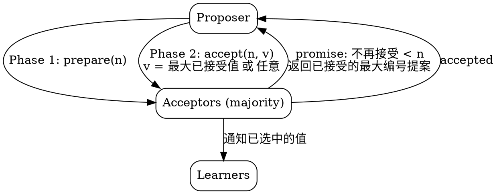

## Introduction

Paxos 是 Lamport 提出的一族分布式共识算法，用于让一组节点就某个值达成一致。它包含单值 Paxos（Basic Paxos）与多值 Paxos（Multi-Paxos）等变体，是后续 Raft、ZAB 等算法的理论源头，但工程上以「难理解」著称。

本文的读法：**先讲算法"为什么长这样"，再讲算法"是什么"**。"Paxos 难懂"的根源，从来不是两阶段消息流本身，而是 Lamport 从安全要求反推出来的那一根推导链（P1 → P2 → P2a → P2b → P2c）。抓住这根链，两阶段就不再是需要死记的仪式，而是 P2c 的直接实现。

## Roles and Model

### Three Roles

Paxos 定义了三个角色：*proposers*（提议者）、*acceptors*（接受者）、*learners*（学习者）。每个节点可同时承担多个角色，甚至全部。

- **Proposers**：提出候选值，并推动算法推进。
- **Acceptors**：协作从多个提案中选出一个，是容错的核心（多数派由 acceptor 构成）。
- **Learners**：得知最终被选中的值，通常把决策交付给上层状态机。

### Fault Model

Paxos 采用经典的**非拜占庭异步模型**：

- 节点以任意速度运行，可能因停机而失效，也可能重启。由于某个值被选中后节点仍可能失效并重启，除非节点记住它已接受/已选定的值，否则无解——**节点必须是持久化的**。
- 消息可任意延迟、重复、丢失，但不会被篡改（非拜占庭）。

### Safety Requirements

共识算法必须满足三条安全要求（Lamport 原文）：

- 只有被提出过的值才能被选中；
- 至多一个值被选中；
- 一个进程绝不会「学到」某个值被选中，除非它确实被选中了。

注意这三条只约束**安全**（safety），不约束**活性**（liveness）：它保证"不会出错"，但不保证"一定能选出"。活性由 leader 选举等机制另行保证（见 [Liveness and the Distinguished Proposer](#liveness-and-the-distinguished-proposer)）。

## Derivation: Why the Algorithm Has This Shape

这一段是 Paxos 真正的"逻辑"。它不是凭空给出两阶段，而是从安全要求一层层逼出来的。

### P1 and its Shortfall

先从最朴素的想法出发：

> **P1**：一个 acceptor 必须接受它收到的第一个提案。

但 P1 单独成立会导致冲突：若两个 proposer 分别向**互不相交**的多数派提出不同的值，每个值都被某个多数派接受，于是两个值同时被选中，违反"至多一个值"。

要堵住这个漏洞，需要让"两个值都被选中"变得不可能。一个提案被选中，当且仅当它被**多数派**接受。因此我们要求：

> 一个 acceptor 接受编号为 n 的提案之前，必须确认**没有编号小于 n 的提案已经被选中**。

但"是否已有更小编号的提案被选中"无法在局部判断——它要求 acceptor 知道全局。于是把约束再推强一层，不再问"是否已选中"，而是直接约束"所有可能中选的提案必须同值"。

### P2: Preserving the Chosen Value

> **P2**：如果一个值为 v 的提案被选中，那么所有编号更高的、被**选中**的提案，其值都必须是 v。

P2 把"两个值中选"从根上排除：一旦某个值 v 中选，后续一切中选提案都被钉死为 v。接下来把 P2 逐步加强到"可由 acceptor/proposer 局部保证"的形式：

- **P2a**：如果值为 v 的提案被选中，那么所有编号更高的、被**任何 acceptor 接受**的提案，其值都必须是 v。（比 P2 更强：接受即约束，不必等选中）
- **P2b**：如果值为 v 的提案被选中，那么所有编号更高的、被**任何 proposer 发出**的提案，其值都必须是 v。（比 P2a 更强：从源头约束提案的值）

P2b 正是我们想要的：只要 proposer 发出编号 n 的提案时，保证之前已选中的值（若有）会被沿用，就绝不会出现"新提案另起炉灶"导致双值。难点在于：**proposer 发出提案 n 之前，如何知道该用哪个值？** 它并不知道全局是否已选中什么，除非先去问 acceptor。

- **P2c**：对任意值 v 与编号 n，若 proposer 要发出编号为 n、值为 v 的提案，则存在某个由多数派 acceptor 构成的集合 S，满足二者之一：
  - (a) S 中没有 acceptor 接受过任何编号小于 n 的提案；或
  - (b) v 等于 S 中所有 acceptor 已接受的、编号小于 n 的提案里，**编号最大**那一条的值。

P2c 是 P2b 的可操作版本：它说 proposer 不必知道全局是否已选中，只要先向一个多数派"探听"——若探听到任何已接受的旧提案，就沿用其中编号最大的那条的值；若什么都没探听到，才可以用自己任意想推的值。通过归纳可以证明 P2c ⇒ P2b ⇒ P2a ⇒ P2，因此满足 P2c 就自动满足全部安全要求。

### From P2c to the Two-Phase Algorithm

P2c 的条件 (a)/(b) 恰好对应一个两阶段协议：

- **Phase 1（prepare）**：proposer 选编号 n，向一个多数派发 `prepare(n)`。acceptor 收到后，若 n 大于它已响应的任何 prepare 编号，就承诺"不再接受编号小于 n 的提案"，并返回自己**已接受过的编号最大的提案**（若有）。这一步就是 P2c 的"探听"——收集条件 (a)/(b) 所需的证据。
- **Phase 2（accept）**：若 proposer 从多数派收齐回应，就发 `accept(n, v)`；v 的取值规则正好落实 P2c：若回应中出现了已接受的旧提案，取其中编号最大者的值；若都没有，v 任意。acceptor 收到 `accept(n, v)` 后，除非它已回应过编号大于 n 的 prepare，否则接受。

于是"两阶段"不再是发明出来的仪式，而是 **P2c 把'全局已选中'翻译成'向多数派探听 + 沿用最大值'** 的直接结果。下一节把这套流程定型为 Basic Paxos。

## Basic Paxos (Single-Decree)

"Single-Decree" 指一次 Paxos 运行只就**一个**决策（一个 slot、一条命令）达成共识；要决定一串值，就跑多次（即 Multi-Paxos，见后）。

Paxos 节点必须知道"多数派"是多少个 acceptor。算法分两个阶段，角色职责如下表：

| | proposer | acceptor |
| --- | --- | --- |
| **Phase 1** | 选提案编号 n，向多数派发送 `prepare(n)`。 | 若 n 大于已响应的任何 prepare 编号，则回应承诺：不再接受编号 `< n` 的提案，并返回已接受过的编号最大的提案（若有）。 |
| **Phase 2** | 若收齐多数派对 `prepare(n)` 的回应，则向这些 acceptor 发送 `accept(n, v)`；v 取回应中编号最大的已接受提案的值，若回应均未报告任何提案则可为任意值。 | 若收到 `accept(n, v)`，除非已回应过编号 `> n` 的 prepare，否则接受该提案。 |

acceptor 接受提案后，该值**被多数派接受即视为选中**（chosen）。一个 proposer 可随时放弃某个提案而不影响正确性——即使相关请求在放弃后很久才到达也无妨；若 acceptor 因已收到更高编号 prepare 而忽略请求，它应顺手通知 proposer 放弃，这是不影响正确性的性能优化。

### A Worked Conflict

Paxos 如何处理两个 proposer 抢同一个决策？看一个最小追踪：

1. Proposer A 发 `prepare(1)`，多数派承诺，尚无任何人接受过值 → A 准备 `accept(1, x)`。
2. 与此同时 Proposer B 发 `prepare(2)`（编号更高）。多数派看到 2 > 1，更新承诺、返回"已接受的最大编号提案"——此时若 A 的 `accept(1,x)` 还没到，它们返回"无"；若已到，则返回 `(1, x)`。
3. B 收齐回应后发 `accept(2, v)`：若它探听到 `(1, x)`，则 v = x（沿用，保证安全）；否则 v = y（自己想推的值）。
4. 此后 acceptor 已承诺不接 `< 2` 的提案，A 的 `accept(1, x)` 到达时被拒绝。最终只有 `accept(2, ·)` 可能达成多数，值由 B 的 v 决定，且不会与已选中的 x 冲突。

关键在于：**高编号 prepare 用"承诺"封锁了低编号提案的接受通道**，而 proposer 又被迫沿用已探听到的旧值——两条规则一起把"双值中选"掐灭。

## Learning a Chosen Value

learner 要知道某值被选中，必须发现它已被多数派接受。

- 最简单的做法：acceptor 把自己的接受结果回报给一组"指定的 learner"，由其中任一在该值选中时通知所有 learner。指定 learner 越多越可靠，但通信开销越大。
- 由于消息可能丢失，某值可能已被选中却无 learner 知晓。learner 可主动向 acceptor 询问已接受的提案；但若 acceptor 失效，可能仍无法确定多数派是否接受。learner 也可以等下一个提案被选中时顺带得知。
- 若 learner **必须**立刻知道，可让一个 proposer 发起新提案（沿用上述算法）——新提案的 phase 1 会探听到当前已选中的值。

## Liveness and the Distinguished Proposer

只要系统足够多部分（proposer、acceptor、网络）正常工作，通过选出一个唯一的 *distinguished proposer*（主提议者 / leader），即可实现活性。

- [FLP 不可能性](/docs/CS/Distributed/Consensus/Consensus.md?id=flp-impossibility) 表明：在纯异步模型下，仅靠消息传递无法保证一定选出 leader，因此选举必然依赖随机性或真实时间（如超时）。但**无论选举成功与否，安全性始终成立**——双主只会拖慢推进，不会让两个服务器对"第 i 条命令选中的值"产生分歧。
- 正常操作中系统选出一个 leader，它在所有共识实例中充当 distinguished proposer。仅在当前 leader 失效与新 leader 选出的短暂窗口内例外。若多个节点自认 leader，它们会在同一实例中各提各的值，可能导致没有任何值被选中——但安全性仍被保持。选出单一 leader 只是为了推进，而非为了安全。

由于 leader 失效与重新选举应是罕见事件，**执行一条状态机命令的有效代价，就等于只跑 phase 2**。可以证明 Basic Paxos 的 phase 2 是"存在故障时达成一致代价"的理论下界，因此 Paxos 本质上是最优的。

## Multi-Paxos

Basic Paxos 一次只决定一个值；要维护一条复制日志（replicated log），就要对日志的每一个槽位（slot / 第 i 条命令）各跑一次 Basic Paxos。Multi-Paxos 的核心洞察是：**同一 leader 反复跑 phase 1 是浪费**——一旦 leader 稳定，它可以把 phase 1 只跑一次，之后对所有 slot 直接复用同一承诺、只跑 phase 2。

### Steady-State Optimization

- 选出稳定 leader 后，它在第 1 个 slot 跑完整的 phase 1 + phase 2，建立"我是当前leader、我的提案编号基线为 n"的承诺。
- 后续每个 slot 直接用 `accept(n+i, v)` 推进，跳过 prepare。代价从"每值两阶段"降到"首值两阶段、余值一阶段"。
- 一旦 leader 切换，新 leader 必须对自己的首个 slot 重新跑 phase 1，用自己的更高编号刷新 acceptor 的承诺，并探听前任可能已接受但未传达的值（沿用 P2c）。

这也解释了为什么工程里的 Paxos 几乎总是"带 leader 的 Multi-Paxos"，而纯 Basic Paxos 很少单独使用。

### Algorithmic Challenges

Multi-Paxos 在工程落地时要解决几类问题，下面挑最关键的几个展开。

#### Master leases

Distinguished proposer（leader）的稳定性决定了协议能否长期高效推进。Master lease 是一种常见优化：leader 向 acceptors 申请一段时间内的"主租约"，在租约有效期内其他节点不得发起新的 proposal，从而省去每次 value 都要重跑 phase 1 的 prepare 开销；租约到期前需续约，过期则允许重新竞选。它本质是"用时间边界换通信量"，但要小心时钟漂移与租约长度对可用性的影响。

#### Epoch numbers

从 master replica 收到请求到该请求真正更新底层数据库的期间，该 replica 可能已失去 master 身份，甚至可能失去后又重新获得。需要一种机制来可靠检测 master turnover，并在必要时中止操作。

> 解决办法是引入一个全局 epoch number，语义如下：若 master replica 上两次请求拿到的 epoch number 相同，当且仅当该 replica 在这两次请求之间持续保持 master 身份。

#### Group membership

实际系统必须能处理副本集合的变化，这被称为 group membership 问题。最简单且安全的做法是把"当前服务器集合"作为状态机状态的一部分，用普通状态机命令来变更它：让第 i 个状态机命令执行后的状态来指定第 i+α 个共识实例的服务器集合，leader 即可超前 α 条命令，从而支持任意复杂的重配置算法。

#### Snapshots

反复应用共识算法来维护复制日志，会导致日志无限增长，带来两个问题：需要无界的磁盘空间；更糟的是，恢复中的副本必须重放可能很长的日志才能追上其它副本，导致恢复时间无界。

由于日志通常是对某个数据结构施加操作序列，并通过重放隐式表示该数据结构的持久化形态，问题就转化为：为该数据结构寻找另一种持久化表示。最直接的机制是把数据结构本身持久化（snapshot），此后到达当前状态所需的操作日志便不再必要。例如数据结构在内存中，则序列化到磁盘即为快照；若在磁盘上，则快照可能只是其磁盘副本。

副本的持久化状态由此包含一份日志与一份快照，二者须保持一致。日志完全由框架控制，而快照格式由应用定义。快照机制中几个值得关注的点：

- 快照与日志须相互一致：每个快照都需记录它与故障容错日志的相对位置信息。
- 生成快照需要时间，某些场景下无法在快照期间冻结副本日志。
- 快照本身可能失败。
- 追赶（catch-up）期间，副本会尝试获取缺失的日志记录。
- 需要一种机制来定位最近的快照。

## The Paxos Family

Paxos 之所以"难懂"，部分原因是它没有单一规范实现，而是一族针对特定故障模型与部署形态演化的变体。下表按"各自解决了什么问题"梳理，便于建立全局认知：

| 变体 | 针对的问题 | 关键思路 |
| :--- | :--- | :--- |
| **Multi-Paxos** | 每个值都重跑 phase 1 开销大 | 选稳定 leader，phase 1 只在 leader 切换时跑一次，余下 slot 只跑 phase 2 |
| **Disk Paxos** | acceptor 内存丢失导致状态失忆 | 把 acceptor 状态放在磁盘，可容忍接受者内存失效 |
| **Cheap Paxos** | 多数派要求全量节点数过高 | 用少量辅助节点作"替补"，降低主节点集合规模仍能凑齐多数派 |
| **Fast Paxos** | 两阶段消息延迟偏高 | 在 fast round 让 acceptor 直接接受提案，理想 1 轮达成；冲突时用协调值（"any"）兜底，代价是更大 quorum 与更复杂的安全性论证 |
| **EPaxos** | 跨地域延迟、强依赖单一 leader | 无主（leaderless），每个副本独立发起提案，用依赖图的"序贯化"在乱序提交时仍保证一致性，对网络分区不敏感 |
| **Vertical Paxos** | 重配置与稳态逻辑耦合 | 把协议拆为稳态协议与重配置协议两部分，二者职责清晰、可分别推理 |
| **Flexible Paxos** | 经典"两 quorum 必须相交"约束过严 | 放宽约束：phase-1 quorum 与 phase-2 quorum 可分别选取，只要二者交集非空即可，不牺牲安全性 |
| **CASPaxos** | 无主且需动态成员变更 | 无领袖（leaderless），用"状态机复制 + 因果收敛"实现强一致的配置存储 |
| **Mencius** | 多节点/多核场景吞吐受限 | 由微软研究院提出，让不同 leader 轮流负责不同实例以消除冲突、提升吞吐 |

### Fast Paxos

Fast Paxos 由 Lamport 提出，旨在通过让 acceptor 在 fast round 里直接接受提案、减少到达一致所需的消息延迟（理想情况下只需 1 轮而非 2 轮）。它在 phase 2 引入 "any" 值协调以处理冲突，代价是安全性论证更复杂、需要更大的 quorum。

- **EPaxos（Egalitarian Paxos）**：由 CMU/IBM Research 提出，是一种无主（leaderless）、对网络延迟不敏感的共识。每个副本都可独立发起提案，通过依赖图的「序贯化」在乱序提交时仍能保证一致性，特别适合跨地域部署。

### Vertical Paxos

Vertical Paxos 是 Paxos 家族的一个变体，将共识协议拆分为两部分：稳态协议（steady state protocol）与重配置协议（reconfiguration protocol）。这种职责划分使之非常契合网络内实现，因为两部分可以很自然地被映射到网络的数据面与控制面（[NetChain](/docs/CS/Distributed/NetChain.md) 即选择在网络内实现 Vertical Paxos 来应对这一挑战）。

- **Flexible Paxos**：放宽了「phase-1 quorum 与 phase-2 quorum 必须相交」的经典约束，允许二者分别选取，只要它们的交集非空即可，从而在不牺牲安全性的前提下提升灵活性。
- **CASPaxos**：一种无领袖（leaderless）、基于 Paxos 的共识方案，用「状态机复制 + 因果收敛」的思路实现集群成员的动态变更，适合强一致的配置存储。
- **Mencius**：由微软研究院提出，针对多节点/多核场景优化吞吐的 Paxos 变体，通过让不同的 leader 轮流负责不同实例来消除冲突。

## Links

- [Consensus](/docs/CS/Distributed/Consensus/Consensus.md) — 共识问题定义、FLP 不可能性、2PC/3PC、Quorum NWR 等上游概念
- [Raft](/docs/CS/Distributed/Consensus/Raft.md) — 以可理解性为设计目标的崩溃容错共识，Paxos 之后的主流落地选择
- [NetChain](/docs/CS/Distributed/NetChain.md) — 在网络内实现 Vertical Paxos 的数据面/控制面映射实例

## References

1. [The Part-Time Parliament](https://www.microsoft.com/en-us/research/uploads/prod/2016/12/The-Part-Time-Parliament.pdf)
2. [Paxos Made Simple](https://www.microsoft.com/en-us/research/uploads/prod/2016/12/paxos-simple-Copy.pdf)
3. [Revisiting the Paxos algorithm](http://citeseer.ist.psu.edu/viewdoc/download;jsessionid=C6EF80E450719CD5457C0E85CCDD0999?doi=10.1.1.44.5607&rep=rep1&type=pdf)
4. [Paxos Made Live - An Engineering Perspective](https://www.cs.albany.edu/~jhh/courses/readings/chandra.podc07.paxos.pdf)
5. [The Paxos Algorithm](https://www.youtube.com/watch?v=d7nAGI_NZPk&ab_channel=GoogleTechTalks)
6. [Consensus Protocols: Paxos](https://www.the-paper-trail.org/post/2009-02-03-consensus-protocols-paxos/)
7. [Viewstamped Replication: A New Primary Copy Method to Support Highly-Available Distributed Systems](https://pmg.csail.mit.edu/papers/vr.pdf)
8. [Fast Paxos](https://www.microsoft.com/en-us/research/wp-content/uploads/2016/02/tr-2005-112.pdf)
9. [Cheap Paxos](https://www.microsoft.com/en-us/research/wp-content/uploads/2016/02/web-dsn-submission.pdf)
10. [Generalized Consensus and Paxos](https://www.microsoft.com/en-us/research/wp-content/uploads/2016/02/tr-2005-33.pdf)
11. [Vertical Paxos and Primary-Backup Replication](https://www.microsoft.com/en-us/research/wp-content/uploads/2009/05/podc09v6.pdf)
12. [Flexible Paxos: Quorum Intersection Revisited](https://www.cs.cornell.edu/~idal/2016paxos/abstract.html)
13. [CASPaxos: Replicated State Machines without logs](https://arxiv.org/abs/1802.07000)
14. [There Is More Consensus in Egalitarian Parliaments (EPaxos)](https://www.cs.cmu.edu/~dga/papers/epaxos-sosp2013.pdf)
15. [Mencius: Building Efficient Replicated State Machines for WANs](https://www.usenix.org/legacy/event/osdi08/tech/full_papers/mao/mao.pdf)
16. [Implementing Replicated Logs with Paxos](https://ongardie.net/static/raft/userstudy/paxos.pdf)
17. [Paxos Made Moderately Complex](https://paxos.systems/)
