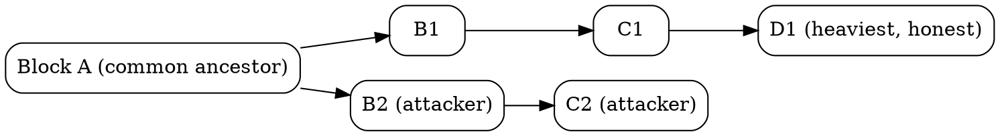

## Introduction

PoW（Proof of Work，工作量证明）是一种用**计算成本**来约束出块权、从而在**无许可（permissionless）**网络中达成拜占庭共识的机制。它最早用于反垃圾邮件（Hashcash，Back 1997），因 Bitcoin 的 Nakamoto 共识而广为人知。

要分清两个常被混用的词：**PoW 只是「一道难题」**，而 Nakamoto 共识 = PoW 难题 + 最长链（最重链）选择规则 + 难度自适应，三者合起来才构成完整协议。单有 PoW 不能算共识——还需要一个让全网就「哪条链算数」达成一致的链选规则，否则每个矿工各自为战、永不收敛。

与 [PBFT](/docs/CS/Distributed/Consensus/PBFT.md) 这类需要固定成员、靠多轮投票达成**确定性**一致的协议不同，PoW 允许任意节点随时匿名加入退出，用算力竞争出块权，并以**最长链 + 概率收敛**给出最终性。这种「用外部物理成本（电力）替代内部身份信任」的思路，是把共识从「谁被授权」转向「谁付出了代价」，从源头消解了无许可网络最棘手的女巫（Sybil）攻击。

## The Puzzle

核心是一道「难解但易验证」的密码学难题。在 Bitcoin 里它就是**双 SHA-256**：

- 矿工把待确认交易组织进 Merkle 树，取出根哈希，连同版本号、前一区块哈希 `prev_block`、时间戳、难度位 `bits`、随机数 `nonce` 一起组成 80 字节的**区块头**；
- 对区块头做 `SHA256(SHA256(header))`，要求结果作为 256 位无符号整数**小于当前目标值 `target`**，直观表现是出现若干前导零；
- SHA-256 是单向且输出均匀分布的，除了暴力枚举 `nonce`（0 → 2³²）没有捷径；当 4 字节 nonce 空间用尽，矿工转而调整 coinbase 交易的 `extraNonce` 来改变 Merkle 根，从而刷新可搜索的 nonce 空间；
- 谁先找到满足条件的 header，谁就有权发布该区块并广播；其他节点**一次哈希**即可验证答案是否合法——验证成本与计算成本相差若干数量级，这正是 PoW 的关键不对称。

`target` 由区块头中的 `bits` 字段以 4 字节紧凑格式编码（指数 + 系数），再解成 256 位目标值；协议规定的最小（最易）目标 `powLimit = 0x00000000FFFFFFFFFFFFFFFFFFFFFFFFFFFFFFFFFFFFFFFFFFFFFFFFFFFFFFFF`。所谓「难度 `difficulty`」就是 `powLimit / target`：target 越小，难度越大，有效哈希的范围越窄。期望出块时间由全网总算力与难度的比值决定，协议周期性调整 target 把平均出块间隔稳定在约 10 分钟。

## Difficulty Adjustment

PoW 网络没有中央调度，算力却会随硬件迭代和矿工进出剧烈波动。若 target 固定，算力争霸会让出块间隔指数级缩短、分叉横飞、安全性崩塌；算力撤离则会让出块停滞。因此 Bitcoin 用**去中心化、各节点独立执行**的难度重标定来兜底：

- **周期**：每 2016 个区块（= 2016 × 10 分钟 = 20,160 分钟 ≈ 两周）触发一次；
- **公式**：`new_target = old_target × (实际耗时 / 20,160 分钟)`。过去 2016 块出得快（实际耗时 < 两周），target 变小、难度升；出得慢则反之；
- **限幅**：单次调整被**钳制在 ±4 倍**以内（Bitcoin Core `CalculateNextWorkRequired` 的代码硬约束）。更大的失衡留到后续周期逐步消化，避免难度被极端算力冲击瞬间拉爆；
- **纯粹后视**：只依据已经发生的出块时长，不预测未来，因此矿工无法靠「谎报预期」套利。

> [!NOTE]
> 由于最初 Bitcoin Core 实现的 off-by-one，`nActualTimespan` 实际取的是前 2015 个区块而非 2016 个的时长，导致难度存在约 0.05% 的偏高偏置——一个被全网接受的「历史彩蛋」。

为什么偏偏是 2016 这个窗口？太短（如 144 块 = 1 天）对自然出块抖动过于敏感、会误触发；太长（如 1 万块）则对算力剧变反应迟钝（2021 年 5 月中国矿场清退使算力腰斩，正是靠两周一次的重标定在数周内自愈）。2016 是「噪声平滑」与「响应速度」的折中。

## Why It Gives Consensus

PoW 之所以能当共识，关键在于把「记账权」和「真实代价（电力、ASIC 硬件）」绑死：

- **出块权与算力成正比且要付费**。要造出一条被大家接受、盖过诚实链的替代历史，攻击者必须在私下重做这些区块的 PoW，成本随其掌握的算力线性增长；
- **链选规则：最重 / 最长链**。每个节点总是在累计工作量最多的链上延伸。一笔交易所在区块后又叠了 k 个区块，要回滚它就得在私下重做这 k+1 个区块并追上诚实链——而诚实链也在持续生长；
- **确认概率随深度指数衰减**。设诚实节点出块概率 p、攻击者 q（p + q = 1，忽略网络 orphan）。当 q < p 时，攻击者从落后 z 个区块处最终赶上的概率为 `(q/p)^z`；当 q ≥ p（即掌握过半算力）时该概率为 1。这就是为什么「6 确认」成为事实标准：对 q = 0.3 这类典型值，`(0.3/0.7)^6 ≈ 0.004`，回滚已极不划算。

这张图说明分叉时诚实矿工为何收敛到 D1 所在的分支：它累计工作量更多，任何理性矿工（也包括攻击者）都应在最重链上挖，否则自己的区块大概率被废弃。

这与状态机复制里「多数票」的安全论证本质不同：[PBFT](/docs/CS/Distributed/Consensus/PBFT.md) 安全依赖诚实节点超过 2/3，PoW 安全依赖恶意算力不占多数（q < 0.5），且确认是**概率性**而非瞬时确定的——没有「一旦提交永不可改」的硬终结。

## Fifty One Percent Attack

掌握过半算力（**51% 攻击**）是 PoW 最常被讨论的威胁，但它在能力上有明确边界：

- **能做的**：重做自己参与的交易实现**双花**（把已花费的币再花一次）、审查特定地址 / 交易使其永不确认、阻止他人出块（selfish mining 的极端形态）。攻击深度受限于攻击者能维持领先多久；
- **不能做的**：无法伪造他人签名或窃取私钥（PoW 不替代 ECDSA 的签名安全）、无法凭空铸造超出协议补贴 schedule 的币（全节点会拒绝 coinbase 超发）、无法改 21M 上限，也无法回滚与攻击者无关、且攻击者并未参与的历史（攻击者只从分叉点之后重做）；
- **经济学反制**：在 2026 年约 1 ZH/s（≈ 980–1020 EH/s）的全网算力下，维持一小时 51% 攻击需数百亿美元级 ASIC 投入加持续电费；而攻击一旦得手会重创 BTC 价格，反而蒸发攻击者自己持有的币与设备的残值。**诚实挖矿是一个纳什均衡**——手握过半算力时，遵守规则拿补贴 + 手续费，比发动攻击更划算。这也是 PoW「安全预算」的核心：攻击成本 ≈ 维持攻击所需的算力 × 时间 × 电价，天然随网络安全价值水涨船高。

> [!WARNING]
> 51% 攻击对小算力 altcoin 现实可行（租算力即可），但对 Bitcoin 这类算力壁垒极高的网络，约束主要来自经济而非技术。

## Security Properties

- **无「无利害关系（nothing-at-stake）」问题**。在 PoW 中，在一条分叉上挖矿要真实耗电，因此矿工有动机只押注「自己认为会胜出」的那条链；而在朴素 PoS 里，验证两个分叉都几乎是零成本，理性验证者会两边下注，导致分叉无法收敛。PoW 用物理成本天然规避了这一点（现代 PoS 靠罚没 slashing 才补上这道缺口，见 [PoS](/docs/CS/Distributed/Consensus/PoS.md)）；
- **哈希谜题对量子计算稳健**。SHA-256 目前没有有效的量子攻击（Grover 算法只带来平方级加速，靠加长比特即可抵消）。PoW 本身不是 Bitcoin 的量子风险点——真正的风险在 ECDSA 密钥暴露，那是签名层的问题，与共识机制无关；
- **抗女巫（Sybil）**。出块权按算力而非按节点数分配，开设一万个女巫节点不会多分一杯羹，从源头消解了无许可网络最棘手的身份伪造攻击。

## Trade-offs

| 维度 | PoW | PBFT | Raft / Paxos |
| --- | --- | --- | --- |
| 网络类型 | 无许可、匿名可加入 | 许可、成员固定 | 许可、成员可知 |
| 抗拜占庭 | 是（成本约束） | 是（n ≥ 3f+1） | 否，仅崩溃容错 |
| 最终性 | 概率性，随确认数收敛 | 确定 | 确定 |
| 吞吐 / 延迟 | 低（出块间隔 + 多确认） | 中，O(n²) 通信 | 高 |
| 资源代价 | 极高能耗（2026 约 138 TWh/年、占全球电 ~0.54%） | 主要为通信开销 | 低 |
| 典型系统 | Bitcoin、早期 Ethereum | 联盟链 / 许可 BFT | etcd、[ZooKeeper](/docs/CS/Framework/ZooKeeper/ZooKeeper.md) |

PoW 的代价是**能耗与吞吐瓶颈**：为了把无许可网络下的分叉竞争压到可控，只能故意放慢出块、限制区块大小，因此每秒交易量远低于中心化或许可链系统。这也催生了 [PoS（Proof of Stake，以质押资本替代烧电算力）](/docs/CS/Distributed/Consensus/PoS.md) 等后继机制。

## Proof of Stake Comparison

PoS 把「出块权按算力」换成「按质押的资本」：验证者锁定代币、按份额抽签出块，违规（如双签、投错链）会被**罚没（slashing）**保证金。与 PoW 相比：

- **能耗**：PoS 几乎不耗电，Ethereum 在 2022 年 The Merge 转向 PoS 后能耗下降约 99.95%；
- **最终性**：许多 PoS 协议提供**确定性最终性**（经两轮投票锁定即不可逆），不依赖概率收敛；
- **攻击成本**：PoW 攻击按「算力 × 时间 × 电价」计费且攻击后硬件仍值钱；PoS 攻击需要买入大量代币（推高价格、抬高自身成本），失败还被罚没，成本结构更「内生化」；
- **新权衡**：PoS 引入了 PoW 没有的富者愈富、长程攻击（long-range attack）、验证者串谋等问题，需要用弱主观性（weak subjectivity）、检查点、slashing 等机制补足。

一句话概括二者的取舍：**PoW 用物理世界的电力买了「无需信任、协议极简、链上历史即凭证」；PoS 用金融质押和更复杂的协议换了「省电与快终结」，代价是引入了主观信任假设**。

## Links

- [Consensus](/docs/CS/Distributed/Consensus/Consensus.md)
- [PBFT](/docs/CS/Distributed/Consensus/PBFT.md)
- [Byzantine Generals](/docs/CS/Distributed/Byzantine.md)
- [Raft](/docs/CS/Distributed/Consensus/Raft.md)
- [Proof of Stake](/docs/CS/Distributed/Consensus/PoS.md)
- [Bitcoin](/docs/CS/Blockchain/Bitcoin.md) / [Mining](/docs/CS/Blockchain/Bitcoin/Mining.md) / [Blockchain](/docs/CS/Blockchain/Blockchain.md)

## References

1. [Bitcoin: A Peer-to-Peer Electronic Cash System](https://bitcoin.org/bitcoin.pdf)
2. [Hashcash - A Denial of Service Counter-Measure](http://www.hashcash.org/papers/hashcash.pdf)
3. [Mastering Bitcoin, 2nd ed. — Ch.10 Mining and Consensus](https://github.com/bitcoinbook/bitcoinbook/blob/develop/ch10.asciidoc)
4. [Bitcoin Developer Documentation — Difficulty Adjustment](https://bitcoindev.info/docs/mining/difficulty)
5. [Timechain Wiki — Difficulty adjustment](https://timechain.wiki/wiki/difficulty-adjustment)
