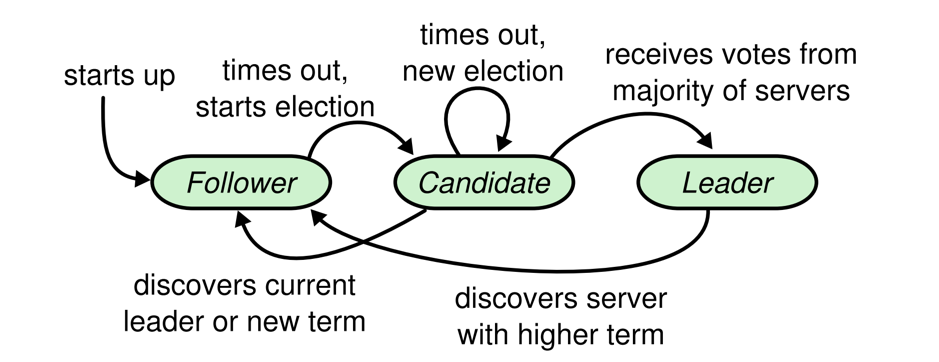
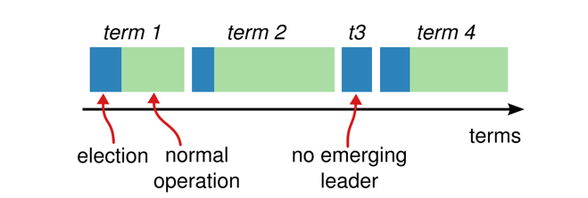
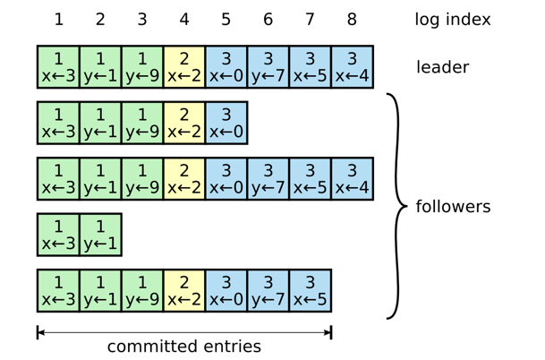
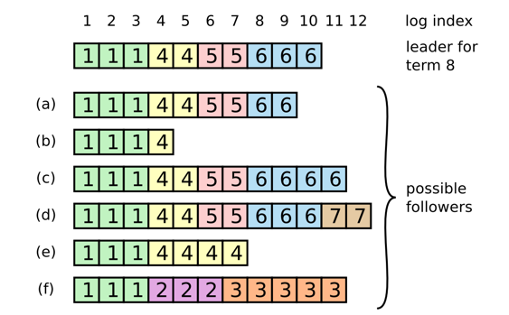
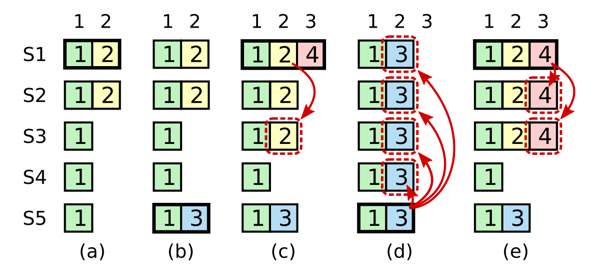
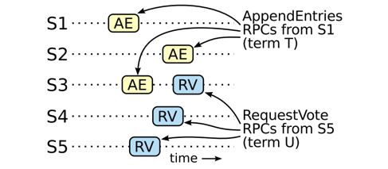

## Introduction

[Raft](https://raft.github.io/) 是一种共识算法，旨在易于理解。它在容错性和性能上相当于 [Paxos](/docs/CS/Distributed/Consensus/Paxos.md)。区别在于它被分解为相对独立的子问题，并且清晰地处理了构建实际系统所需的所有主要部分。

Raft 出自 Ongaro 与 Ousterhout 2014 年的论文《In Search of an Understandable Consensus Algorithm》。它的立场很直接：**可理解性本身就是正确性的一部分**——共识协议要在生产环境里运维多年，只有实现者真正读懂它，系统才可能长期保持正确。Multi-Paxos 早已被工程系统验证可行，但其心智模型对实现者并不友好；Raft 用三个结构性选择把复杂度摊开：

- **强 leader**：正常路径下所有决策由 leader 作出，follower 不发起提案，不存在多节点竞争；
- **问题分解**：leader election、log replication、safety 三个子问题可以分别推理，再组合成完整协议；
- **工程完整**：论文同时回答成员变更、日志压缩、客户端交互等实际系统绕不开的问题，而不是只给算法核心。

与 Paxos 的粗略对照：

| 维度 | Multi-Paxos | Raft |
| :--- | :--- | :--- |
| 领导权 | 弱 leader：distinguished proposer 只是活性优化，协议正确性不依赖单一 leader | 强 leader：leader 是协议核心，正常路径无多节点竞争 |
| 已提交条目 | 新 leader 可能缺条目，需要额外机制识别并回传 | 选举限制保证新 leader 上任即持有全部已提交条目 |
| 结构 | phase 1 / phase 2 反复执行，难以直觉把握 | 三个子问题分别推理再组合，每步都可单独检验 |

## Basics

与无领导的 Paxos 不同，Raft 是一种基于领导者的日志复制协议。简单来说，Raft 实现会选举出一个领导者，然后该领导者负责对数据库状态的所有决策。这有助于在单个读写操作期间避免副本之间的额外通信。每个节点跟踪当前的领导者，并将请求转发给该领导者。

Raft 是围绕复制日志的概念构建的。共识问题可以还原成一句话：**让一组状态机以相同顺序执行相同命令**。实现手段就是复制日志——把每条命令按顺序写进日志，只要各服务器的日志一致，按相同顺序 apply 日志就能得到一致的状态机。

当领导者收到请求时，它首先在其持久化的本地日志中为该请求存储一个条目。然后，这个本地日志会被复制到所有的追随者或副本。一旦大多数副本确认它们已经在日志中持久化，领导者就会应用该条目，并指示副本执行相同操作。

注意这里的顺序：**先落盘、再复制、多数派确认后才 apply**。「多数派确认」是命令被提交（committed）的时刻，也是可以对客户端回响的时刻；此前的任何 apply 都可能在下一次易主时被回滚，是不安全的。

有一个领导者可以简化复制日志的管理。例如，领导者可以决定新条目在日志中的位置而无需咨询其他服务器，并且数据从领导者到其他服务器的流动是简单的。领导者可能会失败或与其他服务器失去连接，在这种情况下会选举新的领导者，拥有最新日志的副本将成为新的领导者。

「最新日志的副本成为新领导者」不是自然结果，而是 safety 部分**选举限制**的产物——RequestVote 会拒绝日志落后于自己的候选者，这条约束贯穿协议始终。

Raft 不仅定义了组如何做出决策，还定义了添加新成员和从组中移除成员的协议。这一特性使 Raft 自然适用于管理分布式系统中的拓扑变化。

Raft 将共识问题分解为三个相对独立的子问题：

- **Leader election**：现有 leader 失效或失联时，如何在不产生双主的前提下选出新 leader；
- **Log replication**：leader 如何把日志条目可靠地复制到其它服务器，并在崩溃后让分歧的日志收敛；
- **Safety**：在前两者的基础上补上关键约束（选举限制 + 提交规则），保证各状态机执行相同的命令序列。

三个子问题各自独立成立，组合起来恰好覆盖共识协议的安全与活性两面：选举与复制回答「系统如何推进」，safety 回答「推进时不会出错」。

**Raft Visualization**：

- [RaftScope](https://github.com/ongardie/raftscope)
- [The Secret Lives of Data](http://thesecretlivesofdata.com/raft/)

### States

一个 Raft 集群包含多个服务器；通常是五个，这使系统能够容忍两次故障。在任何给定时间，每个服务器处于三种状态之一：领导者、跟随者或候选者。在正常操作中，恰好有一个领导者，其余所有服务器都是跟随者。跟随者是被动的：它们不会自行发出请求，只是响应来自领导者和候选者的请求。领导者处理所有 client 的请求（如果 client 连接上了跟随者，跟随者会将其重定向到领导者）。第三种状态候选者则用于选举新的领导者。

五个服务器是常见部署而非协议要求：多数派为 3，集群可容忍任意 2 台同时故障仍能作出决策。跟随者的「被动」是强 leader 模型的另一面——不自行发起请求，正常路径上就不会出现两个节点同时争夺决策权，双主竞争从源头上被消掉。

图 1 显示了各状态及其转换：

Fig.1. Server states.
 
Follower 只响应来自其它服务器的请求；若迟迟收不到任何通信，就转为 candidate 发起选举。
 
获得全集群多数票的 candidate 成为新 leader。Leader 通常会一直执政到失效为止。

Persistent state on all servers（响应 RPC 之前必须先落盘的状态）：

| 参数 | 说明 |
| :--- | :--- |
| `currentTerm` | 服务器已知的最新任期号（首次启动初始化为 0，单调递增） |
| `votedFor` | 当前任期获得选票的 candidateId（无则为 `null`） |
| `log[]` | 日志条目；每条包含状态机命令与该条目被 leader 接收时的任期号（首条索引为 1） |

Volatile state on all servers：

| 参数 | 说明 |
| :--- | :--- |
| `commitIndex` | 已知已提交的最高日志索引（初始为 0，单调递增） |
| `lastApplied` | 已应用到状态机的最高日志索引（初始为 0，单调递增） |

Volatile state on leaders（易主后重新初始化）：

| 参数 | 说明 |
| :--- | :--- |
| `nextIndex[]` | 对每台服务器，下一条要发给它的日志索引（初始化为 leader 最后一条日志索引 + 1） |
| `matchIndex[]` | 对每台服务器，已知已复制到它上面的最高日志索引（初始化为 0，单调递增） |

`commitIndex` 与 `lastApplied` 的差值即「已提交未应用」的窗口，由应用循环逐个消化；`matchIndex` 只被 leader 用来判断多数派是否追到某索引，是提交规则的事实依据。

### Terms

由于 Raft 不能假设全局时钟同步，事件的全序关系通过一个单调递增的值来建立，称为 **term（任期）**。

Raft 把时间划分为任意长度的任期，如图 2 所示。任期用连续整数编号。每一任期以一次选举开始，期间一个或多个 candidate 尝试成为 leader。如果某个 candidate 赢得选举，它就在该任期剩余时间内担任 leader。某些情况下选举会以 split vote 收场，此时该任期在没有 leader 的情况下结束，很快开始新的任期（伴随新一轮选举）。Raft 保证给定任期内至多选出一个 leader。

不同服务器在不同时刻观察到任期切换，某些情况下服务器可能整场选举、甚至整个任期都没有观察到。任期在 Raft 中扮演逻辑时钟的角色，使服务器能够识别过期信息（例如过时的 leader）。每台服务器都维护一个单调递增的 `currentTerm`；服务器之间每次通信都会交换当前任期号——如果一方的任期号小于另一方，就更新为较大值。candidate 或 leader 发现自己的任期过期时，立即退化为 follower；服务器收到任期号过期的请求时，直接拒绝。

节点的任期号只在两种时机更新：自己发起（或重启）选举时 +1，或从其它节点处学到更大的任期号。所有消息都携带源节点的任期号，接收方据此判断：若自己的任期号更大，回以否定响应；若小于等于源节点的，先更新自己的任期号再解析消息。

Raft 服务器之间使用 RPC 通信，基础共识算法只需要两类 RPC：candidate 在选举中发起 **RequestVote RPC**，leader 发起 **AppendEntries RPC** 来复制日志条目并充当心跳。第三类 RPC **InstallSnapshot** 用于在服务器之间传输快照。服务器未在合理时间内收到响应时会重试 RPC，并且并行发出以获得最佳性能。

Fig.2. 时间被划分为一个个任期，每个任期以一次选举开始。
 
成功选举后，由唯一的 leader 管理集群直到任期结束。
 
有些选举会失败，任期在没有选出 leader 的情况下结束。不同服务器在不同时刻观察到任期切换。

### AppendEntries RPC

由 leader 调用，用于复制日志条目；不带条目时充当心跳。

| 参数 | 说明 |
| :--- | :--- |
| `term` | leader 的任期号 |
| `leaderId` | 便于 follower 重定向客户端 |
| `prevLogIndex` | 紧邻新条目之前的日志条目索引 |
| `prevLogTerm` | `prevLogIndex` 条目的任期号 |
| `entries[]` | 待存储的日志条目（心跳时为空；为效率起见可以一次发多条） |
| `leaderCommit` | leader 的 `commitIndex` |

| 返回值 | 说明 |
| :--- | :--- |
| `term` | 当前任期号，供 leader 更新自己 |
| `success` | 若 follower 包含与 `prevLogIndex`、`prevLogTerm` 匹配的条目则为 `true` |

接收方实现：

1. 若 `term < currentTerm`，返回 `false`——任期过期的 leader 已经退位，其指令必须被拒绝；
2. 若日志中不存在 `prevLogIndex` 处且任期匹配 `prevLogTerm` 的条目，返回 `false`——这就是一致性检查：follower 拒绝与自己日志前缀不一致的追加；
3. 若已存在的条目与新条目冲突（同索引不同任期），删除该条目及其后的所有条目；
4. 追加日志中尚未包含的新条目；
5. 若 `leaderCommit > commitIndex`，令 `commitIndex = min(leaderCommit, 最后一条新条目的索引)`。

第 2 步的 `prevLogIndex` / `prevLogTerm` 是 Log Matching 性质的归纳步骤（详见 [Log replication](/docs/CS/Distributed/Consensus/Raft.md?id=log-replication)）：leader 借它向 follower 证明「你我日志在该位置之前完全一致」。

### RequestVote RPC

由 candidate 调用，用于收集选票。

| 参数 | 说明 |
| :--- | :--- |
| `term` | candidate 的任期号 |
| `candidateId` | 请求投票的 candidate |
| `lastLogIndex` | candidate 最后一条日志的索引 |
| `lastLogTerm` | candidate 最后一条日志的任期号 |

| 返回值 | 说明 |
| :--- | :--- |
| `term` | 当前任期号，供 candidate 更新自己 |
| `voteGranted` | `true` 表示 candidate 获得此票 |

接收方实现：

1. 若 `term < currentTerm`，返回 `false`；
2. 若 `votedFor` 为 `null` 或 `candidateId`，且 candidate 的日志至少与接收方的一样新，则投票。

两条规则各司其职：第 1 条配合已落盘的 `votedFor` 保证**一个任期一票**（重启也不会重复投票）；第 2 条的日志新旧比较正是**选举限制**的实现——宁可让选举失败，也不把票投给可能丢失已提交条目的候选者。其动机与证明见 [Election restriction](/docs/CS/Distributed/Consensus/Raft.md?id=election-restriction)。

### Rules for Servers

以下是论文给出的服务器行为规范，实现时可直接对照。

**All Servers**：

- 若 `commitIndex > lastApplied`：`lastApplied` 递增，将 `log[lastApplied]` 应用到状态机；
- 若 RPC 请求或响应携带的任期号 `T > currentTerm`：置 `currentTerm = T`，转为 follower。

**Followers**：

- 响应来自 candidate 和 leader 的 RPC；
- 若选举超时内未收到当前 leader 的 AppendEntries RPC、也未给任何 candidate 投票：转为 candidate。

**Candidates**：

- 转为 candidate 时立即发起选举：
  - `currentTerm` 递增；
  - 为自己投票；
  - 重置选举计时器；
  - 向所有其它服务器并行发送 RequestVote RPC；
- 若获得多数服务器的选票：成为 leader；
- 若收到新 leader 的 AppendEntries RPC：转为 follower；
- 若选举超时：发起新一轮选举。

**Leaders**：

- 上任后立即向每台服务器发送空的 AppendEntries RPC（心跳）；空闲期间周期性重复，防止 follower 选举超时；
- 若收到客户端命令：将条目追加到本地日志，待该条目应用到状态机后才响应客户端；
- 若某 follower 的最后日志索引 ≥ `nextIndex`：向它发送从 `nextIndex` 开始的 AppendEntries RPC；
  - 成功：更新该 follower 的 `nextIndex` 与 `matchIndex`；
  - 因日志不一致失败：递减 `nextIndex` 并重试；
- 若存在 `N > commitIndex`、多数服务器的 `matchIndex[i] ≥ N`、且 `log[N].term == currentTerm`：置 `commitIndex = N`。

最后一条是**提交规则**：只有当前任期的条目才能靠「数多数派」提交，旧任期的条目只能被间接提交——原因见 [Committing entries from previous terms](/docs/CS/Distributed/Consensus/Raft.md?id=committing-entries-from-previous-terms)。

| 保证性质 | 说明 |
| :--- | :--- |
| Election Safety | 给定任期内至多选出一个 leader |
| Leader Append-Only | leader 从不覆盖或删除自己日志中的条目，只追加新条目 |
| Log Matching | 若两条日志某索引与任期号的条目相同，则它们在该索引之前的全部条目相同 |
| Leader Completeness | 某任期提交的日志条目，必存在于所有更晚任期的 leader 日志中 |
| State Machine Safety | 若某服务器已把某索引的条目应用到状态机，其它服务器绝不会对同一索引应用不同条目 |

前四条是机制层面的不变式，最后一条是它们共同推出的最终安全性；[Safety](?id=safety) 一节给出 Leader Completeness 的完整论证。

## Leader election

Raft 用心跳机制触发 leader 选举。服务器启动时均为 follower。只要收到来自 leader 或 candidate 的有效 RPC，服务器就保持 follower 状态。leader 周期性向所有 follower 发送心跳（不带日志条目的 AppendEntries RPC）以维持权威。如果 follower 在一段称为**选举超时（election timeout）**的时间内没有收到任何通信，就认为不存在可用 leader，进而发起选举选出新 leader。

发起选举时，follower 递增自己的 `currentTerm` 并转为 candidate，为自己投票，然后并行向集群中每台其它服务器发出 RequestVote RPC。candidate 会保持该状态直到以下三种情况之一发生：

- 赢得选举；
- 其它服务器确立为 leader；
- 一段时间过去仍无人胜出。

当 candidate 获得**全集群多数**服务器在同一任期的选票时即赢得选举。每台服务器在每个任期内至多投一票，先到先得。多数规则保证特定任期内至多一个 candidate 能胜出——两个多数派必然相交，交集中的服务器只能把唯一一票投给其中一方，另一方就凑不齐多数。candidate 一旦胜出便成为 leader，随即向其它服务器发送心跳以确立权威、阻止新的选举。

等待选票期间，candidate 可能收到另一个声称自己是 leader 的服务器发来的 AppendEntries RPC：

- 若 RPC 中 leader 的任期号 ≥ candidate 的当前任期号，candidate 承认该 leader 合法，退回 follower 状态；
- 若 RPC 中的任期号小于 candidate 的当前任期号，candidate 拒绝该 RPC 并继续保持 candidate 状态。

第三种结局是 candidate 既没赢也没输：如果大量 follower 同时成为 candidate，选票可能被分散到无人取得多数。此时每个 candidate 都会超时，通过递增任期号、再发一轮 RequestVote 重新选举。然而若不附加措施，split vote 可能无限重复。

**Raft 用随机选举超时保证 split vote 罕见且能快速化解。** 选举超时从一个固定区间（例如 150–300ms）中随机选取，把各服务器的超时点打散：多数情况下只有一个服务器先超时，它在其它服务器超时之前赢得选举并发出心跳，选举就此结束。处理 split vote 用的也是同一机制——每个 candidate 在每轮选举开始时重置自己的随机超时，等待其结束后才发起下一轮，从而降低新一轮再次分裂的概率。注意随机化只影响活性（能否选出 leader），不影响安全性（双主在任期内不可能出现）。

## Log replication

leader 一经选出便开始处理客户端请求。每条客户端请求包含一条要由各复制状态机执行的命令。leader 把命令作为新条目追加到自己的日志，然后并行向每台其它服务器发出 AppendEntries RPC 复制该条目。条目被安全复制后，leader 将其应用到自己的状态机，并把执行结果返回客户端。**如果 follower 崩溃、运行缓慢或网络丢包，leader 会无限重试 AppendEntries RPC（即使已经响应过客户端），直到所有 follower 最终存下全部日志条目。**

「已经响应客户端还要继续重试」体现的是提交与持久化的分离：客户端拿到响应只意味着命令已提交（多数派落盘），而全体副本追齐是后台的耐久性义务。

日志的组织如图 3 所示。每个日志条目存储一条状态机命令，外加该条目被 leader 接收时的任期号。条目中的任期号用于检测日志间的不一致，也是安全性质的重要依据。每个条目还有一个整数索引标识其在日志中的位置。

Fig.3. 日志由按顺序编号的条目组成。
 
每个条目包含创建它的任期号（方框内的数字）与一条状态机命令。
 
当条目可以安全地应用到各状态机时，称其为已提交（committed）。

由 leader 决定何时可以安全地把日志条目应用到各状态机；这样的条目称为**已提交**。Raft 保证已提交条目是持久化的，并最终会被所有可用状态机执行。创建该条目的 leader 一旦把它复制到多数服务器上，该条目即提交（如图 3 中的条目 7）。这同时提交了 leader 日志中它之前的所有条目，包括往届 leader 创建的条目。[Membership change](/docs/CS/Distributed/Consensus/Raft.md?id=membership-changes) 讨论了在 leader 更替后应用该规则的一些细节，并证明这种提交定义是安全的。leader 持续跟踪已知已提交的最高索引，并在后续的 AppendEntries RPC（包括心跳）中带上它，其它服务器最终都会得知。follower 一旦得知某条目已提交，便按日志顺序把它应用到本地状态机。

Raft 的日志机制被设计为在不同服务器之间维持高度一致的日志。这不仅简化了系统行为、使之更可预期，也是保证安全的重要组成。Raft 维持如下性质：

- 若不同日志中的两个条目索引与任期号相同，则它们存储相同的命令；
- 若不同日志中的两个条目索引与任期号相同，则两日志在该索引之前的全部条目完全相同。

第一条性质源于：leader 在给定任期内对给定日志索引至多创建一个条目，且日志条目在日志中的位置永不改变。第二条性质由 AppendEntries 执行的一个简单一致性检查保证。发送 AppendEntries RPC 时，leader 会附上其日志中紧邻新条目之前那条的索引与任期号；follower 若在日志中找不到索引与任期号均相同的条目，就拒绝新条目。一致性检查扮演归纳步骤的角色：日志的空初态满足 Log Matching 性质，而每次日志扩展时一致性检查都保持该性质。于是，每当 AppendEntries 成功返回，leader 就知道 follower 的日志在新条目之前与自己的完全一致。

正常运行时 leader 与 follower 的日志保持一致，一致性检查永远不会失败。但 leader 崩溃可能留下不一致的日志（旧 leader 可能没把全部条目复制出去），且这种不一致会在一连串 leader / follower 崩溃中叠加。图 4 展示了 follower 日志与新 leader 日志可能出现的各种差异：follower 可能缺失 leader 上存在的条目，可能多出 leader 上没有的条目，或两者兼有；缺失与多余的条目可能横跨多个任期。

Fig.4. 当顶部的 leader 上台时，follower 日志可能出现 (a)–(f) 任一情形。
 
每个方框代表一条日志条目，框内数字为其任期号。
follower 可能缺失条目（a–b）、可能多出未提交的条目（c–d），或两者兼有（e–f）。

以情形 (f) 为例：该服务器曾是任期 2 的 leader，往自己的日志加了几条条目后崩溃，一条都没来得及提交；随后它快速重启，又当选任期 3 的 leader，再加了几条；任期 2 与任期 3 的条目都未提交，它再次崩溃并缺席了之后的几个任期。

**Raft 中，leader 通过强制 follower 的日志复刻自己的日志来处理不一致。** 这意味着 follower 日志中的冲突条目会被 leader 日志中的条目覆盖。

为了让 follower 的日志与自己的对齐，leader 必须找到两条日志一致的最新条目，删除 follower 日志中该点之后的所有条目，再把 leader 在该点之后的全部条目发过去。这些动作全部由 AppendEntries RPC 的一致性检查驱动。leader 为每个 follower 维护一个 `nextIndex`，即将发给该 follower 的下一条日志索引。leader 刚上台时，所有 `nextIndex` 初始化为自己日志最后一条的索引加 1（图 4 中为 11）。若 follower 日志与 leader 不一致，下一个 AppendEntries RPC 的一致性检查就会失败；遭到拒绝后，leader 递减 `nextIndex` 并重试，最终 `nextIndex` 会到达两条日志匹配的位置。此后 AppendEntries 成功，follower 日志中的冲突条目被移除，leader 的条目被追加进来。AppendEntries 一旦成功，follower 的日志便与 leader 一致，并在该任期剩余时间内保持如此。

协议可以优化以减少被拒绝的 AppendEntries RPC 次数：例如 follower 拒绝时附上冲突条目的任期号以及它为该任期存储的首个索引，leader 便可把 `nextIndex` 一次递减到该任期的首条，跳过整个冲突任期——每个有冲突的任期只需一次 RPC，而不是每条一次。论文作者认为这个优化在实践中并不必要，因为故障罕见、不一致条目通常不多。

借助这一机制，leader 上台时无需任何特殊动作来恢复日志一致性：它只需开始正常运作，日志便会随着一致性检查的失败自动收敛。**leader 从不覆盖或删除自己日志中的条目**——冲突永远由 follower 单方面消化。这一日志复制机制呈现出合意的共识性质：只要多数服务器存活，Raft 就能接受、复制并应用新条目；正常情况下新条目只需一轮发往多数派的 RPC；单个缓慢的 follower 不会影响整体性能。

## Safety

前面几节描述了 Raft 如何选举 leader、如何复制日志。但仅靠这些机制还不足以保证每个状态机以相同顺序执行相同的命令。例如：某 follower 在 leader 提交若干条目期间不可用，之后它却当选 leader 并用新条目覆盖了这些条目，各状态机便会执行不同的命令序列。

本节通过限制「哪些服务器可以当选 leader」来补全 Raft 算法。该限制保证任何任期的 leader 都包含此前各任期已提交的全部条目（即 Leader Completeness 性质）。给定选举限制后，提交规则被表述得更精确；随后给出 Leader Completeness 的证明梗概，并说明它如何推出复制状态机的正确行为。

### Election restriction

在任何基于 leader 的共识算法中，leader 最终必须持有全部已提交的日志条目。在某些共识算法（如 Viewstamped Replication）中，即使日志不全也可能当选 leader，再由额外机制识别缺失条目并在选举过程中或稍后回传给新 leader——这带来了可观的额外机制与复杂度。**Raft 采用更简单的路子：保证每台新 leader 从当选那一刻起就持有此前任期的全部已提交条目，无须向 leader 回传条目。** 这意味着日志条目只沿一个方向流动——从 leader 到 follower，且 leader 从不覆盖自己日志中的已有条目。

Raft 用投票过程阻止日志不全的 candidate 胜出：candidate 必须联系全集群多数才能当选，而每条已提交条目必然存在于该多数中的至少一台服务器上；只要 candidate 的日志不落后于该多数中的任何一份，它就持有全部已提交条目。**RequestVote RPC 实现这一限制：RPC 携带 candidate 的日志信息，若投票者自己的日志比 candidate 的更新，就拒绝投票。**

Raft 通过比较两条日志最后条目的索引与任期号来判断谁更新：若最后条目的任期号不同，任期号晚的日志更新；若相同，则更长的日志更新。

### Committing entries from previous terms

leader 知道当前任期的条目被复制到多数服务器上时，即可认定其提交。若 leader 在提交某条目前崩溃，未来的 leader 会尝试把它复制完毕。但是，leader **不能**因为「旧任期的条目已被存到多数服务器上」就立刻认定它提交。图 5 展示了这样一种情形：旧日志条目已存于多数服务器，却仍可能被未来 leader 覆盖。

Fig.5. 一条时间线，说明为何 leader 不能凭旧任期条目判断提交。

- (a) S1 是 leader，部分复制了索引 2 处的条目；
- (b) S1 崩溃；S5 以 S3、S4 及自己的选票当选任期 3 的 leader，并在索引 2 处写入了另一条目；
- (c) S5 崩溃；S1 重启并当选 leader，继续复制。此时任期 2 的条目虽已复制到多数服务器，但并未提交；
- (d) 若 S1 再崩溃，S5 可能再次当选（凭 S2、S3、S4 的选票）并用自己任期 3 的条目覆盖它；
- (e) 反之，若 S1 在崩溃前先把一个**当前任期**的条目复制到多数服务器，该条目即提交（S5 再也赢不了选举），此时日志中它之前的所有条目也一并提交。

为消除图 5 这类问题，Raft 从不通过数副本来提交旧任期的条目：只有 leader 当前任期的条目可以靠数多数派提交；而当前任期条目一旦这样提交，凭借 Log Matching 性质，它之前的所有条目都被间接提交。某些情形下 leader 本可安全地判定旧条目已提交（例如它存于每一台服务器），但 Raft 为简单起见选择更保守的规则。

这条额外复杂度换来两个好处：其一，条目在复制过程中保留原任期号，推理更简单——同一条目在不同日志、不同时刻始终是同一个身份；其二，相比「新 leader 必须用新任期号重写旧条目才能提交」的算法，Raft 的新 leader 需要重发的旧任期条目更少。

### Safety argument

现在可以更精确地论证 Leader Completeness 性质成立（论证基于论文中的安全性证明）。假设该性质不成立，进而推出矛盾。

设任期 T 的 leader（leaderT）提交了来自任期 T 的一条日志条目，而某个更晚任期 U 的 leader（leaderU）没有存储该条目，且 U 是所有满足条件的任期中最小的一个。

1. 该已提交条目在 leaderU 当选时必须不在其日志中（leader 从不删除或覆盖条目）；
2. leaderT 已把该条目复制到全集群多数，leaderU 的选票也来自全集群多数。两个多数派必相交，因此至少有一台服务器（下称「the voter」）既接受了 leaderT 的条目、又投票给了 leaderU，如图 6 所示。the voter 是通向矛盾的关键；
3. the voter 必须在投票给 leaderU 之前就已接受该已提交条目——否则它会拒绝 leaderT 的 AppendEntries 请求（那时它的任期号已高于 T）；
4. the voter 投票给 leaderU 时仍持有该条目：由假设，其间每任 leader 都含该条目，leader 从不移除条目，而 follower 只在与 leader 冲突时才移除条目；
5. the voter 把票投给了 leaderU，说明 leaderU 的日志至少和 the voter 的一样新。这引出两种矛盾之一；
6. 若 the voter 与 leaderU 的最后条目任期号相同，则 leaderU 的日志至少和 the voter 的一样长，其日志必然包含 the voter 日志中的每一条——这与「the voter 持有已提交条目而 leaderU 不持有」矛盾；
7. 否则 leaderU 的最后条目任期号必大于 the voter 的；又因 the voter 持有来自任期 T 的条目，其最后条目任期号至少为 T，故 leaderU 的最后条目任期号大于 T。创建该条目的往届 leader 由假设必含该已提交条目，再由 Log Matching 性质，leaderU 的日志也必含该已提交条目——矛盾；
8. 矛盾归谬完成：任期 T 中提交的条目，必然存在于所有更晚任期的 leader 日志中；
9. Log Matching 性质保证未来的 leader 同样持有那些被间接提交的条目（如图 5(d) 中索引 2 的条目）。

Fig.6. 若 S1（任期 T 的 leader）提交了来自本任期的新条目，而 S5 在更晚的任期 U 当选 leader，
 
则必存在至少一台服务器（S3）既接受了该条目、又投票给了 S5。

有了 Leader Completeness 性质，可以证明 State Machine Safety 性质：若某服务器已把某索引的日志条目应用到状态机，其它服务器绝不会对同一索引应用不同的条目。服务器应用某条目时，其日志到该条目为止必与 leader 一致，且该条目已提交。考虑最早应用某日志索引的任期：Leader Completeness 保证更晚任期的 leader 都持有同一日志条目，故更晚任期应用该索引的服务器应用的也是同一条目。State Machine Safety 由此成立。

最后，Raft 要求服务器按日志索引顺序应用条目。结合 State Machine Safety，所有服务器都会以相同顺序把完全相同的日志条目集合应用到各自的状态机。

### Follower and candidate crashes

到此为止我们只关注了 leader 失效。follower 与 candidate 的崩溃处理起来简单得多，且方式相同：发给它们的 RequestVote 与 AppendEntries RPC 会失败，Raft 的处理是无限重试；崩溃的服务器重启后，RPC 终将成功。

若服务器在完成 RPC 之后、响应之前崩溃，重启后它会再次收到同一个 RPC。Raft 的 RPC 是幂等的，不会造成危害：例如 follower 收到包含已有条目的 AppendEntries 请求时，会直接忽略这些条目。

### Timing and availability

Raft 的要求之一是**安全性不得依赖时序**：系统不能因为某事件比预期快或慢就产出错误结果。但可用性（系统及时响应客户端的能力）不可避免地依赖时序。例如，若消息交换比典型的服务器崩溃间隔还慢，candidate 就来不及赢得选举；没有稳定的 leader，Raft 就无法推进。leader 选举是 Raft 中对时序最敏感的环节。只要系统满足以下时序要求，Raft 就能选举并维持一个稳定的 leader：

> broadcastTime ≪ electionTimeout ≪ MTBF

- **broadcastTime**：单台服务器向集群其它服务器并发发送 RPC 并收到响应的典型耗时；
- **electionTimeout**：follower 在发起选举前等待通信的时长（随机化后如 150–300ms）；
- **MTBF**：单台服务器的平均无故障时间。

「≪」不是可证明的硬界，而是工程经验：选举超时要远大于广播时间，正常心跳才不会误触选举；又要远小于平均故障间隔，leader 失效才会被及时察觉并完成换届。随机化选举超时正是把「误触发」与「迟察觉」同时压小的手段。反过来看，只要安全性质不依赖时序，网络再抖动也只会拖慢系统，不会让它算出错误结果。

## Membership changes

到目前为止，我们一直假设集群配置（参与共识的服务器集合）固定不变。实践中偶尔需要变更配置，例如替换故障服务器或调整副本度。虽然可以整集群下线、改配置、再重启，但这会让集群在切换期间不可用，且任何人工步骤都有操作失误的风险。为避免这些问题，Raft 把配置变更自动化并纳入共识算法。

配置变更机制要安全，就必须保证过渡期内同一任期不可能选出两个 leader。不幸的是，让服务器从旧配置直接切到新配置的任何方案都不安全：不可能原子地切换所有服务器，集群可能在过渡期分裂成两个各自独立的多数派（论文 Figure 7 正是这种危险窗口）。

为保证安全，配置变更必须采用两阶段方法，具体实现各有不同（例如有的系统第一阶段禁用旧配置使其不再处理客户端请求，第二阶段再启用新配置）。Raft 的做法是：集群先切换到一个称为 **joint consensus（联合共识）**的过渡配置，联合共识提交后，系统再切到新配置。

联合共识同时涵盖新旧两套配置：

- 日志条目复制给两套配置中的全部服务器；
- 两套配置中的任一服务器都可以担任 leader；
- 选举与条目提交的「达成」，需要在新旧配置中**分别**取得各自多数派。

联合共识允许各服务器在不同时刻过渡到新配置而不损害安全性，并且配置变更全程集群可持续处理客户端请求。集群配置以特殊日志条目的形式存储与传播。leader 收到把配置从 $C_{old}$ 改为 $C_{new}$ 的请求时，把联合共识配置（图中的 $C_{old,new}$）作为一条日志条目写入并照常复制。某台服务器一旦把新配置条目加入日志，便立即将其用于所有后续决策（服务器总是使用日志中最新的配置，不论其是否已提交）。这意味着 leader 会用 $C_{old,new}$ 的规则来判断 $C_{old,new}$ 条目本身何时提交。若 leader 崩溃，新 leader 可能在 $C_{old}$ 或 $C_{old,new}$ 规则下产生，取决于胜出的 candidate 是否已收到 $C_{old,new}$；无论哪种情况，此期间 $C_{new}$ 都无法单方面作出决策。

$C_{old,new}$ 一经提交，$C_{old}$ 与 $C_{new}$ 都不能离开对方单方面决策，而 Leader Completeness 性质保证只有持有 $C_{old,new}$ 条目的服务器能当选 leader。此时 leader 才可以创建描述 $C_{new}$ 的日志条目并复制到集群；该配置同样在每台服务器见到时立即生效。当 $C_{new}$ 在 $C_{new}$ 规则下提交后，旧配置彻底无关，不在新配置中的服务器即可关机。整个过程中不存在 $C_{old}$ 与 $C_{new}$ 同时单方面决策的时刻，安全性由此保证。

重新配置还有三个问题要处理。

其一，新服务器初始时可能没有任何日志条目。以这种状态加入集群，它们需要很长时间追赶，期间可能无法提交新日志条目。为避免可用性间隙，Raft 在配置变更前引入一个额外阶段：新服务器以**无投票权成员**身份加入集群（leader 向它们复制日志，但不计入多数派）。待它们追齐集群，再按上述流程重新配置。

其二，集群 leader 可能不在新配置之中。这种情况下，leader 在提交 $C_{new}$ 条目后退位（转回 follower）。这意味着存在一段时间（它正在提交 $C_{new}$ 时），leader 管理着一个不包含自己的集群：它复制日志条目，但把自己排除在多数派之外。退位时点选在 $C_{new}$ 提交之时，因为这是新配置能够独立运转的第一个时刻（此后必可从 $C_{new}$ 中选出 leader）；在此之前，可能只有 $C_{old}$ 中的服务器能当选 leader。

其三，被移除的服务器（不在 $C_{new}$ 中的）会扰乱集群：它们收不到心跳，于是超时并发起选举，带着更高任期号发出 RequestVote RPC，导致现任 leader 退位。新 leader 很快选出，但被移除的服务器会再次超时，过程反复，可用性很差。

为防止此问题，服务器在认为存在当前 leader 时无视 RequestVote RPC：具体而言，若服务器在「距上次听到当前 leader 不足最短选举超时」的时间内收到 RequestVote RPC，它不更新任期号、也不投票。这不影响正常选举——正常选举中每台服务器都会先等满最短选举超时才发起选举；但它能挡住被移除服务器的捣乱：只要 leader 还能把心跳送达集群，就不会被更大的任期号赶下台。

## Log compaction

Raft 的日志在正常运转中随客户端请求不断增长，但实际系统里它不可能无界增长：日志越长，占用空间越多、重放耗时越久，最终引发可用性问题，必须有某种机制丢弃日志中积累的过期信息。

**快照（snapshotting）**是最简单的压缩方式：把整个当前系统状态写入稳定存储上的快照，然后丢弃该点之前的全部日志。Chubby 与 ZooKeeper 都使用快照。增量压缩方案（如 log cleaning 与 [log-structured merge trees](/docs/CS/Algorithms/tree/LSM.md)）也可行：它们每次只处理一部分数据，把压缩负载更均匀地摊到时间上——先挑一个积累了最多删除与覆盖对象的区域，再把其中的存活对象更紧凑地重写并释放该区域。相比快照始终面向全量数据集的简单直接，增量方案需要可观的额外机制与复杂度。log cleaning 需要修改 Raft，而状态机可以用与快照相同的接口在背后实现 LSM 树。

Raft 快照的基本思想（论文 Figure 12）是：每台服务器独立地对**已提交**条目做快照，主要工作由状态机完成——把当前状态写入快照。Raft 还在快照中附带少量元数据：**last included index** 是被快照取代的最后一条日志的索引（即状态机最后应用的条目），**last included term** 是该条目的任期号；保存它们是为了支持快照后第一条日志的 AppendEntries 一致性检查——那条日志需要一个前置索引与前置任期号。为支持集群成员变更，快照还包含 last included index 处日志中的最新配置。服务器写完快照后，即可删除 last included index 之前（含）的全部日志条目及更早的快照。

尽管各服务器通常独立做快照，leader 偶尔仍必须把快照发给落后的 follower——当 leader 已经丢弃了它需要发给某 follower 的下一条日志时。正常情况下这不太可能发生：跟得上 leader 的 follower 早就拥有该条目；但异常缓慢的 follower 或新加入集群的服务器不会。把这类 follower 拉到最新状态的办法，就是 leader 通过网络把快照发给它。

leader 用一个新 RPC **InstallSnapshot** 向落后太多的 follower 发送快照。follower 收到快照后必须决定如何处置现有日志：通常快照包含其日志中没有的新信息，此时 follower 丢弃整个日志——它已被快照取代，且可能含有与快照冲突的未提交条目；若收到的是描述自己日志某个前缀的快照（因重传或误发），则快照覆盖的条目被删除，快照之后的条目仍然有效、必须保留。

这种快照方式偏离了 Raft 的强 leader 原则——follower 可以在 leader 不知情的情况下做快照。我们认为这一偏离是正当的：leader 的作用是避免共识过程中的冲突决策，而快照发生时共识早已达成，不存在冲突决策；数据仍然只从 leader 流向 follower，只是 follower 现在可以重新组织自己的数据。

我们也考虑过另一种以 leader 为中心的方案：只有 leader 生成快照，再发给每个 follower。但它有两个缺点：

- 其一，把快照发给每个 follower 浪费网络带宽、拖慢快照过程。每个 follower 本就拥有生成自己快照所需的信息，且从本地状态生成快照通常远比在网络上收发一份快照便宜；
- 其二，leader 的实现更复杂——例如 leader 需要在向 follower 复制新日志条目的同时并行发送快照，才能不阻塞新的客户端请求。

还有两个影响快照性能的问题：

- 其一，服务器必须决定何时快照。快照太频浪费磁盘带宽与能耗，太疏则有用尽存储之虞，还会拉长重启时重放日志的时间。一个简单策略是当日志达到固定字节数时快照；只要该阈值显著大于快照的预期大小，快照的磁盘带宽开销就很小；
- 其二，写快照可能耗时显著，不应拖慢正常操作。解决办法是使用 copy-on-write 技术，使新更新可在不影响正在写入的快照的情况下被接受——用函数式数据结构构建的状态机天然支持这一点；或者利用操作系统的 copy-on-write 支持（如 Linux 的 `fork`）创建整个状态机的内存快照。

### InstallSnapshot RPC

由 leader 调用，把快照分块发给 follower。leader 总是按序发送分块。

| 参数 | 说明 |
| :--- | :--- |
| `term` | leader 的任期号 |
| `leaderId` | 便于 follower 重定向客户端 |
| `lastIncludedIndex` | 快照取代到此索引为止（含）的全部条目 |
| `lastIncludedTerm` | `lastIncludedIndex` 条目的任期号 |
| `offset` | 该分块在快照文件中的字节偏移 |
| `data[]` | 从 `offset` 开始的快照原始字节 |
| `done` | 是否为最后一个分块 |

| 返回值 | 说明 |
| :--- | :--- |
| `term` | 当前任期号，供 leader 更新自己 |

接收方实现：

1. 若 `term < currentTerm`，立即返回；
2. 若为首个分块（`offset` 为 0），创建新的快照文件；
3. 把数据按给定 `offset` 写入快照文件；
4. 若 `done` 为 `false`，返回并等待更多分块；
5. 保存快照文件，丢弃任何已存在的、索引更小的快照或部分快照；
6. 若已有日志条目的索引与任期号和快照的 last included 条目相同，保留其后的日志条目并返回；
7. 丢弃整个日志；
8. 用快照内容重置状态机（并加载快照中的集群配置）。

## Client interaction

本节描述客户端如何与 Raft 交互，包括客户端如何找到集群 leader，以及 Raft 如何支持线性一致语义。这些问题适用于所有基于共识的系统，Raft 的解法也与其它系统类似。

Raft 的客户端把所有请求发给 leader。客户端首次启动时随机连接一台服务器；若不是 leader，该服务器会拒绝请求并提供它听说过的最新 leader 的信息（AppendEntries 请求带有 leader 的网络地址）。若 leader 崩溃，客户端请求会超时，客户端便换一台随机服务器重试。

Raft 的目标是实现**线性一致（linearizable）**语义：每个操作看起来都在其调用与响应之间的某一瞬间瞬时、恰好执行了一次。但如前所述，Raft 可能多次执行同一命令——例如 leader 在提交日志条目后、响应客户端前崩溃，客户端会向新 leader 重试该命令，导致它被执行第二次。解决办法是客户端为每条命令分配唯一序列号；状态机记录每个客户端已处理的最新序列号及对应响应，若收到序列号已执行过的命令，立即重放响应而不重新执行。

只读操作可以不写日志处理。但没有任何附加措施的话，这会带来陈旧数据的风险——响应请求的 leader 可能已被一个它不知道的新 leader 取代。线性一致读绝不能返回陈旧数据，Raft 需要两条额外预防措施来在不写日志的前提下保证这一点：

- 其一，leader 必须掌握哪些条目已提交的最新信息。Leader Completeness 性质保证 leader 持有全部已提交条目，但任期伊始它并不知道哪些是已提交的。为查明，它需要提交一个本任期的条目。**Raft 的做法是让每位 leader 在任期开始时向日志提交一个空的 no-op 条目**——它一被提交，此前所有条目即间接提交，`commitIndex` 一步到位；
- 其二，leader 必须在处理只读请求前确认自己尚未被废黜（若已有更新的 leader 当选，它的信息可能已过期）。Raft 的做法是 leader 在响应只读请求前与集群多数派交换心跳；另一种方案是让心跳机制提供租约（lease），但那样安全性就依赖时序了（假设时钟偏移有界）。

## Core Raft Review

1. **Leader election**：
   - 用心跳与超时检测崩溃；
   - 用随机超时避免 split vote；
   - 用多数投票保证每任期至多一个 leader。
2. **Log replication**（正常运转）：
   - leader 接收客户端命令并追加到自己的日志；
   - leader 把日志复制给其它服务器（覆盖不一致）；
   - 内置一致性检查简化了日志可能出现的分歧形态。
3. **Safety**：
   - 只选举日志中含全部已提交条目的 leader；
   - 新 leader 推迟提交来自旧任期的条目。

三句话串起来：选举限制保证「对的人」上台，提交规则保证「对的时候」落地，日志复制与一致性检查保证「对的顺序」被执行——Election Safety、Leader Completeness、State Machine Safety 三条性质分别落在这三处。

### prevote

上面提到，被移除的服务器会用更高的任期号扰乱集群。更一般的场景是：一台与集群失联（或新加入）的服务器长时间收不到心跳，等它重新上线时会自建任期并发起选举，即使它根本赢不了，也会把任期号抬上去、迫使现任 leader 退位——**任期膨胀（term inflation）**是实际系统里相当讨厌的可用性杀手。

Pre-Vote 算法的对策是：candidate 先做一轮**不增加任期号**的预选问询，只有当集群多数明确表示「愿意投票给它」（它的日志足够新，且投票者在至少一个基准选举超时内没收到合法 leader 的心跳）时，它才真正递增任期号、发起正式选举。这样，任何赢不了选举的节点都无法把集群的任期号抬上去，稳定 leader 也就不会被莫名赶下台。

代价是选举多一轮 RPC、稍慢一点；换来的是隔离节点回归、网络分区恢复时集群的稳定。etcd 服务端通过 `--pre-vote` 开关启用该算法，官方文档默认值为 `true`；实现细节见本库 [etcd raft](/docs/CS/Framework/etcd/raft.md) 笔记。

## Links

- [Consensus](/docs/CS/Distributed/Consensus/Consensus.md)
- [ZAB](/docs/CS/Framework/ZooKeeper/Zab.md)
- [etcd raft](/docs/CS/Framework/etcd/raft.md)

## References

1. [The Raft Consensus Algorithm](https://raft.github.io/)
2. [In Search of an Understandable Consensus Algorithm(Extended Version)](https://raft.github.io/raft.pdf)
3. [Consensus: Bridging Theory and Practice](https://github.com/ongardie/dissertation#readme)
4. [Raft - 论文导读与ETCD源码解读 - 硬核课堂](https://hardcore.feishu.cn/docs/doccnMRVFcMWn1zsEYBrbsDf8De)
5. [CONSENSUS: BRIDGING THEORY AND PRACTICE](https://web.stanford.edu/~ouster/cgi-bin/papers/OngaroPhD.pdf)
6. [Implementing Linearizability at Large Scale and Low Latency](https://web.stanford.edu/~ouster/cgi-bin/papers/rifl.pdf)
7. [Coracle: Evaluating Consensus at the Internet Edge](https://conferences.sigcomm.org/sigcomm/2015/pdf/papers/p85.pdf)
8. [Paxos vs Raft: Have we reached consensus on distributed consensus?](https://arxiv.org/pdf/2004.05074.pdf)
9. [On the Parallels between Paxos and Raft, and how to Port Optimizations](https://ipads.se.sjtu.edu.cn/_media/publications/wang_podc19.pdf)
10. [Raft Refloated: Do We Have Consensus?](https://www.cl.cam.ac.uk/~ms705/pub/papers/2015-osr-raft.pdf)
11. [etcd-io-raft](https://github.com/etcd-io/raft)
12. [raft-dev](https://groups.google.com/g/raft-dev)
