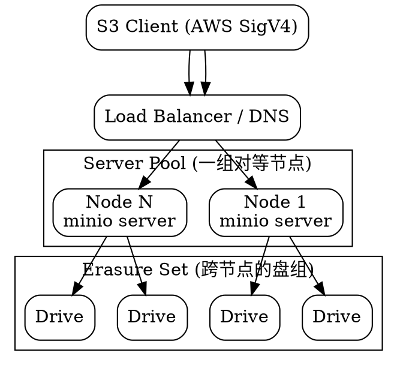

# MinIO

## Introduction

MinIO 是一个用 Go 编写、高性能、S3 兼容的对象存储。它把对象存储做成单进程、单二进制、无独立元数据服务的形态：每个节点是平等的 peer，没有 master，对象数据与元数据作为**一次操作一起写入**，因此天然提供严格 read-after-write 一致性。它最早定位为"自托管的 S3"，是私有云、数据湖、AI/ML 训练数据、备份归档场景里最常被默认选中的 S3 兼容后端。

> [!WARNING]
>
> **许可证与维护状态（截至 2026-10-25，多源交叉印证）**：社区版服务器代码自 2021-05 起是 **GNU AGPLv3**（此前为 Apache-2.0），**并未重新许可为专有**——代码仍公开、仍可 fork。真正的变化是 MinIO, Inc. 逐步停止了**社区版的维护与分发**，把工程力量转向商业产品 **AIStor**：
>
> | 时间 | 事件 |
> | :--- | :--- |
> | 2025-05 | 完整管理控制台从社区版移除，移至 AIStor 付费墙之后 |
> | 2025-10 | 停止发布社区二进制与镜像；最后一个社区构建约 `RELEASE.2025-09-07T16-13-09Z` |
> | 2025-12-03 | `minio/minio` 仓库进入 Maintenance Mode |
> | 2026-02-12 | README 改为 "THIS REPOSITORY IS NO LONGER MAINTAINED" |
> | 2026-04-25 | 仓库正式归档（只读） |
> | 2026-09-11~14 | `minio/minio` 与 `minio/mc` 从 Docker Hub 删除，匿名拉取返回 401/404 |
>
> 后果：任何社区版部署都运行在**永不再补丁**的软件上——`CVE-2026-39414`（S3 Select 内存耗尽，2026-04-09 披露，高危）影响**每一个**社区版本，仅 AIStor 修复。仍在运行的集群靠缓存镜像或 `quay.io/minio/minio` 的旧副本续命，但无保留承诺。新选型应评估 **Ceph RGW / SeaweedFS / Garage / RustFS（Apache-2.0）/ [PGSTY Silo](/docs/CS/Distributed/Silo.md)（AGPLv3 社区 fork，恢复控制台并 backport 修复）**。本笔记的架构与运维内容对 AIStor 与 Silo fork 同样适用（磁盘格式 `xl.meta`、纠删集模型、S3 行为保持一致）。具体版本与许可证以你部署的那一版的精确 tag 为准。

## Architecture

MinIO 的设计哲学是"为对象而生的单层的存储"，刻意不做 SAN/NAS 的网关，也不引入独立的元数据/监控服务。



### Erasure Coding

MinIO 用 **Reed-Solomon** 把对象切分为数据块与奇偶校验块，二者均匀散布在纠删集（erasure set）的各块盘上，每块盘对每个对象至多持有一块。它**不做 RAID**——纠删码在对象级别生效，损坏的对象可单独秒级自愈，而不是像 RAID 那样在卷级别整体重建。

- **纠删集（erasure set）**：同一 server pool 内，来自每个节点的盘被编组为一个或多个等大的纠删集。默认每个纠删集 **2~16 块盘**；AIStor `RELEASE.2026-02-02` 起可通过 `MINIO_ERASURE_SET_DRIVE_COUNT` 配置到 32。纠删集在 pool 初始化时确定，**之后不可改**。
- **奇偶校验（EC:M 表示 M 个奇偶块）**：默认按纠删集大小取默认值，生产环境**必须 ≥ EC:3**。

| 纠删集大小 | 默认奇偶 | 可用容量比 | 可容忍盘故障 |
| :--- | :--- | :--- | :--- |
| 1 | EC:0 | 100% | 0（无保护） |
| 2-3 | EC:1 | — | 1 |
| 4-5 | EC:2 | — | 2 |
| 6-7 | EC:3 | — | 3 |
| 8-16 | EC:4 | 75%（16 盘例） | 4 |
| 16（上限） | 最高 EC:8 | 50% | 8 |

- **读仲裁**：读出对象需要 K 个分片（K = 数据块数）。例如 16 盘 EC:4（12 数据 + 4 奇偶），读仲裁为 12，因此即便 4 块盘离线仍可正常读。
- **比特腐检测（bitrot）**：用 **HighwayHash** 在写入时计算哈希、读取时校验，端到端覆盖"应用 → 网络 → 介质"，单 Intel 核可达 10 GB/s 以上，几乎无额外开销。

### Drive Sets and Server Pools

- **单对象存储层（single object storage layer）**：自 `RELEASE.2023-05-04` 起，MinIO 把早期的 FS 模式与 Erasure 模式统一为单一存储层，不再区分——是否启用纠删码只取决于盘数（≥4 块盘即走纠删码）。
- **横向扩展靠 server pool**：容量通过**新增 pool** 增长，已有数据原地不动；旧 pool 可走 decommission 把数据迁出后再下线。每个请求因多一个 pool 会多一次查找，故 pool 数也非越多越好。
- **无主架构**：任意节点都能接收任意请求并内部路由（any-to-any），没有中心元数据服务，放置由对象→纠删集的哈希决定，而非元数据查表。

## S3 Compatibility

MinIO 实现 AWS S3 REST API（请求须用 AWS Signature V4 签名，旧客户端支持 V2），并覆盖以下核心 S3 能力：

- Bucket / Object 基本操作、Multipart Upload、Presigned URL
- **版本控制（Versioning）**、**对象锁（Object Lock / WORM）**（legal hold + 合规保留期）
- **服务端加密**：SSE-S3、SSE-KMS、SSE-C
- **生命周期 / ILM 分层**：把对象 transition 到远端层（另一 MinIO、S3、GCS 等）
- **站点复制（site replication）**：跨站点主动-主动复制
- **桶通知 / Lambda**、**IAM 策略**、**STS（OIDC / LDAP 联合认证）**

注意 S3 兼容是"子集"而非全量——接入自有应用时，应确认用到的特性（multipart、presigned、versioning、object lock、lifecycle、bucket policy、SSE、通知）在目标版本里受支持。

## Deployment Modes

### Standalone

- **单盘单节点**：无纠删码、无冗余，仅用于开发评估。
- **单节点多盘**：一块机器挂多块盘（建议偶数、等大），盘数 ≥4 即启用纠删码。

```bash
export MINIO_ROOT_USER=admin
export MINIO_ROOT_PASSWORD=change-me-please
minio server /data{1...4} --console-address ":9001"
```

### Distributed

多节点多盘，生产推荐形态。将每个节点的盘以 `http://host/path` 形式列出，MinIO 自动跨节点编组纠删集：

```bash
minio server http://node{1...4}/data{1...4} --console-address ":9001"
```

- S3 API 端口 **9000**，控制台端口 **9001**。
- 建议：每个节点盘数相同、盘等大；节点数建议偶数；跨机架/故障域分散以容忍整节点失效。
- 最小可用集为 4 块盘（才能有 EC:2 级保护）；少于 4 盘则退化为无纠删码。

### Kubernetes

- **MinIO Operator + Tenant CRD**：声明式管理租户（Tenant）集群；Operator 最新社区版停在 **v7.1.1**（已随社区版冻结）。
- **Helm chart**：社区 chart 同样归档停止维护。
- 也可直接用 StatefulSet + PVC 跑 `minio server`，但会失去 Operator 的池管理、扩容、decommission 等能力。

## Key Operation Notes

- **控制台（Console）**：社区版自 2025-05 起仅剩对象浏览能力，用户管理 / bucket policy / 访问控制等 admin 功能需改用 `mc` 命令行。
- **`mc` 客户端**：`mc alias set`、`mc mb`、`mc cp`、`mc mirror`，以及运维关键的 `mc admin info`、`mc admin heal`（驱动自愈）、`mc admin prometheus generate`（输出 Prometheus 抓取配置）。
- **可观测性**：暴露 Prometheus 指标，配 Grafana 看板；驱动故障与重建（healing）进度都可在指标与 `mc admin heal` 中观测。
- **驱动失效与自愈**：单盘故障只需换盘，MinIO 识别新盘并并入纠删集，按对象级别校验与重建，读写互不阻塞。

## Versus Alternatives

| 维度 | MinIO（社区版） | Ceph RGW | AWS S3 | RustFS / SeaweedFS / Garage |
| :--- | :--- | :--- | :--- | :--- |
| 接口 | S3（最完整之一） | S3 / Swift（RGW 网关） | S3 事实标准 | S3 子集（各异） |
| 部署复杂度 | 单二进制极简 | 高（MON/MGR/OSD/MDS） | 托管的，无 | 各异，普遍轻量 |
| 一致性 | 严格一致（对象+元数据同写） | 强一致（RADOS） | 强一致 | 各异 |
| 数据保护 | 纠删码 + bitrot | 副本 / EC（按 pool） | 多副本 + EC（托管） | 各异 |
| 其他接口 | 仅对象 | 块（RBD）/ 文件（CephFS）/ 对象 | 仅对象 + 周边服务 | 通常仅对象 |
| 治理 / 许可 | AGPLv3，**社区版已停维护**（2026-02 归档） | LGPL（Ceph 基金会 / Linux 基金会） | 商业 | RustFS Apache-2.0；其余各异 |

一句话：需要"开箱即用的 S3 兼容、极简运维"且能接受 AGPLv3 与**停止维护**现实时，MinIO 仍是成熟选择；需要块/文件统一底座或 vendor-neutral 持续维护，优先 Ceph RGW；新开源部署应把 RustFS / SeaweedFS / Garage 纳入评估。

## PGSTY Silo: Community Fork

MinIO 社区版停更后，**PGSTY Silo**（`pgsty/silo`，Pigsty / 冯若航维护的 AGPL-3.0 drop-in fork）把上游删掉的控制台、停发的二进制、未修的 CVE 全部找了回来：磁盘格式 `xl.meta` 兼容、保留 S3 API 与 `MINIO_*` 环境变量，迁移只需换镜像或换 systemd 服务名，**无需数据迁移、无需改应用代码**。

Silo 与 MinIO 共用同一套存储引擎与纠删码架构，因此本笔记的 Architecture / S3 Compatibility / Deployment Modes 各节对 Silo 同样适用；fork 特有的背景时间线、三项恢复细节、CVE backport 账本、发布工程、兼容性与迁移步骤、选型对照，已拆为独立笔记 [Silo](/docs/CS/Distributed/Silo.md)，此处不重复展开。

## Relation to Other Topics

- 与 [Distributed Storage](/docs/CS/Distributed/Distributed_Storage.md)：MinIO 是"对象存储"类接口最典型的自托管代表，本笔记是该枢纽按访问接口分类的落地展开。
- 与 [Haystack](/docs/CS/Distributed/Haystack.md)：Haystack 解决"海量小对象高吞吐"，现代对象存储（MinIO / S3）在"海量小文件高吞吐"这一命题上与之同源——MinIO 把该能力做成 S3 兼容的通用底座。
- 与 [Ceph](/docs/CS/Distributed/Ceph.md)：Ceph 用 RGW 网关提供 S3，是一套架构三接口的延伸；MinIO 是对象单接口、无元数据服务的极简对照。
- 在本库的工程落地中，MinIO 是 [Milvus](/docs/CS/DB/Milvus/Deployment_and_Ops.md)（segment / binlog 落盘）、[Coze](/docs/CS/AI/LLM/Platform/Coze/Architecture.md)（默认对象存储）、RAGFlow、GreptimeDB（S3 兼容层之一）的默认对象存储后端——这也是它"事实标准 S3 兼容"地位的直接印证。

## Links

- [Distributed Storage](/docs/CS/Distributed/Distributed_Storage.md)
- [Ceph（RGW 对照）](/docs/CS/Distributed/Ceph.md)
- [Haystack（海量小对象 lineage）](/docs/CS/Distributed/Haystack.md)
- [Milvus Deployment and Ops（对象存储后端）](/docs/CS/DB/Milvus/Deployment_and_Ops.md)
- [Coze Architecture（默认对象存储）](/docs/CS/AI/LLM/Platform/Coze/Architecture.md)

## References

1. [MinIO Documentation (现重定向至 AIStor 文档)](https://min.io/docs/minio/linux/index.html)
2. [MinIO Erasure Coding vs. Block Storage RAID](https://www.min.io/blog/erasure-coding-vs-raid)
3. [MinIO GitHub（社区版已归档，只读）](https://github.com/minio/minio)
4. [MinIO and its alternatives: revisit your self-hosted S3 in 2026](https://revisit.tech/blog/minio-and-its-alternatives-revisit-your-self-hosted-s3)
5. [MinIO 从 Docker Hub 消失：迁移全貌解析](https://bex.co/zh/blog/2026/09/21/rustfs-v1-ga-minio-docker-hub-deletion-migration)
6. [MinIO 中文文档（末代社区版 RELEASE.2025-04-22T22-12-26Z）](https://www.minio.org.cn/docs/minio/linux/index.html)
