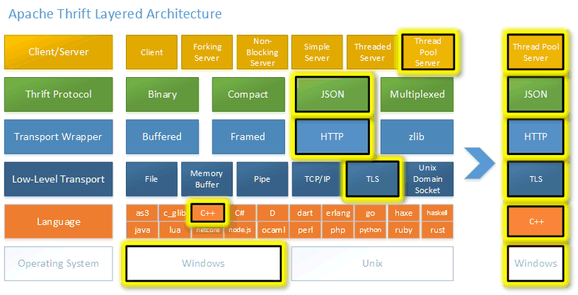

## Introduction

[Apache Thrift](https://thrift.apache.org/) 起源于 Facebook，是一套跨语言的 RPC 与序列化软件栈。它的定位与 gRPC 有微妙差别：gRPC 绑定了 HTTP/2 + Protobuf 这一组具体技术，Thrift 则提供一套**分层抽象**——传输、协议、处理、服务四层都可替换，你可以随意组合出"二进制协议 + 分帧传输 + 线程池服务器"或"JSON 协议 + 阻塞 socket + 单线程服务器"这样的搭配。

Thrift 的核心资产是它的 IDL：`*.thrift` 文件同时定义数据类型与服务接口，编译器为目标语言生成完整的客户端与服务端代码。对 C++、Java、Go、Python、PHP、Ruby、Rust 等语言都有支持。

## Layered Architecture

Thrift 的分层是它最容易理解也最容易被忽略的设计。自下而上：

<div style="text-align: center;">



</div>

<p style="text-align: center;">
Fig.1. Thrift Layered Architecture
</p>

| 层 | 职责 | 关键点 |
| :--- | :--- | :--- |
| Transport | 字节流的读写 | 决定"数据怎么搬运"，不涉及内容 |
| Protocol | 数据的编码/解码 | 决定"数据长什么样"，与传输无关 |
| Processor | IDL 生成的方法派发 | 把 protocol 的抽象读写映射到真实函数调用 |
| Server | 组装上述三层并监听 | 决定并发模型（单线程/线程池/非阻塞） |

分层的实际价值在于**正交替换**：改编码格式不用动网络代码，换并发模型不用改 IDL。代价是抽象层带来的组合爆炸——你必须清楚哪几种组合是被测试覆盖的，而不是随便配。

## IDL

`.thrift` 文件的基本构成：

```thrift
namespace java com.example.thrift

enum PhoneType {
  HOME,
  WORK,
  MOBILE,
  OTHER
}

struct Phone {
  1: i32 id,
  2: string number,
  3: PhoneType type
}

service PhoneService {
  Phone findById(1: i32 id),
  list<Phone> findAll()
}
```

基本类型有 `bool`、`byte`、`i16`、`i32`、`i64`、`double`、`string`、`binary`；容器有 `list<T>`、`set<T>`、`map<K,V>`。此外支持 `struct`、`union`、`exception`、`typedef` 与 `const`。

两个必须注意的约定：

- **字段编号**（如 `1:`）是线上格式的唯一标识，改名可以，改号不行——这一点与 [Protocol Buffers](/docs/CS/Distributed/RPC/ProtoBuf.md) 完全一致。
- **`required` / `optional`** 修饰符影响兼容性语义。`required` 字段在演进中最容易出问题：一旦某个版本声明了 `required`，后续所有版本都必须带上它，删除会直接破坏老节点的解析。新项目倾向于只用 `optional` 与默认值。

`service` 支持 `extends` 继承，也支持 `oneway` 修饰——被 `oneway` 标记的方法客户端只发不收，不等待任何响应，适合日志上报这类"fire and forget"场景。

## Protocols

Thrift 定义了四种协议，实际常用的主要是前三种：

| 协议 | 特点 | 适用场景 |
| :--- | :--- | :--- |
| `TBinaryProtocol` | 直白的二进制编码，不追求紧凑，但处理速度快 | 追求编解码速度、带宽不敏感 |
| `TCompactProtocol` | 紧凑编码，zigzag + varint 压缩整数 | 带宽敏感、跨机房调用 |
| `TJSONProtocol` | 用 JSON 承载数据 | 调试、与脚本语言互通 |
| `TSimpleJSONProtocol` | 只写不读，会丢弃元数据 | 供非 Thrift 的脚本直接解析 |

`TSimpleJSONProtocol` 值得单独留意：它是**只写**的，Thrift 自己无法解析它产出的内容。它的存在意义是让纯脚本环境（没有 Thrift 库）能直接读懂数据，属于单向出口。

需要区分的是，`TZlibTransport` 属于传输层而非协议层——它套在另一个 transport 外面做压缩，与协议选择正交。

## Transports

| Transport | 说明 |
| :--- | :--- |
| `TSocket` | 阻塞式 socket I/O，最基础 |
| `TFramedTransport` | 按帧发送，帧首带长度信息；**非阻塞服务器必须使用** |
| `TMemoryTransport` | 内存 I/O，Java 实现内部用 `ByteArrayOutputStream` |
| `TFileTransport` | 写入文件 |
| `TZlibTransport` | 用 zlib 压缩，需配合其它 transport 使用 |

`TFramedTransport` 与非阻塞服务器的绑定关系是个硬约束，配置错了会在运行时才暴露问题。

## Servers

| Server | 并发模型 |
| :--- | :--- |
| `TSimpleServer` | 单线程 + 阻塞 I/O，仅适合测试 |
| `TThreadedServer` | 每连接一线程 + 阻塞 I/O |
| `TThreadPoolServer` | 线程池 + 阻塞 I/O |
| `TNonblockingServer` | 多线程 + 非阻塞 I/O（Java 用 NIO channel），必须配 `TFramedTransport` |

## Version Baseline

| 组件 | 版本 | 日期 |
| :--- | :--- | :--- |
| Apache Thrift | 0.25.0 | 2026-09-30 |

Thrift 的版本号长期停留在 0.x，这并不代表"不成熟"——它已在生产环境使用近二十年。当前一个主要下游使用者是字节跳动开源的 [Kitex](/docs/CS/Framework/kitex.md)，其默认使用 Thrift 作为 IDL 与编码格式。

## Links

- [RPC](/docs/CS/Distributed/RPC/RPC.md) — RPC 概念模型与异常语义
- [Protocol Buffers](/docs/CS/Distributed/RPC/ProtoBuf.md) — 最直接的对照对象
- [Fury](/docs/CS/Distributed/RPC/Fury.md) — JIT 加速的多语言序列化
- [gRPC](/docs/CS/Framework/gRPC/gRPC.md) — 绑定 HTTP/2 的另一条路线
- [Marshalling](/docs/CS/Distributed/RPC/Marshalling.md) — 编码格式与兼容性通论
- [Kitex](/docs/CS/Framework/kitex.md) — 以 Thrift 为默认 IDL 的 Go RPC 框架

## References

1. [Apache Thrift](https://thrift.apache.org/)
2. [Apache Thrift Download](https://thrift.apache.org/download.html)
3. [Thrift: The Missing Guide](https://diwakergupta.github.io/thrift-missing-guide/)
4. [Apache Thrift (GitHub)](https://github.com/apache/thrift)
5. [Thrift interface description language](https://thrift.apache.org/docs/idl)
