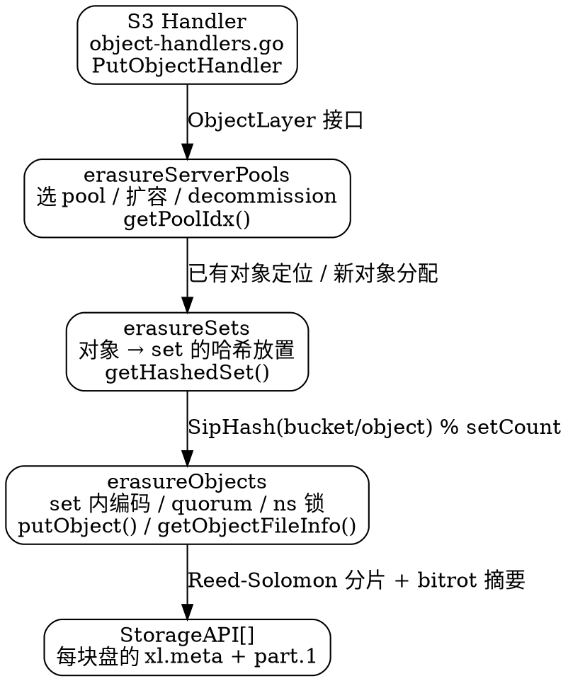

# Silo Object Engine

## Introduction

[MinIO](/docs/CS/Distributed/MinIO.md) 概述了 Silo/MinIO 的纠删码模型与部署形态，[Architecture](/docs/CS/Distributed/Silo/Silo.md?id=architecture) 讲清了 fork 在模块与交付面的改动。但有一层始终没被拆开：**一个 PUT 请求进来，对象究竟怎么被切成块、撒到哪些盘、读的时候又怎么拼回来**。这一层在 Silo 里属于协议面——fork 明确保留、CI 守卫冻结——因此读 Silo 的对象引擎，就是读 MinIO 归档版的那套内核。

本页按 Nacos [Distro 深潜](/docs/CS/Framework/nacos/distro.md)的写法做源码级拆解：给版本锚点、贴真实片段、给成因、列证伪。要回答的问题是：**把数据写进一个没有元数据服务、节点全对等的对象存储，它的"放置—编码—仲裁—自愈"四件事在代码里是怎么闭合的。**

> 版本基线：SILO `RELEASE.2026-11-12T00-00-00Z`（commit `44e848f`，Go 1.27.4），2026-11 从 `pgsty/silo` 浅克隆核实。存储引擎源码由上游 MinIO 继承、fork 未改动，片段取自该 tag 的 `cmd/` 与 `internal/`。

三个最容易理解错的点：

- **对象放置不是 CRC32 取模**：新部署默认走 `SIPMOD+PARITY`，用 SipHash 且把 `deploymentID` 当哈希种子；CRC32 只留给老格式（`CRCMOD`）。
- **quorum 不是固定的"多数派"**：读/写仲裁都从每块盘的 `xl.meta` 反推——读仲裁 = 数据块数，写仲裁 = 数据块数（数据块与奇偶块相等时 +1），而不是拍脑袋的 `N/2+1`。
- **bitrot 不是可选的表层校验**：每个 shard 尾部都带 HighwayHash 摘要（`HighwayHash256S` 为默认算法），解码前逐 shard 验，坏块就地降级为"缺失"，由纠删码补齐。

## The Three-Layer Object Layer

源码里对象层是三层结构，每层各管一件事。codegraph 的关系图（implements / calls）显示得很清楚：



`erasureSets` 的注释直接点明 set 是静态的——这是理解"扩容靠加 pool、不靠动 set"的源头：

```go
// erasureSets implements ObjectLayer combining a static list of erasure coded
// object sets. NOTE: There is no dynamic scaling allowed or intended in
// current design.
type erasureSets struct {
	sets []*erasureObjects

	// Reference format.
	format *formatErasureV3

	// erasureDisks mutex to lock erasureDisks.
	erasureDisksMu sync.RWMutex

	// Re-ordered list of disks per set.
	erasureDisks [][]StorageAPI

	// Distributed locker clients.
	erasureLockers setsDsyncLockers

	// Distributed lock owner (constant per running instance).
	erasureLockOwner string

	// Total number of sets and the number of disks per set.
	setCount, setDriveCount int
	defaultParityCount      int
	// ...
}
```

而 `erasureObjects` 是真正干活的那层——它持有的是"取盘函数"而非盘本身，盘掉线时函数返回 nil，这正是"降级为缺失块"的实现基础：

```go
// erasureObjects - Implements ER object layer.
type erasureObjects struct {
	setDriveCount      int
	defaultParityCount int

	setIndex  int
	poolIndex int

	// getDisks returns list of storageAPIs.
	getDisks func() []StorageAPI

	// getLockers returns list of remote and local lockers.
	getLockers func() ([]dsync.NetLocker, string)

	// Locker mutex map.
	nsMutex *nsLockMap
}
```

`nsMutex` 是命名空间锁：同一个 bucket/object 的并发写在这层串行化，配合下面会看到的 `renameData` 两段式提交，才有"没有元数据服务也能 read-after-write"的语义。

## Object Placement: SipHash, Not CRC32

对象属于哪个 set，由 `getHashedSet()` 决定——它对同一个输入永远返回同一个 set，这是"任意节点都能算出对象在哪、无需查元数据"的关键：

```go
// Returns always a same erasure coded set for a given input.
func (s *erasureSets) getHashedSetIndex(input string) int {
	return hashKey(s.distributionAlgo, input, len(s.sets), s.deploymentID)
}

// Returns always a same erasure coded set for a given input.
func (s *erasureSets) getHashedSet(input string) (set *erasureObjects) {
	return s.sets[s.getHashedSetIndex(input)]
}
```

`hashKey` 路由到两代算法，种子是 16 字节的 `deploymentID`：

```go
func sipHashMod(key string, cardinality int, id [16]byte) int {
	if cardinality <= 0 {
		return -1
	}
	// use the faster version as per siphash docs
	k0, k1 := binary.LittleEndian.Uint64(id[0:8]), binary.LittleEndian.Uint64(id[8:16])
	sum64 := siphash.Hash(k0, k1, []byte(key))
	return int(sum64 % uint64(cardinality))
}

func crcHashMod(key string, cardinality int) int {
	if cardinality <= 0 {
		return -1
	}
	keyCrc := crc32.Checksum([]byte(key), crc32.IEEETable)
	return int(keyCrc % uint32(cardinality))
}

func hashKey(algo string, key string, cardinality int, id [16]byte) int {
	switch algo {
	case formatErasureVersionV2DistributionAlgoV1:
		return crcHashMod(key, cardinality)
	case formatErasureVersionV3DistributionAlgoV2, formatErasureVersionV3DistributionAlgoV3:
		return sipHashMod(key, cardinality, id)
	default:
		return -1
	}
}
```

三个算法常量与新建格式时写入的默认值：

```go
formatErasureVersionV2DistributionAlgoV1  = "CRCMOD"
formatErasureVersionV3DistributionAlgoV2  = "SIPMOD"
formatErasureVersionV3DistributionAlgoV3  = "SIPMOD+PARITY"

// 新建 format 时：
format.Erasure.DistributionAlgo = formatErasureVersionV3DistributionAlgoV3
```

> [!WARNING]
> 很多资料（含本库早期表述）说"MinIO 用 `crc32` 把对象名取模定位"——那只适用于 V2 老格式的 `CRCMOD`。当前新建部署写的是 `SIPMOD+PARITY`，走 SipHash，且哈希种子来自集群的 `deploymentID`。这意味着**同一组对象名在不同集群上的 set 分布不同**，不能靠对象名反推物理位置；老集群升级后仍沿用自己的 `distributionAlgo`，不会重排数据。

set 选完才是 pool。`erasureServerPools.getPoolIdx()` 对新对象挑"剩余空间最足"的 pool，对已存在对象则用 `getPoolInfoExistingWithOpts()` 找回它所在的 pool——所以写一个已存在的对象会回到原 pool，不会因扩容而漂移。

## Quorum Is Derived, Not Fixed

这是这套引擎里最反直觉的一处：**读/写仲裁数不是配置常量，而是每次操作从各盘 `xl.meta` 里的纠删信息算出来的**。`objectQuorumFromMeta` 先凑出各盘上报的奇偶数，取共识：

```go
func objectQuorumFromMeta(ctx context.Context, partsMetaData []FileInfo, errs []error, defaultParityCount int) (objectReadQuorum, objectWriteQuorum int, err error) {
	// There should be at least half correct entries, if not return failure
	expectedRQuorum := len(partsMetaData) / 2
	if defaultParityCount == 0 {
		// if parity count is '0', we expected all entries to be present.
		expectedRQuorum = len(partsMetaData)
	}

	reducedErr := reduceReadQuorumErrs(ctx, errs, objectOpIgnoredErrs, expectedRQuorum)
	if reducedErr != nil {
		return -1, -1, reducedErr
	}

	// special case when parity is '0'
	if defaultParityCount == 0 {
		return len(partsMetaData), len(partsMetaData), nil
	}

	parities := listObjectParities(partsMetaData, errs)
	parityBlocks := commonParity(parities, defaultParityCount)
	if parityBlocks < 0 {
		return -1, -1, InsufficientReadQuorum{Err: errErasureReadQuorum, Type: RQInsufficientOnlineDrives}
	}

	dataBlocks := len(partsMetaData) - parityBlocks

	writeQuorum := dataBlocks
	if dataBlocks == parityBlocks {
		writeQuorum++
	}

	// Since all the valid erasure code meta updated at the same time are equivalent, pass dataBlocks
	// from latestFileInfo to get the quorum
	return dataBlocks, writeQuorum, nil
}
```

`FileInfo` 上的两个方法把这条规则收口：

```go
// WriteQuorum returns expected write quorum for this FileInfo
func (fi FileInfo) WriteQuorum(dquorum int) int {
	if fi.Deleted {
		return dquorum
	}
	quorum := fi.Erasure.DataBlocks
	if fi.Erasure.DataBlocks == fi.Erasure.ParityBlocks {
		quorum++
	}
	return quorum
}

// ReadQuorum returns expected read quorum for this FileInfo
func (fi FileInfo) ReadQuorum(dquorum int) int {
	if fi.Deleted {
		return dquorum
	}
	return fi.Erasure.DataBlocks
}
```

`erasureObjects` 上的 `defaultWQuorum` / `defaultRQuorum` 是同一规则的盘数版本：

```go
// defaultWQuorum write quorum based on setDriveCount and defaultParityCount
func (er erasureObjects) defaultWQuorum() int {
	dataCount := er.setDriveCount - er.defaultParityCount
	if dataCount == er.defaultParityCount {
		return dataCount + 1
	}
	return dataCount
}

// defaultRQuorum read quorum based on setDriveCount and defaultParityCount
func (er erasureObjects) defaultRQuorum() int {
	return er.setDriveCount - er.defaultParityCount
}
```

为什么写 quorum 在 `dataBlocks == parityBlocks` 时要 +1？因为纠删码的重建条件是"凑够数据块数"，而 8 盘 EC:4 时 4 个数据块 = 4 个奇偶块：只写 4 块（可能全是奇偶）无法保证覆盖足够数据分片，多写 1 块才能打破平局。读不需要这个修正——只要拿到任意 4 个有效分片（无论数据还是奇偶）就能重建。

| 纠删集 | 奇偶 | 数据块 | 读仲裁 | 写仲裁 |
| :-- | :-- | :-- | :-- | :-- |
| 8 | EC:2 | 6 | 6 | 6 |
| 8 | EC:4 | 4 | 4 | **5**（相等 +1） |
| 16 | EC:4 | 12 | 12 | 12 |
| 16 | EC:8 | 8 | 8 | **9**（相等 +1） |

默认奇偶数来自 storage class，按 set 盘数查表：

```go
func ecDrivesNoConfig(setDriveCount int) (int, error) {
	sc, err := storageclass.LookupConfig(config.KVS{}, setDriveCount)
	if err != nil {
		return 0, err
	}
	return sc.GetParityForSC(storageclass.STANDARD), nil
}
```

## Reed-Solomon Encoding Under the Hood

编码内核是 `Erasure` 结构，封装 `klauspost/reedsolomon` 编码器；块大小随格式版本变化——V1 是 10 MiB，V2 是 1 MiB：

```go
type Erasure struct {
	encoder                  func() reedsolomon.Encoder
	dataBlocks, parityBlocks int
	blockSize                int64
}
```

`NewErasure` 里有个值得单独看的守卫：`blockSize` 来自 peer 写的 `xl.meta`，而非本地常量。`FileInfo.IsValid()` 不校验它，若为 0，下游所有 `ShardFileSize` / `ShardFileOffset` 都会整数除零——所以在唯一构造点统一拒绝。这是 fork 接手后补的防御性检查之一：

```go
// blockSize reaches here from FileInfo.Erasure, i.e. from xl.meta, which a
// peer can write, and FileInfo.IsValid() does not check it. A coder with a
// non-positive block size cannot encode or decode anything, so refusing to
// build one loses nothing -- but building one leaves every division by
// e.blockSize downstream (ShardFileSize, ShardFileOffset, and the whole of
// erasure-decode.go) as an integer divide-by-zero. Reject at the single
// point where every Erasure value in the process is constructed.
if blockSize <= 0 {
	return e, errInvalidArgument
}
```

编码器是懒构造 + `sync.Once`，并按分片大小自动选 goroutine 数：

```go
var enc reedsolomon.Encoder
var once sync.Once
e.encoder = func() reedsolomon.Encoder {
	once.Do(func() {
		e, err := reedsolomon.New(dataBlocks, parityBlocks, reedsolomon.WithAutoGoroutines(int(e.ShardSize())))
		if err != nil {
			panic(err)
		}
		enc = e
	})
	return enc
}
```

`EncodeData` 是 Split + Encode 两步；`DecodeDataBlocks` 只重建数据块（读路径用），`DecodeDataAndParityBlocks` 连奇偶一起重建并校验（healing 用）：

```go
func (e *Erasure) EncodeData(ctx context.Context, data []byte) ([][]byte, error) {
	if len(data) == 0 {
		return make([][]byte, e.dataBlocks+e.parityBlocks), nil
	}
	encoded, err := e.encoder().Split(data)
	if err != nil {
		return nil, err
	}
	if err = e.encoder().Encode(encoded); err != nil {
		return nil, err
	}
	return encoded, nil
}

func (e *Erasure) DecodeDataBlocks(data [][]byte) error {
	isZero := 0
	for _, b := range data {
		if len(b) == 0 {
			isZero++
			break
		}
	}
	if isZero == 0 || isZero == len(data) {
		// If all are zero, payload is 0 bytes.
		return nil
	}
	return e.encoder().ReconstructData(data)
}

func (e *Erasure) DecodeDataAndParityBlocks(ctx context.Context, data [][]byte) error {
	return e.encoder().Reconstruct(data)
}
```

分片大小是向上取整的块除法：`ShardSize = ceilFrac(blockSize, dataBlocks)`。以 16 盘 EC:4（12 数据块）、V2 块大小 1 MiB 计算，每片约 87 KiB——对象被切成 1 MiB 的段，每段再横向切成 12 份数据 + 4 份校验，均匀散布在 16 块盘上。

## The Write Path

调用链从 codegraph 的 callers 关系可以直接读出：`PutObjectHandler` → `ObjectLayer.PutObject` → `erasureServerPools.PutObject`（选 pool）→ `erasureSets.PutObject`（哈希到 set）→ `erasureObjects.PutObject` → `putObject`。最后一段是核心，先看仲裁与分片布置：

```go
dataDrives := len(storageDisks) - parityDrives

// we now know the number of blocks this object needs for data and parity.
// writeQuorum is dataBlocks + 1
writeQuorum := dataDrives
if dataDrives == parityDrives {
	writeQuorum++
}

// Initialize parts metadata
partsMetadata := make([]FileInfo, len(storageDisks))

fi := newFileInfo(pathJoin(bucket, object), dataDrives, parityDrives)
fi.VersionID = opts.VersionID
if opts.Versioned && fi.VersionID == "" {
	fi.VersionID = mustGetUUID()
}

fi.DataDir = mustGetUUID()
uniqueID := mustGetUUID()
tempObj := uniqueID

// Initialize erasure metadata.
for index := range partsMetadata {
	partsMetadata[index] = fi
}

// Order disks according to erasure distribution
var onlineDisks []StorageAPI
onlineDisks, partsMetadata = shuffleDisksAndPartsMetadata(storageDisks, partsMetadata, fi)

erasure, err := NewErasure(ctx, fi.Erasure.DataBlocks, fi.Erasure.ParityBlocks, fi.Erasure.BlockSize)
```

`shuffleDisksAndPartsMetadata` 按分布算法重排盘序——这是"每块盘对每个对象至多持有一块"的落实：分片索引与盘序的对应关系被 systematically 轮换（bit rotation 思想），避免某个对象的数据总落在固定几块盘上。

接着为每个分片挂 bitrot writer，再调 `Erasure.Encode` 逐块编码写盘：

```go
writers := make([]io.Writer, len(onlineDisks))
for i, disk := range onlineDisks {
	if disk == nil {
		continue
	}
	if !disk.IsOnline() {
		continue
	}
	if len(inlineBuffers) > 0 {
		buf := grid.GetByteBufferCap(int(shardFileSize) + 64)
		inlineBuffers[i] = bytes.NewBuffer(buf[:0])
		defer grid.PutByteBuffer(buf)
		writers[i] = newStreamingBitrotWriterBuffer(inlineBuffers[i], DefaultBitrotAlgorithm, erasure.ShardSize())
		continue
	}
	writers[i] = newBitrotWriter(disk, bucket, minioMetaTmpBucket, tempErasureObj, shardFileSize, DefaultBitrotAlgorithm, erasure.ShardSize())
}

n, erasureErr := erasure.Encode(ctx, toEncode, writers, buffer, writeQuorum)
closeErrs := closeBitrotWriters(writers)
```

`Erasure.Encode` 是"读一块 → 编码成 N 片 → 写 N 个 writer"的循环；每个 writer 对应一块盘。真正决定成败的是 `multiWriter.Write`：它不要求所有盘成功，只要成功的盘数 ≥ `writeQuorum` 就返回 nil——这是 quorum 写的代码级定义：

```go
func (p *multiWriter) Write(ctx context.Context, blocks [][]byte) error {
	for i := range p.writers {
		if p.errs[i] != nil {
			continue
		}
		if p.writers[i] == nil {
			p.errs[i] = errDiskNotFound
			continue
		}
		var n int
		n, p.errs[i] = p.writers[i].Write(blocks[i])
		if p.errs[i] == nil {
			if n != len(blocks[i]) {
				p.errs[i] = io.ErrShortWrite
				p.writers[i] = nil
			}
		} else {
			p.writers[i] = nil
		}
	}

	// If nilCount >= p.writeQuorum, we return nil.
	nilCount := countErrs(p.errs, nil)
	if nilCount >= p.writeQuorum {
		return nil
	}

	writeErr := reduceWriteQuorumErrs(ctx, p.errs, objectOpIgnoredErrs, p.writeQuorum)
	return fmt.Errorf("%w (offline-disks=%d/%d)", writeErr, countErrs(p.errs, errDiskNotFound), len(p.writers))
}
```

分片先写进临时目录 `minioMetaTmpBucket`，全部成功后才由 `renameData` 以 `writeQuorum` 原子改名到最终路径，并用 `writeAllMetadataWithRevert` 并行写 `xl.meta`——失败的盘会触发 revert 删除半写的元数据。这两段合起来，才是"数据和元数据一起成功、否则回滚"的提交语义。

## The Read Path and Overdrive

读路径先并行读所有盘的 `xl.meta`，从元数据算出仲裁，再挑出有效的最新版本：

```go
// Read metadata associated with the object from all disks.
if srcOpts.VersionID != "" {
	metaArr, errs = readAllFileInfo(ctx, storageDisks, "", srcBucket, srcObject, srcOpts.VersionID, true, false)
} else {
	metaArr, errs = readAllXL(ctx, storageDisks, srcBucket, srcObject, true, false)
}

readQuorum, writeQuorum, err := objectQuorumFromMeta(ctx, metaArr, errs, er.defaultParityCount)
// ...
// List all online disks.
onlineDisks, modTime, etag := listOnlineDisks(storageDisks, metaArr, errs, readQuorum)

// Pick latest valid metadata.
fi, err := pickValidFileInfo(ctx, metaArr, modTime, etag, readQuorum)
```

数据读取用 `parallelReader`：它按 shard 大小从各盘并行读，只要凑够 `dataBlocks` 个有效 buffer 就能解码——这是"读仲裁 = 数据块数"的另一半实现：

```go
// Returns if buf can be erasure decoded.
func (p *parallelReader) canDecode(buf [][]byte) bool {
	bufCount := 0
	for _, b := range buf {
		if len(b) > 0 {
			bufCount++
		}
	}
	return bufCount >= p.dataBlocks
}
```

`preferReaders` 还能把指定的盘（比如上一轮成功的、或本地盘）提到前面优先读，配合 `readTriggerCh` 形成 overdrive——不必等最慢的盘，先返回足够数量的分片即可。解码失败时按错误类型区分：`errFileNotFound` / `errFileCorrupt` 走对应分支，凑不齐则返回 `errErasureReadQuorum` 并附上离线盘计数：

```go
return nil, fmt.Errorf("%w (offline-disks=%d/%d)", errErasureReadQuorum, disksNotFound, len(p.readers))
```

## Bitrot and Self-Healing

Silo 的默认 bitrot 算法是 `HighwayHash256S`（流式为大文件而生），每个 shard 尾部追加摘要。算法集合与默认值的定义分处两文件：

```go
var bitrotAlgorithms = map[BitrotAlgorithm]string{
	SHA256:          "sha256",
	BLAKE2b512:      "blake2b",
	HighwayHash256:  "highwayhash256",
	HighwayHash256S: "highwayhash256S",
}

// New returns a new hash.Hash calculating the given bitrot algorithm.
func (a BitrotAlgorithm) New() hash.Hash {
	switch a {
	case SHA256:
		return sha256.New()
	case BLAKE2b512:
		b2, _ := blake2b.New512(nil)
		return b2
	case HighwayHash256:
		hh, _ := highwayhash.New(magicHighwayHash256Key)
		return hh
	case HighwayHash256S:
		hh, _ := highwayhash.New(magicHighwayHash256Key)
		return hh
	}
}
```

`HighwayHash256S` 走流式读写器，其余算法走 whole-file 版本——这是"分段校验 + 边写边算摘要"和"整块算完再写"的分野：

```go
func newBitrotWriter(disk StorageAPI, origvolume, volume, filePath string, length int64, algo BitrotAlgorithm, shardSize int64) io.Writer {
	if algo == HighwayHash256S {
		return newStreamingBitrotWriter(disk, origvolume, volume, filePath, length, algo, shardSize)
	}
	return newWholeBitrotWriter(disk, volume, filePath, algo, shardSize)
}
```

校验失败的 shard 不会被当成"脏数据返回"，而是被计为坏块、交给纠删码用其余分片重建——**bitrot 与纠删码是两层：前者发现静默损坏，后者补回内容**。读路径中发现的旧格式（`fi.XLV1`）对象会被就地触发 `HealObject` 迁移到最新格式；日常的大面积自愈则由后台 data scanner 驱动 `queueHealTask` → `healSequence`，逐对象调用 `HealObject`。这是"对象级秒级自愈、不做什么整卷重建"的代码落点。

## Why This Shape

把四件事串起来， shape 是几个约束共同逼出来的：

- **没有元数据服务**：对象在哪必须能算出来，于是有 `SipHash(name) % setCount` + `deploymentID` 种子；set 一旦初始化就静态，扩容只能加 pool。
- **盘会独立坏掉**：于是按对象做 Reed-Solomon + 默认 EC:4，读仲裁压到数据块数，坏 ≤ 奇偶数的盘仍可读；bitrot 摘要保证"读到的坏块能被识别为坏块"而非静默错误。
- **写要能被多方见证**：于是写仲裁从 `xl.meta` 反推、数据先写临时目录再原子改名、失败盘 revert——在没有中心事务协调器的前提下逼近事务语义。
- **坏盘换上后要自动补齐**：于是 healing 做成对象级任务（scanner 兜底 + 读路径触发），用 `DecodeDataAndParityBlocks` 连奇偶一起重建。

一句话概括这套引擎的取舍：**它用"计算"代替"查表"（放置），用"仲裁"代替"协调"（一致性），用"对象级重建"代替"卷级 RAID"（可靠性）。**

## Links

- [Silo（专题枢纽）](/docs/CS/Distributed/Silo/Silo.md)
- [Architecture（fork 基线与模块替换）](/docs/CS/Distributed/Silo/Silo.md?id=architecture)
- [MinIO（上游架构与纠删码概述）](/docs/CS/Distributed/MinIO.md)
- [Distributed Storage（对象存储分类枢纽）](/docs/CS/Distributed/Distributed_Storage.md)
- [Distro（Nacos AP 协议源码深潜，写法参照）](/docs/CS/Framework/nacos/distro.md)

## References

1. [pgsty/silo 仓库（RELEASE.2026-11-12T00-00-00Z）](https://github.com/pgsty/silo)
2. [erasure-sets.go（对象放置与分布算法）](https://github.com/pgsty/silo/blob/RELEASE.2026-11-12T00-00-00Z/cmd/erasure-sets.go)
3. [erasure-metadata.go（quorum 从元数据反推）](https://github.com/pgsty/silo/blob/RELEASE.2026-11-12T00-00-00Z/cmd/erasure-metadata.go)
4. [erasure-coding.go（Reed-Solomon 编解码内核）](https://github.com/pgsty/silo/blob/RELEASE.2026-11-12T00-00-00Z/cmd/erasure-coding.go)
5. [erasure-object.go（写/读路径主流程）](https://github.com/pgsty/silo/blob/RELEASE.2026-11-12T00-00-00Z/cmd/erasure-object.go)
6. [erasure-encode.go（multiWriter 与逐块编码）](https://github.com/pgsty/silo/blob/RELEASE.2026-11-12T00-00-00Z/cmd/erasure-encode.go)
7. [bitrot.go（bitrot 算法与读写器分流）](https://github.com/pgsty/silo/blob/RELEASE.2026-11-12T00-00-00Z/cmd/bitrot.go)
8. [Klauspost Reed-Solomon 实现](https://github.com/klauspost/reedsolomon)
