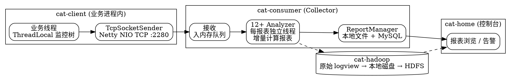

## Introduction

CAT（Central Application Tracking）是美团点评开源的**实时监控**系统，定位与 [SkyWalking](/docs/CS/Distributed/Tracing/SkyWalking.md) / [Pinpoint](/docs/CS/Distributed/Tracing/Pinpoint.md) 同属 APM，但**设计哲学差异最大**：CAT 在**客户端预聚合全量指标**、只在**链路明细上做采样**，以「允许丢消息、追求极高吞吐与低开销」换取千亿级消息下的实时性。它的本质是「基于**消息树（Message Tree）**的实时报表引擎」，而非「完整调用链存储」。

本页是 CAT 的枢纽页：先讲三段式架构与消息模型，再给出存储与报表、采样哲学。客户端与服务端机理分别见 [CAT 客户端设计](/docs/CS/Distributed/Tracing/CAT/Client.md) 与 [CAT 服务端实时分析](/docs/CS/Distributed/Tracing/CAT/Consumer.md)，存储写路径见 [CAT 存储](/docs/CS/Distributed/Tracing/CAT/Storage.md)。

> 源码级笔记。代码事实基于仓库 **dianping/cat tag 3.1.0**（commit tag `3.1.0`，本地 `cat-3.1.0/`，1,288 个 Java 文件）。下面讲解直接贴真实源码，路径相对仓库根，不再标注行号。

## Architecture

CAT 代码按职责拆成六个 Maven 模块，运行时逻辑上仍是经典三段式：**客户端埋点 → Collector 实时分析 → 控制台展示**。实际部署中 cat-consumer 与 cat-home 跑在**同一个 JVM**，每个服务端节点既可当 consumer 也可当 home，以提升稳定性。



- **cat-client**：轻量 JAR，直接嵌入应用进程，负责构造 `MessageTree`、ThreadLocal 上下文、Netty 异步发送到 Collector。多语言支持 Java / C/C++ / .NET / Node.js / Python / Go。
- **cat-consumer（Collector）**：实时分析引擎，产出 12+ 种报表（Transaction / Event / Problem / Heartbeat / Cross / Matrix / Dependency 等）；每个报表独立线程、增量计算。
- **cat-home**：Web UI + REST API + 服务端编排；与 consumer 同 JVM。
- **cat-alarm**：实时告警引擎（规则评估 + 通知渠道）；**cat-hadoop**：HDFS 历史 logview 存储。

与 SkyWalking / Pinpoint 的对照见 [CAT 客户端设计](/docs/CS/Distributed/Tracing/CAT/Client.md) 末尾的横向表。

## Message Model

CAT 的核心数据单元是 **`MessageTree`**（`cat-client/src/main/java/com/dianping/cat/message/spi/MessageTree.java`）：一棵树挂一次请求的全部监控消息，树根是 `Transaction`，叶子是 `Event` / `Metric` / `Heartbeat`。接口上与跨进程串联直接相关的字段就是三个 Message-ID 与线程信息：

```java
	public String getMessageId();

	public void setMessageId(String messageId);
	// ...
	public String getParentMessageId();

	public void setParentMessageId(String parentMessageId);

	public String getRootMessageId();

	public void setRootMessageId(String rootMessageId);
	// ...
	public String getThreadId();

	public void setThreadId(String threadId);
```

跨进程串联即靠 `rootMessageId` + `parentMessageId` 传播。

四种消息类型（接口在 `cat-client/.../message/`，实现在 `.../message/internal/`）：

| 类型 | 语义 | 是否树节点 | 典型用途 | 实现 |
| --- | --- | --- | --- | --- |
| **Transaction** | 有耗时 + 状态的操作 | ✅ 唯一可作树节点 | 方法执行时间、DB 查询、RPC 调用 | `DefaultTransaction.java` |
| **Event** | 离散事件发生次数 | ❌ 叶子 | 缓存命中/未命中、异常、业务事件 | `DefaultEvent.java` |
| **Heartbeat** | 周期性系统指标 | ❌ 叶子 | CPU% / MEM% / 线程池 / JVM 状态 | `DefaultHeartbeat.java` |
| **Metric** | 聚合业务指标（客户端预计算） | ❌ 叶子 | 请求数、错误率、自定义业务指标 | `DefaultMetric.java` |

客户端用一个 **ThreadLocal 上下文**承载当前线程的监控树：`DefaultMessageManager` 持有 `ThreadLocal<Context> m_context`（`cat-client/src/main/java/com/dianping/cat/message/internal/DefaultMessageManager.java`），`getThreadLocalMessageTree()` 惰性 `setup()` 出 `Context.m_tree`：

```java
	@Override
	public MessageTree getThreadLocalMessageTree() {
		Context ctx = m_context.get();

		if (ctx == null) {
			setup();
		}
		ctx = m_context.get();

		return ctx.m_tree;
	}
```

```java
	public void setup() {
		Context ctx;

		if (m_domain != null) {
			ctx = new Context(m_domain.getId(), m_hostName, m_domain.getIp());
		} else {
			ctx = new Context("Unknown", m_hostName, "");
		}
		double samplingRate = m_configManager.getSampleRatio();

		if (samplingRate < 1.0 && hitSample(samplingRate)) {
			ctx.m_tree.setHitSample(true);
		}
		m_context.set(ctx);
	}
```

业务结束时整棵树被 `flush` 进异步队列发出——这正是「监控是业务旁路、绝不阻塞业务线程」的实现基础（详见 [CAT 客户端设计](/docs/CS/Distributed/Tracing/CAT/Client.md)）。

## Storage & Reporting

CAT 走**双存储 + 三级报表**：

- **原始 logview**（明细）：先写本地磁盘（`LocalMessageBucketManager`，`cat-consumer/.../dump/`），再异步上传 **HDFS**（`HdfsUploader`，`cat-hadoop/.../`），避免强依赖 HDFS。
- **聚合报表**：写入 **MySQL**，调用形如 `m_reportManager.storeHourlyReports(getStartTime(), StoragePolicy.FILE_AND_DB, m_index)`（见 `cat-consumer/.../transaction/TransactionAnalyzer.java` 的 `doCheckpoint`）；按消息创建时间以**小时分片**，当前小时全内存增量计算，历史小时报表不变。
- **三级报表**：实时（内存 `ReportBucketManager`）/ 小时（MySQL）/ 历史（HDFS）。

报表建模采用**固定维度**（例如 Transaction 报表 5 维树：应用 / 机器 / Type / Name / 分钟级分布），而非全维度灵活建模——换取低开销。报表与 DAL 实体、DAO、JDBC 由自研 Maven 插件从 **manifest XML**（如 `transaction-report-manifest.xml`）**代码生成**，类型安全且避免手写。存储细节见 [CAT 存储](/docs/CS/Distributed/Tracing/CAT/Storage.md)。

## Sampling Philosophy

CAT 最反直觉、也最值得对照的一点：**指标全量、链路采样**。

- **监控 / 指标数据全量**：客户端本地预计算（count / sum / duration 累加）后异步上报，一条不丢——这是它敢叫「接近全量监控」的底气。
- **链路 / 调用链明细采样**：消息树、调用链这类明细数据量极大，采用采样控制存储与带宽成本。采样判定在客户端发送器 `TcpSocketSender`（`cat-client/src/main/java/com/dianping/cat/message/io/TcpSocketSender.java`）的 `send()` 里就地完成：

```java
	@Override
	public void send(MessageTree tree) {
		if (!m_configManager.isBlock()) {
			double sampleRatio = m_configManager.getSampleRatio();

			if (tree.canDiscard() && sampleRatio < 1.0 && (!tree.isHitSample())) {
				processTreeInClient(tree);
			} else {
				offer(tree);
			}
		}
	}
```

被采中的树走 `processTreeInClient` 本地预聚合（`LocalAggregator.aggregate(tree)`），未采中的入队上送。`hitSample` 的概率判定逻辑位于 `DefaultMessageManager.java`。
- **不保证可靠**：明确允许消息丢失，目标是四个 9 可靠性。与 [SkyWalking](/docs/CS/Distributed/Tracing/SkyWalking.md) / [Pinpoint](/docs/CS/Distributed/Tracing/Pinpoint.md) 追求完整 trace 不同，CAT 的取舍是「报表永远在，明细可以少」。

## Links

- [CAT 客户端设计](/docs/CS/Distributed/Tracing/CAT/Client.md) — ThreadLocal 监控树、Message-ID、Netty :2280
- [CAT 服务端实时分析](/docs/CS/Distributed/Tracing/CAT/Consumer.md) — 12+ Analyzer、增量报表、Cross/Dependency
- [CAT 存储](/docs/CS/Distributed/Tracing/CAT/Storage.md) — 本地文件 + MySQL + HDFS 写路径
- [Pinpoint](/docs/CS/Distributed/Tracing/Pinpoint.md) — 对照字节码插桩 + 完整 trace 路线

## References

- CAT GitHub（dianping/cat），tag 3.1.0：https://github.com/dianping/cat
- 美团技术团队《深度剖析开源分布式监控 CAT》：https://tech.meituan.com/2018/11/01/cat-in-depth-java-application-monitoring.html
- CAT 源码基线（已克隆并 codegraph 索引）：`E:/Projects/cat-3.1.0`
