## Introduction

[Grafana](https://grafana.com/oss/grafana/) 是 Grafana Labs 开源的**统一可观测性可视化层**。它本身不存储任何遥测数据，而是把各种后端接成**数据源**（data source），在同一个界面里查询、绘图、告警。

在 LGTM 栈里，Grafana 是那个 **G**：

| 字母 | 组件 | 信号 | 角色 |
| --- | --- | --- | --- |
| **L** | [Loki](/docs/CS/Distributed/Tracing/Loki.md) | Logs | 日志聚合，只索引标签 |
| **G** | Grafana | — | 统一可视化与告警 |
| **T** | [Tempo](/docs/CS/Distributed/Tracing/Tempo.md) | Traces | 追踪后端，Parquet + 对象存储 |
| **M** | Mimir（或 [Prometheus](/docs/CS/Distributed/Tracing/Prometheus/Prometheus.md)） | Metrics | 指标时序库 |

Grafana 之所以是这套栈的枢纽，不在于它画图画得好，而在于它**把三支柱放进了同一块屏幕**：你可以在一条时间线上看到指标拐点，从拐点处下钻到那几秒钟的 trace，再从 trace 跳到对应服务的日志原文——三者的关联靠 trace id 与标签一致来维系。

> [!NOTE]
> 源码级笔记。代码事实基于 `grafana/grafana` **v13.3.1**（commit `5db6ba887630c7fa12e5bfd063f2fa854025468c`，"Release: 13.3.1 (#137502)"）。获取方式：浅克隆 `--depth 1 --filter=blob:none --branch v13.3.1`；代理对 git 智能 HTTP 的 blob 拉取返回 502，故后端源码经 `raw.githubusercontent.com` 按路径拉取后本地阅读与引证，前端仅取 `public/app/app.ts` 等入口。下面讲解直接贴真实源码，路径相对仓库根，不再标注行号。三点 v13 关键事实：**CLI 入口为 `pkg/cmd/grafana/main.go`**（不再是早期的 `cmd/grafana-server/main.go`）；服务端由 **Wire** 装配（`server.Initialize`）；查询入口 `hs.queryDataService` 落在 **`pkg/services/query`** 而非 `pkg/services/datasources`。

## 源码级架构（v13.3.1）

Grafana 是一个 **Go 后端（`grafana-server`）+ 内嵌 React/Angular 前端（静态资源打进二进制）** 的应用。后端用 **Wire** 做编译期依赖注入，用 `registry.BackgroundService` 抽象「后台常驻服务」，用 **插件系统**（含进程外 gRPC 后端插件）对接数据源。下面按「启动 → 收请求 → 查数据 → 落库/告警」逐段贴源码。

### 启动链：main → Server → HTTPServer

二进制入口就是 `pkg/cmd/grafana/main.go`，`func main()` 极薄，真正的装配在 `MainApp()`：

```go
func main() {
	app := MainApp()

	if err := app.Run(os.Args); err != nil {
		fmt.Printf("%s: %s %s\n", color.RedString("Error"), color.RedString("✗"), err)
		os.Exit(1)
	}

	os.Exit(0)
}

func MainApp() *cli.App {
	// ...
	deps := commands.ServerDeps{
		Initialize:       server.Initialize,
		ModuleInitialize: server.InitializeModuleServer,
		IsEnterprise:     extensions.IsEnterprise,
	}

	app := &cli.App{
		// ...
		Commands: []*cli.Command{
			gcli.CLICommand(version),
			commands.ServerCommand(buildInfo, deps),
		},
		// ...
	}
	// ...
}
```

注意两件事：① `deps.Initialize = server.Initialize` 把 OSS/Enterprise 的 **Wire 装配图**注入进去，靠 build tag 决定走哪张图；② 文件顶部有一行副作用导入 `_ "github.com/grafana/grafana/pkg/server/bootstrap/wire"`，注释明确说「without this side-effect import they are nil」——Wire 生成的构造器注册就靠这个 init 落地。

`grafana-server` 子命令最终进入 `pkg/cmd/grafana-server/commands/cli.go` 的 `RunServer`，它把命令行参数转成 `bootstrap.RunServerConfig` 交给 bootstrap 接管完整生命周期：

```go
func RunServer(buildInfo standalone.BuildInfo, deps ServerDeps, cliCtx *cli.Context) error {
	return bootstrap.RunServer(cliCtx.Context, bootstrap.RunServerConfig{
		Config:     bootstrapConfig(buildInfo, deps, cliCtx.Args().Slice()),
		Initialize: deps.Initialize,
	})
}
```

`pkg/server/server.go` 是核心。`New` 调 `newServer` 构造 `Server`，要注意它持有 `HTTPServer` 和 `backgroundServiceRegistry` 两个关键字段：

```go
type Server struct {
	// ...
	backgroundServiceRegistry registry.BackgroundServiceRegistry
	tracerProvider            *tracing.TracingService
	features                  featuremgmt.FeatureToggles

	HTTPServer          *api.HTTPServer
	roleRegistry        accesscontrol.RoleRegistry
	provisioningService provisioning.ProvisioningService
	// ...
}

func (s *Server) Run() error {
	if err := s.Init(); err != nil {
		return err
	}

	ctx, span := s.tracerProvider.Start(s.context, "server.Run")
	defer span.End()
	s.notifySystemd("READY=1")
	return s.managerAdapter.Run(ctx)
}
```

`Server` 自身不实现路由，它把 `HTTPServer` 作为一个后台服务跑起来，再让 `managerAdapter` 统一驱动所有 `BackgroundService`。

### HTTP 路由注册

HTTP 服务在 `pkg/api/http_server.go` 里实现为 `registry.BackgroundService`，`Run` 里先 `applyRoutes()` 再建 server 并把所有路由挂到 `hs.web`：

```go
func (hs *HTTPServer) Run(ctx context.Context) error {
	hs.context = ctx

	hs.applyRoutes()

	// Remove any square brackets enclosing IPv6 addresses, a format we support for backwards compatibility
	host := strings.TrimSuffix(strings.TrimPrefix(hs.Cfg.HTTPAddr, "["), "]")
	hs.httpSrv = &http.Server{
		Addr:        net.JoinHostPort(host, hs.Cfg.HTTPPort),
		Handler:     hs.web,
		// ...
	}
	// ...
	hs.RouteRegister.Register(hs.web, hs.namedMiddlewares...)
	// ...
}
```

业务路由集中在 `pkg/api/api.go` 的 `registerRoutes()`，例如这一行把 `/api/ds/query` 接到查询入口：

```go
apiRoute.Post("/ds/query", requestmeta.SetSLOGroup(requestmeta.SLOGroupHighSlow), authorize(ac.EvalPermission(datasources.ActionQuery)), hs.getDSQueryEndpoint())
```

### 查询管线（端到端）

一次面板刷新 / Explore 查询的完整链路：

```
Browser(React) ──POST /api/ds/query──▶ HTTPServer
        │                                      │
        │                              QueryMetricsV2 (ds_query.go)
        │                                      │ hs.queryDataService.QueryData
        ▼                                      ▼
                                  query.Service (query/query.go)
                                      │ s.pluginClient.QueryData
                                      ▼
                          plugin manager client (manager/client/client.go)
                                      │ p.QueryData
              ┌─────────────────────────┴─────────────────────────┐
              ▼                                                    ▼
     backend plugin (gRPC, 进程外)                        HTTP datasource proxy
              │                                                    │
              ▼                                                    ▼
        Loki / Mimir / Tempo / ...                          数据源自有 HTTP API
```

入口处理器在 `pkg/api/ds_query.go`，按 `X-Query-V2` 头分流到 `QueryData` / `QueryDataNew`：

```go
func (hs *HTTPServer) QueryMetricsV2(c *contextmodel.ReqContext) response.Response {
	reqDTO := dtos.MetricRequest{}
	if err := web.Bind(c.Req, &reqDTO); err != nil {
		return response.Error(http.StatusBadRequest, "bad request data", err)
	}

	handleTimeInQuery := c.Req.Header.Get("X-Query-V2") == "true"

	var resp *backend.QueryDataResponse
	var err error

	hs.log.Debug("QueryMetricsV2: request received", "time_in_query", handleTimeInQuery)
	if handleTimeInQuery {
		resp, err = hs.queryDataService.QueryDataNew(c.Req.Context(), c.SignedInUser, c.SkipDSCache, reqDTO)
	} else {
		resp, err = hs.queryDataService.QueryData(c.Req.Context(), c.SignedInUser, c.SkipDSCache, reqDTO)
	}

	if err != nil {
		return hs.handleQueryMetricsError(err)
	}
	return hs.toJsonStreamingResponse(c.Req.Context(), resp)
}
```

关键点是 `queryDataService` 不在 `pkg/services/datasources`，而在 **`pkg/services/query`**。`ServiceImpl.queryData` 先把请求按 datasource uid 分组，再决定单源直查还是多源并发：

```go
// QueryData processes queries and returns query responses. It handles queries to single or mixed datasources, as well as expressions.
func (s *ServiceImpl) queryData(ctx context.Context, user identity.Requester, skipDSCache bool, reqDTO dtos.MetricRequest, supportLocaltimeRange bool) (*backend.QueryDataResponse, error) {
	// ...
	// If there are expressions, handle them and return
	if parsedReq.hasExpression || fromAlert {
		// ...
		return s.handleExpressions(ctx, user, parsedReq)
	}
	// If there is only one datasource, query it and return
	if len(parsedReq.parsedQueries) == 1 {
		// ...
		return s.handleQuerySingleDatasource(ctx, user, parsedReq)
	}
	// If there are multiple datasources, handle their queries concurrently and return the aggregate result
	// ...
	return s.executeConcurrentQueries(ctx, user, skipDSCache, reqDTO, parsedReq.parsedQueries)
}
```

`getDataSourceFromQuery` 解析出数据源后，对单租户走 `s.pluginClient.QueryData`，把请求交给插件管理器客户端：

```go
	qsDsClient, ok, err := s.qsDatasourceClientBuilder.BuildClient(ds.Type, ds.UID)
	// ...
	if !ok { // single tenant flow
		pCtx, err := s.pCtxProvider.GetWithDataSource(ctx, ds.Type, user, ds)
		// ...
		req.PluginContext = pCtx
		return s.pluginClient.QueryData(ctx, req)
	} else { // query-service flow (single or multi tenant)
		// ...
		return qsDsClient.QueryData(ctx, *k8sReq)
	}
```

`pkg/plugins/manager/client/client.go` 拿到对应插件实例 `p` 后调 `p.QueryData`——`p` 就是 `Plugin` 上那个 backend client：

```go
func (s *Service) QueryData(ctx context.Context, req *backend.QueryDataRequest) (*backend.QueryDataResponse, error) {
	if req == nil {
		return nil, errNilRequest
	}

	p, exists := s.plugin(ctx, req.PluginContext.PluginID, req.PluginContext.PluginVersion)
	if !exists {
		return nil, plugins.ErrPluginNotRegistered
	}

	resp, err := p.QueryData(ctx, req)
	// ...
}
```

### 插件系统：进程外 gRPC 与 HTTP 代理

插件的运行时模型是「一个 `Plugin` 结构 + 一个 backend client」。`pkg/plugins/plugins.go` 里 `client backendplugin.Plugin` 字段承载所有后端能力：

```go
type Plugin struct {
	JSONData

	FS    FS
	Class Class

	// App fields
	IncludedInAppID string
	DefaultNavURL   string
	Pinned          bool

	// Signature fields
	Signature     SignatureStatus
	SignatureType SignatureType
	SignatureOrg  string
	// ...
	Module          string
	BaseURL         string
	LoadingStrategy LoadingStrategy
	// ...
	client backendplugin.Plugin
	log    log.Logger
	// ...
}
```

后端插件以**独立子进程 + gRPC** 运行。`pkg/plugins/backendplugin/grpcplugin/grpc_plugin.go` 的 `grpcPlugin` 持有 `*ClientV2` 和 hashicorp `plugin.Client`，`newGrpcPlugin` 用 `plugin.NewClient` 拉起子进程：

```go
type grpcPlugin struct {
	descriptor     PluginDescriptor
	clientFactory  func() (*plugin.Client, string, error)
	client         *plugin.Client
	pluginClient   *ClientV2
	clientV3       v3.Client
	logger         log.Logger
	mutex          sync.RWMutex
	decommissioned bool
	state          pluginState
	// ...
}

func newGrpcPlugin(descriptor PluginDescriptor, logger log.Logger, tracer trace.Tracer, env func() []string) (*grpcPlugin, error) {
	return &grpcPlugin{
		descriptor: descriptor,
		logger:     logger,
		clientFactory: func() (*plugin.Client, string, error) {
			processEnv := env()
			accessPolicyToken := localv3.LocalAccessPolicyTokenFromEnv(processEnv)
			clientConfig, err := newClientConfig(descriptor, processEnv, logger, tracer)
			if err != nil {
				return nil, accessPolicyToken, err
			}
			return plugin.NewClient(clientConfig), accessPolicyToken, nil
		},
		state: pluginStateNotStarted,
	}, nil
}
```

> 进程外 gRPC 是 Grafana 能接入任意语言数据源/面板的关键：插件作者用 `grafana-plugin-sdk-go` 起一个 gRPC server，Grafana 用 `hashicorp/go-plugin` 拉起并通信，崩溃隔离、版本解耦。

非后端插件（或需要代理其自有 HTTP API 的数据源）走反向代理，`pkg/api/pluginproxy/ds_proxy.go` 的 `HandleRequest` 注入鉴权头、`modifyResponse` 把 401 转 400：

```go
func (proxy *DataSourceProxy) HandleRequest() {
	if err := proxy.validateRequest(); err != nil {
		writeJSONErr(proxy.ctx.Resp, proxy.ctx.Req, 403, err.Error(), nil)
		return
	}
	// ...
	transport, err := proxy.dataSource.GetHTTPTransport(proxy.ctx.Req.Context(), proxy.clientProvider)
	if err != nil {
		writeJSONErr(proxy.ctx.Resp, proxy.ctx.Req, 400, "Unable to load TLS certificate", err)
		return
	}

	modifyResponse := func(resp *http.Response) error {
		if resp.StatusCode == 401 {
			// The data source rejected the request as unauthorized, convert to 400 (bad request)
			// ...
		}
		// ...
	}
	// ...
}
```

### 服务侧模型：数据源、仪表盘、告警

- **数据源服务**：`pkg/services/datasources/service/datasource.go` 的 `Service` 负责 CRUD 与缓存，实现里持有 `SQLStore`、`SecretsService` 等：

```go
type Service struct {
	SQLStore                  Store
	SecretsStore              kvstore.SecretsKVStore
	SecretsService            secrets.Service //nolint:staticcheck // SA1019: Legacy envelope encryption for single-tenant feature
	cfg                       *setting.Cfg
	features                  featuremgmt.FeatureToggles
	permissionsService        accesscontrol.DatasourcePermissionsService
	ac                        accesscontrol.AccessControl
	logger                    log.Logger
	// ...
}
```

- **仪表盘服务**：`pkg/services/dashboards/service/dashboard_service.go` 的 `DashboardServiceImpl` 提供 `SaveDashboard` / `GetDashboard` / `DeleteDashboard`，把仪表盘 JSON 落到 SQL 存储（MySQL/PostgreSQL/SQLite）：

```go
func (dr *DashboardServiceImpl) SaveDashboard(ctx context.Context, dto *dashboards.SaveDashboardDTO,
	// ...
) (*dashboards.Dashboard, error) {
	// ...
}

func (dr *DashboardServiceImpl) GetDashboard(ctx context.Context, query *dashboards.GetDashboardQuery) (*dashboards.Dashboard, error) {
	// ...
}

func (dr *DashboardServiceImpl) DeleteDashboard(ctx context.Context, dashboardId int64, dashboardUID string, orgId int64) error {
	// ...
}
```

- **Unified Alerting**：`pkg/services/ngalert/ngalert.go` 是整个告警引擎入口。`func (ng *AlertNG) init() error` 装配 evaluation runner / notification 等子服务，`func (ng *AlertNG) Run(ctx) error` 作为后台服务启动，周期性评估告警规则并触发通知。它直接复用上面的查询管线查各数据源，实现「跨数据源告警」。

### 前端启动（React SPA）

前端源码在 `public/app`，以静态资源形式被后端 `HTTPServer` 托管。入口 `public/app/app.ts` 的 `GrafanaApp.init()` 是应用引导核心，它构建 Redux store 并用 boot data 种子化数据源缓存，使面板一加载就能查：

```typescript
async init(options?: AppInitOptions) {
  try {
    await preInitTasks();
    // ...
    initSystemJSHooks();
    initializeLoggersRegistry();
    // ...
    const initI18nPromise = initializeI18n({ /* ... */ });
    // ...
    // Important that extension reducers are initialized before store
    addExtensionReducers();
    configureStore(undefined, { mergedPreferences: options?.mergedPreferences });
    // ...
    // Init async data source services (populates cache from boot data ...)
    setExpressionDataSourceInstance(expressionDatasource);
    initDataSourceInstanceSettings(config.datasources, config.defaultDatasource);
    // ...
    // Init DataSourceSrv (legacy sync API; retained for backwards compatibility)
    const dataSourceSrv = new DatasourceSrv();
    dataSourceSrv.init(config.datasources, config.defaultDatasource);
    setDataSourceSrv(dataSourceSrv);
    // ...
  }
}
```

面板查询通过 `BackendSrv` 发 `POST /api/ds/query`，与服务端 `QueryMetricsV2` 对接；查询结果的 `data frames` 由面板类型（timeseries / table / trace / nodeGraph …）渲染。

```dot
digraph grafana_boot {
  rankdir=LR;
  node [shape=box, style=rounded, fontname="sans-serif"];

  subgraph cluster_fe { label="前端 public/app (React SPA)"; color="#1f6fb2";
    app [label="app.ts init()\nconfigureStore / dataSourceSrv.init", color="#1f6fb2"];
    bsrv [label="BackendSrv\nPOST /api/ds/query", color="#1f6fb2"];
  }
  subgraph cluster_be { label="grafana-server (Go)"; color="#555555";
    http [label="HTTPServer.Run", color="#2d7d46"];
    route [label="route /ds/query", color="#2d7d46"];
    qh [label="QueryMetricsV2\nds_query.go", color="#2d7d46"];
    qs [label="query.Service\nquery/query.go", color="#2d7d46"];
    pm [label="plugin mgr client\nmanager/client/client.go", color="#7a4fb5"];
  }
  subgraph cluster_plg { label="Data source plugin"; color="#7a4fb5";
    grpc [label="backend plugin (gRPC)\ngrpcplugin/grpc_plugin.go", color="#b5832a"];
    proxy [label="HTTP proxy\npluginproxy/ds_proxy.go", color="#b5832a"];
  }
  store [label="Loki / Mimir / Tempo / ...", shape=cylinder, color="#555555"];

  app -> bsrv;
  bsrv -> http [label="HTTP"];
  http -> route -> qh -> qs -> pm;
  pm -> grpc [label="QueryData"];
  pm -> proxy;
  grpc -> store;
  proxy -> store;
  store -> qs [style=dashed, label="frames"];
}
```



## Data Sources

数据源是 Grafana 的核心抽象：一个数据源 = 一种后端 + 一种查询语言。官方与社区提供 **170 多个数据源**、**120 多个可视化面板**。

可观测性栈里最常用的几个：

| 数据源 | 查询语言 | 对应信号 |
| --- | --- | --- |
| Prometheus / Mimir | PromQL | Metrics |
| Loki | LogQL | Logs |
| Tempo | TraceQL | Traces |
| Jaeger / Zipkin | 自有 | Traces |
| Pyroscope | 自有 | Profiles（第四支柱） |
| Elasticsearch | Lucene / DSL | Logs |
| MySQL / PostgreSQL / ClickHouse | SQL | 业务数据 |

关系型数据库作为数据源常被忽略，但它很有用——把业务指标和基础设施指标画在同一张图上，是排查「到底是系统慢还是订单结构变了」这类问题的最快方式。

## Dashboards

### 面板与可视化

Grafana 的面板类型覆盖时序折线图、柱状图、仪表盘（gauge）、状态热力图（stat）、表格、日志面板、追踪面板、节点图（node graph，画服务拓扑）、直方图/热力图等。

面板与查询的组合是最基本的技能，几条经验：

- **变量（variables）驱动复用**：把 `instance`、`namespace`、`service` 做成下拉变量，一张仪表盘覆盖全集群，而不是为每个服务复制一份。
- **Recording rules 预聚合**：高频查询的仪表盘应该在 [Prometheus](/docs/CS/Distributed/Tracing/Prometheus/Prometheus.md) 侧用 recording rule 预计算，别让每次刷新都扫原始序列。
- **布局模板**：13 提供了 DORA、USE / RED 等标准方法论的布局模板，直接套用比从空白页开始省心。USE（Utilization/Saturation/Errors）看资源，RED（Rate/Errors/Duration）看服务，是两套最值得先掌握的骨架。

仪表盘 JSON 由 `pkg/services/dashboards/service/dashboard_service.go` 的 `SaveDashboard` 写入 SQL 存储，前端 `app.ts` 引导时用 boot data 种子化。

### 常用官方仪表盘 ID

Grafana 官方市场按 ID 分享仪表盘，导入时填 ID 即可（`Dashboards → Import`）。下面几个是生产里最常见的：

| 组件 | Exporter | Dashboard ID |
| --- | --- | --- |
| MySQL | `prom/mysqld-exporter` | 14057 |
| Redis | `oliver006/redis_exporter` | 11835 |
| Kafka | `rfvbkm/kafka-exporter` | 25462 |

导入前注意：官方仪表盘的指标名依赖特定 exporter 版本，版本不匹配会出现空面板，需要手动调整查询。

### 13 的仪表盘改进

- **Suggested dashboards（推荐仪表盘）**：根据已连接的数据源自动推荐现成仪表盘，解决「空白页综合征」。
- **Dynamic dashboards GA**：仪表盘可根据变量、上下文与用户需求自适应，不必再为每个组合复制一份静态副本。
- **Git Sync GA**：基于重新设计的仪表盘 schema 与版本化 API 的双向 Git 工作流（GitHub / GitLab / Bitbucket / 原生 git），把仪表盘纳入 observability as code。
- **Grafana Advisor**：定期对 Grafana 服务器做健康检查，给出可执行的优化建议。
- **Graphviz panel**（实验性）：用 DOT 语言定义交互图，把实时数据映射到节点颜色、边宽度上，适合画服务拓扑与依赖关系。

## Explore: 三支柱的关联点

Explore 是 Grafana 里做**临时调查**（ad-hoc investigation）的地方，也是三支柱真正咬合的位置。典型排查路径：

```
1. 指标发现异常（Prometheus / Mimir）
   rate(http_requests_total{status=~"5.."}[5m]) 出现尖峰
        │
        ▼ 同一时间窗
2. 下钻到 trace（Tempo）
   { resource.service.name = "checkout" && status = error }
        │
        ▼ 选中一条 trace，取其 trace_id
3. 跳到日志原文（Loki）
   {app="checkout"} | trace_id="4bf92f..." 
        │
        ▼ 看具体报错堆栈
4. 回到指标确认影响面，修复后验证曲线回落
```

让这条链路跑通有两个前提：

1. **日志里带 trace id**。应用输出日志时必须把 `trace_id`（以及 `span_id`）写进去。在 [Loki](/docs/CS/Distributed/Tracing/Loki.md) 中应把它作为 structured metadata 而不是标签——标签会让流数量爆炸。
2. **配置数据源关联**（correlations）。在 Grafana 里为数据源配置关联规则，指定从哪个字段跳转到哪个数据源，点击即可跳转，而不是手工复制 trace id。

这三步走完，才谈得上「不重新发版就能定位未知故障」。任何一根支柱单独存在，都只是监控，不是可观测性。

## Alerting

Grafana 使用 **Unified Alerting**（代码入口 `pkg/services/ngalert/ngalert.go`，`AlertNG.Run` 启动评估循环）：告警规则可以在 Grafana 侧定义并直接查询各数据源，而不必全部下沉到 Prometheus 的 alerting rules。

两种告警来源的分工：

| 来源 | 适用 |
| --- | --- |
| Prometheus alerting rules + Alertmanager | 纯指标告警、规模大、需要复杂路由与抑制 |
| Grafana Unified Alerting | 跨数据源告警、查询结果告警、无后端告警能力的数据源（如 Loki、SQL） |

Grafana 侧的流程是：查询（复用 `pkg/services/query` 管线）→ 条件（threshold / 无数据 / 异常）→ 评估周期（`for`）→ 通知策略（label 匹配路由）→ 联系点（Slack / Webhook / 邮件 / 企业微信 / PagerDuty）。

实践上常见的坑是**告警风暴**：一个指标抖动触发几十条通知。Unified Alerting 靠分组（group by）与通知策略的静默、抑制来控制，规则设计时应按「影响用户」而不是「资源阈值」来定级。

## Provisioning

生产环境的 Grafana 应该**配置即代码**，而不是有人在 UI 上点。Provisioning 通过目录里的 YAML 文件在启动时自动加载数据源与仪表盘：

```yaml
# /etc/grafana/provisioning/datasources/lgtm.yaml
apiVersion: 1
datasources:
  - name: Prometheus
    type: prometheus
    url: http://prometheus:9090
    isDefault: true

  - name: Loki
    type: loki
    url: http://loki:3100
    jsonData:
      derivedFields:                        # 从日志中提取 trace_id 并跳转到 Tempo
        - datasourceUid: tempo
          matcherRegex: '"trace_id":"(\w+)"'
          name: TraceID
          url: '$${__value.raw}'

  - name: Tempo
    type: tempo
    uid: tempo
    url: http://tempo:3200
```

上例中的 `derivedFields` 就是把日志与 trace 联动起来的具体配置：正则从日志行里抓出 trace id，渲染成跳转到 Tempo 数据源的链接。

仪表盘同理，用 `provisioning/dashboards/` 下的 provider 指向存 JSON 的目录，配合 Git 管理（13 起另有 Git Sync 做双向同步）。

## Deployment Notes

- **数据库**：默认 SQLite 只适合单机。HA 部署应改用 MySQL 或 PostgreSQL 存 dashboard、用户、session 与告警状态，多个 Grafana 实例共享同一库，前面挂负载均衡。
- **高可用告警**：开启 `[unified_alerting]` 的 HA，实例间通过 `ha_listen_address` / `ha_peers` 互相感知，避免重复发通知。
- **无状态化**：session 与 remote_cache 都应落到共享数据库，这样任意实例都能服务任意请求。
- **插件**：通过 `GF_INSTALL_PLUGINS` 环境变量或 `grafana-cli plugins install` 安装，注意插件不自动更新；后端插件以独立进程运行（见上文 `grpcplugin`），重启 Grafana 会重拉子进程。
- 完整的高可用部署示例（双 Prometheus + 三节点 Alertmanager + 双 Grafana + 外部 MySQL）见 [部署实践](/docs/CS/Distributed/Tracing/Prometheus/Deploy.md)。

## AI 相关能力（2026）

Grafana Labs 近一年把 AI 能力推进得很快，但大多带预览属性，采用前需确认可用性：

- **Grafana Assistant**：面向可观测性的 LLM 助手，可分析遥测数据、改仪表盘、简化 SQL 表达式。自 13 起 OSS 与 Enterprise 用户也能通过连接 Grafana Cloud 账号使用；另有 skills、automations，以及 Slack / Teams / API / CLI 的接入方式。
- **GCX CLI**（public preview）：把 Grafana Cloud 数据拉进编码 agent（如 Claude Code、Cursor）的命令行工具，用于「合成监测发现故障 → Assistant 根因分析 → 在编辑器里改代码 → 回查指标确认恢复」的闭环。同时也在开发 hosted remote MCP server。
- **AI Observability**（Grafana Cloud，public preview）：面向 LLM 应用与 agent 工作负载的监控评估。

## 关键源码文件（v13.3.1）

想继续深挖，按下面路径直接打开仓库即可（相对 `grafana/grafana` 根，不再标注行号）：

- **启动装配**：`pkg/cmd/grafana/main.go`、`pkg/cmd/grafana-server/commands/cli.go`、`pkg/server/server.go`
- **HTTP 与路由**：`pkg/api/http_server.go`、`pkg/api/api.go`
- **查询管线**：`pkg/api/ds_query.go`、`pkg/services/query/query.go`、`pkg/plugins/manager/client/client.go`
- **插件与 gRPC / 代理**：`pkg/plugins/plugins.go`、`pkg/plugins/backendplugin/grpcplugin/grpc_plugin.go`、`pkg/api/pluginproxy/ds_proxy.go`
- **服务侧模型**：`pkg/services/datasources/service/datasource.go`、`pkg/services/dashboards/service/dashboard_service.go`、`pkg/services/ngalert/ngalert.go`
- **前端引导**：`public/app/app.ts`

## Links

- [Loki](/docs/CS/Distributed/Tracing/Loki.md)
- [Tempo](/docs/CS/Distributed/Tracing/Tempo.md)
- [Mimir](/docs/CS/Distributed/Tracing/Mimir.md)
- [Prometheus](/docs/CS/Distributed/Tracing/Prometheus/Prometheus.md)
- [Tracing](/docs/CS/Distributed/Tracing/Tracing.md)
- [OpenTelemetry](/docs/CS/Distributed/Tracing/Otel.md)
- [Jaeger](/docs/CS/Distributed/Tracing/Jaeger.md)

## References

1. [Grafana documentation](https://grafana.com/docs/grafana/latest/)
2. [Grafana 13 release: GrafanaCON 2026 announcements](https://grafana.com/blog/grafanacon-2026-announcements/)
3. [Provisioning Grafana data sources](https://grafana.com/docs/grafana/latest/administration/provisioning/)
4. [Grafana dashboards](https://grafana.com/grafana/dashboards/)
5. [Grafana download and version support](https://grafana.com/grafana/download/)
6. [grafana/grafana Releases (v13.3.1)](https://github.com/grafana/grafana/releases/tag/v13.3.1)
7. [Grafana plugin SDK for Go (backendplugin / gRPC)](https://grafana.com/docs/grafana/latest/developers/plugins/)
