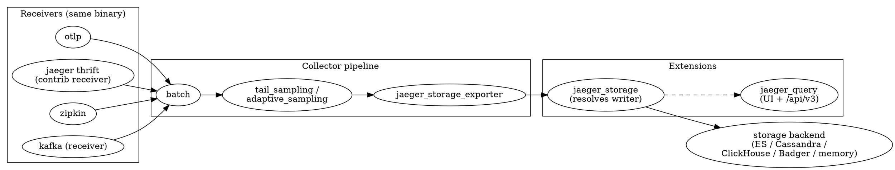

## Introduction

[Jaeger](https://www.jaegertracing.io/) 是受 [Dapper](/docs/CS/Distributed/Tracing/Tracing.md) 与 OpenZipkin 启发、由 Uber 开源后捐赠给 CNCF（2019 年毕业）的**分布式链路追踪后端**。它接收、存储、检索并可视化由 [OpenTelemetry](/docs/CS/Distributed/Tracing/Otel.md) 等探针上报的 trace，用于微服务环境下的分布式上下文传播、延迟定位与故障根因分析。

要区分两个层面：OTel 负责**埋点、传播上下文、生成 span 并通过 OTLP 上报**（厂商中立），Jaeger 负责**作为后端存储与展示这些 span**。自 Jaeger v1.35 起官方推荐用 OTel SDK 取代已废弃的 Jaeger client；自 v1.41/v2 起 collector 基于 OpenTelemetry Collector 构建。

> 版本基线：**Jaeger v2.23.0**（2026-11-04）。v2 不是「改了配置的 v1」——它把整个后端重写为 OpenTelemetry Collector 的一组插件：进程模型（`agent`/`collector`/`query` 不再是三个进程）、数据模型（主路径改用 `ptrace.Traces` 而非 `model.Span`）、组件注册方式都与 v1 不同。架构与反直觉点见下方 **Architecture** 章节及各子册。

## Architecture
Jaeger v2 不是「改了配置的 v1」，而是把整个后端重写成 **OpenTelemetry Collector 的一组插件**：一个 Go 二进制 + 一份 YAML，所有角色（接收 / 存储 / 查询）都是同一进程里的 Collector component。理解它的关键，是先扔掉 v1 的 mental model——没有独立 `agent`/`collector`/`query` 三进程，主数据路径用 OTel `ptrace.Traces` 而非 `model.Span`，依赖 Kafka / 死信队列也只是「换个 YAML 或把一个 exporter 注册成 connector」。

三个最容易被旧文档误导的地方：

1. **进程模型变了**：v2 是「一个二进制 + 一份 YAML 配置」，receiver / processor / exporter / extension 全在同一进程内由 pipeline 串联。
2. **数据模型换了**：全链路主路径用 OTel 的 `ptrace.Traces`，`model.Span` 退化为仅服务于 v1 兼容适配层。
3. **Kafka / 死信队列不再是独立服务**：它们是同一二进制换一份配置、或同一个 exporter 注册成 connector 的两种形态。

### v1 经典组件划分（演进参考）

v1 的部署心智是「起 agent、起 collector、起 query」，下表仍是很多文档的默认叙述，仅作演进参照：

| 组件 | 职责 |
| --- | --- |
| **jaeger-client / OTel SDK** | 进程内埋点，构造 span、注入/提取 trace context（W3C TraceContext 或 B3） |
| **jaeger-agent**（sidecar / daemonset） | 接收 span，批量转发给 collector；新版可被 OTel Collector agent 取代 |
| **jaeger-collector** | 校验、tail 采样、处理 span 并写入存储，无状态可水平扩展 |
| **storage** | 可插拔后端：Cassandra、Elasticsearch/OpenSearch、[Kafka](/docs/CS/MQ/Kafka/Kafka.md)（缓冲）、Badger（单机）、v2 OTLP 存储 |
| **query** | 从存储检索 trace，提供 API 供 UI 调用 |
| **jaeger-ui** | 展示 trace 时间轴、依赖拓扑、trace 对比 |

典型 v1 数据流：

```
Instrumented Service
   │  OTLP / Jaeger thrift
   ▼
agent ──► collector ──► Kafka(可选削峰) ──► ingester ──► Elasticsearch/Cassandra
                                                    ▲
                                query + UI ─────────┘
```

### v2：单一二进制 = OTel Collector 插件

入口 `cmd/jaeger/main.go` 极其单薄，真正的装配在 `cmd/jaeger/internal/command.go`——它构造 OTel Collector 的 `CollectorSettings` 后调用 `otelcol.NewCommand`，**没有** `otelcol.Collector` 对象，也没有自定义的 Collector 结构体：

```go
// cmd/jaeger/main.go
func main() {
	factories, err := jaegercli.Components()
	if err != nil { log.Fatal(err) }
	if err := jaegercli.NewCommand(factories).Execute(); err != nil { log.Fatal(err) }
}

// cmd/jaeger/internal/command.go
settings := otelcol.CollectorSettings{
	BuildInfo: info,
	Factories: func() (otelcol.Factories, error) { return factories, nil },
	ConfigProviderSettings: otelcol.ConfigProviderSettings{ ResolverSettings: jconfmap.ResolverSettings() },
}
cmd := otelcol.NewCommand(settings)
// 没有 --config 时注入内置 all-in-one 配置，故 `jaeger all-in-one` 与 `jaeger` 是同一命令的两种入口
```

jaeger 自己只向 Collector 注册一批 factory（`cmd/jaeger/internal/components.go`）。值得注意的是 `components/` 是个「薄壳」——`components/ext/receiver/jaegerreceiver/factory.go` 只有一行转发 `var NewFactory = impl.NewFactory`，绝大多数列出的组件（kafka、zipkin、tail-sampling 等）是 **contrib 的 re-export**，jaeger 自己真正写死的只有 `jaeger_storage_exporter` / `jaeger_query` / `jaeger_storage` 这几个 extension/exporter。这解释了为何 v2 里「收到 jaeger thrift 协议」仍可用——它直接复用 contrib 的 `jaegerreceiver`，而非 v1 那套自研 thrift 服务。

默认 all-in-one 的 pipeline（`cmd/jaeger/internal/all-in-one.yaml`）把三个角色串成一条标准 Collector 链路；`jaeger_storage_exporter` 才是 Jaeger 自己的缝——它从 `jaeger_storage` extension 按名解析出 trace writer，写之前先过一遍 sanitizer：

```yaml
service:
  extensions: [jaeger_storage, jaeger_query, remote_sampling, healthcheckv2, expvar, zpages]
  pipelines:
    traces:
      receivers: [otlp, jaeger, zipkin]
      processors: [batch]
      exporters: [jaeger_storage_exporter]
```

写入主路径的接口直接吃 OTel 数据，注释明说「Compatible with OTLP Exporter API」；而 v1 的写入接口仍是 `model.Span`（这个 `model` 包已不在 jaeger 主仓，来自外部 `jaeger-idl`）——两套接口并存，靠 `internal/storage/v2/v1adapter` 桥接，把 `ptrace.Traces` 转回 v1 batches 再逐 span 写。存储抽象与 v1↔v2 桥接的细节见 [Jaeger 存储抽象](/docs/CS/Distributed/Tracing/Jaeger/Storage.md)；摄入管线见 [Jaeger 摄入管线](/docs/CS/Distributed/Tracing/Jaeger/Ingestion.md)；采样与查询也只是普通组件，分别见 [Jaeger 采样体系](/docs/CS/Distributed/Tracing/Jaeger/Sampling.md) 与 [Jaeger 查询服务](/docs/CS/Distributed/Tracing/Jaeger/Query.md)。

### 为什么 v1 心智模型会误导

把 v1 的常见叙述逐条对照 v2 源码：

| v1 印象 | v2 源码事实 | 证据 |
| --- | --- | --- |
| 三个进程 agent / collector / query | 单一二进制 + YAML 决定角色 | `cmd/jaeger/main.go`；`cmd/` 下无 agent/collector/query 独立 main |
| 自研存储层 `model.Span` 贯穿 | 主路径 `ptrace.Traces`，`model.Span` 仅 v1 适配器 | `internal/storage/v2/api/tracestore/writer.go`；`go.mod` 中 `jaeger-idl v0.14.0` |
| 需要独立 jaeger-agent 收 thrift | thrift 端口在**同一个** jaeger 进程内，由 contrib `jaegerreceiver` 提供 | `all-in-one.yaml` 的 `jaeger.protocols.thrift_*`；`components/ext/receiver/jaegerreceiver` |
| Kafka + ingester 是独立服务 | 同一二进制换 YAML；`kafka` 既是 exporter 也是 receiver | `config-kafka-collector.yaml` / `config-kafka-ingester.yaml` |
| 死信队列要新进程 | `jaeger_storage_exporter` 注册成 connector 即带死信输出（RFC 0007） | `components.go` connectors；`storageexporter/factory.go` |


## Data Model

Jaeger 模型与 OpenTelemetry trace 模型基本一一对应：

- **Trace**：一次完整请求的 span 集合，由 `trace_id` 标识（推荐 128-bit，兼容 64-bit）。
- **Span**：一个工作单元，含 `span_id`、`parent_span_id`、operation name、起止时间、tags、logs、process。
- **SpanContext**：跨进程传播的载体，携带 trace/span id、sampling flags、baggage。
- **References**：除 `ChildOf` 外支持 `FollowsFrom`（异步、非因果关键路径），与 OTel 的 Link 概念呼应。
- **Process**：产生 span 的服务元数据（service name + host、版本等 tags）。

上下文传播默认采用 [W3C Trace Context](https://www.w3.org/TR/trace-context/)（`traceparent` / `tracestate`），早期默认 B3。

## Sampling

采样在两处发生：

1. **Head-based（客户端）**：入口决定整条 trace 是否采样，决策随上下文传播以保证完整性。策略有 `const`（全采/全不采）、`probabilistic`（概率，默认）、`ratelimiting`（每秒 N 条，漏桶）、`remote`（从 collector 拉取按 service/endpoint 的集中式策略，可动态调整）。
2. **Tail-based（collector 端）**：先缓冲完整 trace，再依据延迟、错误码、命中服务等规则决定保留，可在低采样率下保住异常链路，代价是需要缓冲资源；v2 借助 OTel Collector 的 Tail Sampling Processor。详见 [Otel 采样章节](/docs/CS/Distributed/Tracing/Otel.md?id=sampling)。

## Storage

存储是 Jaeger 运维成本的核心：

| 后端 | 定位 |
| --- | --- |
| **Cassandra** | 早期默认，写入扩展性强，运维较重 |
| **Elasticsearch / OpenSearch** | 最常用，检索能力强、生态成熟 |
| **Badger** | 本地文件存储，all-in-one 与小规模场景 |
| **Kafka + ingester** | collector 与存储之间的削峰缓冲 |
| **v2 OTLP storage** | Jaeger v2 直接以 OTLP 落盘，统一数据通路 |

span 是典型的**时序追加写**，查询按 trace_id 点查、按 service/operation/tag/时间范围过滤，这解释了为何选用宽表/搜索引擎型存储而非关系库。

> v2 把存储层统一为 `tracestore.Factory` 契约、由 `jaeger_storage` extension 按名分发工厂，而 Badger 这种默认后端其实仍是 v1 `spanstore` 被 `v1adapter` 包成 v2 接口——存储抽象与 v1↔v2 桥接的源码细节见 [Jaeger 存储抽象](/docs/CS/Distributed/Tracing/Jaeger/Storage.md)。

## Deployment

- **all-in-one**：单二进制 + 内存/Badger，适合本地开发演示。
- **生产**：agent 以 DaemonSet/sidecar 部署，collector/query 无状态多副本 + 独立 ES/Cassandra，常用 Helm Chart。
- **Jaeger v2**：基于 OpenTelemetry Collector 重写，单一二进制以 pipeline 配置接收（OTLP）→处理→导出，弱化独立 agent。

快速本地启动（all-in-one，OTLP 4317/4318，UI 16686）：

```bash
docker run --rm -d -p 16686:16686 -p 4317:4317 -p 4318:4318 \
  jaegertracing/all-in-one:latest
# UI: http://localhost:16686
```

应用侧只需把 OTel exporter 指向 `http://localhost:4318`（OTLP/HTTP）或 `4317`（OTLP/gRPC）即可，无需引入 Jaeger 专有客户端。

## Jaeger and Zipkin

| 维度 | Jaeger | [Zipkin](/docs/CS/Distributed/Tracing/Zipkin.md) |
| --- | --- | --- |
| 起源 | Uber（Dapper 论文） | Twitter |
| 客户端 | 已弃用，推荐 OTel SDK | 多语言 reporter，也可接 OTel |
| 模型 | trace/span + FollowsFrom | span 树 + [annotation](/docs/CS/Distributed/Tracing/Zipkin/Data_Model.md) |
| 传播 | W3C TraceContext / B3 | B3（多/单 header） |
| 存储 | ES/Cassandra/Kafka/Badger | [MySQL/ES/Cassandra/内存](/docs/CS/Distributed/Tracing/Zipkin/Collector_and_Storage.md) |
| 采样 | probabilistic + remote + tail | 多在客户端，生态较小 |

两者模型高度相似，OTel Collector 都能桥接；选型更多取决于存储与运维栈（ES 生态偏 Jaeger，轻量简单偏 Zipkin）。Zipkin 单进程架构、可插拔存储与检索开关详见 [Zipkin Architecture](/docs/CS/Distributed/Tracing/Zipkin/Architecture.md) 与 [Collector/Storage](/docs/CS/Distributed/Tracing/Zipkin/Collector_and_Storage.md)。

## Use Cases

- 微服务延迟瓶颈定位（trace 时间轴上定位慢 span）。
- 错误/重试链路串联，配合应用日志与 metrics exemplar，见[三大信号关联](/docs/CS/Distributed/Tracing/Otel.md?id=correlating-the-three-signals)。
- 基于 span 父子关系自动聚合服务依赖拓扑。
- 正常/异常请求 trace diff，辅助分布式事务与一致性问题分析。

## Links

- [Tracing](/docs/CS/Distributed/Tracing/Tracing.md)
- [OpenTelemetry](/docs/CS/Distributed/Tracing/Otel.md)
- [Zipkin](/docs/CS/Distributed/Tracing/Zipkin.md)
- [SkyWalking](/docs/CS/Distributed/Tracing/SkyWalking.md)
- [Prometheus](/docs/CS/Distributed/Tracing/Prometheus/Prometheus.md)
- [Grafana](/docs/CS/Distributed/Tracing/Grafana.md)
- [Micrometer](/docs/CS/log/Micrometer.md)

- [Jaeger 存储抽象](/docs/CS/Distributed/Tracing/Jaeger/Storage.md) — v2 `tracestore.Factory` 契约、`jaeger_storage` 分发、Badger 靠 `v1adapter` 顶 v1 老壳
- [Jaeger 采样体系](/docs/CS/Distributed/Tracing/Jaeger/Sampling.md) — `remotesampling` 策略服务器 + `adaptivesampling` 处理器组成的 head sampling 闭环（非 tail）
- [Jaeger 摄入管线](/docs/CS/Distributed/Tracing/Jaeger/Ingestion.md) — 标准 OTel Collector YAML 管线，Jaeger 只在 `jaeger_storage_exporter` 这道缝接进 v2 存储
- [Jaeger 查询服务](/docs/CS/Distributed/Tracing/Jaeger/Query.md) — `jaegerquery` extension 同端口跑 `api_v2`/`api_v3` 双 API；v3 原生 ptrace 直出、v1 经 `v1adapter` 转回 `model.Span`
- [Jaeger Badger 后端](/docs/CS/Distributed/Tracing/Jaeger/Badger.md) — v2 工厂是转发壳，真实实现是 v1 `spanstore`：BigEndian 有序键 + 多前缀二级索引 + Badger 原生 TTL + merge-join 查询

## References

1. [Jaeger Documentation](https://www.jaegertracing.io/docs/)
2. [Jaeger GitHub](https://github.com/jaegertracing/jaeger)
3. [Jaeger v2 Documentation](https://www.jaegertracing.io/docs/2.0/)
4. [Dapper, a Large-Scale Distributed Systems Tracing Infrastructure](https://research.google/pubs/pub36356/)
5. [W3C Trace Context](https://www.w3.org/TR/trace-context/)
