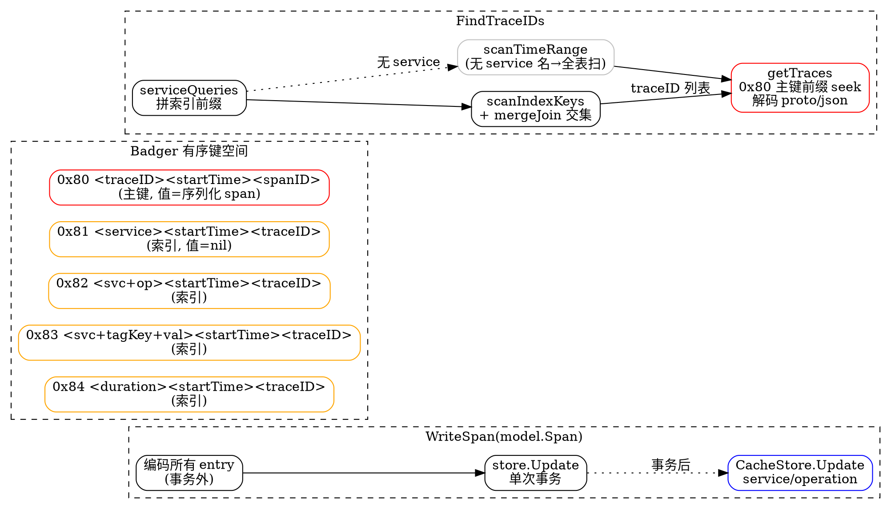

# Jaeger 默认嵌入式后端：Badger 的 v1 spanstore 实现

> 源码基线：Jaeger **v2.23.0**（`E:/Projects/jaeger-2.23.0`）。本文聚焦 Badger 后端，所有结论来自 `internal/storage/v2/badger/` 与 `internal/storage/v1/badger/` 的真实源码，凡与直觉冲突者以源码为准。

## Introduction

[Storage](/docs/CS/Distributed/Tracing/Jaeger/Storage.md) 里已经点明一个反直觉事实：Badger 是「披着 v2 外衣的 v1」——`storageconfig.CreateTraceStorageFactory` 只直建原生 v2 工厂，而全局唯一调用 `v1adapter.NewTraceWriter/Reader` 的点就在 Badger 的 v2 工厂里。本文把它拆到底：**v2 的 Badger 工厂只有 66 行，是个纯转发壳；真正的写入/索引/查询逻辑全都躺在 `internal/storage/v1/badger/spanstore` 里**，用 `model.Span`（不是 `ptrace.Traces`）作为写入单位。

这反而让 Badger 成为理解「一个追踪后端如何在通用 K/V 上手工搭出二级索引」的最佳样本——它不依赖任何列式/搜索引擎特性，纯粹靠 **BigEndian 有序键 + 多前缀二级索引 + Badger 原生 TTL** 拼出一套能用的 trace 存储与检索。

## v2 工厂：66 行转发壳

v2 Badger 工厂结构体只持有一个 v1 工厂指针，所有 `CreateXxx` 都委托给 v1 再裹一层 `v1adapter`：

```go
// internal/storage/v2/badger/factory.go
type Factory struct {
    v1Factory *badger.Factory
}
```

```go
// internal/storage/v2/badger/factory.go
func (f *Factory) CreateTraceWriter() (tracestore.Writer, error) {
    v1Writer, _ := f.v1Factory.CreateSpanWriter() // error is always nil
    return v1adapter.NewTraceWriter(v1Writer), nil
}
func (f *Factory) CreateTraceReader() (tracestore.Reader, error) {
    v1Reader, _ := f.v1Factory.CreateSpanReader() // error is always nil
    return v1adapter.NewTraceReader(v1Reader), nil
}
```

所以「Badger 是 v2 接口、v1 实现」不是比喻，是源码字面事实：v2 这一层只负责把 v1 的 `spanstore.Writer/Reader` 用 `v1adapter` 包成 `tracestore.Writer/Reader`，让上层 [Query](/docs/CS/Distributed/Tracing/Jaeger/Query.md) 与 [Ingestion](/docs/CS/Distributed/Tracing/Jaeger/Ingestion.md) 无感知地调用。

## v1 工厂：开库、后台 GC、读写分工

v1 `Factory` 包一个 `*badger.DB` 和一个 `CacheStore`：

```go
// internal/storage/v1/badger/factory.go (节选)
opts := badger.DefaultOptions("")
if f.Config.Ephemeral {
    opts.SyncWrites = false
    dir, _ := os.MkdirTemp("", "badger")   // 内存盘，临时目录
    f.tmpDir = dir
    opts.Dir = f.tmpDir; opts.ValueDir = f.tmpDir
} else {
    initializeDir(f.Config.Directories.Keys)
    initializeDir(f.Config.Directories.Values)
    opts.SyncWrites = f.Config.SyncWrites
    opts.Dir = f.Config.Directories.Keys; opts.ValueDir = f.Config.Directories.Values
    opts.ReadOnly = f.Config.ReadOnly
}
store, err := badger.Open(opts)
```

`Initialize` 还起了两个后台 goroutine：一个跑 `maintenance()`（周期性 `RunValueLogGC(0.5)` 回收 value log），一个跑 `metricsCopier()`（把 Badger 的 expvar 指标搬到 Jaeger 的 metrics）：

```go
// internal/storage/v1/badger/factory.go
f.bgWg.Add(2)
go func() { defer f.bgWg.Done(); f.maintenance() }()
go func() { defer f.bgWg.Done(); f.metricsCopier() }()
```

读写分工很清晰：span reader 用 `spanstoremetrics.NewReaderDecorator` 包一层指标，依赖 reader 构造时 `prefillCache=true` 预热缓存：

```go
// internal/storage/v1/badger/factory.go (节选)
func (f *Factory) CreateSpanReader() (spanstore.Reader, error) {
    tr := badgerstore.NewTraceReader(f.store, f.cache, true)
    return spanstoremetrics.NewReaderDecorator(tr, f.metricsFactory), nil
}
func (f *Factory) CreateSpanWriter() (spanstore.Writer, error) {
    return badgerstore.NewSpanWriter(f.store, f.cache, f.Config.TTL.Spans), nil
}
func (f *Factory) CreateDependencyReader() (dependencystore.Reader, error) {
    sr, _ := f.CreateSpanReader()
    return depstore.NewDependencyStore(sr), nil   // 依赖 reader 直接复用 span reader
}
```

注意 `CreateDependencyReader` **复用 span reader**——Badger 没有独立的依赖存储，依赖图是在查询时由 span reader 现算的（见 `dependencystore` 包）。`CreateLock` 返回一个进程内 `&lock{}`，说明 Badger 的「分布式锁」只是本地内存锁——它本身是单机嵌入后端，不假设多副本竞争。

## 键设计：BigEndian 有序键 + 多前缀二级索引

Badger 只是个有序 K/V，所以「索引」全靠键的字节排布手工编码。前缀常量就说明了分工：

```go
// internal/storage/v1/badger/spanstore/writer.go
const (
    spanKeyPrefix         byte = 0x80 // 所有 span 主键首位为 1
    indexKeyRange         byte = 0x0F // 二级索引只用末 4 位
    serviceNameIndexKey   byte = 0x81
    operationNameIndexKey byte = 0x82
    tagIndexKey           byte = 0x83
    durationIndexKey      byte = 0x84
    jsonEncoding          byte = 0x01
    protoEncoding         byte = 0x02 // 默认编码
    defaultEncoding       byte = protoEncoding
)
```

**主键**（存真实 span 数据）：

```go
// internal/storage/v1/badger/spanstore/writer.go (节选)
// KEY: ti<trace-id><startTime><span-id>  VALUE: 序列化后的 span
key = make([]byte, 1+sizeOfTraceID+8+8)
key[0] = spanKeyPrefix                       // 0x80
binary.BigEndian.PutUint64(key[1:],  span.TraceID.High)
binary.BigEndian.PutUint64(key[9:],  span.TraceID.Low)
binary.BigEndian.PutUint64(key[17:], startTime)   // 大端排序保证按时间有序
binary.BigEndian.PutUint64(key[25:], uint64(span.SpanID))
```

**二级索引键**（值为空，纯为扫描存在）：`indexKey<indexValue><startTime><traceId>`，前缀 `0x81~0x84` 区分索引类型。所有整数字段 BigEndian，于是一次前缀 scan 就能按 `<索引值, 时间>` 顺序遍历，范围查询直接落在键序上。

```go
// internal/storage/v1/badger/spanstore/writer.go (节选)
func createIndexKey(indexPrefixKey byte, value []byte, startTime uint64, traceID model.TraceID) []byte {
    key := make([]byte, 1+len(value)+8+sizeOfTraceID)
    key[0] = (indexPrefixKey & indexKeyRange) | spanKeyPrefix
    // ... copy value, startTime, traceID.High, traceID.Low (全部 BigEndian)
}
```

写入时，一个 span 会被展开成「1 条主键 + serviceName 索引 + operationName 索引 + duration 索引 + 每个 tag 一条索引 + process tags + 每条 log 的每个 field 一条索引」：

```go
// internal/storage/v1/badger/spanstore/writer.go (节选)
func (w *SpanWriter) WriteSpan(_ context.Context, span *model.Span) error {
    expireTime := uint64(time.Now().Add(w.ttl).Unix())   // Badger 原生 TTL
    startTime  := model.TimeAsEpochMicroseconds(span.StartTime)
    entriesToStore := make([]*badger.Entry, 0, len(span.Tags)+4+len(span.Process.Tags)+len(span.Logs)*4)
    entriesToStore = append(entriesToStore,
        trace,                                                          // 主键（含 span 值）
        w.createBadgerEntry(createIndexKey(serviceNameIndexKey,   []byte(span.Process.ServiceName), startTime, span.TraceID), nil, expireTime),
        w.createBadgerEntry(createIndexKey(operationNameIndexKey, []byte(span.Process.ServiceName+span.OperationName), startTime, span.TraceID), nil, expireTime),
    )
    // duration 索引值本身就是 8 字节 BigEndian 时长，便于范围扫描
    binary.BigEndian.PutUint64(durationValue, uint64(model.DurationAsMicroseconds(span.Duration)))
    entriesToStore = append(entriesToStore, w.createBadgerEntry(createIndexKey(durationIndexKey, durationValue, startTime, span.TraceID), nil, expireTime))
    for _, kv := range span.Tags { // 每个 tag 一条索引键，value=nil
        entriesToStore = append(entriesToStore, w.createBadgerEntry(createIndexKey(tagIndexKey, []byte(span.Process.ServiceName+kv.Key+kv.AsString()), startTime, span.TraceID), nil, expireTime))
    }
    // ... process tags、logs 同样展开
    err = w.store.Update(func(txn *badger.Txn) error {           // 单个事务批量写
        for i := range entriesToStore { if err = txn.SetEntry(entriesToStore[i]); err != nil { return err } }
        return nil
    })
    w.cache.Update(span.Process.ServiceName, span.OperationName, expireTime) // 事务外刷缓存
    return err
}
```

两个值得记住的设计点：

1. **TTL 是 Badger 原生能力**：每条 entry 的 `ExpiresAt = now + ttl`，所以「数据保留 N 天」不是定时清理任务，而是 Badger 在 compaction 时自动丢弃过期键。`maintenance()` 的 `RunValueLogGC` 只是顺手回收 value log 空间。
2. **编码与事务分离**：所有键/值编码都在 `store.Update` 之外完成，事务内只做 `SetEntry`；缓存刷新放在事务**之后**，尽量缩短持锁窗口。键的编码注释还明说「这套键结构也能搬到 RocksDB」——它是与具体 K/V 解耦的通用方案。

## 读路径：索引扫描 + merge-join，无服务名则全表扫描

`FindTraceIDs` 是查询核心。它先校验（**service name 必填**，否则 `ErrServiceNameNotSet`），再把查询翻译成一组索引前缀 seek，最后做交集：

```go
// internal/storage/v1/badger/spanstore/reader.go (节选)
func (r *TraceReader) FindTraceIDs(_ context.Context, query *spanstore.TraceQueryParameters) ([]model.TraceID, error) {
    if err := validateQuery(query); err != nil { return nil, err }   // service name / 时间范围 必填
    setQueryDefaults(query)
    indexSeeks := make([][]byte, 0, 1)
    indexSeeks = serviceQueries(query, indexSeeks)                    // 拼 service/tag/operation 索引键前缀
    // duration 走独立范围扫描，结果作为 hash 过滤集
    if query.DurationMax != 0 || query.DurationMin != 0 {
        plan.hashOuter = r.durationQueries(plan, query)
    }
    if len(indexSeeks) > 0 {
        return r.indexSeeksToTraceIDs(plan, indexSeeks)               // 索引交集
    }
    return r.scanTimeRange(plan)                                     // 无 service 名 → 全表扫描
}
```

`serviceQueries` 把查询条件拼成对应前缀的索引键（serviceName、service+operation、或 service+tagKey+tagValue）：

```go
// internal/storage/v1/badger/spanstore/reader.go (节选)
func serviceQueries(query *spanstore.TraceQueryParameters, indexSeeks [][]byte) [][]byte {
    if query.ServiceName != "" {
        for k, v := range query.Tags {
            tagSearchKey := append([]byte{tagIndexKey}, []byte(query.ServiceName+k+v)...)
            indexSeeks = append(indexSeeks, tagSearchKey)
        }
        if query.OperationName != "" {
            indexSearchKey = append(indexSearchKey, operationNameIndexKey)
            indexSearchKey = append(indexSearchKey, []byte(query.ServiceName+query.OperationName)...)
        } else if !tagQueryUsed {
            indexSearchKey = append(indexSearchKey, serviceNameIndexKey)
            indexSearchKey = append(indexSearchKey, []byte(query.ServiceName)...)
        }
        ...
    }
    return indexSeeks
}
```

多个索引条件（比如 serviceName + tagA + tagB）各扫出一组有序 traceID，再用**归并连接（merge-join）**求交集：

```go
// internal/storage/v1/badger/spanstore/reader.go (节选)
// 从最后一个索引往前扫，每扫一组和已合并结果做归并连接
for i := len(indexSeeks) - 1; i > 0; i-- {
    indexResults, _ := r.scanIndexKeys(indexSeeks[i], plan)
    slices.SortFunc(indexResults, bytes.Compare)
    // 去重同 traceID
    ...
    if plan.mergeOuter == nil { plan.mergeOuter = innerIDs } else { plan.mergeOuter = mergeJoinIds(plan.mergeOuter, innerIDs) }
}
```

```go
// internal/storage/v1/badger/spanstore/reader.go (节选)
func mergeJoinIds(left, right [][]byte) [][]byte {   // 两个有序切片求交集
    for r, l := 0, 0; r <= rMax && l <= lMax; {
        switch bytes.Compare(left[l], right[r]) {
        case 1:  r++
        case -1: l++
        default: merged = append(merged, left[l]); l++; r++   // 命中即合并
        }
    }
    return merged
}
```

关键反直觉点：**没有 service name 的查询会退化成全表扫描**。`scanTimeRange` 注释自己写着「We need to do a full table scan」，遍历所有 `0x80` 前缀主键、按时间戳过滤、再按 traceID 去重：

```go
// internal/storage/v1/badger/spanstore/reader.go (节选)
func (r *TraceReader) scanTimeRange(plan *executionPlan) ([]model.TraceID, error) {
    startIndex := []byte{spanKeyPrefix}   // 0x80
    for it.Seek(startIndex); it.ValidForPrefix(startIndex); it.Next() {
        // 解析 key 中的 timestamp 与 traceID，按时间范围过滤、按 traceID 去重
        ...
    }
}
```

这也正好解释了 [Query](/docs/CS/Distributed/Tracing/Jaeger/Query.md) 里 `QueryService.checkServiceName` / `SearchWithoutServiceName` 的存在意义：Badger 的 `SearchCapabilities` 会声明它**不支持无服务名搜索**，于是 `QueryService` 直接在上层拒绝这类请求，而不是把全表扫描的代价甩给用户。二级索引是「有服务名前缀」才能有效命中，这是 Badger 作为嵌入式后端与 Cassandra/ES 在能力上的真实差距。

拿到 traceID 后，`getTraces` 按主键前缀 `0x80 | traceID` 做一次 seek 迭代，把所有 span 解码出来拼成 `model.Trace`——因为主键里带了 `startTime` 与 `spanID` 且 BigEndian，迭代顺序天然就是正确的 span 顺序：

```go
// internal/storage/v1/badger/spanstore/reader.go (节选)
func (r *TraceReader) getTraces(traceIDs []model.TraceID) ([]*model.Trace, error) {
    for _, traceID := range traceIDs {
        prefixes = append(prefixes, createPrimaryKeySeekPrefix(traceID))  // 0x80 | traceID.High | traceID.Low
    }
    err := r.store.View(func(txn *badger.Txn) error {
        for _, prefix := range prefixes {
            for it.Seek(prefix); it.ValidForPrefix(prefix); it.Next() {
                sp, _ := decodeValue(val, item.UserMeta()&encodingTypeBits)  // proto/json 按 UserMeta 解
                spans = append(spans, sp)
            }
        }
    })
}
```

## CacheStore：服务名/操作名的写穿透缓存

`GetServices` / `GetOperations` 不扫库，全走内存 `CacheStore`——它是一层写穿透、读时惰性过期的缓存：

```go
// internal/storage/v1/badger/spanstore/cache.go
type CacheStore struct {
    cacheLock  sync.Mutex
    services   map[string]uint64              // value = 过期时间（unix 秒）
    operations map[string]map[string]uint64
    store *badger.DB
    ttl   time.Duration
}
```

写入时 `Update` 直接覆盖，`AddService`/`AddOperation` 取**最大**过期时间（让存活最久的索引项决定缓存条目寿命）；读取时若发现已过期则顺手删除再返回：

```go
// internal/storage/v1/badger/spanstore/cache.go (节选)
func (c *CacheStore) Update(service, operation string, expireTime uint64) {
    c.cacheLock.Lock()
    c.services[service] = expireTime
    if _, ok := c.operations[service]; !ok { c.operations[service] = make(map[string]uint64) }
    c.operations[service][operation] = expireTime
    c.cacheLock.Unlock()
}
```

```go
// internal/storage/v1/badger/spanstore/cache.go (节选)
func (c *CacheStore) GetServices() ([]string, error) {
    // 遍历 services，过期则 delete，未过期则收集，最后排序返回
    ...
}
```

reader 构造时 `prefillCache=true`，会 `preloadServices` / `preloadOperations` 扫一遍 `0x81` / `0x82` 索引前缀把缓存预热，之后写路径持续 `Update` 维护——所以「列出所有服务/操作」这个高频且对实时性不敏感的请求，永远不碰主存储。

## 键空间布局图



## 与已落笔记的呼应

- [Storage](/docs/CS/Distributed/Tracing/Jaeger/Storage.md)：本文是「Badger 靠 `v1adapter` 顶 v1 老壳」的落地证据链——v2 工厂只做转发，真实实现是 v1 `spanstore`。
- [Query](/docs/CS/Distributed/Tracing/Jaeger/Query.md)：Badger 的 `SearchCapabilities` 声明不支持无服务名搜索，于是 `QueryService` 在上层拒绝；v1 reader 返回的 `model.Trace` 经 `v1adapter.V1TracesFromSeq2` 转成 `ptrace.Traces` 流给 v3、转成 `[]*model.Span` 给 v1 老客户端。
- [Ingestion](/docs/CS/Distributed/Tracing/Jaeger/Ingestion.md)：`jaeger_storage_exporter` 写出的 `ptrace.Traces` 经 `v1adapter` 转回 `model.Span` 后才进入本页的 `WriteSpan`。
- [Jaeger 架构](/docs/CS/Distributed/Tracing/Jaeger.md)：「v1/v2 双栈」在存储与查询两端闭合——Badger 是这套双栈里 v1 残留最重的一块。

## Links

- [Jaeger 存储抽象](/docs/CS/Distributed/Tracing/Jaeger/Storage.md) — v2 `tracestore.Factory` 契约、Badger 的 v1adapter 桥接
- [Jaeger 查询服务](/docs/CS/Distributed/Tracing/Jaeger/Query.md) — `QueryService` 能力协商、v1/v3 双 API
- [Jaeger 摄入管线](/docs/CS/Distributed/Tracing/Jaeger/Ingestion.md) — `jaeger_storage_exporter` 如何把 ptrace 写进 Badger
- [Jaeger 采样体系](/docs/CS/Distributed/Tracing/Jaeger/Sampling.md) — 采样与存储正交
- [Jaeger 源码实现总览](/docs/CS/Distributed/Tracing/Jaeger.md) — v2 进程模型与双栈
- [Zipkin 源码实现](/docs/CS/Distributed/Tracing/Zipkin/Architecture.md) — 对照 Zipkin 的内存索引设计

## References

- `internal/storage/v2/badger/factory.go` — v2 Badger 工厂，纯转发壳（`v1adapter` 包裹 v1）
- `internal/storage/v1/badger/factory.go` — v1 工厂：开库、ValueLogGC 后台、读写分工、进程内锁
- `internal/storage/v1/badger/spanstore/writer.go` — 键编码常量、`WriteSpan` 多索引展开、Badger 原生 TTL
- `internal/storage/v1/badger/spanstore/reader.go` — `FindTraceIDs`（索引 seek + merge-join）、`scanTimeRange` 全表扫、`getTraces` 主键 seek
- `internal/storage/v1/badger/spanstore/cache.go` — `CacheStore` 写穿透缓存（service/operation 惰性过期）
- Jaeger v2 source: `E:/Projects/jaeger-2.23.0`
