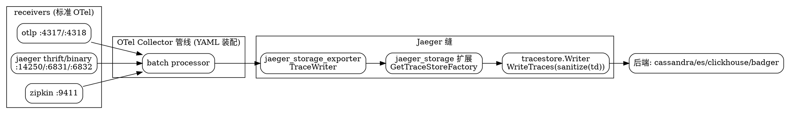

# Jaeger Ingestion: The OTLP Pipeline and Its Jaeger-Specific Seam

## Introduction

Jaeger v2 的「接收」环节基本就是一段标准的 OpenTelemetry Collector 管线，写在 YAML 里、由 Collector 的 service builder 装配，Jaeger 自己几乎不手搓组件。真正 Jaeger 特有的只有两处：**`jaeger_storage` 扩展**（存储注册表，见 [Jaeger 存储抽象](/docs/CS/Distributed/Tracing/Jaeger/Storage.md)）和 **`jaeger_storage_exporter`**（把 OTel 管线里的 `ptrace.Traces` 桥接到 v2 存储抽象的写器）。这一节把默认 all-in-one 的管线拆开，看清「标准件」和「Jaeger 缝」分别在哪里。

> 基线：`E:/Projects/jaeger-2.23.0`（tag v2.23.0）。下文讲解直接贴真实源码，路径相对仓库根，不再标注行号。

## The Pipeline Is Declarative YAML

all-in-one 的 traces 管线只有三截，全程是 OTel Collector 的原语：

```yaml
# cmd/jaeger/internal/all-in-one.yaml
service:
  extensions: [jaeger_storage, jaeger_query, remote_sampling, healthcheckv2, expvar, zpages]
  pipelines:
    traces:
      receivers: [otlp, jaeger, zipkin]
      processors: [batch]
      exporters: [jaeger_storage_exporter]
```

`receivers` / `processors` / `exporters` 这些名字、以及它们如何被 Collector 拼成一条处理链，都来自 OTel Collector 内核——Jaeger 只是把组件注册进 `components.go`（OTel Collector 的 `MakeFactoryMap`），并不自己写装配逻辑。换句话说，**「管线怎么串」是 OTel 的事，「往哪存、怎么查」才是 Jaeger 的事**。

## Multi-Protocol Receivers: One Binary Eats Everything

接收端同时挂了三套 receiver，意味着同一个 all-in-one 进程既能吃 OTLP，也能吃 Jaeger 自己的老 thrift 协议、还能吃 Zipkin 格式：

```yaml
# cmd/jaeger/internal/all-in-one.yaml
receivers:
  otlp:
    protocols:
      grpc:  { endpoint: "...:4317" }
      http:  { endpoint: "...:4318" }
  jaeger:                                  # 老 jaeger 客户端 / agent
    protocols:
      grpc:          { endpoint: "...:14250" }
      thrift_http:   { endpoint: "...:14268" }
      thrift_binary: { endpoint: "...:6832" }
      thrift_compact:{ endpoint: "...:6831" }
  zipkin:
    endpoint: "...:9411"
```

`otlp` / `jaeger` / `zipkin` 这三个 receiver 都是 OTel Collector contrib 提供的标准件，经 `components.go` 重新导出，并非 Jaeger 自研。这一点很关键：Jaeger v2 在摄入侧对外**保持全协议兼容**（legacy 客户端、Zipkin 生态都不用改），而对内统一收敛成 `ptrace.Traces` 后再往下走。

## The Batch Processor: Standard Middleware

`processors: [batch]` 用的就是 OTel Collector 自带的 batch processor（按大小/时间攒批）。它也是标准件，Jaeger 没有定制。生产配置里通常会在这个位置再插入 `tail_sampling` 之类的处理器（见 `config-tail-sampling-*.yaml`），但默认 all-in-one 为了简单只留了 batch。

## The Storage Exporter: The Jaeger Seam

管线最后一段 `jaeger_storage_exporter` 才是 Jaeger 自己的零件，也是 OTel 世界与 Jaeger 存储世界的交界。它的配置极简——只声明往哪个后端写：

```yaml
# cmd/jaeger/internal/all-in-one.yaml
exporters:
  jaeger_storage_exporter:
    trace_storage: some_storage   # 对应 jaeger_storage.backends 里的名字
```

启动阶段，exporter 的 `TraceWriter.Start` 拿着这个名字，从 host 上的 `jaeger_storage` 扩展反查出工厂，再建出 v2 写器——这一步把 YAML 里的字符串和 P0 讲的存储抽象接上了：

```go
// cmd/jaeger/internal/exporters/storageexporter/exporter.go
func (w *TraceWriter) Start(_ context.Context, host component.Host) error {
	f, err := jaegerstorage.GetTraceStoreFactory(w.config.TraceStorage, host)
	if err != nil { return fmt.Errorf("cannot find storage factory: %w", err) }
	if w.storage, err = f.CreateTraceWriter(); err != nil { ... }
	return nil
}
```

真正的写入只有一行——先 `sanitizer` 清洗，再交给 v2 写器：

```go
// cmd/jaeger/internal/exporters/storageexporter/exporter.go
func (w *TraceWriter) WriteTraces(ctx context.Context, td ptrace.Traces) error {
	return w.storage.WriteTraces(ctx, w.sanitizer(td))
}
```

`sanitizer` 来自 `internal/jptrace/sanitizer`，负责修补不合规的 span（去重 process、纠正非法字段等）。它特意被设计成**可被导出复用**——注释里点明，像死信重路由的 connector 这类需要「走和 exporter 一模一样的写路径」的组件，可以直接拿这个 `TraceWriter` 去解析存储并写入，保证行为一致。

## A Subtle Efficiency Guard

`warnMisalignedSyncBatchSizing`（exporter.go）暴露了一个容易被忽略的细节：当后端是**同步、按字节封顶**的存储（如 Elasticsearch 的 `write_mode: sync`），而 exporter 的字节型 `queue.batch.max_size` 又超过 writer 单请求上限的一半时，writer 会把一个 batch 拆成多个 `_bulk` 请求。这**不影响正确性**——失败整批重试，且 span 带确定性 `_id`（RFC 0007 §4.7），重发是 upsert 而非重复；只是浪费。所以这个检查只打 warning 不阻断。这条告警本身说明 Jaeger v2 的 ES 写入存在同步/异步两种模式，且靠确定性 `_id` 保证重试幂等。

## Production Variations

all-in-one 是最小可用管线。真实生产配置（`config.yaml`、`config-cassandra.yaml`、`config-kafka-*.yaml` 等）只是在这套骨架上增删 receiver/processor/extension：

- 加 `tail_sampling` processor 做尾部采样（与 [Jaeger 采样体系](/docs/CS/Distributed/Tracing/Jaeger/Sampling.md) 的 head sampling 闭环正交）。
- 用 `kafka` exporter + `kafkaingester` 在 collector 与存储之间削峰（`config-kafka-ingester.yaml`）。
- 切不同的 `jaeger_storage` 后端（Cassandra / ES / ClickHouse / Badger）。

但无论怎么变，**receiver→(processors)→jaeger_storage_exporter→jaeger_storage 工厂→tracestore.Writer** 这条主干不变。

## Mental Model



一句话总结：**摄入侧是标准 OTel Collector 管线，Jaeger 只在末尾用 `jaeger_storage_exporter` 这一道缝把 `ptrace.Traces` 接进自己的 v2 存储抽象**；多协议 receiver 保证老客户端和 Zipkin 生态零改动接入。

## Links

- [Jaeger 源码实现总览](/docs/CS/Distributed/Tracing/Jaeger.md)
- [Jaeger 存储抽象](/docs/CS/Distributed/Tracing/Jaeger/Storage.md)
- [Jaeger 采样体系](/docs/CS/Distributed/Tracing/Jaeger/Sampling.md)
- [Zipkin 源码实现](/docs/CS/Distributed/Tracing/Zipkin/Architecture.md)

## References

- all-in-one pipeline: `cmd/jaeger/internal/all-in-one.yaml`
- storage exporter (the Jaeger seam): `cmd/jaeger/internal/exporters/storageexporter/exporter.go`
- Component registry (standard OTel receivers re-exported): `cmd/jaeger/internal/components.go`
- OTel Collector pipelines / batch processor: <https://opentelemetry.io/docs/collector/>
