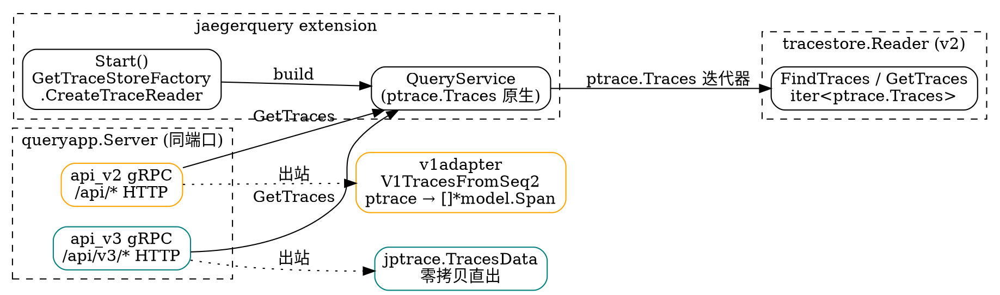

# Jaeger 查询服务：v1/v3 双 API 同端口并存

> 源码基线：Jaeger **v2.23.0**（`E:/Projects/jaeger-2.23.0`）。本文所有结论均来自 `cmd/jaeger/internal/extension/jaegerquery/` 与 `internal/storage/v2/api/tracestore` 的真实源码，凡与社区文档/直觉冲突者以源码为准。

## Introduction

之前几篇已经把 Jaeger 的存储双栈（[Storage](/docs/CS/Distributed/Tracing/Jaeger/Storage.md)）、采样闭环（[Sampling](/docs/CS/Distributed/Tracing/Jaeger/Sampling.md)）、摄入管线（[Ingestion](/docs/CS/Distributed/Tracing/Jaeger/Ingestion.md)）拆开了。本篇聚焦「读」的一端：**查询服务**。

Jaeger v2 的查询不是独立进程，而是名为 `jaegerquery` 的 collector extension。它最大的反直觉点是：**同一个端口上同时跑着两套 API 协议**——祖传的 `api_v2`（gRPC）+ `/api/*`（HTTP），和全新的 `api_v3`（gRPC）+ `/api/v3/*`（HTTP）。它们共享同一个 `QueryService`，但**对存储返回的数据做了完全不同的处理**：v3 把 `ptrace.Traces` 原样送出，v1 则必须把 `ptrace.Traces` 重新转回祖传的 `[]*model.Span` 才能喂给老客户端。

这个「转回 model.Span」的动作，正是 [Jaeger 架构](/docs/CS/Distributed/Tracing/Jaeger.md) 里说的「v1 双栈」在**查询侧**的落点——存储层早已是 v2（ptrace）原生，所谓 v1 只剩一层协议适配外壳。

## jaegerquery：一个把 reader 包成 HTTP/gRPC 服务的 extension

`jaegerquery` 在 `Start` 时只做一件事：从 `jaegerstorage` 取到 trace reader，就地搭一个 `QueryService`，再交给 `queryapp.Server` 监听端口。注意它**显式声明依赖** `jaegerstorage.ID` 和配置的 query-interceptor，保证自己启动前依赖方已经 `Start` 完：

```go
// cmd/jaeger/internal/extension/jaegerquery/server.go
tf, err := jaegerstorage.GetTraceStoreFactory(s.config.Storage.TracesPrimary, host)
if err != nil {
    return fmt.Errorf("cannot find factory for trace storage %s: %w", s.config.Storage.TracesPrimary, err)
}
traceReader, err := tf.CreateTraceReader()
if err != nil {
    return fmt.Errorf("cannot create trace reader: %w", err)
}
```

```go
// cmd/jaeger/internal/extension/jaegerquery/server.go
qs := querysvc.NewQueryService(traceReader, depReader, opts)
```

这就和 [Storage](/docs/CS/Distributed/Tracing/Jaeger/Storage.md) 里 `jaeger_storage` 工厂的契约对上了：`jaegerquery` 自己不碰任何具体后端，只读 `tracestore.Reader`。无论底层是原生 v2（Cassandra/ES/ClickHouse）还是被 `v1adapter` 包成 v2 的 Badger，对查询层来说都是同一个 `tracestore.Reader` 接口。

## QueryService：完全 ptrace 原生，model 不在核心逻辑里

`NewQueryService` 把 reader 和一组 `StandardAdjusters`（时钟偏移修正、span 排序、ID 去重等）收进结构体，**内部全程只有 `ptrace.Traces`**：

```go
// cmd/jaeger/internal/extension/jaegerquery/querysvc/service.go
func NewQueryService(traceReader tracestore.Reader, dependencyReader depstore.Reader, options QueryServiceOptions) *QueryService {
    qsvc := &QueryService{
        traceReader:      traceReader,
        dependencyReader: dependencyReader,
        adjuster: adjuster.Sequence(
            adjuster.StandardAdjusters(options.MaxClockSkewAdjust)...,
        ),
        options: options,
    }
    return qsvc
}
```

`GetTraces` 直接消费 storage 返回的 `iter.Seq2[[]ptrace.Traces, error]`，在 `receiveTraces` 里按需做聚合与 adjuster（除非 `RawTraces`），并支持**主存储命中不到时回落到归档存储**：

```go
// cmd/jaeger/internal/extension/jaegerquery/querysvc/service.go (节选)
func (qs QueryService) GetTraces(ctx context.Context, params GetTraceParams) iter.Seq2[[]ptrace.Traces, error] {
    getTracesIter := qs.interceptTraceResults(ctx, qs.traceReader.GetTraces(ctx, params.TraceIDs...))
    return func(yield func([]ptrace.Traces, error) bool) {
        foundTraceIDs, proceed := qs.receiveTraces(getTracesIter, yield, params.RawTraces)
        if proceed && qs.options.ArchiveTraceReader != nil {
            // 把主存储没命中的 traceID 收集起来，去归档 reader 再查一遍
            ...
        }
    }
}
```

一个有意思的**能力协商**设计：查询服务不直接假设后端能做什么，而是每次都问 reader 的 `SearchCapabilities`。reader 答不上来（返回 `errors.ErrUnsupported`）就按「最弱后端」降级处理：

```go
// cmd/jaeger/internal/extension/jaegerquery/querysvc/service.go
func (qs QueryService) readerSearchCapabilitiesOrDefault(ctx context.Context) tracestore.SearchCapabilities {
    caps, err := qs.traceReader.SearchCapabilities(ctx)
    if err != nil {
        caps = tracestore.SearchCapabilities{}  // 当成最弱后端
    }
    return caps
}
```

`FindTraceSummaries` 更狠——如果 reader 声明自己算不了 summary（首个错误是 `errors.ErrUnsupported` 且无具体 reason），它会**透明回落到 `FindTraces` 把所有 trace 拉回来自己聚合**：

```go
// cmd/jaeger/internal/extension/jaegerquery/querysvc/service.go (节选)
for chunk, err := range qs.traceReader.FindTraceSummaries(ctx, readerQuery) {
    if err != nil {
        if errors.Is(err, errors.ErrUnsupported) && tracestore.ErrorReason(err) == "" {
            // 回落：FindTraces + 本地 computeSummaries
            traces := qs.interceptTraceResults(ctx, qs.traceReader.FindTraces(ctx, readerQuery))
            for b, e := range computeSummaries(traces, qs.adjuster) { ... }
            return
        }
        ...
    }
}
```

这种「能力声明 + 优雅降级」是 v2 查询层和 v1 最大的架构差异之一：v1 时代每个后端自己实现一套固定语义的 `QueryService`，v2 把语义收敛到 `QueryService`，把能力差异下推到 `tracestore.Reader` 的 `SearchCapabilities`。

## 双 API 在 server.go 里并排注册

`queryapp.Server` 同时起 HTTP 和 gRPC。gRPC 那边一次性把三套服务都挂上同一个 server：

```go
// cmd/jaeger/internal/extension/jaegerquery/internal/server.go (节选)
func registerGRPCHandlers(server *grpc.Server, querySvc *querysvc.QueryService, telset telemetry.Settings) {
    reflection.Register(server)
    handler := NewGRPCHandler(querySvc, GRPCHandlerOptions{Logger: telset.Logger})
    healthServer := health.NewServer()

    api_v2.RegisterQueryServiceServer(server, handler)                              // 祖传 v1 gRPC
    api_v3.RegisterQueryServiceServer(server, &apiv3.Handler{QueryService: querySvc}) // 新 v3 gRPC
    api_v3.RegisterCapabilitiesServer(server, &apiv3.CapabilitiesHandler{QueryService: querySvc})

    healthServer.SetServingStatus("jaeger.api_v2.QueryService", ...)
    healthServer.SetServingStatus("jaeger.api_v3.QueryService", ...)
}
```

HTTP 这边也是两套路由同挂一个 mux：v3 的 HTTP gateway 和祖传的 `apiHandler` 并存，外加 static（UI）、AI、OTLP proxy：

```go
// cmd/jaeger/internal/extension/jaegerquery/internal/server.go (节选)
(&apiv3.HTTPGateway{QueryService: querySvc, ...}).RegisterRoutes(r)
apiHandler.RegisterRoutes(r)   // 祖传 v1 HTTP 端点（/api/* 前缀）
...
cs = append(cs, RegisterStaticHandler(r, telset.Logger, queryOpts, backendCaps))
```

v3 的 HTTP 路由前缀一目了然：

```go
// cmd/jaeger/internal/extension/jaegerquery/internal/apiv3/http_gateway.go
const (
    routeGetTrace      = "/api/v3/traces/{" + paramTraceID + "}"
    routeFindTraces    = "/api/v3/traces"
    routeFindSummaries = "/api/v3/trace-summaries"
    routeFindSpans     = "/api/v3/spans"
    routeGetServices   = "/api/v3/services"
    routeGetOperations = "/api/v3/operations"
    routeCapabilities  = "/api/v3/capabilities"
)
```

## v1 vs v3 处理器：差异只在「是否转回 model.Span」

两套 handler 都从 `QueryService` 拿到 `ptrace.Traces`，但**出网那一刻分道扬镳**。

**v3 handler 原生直出**：`GetTrace` 把迭代器里的 `ptrace.Traces` 直接包成 `jptrace.TracesData` 流出去，没有任何模型转换：

```go
// cmd/jaeger/internal/extension/jaegerquery/internal/apiv3/grpc_handler.go
err = receiveTraces(getTracesIter, func(data *jptrace.TracesData) error {
    traceFound = true
    return stream.Send(data)
})
```

```go
// cmd/jaeger/internal/extension/jaegerquery/internal/apiv3/grpc_handler.go (节选)
func receiveTraces(seq iter.Seq2[[]ptrace.Traces, error], sendFn func(*jptrace.TracesData) error) error {
    for traces, err := range seq {
        ...
        for _, trace := range traces {
            tracesData := jptrace.TracesData(trace)  // 零拷贝别名
            if err := sendFn(&tracesData); err != nil { ... }
        }
    }
    return nil
}
```

**v1 handler 必须转回祖传模型**：同样的 `getTracesIter`，v1 要先过 `v1adapter.V1TracesFromSeq2` 把 `ptrace.Traces` 还原成 `[]*model.Span`，再按每 10 个 span 切块用 `api_v2.SpansResponseChunk` 送出：

```go
// cmd/jaeger/internal/extension/jaegerquery/internal/grpc_handler.go (节选)
getTracesIter := g.queryService.GetTraces(stream.Context(), query)
traces, err := v1adapter.V1TracesFromSeq2(getTracesIter)   // ptrace.Traces -> []*model.Span
if len(traces) == 0 { ... }
for _, trace := range traces {
    if err := g.sendSpanChunks(trace.Spans, stream.Send); err != nil { return err }
}
```

```go
// cmd/jaeger/internal/extension/jaegerquery/internal/grpc_handler.go (节选)
func (g *GRPCHandler) sendSpanChunks(spans []*model.Span, sendFn func(*api_v2.SpansResponseChunk) error) error {
    chunk := make([]model.Span, 0, len(spans))
    for i := 0; i < len(spans); i += maxSpanCountInChunk {   // maxSpanCountInChunk = 10
        ...
        if err := sendFn(&api_v2.SpansResponseChunk{Spans: chunk}); err != nil { ... }
    }
    return nil
}
```

两侧还有一个共同的边界动作：入站的老式 `model.TraceID`（v1 协议里字符串或 `model.TraceID`）都要用 `v1adapter.FromV1TraceID` 转成 `pcommon.TraceID` 才能进 `QueryService`。所以「v1 模型」只在 **两个边界** 出现：入站按 ID 查、出站按 span 回放；中间整条链路全是 `ptrace.Traces`。

```go
// cmd/jaeger/internal/extension/jaegerquery/internal/grpc_handler.go (节选)
query := querysvc.GetTraceParams{
    TraceIDs: []tracestore.GetTraceParams{
        { TraceID: v1adapter.FromV1TraceID(r.TraceID), Start: r.StartTime, End: r.EndTime },
    },
    RawTraces: r.RawTraces,
}
```

```go
// cmd/jaeger/internal/extension/jaegerquery/internal/apiv3/grpc_handler.go (节选)
query := querysvc.GetTraceParams{
    TraceIDs: []tracestore.GetTraceParams{
        { TraceID: v1adapter.FromV1TraceID(traceID), Start: request.GetStartTime(), End: request.GetEndTime() },
    },
    RawTraces: request.GetRawTraces(),
}
```

> 一句话总结双栈在查询侧的本质：**v3 是 ptrace 的母语，v1 是一层把 ptrace 翻译成祖传 model 的外交翻译**。这层翻译的成本（反序列化 ptrace、重建 model.Span 树、切块）只在老客户端请求时才付出。

## 数据流图



## 与已落笔记的呼应

- [Storage](/docs/CS/Distributed/Tracing/Jaeger/Storage.md)：`jaegerquery.Start` 的 `GetTraceStoreFactory(...).CreateTraceReader()` 正是 `jaeger_storage` 工厂契约的读取端；Badger 经 `v1adapter` 包成 v2 也在这里被一视同仁。
- [Jaeger 架构](/docs/CS/Distributed/Tracing/Jaeger.md)：「v1/v2 双栈」不再是抽象说法——本文给出查询侧的具体落点：`model.Span` 仅存活于 v1 handler 的入/出站边界。
- [Sampling](/docs/CS/Distributed/Tracing/Jaeger/Sampling.md)：查询服务只读主/归档 `tracestore.Reader` 与 `depstore.Reader`，与采样的 head/adaptive 闭环正交；采样决定「存什么」，查询决定「怎么取」。

## Links

- [Jaeger 存储抽象](/docs/CS/Distributed/Tracing/Jaeger/Storage.md) — `jaeger_storage` 工厂契约、`v1adapter` 包 v1 老壳
- [Jaeger 采样体系](/docs/CS/Distributed/Tracing/Jaeger/Sampling.md) — head sampling 闭环，与查询正交
- [Jaeger 摄入管线](/docs/CS/Distributed/Tracing/Jaeger/Ingestion.md) — OTel Collector 管线 + `jaeger_storage_exporter`
- [Jaeger 源码实现总览](/docs/CS/Distributed/Tracing/Jaeger.md) — v2 进程模型与 v1/v2 双栈
- [Zipkin 源码实现](/docs/CS/Distributed/Tracing/Zipkin/Architecture.md) — 对照单进程查询模型
- [SkyWalking 源码实现](/docs/CS/Distributed/Tracing/SkyWalking.md) — 对照 OAP 流式查询

## References

- `cmd/jaeger/internal/extension/jaegerquery/server.go` — extension `Start`/`Dependencies`，reader 获取与 `QueryService` 构建
- `cmd/jaeger/internal/extension/jaegerquery/internal/server.go` — `queryapp.Server`、gRPC/HTTP 双 handler 注册、`/api/v3/*` 路由挂载
- `cmd/jaeger/internal/extension/jaegerquery/querysvc/service.go` — `QueryService` 核心（ptrace 原生、能力协商、归档回落、summary 降级）
- `cmd/jaeger/internal/extension/jaegerquery/internal/grpc_handler.go` — v1 `api_v2` handler（`V1TracesFromSeq2` 转回 model.Span）
- `cmd/jaeger/internal/extension/jaegerquery/internal/apiv3/grpc_handler.go` — v3 `api_v3` handler（原生 `jptrace.TracesData`）
- `cmd/jaeger/internal/extension/jaegerquery/internal/apiv3/http_gateway.go` — v3 HTTP 路由 `/api/v3/*`
- Jaeger v2 source: `E:/Projects/jaeger-2.23.0`
